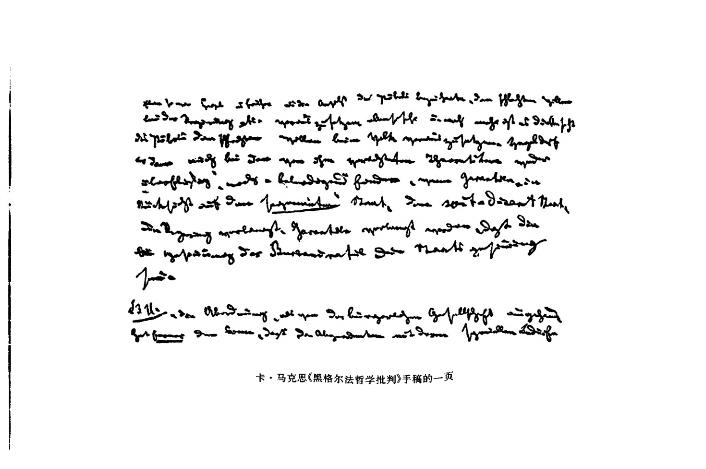

# 黑格尔法哲学批判（附手稿索引）

作者：卡尔·马克思。写作时间：约1843年3月中—9月底；索引约1843年夏—1844年秋。

来源：《马克思恩格斯全集》中文第二版第3卷，人民出版社，2002年10月第2版。书5—158页的已刊存世批判手稿及书159—160页的手稿索引；保留书25页手稿影印和两张空白页，卷末注1—29。原手稿第一帖四页不存，现存从第261节开始，第313节后中断，不能称一部写完的原作。

整理说明：可检索文字来自本地免费 RapidOCR 重新识别，不使用扫描 PDF 的旧乱码文字层；少量识别错字仍可能存在，未声称逐字校勘零错字。文字层按原页保留行序、缩进、空行、双栏的水平位置；着重点、字号、上标及个别排印细节以随页扫描图为准。随文脚注仍位于本页下部，卷末注另列，不将编者注当作者正文。原 PDF、未经修改的 OCR 行框与分数、所列 OCR 修复、逐页原图均保留。OCR 置信度不作为原文正确的证明。 当前检查结论见收集清单。

## 正文 · 书 5 页

<!-- BEGIN OCR PAGE 30 body -->
<section data-source-page="30" data-section="body"><pre style="white-space:pre;overflow-x:auto;font-family:monospace">黑格尔法哲学批判1</pre><table data-source-two-columns="true"><tbody><tr><td style="vertical-align:top"><pre style="white-space:pre;overflow-x:auto;font-family:monospace">卡·马克思大约写于1843年
3月中—9月底

第一次发表于《马克思恩格斯
全集》1927年历史考证版
第1部分第1卷</pre></td><td style="vertical-align:top"><pre style="white-space:pre;overflow-x:auto;font-family:monospace">原文是德文

中文根据(马克思恩格斯全集)
1982年历史考证版第1部分
第2 卷翻译</pre></td></tr></tbody></table></section>
<!-- END OCR PAGE -->

## 正文 · 书 6 页

<!-- BEGIN OCR PAGE 31 body -->
<section data-source-page="31" data-section="body"></section>
<!-- END OCR PAGE -->

本页为空白页。

## 正文 · 书 7 页

<!-- BEGIN OCR PAGE 32 body -->
<section data-source-page="32" data-section="body"><pre style="white-space:pre;overflow-x:auto;font-family:monospace">                   [A.国内法]

    [II.5]第261节：“对私法和私人福利，即对家庭和市民社会2这两个领域来
说，一方面，国家是外在必然性和它们的最高权力，它们的法律和利益都从属并
依存于这种权力的本性；但是，另一方面，国家又是它们的内在目的，国家的力
量在于它的普遍的最终目的和个人的特殊利益的统一，即个人对国家尽多少义
务，同时也就享有多少权利。”

    上一节3已经告诉我们，具体的自由在于(家庭和市民社会的)特
殊利益体系和(国家的)普遍利益体系的同一性(应有的、双重的同一
性)。现在应当更详细地规定这些领域的关系。
    对家庭和市民社会这两个领域来说，一方面，国家是“外在必然
性”，是一种权力，由于这种权力，“法律”和“利益”都“从属并依存于”
国家。国家对家庭和市民社会来说是“外在必然性”，这已经部分地
包含在“过渡”这一范畴中，部分地包含在家庭和市民社会对国家的
被意识到的关系中。对国家的“从属”完全符合这种“外在必然性”的
关系。但是，黑格尔所了解的“依存性”可由这一节附释中的下述论
点来说明：

    “首先是孟德斯鸠考虑到了关于私法的法律也特别依存于国家的一定性质
的思想，以及关于部分只应就它对整体的关系来加以考察这一哲学观点”，
等等。

     因此，黑格尔在这里谈到了私法等等对国家的内在依存性，或者</pre></section>
<!-- END OCR PAGE -->

## 正文 · 书 8 页

<!-- BEGIN OCR PAGE 33 body -->
<section data-source-page="33" data-section="body"><pre style="white-space:pre;overflow-x:auto;font-family:monospace">说，私法等等本质规定依存于国家。但是，他同时又把这种依存性纳
入“外在必然性”的关系，并把它作为另外一个方面而同另一种关系
相对立，在这种关系中，家庭和市民社会把国家作为自己的“内在目
的”来对待。
    “外在必然性”的意思只能理解成这样：当家庭和社会的“法律”
和“利益”同国家的“法律”和“利益”发生冲突时，家庭和社会的“法
律”和“利益”必须依从国家的“法律”和“利益”；它们是从属于国家
的；它们的存在依存于国家的存在；或者还可以说，国家的意志和法
律对家庭和社会的“意志”和“法律”来说是一种必然性。
    然而黑格尔在这里不是谈经验的冲突，他是说“私法和私人福
利，即家庭和市民社会这两个领域”对国家的关系。这里涉及的是这
两个领域本身的本质关系。不仅它们的“利益”，而且连它们的“法
律”、它们的本质规定，都“依存于”国家并“从属于”国家。对它们的
法律和利益来说，国家是“最高权力”；对国家来说，它们的“利益”和
“法律”是国家的“从属者”。它们存在于对国家的“依存性”中。正因
为“从属性”和“依存性”是约束着独立的本质并与这种本质背道而驰
的外在关系，所以“家庭”和“市民社会”对国家的关系是一种“外在必
然性”的关系，一种违反事物内在本质的必然性的关系。正因为“市
民社会和家庭”在其真实的即在其独立的和充分的发展中是作为特
殊的“领域”而成为国家的前提，所以，“私法的法律”依存于“国家的
一定性质”并根据这种性质而变更，这本身就被纳入“外在必然性”的
关系。“从属性”和“依存性”是表示“外在的”、强制的、表面的同一性
的用语，至于它的逻辑用语，则黑格尔正确地使用了“外在必然性”。
在“从属性”和“依存性”这两个概念中，黑格尔进一步发展了双重同
一性中的一个方面，即进一步发展了统一性内部的异化这个方面；</pre></section>
<!-- END OCR PAGE -->

## 正文 · 书 9 页

<!-- BEGIN OCR PAGE 34 body -->
<section data-source-page="34" data-section="body"><pre style="white-space:pre;overflow-x:auto;font-family:monospace">[6]“但是，另一方面，国家又是它们的内在目的，国家的力量在于它
的普遍的最终目的和个人的特殊利益的统一，即个人对国家尽多少
义务，同时也就享有多少权利。”
     黑格尔在这里提出了一个没有解决的二律背反。一方面是外在
必然性；另一方面是内在目的。国家的普遍的最终目的和个人的特
殊利益的统一，据说就在于个人对国家所尽的义务和国家赋予他的
权利是同一的。(因而，例如，尊重财产的义务同对财产的权利是吻
合的。)
     附释对这种同一性作了如下的说明：

    “因为义务首先是我对于某种在我看来是实体性东西、自在自为的普遍东
西的态度；权利则相反，它总是这种实体性东西的定在，从而也是它的特殊性和
我的特殊自由的方面，所以二者在形式阶段上，看来是分配于不同的方面或不
同的人的。国家是伦理的东西，是实体性东西和特殊东西的相互渗透，因此，在
国家中，我在对实体性东西的关系上所受的约束同时是我的特殊自由的定在，
就是说，在国家中，义务和权利结合在同一种关系中。”[7]
    [8]第262节：“现实的观念，精神，把自身分为自已概念的两个理想性的领
域：家庭和市民社会，即分为自己的有限性，以便从这两个领域的理想性中形成
 自为的无限的现实的精神，—现实的观念从而把自已的这种现实性的材料，
把作为群体的各个人，分配于这两个领域，这样，对于单个人来说，这种分配是
通过情况、任意和本身使命的亲自选择为中介的。”

     如果我们把这一段译成普通的语言，那就是这样：
     国家如何同家庭和市民社会发生联系，决定于“情况、任意和本
 身使命的亲自选择”。因此，国家理性同国家材料之分配于家庭和市
 民社会是没有任何关系的。国家是从家庭和市民社会之中以无意识
 的任意的方式产生的。家庭和市民社会仿佛是黑暗的自然基础，从
 这一基础上燃起国家之光。国家材料应理解为国家的事务，理解为</pre></section>
<!-- END OCR PAGE -->

## 正文 · 书 10 页

<!-- BEGIN OCR PAGE 35 body -->
<section data-source-page="35" data-section="body"><pre style="white-space:pre;overflow-x:auto;font-family:monospace">家庭和市民社会，因为它们是国家的构成部分，它们参与国家本身。
    这种阐释有两个方面值得注意：
    (1)家庭和市民社会被看作国家的概念领域，即被看作国家的有
限性的领域，看作国家的有限性。国家把自已分为这些领域，国家以
它们为前提，国家这样做“以便从这两个领域的理想性中形成自为的
无限的现实的精神”。“它把自身分为……以便……”它“从而把自
己的现实性的材料……分配于这两个领域，这样，……这种分配是通
过……为中介的”。所谓“现实的观念”(无限的现实的精神)被描述
成似乎是按照一定的原则和一定的意图而行动的。它把自己分为有
限的领域；它这样做，是“为了返回自身，成为自为的”，同时，它这样
做，是要使结果恰恰成为在现实中存在的那样。
     逻辑的、泛神论的神秘主义在这里已经很清楚地显露出来。
     现实的关系是这样的：“对于单个人来说”，国家材料的“分配是
 通过情况、任意和本身使命的亲自选择为中介的”。这一事实，这种
 现实的关系，用思辨的思维来说就是现象。这种情况，这种任意，这
 种使命的选择，即这种现实的中介，仅仅是由现实的观念自已引起并
 在幕后进行的那种中介的现象。现实性没有被说成是这种现实性本
 身，而被说成是某种其他的现实性。普通经验没有把它本身的精神，
 而是把异己的精神作为精神；另一方面，现实的观念没有把从自身中
 发展起来的现实，而是把普通经验作为定在。
     [III.9]观念变成了主体，而家庭和市民社会对国家的现实的关
 系被理解为观念的内在想像活动。家庭和市民社会都是国家的前
 提，它们才是真正活动着的；而在思辨的思维中这一切却是颠倒的。
 可是如果观念变成了主体，那么现实的主体，市民社会、家庭、“情况、
 任意等等”，在这里就变成观念的非现实的、另有含义的客观因素。</pre></section>
<!-- END OCR PAGE -->

## 正文 · 书 11 页

<!-- BEGIN OCR PAGE 36 body -->
<section data-source-page="36" data-section="body"><pre style="white-space:pre;overflow-x:auto;font-family:monospace">    “对于单个人来说”，国家材料的分配“是通过情况、任意和本身使
命的亲自选择为中介的”。这种情况等等没有被说成是真实的东西，
必然的东西，自在自为地无条件地合理的东西；它们本身并没有被冒
充为合乎理性的东西；但是，另一方面，它们又被冒充为合乎理性的东
西，这只是因为它们被冒充为表面的中介，让它们保持现状，而同时却
获得了观念的规定的意义，获得了观念的结果、观念的产物的意义。
这种差别的根源不在于内容，而在于考察方式或语言表达方式。在这
里我们看到一种双重的历程：既是秘密的又是公开的历程。内容包含
在公开的部分，而秘密的部分所关心的总是在国家中重新找出逻辑概
念的历程。但是，自身的发展恰巧是在公开的方面进行的。
     黑格尔的命题只有像下面这样解释才是合理的：
     家庭和市民社会是国家的构成部分。国家材料是“通过情况、任
意和本身使命的亲自选择”而分配给它们的。国家公民是家庭的成
 员和市民社会的成员。
     “现实的观念，精神，把自身分为自己概念的两个理想性的领域：
家庭和市民社会。即分为自己的有限性，(因此，国家划分为家庭和
 市民社会，这是理想的，就是说，是必然的划分，是国家的本质所在。
家庭和市民社会是国家的现实的构成部分，是意志的现实的精神存
 在，它们是国家的存在方式。家庭和市民社会使自身成为国家。它
 们是动力。可是，在黑格尔看来又相反，它们是由现实的观念产生
 的。把它们结合成国家的不是它们自己的生存过程，而是观念的生
 存过程，是观念使它们从它自身中分离出来。就是说，它们才是这种
 观念的有限性。它们[10]的存在归功于另外的精神，而不归功于它
 们自己的精神。它们是由第三者设定的规定，不是自我规定。因此，
 它们也被规定为“有限性”，被规定为“现实的观念”所固有的有限性。</pre></section>
<!-- END OCR PAGE -->

## 正文 · 书 12 页

<!-- BEGIN OCR PAGE 37 body -->
<section data-source-page="37" data-section="body"><pre style="white-space:pre;overflow-x:auto;font-family:monospace">它们的存在的目的并不是这种存在本身，而是观念从自身分离出这
些前提，“以便从这两个领域的理想性中形成自为的无限的现实的精
神”，这就是说，政治国家没有家庭的自然基础和市民社会的人为基
础就不可能存在。它们对国家来说是必要条件。但是，制约者被设
定为受制约者，规定者被设定为被规定者，生产者被设定为其产品的
产品。现实的观念之所以下降为家庭和市民社会的“有限性”，只是
为了通过扬弃它们来享有自己的无限性和重新产生这种无限性)。
现实的观念(为了达到自己的目的&gt;从而把自己的这种有限的现实性
的材料(这种？哪一种？—要知道，这两个领域也是现实的观念的
“有限的现实性”，是现实的观念的“材料”)，把作为群体的各个人&lt;在
这里，“各个人、群体”是国家的材料，“国家由他们构成”；国家的这种
构成在这里被说成是观念活动，即观念以它自己的材料所进行的“分
 配”；事实却是这样：国家是从作为家庭的成员和市民社会的成员而
 存在的这种群体中产生的。思辨的思维把这一事实说成是观念活
 动，没有把它说成是群体的观念，而说成是同事实本身有区别的主观
 的观念活动，分配于这两个领域，这样，对于单个人来说，这种分配
 (上面只是谈到把个人分配于家庭和市民社会这两个领域〉是通过情
 况、任意等等为中介的。”这样一来就认可经验的现实性的现状；这种
 现实性也被说成合乎理性，然而它之所以合乎理性，并不是因为它固
 有的理性，而是因为经验的事实在其经验的存在中具有一种与它自
 身不同的意义。作为出发点的事实没有被理解为事实本身，而是被
 理解为神秘的结果。[11]现实性成了现象，但观念除了是这种现象
 以外，没有任何其他的内容。观念除了“形成自为的无限的现实的精
 神”这一逻辑的目的以外，也没有任何其他的目的。这一节集法哲学
 和黑格尔整个哲学的神秘主义之大成。</pre></section>
<!-- END OCR PAGE -->

## 正文 · 书 13 页

<!-- BEGIN OCR PAGE 38 body -->
<section data-source-page="38" data-section="body"><pre style="white-space:pre;overflow-x:auto;font-family:monospace">    第263节：“在这些领域中，精神的两个环节即单一性和特殊性，有其直接
的和反射出来的实在性，精神是在它们中映现出的客观普遍性，是必然性中合
乎理性的东西的力量，即前面考察过的那些设制。”
    第264节：“构成群体的各个人，他们本身都具有精神的本性，从而都包含
着双重因素，即一端具有自为地认识若和希求着的单一性，一端具有认识着和
希求着实体性东西的普遍性，因此只有就各个人作为私人和作为实体性的人都
是现实的而论，他们才获得这两方面的权利。——由于这些情况，他们在这两
个领域中有的是直接达到这些权利的一端，而达到这些权利的另一端，则有的
是他们在各种设制中，即在个人特殊利益的自在地存在着的普遍东西中，获得
 自己的本质的自我意识，有的是他们在这些设制中通过同业公会获得致力于普
 遍目的的职业和活动机会。”
     第265节：“这些设制构成特殊这个领域的国家制度，即发展了和实现了的
 合理性，因此，它们是国家的稳固基础，是个人对国家的信任和信念的稳固基
 础，是公众自由的支柱，这是因为在这些设制中特殊自由是实现了的和合乎理
 性的，因而这些设制本身自在地就存在着自由和必然性的结合。”[12]
     [IV.13]第266节：“但是，精神不仅作为这种〈哪一种?)必然性①，而且作
 为这种必然性的理想性和内在东西，都是客观的和现实的；由此可见，这种实体性
 的普遍性本身就是对象和目的，因此，上述的必然性同样存在于自由的形态中。”

     因此，家庭和市民社会到政治国家的过渡在于：本身就是国家精
 神的这两个领域的精神，现在也是作为这种国家精神来对待自身的，
 而且作为家庭和市民社会的内在东西本身，是现实的。可见，过渡不
 是从家庭等等的特殊本质以及从国家的特殊本质中引申出来的，而
 是从必然性和自由的普遍关系中引申出来的。这完全是在逻辑学中
 所实现的那种从本质领域到概念领域的过渡。②这种过渡在自然哲
 学中是从无机界到生命。永远是同样的一些范畴，它们时而为这一

     ① 黑格尔《法哲学原理》中是“这种必然性和现象王国”。—编者注
     ②  黑格尔《哲学全书纲要》1830年海德堡第3版第151—163节及第336
         和337节。—编者注</pre></section>
<!-- END OCR PAGE -->

## 正文 · 书 14 页

<!-- BEGIN OCR PAGE 39 body -->
<section data-source-page="39" data-section="body"><pre style="white-space:pre;overflow-x:auto;font-family:monospace">些领域，时而为另一些领域提供灵魂。问题只在于为各个具体规定
寻求相应的抽象规定。

    第267节：“理想性中的必然性就是观念自身内部的发展；作为主观实体
性，这种必然性是政治信念；作为客观实体性则有所不同，它是国家的机体，即
本来意义上的政治国家和它的制度。”

    在这里主体是“理想性中的必然性”，“观念自身内部”，而谓语则
是政治信念和政治制度。明确地说就是：政治信念是国家的主观实
体，政治制度是国家的客观实体。可见，从家庭和市民社会到国家，
这种逻辑发展纯粹是一种外观，因为这里没有阐明：家庭的信念、市
 民的信念、家庭的设制和各种社会设制本身，怎样对待政治信念和政
 治制度以及怎样同它们发生联系。
     [14]所谓过渡就是：精神“不仅作为这种必然性和现象王国”，而
 且作为“这种必然性的理想性”，作为这个王国的灵魂，是自为地现实
 的，而且具有特殊的存在。其实这种过渡根本不是过渡，因为家庭的
 灵魂是作为爱等等而自为地存在的，然而一个现实领域的纯粹理想
 性只有作为科学才能存在。
     重要的是黑格尔在任何地方都把观念当作主体，而把本来意义
 上的现实的主体，例如，“政治信念”变成谓语。而发展却总是在谓语
 方面完成的。
     第268节对政治信念即爱国主义作了很好的阐述，这种阐述与逻辑
 的阐发毫无共同之处；但是，黑格尔把政治信念“仅仅”规定为“国家中现
 存的各种设制的结果，而在这些设制中合理性是实际存在的”，①相反

     ① 并见本卷第 128 页。——编者注</pre></section>
<!-- END OCR PAGE -->

## 正文 · 书 15 页

<!-- BEGIN OCR PAGE 40 body -->
<section data-source-page="40" data-section="body"><pre style="white-space:pre;overflow-x:auto;font-family:monospace">地，这些设制同样是政治信念的对象化。参看这一节附释。

    第269节：“信念从国家机体的各个不同方面取得自已特定的内容。这一
机体是观念向自己的各种差别及各种差别的客观现实性的发展。由此可见，这
些有差别的方面就是各种不同的权力及其职能和活动，通过它们，普遍东西不
断地创造自己，而且以必然的方式创造自己，因为这些差别是由概念的本性规
定的；又因为这一普遍东西是自己的创造活动的前提，所以也保留着自己。这
种机体就是政治制度。”

    政治制度是国家机体，或者国家机体是政治制度。任何机体的
有差别的方面，都处于由机体的本性所产生的必然的联系之中，这种
说法纯粹是同义反复。因为政治制度被规定为机体，这种制度的各
个不同方面、各种不同的权力，就作为有机的规定而相互对待，它们
 就处于合乎理性的相互关系之中，这种说法也是同义反复。把政治
 国家看作机体，因而把权力的不同[15]不再看作机械的不同，而是看
 作有生命的和合乎理性的不同，——这是前进了一大步。但是，黑格
 尔究竟怎样描述这一发现呢？
     “这一机体是观念向自己的各种差别及各种差别的客观现实性
 的发展。”这不是说：国家这一机体是它向各种差别及各种差别的客
 观现实性的发展。本来的思想是：国家或政治制度向各种差别及各
 种差别的现实性的发展是有机的发展。前提、主体是政治制度的现
 实的差别或各个不同方面。谓语是这些不同方面作为有机的东西而
 具有的规定。观念反而成了主体；各种差别及各种差别的现实性被
 设定为观念的发展，观念的产物，其实恰好相反，观念应当从现实的
 差别中产生。有机的东西正是各种差别的观念，正是各种差别的理
 想规定。而这里所谈的是作为某种主体的观念，是使自身向自己的
 差别发展的观念。除了主体和谓语的这种颠倒之外，还造成一种假</pre></section>
<!-- END OCR PAGE -->

## 正文 · 书 16 页

<!-- BEGIN OCR PAGE 41 body -->
<section data-source-page="41" data-section="body"><pre style="white-space:pre;overflow-x:auto;font-family:monospace">象，似乎这里谈的是与机体不同的另一种观念。这里的出发点是抽
象的观念，这种观念在国家中的发展就是政治制度。因此，这里所谈
的不是政治观念，而是政治领域中的抽象观念。由于我谈的是：“这
一机体〈即国家机体，政治制度〉是观念向自己的各种差别等等的发
展”，所以关于政治制度的特殊观念，我还毫无了解。关于动物机体
和政治机体都可以根据同样的理由讲出同样的命题。这样一来，动
物机体和政治机体又有什么差别呢？差别是不会从这种普遍规定中
产生的。没有指出特殊差别的解释就不成其为解释。这里惟一值得
注意的是：在每一个领域里，不管是国家领域还是自然界领域，重新
找到地道的“观念”，“逻辑观念”；而现实的主体，例如[16]这里所谈
的“政治制度”则变成它们的简单名称，这样就只能得到真正认识的
假象，因为这些主体——由于没有从它们的特殊本质加以了解—
依然是不可理解的规定。
    “由此可见，这些有差别的方面就是各种不同的权力及其职能和
 活动。”利用“由此可见”这么几个字造成逻辑顺序、演绎和阐释的假
象。我们倒要问一问：“何以见得呢？”“国家机体的各个不同的方面”
 是“各种不同的权力”及“其职能和活动”，这是经验的事实；它们是
“机体”的组成部分，这是哲学上的“谓语”。
     我们在这里要注意黑格尔的文体的一个特点，这个特点随时可
 见，而且是神秘主义的产物。整个这一节是这样讲的：</pre><table data-source-two-columns="true"><tbody><tr><td style="vertical-align:top"><pre style="white-space:pre;overflow-x:auto;font-family:monospace">    信念从国家机体的各个不同方面
取得自己特定的内容。这一机体是观
念向自己的各种差别及各种差别的客
观现实性的发展。由此可见，这些有
差别的方面就是各种不同的权力及其
职能和活动，通过它们，普遍东西不断</pre></td><td style="vertical-align:top"><pre style="white-space:pre;overflow-x:auto;font-family:monospace">    (1)“信念从国家机体的各个不
同方面取得自己特定的内容。”“…
这些有差别的方面就是各种不同的
权力及其职能和活动。”
    (2)“信念从国家机体的各个不
同方面取得自己特定的内容。这一</pre></td></tr></tbody></table></section>
<!-- END OCR PAGE -->

## 正文 · 书 17 页

<!-- BEGIN OCR PAGE 42 body -->
<section data-source-page="42" data-section="body"><table data-source-two-columns="true"><tbody><tr><td style="vertical-align:top"><pre style="white-space:pre;overflow-x:auto;font-family:monospace">地创造自己，而且以必然的方式创造
自己，因为这些差别是由概念的本性
规定的；又因为这一普遍东西是自己
的创造活动的前提，所以也保留着自
己。这种机体就是政治制度。”</pre></td><td style="vertical-align:top"><pre style="white-space:pre;overflow-x:auto;font-family:monospace">机体是观念向自己的各种差别及各
种差别的客观现实性的发展……通
过它们，普遍东西不断地创造自己，
而且以必然的方式创造自己，因为这
些差别是由概念的本性规定的；又因
为这一普遍东西是自己的创造活动
的前提，所以也保留着自己。这种机
体就是政治制度。”</pre></td></tr></tbody></table><pre style="white-space:pre;overflow-x:auto;font-family:monospace">我们看到，黑格尔把进一步的规定同两个主体—“机体的各个不同
方面”和“机体”连接在一起了。在第三个命题中，“有差别的方面”被
规定为“各种不同的权力”。由于插入了“由此可见”这几个字，便造
成一种假象，好像这些“各种不同的权力”是从关于机体是观念的发
展这一插入的命题中推导出来的。
    接下来谈到“各种不同的权力”。关于普遍东西不断地“创造”自
己从而保留着自己这一规定，并没有任何新意，因为这已经包含在“各
种不同的权力”是“机体的各个方面”，即各个“有机的”方面这一规定
中了。或者更正确地说，“各种不同的权力”这一规定，只不过是关于
机体是“观念向自己的各种差别……的发展”这一思想的另一种说法。
    [V.17]下面这些命题：这一机体是“观念向自已的各种差别及
各种差别的客观现实性的发展”，或者是观念向这样一些差别的发
展，通过它们，“普遍东西(这里普遍东西是与观念同一的东西〉不断
地创造自己，而且以必然的方式创造自己，因为这些差别是由概念的
本性规定的；又因为这一普遍东西是自己的创造活动的前提，所以也
 保留着自己”，——这些命题都是相同的。最后一个命题只是比较详
 细地解释了“观念向自已的各种差别的发展”。因此，黑格尔还一点</pre></section>
<!-- END OCR PAGE -->

## 正文 · 书 18 页

<!-- BEGIN OCR PAGE 43 body -->
<section data-source-page="43" data-section="body"><pre style="white-space:pre;overflow-x:auto;font-family:monospace">也没有超出“观念”这个一般概念，至多也没有超出“机体”本身这个
一般概念(因为实际上只谈到这一特定的观念)。黑格尔凭什么认为
自己有理由作出的结论是：“这种机体就是政治制度”？为什么不说：
“这一机体就是太阳系”！只因为黑格尔随后就把“国家的各个不同
方面”规定为“各种不同的权力”。“国家的各个不同方面是各种不同
的权力”这一命题是经验的真理，不能冒充为哲学上的发现，也决不
是作为先前阐释的结果产生出来的。但是，由于机体被规定为“观念
的发展”，由于先讲到观念的各种差别，然后又插进一个具体名词：
“各种不同的权力”，这就造成一种假象，似乎特定的内容在这里获得
发展。在“信念从国家机体的各个不同方面取得自己特定的内容”这
一命题之后，黑格尔不应当紧接着说“这一机体”，而应当说“机体是
观念的发展”等等。至少黑格尔谈到的东西适用于任何机体，这样就
没有任何谓语能说明主体“这一”是有根据的。黑格尔力图达到的真
正结果，是要把机体规定为政治制度。但是，从机体的一般观念通向
 国家机体或政治制度的特定观念的桥梁并没有架设起来，而且这座
桥梁永远也架设不起来。在开头的命题中谈到“国家机体的各个不
同方面”，这些不同方面随后就被规定为“各种不同的权力”。因此，
 这仅仅是说：“国家机体的各种不同的权力”或“各种不同的权力的国
 家机体”，才是国家的“政治制度”。不是从“机体”、“观念”以及观念
 的“各种差别”等等，而是从假设的概念—“各种不同的权力”、“国
 家机体”架设起一座通向“政治制度”的桥梁。
     [18]事实上，黑格尔所做的无非是把“政治制度”消融在“机体”
 这个一般的抽象观念中，但是从表面看来而且按照他自已的意见，他
 已经从“一般观念”中发展出某种确定的东西。他使作为观念的主体
 的东西成为观念的产物，观念的谓语。他不是从对象中发展自己的</pre></section>
<!-- END OCR PAGE -->

## 正文 · 书 19 页

<!-- BEGIN OCR PAGE 44 body -->
<section data-source-page="44" data-section="body"><pre style="white-space:pre;overflow-x:auto;font-family:monospace">思想，而是按照自身已经形成了的并且是在抽象的逻辑领域中已经
形成了的思想来发展自己的对象。这里涉及的不是发展政治制度的
特定的观念，而是使政治制度同抽象观念建立关系，把政治制度列为
它的(观念的)发展史上的一个环节。这是露骨的神秘主义。
    另一个规定是：“各种不同的权力”是“由概念的本性规定的”，因
此，普遍东西“以必然的方式创造着”它们。这样一来，各种不同的权
力便不是由它们“自己的本性”规定的，而是由异己的本性规定的。
同样，必然性也不是从它们自己的本质中汲取的，更不必说得到批判
性的证明了。相反，各种不同的权力的命运是由“概念的本性”预先
规定好并封存在圣宫(逻辑学)的神圣记录中。对象——这里指国
家——的灵魂是现成的，它在对象的躯体产生以前就预先规定好了，
其实这种躯体只不过是一种假象。“概念”是“观念”的即圣父的圣
 子；它是动因，是决定性的和有辨别力的原则。“观念”和“概念”在这
 里是独立自在的抽象。

    第270节：“国家的目的是普遍利益本身，是在作为特殊利益实体的普遍利
 益中保存着特殊利益，这一情况是(1)国家的抽象的现实性或实体性；但是它是
 (2)国家的必然性，因为它把自己分为它的活动的各种概念差别，这些差别由于
 这种实体性也成了各种现实的固定的规定，成了各种权力；(3)但正是这种实体
 性又是精神，是通过受过教育的形式而了解自身并希求自身的精神。因此，国
 家了解自已希求的东西，而且是在它的普遍性中作为思维的东西加以了解；因
 此，国家是依照那已被了解的目的和认识到的基本原理，并且根据那些不只是
 自在的而且是已被意识到的规律进行活动和行动的；又因为国家的行动是针对
 现存的环境和关系的，所以它是根据对它们的一定认识而行动的。”

     (这一节附释——论国家和教会的关系，留待以后再谈。5)
     [19]对这些逻辑范畴的运用值得我们进行完全专门的研究。

    “国家的目的是普遍利益本身，是在作为特殊利益实体的普遍利益中保存</pre></section>
<!-- END OCR PAGE -->

## 正文 · 书 20 页

<!-- BEGIN OCR PAGE 45 body -->
<section data-source-page="45" data-section="body"><pre style="white-space:pre;overflow-x:auto;font-family:monospace">着特殊利益，这一情况是(1)国家的抽象的现实性或实体性。”

    普遍利益本身和它作为特殊利益的存在，是国家的目的，这一情
况抽象地规定了国家的现实性、国家的持续存在。没有这一目的，国
家就不是现实的国家。这是国家意志的本质的对象，但同时还只是
这一对象的很一般的规定。这一目的作为存在，对国家来说是持续
存在的要素。

    “但是它(抽象的现实性，实体性〉是(2)国家的必然性，因为它把自己分为
它的活动的各种概念差别，这些差别由于这种实体性也成了各种现实的固定的
规定，成了各种权力。”

     它(抽象的现实性，实体性)是它的(国家的)必然性，因为国家的
现实性把自已划分为各种有差别的活动。这些活动的差别是合乎理
性地规定的，因而它们是各种固定的规定。国家的抽象的现实性、国
 家的实体性，是必然性，因为国家的目的和整体的持续存在只有通过
 各种有差别的国家权力的持续存在才能实现。
     十分明显，国家的现实性的第一个规定是抽象的；不能把国家看
 作简单的现实性，而应当把它看作一种活动，看作一种有差别的
活动。

    “国家的抽象的现实性或实体性是国家的必然性，因为它把自已分为它的
 活动的各种概念差别，这些差别由于这种实体性也成了各种现实的固定的规
 定，成了各种权力。”

     实体性的关系是必然性的关系，就是说，实体似乎是被划分为独
 立的、但本质上被规定的各种现实性或活动。这些抽象我可以运用
 于任何一种现实性。既然我首先根据“抽象的现实性”的模式来考察
 国家，接下来我就必须根据“具体的现实性”、“必然性”、实现了的差</pre></section>
<!-- END OCR PAGE -->

## 正文 · 书 21 页

<!-- BEGIN OCR PAGE 46 body -->
<section data-source-page="46" data-section="body"><pre style="white-space:pre;overflow-x:auto;font-family:monospace">别的模式来考察它。

    (3)“但正是这种实体性又是精神，是通过受过教育的形式而了解自身并希
求自身的精神。因此，国家了解自己希求的东西，而且是在它的普遍性中作为
思维的东西加以了解；因此，国家是依照那已被了解的目的和认识到的基本原
理，并且根据那些不只是自在的而且是已被意识到的规律进行活动和行动的；
又因为国家的行动是针对现存的环境和关系的，所以它是根据对它们的一定认
识而行动的。”

    [20]现在我们把整个这一节译成明确的语言。这就是说：
    (1)了解自身并希求自身的精神是国家的实体(受过教育的、意
识到自身的精神是国家的主体和基础，它构成国家的独立性)。
     (2)普遍利益和在普遍利益中保存着特殊利益，这是这一精神的
 普遍目的和内容，是国家的现存实体，是了解自身并希求自身的精神
 的国家本性。
     (3)了解自身并希求自身的精神，即意识到自身的、受过教育的
 精神，只有作为有差别的活动、作为各种不同权力的定在，作为被划
 分的力量，才能实现这一抽象的内容。
     关于黑格尔的有关阐述，应当指出以下几点：
     (a)变成主体的是：抽象的现实性、必然性(或实体性的差别)、实
 体性，因而是些抽象逻辑范畴。“抽象的现实性”和“必然性”固然也
 被称为“它的”即国家的现实性和必然性，但是，(1)“它”，即“抽象的
 现实性”或“实体性”，是国家的必然性。(2)它“把自己分为它的活动
 的各种概念差别”。“各种概念差别”“由于这种实体性也成了各种现
 实的固定的规定，成了各种权力”。(3)“实体性”不再被当作国家的
 抽象规定，不再被当作“国家的”实体性；实体性本身成了主体，因为
 终于说出：“但正是这种实体性又是精神，是通过受过教育的形式而</pre></section>
<!-- END OCR PAGE -->

## 正文 · 书 22 页

<!-- BEGIN OCR PAGE 47 body -->
<section data-source-page="47" data-section="body"><pre style="white-space:pre;overflow-x:auto;font-family:monospace">了解自身并希求自身的精神。”
    (b)最后也没有说“受过教育的……精神是实体性”，反而说“实
体性是受过教育的……精神”。因而精神成了它的谓语的谓语。
    (c)实体性被规定为(1)普遍的国家目的，接着被规定为(2)各种
有差别的权力，在这以后，它又被规定为(3)受过教育的、了解自身并
希求自身的现实精神。真正的出发点即了解自身并希求自身的精神
——如果没有这种精神，“国家的目的”和“国家的各种权力”都会成
为无根据的想像，成为无本质的东西，甚至成为不可能有的存在
物，——这一出发点只是以前已经被规定为普遍目的和各种不同的
国家权力的实体性的最后谓语。如果出发点是现实的精神，那么“普
遍目的”就是这种精神的内容，各种不同的权力是它实现自身的方
 式，是它的实在的或物质的定在，而这种定在的规定性正应从它的目
的的本性中产生。但是，既然出发点是被当作主体、当作现实本质的
 “观念”或“实体”，那现实的主体就只能是抽象谓语的最后谓语。
     [VI.21]“国家的目的”和“国家的各种权力”被神秘化了，因为
 它们被说成是“实体”的“存在方式”，而且脱离了自己的现实的存在，
 脱离了“了解自身并希求自身的精神”，脱离了“受过教育的精神”。
     (d)具体的内容即现实的规定成了形式的东西，而完全抽象的形
 式规定则成了具体的内容。国家的各种规定的实质并不在于这些规
 定是国家的规定，而在于这些规定在其最抽象的形式中可以被看作
 逻辑学的形而上学的规定。真正注意的中心不是法哲学，而是逻辑
 学。哲学的工作不是使思维体现在政治规定中，而是使现存的政治
 规定消散于抽象的思想。哲学的因素不是事物本身的逻辑，而是逻
 辑本身的事物。不是用逻辑来论证国家，而是用国家来论证逻辑。
     (1)普遍利益和在普遍利益中保存着特殊利益，这是国家目的。</pre></section>
<!-- END OCR PAGE -->

## 正文 · 书 23 页

<!-- BEGIN OCR PAGE 48 body -->
<section data-source-page="48" data-section="body"><pre style="white-space:pre;overflow-x:auto;font-family:monospace">    (2)各种不同的权力，这是这一国家目的的实现。
    (3)受过教育的、意识到自身的、有希求并行动着的精神，这是目
的的和实现目的的主体。
    这些具体的规定是从外部获得的，它们是某种附加的东西；这些
规定的哲学意义在于，国家在这些规定中具有逻辑学的意义，即：
     (1)抽象的现实性或实体性；
    (2)实体性的关系过渡到必然性的关系、实体性的现实性的
关系；
     (3)实体性的现实性实际上就是概念，就是主观性。
     这些具体的规定对于其他任何领域，例如对于物理学，都可以很
好地用其他的具体规定来代替，因而它们是非本质的。如果我们抛
开这些具体的规定，我们就会得到逻辑学中的一章。
     实体必须“把自已分为各种概念差别，这些差别由于这种实体性
 也成了各种现实的固定的规定”。论述本质的这一命题属于逻辑学，
 而且在法哲学以前已经有了。这些概念差别在这里“是它的〈国家
 的&gt;活动”的各种差别，而且“各种固定的规定”是国家的“各种权力”，
 ——这个补充属于法哲学，属于政治经验。由此可见，整个法哲学只
 不过是逻辑学的补充。十分明显，这一补充只是对概念本身发展的
 某种附加的东西。
     [22]例如，参看第347页：

    “必然性就在于整体被分为各种概念差别，在于这种被分出的东西具有固
 定的和持久的规定性，而这种规定性并不是僵死不变的，而是在自己的瓦解过
 程中始终不断地重新产生自己。”还可参看逻辑学①。

    ① 指黑格尔《哲学全书纲要》第1部《逻辑学》。——编者注</pre></section>
<!-- END OCR PAGE -->

## 正文 · 书 24 页

<!-- BEGIN OCR PAGE 49 body -->
<section data-source-page="49" data-section="body"><pre style="white-space:pre;overflow-x:auto;font-family:monospace">    第271节：“政治制度首先是国家组织和国家对自身的关系中的有机生命
过程；在这种关系中，国家把它自身内部的几个环节区别开来，并使它们发展成
持续存在。
    其次，作为个体性，国家是一种排他的单一体，因此，这种单一体要与他物
发生关系，从而使自己的差别转向外部，并根据这种规定把它自身内部现存的
各种差别设定在它们的理想性中。”
    补充：“国家对内表现为民事权力，对外则表现为军事权力，而军事权力是
国家本身中的一个特定方面。

                  一、内部国家制度本身

     第272节：“国家制度是合乎理性的，只要国家按照概念的本性在自身中区
 别和规定自已的活动，也就是说，这些权力中的每一种由于有效地包含着其余
 的环节而自成总体，同时这些权力由于它们表现出概念的差别而完整地保留在
 国家的理想性中，并且只构成一个单个的整体。”

     就是说，国家制度是合乎理性的，只要它的各个环节都能消融在
 抽象逻辑的环节中。国家要区别和规定自己的活动，不应按照自己
 特有的本性，而应按照概念的本性，这概念是抽象思想的被神秘化了
 的动力。可见，国家制度的理性是抽象的逻辑，而不是国家的概念。
 我们得到的不是国家制度的概念，而是概念的制度。不是思想决定
 于国家的本性，而是国家决定于现成的思想。

     第273节：“政治国家因此(因为什么？)就把自己分为如下实体性的差别：
     (a)立法权，即规定和确立普遍东西的权力；
     [23](b)行政权，即把各个特殊领域和个别事件从属于普遍东西的权力；</pre></section>
<!-- END OCR PAGE -->

## 正文 · 书 25 页

<!-- BEGIN OCR PAGE 50 body -->
<section data-source-page="50" data-section="body"></section>
<!-- END OCR PAGE -->

本页为手稿影印，不把 OCR 对手写图像的误识别充作正文。

原页图：书 25 页

## 正文 · 书 26 页

<!-- BEGIN OCR PAGE 51 body -->
<section data-source-page="51" data-section="body"></section>
<!-- END OCR PAGE -->

本页为空白页。

## 正文 · 书 27 页

<!-- BEGIN OCR PAGE 52 body -->
<section data-source-page="52" data-section="body"><pre style="white-space:pre;overflow-x:auto;font-family:monospace">    (c)王权，即作为意志最后决断的主观性权力，它把各种有差别的权力集中
于个人一体，因而它是整体即立宪君主制的顶点和开端。”

    我们将在分别考察这种划分的论述之后再回过来谈这种划分。

    第274节：“精神只有知道自身是什么才是现实的，同时，国家作为一个民
族的精神，是渗透于国家一切关系的法律，是国家的每一个人的习惯和意识，因
此，某一个民族的国家制度总是取决于该民族的自我意识的性质和形成；民族
的自我意识包含着民族的主观自由，从而也包含着国家制度的现实性…… 因
此每一个民族都有与它相适应并适合于它的国家制度。

     从黑格尔的这些论断中只能得出这样的结论：如果在国家中“自
我意识的性质和形成”与“国家制度”互相矛盾，那么这个国家就不是
真正的国家。曾经是过去的意识的产物的国家制度，会成为发展了
的意识的沉重镣铐，如此等等，——这些当然是浅薄之论。相反，从
中得出的只会是要求这样一种国家制度：它本身具有与意识同步发
展、与现实的人同步发展的规定和原则。而这只有在“人”成为国家
制度的原则时才有可能。黑格尔在这里成了诡辩论者。

                         (a)王 三权

    第275节：“王权本身包含着总体的三个环节：国家制度和法律的普遍性，
 作为特殊对普遍的关系的协商，作为自我规定的最后决断环节，这种自我规定
 是其余一切东西的归宿，也是其余一切东西的现实性的开端。这种绝对的自我
 规定构成王权本身的有差别的原则，必须首先发展这种原则。”

     这一节开头所讲的直接意思不外是：“国家制度和法律的普遍
 性”是王权；协商或特殊对普遍的关系是王权。一旦王权被理解为君</pre></section>
<!-- END OCR PAGE -->

## 正文 · 书 28 页

<!-- BEGIN OCR PAGE 53 body -->
<section data-source-page="53" data-section="body"><pre style="white-space:pre;overflow-x:auto;font-family:monospace">主(立宪君主)的权力，王权就不会超出国家制度和法律的普遍性。
    [24]但是，黑格尔本来想讲的只是：“国家制度和法律的普遍
性”，是国家主权意义上的王权。然而在这种情况下，把王权变成主
体，并且由于王权也可以了解为某一君王的权力而造成一种假象，似
乎君王是这一环节的主人，是这一环节的主体，那就不对了。但是，
我们首先来看看黑格尔所谓的“王权本身的有差别的原则”：这一原
则就是“作为自我规定的最后决断环节，这种自我规定是其余一切东
西的归宿，也是其余一切东西的现实性的开端”，这就是“绝对的自我
规定”。
     黑格尔在这里只不过是说：现实的意志即个人的意志是王权。
例如，在第12节中谈到：

    “由于意志使自身……具有单一性的形式，所以它是决定性的意志，而且只
有作为决定性的意志，它才是现实的意志。”

     就“最后决断”或“绝对的自我规定”这一环节脱离了内容的“普
遍性”和协商的特殊性而言，它是现实的意志，即任意。或者说：
     “任意是王权”，或者，“王权是任意”。

    第276节：“政治国家的基本规定是国家各个环节的实体性的统一即国家
 各个环节的理想性，在这种统一中
    (a)国家的各种特殊权力和职能被消融，同样也被保留，—它们被保留，
 只是说它们没有不受约束的权能，而只有整体观念所规定的那么大的权能，只
 是说它们来自整体的力量，是这个整体的流动部分，而整体则是它们的简单自
 我。”
    补充：“各个环节的这种理想性正像有机体的生命一样。”

     不言而喻，黑格尔只谈到“各种特殊权力和职能”的观念。它们
 只应当“有整体观念所规定的那么大的权能”；它们只应当“来自整体</pre></section>
<!-- END OCR PAGE -->

## 正文 · 书 29 页

<!-- BEGIN OCR PAGE 54 body -->
<section data-source-page="54" data-section="body"><pre style="white-space:pre;overflow-x:auto;font-family:monospace">的力量”。这种应当如何如何，已包含在机体的观念之中。不过，这
怎样付诸实现，恰恰需要加以证明。因为国家必须由有意识的理性
来统治。实体性的、仅仅是内在的因而仅仅是外在的必然性，“各种
权力和职能”的偶然交叉，[VII.25]不能冒充为合乎理性的。

    第277节：(β)“国家的各种特殊职能和活动既是国家的本质环节，就为国
家所固有，并且同运用和实现它们的个人发生联系，但不是根据这些个人的直
接的人格，而是只根据这些个人的普遍的和客观的特质，因此它们是以外在的
和偶然的方式同这种特殊的人格本身联结在一起。可见，国家的各种职能和权
力不可能是私有财产。”

    显而易见，如果各种特殊的职能和活动指的是国家的各种职能
和活动，是国家职能和国家权力，那么它们就不是私有财产，而是国
家财产。这是同义反复。
    国家的各种职能和活动同个人发生联系(国家只有通过各个人
才能发生作用)，但不同作为肉体的个人，而是同作为政治的个人发
生联系，同个人的政治特质发生联系。因此，黑格尔说它们“是以外
在的和偶然的方式同这种特殊的人格本身联结在一起”，这是可笑
的。相反，它们通过实质性的联系，通过个人的基本特质而同个人联
结在一起。它们是个人的基本特质的自然行动。之所以会有这些谬
论，是因为黑格尔抽象地、孤立地考察国家的各种职能和活动，而把
特殊的个体性看作与它们对立的东西；但是，他忘记了特殊的个体性
是人的个体性，国家的各种职能和活动是人的职能；他忘记了“特殊
 的人格”的本质不是它的胡子、它的血液、它的抽象的肉体，而是它的
 社会特质，而国家的职能等等只不过是人的社会特质的存在方式和
 活动方式。因此不言而喻，个人既然是国家各种职能和权力的承担
 者，那就应该按照他们的社会特质，而不应该按照他们的私人特质来</pre></section>
<!-- END OCR PAGE -->

## 正文 · 书 30 页

<!-- BEGIN OCR PAGE 55 body -->
<section data-source-page="55" data-section="body"><pre style="white-space:pre;overflow-x:auto;font-family:monospace">考察他们。

    [26]第278节：“上述两个规定说明：国家的特殊职能和权力，无论是孤立
地或是在个人的特殊意志中，都不是独立而固定的，而是它们的最终根源就在
国家的统一体中，即在它们的简单自我中。这两个规定构成国家的主权。”
    “专制一般表示无法无天的状况，在这里，特殊意志本身，不论是君主的意
志还是人民的意志，是具有法律效力的，或者说得更正确些，它本身代替了法
律；相反，主权正是在有法可依的立宪的状况下构成各个特殊的领域和职能的
理想性环节。主权恰恰表示：每一个这样的领域都不是不受约束的东西，在自
 己的目的和行动方式方面不是独立的东西，不是专注于自身的东西，而是在这
些目的和行动方式方面要由整体的目的(这种目的通常都被笼统地称为国家的
 福利)规定和约束的东西。这种理想性以双重形式表现出来，——在和平的状
况下，各个特殊的领域和职能沿着完成自己的特殊职能的道路不断前进，一方
 面，这仅仅是事物的无意识的必然性的性质使这些领域和职能的追求私利的行
 为得以转而促进它们自己的相互保留和整体的保留，而另一方面，是来自上面
 的直接影响不断地使它们返回实现整体的日的的道路，同时由于这种影响，它
 们也受到限制并不得不直接促进这种保留。——而在危难的状况下，不管这种
 危难是内部的还是外来的，主权的作用就在于把和平时期寓于自已特殊性中的
 机体集中到简单的主权概念中去；而且主权也有贡任牺牲这种一般说来是权能
 的东西以拯救国家，于是国家主权的理想主义就达到了自己特有的现实性。”

      因此，这种理想主义不会发展为有意识的、合乎理性的体系。在
 和平的状况下，它或者只是表现为借助“来自上面的直接影响”而施
 加于统治力量、私人生活的外来强制，[27]或者表现为追求私利行为
 所产生的盲目的、无意识的结果。这种理想主义只有在国家处于“战
 争或危难的状况”下才具有自己“特有的现实性”，所以它的本质在这
 里表现为实际存在的国家的“战争和危难的状况”，而国家的“和平
 的”状况正是追求私利行为所引起的战争和危难。
      因此，主权即国家的理想主义只是作为内在的必然性即作为观
 念而存在。但是，黑格尔也以此为满足，因为谈的只是观念。这样一</pre></section>
<!-- END OCR PAGE -->

## 正文 · 书 31 页

<!-- BEGIN OCR PAGE 56 body -->
<section data-source-page="56" data-section="body"><pre style="white-space:pre;overflow-x:auto;font-family:monospace">来，主权一方面只能作为无意识的、盲目的实体而存在。现在让我们
来看看主权的另外一种现实性。</pre><table data-source-two-columns="true"><tbody><tr><td style="vertical-align:top"><pre style="white-space:pre;overflow-x:auto;font-family:monospace">第279节：“主权最初只是这种理想性
的普遍思想，它只是作为自我确定的
主观性，作为意志所具有的一种抽象
的以至无根据的、能作出最后决断的
自我规定而存在。这就是国家中的个
体因素本身，而国家本身也只有通过
这种个体因素才成为单一的东西。但
是，真正的主观性只是作为主体才存
在，人格只是作为人才存在；而在已经
发展到实在的理性阶段的国家制度
中，概念的三个环节中的每一个都有
其自为地现实的独特形式。因此，整
体的这一绝对决定性的环节不是一般
的个体性，而是某一个体，即君主。”</pre></td><td style="vertical-align:top"><pre style="white-space:pre;overflow-x:auto;font-family:monospace">    (1)“主权最初只是这种理想性
的普遍思想，它只是作为自我确定的
主观性而存在。但是，真正的主观性
只是作为主体才存在，人格只是作为
人才存在……在已经发展到实在的
理性阶段的国家制度中，概念的三个
环节中的每一个都有其自为地现实
的独特形式。”
    (2)主权“只是作为意志所具有
的一种抽象的以至无根据的、能作出
最后决断的自我规定而存在。这就
是国家中的个体因素本身，而国家本
身也只有通过这种个体因素才成为
单一的东西……(而在已经发展到实
在的理性阶段的国家制度中，概念的
三个环节中的每一个都有其自为地
现实的独特形式。)因此，整体的这一
绝对决定性的环节不是一般的个体
性，而是某一个体，即君主。”</pre></td></tr></tbody></table><pre style="white-space:pre;overflow-x:auto;font-family:monospace">第一个命题不外是说，这种理想性的普遍思想——它的可悲的存在，
我们刚才已经看到了——应该成为各主体的自我意识的产物，它作
为这种产物应该为了各主体而存在并且存在于各主体中。
    [28]如果黑格尔从作为国家基础的各现实的主体出发，那么他
就没有必要以神秘的方式把国家变成主体。黑格尔说：“但是，真正
的主观性只是作为主体才存在，人格只是作为人才存在。”这也是神</pre></section>
<!-- END OCR PAGE -->

## 正文 · 书 32 页

<!-- BEGIN OCR PAGE 57 body -->
<section data-source-page="57" data-section="body"><pre style="white-space:pre;overflow-x:auto;font-family:monospace">秘化。主观性是主体的规定，人格是人的规定。黑格尔不把主观性
和人格看作它们的主体的谓语，反而把这些谓语变成某种独立的东
西，然后以神秘的方式把这些谓语变成这些谓语的主体。
    各谓语的存在是主体，因此主体是主观性等等的存在。黑格尔
使各谓语、各客体变成独立的东西，但是，他这样做的时候，把它们同
它们的现实的独立性、同它们的主体割裂开来了。然后现实的主体
作为结果出现，其实正应当从现实的主体出发，考察它的客体化。因
此，神秘的实体成了现实的主体，而实在的主体则成了某种其他的东
 西，成了神秘的实体的一个环节。正因为黑格尔不是从实在的存在
物(oivov，主体)出发，而是从谓语、从一般规定出发，而且毕竟
 应该有这种规定的体现者，于是神秘的观念便成了这种体现者。黑
格尔没有把普遍东西看作现实有限物的即存在的东西的、被规定的
 东西的现实本质，或者说，他没有把现实的存在物看作无限物的真正
 主体，这正是二元论。
     这样一来，主权，国家的本质，在这里先是被看作独立的存在物，
 被对象化了。然后，不言而喻，这种客观的东西一定又成为主体。但
 是，这种主体这时是主权的自我体现，而主权不外是国家的各主体的
 对象化的精神。
     我们且撇开解释上的这一根本缺陷，考察一下这一节的第一个
 命题。这一命题所说的无非是：主权，国家的理想主义，作为人、作为
 “主体”而存在，自然是作为许多人、作为许多主体而存在的，因为任
 何单个的人都不能把人格的整个领域容纳于自身，任何单个的主体
 都不能把主观性的整个领域容纳于自身。如果国家的理想主义不代
 表公民的现实的自我意识，不代表国家的共同灵魂，而只是体现于一
 个人，体现于一个主体，那么这是什么样的国家理想主义呢？在这个</pre></section>
<!-- END OCR PAGE -->

## 正文 · 书 33 页

<!-- BEGIN OCR PAGE 58 body -->
<section data-source-page="58" data-section="body"><pre style="white-space:pre;overflow-x:auto;font-family:monospace">命题中黑格尔也没有作更多的说明。现在我们来看看[VIII.29]与
这一命题相联的第二个命题。黑格尔力图在这里把君主说成是真正
的神人，说成是观念的真正化身。

    “主权……只是……作为意志所具有的一种抽象的以至无根据的、能作出
最后决断的自我规定而存在。这就是国家中的个体因素本身，而国家本身也只
有通过这种个体因素才成为单一的东西……在已经发展到实在的理性阶段
的国家制度中，概念的三个环节中的每一个都有其自为地现实的独特形式。因
此，整体的这一绝对决定性的环节不是一般的个体性，而是某一个体，即
君主。”

    这个命题我们在前面已经注意到了。决定的环节即任意(因为
是无条件的)决断的环节，就是意志的王权。王权观念，按照黑格尔
对它的阐发，不外是一种任意即意志决断的观念。
     在前面，黑格尔正是把主权理解为国家的理想主义，理解为整体
的观念对各部分的现实规定，但现在又把它变成“意志所具有的一种
抽象的以至无根据的、能作出最后决断的自我规定。这就是国家中
的个体因素本身”。前面讲主观性，现在讲个体性。国家，作为行使
主权者，必须是单一的东西，是某一个体，必须具有个体性。国家“不
仅”在这方面即在这种个体性上是单一的东西；个体性只是国家统一
体的自然环节，是国家的自然规定。“因此，这一绝对决定性的环节
不是一般的个体性，而是某一个体，即君主。”为什么呢？因为“在已
经发展到实在的理性阶段的国家制度中，概念的三个环节中的每一
个都有其自为地现实的独特形式”。概念的环节之一是“单一性”，然
 而单一性还不是某一个体。如果在国家制度中普遍性、特殊性、单一
性都有“其自为地现实的独特形式”，那么这是什么样的国家制度呢？
 因为讲的根本不是什么抽象的东西，而是国家，是社会，所以甚至可</pre></section>
<!-- END OCR PAGE -->

## 正文 · 书 34 页

<!-- BEGIN OCR PAGE 59 body -->
<section data-source-page="59" data-section="body"><pre style="white-space:pre;overflow-x:auto;font-family:monospace">以采用黑格尔的分类法。从这里能得出什么结论呢？国家公民，作
为规定普遍东西的人，就是立法者，而作为决定单个东西的人和真正
地表现出意志的人，就是君王。硬说国家意志的个体性就是某一个
体，一个特别的与众不同的[30]个体，这有什么意思呢？要知道，普
遍性，立法，也有“自为地现实的独特形式”。这样就可以得出一个结
论：“立法就是这些特殊的个人。”

          普通人说：                      黑格尔说：
    (2)君主拥有行使主权的权力，即   (2)国家的主权就是君主。
主权。                              (3)主权就是“意志所具有的一
    (3)主权就是为所欲为。       种抽象的以至无根据的、能作出最后
                                决断的自我规定”。

 黑格尔把现代欧洲立宪君主的一切属性都变成了意志的绝对的自我
规定。他不说君主的意志是最后决断，却说意志的最后决断是君主。
第一个命题是经验的。第二个命题把经验的事实歪曲为形而上学的
公理。
     黑格尔把两个主体，即把作为“自我确定的主观性”的主权和作
 为“意志所具有的无根据的自我规定”、作为个人意志的主权，互相交
 叉，以便构想出体现为“某一个体”的“观念”。
     显然，自我确定的主观性也必须真正地表现意志，也必须作为一
 个统一体、作为个人表现意志。但是，有谁曾经怀疑过国家是通过各
 个人来行动的呢？如果黑格尔要说明，国家必须有某一个体来作为
 它的个人统一体的代表，那他并没有把君主制造出来。我们从这一
 节中得出的肯定结果只有下面这一点：
     君主是国家中个人意志的、无根据的自我规定的环节，是任意的
 环节。</pre></section>
<!-- END OCR PAGE -->

## 正文 · 书 35 页

<!-- BEGIN OCR PAGE 60 body -->
<section data-source-page="60" data-section="body"><pre style="white-space:pre;overflow-x:auto;font-family:monospace">    黑格尔给这一节所写的附释很值得注意，我们必须进一步加以
说明。

    “科学的内在发展，即从简单概念到它的全部内容的推演显示出这样一个
特点：同一个概念，在这里指意志，一开始是抽象的——因为这是开端——，它
保留自身，但确切地说，它也只是通过自身使自己的规定丰富起来，从而获得具
体的内容。例如，起初在直接法中还是抽象人格的基本环节，通过自已的主体
性的各种形式发展了自身，[31]而在这里，在绝对法中，在国家中，在意志的最
具体的客体性中，成了国家人格，成了国家自身的确定性；它这个最终者，扬弃
 了简单自我的一切特殊性，中止了对正面理由和反面理由的权衡——在二者之
间往往可以左右摇摆，而以朕意如此&#x27;作出决定，从而使一切行动和现实得以
开始。”

     首先，“科学的特点”不在于事物的基本概念一次又一次地重复。
     其次，这里没有丝毫的进展。抽象人格曾经是抽象法的主体，它
 没有变化；现在，它作为抽象人格，又是国家人格。现实的人——而
 且是人们组成国家到处都重复表现为国家的本质，这一点黑格
 尔本不应该感到奇怪。他倒是应该对相反的情况感到奇怪，他更应
 该感到奇怪的是，作为政治人的人重复表现为私法中的人那样的贫
 乏的抽象。
     黑格尔在这里把君主规定为“国家人格，国家自身的确定性”。
 君主是“人格化的主权”，是“化身为人的主权”，是具有肉体形式的国
 家意识，因此，所有其他的人都被排斥于这种主权、人格和国家意识
 之外。但同时，除了“朕意如此”，除了意志中的任意环节，黑格尔并
 不懂得把别的内容赋予这个“人格化的主权”。“国家理性”和“国家
 意识”是一个排除其他一切人的、“单一的”经验的人，但这个人格化
 的理性具有的惟一内容就只是“朕意如此”这个抽象。朕即国家。

    “但是，此外，作为无限的自我相关者的人格和一般主观性，只有作为人，作</pre></section>
<!-- END OCR PAGE -->

## 正文 · 书 36 页

<!-- BEGIN OCR PAGE 61 body -->
<section data-source-page="61" data-section="body"><pre style="white-space:pre;overflow-x:auto;font-family:monospace">为自为地存在着的主体，才无条件地具有真理性，也就是具有自已最切近的直
接的真理性。自为地存在着的东西也无条件地仅仅是一。”

    显而易见，既然人格和主观性只是人和主体的谓语，那么它们只
有作为人和主体才能存在，而且人就是一。不过，黑格尔应该继续说
下去：一惟有作为许多的一才无条件地具有真理性。谓语即本质，任
何时候都不能用一个一，而是只能用许多的一来详尽无遗地说明自
己的存在的各个领域。
    [32]黑格尔没有这样做，反而作出以下的推论：

    “国家人格只有作为一个人，作为君主才是现实的。”

     这就是说，因为主观性只有作为主体才能存在，而每一个主体又
 只有作为一才能存在，所以国家人格只有作为一个人才是现实的。
真是高明的推论。黑格尔同样可以作出这样的推论：因为单个的人
是一，所以人类只是一个惟一的人。

    “人格表示概念本身，人同时包含着概念的现实性，而且概念只有具备这样
 的规定，才是观念，才是真理。”

     人格脱离了人，当然只是一个抽象，但人也只有在自已的类存在
 中，只有作为人们，才是人格的现实的观念。

    “一个所谓的法人，即社会团体、区乡组织、家庭，不管它本身如何具体，它
 所包含的人格只是在它本身中是抽象的环节；人格在法人中达不到自己存在的
 真理性。国家则正是这种总体，在总体中概念的各个环节都按各自特有的真理
 性达到现实性。”

     这个命题极为混乱。法人、社会团体等等都被称作抽象的东西，
 也就是说，正是一些类形式被称作抽象的东西，现实的人借助这些类</pre></section>
<!-- END OCR PAGE -->

## 正文 · 书 37 页

<!-- BEGIN OCR PAGE 62 body -->
<section data-source-page="62" data-section="body"><pre style="white-space:pre;overflow-x:auto;font-family:monospace">形式实现他的现实内容，使自己客体化，抛弃“人本身”的抽象。黑格
尔不承认人的这种实现是最具体的，反而说国家有这样的优点：“概
念的环节”、“单一性”达到某种神秘的“定在”。合乎理性的东西，并
不是指现实的人的理性达到了现实性，而是指抽象概念的各个环节
达到了现实性。

    “对于推理，即对于运用知性进行反思的考察方法来说，君主这一概念是最
难理解的概念，因为推理停留于一些零散的规定，因而只知道一些根据、有限的
观点和从这些根据进行的推导。因此，这种考察认为，君主的尊严不仅从形式
而且从它的规定来说都是推导出来的；与此相反，君主这一概念不应当是推导
出来的东西，而应当是无条件地从自身开始的东西。因此，最切合（的确如此〉
这个概念的看法，就是把君主权看成以神的权威为基础的东西，因为这种看法
包含着君主权的绝对性。”

    从某种意义上说，任何定在都是“无条件地从自身开始的”。在
这方面，君主身上的虱子同君主本人没有丝毫区别。因此，关于君
主，黑格尔并没有说出任何特别的东西。但是，如果指的是君主具有
某种显然不同于科学和法哲学的其他一切对象的特点，那实在是愚
蠢的；要说黑格尔这一思想是正确的，那只是说“一个人一观念”是只
能从想像中而不能从知性中推导出来的东西。

    [IX.33]“只有人民对外完全是独立的并组成自己的国家，才谈得上人民主
权”，等等。

     这是尽人皆知的道理。如果君王是“现实的国家主权”，那么“君
 王”对外也应当被认为是一个“独立的国家”，甚至不要人民也行。但
 是，如果君王，就其代表人民统一体来说，是主宰，那么他本人只是人
 民主权的代表、象征。人民主权不是凭借君王产生的，君王倒是凭借
 人民主权产生的。</pre></section>
<!-- END OCR PAGE -->

## 正文 · 书 38 页

<!-- BEGIN OCR PAGE 63 body -->
<section data-source-page="63" data-section="body"><pre style="white-space:pre;overflow-x:auto;font-family:monospace">    “可见，如果只是一般地谈整体，那么关于对内的主权，也可以讲它存在于
人民中，这同我们前面(第277、278节)所说的国家拥有主权完全一样。”

    似乎不是人民构成现实的国家。国家是抽象的东西。只有人民
才是具体的东西。值得注意的是，黑格尔把一种活生生的特质如主
权赋予抽象东西时没有顾虑，而把它赋予具体东西时则有顾虑和有
保留。

    “但是，人们近来开始谈论人民主权，通常都是指这种主权同存在于君主身
上的主权相对立；在这种对立中，人民主权属于以人民的粗陋观念为基础的混
乱思想。”

     在这里，有“混乱思想”和“粗陋观念”的只是黑格尔。显而易见，
 如果主权存在于君主身上，那么谈论同它相对立的存在于人民身上
的主权就愚蠢了，因为主权这个概念本身不可能有双重的存在，更不
 可能有对立的存在。但是：
     (1)问题在于，那集中于君主身上的主权难道不是一种幻想吗？
 不是君主的主权，就是人民的主权问题就在这里。
     (2)如果要谈论同存在于君主身上的主权相对立的人民主权，那
 也是可以的。不过，这里讲的已经不是存在于两方面的同一个主权，
 而是[34]两个完全对立的主权概念，其中一个是能在君主身上存在
 的主权，另一个是只能在人民身上存在的主权。这同下面的问题是
 同样的：是上帝为主宰还是人为主宰。二者之中有一个是不真实的，
 虽然已是现存的不真实。

    “如果没有自己的君主，没有那种正是同君主必然而直接地联系着的整体
 的划分，人民就是无形式的东西，无形式的东西不再是国家，不再具有只存在于
 自身已形成的整体中的任何一个规定，就是说，没有主权，没有政府，没有法庭，
 没有官府，没有等级，什么都没有。因为在人民中出现了那些同组织、同国家生</pre></section>
<!-- END OCR PAGE -->

## 正文 · 书 39 页

<!-- BEGIN OCR PAGE 64 body -->
<section data-source-page="64" data-section="body"><pre style="white-space:pre;overflow-x:auto;font-family:monospace">活相关联的环节，所以这种人民不再是在纯粹一般的概念中称作人民的那种无
规定性的抽象。”

    这一切都是同义反复。如果人民有君主并且有同君主必然而直
接地联系着的整体的划分，就是说，如果人民已经组织成为君主制，
那么离开这种组织，人民自然就变为无形式的东西和纯粹一般的
概念。

    “如果人民主权是指共和制的形式，或者说得更确切些，是指民主制的形
式，那么这样一种概念就无从谈起了，因为我们现在谈的是发展了的观念。”

    如果关于民主制只是指“这样一种概念”，而不是指“发展了的观
念”，这种说法当然是正确的。
    民主制是君主制的真理，君主制却不是民主制的真理。君主制
必然是本身不彻底的民主制，而君主环节却不是民主制中的不彻底
性。君主制不能从自身中得到理解，而民主制则可以从自身中得到
理解。在民主制中，任何一个环节都不具有与它本身的意义不同的
意义。每一个环节实际上都只是整体人民的环节。在君主制中，则
是部分决定整体的性质。在这里，国家的整个制度构成必须适应一
个固定不动的点。民主制是国家制度的类。君主制则只是国家制度
的种，并且是坏的种。民主制是内容和形式，君主制似乎只是形式，
 然而它伪造内容。
     [35]在君主制中，整体，即人民，从属于他们的一种存在方式，即
政治制度。在民主制中，国家制度本身只表现为一种规定，即人民的
 自我规定。在君主制中是国家制度的人民；在民主制中则是人民的
 国家制度。民主制是一切形式的国家制度的已经解开的谜。在这
 里，国家制度不仅自在地，不仅就其本质来说，而且就其存在、就其现</pre></section>
<!-- END OCR PAGE -->

## 正文 · 书 40 页

<!-- BEGIN OCR PAGE 65 body -->
<section data-source-page="65" data-section="body"><pre style="white-space:pre;overflow-x:auto;font-family:monospace">实性来说，也在不断地被引回到自己的现实的基础、现实的人、现实
的人民，并被设定为人民自己的作品。国家制度在这里表现出它的
本来面目，即人的自由产物。也许有人会说，在某种意义上，这对于
立宪君主制也是适用的。然而民主制独有的特点是：国家制度在这
里毕竟只是人民的一个定在环节，政治制度本身并不构成国家。
    黑格尔从国家出发，把人变成主体化的国家。民主制从人出发，
把国家变成客体化的人。正如同不是宗教创造人，而是人创造宗教
一样，不是国家制度创造人民，而是人民创造国家制度。在某种意义
上，民主制对其他一切国家形式的关系，同基督教对其他一切宗教的
关系是一样的。基督教是卓越超绝的宗教，宗教的本质，作为特殊宗
教的神化的人。民主制也是一样，它是一切国家制度的本质，作为特
殊国家制度的社会化的人。它对其他形式的国家制度的关系，同类
对自己的各个种的关系是一样的。然而，在这里，类本身表现为一个
存在物，因此，对其他不适合自己的本质的存在物来说，它本身表现
 为一个特殊的种。民主制对其他一切国家形式的关系，就像对自己
 的旧约全书的关系一样。在民主制中，不是人为法律而存在，而是法
律为人而存在；在这里法律是人的存在，而在其他国家形式中，人是
 法定的存在。民主制的基本特点就是这样。
     [36]其他一切国家构成都是某种确定的、特定的、特殊的国家形
 式。而在民主制中，形式的原则同时也是物质的原则。因此，只有民
 主制才是普遍和特殊的真正统一。例如，在君主制中，或者在仅仅被
 看作特殊国家形式的共和制中，政治的人同非政治的人即同私人一
 样都具有自己的特殊存在。财产、契约、婚姻、市民社会2在这里同政
 治国家一样表现为(黑格尔对这些抽象的国家形式所作的这种阐述
 是完全正确的，可是他又认为他是在阐述国家的观念)特殊的存在方</pre></section>
<!-- END OCR PAGE -->

## 正文 · 书 41 页

<!-- BEGIN OCR PAGE 66 body -->
<section data-source-page="66" data-section="body"><pre style="white-space:pre;overflow-x:auto;font-family:monospace">式，表现为一种内容，对这种内容来说，政治国家是一种组织形式，其
实只是一种在规定、在限制、时而在肯定、时而在否定、而本身没有任
何内容的理智。在民主制中，与这种内容并行不悖而又有别于这种
内容的政治国家本身，只是人民的特殊内容和人民的特殊存在形式。
例如，在君主制中，这个特殊东西，即政治制度，具有管辖和规定一切
特殊东西的普遍东西的意义。在民主制中，作为特殊东西的国家仅
仅是特殊东西，而作为普遍东西的国家则是现实的普遍东西，就是
说，国家不是有别于其他内容的规定性。现代的法国人8对这一点是
这样了解的：在真正的民主制中政治国家就消失了。这可以说是正
确的，因为在民主制中，政治国家作为政治国家，作为国家制度，已经
不再被认为是一个整体了。
    在一切不同于民主制的国家中，国家、法律、国家制度是统治的
东西，却并没有真正在统治，就是说，并没有物质地贯穿于其他非政
治领域的内容。在民主制中，国家制度、法律、国家本身，就国家是政
治制度来说，都只是人民的自我规定和人民的特定内容。
    此外，不言而喻，一切国家形式都以民主为自已的真实性，正因
 为这样，它们有几分不民主，就有几分不真实。
     在古代国家中，政治国家构成国家的内容，并不包括其他的领域
在内，而现代的国家则是政治国家和非政治国家的相互适应。
     [X.37]在民主制中，抽象的国家不再是统治环节。君主制与共
和制之间的争论始终是抽象的国家范围内的争论。政治的共和制是
抽象国家形式范围内的民主制。因此，共和制是民主制的抽象国家
形式，但这里共和制已不再仅仅是政治制度了。
     在北美，财产等等，简言之，法和国家的全部内容，同普鲁士的完
 全一样，只不过略有改变而已。因此，那里的共和制同这里的君主制</pre></section>
<!-- END OCR PAGE -->

## 正文 · 书 42 页

<!-- BEGIN OCR PAGE 67 body -->
<section data-source-page="67" data-section="body"><pre style="white-space:pre;overflow-x:auto;font-family:monospace">一样，都只是一种国家形式。国家的内容都处在这些国家制度之外。
因此，黑格尔说得对：政治国家就是国家制度。这就是说，物质国家
不是政治国家。这里有的只是外在的同一，即相互规定。在人民生
活的各个不同环节中，政治国家即国家制度的形成是最困难的。对
其他领域来说，它是作为普遍理性、作为彼岸之物而发展起来的。因
此，历史任务就是国家制度的回归，但各个特殊领域并没有意识到：
它们的私人本质将随着国家制度或政治国家的彼岸本质的消除而消
除，政治国家的彼岸存在无非是要肯定这些特殊领域自身的异化。
政治制度到目前为止一直是宗教领域，是人民生活的宗教，是同人民
 生活现实性的尘世存在相对立的人民生活普遍性的天国。政治领域
 是国家中惟一的国家领域，是这样一种惟一的领域，它的内容同它的
 形式一样，是类的内容，是真正的普遍东西，但因为这个领域同其他
 领域相对立，所以它的内容也成了形式的和特殊的。现代意义上的
 政治生活就是人民生活的经院哲学。君主制是这种异化的完备表
 现。共和制则是这种异化在它自己领域内的否定。不言而喻，政治
 制度本身只有在各私人领域达到独立存在的地方才能发展起来。在
 商业和地产还不自由、还没有达到独立的地方，也就不会有政治制
 度。中世纪是不自由的民主制。
     [38]国家本身的抽象只是现代才有，因为私人生活的抽象也只
 是现代才有。政治国家的抽象是现代的产物。
     中世纪存在过农奴、封建庄园、手工业行会、学者协会等等；就是
 说，在中世纪，财产、商业、社会团体和人都是政治的；国家的物质内
 容是由国家的形式设定的。每个私人领域都具有政治性质，或者都
 是政治领域；换句话说，政治也就是私人领域的性质。在中世纪，政
 治制度是私有财产的制度，但这只是因为私有财产的制度就是政治</pre></section>
<!-- END OCR PAGE -->

## 正文 · 书 43 页

<!-- BEGIN OCR PAGE 68 body -->
<section data-source-page="68" data-section="body"><pre style="white-space:pre;overflow-x:auto;font-family:monospace">制度。在中世纪，人民的生活和国家的生活是同一的。人是国家的
现实原则，但这是不自由的人。因此，这是不自由的民主制，是完成
了的异化。抽象的反思的对立性只是现代世界才有。中世纪是现实
的二元论，现代是抽象的二元论。

    “在前面所指出的、国家制度分为民主制、贵族制和君主制的阶段上，在那
种还没有达到自己的无限划分和深入到自身的、仍停留于自身的实体性统一的
阶段上，最终的自我规定的意志决断这一环节，在自已固有的现实性中，并不表
现为国家本身的内在的有机环节。”

     在直接的君主制、民主制、贵族制中，还没有一种与现实的物质
 国家或人民生活的其他内容不相同的政治制度。政治国家还没有表
现为物质国家的形式。或者像希腊那样，respublica①是市民的现实
 私人事务，是他们的活动的现实内容，而私人则是奴隶，在这里，政治
 国家作为政治国家是市民的生活和意志的真正的惟一的内容；或者
 像亚洲的专制制度那样，政治国家只是单个人一己之任意，换句话
 说，政治国家像物质国家一样，是奴隶。现代国家[39]同这些在人民
 和国家之间存在着实体性统一的国家的区别，不在于国家制度的各
 个不同环节发展到特殊现实性——像黑格尔所愿望的那样，而在于
 国家制度本身发展到同现实的人民生活并行不悖的特殊现实性，在
 于政治国家成了国家其他一切方面的制度。

     第280节：“国家意志的这种最终的自我，就它的这种抽象而言，是简单的，
 因而是直接的单一性；这样，其概念本身就包含着自然性的规定；因此，君主本
 质上是作为这个从其他一切内容中抽象出来的个体而注定享有君主的尊严的，
 并且这个个体是通过直接的自然的方式，通过自然的肉体出生而注定享有君主

    ① 国家，共和国。原意是公共事务。—编者注</pre></section>
<!-- END OCR PAGE -->

## 正文 · 书 44 页

<!-- BEGIN OCR PAGE 69 body -->
<section data-source-page="69" data-section="body"><pre style="white-space:pre;overflow-x:auto;font-family:monospace">的尊严的。”

    我们已经听说过：主观性是主体，而主体必然是经验的个体，是
一。现在我们又获悉，直接的单一性这个概念包含着自然性、肉体性
的规定。黑格尔只是证明了不言自明的东西，即主观性只有作为肉
体的个体才存在，当然，自然的肉体出生应属肉体的个体。
    黑格尔认为他已经证明，国家的主观性、主权、君主“本质上是作
为这个从其他一切内容中抽象出来的个体而注定享有君主的尊严
的，并且这个个体是通过直接的自然的方式，通过自然的肉体出生而
注定享有君主的尊严的”。所以，主权、君主的尊严会与生俱来。君
主的肉体决定了他的尊严。这样一来，在国家最高层作决断的就不
是理性，而是单纯的肉体。出生像决定牲畜的特质一样决定君主的
特质。黑格尔证明，君主一定是肉体出生的，这一点谁也没有怀疑
过；但他没有证明，出生造就君主。
     人一出生就注定成为君主，如同圣母马利亚的圣灵降孕一样，不
 可能成为超自然的真理。然而，不论是作为意识事实的后一种看法，
 或是作为经验事实的前一种看法，都能从人类的幻想和关系来理解。
     在我们就要详细加以考察的附释中，黑格尔把不合乎理性的东
 西论证成绝对合乎理性的东西，他以此为乐事。

    [40]“从纯自我规定的概念到存在的直接性，从而到自然性的这种过渡，带
 有纯粹思辨的性质，因此对这种过渡的认识属于逻辑哲学的范围。”

     这当然是纯粹的思辨，但不是从纯自我规定、从抽象到纯自然性
 (即出生的偶然性)，到另一极端的飞跃，因为两极相逢。这里思辨的
 东西就在于：这被称为“概念的过渡”，最彻底的矛盾被说成同一，最
 大的非连贯性被当成连贯性。</pre></section>
<!-- END OCR PAGE -->

## 正文 · 书 45 页

<!-- BEGIN OCR PAGE 70 body -->
<section data-source-page="70" data-section="body"><pre style="white-space:pre;overflow-x:auto;font-family:monospace">    下述论点可以看成是黑格尔的积极的表白：随着世袭君主的出
现，抽象的自然规定性代替了自我规定的理性，但这种规定性已经不
是它本来的那样，已经不是自然规定性，而是国家的最高规定；这是
积极的地方，在这里，君主制已经不能再保住君主制是合乎理性的意
志的组织这样一种假象了。

    “此外，就整体而言，这正是同一种(?&gt;被公认为一般意志的本性的过渡，这
种过渡是内容从主观性(作为想像的目的)转移到定在的过程。但是，观念的和
这里所考察的过渡的独特形式，就是意志的纯自我规定(简单概念本身)直接转
变为这个和自然的定在，而没有借助特殊内容(行动中的目的)作为中介。”

    黑格尔说，国家主权(意志的一种自我规定)转变为已出生的君
主的肉体(转变为定在)，就整体而言，这是意志所实行的整个内容的
过渡，实行这个过渡是为了实现所想的目的，把这个目的转移到定
在。不过黑格尔说的是：就整体而言。他所陈述的独特的区别已经
独特到能够消灭一切类似物，并且用魔法来代替“一般意志的本性”。
     第一，想像的目的转变为定在，在这里是直接地、施魔法完成的。
 第二，在这里，主体是意志的纯自我规定，是简单概念本身。在这里，
是意志的本质作为神秘的主体作出决定。在这里，不是现实的、个人
的和有意识的希求。在这里，是意志的抽象转变为自然的定在，是纯
 观念使自身体现为某一个体。[XI.41]第三，意志实现为自然的定
 在是直接发生的，即不需要意志为了自身对象化而经常要用的那些
手段，而且甚至没有特殊的即特定的目的，没有“借助特殊内容即行
 动中的目的作为中介”。这是可以理解的，因为这里没有行动着的主
 体，而如果意志的抽象，意志的纯观念要行动，就只能神秘地行动。
 一个目的如果不是特殊的目的，就不是目的，正像行动如果没有目的
 就是无目的、无意义的行动一样。所以，同意志的目的论行为的整个</pre></section>
<!-- END OCR PAGE -->

## 正文 · 书 46 页

<!-- BEGIN OCR PAGE 71 body -->
<section data-source-page="71" data-section="body"><pre style="white-space:pre;overflow-x:auto;font-family:monospace">比较，归根结底表明本身在故弄玄虚。这就是观念的无内容的行动。
    手段是绝对意志和哲学家的言词，而特殊的目的仍然是空谈哲
理的主体的目的：从纯观念构成世袭君主。实现这个目的，就靠黑格
尔的简单确证。

    “在所谓上帝的存在这个本体论证明中，同样是绝对概念转变为存在（同样
的故弄玄虚〉，这种转变在近代构成观念的深度，而在现代却被（有根据地〉当作
不可理解的东西。”
    “但是，因为关于君主的观念被认为已经完全归入普通的(即知性的〉意识，
所以在这里知性更是停留在自己的分离状态，停留在自己的推理机智由此得出
的结论之中。于是，知性就否认，国家本身中(即理性概念中)最后决断这一环
节会与直接的自然性有联系。”

     谁都否认最后决断是与生俱来的，而黑格尔却硬说，君主是与生
俱来的最后决断；但是，国家中的最后决断会与现实的肉体的个体连
在一起，从而也“会与直接的自然性有联系”，这一点有谁怀疑过呢？

    [42]第281节：“意志最终的无根据的自我，以及因而同样无根据的存在、
即听任自然来安排的规定，这两个环节处在不可分割的统一中，不为任意
所动这一观念造就君主的威严。这种统一包含着国家的现实的统一，而国家的
 现实的统一只有借助这种内在的和外在的直接性才能避免降为特殊性的领域，
降为特殊性的任意、目的、观点的领域，才能避免御座周围的派系倾轧以及国家
 权力的削弱与破坏。”

     这两个环节是：意志的偶然性即任意和自然的偶然性即出生，因
 此，国王陛下就是偶然性。于是，偶然性就成了国家的现实的统一。
     说什么“内在的和外在的直接性”如何可以避免冲突等等，黑格
 尔这种论断根本无法理解，因为正是这种直接性是任凭摆布的。
     黑格尔关于选举君主制9所讲的一切，对世袭君主说来倒是更有
 说服力。</pre></section>
<!-- END OCR PAGE -->

## 正文 · 书 47 页

<!-- BEGIN OCR PAGE 72 body -->
<section data-source-page="72" data-section="body"><pre style="white-space:pre;overflow-x:auto;font-family:monospace">    “正是在一个选举君主制中，由于存在着个人意志成为最后决断这样一种
关系的本性，国家制度就等于选举协约10……等于把国家权力无条件地交给了
个人意志，结果，各种特殊的国家权力变成私有财产”，等等。
    第282节：“君主行使的主权产生对罪犯的款免权，因为只有它才可以实现
精神的威力，去挽回已经发生的事并用宽恕和忘却的办法消灭犯罪行为。”

     赦免权就是恩赦权。恩赦是颇具偶然因素的任意的最高表现，
黑格尔意味深长地把这种任意变成君主的真正属性。黑格尔在补充
中甚至认为“无根据的决断”是恩赦的起源。

    [43]第283节：“王权中包含的第二个东西，就是特殊性环节或特定内容的
以及使特定内容从属于普遍东西的环节。就这个环节获得特殊的存在来说，它
是最高咨议机关及机关人员，他们把国家当前事务的内容，或把那种由于当前
的需要而必须制定的法律规定的内容，连同其客观方面即决断根据、与此有关
的法律、情况等等，一并呈请君主决断。负责这些事务的人员的任免，全凭君主
的不受限制的任意来决定，因为他们直接同君主本人打交道。”
    第284节：“因为决断的客观方面—对事务的内容和情况的了解，决断的
法律根据和其他根据——是能够承担责任的，也就是能够证明客观性，从而这
些客观方面是可以进行咨议的，以示它不同于君主的个人意志本身，所以只有
这些咨议机关及机关人员才是承担责任的，而君主特有的威严，作为最后决断
的主观性，则对政府的行动不承担任何责任。”

     黑格尔在这里纯经验地描写了大臣的权力，正像它在立宪国家
 中通常被规定的那样。哲学在这里附加的惟一东西，就是把这一“经
 验的事实”变成存在，变成“王权的特殊性环节”的谓语。
     (大臣代表行使主权的意志的合乎理性的客观方面，所以他们也
 获得承担责任的荣幸，而君主则甘于自己“威严”特有的想像。)因此，
 思辨的因素在这里是很少的。相反，细节上的阐述，其立足点却是纯
 经验的根据，并且是非常抽象、非常糟糕的经验的根据。
     例如，选用大臣要由君主的“不受限制的任意”来决定，“因为他</pre></section>
<!-- END OCR PAGE -->

## 正文 · 书 48 页

<!-- BEGIN OCR PAGE 73 body -->
<section data-source-page="73" data-section="body"><pre style="white-space:pre;overflow-x:auto;font-family:monospace">们直接同君主本人打交道”，这就是说，因为他们是大臣。同样，“不
受限制地选用”君主侍从也可以从绝对观念推演出来。
    在论证大臣的责任时，所举的理由就好些了，“因为决断的客观
方面——对事务的内容和情况的了解，决断的法律根据和其他根据
——是能够承担责任的，也就是能够证明客观性”。显然，一旦某一
个体成了任意这一神圣的、被认可的存在，那“最后决断的主观性”、
纯粹的主观性、纯粹的任意就不是客观的，从而也就不能够证明客观
性，也就不能够承担责任。如果从立宪的前提出发，黑格尔的证明还
是可信的，[44]但是，黑格尔是从这些前提的基本观念来分析这些前
提的，因而他没有证明这些前提。这种混乱表明了黑格尔法哲学的
全部非批判性。

    第285节：“王权的第三个环节所涉及的是自在自为的普遍东西，这种普遍
东西从主观方面考虑是君主的良心，从客观方面考虑是国家制度的整体和法
律；由于其他每一个环节都以王权为前提，所以王权就以其他环节为前提。”
    第286节：“王权、合法的王位世袭制等等的客观保证在于，这个领域具有
其从理性所规定的其他环节中分离出来的现实性，同样，其他环节本身也具有
 各自的规定的固有权利和义务。在理性的机体中，每一部分在各自保存自身
 时，也保存其他部分的特点。”

     黑格尔没有意识到，他用第三个环节即“自在自为的普遍东西”
 炸毁前两个环节，或者说，用前两个环节炸毁第三个环节。“由于其
 他每一个环节都以王权为前提，所以王权就以其他环节为前提。”如
 果这种设定不是被神秘主义地而是现实地理解，那么王权就不应由
 出生设定，而应由其他环节设定；就是说，王权不是世袭的，而是流动
 的，也就是说，王权是一种国家规定，这种规定是按其他环节的内在
 制度轮流指派给国家单个公民的。在理性的机体中，不可能头是铁</pre></section>
<!-- END OCR PAGE -->

## 正文 · 书 49 页

<!-- BEGIN OCR PAGE 74 body -->
<section data-source-page="74" data-section="body"><pre style="white-space:pre;overflow-x:auto;font-family:monospace">的，而身体却是肉的。各个部分为了保存自身必须同出一源，必须具
有同样的血和肉。但是，世袭的君主不是同出一源，他是由另一种材
料做成的。在这里，大自然的魔法就同国家其他部分的理性主义意
志的单调对立起来。况且各个部分之所以能互相保存，只是因为整
个机体是流动的，每一部分都在这种流动性中被扬弃，可见，任何一
部分都不会像这里所说的国家首脑那样，是“不动的”、“不变的”。因
此，黑格尔的这种说法取消了“与生俱来的主权”。
    其次，关于不承担责任。如果君王违反了“国家制度的整体”，违
反了“法律”，那么他的不承担责任也就终止了，因为他那种由国家法
律规定的存在终止了。然而，使国王不承担责任的正是这些法律，正
是这个国家制度。可见，它们自相矛盾，而且仅仅这一个附加条款就
可取消法律和宪法。[XII.45]因此，立宪君主的国家制度就是不承
担责任。
    但是，如果黑格尔满足于：“这个领域[具有]其从理性所规定的
其他环节中分离出来的现实性，同样，其他环节本身也具有各自的规
定的固有权利和义务”，那么他就应该把中世纪的国家制度也称为机
体。这样一来，我们在黑格尔那里所看到的，只是许多与一种外在必
然性联系在一起的特殊领域，而肉体的君主当然也只适合于这种情
况。在每个规定都独立存在的国家中，国家主权也惟有通过特殊的
个体才能确立。

黑格尔关于王权或国家主权观念的阐述摘要。

在第367页第279节附释中说：

    “只有人民对外完全是独立的并组成自己的国家，才谈得上人民主权，大不
列颠的人民就是一个例子。但是，英格兰或苏格兰、爱尔兰的人民或威尼斯、热</pre></section>
<!-- END OCR PAGE -->

## 正文 · 书 50 页

<!-- BEGIN OCR PAGE 75 body -->
<section data-source-page="75" data-section="body"><pre style="white-space:pre;overflow-x:auto;font-family:monospace">那亚、锡兰等地的人民，自从他们不再有自己的君王或自己的最高政府以后，就
不再是享有主权的人民了。”

    可见，在这里人民的主权是民族性，君王的主权是民族性，或者
说，君主权的原则是民族性；民族性本身并且只有民族性，才构成人
民的主权。人民，如果其主权仅仅存在于民族性中，就拥有君主。各
国人民通过各自的君主能最好地巩固和表现各自的民族性。一个绝
对的个人和另一绝对的个人之间的鸿沟，也同样存在于这些民族性
之间。
    希腊人(和罗马人)过去是有民族性的，因为他们曾经是享有主
权的人民。日耳曼人是享有主权的，因为他们是有民族性的。(见第
XXXIV页)
     [130](补人第 XII页)

    此外，在这个附释中谈到：“一个所谓的法人，即社会团体、区乡组织、家庭，
 不管它本身如何具体，它所包含的人格只是在它本身中是抽象的环节；人格在
 法人中达不到自己存在的真理性。国家则正是这种总体，在总体中概念的各个
 环节都按各自特有的真理性达到现实性。”

     法人，即社会团体、家庭等所包含的只是在它本身中是抽象的人
 格；相反，在君主身上，人则在自身中包含着国家。
     其实，抽象的人只是在法人即社会团体、家庭等等之中，才使自
 己的人格达到真正的存在。但是，黑格尔并不把社会团体、家庭等
 等，总之，不把法人理解为现实的经验的人的实现，而是理解为现实
 的人，而现实的人所包含的仅仅是在它本身中是抽象的人格环节。
 正因为这样，在黑格尔那里，并不是现实的人成为国家，倒是国家必
 须先成为现实的人。因此，黑格尔不是把国家推崇为人的最高现实，
 推崇为人的最高的社会现实，而是把单一的经验的人，把经验的人推</pre></section>
<!-- END OCR PAGE -->

## 正文 · 书 51 页

<!-- BEGIN OCR PAGE 76 body -->
<section data-source-page="76" data-section="body"><pre style="white-space:pre;overflow-x:auto;font-family:monospace">崇为国家的最高现实。这种把主观的东西颠倒为客观的东西，把客
观的东西颠倒为主观的东西的做法(这是因为黑格尔想给抽象的实
体、观念写传记，于是人的活动等等在他那里一定表现为其他某种东
西的活动和结果，其次是因为黑格尔想使人的本质作为某种想像中
的单一性来独自活动，而不是使人在其现实的、人的存在中活动)，必
然产生这样的结果：把某种经验的存在非批判地当作观念的现实真
理性。要知道，黑格尔所谈的不是把经验的存在归结为它的真理性，
而是把真理性归结为某种经验的存在，这样一来，随便哪一种经验的
存在都可以解释为观念的实在环节了。(关于从经验到思辨和从思
辨到经验的这种必然转变，我们以后再详细地谈。①)
    [131]这样也就造成了一种印象：神秘和深奥。说人一定是肉体
出生的，这个通过肉体的出生而有的存在会成为社会的人等等，直到
成为国家公民；说人是通过他自已的出生而成为他现在这个样子，这
种看法是非常粗浅的。但是，说国家观念是直接生出来的，这种观念
通过君王的出生而生出自己并且成为经验的存在，这种说法就颇为
深奥，令人惊异了。通过这种方法是得不到任何新的内容的，只不过
改变了旧内容的形式而已。现在，这种内容获得了哲学的形式、哲学
的证书。
     这种神秘思辨的另一结果就是：特殊的经验存在、单一的经验存
 在与其他的经验存在不同，它被看作观念的定在。硬说我们看到观
念所创造的特殊的经验存在，因而我们在一切阶段上都遇到上帝人
 化，这种说法又造成了一种深奥的、神秘的印象。
     例如，如果在阐述家庭、市民社会、国家等等时把人的这些社会

    ① 见本卷第77—83页。——编者注</pre></section>
<!-- END OCR PAGE -->

## 正文 · 书 52 页

<!-- BEGIN OCR PAGE 77 body -->
<section data-source-page="77" data-section="body"><pre style="white-space:pre;overflow-x:auto;font-family:monospace">存在方式看作人的本质的实现，看作人的本质的客体化，那么家庭等
等就表现为主体所固有的特质。人始终是这一切实体性东西的本
质，但这些实体性东西也表现为人的现实普遍性，因而也就是一切人
共有的东西。相反，如果家庭、市民社会、国家等等是观念的各种规
定，是作为主体的实体，那么它们就一定会得到经验的现实性，于是
市民社会的观念赖以发展的那一批人就是市民，而其余的人则是国
家公民。由于所谈的本来只是比喻，只是把实现了的观念的意义加
之于任何一种经验的存在，所以很明显，观念的这些容器一旦成为观
念的某一生命环节的某种体现，它们就完成了自己的使命。因此，在
这里，普遍的东西到处都表现为某种确定的东西，特殊的东西，而单
一的东西则在任何地方都达不到自己的真正的普遍性。
     因此，如果那些最抽象的、还完全没有成熟到进入真正的社会现
实的规定，国家的那些自然基础如出生(君王的)或私有[132]财产
(长子继承权中的)，都是最高的、直接人化了的观念，那么这必然是
 最深奥、最思辨的。
     这也是不言而喻的。正确的方法被颠倒了。最简单的东西被描
 绘成最复杂的东西，而最复杂的东西又被描绘成最简单的东西。应
 当成为出发点的东西变成了神秘的结果，而应当成为合乎理性的结
 果的东西却成了神秘的出发点。
     但是，如果君王是在自身中包含着国家的抽象的人，那么这无非
 是说国家的本质就是抽象的人，是私人。国家只有在自己的成熟阶
 段才泄露本身的秘密。君王是体现出私人对国家的关系的惟一
私人。
     [46]君王世袭制是从君王的概念中产生的。据说君王是与自己
 的整个类、与其他一切人特别不同的人。这么一个人与其他一切人</pre></section>
<!-- END OCR PAGE -->

## 正文 · 书 53 页

<!-- BEGIN OCR PAGE 78 body -->
<section data-source-page="78" data-section="body"><pre style="white-space:pre;overflow-x:auto;font-family:monospace">的最后的明确的区别究竟是什么呢？是肉体。肉体的最高功能是生
殖活动。这样，国王的最高宪政活动就是他的生殖活动，因为他通过
这种活动制造国王，从而延续自已的肉体。他儿子的肉体是他自己
肉体的再生产，是国王肉体的创作。[47][48]

                [XIII.49]（b）行 政权

     第287节：“执行和实施君王的决定，一般说来，继续贯彻和维护已经决定
的东西，即现行的法律、设施和公益机构等等，这和作出决定是有区别的。这种
从属性的工作是行政权分内的事。行政权包括审判权，也包括警察权，它们同
 市民社会²中的特殊东西有更直接的关系，并通过这些目的实现普遍利益。”

     这是关于行政权的一般说明。黑格尔的独到之处只在于他使行
政权、警察权和审判权协调一致，而通常总是把行政权和审判权看成
对立的东西。

    第288节：“在市民社会以内和在国家本身的自在自为地存在着的普遍东
 西之外的共同的特殊利益(第256节)，是由区乡组织的以及其他职业和等级的
 同业公会(第251节)及其首脑、领导、主管人等等来管理的。一方面，它们经管
 的事务是这些特殊领域的私有财产和利益，同时它们在这方面的威信也建立于
 本等级成员和全体市民的信赖；另一方面，这些集团必须服从国家的最高利益；
 因此，对这些职位的分配，一般采取由有关人员实行通常的选举同最高当局批
 准、任命相混合的方式。”

     这是对某些国家中的经验状况的简单描述。

     第289节：“在这些特殊权利的范围内维护普遍的国家利益和法制，再把特
 殊权利归入普遍的国家利益和法制，这都需要行政权的全权代表、有执行权的
 国家官员以及最高咨议机关——因为这是以咨询委员会形式组成的——来照</pre></section>
<!-- END OCR PAGE -->

## 正文 · 书 54 页

<!-- BEGIN OCR PAGE 79 body -->
<section data-source-page="79" data-section="body"><pre style="white-space:pre;overflow-x:auto;font-family:monospace">管，这些人和机关汇合于同君主直接接触的最上层。”

    黑格尔并没有阐明行政权。而且，即使假定他做到了这一点，他
还是没有证明，行政权超过一般国家公民的职能、规定。黑格尔之所
以把行政权演绎为一种特殊的、单独的权力，只是由于他把“市民社
会的特殊利益”看成“在国家的自在自为地存在着的普遍东西之外”
的利益。

    “市民社会是个人私利的战场，是一切人反对一切人的战场，同样，市民社
会也是私人利益与共同的特殊事务冲突的场所，并且是它们二者共同与国家的
最高观点和命令冲突的场所。同时，因特殊领域的合法权益而产生的同业公会
精神，本身转变为国家精神，因为它把国家看作是维护特殊目的的工具。市民
爱国心的秘密就在于这方面：他们知道国家是他们的实体，因为国家维护他们
的特殊领域，它们的合法权益、威信和福利。国家在市民信念上具有的深度和
强度就是同业公会精神，因为这种精神直接包含的是特殊东西植根于普遍
东西。”

     以上所述值得注意的是：
     (1) 市民社会的定义是一切人反对一切人的战争11；
     [50](2) 在私人的利己主义中既显示出“市民爱国心的秘密”，
 又显示出“国家在市民信念上具有的深度和强度”；
     (3)“市民”，即具有同普遍东西对立的特殊利益的人，市民社会
 的成员，被看作“固定不变的个人”；另一方面，国家也同“市民”这种
 “固定不变的个人”相对立。
     看来，黑格尔应当确认，“市民社会”和“家庭”是国家的每一个个
 体的规定，从而也应当确认，晚近各种“国家特质”是国家一般个体的
 规定。但是，黑格尔认为，这并不是正在展现自己社会本质的新规定
 的同一种个体。这是意志的本质，据称它从自己本身展现出自己的</pre></section>
<!-- END OCR PAGE -->

## 正文 · 书 55 页

<!-- BEGIN OCR PAGE 80 body -->
<section data-source-page="80" data-section="body"><pre style="white-space:pre;overflow-x:auto;font-family:monospace">规定。于是，国家现有的各种不同的、彼此分离的、经验的存在，都被
看作这类规定中某一个规定的直接体现。
     黑格尔把普遍的东西本身变成一种独立的东西后，就把它同经
验的存在直接混淆起来，并立即非批判地把有限的东西当作观念的
表现。
     黑格尔在这里之所以陷入自相矛盾，只是因为他不认为“家庭的
人”像市民那样是一类固定不变的、摒弃了其他特质的人。

    第290节：“在政府事务中也有分工。行政机关的组织有其形式上的但又
 是困难的任务：从下层——市民生活在那里是具体的——来具体地管理市民生
 活，而把政府事务分为它的一些抽象的部门，这些部门由专门的行政机关即由
 不同的中心来管理；这些行政机关对下的活动，也像在最高行政权中一样，重新
 汇合起来，获得一个具体的概貌。”

     对这一节的补充，我们以后再研究。12

     第291节：“政府事务具有客观的性质，它们本身，就其实体而言，具有已经
 作出决断的性质(第287节)，并且必须由各个人来执行和实现。政府事务和各
 个人之间没有任何直接的自然的联系，因此，各个人执行政府事务，不是由本身
 的自然人格和出生确定的。确定他们这样做的是客观因素，即知识及其才能的
 证明；这种证明保证国家能满足自己的需要，同时也作为一个惟一的条件保证
 每个市民都有献身于普遍等级的可能性。”
     [51]第292节：“因为在这里客观方面不包括天才(例如，在艺术方面)，可
 供选择的势必人数众多，不计其数，择优而取毫无把握，所以选择是主观方面
 的，即从这众多人中正是选择这个人担任官职，任命他，让他全权管理公共事
 务，把个人和官职这两个彼此永远没有必然联系的方面联系起来，就成为君王
 这一进行最后决断和行使主权的国家权力的特权。”
     第293节：“君主制托付给行政机关的特殊的国家事务，构成君主固有主权
 的客观方面的一部分；这些事务的特定的差别也是由事物的本性产生的；正像
 行政机关的活动是履行职责一样，它们的事务也是摆脱了偶然性的权利。”</pre></section>
<!-- END OCR PAGE -->

## 正文 · 书 56 页

<!-- BEGIN OCR PAGE 81 body -->
<section data-source-page="81" data-section="body"><pre style="white-space:pre;overflow-x:auto;font-family:monospace">    这里应该注意的只是“君主固有主权的客观方面”。

    第294节：“奉诏(第292节)而同一定官职相联系的个人，全靠完成本职的
任务，即本职的实体性因素，作为这种联系的条件。作为这种实体性职位的结
果，个人获得生活资料，他的特殊性得到有保证的满足(第264节)，他的外部处
境和公职活动得以摆脱其他主观的依赖性和影响。”
    黑格尔在附释中说：“国家职务要求个人放弃独自地、随意地满足主观目
的，并且正是这样，它才让个人有权利在克尽职守的时候而且仅仅在这种时候
满足主观目的。于是，从这方面也就建立了普遍利益和特殊利益的联系，这种
联系构成国家的概念和国家的内部稳固性。(第260节)”“使特殊需要得到有保
证的满足，这就排除了外部的困难，这种困难会使人玩忽职守，以追求满足特殊
需要的手段。受权执行国家事务的人员得到普遍的国家权力的保护，防止其他
 主观方面的侵扰，防止被管辖者由于坚持普遍利益使私人利益等等受到损害而
产生的私人激情。”
     第295节：“要保证国家和被管辖者能防止行政机关及其官员滥用权力，一
 方面直接有赖于行政机关及其官员的等级制和责任制，另一方面又有赖于赋予
 区乡组织、同业公会的权能，因为这能防止在托付给官员的权力中夹杂有主观
 任意，并能以来自下面的监督补充那无法顾及官员每一细小行为的来自上面的
监督。”
     [52]第296节：“然而，要使行为上的冷静沉着、奉公守法以及和善宽厚成
 为风气，这部分地与直接的道德教育和思想教育有关，这种教育可以从精神上
 抵消在学习关于这些领域的对象的所谓科学知识时，在熟练必要的业务和进行
 实际工作等等时产生的机械性成分；同时，国家的大小也是一个主要的环节，因
 为这个环节既可以减少家庭和其他私人联系所占的比重，也可以使报复心、仇
 恨心和其他类似的激情不那么强烈，从而不那么尖锐。在为大国现有的重大利
 益服务的过程中，这些主观方面就自行消失，同时服从普遍的利益、观点和工作
 的习惯也会逐渐养成。”
     第297节：“政府成员和国家官员构成中间等级的主要组成部分，民众中有
 文化教养的才智和法律意识集中于这一等级。这个等级之所以不占据贵族的
 独特地位，它的文化教养和技能之所以未变成任意和统治的手段，是靠自上而
 下起作用的主权设制和自下而上起作用的同业公会权利的设制。”
     补充：“国家的意识和卓绝的文化教养表现在国家官员所属的中间等级中。</pre></section>
<!-- END OCR PAGE -->

## 正文 · 书 57 页

<!-- BEGIN OCR PAGE 82 body -->
<section data-source-page="82" data-section="body"><pre style="white-space:pre;overflow-x:auto;font-family:monospace">因此中间等级也是国家在法制和才智方面的主要支柱。”“这个中间等级要有文
化教养，是国家最关心的事情之一；但是，只有在上述那种组织中才能做到这一
点，就是说，只有由于赋予相对独立的特殊集团以权能，只有官员们的任意受到
这些享有权能的集团的遏制，才能做到这一点。按照普通法采取行动和这种行
动的习惯，是这些本身独立的集团所形成的对立的结果。”

    [XIV.53]黑格尔关于“行政权”所讲的一切，不配称为哲学的阐
述。这几节大部分都可以原封不动地载入普鲁士邦法13，可是真正
的行政管理是最难阐明的。
    因为黑格尔已经把“警察”权和“审判”权归入市民社会的领域，
所以行政权无非是被他作为官僚政治来阐明的行政机关。
    在黑格尔看来，官僚政治的前提首先是市民社会通过“同业公
会”实行的“自治”。他给同业公会所加的惟一的规定就是，同业公会
等等的管理人、主持人的选择必须采取混合的方式：这些人必须由市
 民提出并经真正的行政权力机关批准(照黑格尔的说法是“最高当局
批准”)。
     为了“维护普遍的国家利益和法制”，在这一领域之上，还有汇合
 于“君主”周围的“行政权的全权代表”、“有执行权的国家官员”和“咨
 询委员会机关”。
     在“政府事务”中有“分工”。个人必须证明自己有管理政府事务
 的才能，也就是必须经过考试。选择某些特定的个人担负国家职务，
 这是君主掌握的国家权力。这些事务的划分“是由事物的本性产生
 的”。公务是国家官员的义务和终身职业。因此他们应该由国家发
 给薪俸。防止官僚滥用权力的保证，一方面在于他们的等级制和责
 任制，另一方面在于赋予区乡组织、同业公会的权能。官僚的人道精
 神既同“直接的道德教育和思想教育”有关，也同“国家的大小”有关。</pre></section>
<!-- END OCR PAGE -->

## 正文 · 书 58 页

<!-- BEGIN OCR PAGE 83 body -->
<section data-source-page="83" data-section="body"><pre style="white-space:pre;overflow-x:auto;font-family:monospace">官员是：“中间等级的主要组成部分”。要防止他们占据“贵族和统治
的地位”，一方面靠“自上而下起作用的主权设制”，另一方面靠“自下
而上起作用的同业公会权利的设制”。中间等级是“有文化教养的”
等级。仅此而已。关于官僚政治，黑格尔给我们作了一番经验的描
述，其中一部分符合实际情况，一部分符合官僚政治本身对自己存在
的看法。黑格尔就这样写完了这难以写好的关于“行政权”的一章。
    黑格尔以“国家”同“市民”社会、“特殊利益”同“自在自为地存在
着的普遍东西”的分离为出发点，而官僚政治实际上以这种分离为基
础。黑格尔以“同业公会”的前提为出发点，而官僚政治实际上以“同
业公会”，至少以“同业公会精神”为前提。黑格尔完全没有阐明宫僚
政治的内容，只是给官僚政治的“形式的”组织做了某些一般的规定，
而官僚政治实际上只是在它本身以外的一种内容的“形式主义”。
    同业公会是官僚政治的唯物主义，而官僚政治则是同业公会的
唯灵论。同业公会构成市民社[54]会的官僚政治，官僚政治则是国
家的同业公会。因此，官僚政治实际上把自己即“国家的市民社会”，
 与同业公会即“市民社会的国家”对立起来。在“官僚政治”成为一项
 新原则的地方，在普遍的国家利益开始成为自为地“独立的”因而也
 是“现实的”利益的地方，官僚政治就反对同业公会，就像任何结果总
 是反对自已的前提的存在一样。可是，一旦现实的国家生活苏醒，市
 民社会由于自己固有理性的推动而逐渐摆脱同业公会，官僚政治就
 要竭力复兴同业公会，因为“市民社会的国家”一旦衰落，“国家的市
 民社会”也就衰落。唯灵论是随着与其对立的唯物主义一起消逝的。
 一旦新原则不为反对前提的存在而为反对这种存在的原则进行斗
 争，结果就开始为自已的前提的存在进行斗争。在社会中创立了同
 业公会的那种精神，在国家中创立了官僚政治。因此，同业公会精神</pre></section>
<!-- END OCR PAGE -->

## 正文 · 书 59 页

<!-- BEGIN OCR PAGE 84 body -->
<section data-source-page="84" data-section="body"><pre style="white-space:pre;overflow-x:auto;font-family:monospace">遭到攻击，官僚政治精神也就遭到攻击；如果官僚政治过去曾经为了
开拓自已生存的地盘而反对过同业公会的存在，那么，它为了拯救同
业公会精神，亦即拯救它自己的精神，现在就力图强行维持同业公会
的存在。
    “官僚政治”是市民社会的“国家形式主义”。它作为一种同业公
会(“普遍利益”只有在特殊东西作为某种“普遍东西”同普遍东西保
持对立时，才能作为某种“特殊东西”同特殊东西保持对立。因此，官
僚政治要维护普遍利益的虚构的特殊性，即它自己的精神，就必须维
护特殊利益的虚构的普遍性，即同业公会精神。只要同业公会力图
成为国家，国家就势必会成为同业公会。)，作为国家中一个特殊的、
封闭的社团，是“国家意识”、“国家意志”、“国家威力”。但是，官僚政
治希望同业公会是一种虚构的力量。当然，单独一个同业公会为了
 自己的特殊利益对官僚政治也抱有同样的愿望；但是，它希望官僚政
 治去反对别的同业公会，反对别的特殊利益。于是，官僚政治这种完
备的同业公会就胜于同业公会这种不完备的官僚政治。官僚政治把
 同业公会贬低为假象，或者力图把它贬低为假象；但是，它又希望这
 种假象存在并希望这种假象相信自己的存在。同业公会是市民社会
 企图成为国家的尝试，而官僚政治则是那种确[55]实使自已变成市
 民社会的国家。
     体现在官僚政治中的“国家形式主义”，是“作为形式主义的国
 家”，而黑格尔也正是把官僚政治描述为这种形式主义。既然这种
 “国家形式主义”把自身建成为一种现实力量，并使自身成为自己的
 物质内容，那就显而易见，“官僚政治”是各种实际的幻想的网状织
 物，或者说，它是“国家的幻想”；官僚政治精神是一种纯粹的耶稣
 会14精神、神学精神。官僚是国家耶稣会教士和国家神学家。官僚</pre></section>
<!-- END OCR PAGE -->

## 正文 · 书 60 页

<!-- BEGIN OCR PAGE 85 body -->
<section data-source-page="85" data-section="body"><pre style="white-space:pre;overflow-x:auto;font-family:monospace">政治是僧侣共和国。
    既然官僚政治就其本质而言是“作为形式主义的国家”，那么官
僚政治就其目的而言也是这样。于是，现实的国家目的对官僚政治
来说就成了反国家的目的。官僚政治精神是“形式的国家精神”。因
此，官僚政治把“形式的国家精神”或现实的国家无精神变成了绝对
命令。官僚政治认为它自己是国家的最终目的。既然官僚政治把自
己的“形式的”目的变成了自己的内容，它就处处同“实在的”目的相
冲突。因此，它不得不把形式的东西充作内容，而把内容充作形式的
东西。国家的目的变成行政办事机构的目的，或者行政办事机构的
目的变成国家的目的。官僚政治是一个谁也跳不出的圈子。它的等
级制是知识的等级制。上层指望下层了解详情细节，下层则指望上
层了解普遍的东西。结果彼此都失算。
    官僚政治是同实在的国家并列的虚构的国家，它是国家的唯灵
论。因此，每一件事都具有双重意义，实在的意义和官僚政治的意
 义，正如同知识(还有意志)也是双重意义的——实在的和官僚政治
的。但是，对实在的本质，是根据它的官僚政治本质，根据它那彼岸
 的唯灵论本质来看待的。官僚政治掌握了国家，掌握了社会的唯灵
 论本质：这是它的私有财产。
     官僚政治的普遍精神是秘密，是奥秘；保守这种秘密在官僚政治
 内部靠等级制，对于外界则靠它那种封闭的同业公会性质。因此，公
 开的国家精神及国家信念，对官僚政治来说就等于泄露它的奥秘。
 因此，权威是它的知识原则，而神化权威则是它的信念。但是，在官
 僚政治内部，唯灵论变成了粗陋的唯物主义，变成了消极服从的唯物
 主义，变成了信仰权威的唯物主义，[56]变成某种例行公事、成规、成
 见和传统的机械论的唯物主义。就单个的官僚来说，国家的目的变</pre></section>
<!-- END OCR PAGE -->

## 正文 · 书 61 页

<!-- BEGIN OCR PAGE 86 body -->
<section data-source-page="86" data-section="body"><pre style="white-space:pre;overflow-x:auto;font-family:monospace">成了他的私人目的，变成了追逐高位、谋求发迹。首先，这个官僚把
现实的生活看作物质的生活，因为这种生活的精神在官僚政治中自
有其独立的存在。因此，官僚政治必须使生活尽可能物质化。其次，
这种现实生活，对官僚本身来说，即就现实生活成为他的官僚活动的
对象而言，是物质生活，因为它赋有这种生活的精神，它的目的在它
之外，它的存在只是办事机构的存在。国家已经只是作为由从属关
系和消极服从联系起来的各种固定的官僚势力而存在。对于官僚来
说，现实的科学是没有内容的，正如现实的生活是毫无生气的一样，
因为他把这种虚构的知识和这种虚构的生活当作本质。因此，官僚
必须以耶稣会精神来对待现实的国家，不管这种耶稣会精神是有意
识的还是无意识的。但是，既然这种耶稣会精神是同知识对立的，那
么它势必同样达到自我意识而成为有意识的耶稣会精神。
    如果官僚政治一方面是这种粗陋的唯物主义，那么它另一方面
 也表明了它那粗陋的唯灵论就在于它想创造一切，就是说，它把意志
 推崇为始因，因为它只是活动着的存在，而它的内容是从外面得到
 的。因此，它的存在只有通过这种内容的形成和限定才能得到证明。
 对官僚来说，世界不过是他活动的对象而已。
     黑格尔把行政权称为君主固有主权的客观方面，这就像过去把
 天主教教会说成神圣三位一体15的统治权力、内容和精神的实际定
 在一样正确。在官僚政治中，国家利益和特殊私人目的的同一是这
 样确定的：国家利益成为一种同其他私人目的相对立的特殊私人
目的。
     铲除官僚政治，只有普遍利益在实际上而不是像在黑格尔那里
 仅仅在思想上、在抽象中成为特殊利益，才有可能；而这又只有特殊
 利益在实际上成为普遍利益时才有可能。黑格尔[XV.57]从非现实</pre></section>
<!-- END OCR PAGE -->

## 正文 · 书 62 页

<!-- BEGIN OCR PAGE 87 body -->
<section data-source-page="87" data-section="body"><pre style="white-space:pre;overflow-x:auto;font-family:monospace">的对立出发，因而只得到虚构的同一，而这种同一事实上本身又是对
立的同一。官僚政治就是这样的同一。
    现在我们就来详细考察一下他的阐述。
    黑格尔给行政权所下的惟一的哲学定义，就是使单一和特殊“从
属”于普遍，等等。
    黑格尔满足于这一点。一方面是特殊东西的“从属”这一范畴，
等等。这一范畴必须加以实现。于是，黑格尔就从普鲁士或某一现
代国家的经验存在中举出任何一种存在(完全按照它本来的样子)，
这种存在，顺便说一说，也实现了这个范畴，虽然这个范畴表现不出
这种存在的特有本质。应用数学也是“从属”，等等。黑格尔不问这
种从属的形式是否合理，是否适合。他只是抓住这个范畴并满足于
 为它找到了一种相应的存在。黑格尔给他自己的逻辑提供了政治形
体，但他并没有提供政治形体的逻辑。（第287节）
    关于同业公会、区乡组织对政府的关系问题，我们首先得知：对
 它们管理(对它们的职位的分配)的要求“一般采取由有关人员实行
 通常的选举同最高当局批准、任命相混合的方式”。因此，区乡组织
 和同业公会负责人的混合的选拔，是市民社会和国家或行政权之间
 的第一种关系，是它们的第一种同一。(第288节)就连黑格尔本人
 也认为这种同一是非常肤浅的，因为它是大杂烩，是“混合”。这种同
 一有多么肤浅，对立也就有多么尖锐。“一方面，它们即同业公会，
 区乡组织等&gt;经管的事务是这些特殊领域的私有财产和利益，同时它
 们在这方面的威信也建立于本等级成员和全体市民的信赖；另一方
 面，这些集团必须服从国家的最高利益”，于是就得出上述的“混
 合的选拔”。
     可见，对同业公会的管理包含着下述的对立：</pre></section>
<!-- END OCR PAGE -->

## 正文 · 书 63 页

<!-- BEGIN OCR PAGE 88 body -->
<section data-source-page="88" data-section="body"><pre style="white-space:pre;overflow-x:auto;font-family:monospace">    特殊领域的私有财产和利益反对国家的最高利益—私有财产
和国家之间的对立。
    无须指出，通过混合的选拔来解决这种对立只是妥协、协议，是
承认没有解决的二元论，这种解决本身就是二元论，是“混合”。[58]
同业公会和区乡组织的特殊利益在它们自己的领域内部包含着二元
论，这也同样地形成它们的管理的性质。
    但是，这种明显的对立，只显现在这些“在国家本身的自在自为
地存在着的普遍东西之外”的“共同的特殊利益”等对这个“国家的自
在自为地存在着的普遍东西”的关系之中。这种对立首先又表现在
这一领域的内部。

    “在这些特殊权利的范围内维护普遍的国家利益和法制，再把特殊权利归
入普遍的国家利益和法制，这都需要行政权的全权代表、有执行权的国家官员
以及最高咨议机关——因为这是以咨询委员会形式组成的——来照管，这些人
和机关汇合于同君主直接接触的最上层。”(第289节)

     我们顺便注意一下例如在法国就没有的政府咨询委员会的构
 成。“因为”黑格尔一开始就把这些机关称为“咨议”机关，“所以”显
 而易见，它们是“以咨询委员会形式组成”的。
     在黑格尔看来，“国家本身”，即“行政权力机关”，通过“全权代
 表”进入市民社会内部“照管普遍的国家利益和法制”，等等；这些“政
 府的全权代表”，这些“有执行权的国家官员”，按照黑格尔的看法，本
 来都是真正的“国家代表”，他们不属于“市民社会”，而是“与市民社
 会”“对立”的。这样一来，国家和市民社会之间的对立就固定下来
 了。国家不在市民社会之内，而在市民社会之外，它只是通过自已的
 “全权代表”，那些受权在这些领域内部“照管国家”的人们来同市民
 社会接触。因为有了这些“全权代表”，国家同市民社会之间的对立</pre></section>
<!-- END OCR PAGE -->

## 正文 · 书 64 页

<!-- BEGIN OCR PAGE 89 body -->
<section data-source-page="89" data-section="body"><pre style="white-space:pre;overflow-x:auto;font-family:monospace">不仅没有消除，反而变成了“法定的”“固定的”对立。“国家”被认为
是与市民社会的本质相异的彼岸的东西，它通过自己的代表反对市
民社会，从而确立自己的作用。“警察”、“法庭”和“行政机关”不是市
民社会本身赖以管理自己固有的普遍利益的代表，而是国家用以管
理自己、反对市民社会的全权代表。[59]在前面谈到的那一段坦率
的论述中[有关第289节]，黑格尔详细说明了这个对立：

    “政府事务具有客观的性质，它们本身具有已经作出决断的性质。”(第
291节）

     黑格尔有没有从中得出结论说，政府事务因此就更不需要“知识
的等级制”，而且完全可以由“市民社会本身”来执行呢？没有，恰恰
相反。
     他有一段意味深长的论述，说惟有通过“各个人”才能执行这些
 政府事务，而“政府事务和这些个人之间没有任何直接的自然的联
 系”。这是在暗示：王权无非是“自然的任意权力”，因此也可以是“与
 生俱来”的东西。“王权”不过是意志中的自然环节的代表，是“肉体
 在国家中的统治”的代表。
     因此，在取得自已的职位这方面，“有执行权的国家官员”同“君
 王”有本质上的差别。

    “确定他们这样做(即处理国家事务》的是客观因素，即知识《主观任意没有
 这个因素〉及其才能的证明；这种证明保证国家能满足自已的需要，同时也作为
 一个惟一的条件来保证每个市民都有献身于普遍等级的可能性。”

     每个市民都有可能成为国家官员，因此，这是市民社会和国家之
 间的第二种肯定的关系，是第二种同一。这种同一具有非常肤浅的
 和二元论的性质。每个天主教徒都有成为神父的可能性(也就是使</pre></section>
<!-- END OCR PAGE -->

## 正文 · 书 65 页

<!-- BEGIN OCR PAGE 90 body -->
<section data-source-page="90" data-section="body"><pre style="white-space:pre;overflow-x:auto;font-family:monospace">自己脱离俗人和尘世)。但是，这难道就会使僧侣不作为彼岸势力来
与天主教徒对立吗？每个人都有获得另一领域的权利的可能性，这
只是证明他本来的领域不具备这种权利的现实性罢了。
    在真正的国家中，问题不在于每个市民是否有献身于作为特殊
等级的普遍等级的可能性，而在于这一等级是否有能力成为真正普
遍的等级，即成为一切市民的等级。但是，黑格尔所根据的[60]前提
是虚假的普遍等级、空幻的普遍等级，是特殊的等级的普遍性。
    黑格尔在市民社会和国家之间所构思的同一，是两支敌对军队
的同一，这两支军队中的每一个士兵都有因“开小差”而成为“敌”军
的一员的“可能性”。在这里，黑格尔当然是正确地描写了现代的经
验状况。
    同样，黑格尔关于“考试”的构思也是如此。在合乎理性的国家
中，与其考一考那些想成为有执行权的国家官员的人，还不如考一考
想当鞋匠的人，因为制鞋是一种技能，人没有这种技能，也可以成为
一个好的国家公民，成为社会的人。而必需的“国家知识”则是这样
一种条件，不具备这种条件的人，虽然生活在国家之中，犹如生活在
国家之外，他脱离自己、脱离空气而生活着。“考试”无非是共济会16
的那一套仪式，无非是从法律上确认国家公民知识是一种特权而已。
    考试—“官职”和“个人”之间的“联系”，市民社会的知识和国
 家的知识之间的客观联系，——无非是官僚政治对知识的洗礼，是官
方对世俗知识变体为神圣知识的确认(每次考试，主考人当然是知道
 一切的)。我们倒没有听说过希腊或罗马的政治家是经过考试的。
 可是，罗马政治家同普鲁士的政府官员比起来又算得了什么！
     除了个人同官职的客观联系，即除了考试，还有另外一种联系，
 即君王的任意。</pre></section>
<!-- END OCR PAGE -->

## 正文 · 书 66 页

<!-- BEGIN OCR PAGE 91 body -->
<section data-source-page="91" data-section="body"><pre style="white-space:pre;overflow-x:auto;font-family:monospace">    “因为在这里客观方面不包括天才(例如，在艺术方面)，可供选择的势必人
数众多，不计其数，择优而取毫无把握，所以选择是主观方面的，即从这众多人
中正是选择这个人担任官职，任命他，让他全权管理公共事务，把个人和官职
这两个彼此永远没有必然联系的方面联系起来，就成为君王这一进行最后决断
和行使主权的国家权力的特权。”

    君王在任何场合下都是偶然性的代表。除了官僚政治的信仰声
明(考试)这一客观因素外，还需要有君王的恩赐这一主观因素，信仰
才能取得成果。
    [XVI.61]“君主制托付给行政机关的特殊的国家事务〈君主制
把各种特殊的国家活动作为事务分配、托付给各行政机关，把国家分
配给各个官僚；它托付这些事务，就像神圣罗马教会托付圣职一样；
君主制是一种流出体系；君主制出租国家的职能〉，构成君主固有主
权的客观方面的一部分。”在这里，黑格尔第一次把君主固有主权的
客观方面和主观方面区别开来。以前他总是把这两方面搅在一起。
君主固有的主权在这里获得了真正神秘的意义，—简直像神学家
在自然界中找到了人格化的上帝一样。黑格尔还说：君主是国家固
有主权的主观方面。(第293节）
     在第294节中，黑格尔从观念中引申出官员的薪俸。市民社会
 和国家的真正同一就在于此，在于官员的薪俸，或国家职务同时保证
 经验存在的牢靠性。官员的薪金是黑格尔所构思的最高同一。国家
 活动变成官职是以国家脱离社会为前提的。黑格尔说：

    “国家职务要求个人放弃独自地、随意地满足主观目的《任何职务都这样要
 求〉，并且正是这样，它才让个人有权利在克尽职守的时候而且仅仅在这种时候
 满足主观目的。于是，从这方面也就建立了普遍利益和特殊利益的联系，这种
 联系构成国家的概念和国家的内部稳固性。”</pre></section>
<!-- END OCR PAGE -->

## 正文 · 书 67 页

<!-- BEGIN OCR PAGE 92 body -->
<section data-source-page="92" data-section="body"><pre style="white-space:pre;overflow-x:auto;font-family:monospace">    可见，(1)这对任何公务员来说都是适用的；(2)官员的薪俸构成
根深蒂固的现代君主制的内部稳固性，这话说得不错。与市民社会
的成员不同，只有官员的生存才得到保证。
    黑格尔不会看不出，他把行政权构思成市民社会的对立面，确切
地说把它构思成起支配作用的一极。那么他是怎样恢复同一关系
的呢？
    根据第295节，“要保证国家和被管辖者能防止行政机关及其官
员滥用权力”，一方面有赖于他们的“等级制”(似乎滥用权力主要不
是等级制，似乎官员的某些个人罪行完全不可与他们因等级制而必
然会犯的罪行相提并论。官员只有犯了违背等级制或犯了等级制认
为不必要犯的罪行时，才会受到等级制的惩罚。但是，如果是等级制
本身通过某个官员犯了罪行，那么它总是对这个官员百般庇护。此
外，等级制不会轻易相信它的某些成员犯了罪)，[62]另一方面，又有
赖于“赋予区乡组织、同业公会的权能，因为这能防止在托付给官员
的权力中夹杂有主观的任意，并能以来自下面的监督补充那无法顾
 及官员每一细小行为的来自上面的监督(似乎这种监督不是从官僚
 等级制的角度来施行的〉”。
    这就是说，反对官僚政治任意而为的第二个保证是同业公会的
特权。
     于是，如果我们问黑格尔：有什么东西是保护市民社会以防范官
 僚政治的，他的回答是：
     (1）官僚政治的“等级制”。滥用权力本身。监督。这就是对方
 自己被缚住手脚，如果说他对下是锤，那么对上则是砧。但是，防范
 “等级制”的东西究竟在哪里呢？当然，所谓大害除小害，不过表示小
 害同大害相比是微不足道的。</pre></section>
<!-- END OCR PAGE -->

## 正文 · 书 68 页

<!-- BEGIN OCR PAGE 93 body -->
<section data-source-page="93" data-section="body"><pre style="white-space:pre;overflow-x:auto;font-family:monospace">    (2) 冲突，官僚政治和同业公会之间的没有解决的冲突。斗争、
斗争的可能性，是避免失败的保证。在后面(第297节)，黑格尔又补
充了“自上而下的主权设制”作为保证，这指的也还是等级制。
    可是，黑格尔还指出了两个环节。(第296节)
    在官员本人身上，“直接的道德教育和思想教育”应该“从精神上
抵消”他的知识和“实际工作”的机械性成分，—这就必须培养他的
人道精神，使“行为上的冷静沉着、奉公守法以及和善宽厚”成为“风
气”。事实上，难道不正是他的“官场”知识和“实际工作”的“机械性
成分”“抵消了”他的“道德教育和思想教育”吗？难道不是他的实际
精神和实际工作作为实体而压倒他的其余才能的偶性吗？原来他的
“官职”就是他的“实体性”关系和他的“饭碗”。黑格尔用“直接的道
德教育和思想的教育”来反对“官场知识和工作的机械性成分”，这真
是妙不可言！做官的人要确保官不受自已侵扰。这算什么统一！从
精神上抵消。简直是二元论的范畴！
    黑格尔接着举出“国家的大小”，可是这个环节在俄国丝毫也不
能保证“有执行权的国家官员”不任意而为；这个环节无论如何与官
 僚政治的“本质”是“不相干”的。
    [63]黑格尔把“行政权力机关”阐释为“国家公务员”。
    在这里，即在“国家本身的自在自为地存在着的普遍东西”的领
 域内，我们所看到的只是一些没有解决的冲突。官员的考试和饭碗
 是最终的合题。
     黑格尔举出官僚政治的无能及其与同业公会的冲突当作替官僚
 政治辩护的最终理由。
     在第297节中，黑格尔以下述方式设定了同一：“政府成员和国
 家官员”构成“中间等级的主要组成部分”。黑格尔把这个“中间等</pre></section>
<!-- END OCR PAGE -->

## 正文 · 书 69 页

<!-- BEGIN OCR PAGE 94 body -->
<section data-source-page="94" data-section="body"><pre style="white-space:pre;overflow-x:auto;font-family:monospace">级”推崇为国家“在法制和才智方面”的“主要支柱”。(对所引这一节
的补充。)

    “这个中间等级要有文化教养，是国家最关心的事情之一；但是，只有在上
述那种组织中才能做到这一点，就是说，只有由于赋予相对独立的特殊集团以
权能，只有官员们的任意受到这些享有权能的集团的遏制，才能做到这一点。”

    当然，只有在这种组织中人民才能成为一个等级，也就是成为中
间等级，可是，这是一个通过特权均衡起作用的组织吗？行政权是最
难阐述的。与立法权相比，它在更大程度上属于全体人民。
    稍后，在第308节附释中，黑格尔说出了官僚政治的真正精神，
他把这种精神称为“事务成规”和“有限领域的眼界”。[64]

              [XVII.65]（c）立 法权

    第298节：“立法权涉及的是法律本身——因为法律需要进一步规定—
以及那些按其内容来说十分普遍的(很一般的说法)国内事务。立法权本身是
国家制度的一部分，国家制度是立法权的前提，因此，它本身处于立法权的直接
规定之外，但是，它通过法律的不断完善和由于一般政府事务的前进性质，得到
进一步的发展。”

    这里首先引人注意的，是黑格尔强调“立法权本身是国家制度的
 一部分，国家制度是立法权的前提，它本身处于立法权的直接规定之
外”，因为黑格尔既未对王权也未对行政权作这种评述，虽然这种评
述对它们来说也同样正确。黑格尔后来才构思出整个的国家制度，
因此也就不可能把它看作前提。然而，我们看到黑格尔的深刻之处，
 正是在于他处处都从各种规定(如我们各个邦所存在的那类规定)的</pre></section>
<!-- END OCR PAGE -->

## 正文 · 书 70 页

<!-- BEGIN OCR PAGE 95 body -->
<section data-source-page="95" data-section="body"><pre style="white-space:pre;overflow-x:auto;font-family:monospace">对立开始，并且强调这种对立。
    “立法权本身是国家制度的一部分”，国家制度“本身处于立法权
之外”。但是，国家制度毕竟也不是由自身产生的。那些“需要进一
步规定”的法律，应该是已经制定出来。立法权应该存在于或已经存
在于国家制度之前和国家制度之外。立法权应该存在于现实的、经
验的、确立了的立法权之外。可是，黑格尔会回答说：我们以现存的
国家为前提！不过，黑格尔是法哲学家，而且是在阐述国家的类概
念。他不应该用现存的东西来衡量观念，而应该以观念来衡量现存
的东西。
    冲突是简单明了的。立法权是组织普遍东西的权力。它是规定
国家制度的权力。它高居于国家制度之上。
    然而，从另一方面来看，立法权是按照国家制度确立起来的权
力。因此，它是从属于国家制度的。国家制度对立法权来说是法律。
它给了立法权以各种法律，而且还经常给它以各种法律。立法权只
有在国家制度的范围内才是立法权，如果国家制度在立法权之外，那
么，它就处于法律之外了。冲突就在这里！在现代法国历史上，有人
 曾为解决这个冲突而大伤脑筋。
     黑格尔怎样解决这个二律背反呢？
     [66]他一开始就说：
    国家制度是立法权的“前提”；“因此”，它“本身处于立法权的直
 接规定之外”。
    “但是”—一但是，“通过法律的不断完善和由于一般政府事务的
 前进性质”，国家制度“得到进一步的发展”。
     可见，这就是说：国家制度直接处于立法权的范围之外，但是立
 法权却间接改变国家制度。立法权采用的是它不可能也不应该以直</pre></section>
<!-- END OCR PAGE -->

## 正文 · 书 71 页

<!-- BEGIN OCR PAGE 96 body -->
<section data-source-page="96" data-section="body"><pre style="white-space:pre;overflow-x:auto;font-family:monospace">接的方式去做的那种行事方式。它一点一点地分解国家制度，因为
它不能整个地加以改变。它顺应事物和关系的本性所做的，按照国
家制度的本性却是它所不应该做的。它实质上、实际上所做的，在形
式上、法律上、按照宪法却是它所不做的。
    黑格尔并没有因此消除这个二律背反，而是把它变成另一个二
律背反。他把立法权的作用即它的按照国家制度确定的作用置于同
它的按照国家制度确定的使命相矛盾的境地。国家制度同立法权之
间的对立依然存在。按照黑格尔的释义，立法权的实际行动同合法
行动是有矛盾的，或者说，在立法权应该是什么同它实际上是什么之
间，在它本身想做什么同它实际上在做什么之间也是存在着矛盾的。
黑格尔怎么能用这个矛盾来冒充真理呢？“一般政府事务的前进性
质”也很难说明什么，因为这种前进性质本身也需要加以说明。
    黑格尔在补充中所说的虽然丝毫无助于解决这个困难，但是他
使这个困难更突出了。

    “国家制度本身应当是立法权赖以建立起来的公认的、坚固的基础，因此它
根本不应当由立法权产生。”“可见，国家制度存在着，同样也在本质上变易着，
就是说，在它自身的形成中前进着。这种前进是一种变化，它外观上不易觉察
并且不具有变化形式。”

     这就是说，根据法律(根据幻想)，国家制度存在着，但根据现实
性(根据真理性)，它却变易着。从它本身的使命来说，它是无变化
的，但实际上它却在变化，不过[67]这种变化是无意识的，它不具有
变化形式。外观同本质相矛盾。外观是国家制度的有意识的法律，
 而本质是国家制度的无意识的、与前者相矛盾的规律。存在于事物
 本性中的东西，不存在于法律中，倒不如说是法律的对立面。
     按照黑格尔的看法，国家是自由的最高定在，是意识到自身的理</pre></section>
<!-- END OCR PAGE -->

## 正文 · 书 72 页

<!-- BEGIN OCR PAGE 97 body -->
<section data-source-page="97" data-section="body"><pre style="white-space:pre;overflow-x:auto;font-family:monospace">性的定在。如果说在这样的国家里支配一切的不是法律，不是自由
的定在，而是一种盲目的自然必然性，那这样说对不对呢？再说，既
然认识到事物的规律同它在立法上的规定相矛盾，那为什么不承认
事物的规律、理性的规律也是国家法律，为什么要有意识地坚持二元
论呢？黑格尔处处都想把国家说成自由精神的实现，而事实上他是
要通过同自由相对立的自然必然性来解决一切棘手的冲突。同样，
特殊利益到普遍东西的过渡也不是有意识地通过国家法律来实现
的，而是以偶然事件为中介，违反意识而实现的。但是，黑格尔却想
在国家中处处找到自由意志的实现！（黑格尔的实体性观点在这里
表现出来了。)
    黑格尔为说明国家制度的逐渐变化而举的例子，都不恰当。例
 如，德意志诸侯和他们家庭的财产由私人地产转变成国有土地，德意
 志皇帝的亲自审判转变成全权代表进行审判。最初的过渡只是这样
 完成的：国家的全部财产变成了诸侯的私人财产。
     此外，这些变化只具有局部的性质。诚然，全部国家制度总是这
 样变化的：新的要求逐渐产生，旧的东西瓦解，等等，但是，要建立新
 的国家制度，总要经过一场真正的革命。
     黑格尔得出结论说：“因此，一种状态的不断发展从外观看是平
 静的和觉察不到的。久而久之国家制度就按这种方式变成同以前完
 全不一样的状态了。”逐渐过渡这个范畴，首先，从历史上看是虚假
 的，其次，它不能说明任何问题。要使国家制度不仅是经受变化，从
 而要使这种幻想的外观最后不被暴力粉碎，要使人有意识地做他一
 向无意识地被事物本性逼迫着做的事，[68]就必须使国家制度的运
 动，使前进成为国家制度的原则，从而必须使国家制度的实际承担者
 ——人民成为国家制度的原则。这时，前进本身也就成了国家制度。</pre></section>
<!-- END OCR PAGE -->

## 正文 · 书 73 页

<!-- BEGIN OCR PAGE 98 body -->
<section data-source-page="98" data-section="body"><pre style="white-space:pre;overflow-x:auto;font-family:monospace">    “国家制度”本身到底应不应该属于“立法权”的范围呢？这类问
题只有在下述情况下才会提出：(1)政治国家作为现实国家的单纯的
形式主义而存在着，政治国家是单独的领域，政治国家作为“国家制
度”而存在着；(2)立法权和行政权不是同出一源，等等。
    立法权完成了法国的革命。在立法权就其特殊性来说作为统治
要素出现的地方，它完成了伟大的根本的普遍的革命。正因为立法
权代表人民，代表类意志，所以它进行斗争，反对的不是一般的国家
制度，而是反对特殊的陈旧的国家制度。行政权却相反，它完成的是
一些细微的革命、逆行的革命和反动的变革。正因为行政权代表着
特殊意志、主观任意、意志的魔法部分，所以它进行革命，不是争取新
宪法反对旧宪法，而是反对宪法。
    如果问题提得正确，那它只能是这样：人民是否有权为自己制定
 新的国家制度？对这个问题的回答应该是绝对肯定的，因为国家制
度一旦不再是人民意志的现实表现，它就变成了事实上的幻想。
     国家制度和立法权之间的冲突只不过是国家制度和自身的冲
 突，是国家制度这一概念中的矛盾。
     国家制度只不过是政治国家和非政治国家之间的妥协，因此它
 本身必然是两种本质上相异的权力之间的一种契约。可见，在这里
 法律无法表示这两种权力中的哪一种，即国家制度的哪一部分有权
 改变国家制度本身，有权改变整体。
     与其说国家制度是一种特殊东西，倒不如把它看作整体的一
部分。
     [XVIII.69]如果把国家制度，把普遍的规定，理解为理性意志
 的根本规定，那么自然很清楚：每一个民族(国家)都会把这些规定作
 为自已的前提，而且这些规定又必然构成它的政治信条。其实，这是</pre></section>
<!-- END OCR PAGE -->

## 正文 · 书 74 页

<!-- BEGIN OCR PAGE 99 body -->
<section data-source-page="99" data-section="body"><pre style="white-space:pre;overflow-x:auto;font-family:monospace">知识问题，而不是意志问题。民族的意志，正如个人的意志一样，不
能超越理性的规律。在非理性的民族那里根本谈不上有什么理性的
国家组织。何况这里，在法哲学中，我们的对象是类意志。
     立法权并不创立法律，它只披露和表述法律。
     有人曾企图用区分assemblée constituante[制宪议会]和
assemblée constituée[宪制议会]的办法来解决这个冲突。17[70]

    [XIX.71]第299节：“这些对象(立法权的对象）对个人来说，可以比较确切
地从两个方面来规定：(a)个人从国家那里可以得到什么，可以享受到什么；(β)
个人应该给国家做些什么。第一方面包括一般私法法律，包括区乡组织和同业
 公会的权利以及举办非常一般的活动，而间接地(第298节)包括整个国家制
 度。但是，个人给国家所做的劳绩只有折合为货币，即折合为实物和劳绩的现
行一般价值，才能按公正的方式规定，同时才能按下面这样的方式规定：让个人
 任意选择他所能承担的特殊的工作和职务。”

     在这一节附释中，黑格尔自已谈到了立法权对象的这种规定：

     “固然，一般立法的对象应该是什么，交由行政机关确定和一般由政府调节
 的应该是什么，二者大体上可以这样区分：前一领域所包括的按内容来说只是
 完全普遍的东西，即法律的规定；而后一领域所包括的则是特殊的东西和执行
 的方式方法。但是，这种区分并不十分明确，因为法律要成其为法律，而不成为
 简单的一般戒条(例如，“不可杀人”①)，本身就应该是明确的。而法律越是明
 确，其条款就越能被切实执行。但是，规定过于详细，也会使法律具有经验的方
 面，这样，法律在实际执行过程中就不免要加以修改，而这会损害法律的性质。
 正是在国家各种权力的有机的统一中，包含着一个精神，它既建立了普遍东西，
 又使这个普遍东西具有一定的现实性，并加以实施。”

      但是，黑格尔正好没有构思出这种有机的统一。不同的权力有
 不同的原则。此外，这些权力还是稳固的现实性。因此，黑格尔不去

     ①《旧约全书·出埃及记》第20章第13节。——编者注</pre></section>
<!-- END OCR PAGE -->

## 正文 · 书 75 页

<!-- BEGIN OCR PAGE 100 body -->
<section data-source-page="100" data-section="body"><pre style="white-space:pre;overflow-x:auto;font-family:monospace">阐明这些权力是有机的统一的各个环节，反而避开这些权力之间的
现实冲突，遁入想像的“有机的统一”，这不过是一套空洞神秘的
遁术。
     第一个没有解决的冲突是整个国家制度和立法权之间的冲突；
 第二个没有解决的冲突是立法权和行政权之间的冲突，即法律和执
 行之间的冲突。
     [72]本节中的第二个规定就是：国家要求个人所做的惟一劳绩
 就是货币。
     黑格尔为此援引的根据是：
     (1) 货币是实物和劳绩的现行一般价值；
     (2) 所做的劳绩只有折合为货币，才能按公正的方式规定；
     (3）只有这样，劳绩才能按下面这样的方式规定：让个人任意选
 择他所能承担的特殊的工作和职务。
     黑格尔在附释中说：

     关于第一点：“在国家中首先可能引人注意的是：对于无数的技能、产业、活
 动、才能，以及这些东西所包含的纷繁多样的、同时也同信念相联系的活的财
 富①，国家要求的不是直接的劳绩，而只要求表现为货币的一种财富①。
 与保卫国家免受敌人侵犯有关的劳绩放在下一节要谈的义务部分。（倒不是因
 为下一节的关系，而是由于其他原因，我们只有以后再研究个人服兵役的义
 务18。&gt;
     但在事实上，货币并不是同其他财富并列的一种特殊的财富，而是所有这
 些财富的普遍东西，因为它们表现为存在的外在性，通过这种外在性，它们可以
 被看成一种实物。”黑格尔在补充中又说：“国家向我们购买它所需要的东西。”
     关于第二点：“只有在这种最外在的顶端也就是说，这里财富表现为存在

     ①德文Vermögen 既有财产、财富的意思，也有能力、技能、才能的意
         思。——编者注</pre></section>
<!-- END OCR PAGE -->

## 正文 · 书 76 页

<!-- BEGIN OCR PAGE 101 body -->
<section data-source-page="101" data-section="body"><pre style="white-space:pre;overflow-x:auto;font-family:monospace">的外在性，通过这种外在性，它们可以被看成一种实物〉，劳绩才能有量的规定
性，因而才能公正和平等。”在补充中说：“但是，借助货币则能够大大有效地达
到平等的公正。”“如果一切都以具体的能力为标准，那么，有才能的人就会比没
有才能的人缴纳更重的税。”
    关于第三点：“柏拉图在他的国家①中，让首脑人物把个人划分为各种特殊
的等级，并让他们做出特殊的劳绩；在封建君主国中，臣仆同样必须担负不固定
的职务，但也必须根据自己的特点担负例如审判官等等的职务；在东方和埃及
为宏伟无比的建筑物等等所做出的劳绩同样也有特殊的质，等等。在这些情况
下缺乏主观自由的原则：个人的实体性活动—它在这些劳绩中按内容来说本
来就是某种特殊的东西一—要以个人的特殊意志为中介。这是一种权利，这种
权利只有要求以一般价值形式完成劳绩时才能实现。这也是引起这种转化的
原因。”在补充中说：“国家向我们购买它所需要的东西，初看起来，这好像是抽
 象的、死板的、无情的，好像国家[73]会因满足于抽象的劳绩而衰落。但是，现
 代国家的原则是个人所做的一切都要以自己的意志为中介。”“……但是只有以
 每个人可以接受的那种方式来把握每个人，正是这样才显示出对主观自由的
尊重。”

     做你们想做的事，支付你们必须支付的东西！

     补充一开头就说：“国家制度的两个方面涉及个人的权利和劳绩。至于劳
 绩，现在几乎可以完全折合为货币。服兵役现在几乎是惟一的个人劳绩。”[74]
     [XX.75]第300节：“在作为总体的立法权中，起作用的首先是其他两个环
 节，即作为最高决断环节的君主权和作为咨议环节的行政权。行政权具体知道
 并全面了解整体的种种方面和稳固地存在于整体中的现实的基本原则，特别是
 了解国家权力的需要。最后一个环节就是等级要素。”

      君主权和行政权构成……立法权。但是，如果立法权是一个总
 体，那么，反过来说，君主权和行政权就应该是立法权的两个环节。
 附加的等级要素只是立法权，或者说，只是不同于君主权和行政权的

     ① 指柏拉图的《理想国》。——编者注</pre></section>
<!-- END OCR PAGE -->

## 正文 · 书 77 页

<!-- BEGIN OCR PAGE 102 body -->
<section data-source-page="102" data-section="body"><pre style="white-space:pre;overflow-x:auto;font-family:monospace">立法权。

    第301节：“等级要素的使命是使普遍事务不仅自在地而且还自为地在等
级要素中获得存在，也就是使主观的形式的自由这一环节，即作为众人的观点
和思想的经验普遍性的公众意识通过等级要素获得存在。”

    等级要素就是市民社会向国家派出的代表团，市民社会作为
“众人”是同国家相对立的。这些“众人”时时刻刻都应该有意识地把
 普遍事务作为自己本身的事务、作为公众意识的对象来对待，而这种
 公众意识在黑格尔看来，只不过是“众人的观点和思想的经验普遍
性”(而在现代的君主制度中，包括立宪君主制在内，实际情形正是这
 样)。黑格尔对国家精神、伦理精神、国家意识十分尊重，可是，当这
些东西以现实的经验的形式出现在他面前的时候，又真的鄙视它们，
 这倒是颇有特色。
     这是神秘主义之谜。虚幻的抽象重新发现具有不适当的官僚政
 治形式即知识等级制形式的国家意识，并且不加批判地把这种不适
 当的存在当作真正的、十全十美的存在，这种神秘的抽象同样坦然地
 承认：现实的经验的国家精神，即公众意识，是“众人的思想和观点”
 的简单混合。这种抽象把同官僚政治相异的本质偷偷塞进官僚政
 治，同样，它把不适当的表现形式强加给真正的本质。黑格尔把官僚
 政治理想化，而把公众意识经验化了。黑格尔之所以会把现实的公
 众意识看作非常特殊的意识，正是因为他把特殊意识看作公众意识。
 他之所以用不着那么关心国家精神的现实存在，是因为他认为已经
 使这种精神适当地在所谓它的存在形式中实现了。当国家精神神秘
 地在前院出没无常的时候，就对它必恭必敬。而在可以亲手抓到它
 的地方，又对它视而不见。
     [76]“等级要素的使命是使普遍事务不仅自在地而且还自为地</pre></section>
<!-- END OCR PAGE -->

## 正文 · 书 78 页

<!-- BEGIN OCR PAGE 103 body -->
<section data-source-page="103" data-section="body"><pre style="white-space:pre;overflow-x:auto;font-family:monospace">在等级要素中获得存在。”而且普遍事务作为“公众意识”、作为“众人
的观点和思想的经验普遍性”自为地获得存在。
    “普遍事务”变成主体，从而形成为独立的东西，这种转变在这里
被说成是“普遍事务”生活过程中的一个环节。在黑格尔看来，不是
主体对象化为“普遍事务”，而是让“普遍事务”成为“主体”。他认为，
不是主体需要“普遍事务”作为自己的真正的事务，而是“普遍事务”
需要主体作为它自己的形式的存在。对“普遍事务”来说，要紧的是
它也像主体一样存在。
    在这里，“普遍事务”的“自在存在”和“自为存在”之间的区别，应
该特别予以注意。
    “普遍事务”作为政府事务等等已经“自在地”存在了。它存在
着，但并非真的是普遍事务。它完全不是普遍事务，因为它不是“市
民社会”的事务。它已经获得了它自己的本质的、自在地存在着的存
 在。说它现在也真的成为“公众意识”，即“经验普遍性”，那是纯粹形
 式的东西，而且似乎只能象征性地获得现实性。普遍事务的“形式
 的”存在或“经验的”存在，是同它的实体性的存在脱离的。所有这一
 切的真正意思就是：自在地存在着的“普遍事务”不是真正的普遍事
 务，而真正的经验的普遍事务只是形式的。
     黑格尔把内容和形式、把自在存在和自为存在分割开来，而且这
 种自为存在是被黑格尔当作形式的环节从外面塞入的。在黑格尔看
 来，内容是现成的，而且存在于许许多多不是这个内容的形式的形式
 之中；可是，显而易见，应当作为内容的真正形式的那种形式，却又没
 有现实内容来做自己的内容。
     普遍事务是现成的，然而不会是人民的现实的事务。人民的现
 实的事务是在没有人民行动的情况下实现的。等级要素是作为人民</pre></section>
<!-- END OCR PAGE -->

## 正文 · 书 79 页

<!-- BEGIN OCR PAGE 104 body -->
<section data-source-page="104" data-section="body"><pre style="white-space:pre;overflow-x:auto;font-family:monospace">的事务的国家事务的虚幻存在。说普遍事务就是普遍事务，公众的
事务，这是一种幻想，或者，说人民的事务就是普遍事务，这是一种幻
想。在我们各邦以及在黑格尔的法哲学中，事情都达到这种地步，以
致“普遍事务就是普遍事务”这种同义反复的命题只能作为实际意
[77]识的幻想出现。等级要素是市民社会的政治幻想。黑格尔之所
以把主观的自由看成形式的自由(当然，重要的是使自由的东西也被
自由地实现，使自由不像社会的无意识的自然本能那样来支配一
切)，正是因为他没有把客观自由看作主观自由的实现，看作主观自
由的实际表现。因为黑格尔使自由的假设内容或现实内容有了一种
 神秘的载体，所以，自由的现实主体在他那里获得形式的意义。
     使自在和自为互相分离、使实体和主体互相分离，这是抽象的神
秘主义。
     黑格尔在附释中非常恰当地说明“等级要素”是某种“形式的东
 西”和“虚幻的东西”。
     “等级要素”的知识和意志，一部分是没有意义的，一部分是可疑
 的，就是说，等级要素并不是内容丰富的补充。

    (1）“首先在普通意识中，对于等级竞争的必要性或有效性，常常有这样一
 种看法，主要是这样：人民的代表、甚至人民自己一定最了解什么对他们是有利
 的事，他们对争取这种最好的东西具有毫不动摇的意志。就第一点而言，事实
 正好相反，既然人民这个词表示国家成员的特殊部分，所以人民是不知道自己
 需要什么的那一部分人。知道人们需要什么，特别是知道自在自为地存在着的
 意志即理性需要什么，则是深刻的认识(显然是在行政办事机构内得到的〉和了
 解的结果，而这恰巧不是人民的事情。”他随后又谈到了等级本身：“国家的高级
 官员必然对国家的各种设施和需要的性质具有比较深刻和比较广泛的了解，而
 且对处理这些事务也比较习惯、比较精明干练。他们在没有各等级的情况下是
 能够办有利的事的，就像他们在有等级会议的情况下必须不断地办有利的事
 一样。”</pre></section>
<!-- END OCR PAGE -->

## 正文 · 书 80 页

<!-- BEGIN OCR PAGE 105 body -->
<section data-source-page="105" data-section="body"><pre style="white-space:pre;overflow-x:auto;font-family:monospace">    当然，就黑格尔所描述的组织而言，这是完全真实的。

    (2)“至于谈到各等级具有想办普遍有利的事的特别善良的意志，我们在
前面已经指出：假设政府具有恶的或不大善良的意志，这是出自贱民的见解而
且一般是出自否定的观点。如果要以同样的形式来回答这种假设，那么首先这
种假设[78]就会引起非难，因为等级都是由单一性、私人观点和特殊利益产生
的，所以等级愿意利用自己的活动，为获得这些利益而牺牲普遍利益。相反地，
国家权力的其他环节本来就是站在国家立场上的，并献身于普遍目的。”

    因此，各等级的知识和意志一部分是多余的，一部分是可疑的。
人民不知道自己要什么。各等级并不掌握官员所掌握的那种程度的
有关国家事务的知识，这种知识是官员独占的。各等级对实现“普遍
事务”来说是多余的。官员在没有各等级的情况下，能够完成普遍事
务，虽说有各等级存在，他们也应该办有利的事。可见，从内容上说，
各等级的代表是一种纯粹的奢侈品。因此，各等级的存在，严格说来
仅仅是一种形式而已。
    其次，各等级的信念即意志，也是可疑的，因为这种意志源自私
人观点和私人利益。实际上，私人利益才是各等级的普遍事务，而普
遍事务并不是等级的私人利益。但是，如果普遍事务要获取“普遍事
务”的形式竟是通过一种不知道自己要什么、至少是不具备关于普遍
 东西的特殊知识的意志，一种以对立的利益当作自己的真正内容的
 意志，这是什么样的手法啊！
     在现代国家中，正如在黑格尔的法哲学中一样，普遍事务的被意
 识到的真正的现实性只是形式的，或者说，只有形式的东西才是现实
 的普遍事务。
     黑格尔应该受到责难的地方，不在于他按现代国家本质现存的
 样子描述了它，而在于他用现存的东西冒充国家本质。合乎理性的</pre></section>
<!-- END OCR PAGE -->

## 正文 · 书 81 页

<!-- BEGIN OCR PAGE 106 body -->
<section data-source-page="106" data-section="body"><pre style="white-space:pre;overflow-x:auto;font-family:monospace">是现实的，这一点正好通过不合乎理性的现实性的矛盾得到证明，这
种不合乎理性的现实性处处都同它关于自己的说明相反，而它关于
自己的说明又同它的实际情况相反。
    黑格尔不去说明“普遍事务”怎样自为地、主观地、因而也是现实
地存在着，不去说明它也具有普遍事务的形式，他只是说明无形式性
是普遍事务的主观性，而没有内容的形式必定是无形式的。在并非
普遍事务的国家的国家中，普遍事务所具有的形式只能是不成形，只
能是一种自欺的、自相矛盾的形式，一种虚假形式，而这种形式会显
示出自己就是这种假象。
    [XXI.79]黑格尔需要等级要素这一奢侈品，只是为了迎合逻
辑。普遍事务的自为存在，作为经验的普遍性，应该具有定在。黑格
尔不去寻求“普遍事务的自为存在”的恰当实现，却满足于找出一个
可以融入这种逻辑范畴的经验存在。于是就有了等级要素。同时，
黑格尔本人也没有忘记指出这种存在是如何可悲、如何充满矛盾。
后来，黑格尔还责难普通意识，说它不满足于这种逻辑上的补偿，说
它不要求通过任意的抽象把现实融入逻辑，而要求把逻辑转化为真
实的对象性。
    我说的是：任意的抽象。因为，如果行政权希求普遍事务，知道
它并实现它，如果行政权是从人民中产生而且是经验的众多性(这指
的不是黑格尔本人教我们的那种全体性)，那么，为什么不可以把行
政权规定为“普遍事务的自为存在”呢？或者说，既然事务只是通过
政府才获得明确性和规定性，才获得实施和独立性，那么为什么不可
以把“等级”看作普遍事务的自在存在呢？
    但是，真正的对立却是：“普遍事务”毕竟应该作为“现实的”、因
而也是“经验的普遍事务”在国家的某个地方表现出来。普遍事务应</pre></section>
<!-- END OCR PAGE -->

## 正文 · 书 82 页

<!-- BEGIN OCR PAGE 107 body -->
<section data-source-page="107" data-section="body"><pre style="white-space:pre;overflow-x:auto;font-family:monospace">该在某个地方穿戴着普遍东西的王冠和长袍，这样，它就自然而然地
成为一个角色，一种幻想。
    这里所指的是作为“形式”——具有“普遍性形式”——的“普遍
东西”同“作为内容的普遍东西”之间的对立。
    例如，在科学中“单个人”能完成普遍事务，而且普遍事务也始终
是由单个人完成的。但是，普遍事务只有当它不是单个人的事务而
是社会的事务时，才能成为真正的普遍东西。这时不仅形式改变了，
而且内容也改变了。不过，这里谈的是这样的国家，在这种国家，人
民本身就是普遍事务；这里谈的是这样的意志，这种意志只有在具有
 自我意识的人民意志中，才能作为类意志而获得真实的定在。此外，
 这里谈的是国家的观念。
     在现代国家中，“普遍事务”和从事普遍事务，成了一种独占，反
 过来，独占又成为现实的普遍事务。这种现代国家有一个特殊的发
 明：把“普遍事务”当作一个纯粹的形式而占为己有。（真实情况是：
 只有形式是普遍事务。)于是，现代国家就为[80]自已那种仅仅从外
 观上看是现实的普遍事务的内容找到了相应的形式。
     立宪国家是这样的国家，在这种国家，国家利益作为人民的现实
 利益，只是形式上存在，但作为一定的形式，它又同现实的国家并存。
 这里，国家利益作为人民利益在形式上重新获得现实性，但它也只应
 该有这种形式上的现实性。这种国家利益成了一种形式性，成了人
 民生活的调味品，成了一种仪式。等级要素是立宪国家批准的法定
 的谎言：国家是人民的利益，或者说，人民是国家的利益。这种谎言
 在内容上会不攻自破。它之所以能作为立法权被确定下来，正是因
 为立法权有普遍东西作为自已的内容，何况立法权与其说是意志的
 问题，还不如说是知识的问题，所以它是形而上学的国家权力。可</pre></section>
<!-- END OCR PAGE -->

## 正文 · 书 83 页

<!-- BEGIN OCR PAGE 108 body -->
<section data-source-page="108" data-section="body"><pre style="white-space:pre;overflow-x:auto;font-family:monospace">是，同一种谎言作为行政权等等，必然是要么立即破灭，要么变成真
理。形而上学的国家权力对形而上学的、普遍的国家幻想来说是最
适当的安身之处。

    “我们稍加思索就会发现：各等级对普遍有利的事和公众自由提供的保证，
并不在于它们有独到的见解，而是部分地在于代表们的见解是个补充(!!〉，主
要是他们能看到那些远离最高当局的监督的官员的所作所为，特别是[代表们]
能具体地体验到那些比较迫切和比较特殊的需要和缺点，部分地还在于人们所
期待的众人进行的检查即公众检查所起的作用，它使官员事先充分了解自己的
 工作和所提出的草案，并完全以最纯正的动机予以实行。这是一种强制，它对
 各等级的成员本身也起同样的作用。”
    “因此，说到全部保障特别应当由各等级提供，那么国家的其他任何一种设
 制都与各等级一起来保障公众的福利和合乎理性的自由，其中有一些设制，如
 君主行使的主权、王位继承的世袭制、法院组织等所提供的保障甚至还要大得
 多。因此，各等级所特有的概念规定，应该到下述事实中去探求：在各等级中，
 普遍自由的主观因素，即这次叙述中称为市民社会这一领域自己的见解和意
 志，其存在是与国家有关系的。这一因素是发展到总体[81]的观念的一个规
 定，不能把这种内在的必然性同外在的必然性及有效性混淆起来，正如在
 其他一切场合一样，这两个结论是从哲学观点中得出的。”

     公众的、普遍的自由似乎是由国家的其他设制来保障的，各等级
 则似乎是这种自由的自我保障。人民对等级会议比对其他设制更为
 重视，因为他们认为等级会议能使他们自己得到保证，而其他设制没
 有他们参加，却应该保护他们的自由，不实现他们的自由，却证实他
 们的自由。黑格尔把各等级同其他设制并列的做法，是同等级的本
 质相矛盾的。
      黑格尔是这样解开这个谜的：他认为“各等级所特有的概念规
 定”就在于在各等级中，“市民社会自已的见解和意志，其存在是与国
 家有关系的”。这是市民社会在国家中的反映。正如官僚是国家在</pre></section>
<!-- END OCR PAGE -->

## 正文 · 书 84 页

<!-- BEGIN OCR PAGE 109 body -->
<section data-source-page="109" data-section="body"><pre style="white-space:pre;overflow-x:auto;font-family:monospace">市民社会中的代表一样，各等级是市民社会在国家中的代表。因此，
经常有两个对立的意志之间的协议。
    在这一节的补充中说：“政府对各等级的态度，在本质上不应当
是敌对的，而认为这种敌对关系不可避免，那是一种可悲的谬误。”其
实应该说：是“一种可悲的真理”。“政府并不是同其他党派对立的党
派。”事实恰恰相反。
    “其次，各等级所同意承担的赋税不应被看作是献给国家的礼
物，因为同意承担赋税是对同意承担者自身有利的事。”按照一般的
看法，在立宪国家中，同意承担赋税必然是一种礼物。
    “各等级的真正意义就是：国家通过它们进入人民的主观意识，
而人民也开始参与国事。”后面这一点是完全正确的。人民通过各等
级开始参与国事，而国家则作为一种彼岸的东西进入人民的主观意
识。但是，黑格尔怎么可以用这种开始来冒充完全的实在性呢？

    [82]第302节：“被看作是一种中介机关的各等级，处于以整个政府为一方
同以分为特殊领域和特殊个人的人民为另一方的这两者之间。各等级的使命
要求它们既忠于国家的和政府的意愿和信念，又忠于特殊集团的和单个人的利
益。同时，各等级所处的这种地位具有一种与组织起来的行政权共有的中介作
用。由于这种中介作用，王权就不致成为孤立的极端，从而不致显现为单纯的
统治权和任意；区乡组织、同业公会和个人的特殊利益也不致孤立，或者，更重
要的是，许多单个人不致表现为群体和群氓，从而提出无机的见解和希求，并成
 为一种反对有机国家的单纯的群众力量。”

     黑格尔总是把国家和政府当作同一的东西设定为一方，而把分
 为特殊领域和特殊个人的人民设定为另一方。各等级作为中介机关
 处于这两个方面之间。各等级是中项，通过它，“国家的和政府的意
 愿和信念”同“特殊集团的和单个人的意愿和信念”就会达到一致并
 结合起来。这两种“对立设定的意愿和信念”的同一性——国家本来</pre></section>
<!-- END OCR PAGE -->

## 正文 · 书 85 页

<!-- BEGIN OCR PAGE 110 body -->
<section data-source-page="110" data-section="body"><pre style="white-space:pre;overflow-x:auto;font-family:monospace">就应该包含在这种同一性中——在各等级中有了象征性的表现。国
家和市民社会之间的协议是一种特殊领域。各等级是国家和市民社
会之间的合题。但是，各等级应该怎样着手把这两种互相矛盾的信
念结合在自身中，黑格尔并没有说明。各等级在国家中是国家和市
民社会之间的设定的矛盾。同时，它们也是解决这个矛盾所需要的。

    “同时，各等级所处的这种地位具有一种与组织起来的行政权共有的中介
作用……”

    各等级不仅仅在政府和人民之间起中介作用。它们防止“王权”
显现为孤立的“极端”，从而防止它显现为“单纯的统治权和任意”；它
同样也防止“特殊”利益等等的“孤立”；防止“许多单个人表现为群体
和群氓”。这种中介作用是各等级同组织起来的行政权共有的。如
果在一个国家中，“各等级”的“地位”防止“许多单个人表现为群体或
群氓，从而提出无机的见解和希求，并成为一种反对有机国家的单纯
的群众力量”，那么，在这个国家中，“有机国家”就存在于“群体”和
“群氓”之外，或者在这里，“群体”和“群氓”属于国家组织，只不过他
 们的“无机的见解和希求”不致成为“反对国家的见解和希求”，
 有了这样确定的方向，那么，这些见解和希求也就成为“有机的”了。
 同样，这种“群众力量”仍然只是“群众的”，以致理智只存在于群众之
 外，群众力量因此也不能自己行动，而只有“有机国家的”独占者才能
 使它行动起来，并把它当作群众力量来利用。[XXII.83]如果不是
 “区乡组织、同业公会和许多单个人的特殊利益”脱离国家而孤立，而
 是“许多单个人表现为群体和群氓，从而提出无机的见解和希求，并
 成为一种反对国家的单纯的群众力量”，那么这正好表明：并不是什
 么“特殊利益”同国家有矛盾，而是“群体和群氓的现实的有机的普遍</pre></section>
<!-- END OCR PAGE -->

## 正文 · 书 86 页

<!-- BEGIN OCR PAGE 111 body -->
<section data-source-page="111" data-section="body"><pre style="white-space:pre;overflow-x:auto;font-family:monospace">思想”没有成为“有机国家的思想”，并且也没有在国家中得到实现。
那么各等级究竟靠什么起中介作用以防止这种极端呢？只是靠“区
乡组织、同业公会和个人的特殊利益的孤立”，或者靠它们的孤立了
的利益通过各等级同国家算总账，同时，靠“群体和群氓的无机的见
解和希求”在各等级的建立中表达自己的意志(自己的活动)，而在各
等级活动的评论中表达自己的“见解”，并一味幻想自己的对象化。
“各等级”只有解散无机的群氓才能保护国家免受这种群氓的影响。
    但同时，各等级应该起中介作用以防止“区乡组织、同业公会和
个人的特殊利益的孤立”。它们要起到这样的中介作用就应该：(1)
同“国家的利益”妥协，(2)它们本身成为这些特殊利益的“政治上的
孤立”，使这种孤立成为政治的行动，通过它们使这些“孤立的利益”
取得“普遍利益”的地位。
    最后，各等级应该起中介作用以防止王权这一“极端”趋于“孤
立”(“从而不致显现为单纯的统治权和任意”)。这一点很重要，因为
王权的原则(任意)是由于各等级而受到限制的，至少它的行动是受
 到约束的，还由于各等级本身也成为王权的参与者，同谋者。王权或
 者因此真的不再成为王权的极端(可是王权只能作为极端、作为片面
 性而存在，因为它不是有机的原则)，而成为一种徒有外观的权力，成
 为一种象征，或者它仅仅失去任意和单纯统治权的外观。
     各等级起中介作用以防止特殊利益的孤立，其办法是把这种孤
 立看成政治的行动。各等级起中介作用以防止王权作为一个极端而
 孤立起来，部分地是凭借它们自已参与王权，部分地是凭借它们使行
 政权成为极端。
     在“各等级”中汇集了现代国家组织的一切矛盾。它们是各方面
 的“中介者”，因为在各方面，它们都是“中介物”。</pre></section>
<!-- END OCR PAGE -->

## 正文 · 书 87 页

<!-- BEGIN OCR PAGE 112 body -->
<section data-source-page="112" data-section="body"><pre style="white-space:pre;overflow-x:auto;font-family:monospace">    应该指出：黑格尔偏重于谈各等级的地位即它们的政治身份，而
很少谈等级活动的内容即立法权。
    [84]还应该指出：按照黑格尔的说法，各等级首先“处于以整个
政府为一方同以分为特殊领域和特殊个人的人民为另一方的这两者
之间”，它们的地位，则像前面所说的，“具有一种与组织起来的行政
权共有的中介作用”。
    就各等级的前一种地位而言，各等级是与政府相对立的人民，不
过是缩小了的人民。这就是它们的对立派的地位。
    就第二种地位而言，各等级是与人民相对立的政府，不过是扩大
了的政府。这就是它们的保守地位。各等级本身是与人民相对立的
行政权的一部分，但同时它们还具有一种意义：充当与政府相对立的
人民。
    在前面，黑格尔说明了“作为总体的立法权”(第300节)。事实
上，各等级才是这种总体，才是国家中的国家，但正是在各等级中暴
露出国家并不是总体，而是二元性。各等级所代表的是某种本身并
非国家的社会中的国家。国家仅仅是一种观念。
     黑格尔在附释中说：

    “最重要的逻辑观点之一就是：一个特定环节当它处在对立中时便居于极
 端地位，但由于它同时又是中项，因而就不再是极端，而是一种有机的环节。”

     (这样，等级要素首先是与政府相对立的人民的极端；但是，其
 次，它同时又是人民和政府之间的中项，或者是人民本身内部的对立
 面。政府和人民的对立通过各等级和人民的对立而得到协调。各等
 级对政府一方来说，居于人民的地位，而对人民一方来说，居于政府
 的地位。当人民体现为一种观念，一种幻觉、幻想、表征——观念中</pre></section>
<!-- END OCR PAGE -->

## 正文 · 书 88 页

<!-- BEGIN OCR PAGE 113 body -->
<section data-source-page="113" data-section="body"><pre style="white-space:pre;overflow-x:auto;font-family:monospace">的人民或等级，这种观念中的人民作为特殊权力而立即同现实的人
民相分离，——这种情况消除了政府和人民之间的真正的对立。人
民在这里，就像它在前面说过的有机体中一样，已被弄得没有任何决
定意义了。)

    “有人主要是从各等级与政府相对立的观点来看待各等级，以为这是各等
级的本质地位。这是一种常见的、但又极其危险的偏见，因此，在考察现在这个
论题时，强调这一方面就尤其重要了。等级要素只是通过中介作用这一职能才
显示出自己是一个有机的即纳入总体的东西。因此，对立本身[85]被降格为外
观。如果这种对立显现出来，它不仅涉及表面，而且实际上成为实体性的对立，
那么，国家就会处于灭亡之中。——表明冲突不带有这种性质的标志，按照事
物的本性，是这样产生的：对立的各方面并不涉及国家机体的本质要素，而是涉
 及一些比较特殊和不太重要的事物，而且同这种内容有密切联系的激情也变成
 了追逐单纯主观利益的集团争斗，如争夺国家要职。”

     在补充中说：

     “国家制度在本质上是一种中介体系。”[86]

     [XXIII.(1)p.87①]第303节：“普遍等级，或者更确切地说，在政府中供职
 的等级，直接被规定要以普遍东西为其本质活动的日的；私人等级在立法权的
 等级要素中获得政治意义和政治效能。在这里，这种私人等级既不表现为简单
 的未被分割的整体，也不表现为分裂为许多原子的群体，而是它已有的样子，就
 是说，它分为两个等级：建立在实体性关系上的等级，以及建立在特殊需要和促
 成这些需要得以实现的劳动上的等级。只有这样，国家内部的现实的特殊东西
 才在这方面同普遍东西真正地联系起来。”

      我们在这里找到了谜底。“私人等级在立法权的等级要素中获

     ①手稿编码中的阿拉伯数字，到此为止都是马克思自己编的。一编
         者注</pre></section>
<!-- END OCR PAGE -->

## 正文 · 书 89 页

<!-- BEGIN OCR PAGE 114 body -->
<section data-source-page="114" data-section="body"><pre style="white-space:pre;overflow-x:auto;font-family:monospace">得政治意义”。显然，私人等级是按照它现在的样子，即按照它在市
民社会²中的构成获得这种意义的(黑格尔已经把普遍等级称为在政
府中供职的等级，因此，在立法权中普遍等级是由行政权代表的)。
     等级要素是私人等级即非政治等级的政治意义，这是定义中的
矛盾。换句话说，私人等级(以后还要一般地谈私人等级的差别)在
黑格尔所描述的等级中具有了政治意义。私人等级属于这种国家的
本质，属于这种国家的政治。因此，黑格尔也赋予私人等级政治意
义，即一种与它的实际意义不同的意义。
     附释中这样说：

    “这是与另外一种通行的观念相抵触的，按照这种观念，私人等级在立法权
中升格了，得以参与普遍事务，但私人等级都必须通过单个人的形式表现出来，
或者是由这些单个人选举代表来执行这种职能，或者甚至是由每一个人亲自投
票。这种原子论的、抽象的观点在家庭和市民社会中早已消失，在那里，单个人
 只有作为某种普遍东西的成员才能得到表现。但是，国家在本质上是这样一些
成员的组织，这些成员本身就构成集团，国家中的任何一个环节都不应该表现
为无机的群体。作为许多单个人的众人——人们喜欢称之为人民&#x27;—固然
是一种集合体，但只是群体，只是无形式的整体，因此他们的运动和行动只会是
 自发的、无理性的、野蛮的和恐怖的。”
    [88]“有一种设想，主张当已经存在于上述集团中的各种共同体进入政治
领域时，即采取最高的具体的普遍性立场时，把这些共同体重新分解为个人组
成的群体，正因为如此，这种设想就把市民生活和政治生活彼此分离开来了，可
以说是把政治生活悬在了空中，因为政治生活的基础只是任意和意见的抽象单
一性，因而是一种偶然的东西，而不是自在自为的固定而合理的基础。”
    “尽管在一些所谓的理论提出的设想中，一般的市民社会等级同政治意义
上的等级是截然分开的东西，但语言仍然保持了以前本来就存在的二者的
一致。”
    “普遍等级，或者更确切地说，在政府中供职的等级。”</pre></section>
<!-- END OCR PAGE -->

## 正文 · 书 90 页

<!-- BEGIN OCR PAGE 115 body -->
<section data-source-page="115" data-section="body"><pre style="white-space:pre;overflow-x:auto;font-family:monospace">    黑格尔是从普遍等级“在政府中供职”这一前提出发的。他硬说
普遍理性是“等级的和不变的”。
    “在等级要素中”，等等。私人等级的“政治意义和政治效能”是
私人等级的一种特殊意义和特殊效能。私人等级并没有变成政治等
级，而是作为私人等级它获得自己的政治效能和政治意义。它不是
无条件地具有政治效能和政治意义。它的政治效能和政治意义是作
为私人等级的私人等级所具有的政治效能和政治意义。因此，私人
等级只有按照市民社会的等级差别才能进入政治领域。市民社会的
等级差别成了政治差别。
    黑格尔说，语言已经表示了市民社会的等级和政治意义上的等
级的同一，即“一致”，它是“以前本来就存在的”，因此，人们一定会得
出这样的结论：现在这种一致已经不复存在了。
     黑格尔认为：“这样，国家内部的现实的特殊东西才在这方面同
普遍东西真正地联系起来。”据说用这种方法就可以消除“市民生活
和政治生活”的分离而设定它们的“同一”。
     黑格尔是这样论证的：
     “上述集团〈家庭和市民社会〉中已经存在着各种共同体。”“当各
 种共同体进入政治领域时，即采取最高的具体的普遍性立场时”，怎
 么能想到把这些共同体“重新分解为个人组成的群体”呢？
     [89]仔细探究黑格尔阐明问题时的这种思路是很重要的。
     黑格尔自己承认，中世纪是他所说的同一的顶峰。在那时，一般
 的市民社会等级和政治意义上的等级是同一的。中世纪的精神可以
 表述如下：市民社会的等级和政治意义上的等级是同一的，因为市民
 社会就是政治社会，因为市民社会的有机原则就是国家的原则。
     但是，黑格尔的出发点是作为两个固定的对立面、两个真正有区</pre></section>
<!-- END OCR PAGE -->

## 正文 · 书 91 页

<!-- BEGIN OCR PAGE 116 body -->
<section data-source-page="116" data-section="body"><pre style="white-space:pre;overflow-x:auto;font-family:monospace">别的领域的“市民社会”和“政治国家”的分离。当然，在现代国家中
这种分离实际上是存在的。市民等级和政治等级同一就是市民社会
和政治社会同一的表现。这种同一已经消失了。黑格尔是以同一已
经消失为前提的。如果市民等级和政治等级的同一曾表现出实际情
况，那么它现在自然就只能是市民社会和政治社会分离的表现！或
者更确切地说：只有市民等级和政治等级①的分离才表现出现代的
市民社会和政治社会的真正的相互关系。
    其次，黑格尔在这里所说的政治等级，完全不同于他在指出中世
纪的政治等级与市民社会的等级的同一时所说的政治等级。
    中世纪各等级的全部存在是政治的存在，它们的存在是国家的
存在。它们的立法活动、它们投票赞成帝国的赋税，只是它们那普遍
的政治意义和政治效能的特殊表现。它们的等级就是它们的国家。
它们对帝国的关系只是这些不同国家与民族之间的协议关系，因为
政治国家不同于市民社会，它不过是民族的表征。民族是名誉攸关
的问题，主要是这些不同的同业公会等等的政治意义，而且赋税等等
 也只是为了民族而征收的。各立法的等级对帝国的关系就是这样。
单个公国内部等级的情况大致也是这样。在公国中，公国君主即主
宰者是特殊的等级，这一等级享有一定的特权，但这种权力又同样为
 其他等级的特权所限制。（在希腊人那里，市民社会是政治社会的奴
 隶。)市民社会各等级具有普遍的立法效能，决不是表示私人等级获
 得政治意义和政治效能；而更确切地说，这种立法效能是它们的现实
 而普遍的政治意义和政治效能的简单表现。它们以立法权的资格出
 现，只是对它们的主权和行政权(执行权)的一种补充；或者宁可说，

    ①手稿中写的是“社会”。—编者注</pre></section>
<!-- END OCR PAGE -->

## 正文 · 书 92 页

<!-- BEGIN OCR PAGE 117 body -->
<section data-source-page="117" data-section="body"><pre style="white-space:pre;overflow-x:auto;font-family:monospace">是它们获得作为私人事务的纯粹普遍事务，获得作为私人等级的主
权。市民社会各等级作为这样的等级在中世纪时也是立法的等级，
因为它们当时不是私人等级，[90]或者说，因为私人等级当时就是政
治等级。中世纪的各等级作为政治等级要素并没有获得任何新规
定。它们并不是因为参与立法而成为政治等级要素，相反，正因为它
们是政治等级要素，所以才参与立法。而黑格尔所说的私人等级却
作为立法要素唱起华丽辉煌的政治咏叹调，达到心醉神迷的状态，并
获得别具一格的、显著的和独有的政治意义和政治效能。试问这二
者之间有什么共同之处呢？
    我们看到，在黑格尔表述问题时的这种思路中，所有的矛盾都集
中在一起了。
    (1)黑格尔以市民社会和政治国家的分离(现代的状况)为前提，
并把这种状况阐释为观念的必然环节、理性的绝对真理。他表述的
是具有现代形式——各种权力分离——的政治国家。他把官僚机构
赋予现实的行动着的国家作为它的形体，并把官僚机构当作赋有知
识的精神捧到市民社会的唯物主义之上。他把国家的自在自为地存
 在着的普遍东西同市民社会的特殊利益和需求对立起来。总而言
 之，他到处都在表述市民社会和国家的冲突。
     (2)黑格尔把作为私人等级的市民社会同政治国家对立起来。
     (3)他认定立法权的等级要素是市民社会的纯粹政治上的形式
 主义。他认定它是市民社会对国家的反思关系，是不能改变国家本
 质的反思关系；而反思关系又是有本质差异的各环节之间的最高的
同一。
     另一方面，黑格尔又打算：
     (1)让市民社会在把自身构想为立法要素的时候既不表现为简</pre></section>
<!-- END OCR PAGE -->

## 正文 · 书 93 页

<!-- BEGIN OCR PAGE 118 body -->
<section data-source-page="118" data-section="body"><pre style="white-space:pre;overflow-x:auto;font-family:monospace">单的未被分割的整体，也不表现为分裂为许多原子的群体。他的愿
望是市民生活和政治生活不分离。
     (2)他忘记了这里所谈的是反思关系.他使市民等级本身成为政
治等级，但这仍然只是在立法权方面，于是它们的效能本身就成了分
离的证明。
     黑格尔使等级要素变成分离的表现，但同时，这一要素又应当是
并不存在的一种同一的代表者。黑格尔知道市民社会和政治国家的
分离，但他打算使国家的统一能表现在国家内部，而且要以这种形式
实现：市民社会各等级本身同时构成立法社会的等级要素。（参看
XXIV.X.)19

    [XXIV.91]第304节：“政治上的等级要素在其固有的规定中同时还包含
 着过去的领域中已经存在的等级差别。它的最初是抽象的地位，即对整个王权
 原则或君主制原则来说是经验普遍性的极端的地位一在这种地位中只包含
 着谐和一致的可能性，因而也同样包含着敌对反抗的可能性，—这种抽象的
 地位只有当它的中介作用得以体现时，才能成为合乎理性的关系(推理，参看第
 302节附释)。行政权(第300节)已经从王权方面获得这种规定；从等级方面
 看，各等级的某个环节也必须遵循下述规定，即本质上作为中项环节而存在。”
    第305节：“在市民社会的各等级中有这样一个等级，它所包含的原则本身
 能够被确立为这样的政治关系，这就是过着自然伦理生活的等级，它以家庭生
 活为基础，而在生活资料方面则以土地占有为基础。因此，这个等级的特殊性
 在于具有以自身为基础的意志和君王要素所包含的自然规定，这种意志和自然
 规定是它同君王要素所共有的。”
     第306节：“这个等级是为了政治地位和政治意义按照比较确定的方式确
 立的，因为这个等级的财产既不依赖于国家的财产，又不农赖于职业的无保证、
 利润的追逐和一般占有物的可变性，因为它的财产既不依赖于行政权的恩惠，
 也不依赖于一群人的恩惠。这一等级的财产甚至不为等级自己的任意所左右：
 这一等级的负有这种使命的成员没有其他市民具有的那种权利——或者自由
 处理自已的全部所有物，或者知道全部所有物将按对了女一视同仁的办法转给
 子女。他们的财产就这样成为不可让渡的长子继承的世传地产。”</pre></section>
<!-- END OCR PAGE -->

## 正文 · 书 94 页

<!-- BEGIN OCR PAGE 119 body -->
<section data-source-page="119" data-section="body"><pre style="white-space:pre;overflow-x:auto;font-family:monospace">    补充：“这个等级具有更为独立的意志。总的说来，土地占有者等级分为受
过教育的一部分人和农民等级。同时，与这两部分对立的还有产业等级和普遍
等级，前者依赖于需求[92]并以需求为指向，后者则基本上依赖于国家。长子
继承权制度可以使这一等级更有保证和更为巩固，但这种制度只有从政治上考
虑才是值得向往的，因为它包含着为政治目的——使长子能独立生活——而作
出牺牲。长子继承权的根据是：国家不能光指望信念的单纯可能性，而必须依
靠某种必然的东西。当然，信念不受财产约束，但二者之间又有相对必然的联
系：拥有独立财产的人不受外部环境的限制，这样，他就能够毫无阻碍地出来为
国家做事。在没有政治设制的地方，建立和庇护长子继承权无非是给私人权利
的自由带上的枷锁，所以长子继承权或者必须获得政治意义，或者注定要
瓦解。”
     第307节：“可见，实体性等级的这一部分所拥有的权利，一方面固然以家
 庭的自然原则为基础，但是这一原则同时又由于为政治目的所作出的沉重牺牲
 而遭到歪曲，因此，这一等级实质上是被指派去从事为这一目的而进行的活动，
 同样，它因而被委任并有权利进行这类活动，也是凭借出生，而并非由于选举的
 偶然性。因此，这个等级占有两个极端的主观任意和偶然性之间的巩固的实体
 性地位，而且它本身与王权这一环节有类似之处，同时在其他方面又与另一极
 端具有同样的需要，分享同样的权利，结果它就同时成为王位和社会的支柱。”

      黑格尔变了一套戏法。他从绝对观念中引申出天生贵族、世传
 地产等等，等等，引申出这种“王位和社会的支柱”。
      [93]X. 黑格尔觉得市民社会和政治社会的分离是一种矛盾，这
 是他的著作中比较深刻的地方。但是，错误在于：他满足于这种解决
 办法的表面现象，并把这种表面现象当作事情的本质；而他不屑一顾
 的“所谓的理论”则要求市民等级和政治等级“分离”，而且这样要求
 是有理由的，因为这些理论以此表现现代社会的结果，在这里，政治
 上的等级要素不外是国家和市民社会的现实关系的实际表现，即它
 们的分离。
      黑格尔不是用人所共知的名称来称呼这里所谈论的问题。争论</pre></section>
<!-- END OCR PAGE -->

## 正文 · 书 95 页

<!-- BEGIN OCR PAGE 120 body -->
<section data-source-page="120" data-section="body"><pre style="white-space:pre;overflow-x:auto;font-family:monospace">的问题在于是代议制还是等级制。20代议制是一大进步，因为它是现
代国家状况的公开的、未被歪曲的、前后一贯的表现。它是一个未加
掩饰的矛盾。
    在谈这个问题本身以前，让我们再来看看黑格尔的表述。

    “私人等级在立法权的等级要素中获得政治意义。”在前面(第301节附释)
曾这样说：“因此，各等级所特有的概念规定，应该到下述事实中去探求：在各等
级中……这次叙述中称为市民社会这一领域自己的见解和意志，其存在是与国
家有关系的。”

    我们把这一规定概括一下，就可得出如下结论：“市民社会是私
人等级”，或者私人等级是市民社会的直接的、本质的、具体的等级。
只有在立法权的等级要素中，市民社会才获得“政治意义和政治效
能”。这是给市民社会增加的一种新东西，一种特殊的职能，因为正
是市民社会作为私人等级这样的性质，表现出市民社会同政治意义
和政治效能的对立，表现出政治性质的缺乏，即市民社会本身是没有
政治意义和政治效能的。私人等级就是市民社会的等级，或者说，市
民社会就是私人等级。因此，黑格尔把“普遍等级”从“立法权的等级
要素”中排除出去是合乎他的逻辑的。“普遍等级，或者更确切地说，
在政府中供职的等级，直接被规定要以普遍东西为其本质活动的目
 的。”市民社会或者私人等级没有以此作为自己的规定；它的本质活
 动不包含那种以普遍东西为目的的规定；或者说，它的本质活动不是
 普遍东西的规定，不是普遍的规定。私人等级是同国家相对立的市
 民社会等级。市民社会的等级不是政治等级。
     黑格尔在称市民社会为私人等级时，宣称市民社会的等级差别
 是非政治的差别，宣称市民生活和政治生活不但毫无共同之处，甚至
 还是对立的。他接着[94]是怎么说的呢？</pre></section>
<!-- END OCR PAGE -->

## 正文 · 书 96 页

<!-- BEGIN OCR PAGE 121 body -->
<section data-source-page="121" data-section="body"><pre style="white-space:pre;overflow-x:auto;font-family:monospace">   “在这里，这种私人等级既不表现为简单的未被分割的整体，也不表现为分
裂为许多原子的群体，而是它已有的样子，就是说，它分为两个等级：建立在实
体性关系上的等级，以及建立在特殊需要和促成这些需要得以实现的劳动上的
等级。(第201节及以下各节)只有这样，国家内部的现实的特殊东西才在这方
面同普遍东西真正地联系起来。”

    当然，市民社会(私人等级)在其立法的等级活动中不能是“简单
的未被分割的整体”，因为“简单的未被分割的整体”只存在于“观念”
中、“幻觉”中，而不存在于现实中。这里存在的只有大大小小的偶然
的整体(城市、村镇等)。这些整体或这个整体不仅看来是，而且实际
上到处是“分裂为许多原子的群体”，而且既然这样分裂为原子，它们
必定显示和出现在自已的政治上的等级活动中。私人等级，即市民
社会，不能在这里显示出“它已有的样子”。它已有的样子到底是什
 么呢？就是私人等级，也就是国家的对立面，是同国家分离。相反，
 私人等级要获得“政治意义和政治效能”，就必须不再是已有的样子，
 不再是私人等级。只有这样，它才能获得自己的“政治意义和政治效
 能”。这种政治行动是完完全全的变体。在这种行动中，市民社会应
 该完全摆脱作为市民社会、作为私人等级的自身，它应该表现自己本
 质中的这样一个方面，这个方面不仅与它的本质所具有的现实的市
 民存在毫无共同之处，而且还与它直接对立。
     普通法是什么，在这里是表现在单个人身上的。市民社会和国
 家是彼此分离的。因此，国家公民也是同作为市民社会成员的市民
 彼此分离的。这样，他就不得不与自已在本质上分离。作为一个现
 实的市民，他处于一个双重组织中：处于官僚组织——这种官僚组织
 是彼岸国家的即不触及市民及其独立现实性的行政权的外在的和形
 式的规定—和社会组织即市民社会的组织中。但是，在后一种组</pre></section>
<!-- END OCR PAGE -->

## 正文 · 书 97 页

<!-- BEGIN OCR PAGE 122 body -->
<section data-source-page="122" data-section="body"><pre style="white-space:pre;overflow-x:auto;font-family:monospace">织中，他作为一个私人处于国家之外；这种社会组织不触及政治国家
本身。第一种组织是国家组织，它的质料总是由市民构成的。第二
种组织是市民组织，它的质料并不是国家。在第一种组织中，国家对
市民来说是形式的对立面，在第二种组织中，市民本身对国家来说是
质料的对立面。因此，他要成为现实的国家公民，要获得政治意义和
政治效能，就应该走出自己的市民现实性的范围，摆脱这种现实性，
离开这整个组织而进入自己的个体性，因为他那纯粹的、明显的个体
性本身是他为自己的国家公民身份找到的惟一的存在，因为，国家作
 为政府，它的存在是在他之外形成的；而他在市民社会中的存在则是
 在国家之外形成的。只有在与这些单独存在的[XXV.95]共同体的
 矛盾中，只有作为个体，他才能成为国家公民。他作为国家公民的存
 在，是处于他的各共同体的存在之外的存在，因而是纯个体的存在。
 要知道，“立法权”作为“权力”，正是这种存在所应当具有的组织、共
 同形体。在“立法权”之前，市民社会即私人等级并不作为国家组织
 而存在，要使这个等级作为国家组织获得存在，就必须设定这一等级
 的现实组织、现实的市民生活是不存在的，因为立法权的等级要素恰
 巧负有使命设定私人等级、市民社会是不存在的。市民社会和政治
 国家的分离必然表现为政治市民即国家公民脱离市民社会，脱离自
 己固有的、真正的、经验的现实性，因为国家公民作为国家的理想主
 义者，是完全另外一种存在物，一种与他的现实性不同的、有差别的、
 相对立的存在物。市民社会在这里，在自己内部建立起国家和市民
 社会之间的关系，这种关系在另一方面已经作为官僚政治存在着。
 在等级要素中，普遍东西真正地由自在变成自为，也就是变成特殊东
 西的对立面。市民要获得政治意义和政治效能，就必须抛弃自己的
 等级，即抛弃市民社会，抛弃私人等级，因为正是这个等级处在个体</pre></section>
<!-- END OCR PAGE -->

## 正文 · 书 98 页

<!-- BEGIN OCR PAGE 123 body -->
<section data-source-page="123" data-section="body"><pre style="white-space:pre;overflow-x:auto;font-family:monospace">和政治国家之间。
    既然黑格尔把整个市民社会当作私人等级而同政治国家对立起
来，那么私人等级内部的差别，即不同的市民等级，对国家来说就自
然只具有私人意义，而不具有政治意义。因为不同的市民等级只是
一定原则的实现、存在，即作为市民社会原则的私人等级的实现、存
在。但是，如果必须放弃原则，那么这一原则内部的各种分离对政治
国家来说自然就更不存在了。
    黑格尔在结束这一节时写道：“只有这样，国家内部的现实的特
殊东西才在这方面同普遍东西真正地联系起来。”但是，黑格尔在这
里把作为人民的整体存在的国家同政治国家混为一谈。这种特殊东
西不是“国家内部的特殊东西”，而更确切地说是“国家外部的特殊东
西”，即政治国家外部的特殊东西。它不仅不是“国家内部的现实的
特殊东西”，而且还是“国家的非现实性”。[96]黑格尔是想阐明：市
民社会的各等级是政治等级。而且为了证明这一点他就假定：市民
社会的各等级是“政治国家的特殊化”，就是说，市民社会是政治社
会。“国家内部的特殊东西”这种说法在这里只能理解为“国家的特
殊化”。黑格尔存心选择了这个模棱两可的说法。他自已不仅阐明
了与此相对立的观点，而且还在这一节中把市民社会说成“私人等
级”，以此证明这一观点。确定特殊东西同普遍东西“联系起来”，这
 也是很审慎的。极不相同的东西是可以联系起来的。然而，这里谈
的不是逐渐的过渡，而是变体，而且无视这条被跨越并被跳跃本身所
 证实的鸿沟，那是无济于事的。
     黑格尔在附释中说：
     “这是与另外一种通行的观念相抵触的”，等等。我们刚才已经
 指出，这种通行的观念如何合乎逻辑和如何必要，它如何是“人民发</pre></section>
<!-- END OCR PAGE -->

## 正文 · 书 99 页

<!-- BEGIN OCR PAGE 124 body -->
<section data-source-page="124" data-section="body"><pre style="white-space:pre;overflow-x:auto;font-family:monospace">展的现阶段上的一个必然的观念”，黑格尔的观念如何荒诞，虽然它
在某些集团中也颇为通行。黑格尔在回过来谈通行的观念时说：
    “这种原子论的、抽象的观点在家庭……中早已消失。但是，国
家……”这种观点当然是抽象的，但正像黑格尔自己所阐明的那
样，这种观点是政治国家的“抽象”。这种观点也是原子论的，但这是
社会本身的原子论。如果观点的对象是“抽象的”，“观点”就不可能
是具体的。市民社会在自已的政治行动中所陷入的原子论，必然产
生于下述情况：个人赖以存在的公团、共同体，市民社会，是同国家分
离的，或者说，政治国家是从市民社会中得出的抽象。
    虽然这种原子论的观点在家庭中已经消失，而且可能(??)在市
民社会中也已消失，但它所以在政治国家中重新出现，正是因为政治
国家是从家庭和市民社会中得出的抽象。反过来说也是如此。黑格
尔把这种现象说成令人诧异的东西，但这丝毫也不能消除上述两个
领域的异化。

    [97]接着又说：“有一种设想，主张当已经存在于上述集团中的各种共同体
进入政治领域时，即采取最高的具体的普遍性立场时，要把这些共同体重新分
解为个人组成的群体。正因为如此，这种设想就把市民生活和政治生活彼此分
离开来了，可以说是把政治生活悬在了空中，因为政治生活的基础只是任意和
 意见的抽象单一性，因而是一种偶然的东西，而不是自在自为的固定而合理的
基础。”

     这种设想并没有把市民生活和政治生活彼此分离开来；它只不
 过是关于实际存在的分离的设想。
     这种设想并没有把政治生活悬在空中，而是政治生活就是空中
 的生活，是市民社会的超越尘世的领域。
     现在我们来研究等级制和代议制。</pre></section>
<!-- END OCR PAGE -->

## 正文 · 书 100 页

<!-- BEGIN OCR PAGE 125 body -->
<section data-source-page="125" data-section="body"><pre style="white-space:pre;overflow-x:auto;font-family:monospace">    历史的发展使政治等级变成社会等级，以致正如基督徒在天国
是平等的，而在尘世则不平等一样，人民的单个成员在他们的政治世
界的天国是平等的，而在社会的尘世存在中却不平等。从政治等级
到市民等级的真正转变过程是在君主专制政体中发生的。官僚政治
实现了反对一个国家中有许多不同国家的统一思想。但是，即使有
绝对行政权的官僚机构并存，各等级的社会差别仍然是政治差别，仍
然是在有绝对行政权的官僚机构内部并且与它并存的政治差别。只
有法国大革命才完成了从政治等级到社会等级的转变过程，或者说，
使市民社会的等级差别完全变成了社会差别，即在政治生活中没有
意义的私人生活的差别。这样就完成了政治生活同市民社会的
分离。
     同时，市民社会的等级同样也起了变化：市民社会由于它同政治
 社会的分离而变得不一样了。中世纪意义上的等级只在官僚机构本
 身中还依然存在，在那里市民地位和政治地位是直接同一的。市民
 社会作为私人等级同官僚机构相对立。在市民社会中，等级差别已
 不再是需要和劳动这类独立体的差别了。在这里，惟一还有的普遍
 的、表面的和形式的差别只是城市和乡村的差别。但是，在社会本身
 内部，这种差别则发展成各种以任意为原则的流动的不固定的集团。
 金钱和教育是这里的主要标准。不过，这个问题我们不准备在这里
 谈，而是留待批判黑格尔对市民社会的看法时再来阐述。21现在只指
 出一点：市民社会的等级既不以需要即自然因素为其原则，也不以政
 治为其原则。这里是划分开来的群众，他们是仓促形成的，他们的形
 成本身是任意的而且不是组织的。
     [98]这里的特点只是，丧失财产的人们和直接劳动的即具体劳
 动的等级，与其说是市民社会中的一个等级，还不如说是市民社会各</pre></section>
<!-- END OCR PAGE -->

## 正文 · 书 101 页

<!-- BEGIN OCR PAGE 126 body -->
<section data-source-page="126" data-section="body"><pre style="white-space:pre;overflow-x:auto;font-family:monospace">集团赖以安身和活动的基础。只有行政权力机关成员的等级才是政
治地位和市民地位吻合一致的真正等级。现代的社会等级显现出它
同过去的市民社会等级的差别，已经不在于它像过去那样作为一种
共有的组织、作为一种共同体吸纳个体，而在于个体是否留在自已的
等级中，这部分地取决于机会，部分地取决于本人所从事的劳动等
等；这里所说的等级，它本身仍然只是个体的外在规定，因为它不是
从个体的劳动产生的，而且对个体来说也不是一种根据固定的法律
组织起来并对个体保持固定关系的客观共同体。相反，现代等级对
个体的实体性活动、对个体的现实地位①毫无现实关系。医生在市
民社会中不构成任何特殊的等级。一个商人和另一个商人相比，属于
不同的等级，处于不同的社会地位。正像市民社会同政治社会分离一
样，市民社会在自己内部也分为等级和社会地位，虽然后二者彼此也
有一定的关系。享受和享受能力是市民等级或市民社会的原则。
    市民社会的成员在自己的政治意义上脱离了自己的等级，脱离
了自己真正的私人地位。只有在这里，这个成员才获得人的意义，或
者说，只有在这里，他作为国家成员、作为社会存在物的规定，才表现
为他的人的规定；因为他在市民社会中的其他一切规定，对于人，对
于个体，都表现为非本质的，都表现为外在的规定，尽管这些规定对
他生存于整体中是必需的，就是说，都表现为把他同整体连接起来的
纽带，不过这个纽带他是同样可以重新抛弃掉的。（现代的市民社会
是实现了的个人主义原则；个人的存在是最终目的；活动、劳动、内容
等等都只是手段。)
    等级制度在它不是中世纪的一种传统的时候，就企图把人——

    ① 德文Stand既有“等级”的意思，又有“地位”的意思。——编者注</pre></section>
<!-- END OCR PAGE -->

## 正文 · 书 102 页

<!-- BEGIN OCR PAGE 127 body -->
<section data-source-page="127" data-section="body"><pre style="white-space:pre;overflow-x:auto;font-family:monospace">部分地在政治领域本身中——推回到他的私人领域的狭小圈子里
去，把他的特殊性变为他的实体性意识，并且利用政治上存在着等级
差别这一事实使这种差别也同样成为社会差别。
    现实的人就是现代国家制度的私人。
    差别、分离是单个人存在的基础，这就是等级一般所具有的意
义。单个人的生活方式、单个人的活动等等，不但不使单个人成为社
会的一个成员、社会的一种机能，反而使他成为社会的例外，它们成
了他的特权。这种差别不只是个人的，而且作为共同体、等级、同业
公会固定下来，这种情形不仅不消除这种差别的排他性质，甚至不如
说是这种性质的表现。不是单个的机能成为社会的机能，倒是从单
个的机能变成自为的社会。
    [XXVI.99]等级不仅建立在社会内部的分离这一主导规律上，
而且还使人同自己的普遍本质分离，把人变成直接与其规定性相一
致的动物。中世纪是人类史上的动物时期，是人类动物学。
    我们的时代即文明时代，却犯了一个相反的错误。它使人的对
象性本质作为某种仅仅是外在的、物质的东西同人分离，它不认为人
的内容是人的真正现实。
    关于这一点要在《市民社会》这一章中作进一步阐述。21现在我
们看

    第304节：“政治上的等级要素在其固有的意义①中同时还包含着过去的
 领域中已经存在的等级差别。”

    ①“意义”(Bedeutung)一词在黑格尔著作中是“规定”(Bestimmung)。在
       本卷第93页和第119页，马克思援引黑格尔著作第304节时，按照原
       著引用“规定”一词。——编者注</pre></section>
<!-- END OCR PAGE -->

## 正文 · 书 103 页

<!-- BEGIN OCR PAGE 128 body -->
<section data-source-page="128" data-section="body"><pre style="white-space:pre;overflow-x:auto;font-family:monospace">    我们已经指出，“过去的领域中已经存在的等级差别”对于政治
领域不具有任何意义，或者说，只具有私人的即非政治的差别的意
义。但是，在黑格尔看来，等级差别在这里也不具有它的“已经存在
的意义”(它在市民社会中所具有的意义)，倒不如说是这样：“政治上
的等级要素”容纳等级差别，所以它就肯定了这种差别的本质，而这
种沉浸在政治领域中的差别则具有不属于它而属于这种要素的“固
有的”意义。
    当市民社会的构成还具有政治性质，而且政治国家就是市民社
会的时候，这种分离，这种等级的意义的双重化是不存在的。各等级
并不意味着在市民世界是一个样子，在政治世界是另一个样子。各
等级在政治世界并没有获得什么意义，而只是意味着它们本身。等
级制度想用复旧的办法来消除市民社会和政治国家的二元性，但这
种二元性在等级制度本身中的表现却是：等级差别(市民社会的内部
差别)在政治领域中获得了一种不同于在市民领域中获得的意义。
这里似乎存在着同一，存在着同一个主体，但这种主体具有本质上不
同的规定，因此实际上这里是双重的主体。而这种幻想的同一(它之
所以是幻想的，就是因为现实的主体，即人，固然其本质具有各种规
定，总是与自身相等，还没有丧失他的同一，但人在这里并不是主体，
而是与某个谓语(等级)同一的；同时黑格尔还硬说：人既有这个特定
的规定性，也有另一个规定性；他作为这种排他的特定的受限制者，
同时又是另一种受限制者。)之所以人为地通过反思来维持，是由于：
有时市民社会的等级差别[100]本身获得的规定，只是产生于政治领
域，而有时则相反，政治领域中的等级差别获得的规定，不是产生于
政治领域，而是产生于市民领域的主体。为了把同一个受限制的主
体，即特定的等级(等级差别)描述为两个谓语的本质主体，或者为了</pre></section>
<!-- END OCR PAGE -->

## 正文 · 书 104 页

<!-- BEGIN OCR PAGE 129 body -->
<section data-source-page="129" data-section="body"><pre style="white-space:pre;overflow-x:auto;font-family:monospace">证明两个谓语的同一，两个谓语都被神秘化了，都被说成是幻想的不
确定的双重形式。
    同一个主体在这里被认为具有各种不同的意义，但是这里所谓
的意义并不是自我规定，而是比喻性的强加的规定。可以把另一个
具体的主体用于同一种意义，也可以把另一种意义用于同一个主体。
市民的等级差别在政治领域中所获得的意义，不是产生于市民的等
级差别，而是产生于政治领域，并且在这里，正如在历史上曾经有过
的那样，这种差别还可以具有另一种意义。反过来也是如此。这还
是那一套非批判性的、神秘主义的做法，按照新世界观去解释旧世界
观，由于这种做法，旧世界观成了某种不幸的中间物，它的形式不符
 合意义，意义也不符合形式，而且既不是形式获得自己的意义并具有
真正的形式，也不是意义获得形式并成为真正的意义。这种非批判
性，这种神秘主义，既构成了现代国家制度(主要是等级制度)的一个
谜，也构成了黑格尔哲学、主要是他的法哲学和宗教哲学的奥秘。
     如果我们如实地理解意义，即把它理解为特有的规定，然后把这
 种意义本身变成主体，这时再比较一下：所谓从属于这种意义的主体
 是不是这种意义的真正谓语，是不是这种意义的本质和真正实现，那
 么我们就能最彻底地摆脱这种幻想。

    “它(政治上的等级要素)的最初是抽象的地位，即对整个王权原则或君主
 制原则来说是经验普遍性的极端的地位——在这种地位中只包含着[101]谐和
 一致的可能性，因而也同样包含着敌对反抗的可能性，一这种抽象的地位只
 有当它的中介作用得以体现时，才能成为合乎理性的关系(推理，参看第302节
附释)。”

     我们已经看到，等级与行政权共同构成君主制原则和人民之间，
 作为单一经验意志而存在的国家意志和作为许多经验意志而存在的</pre></section>
<!-- END OCR PAGE -->

## 正文 · 书 105 页

<!-- BEGIN OCR PAGE 130 body -->
<section data-source-page="130" data-section="body"><pre style="white-space:pre;overflow-x:auto;font-family:monospace">国家意志之间，经验单一性和经验普遍性之间的中项。黑格尔既然
把市民社会的意志规定为经验普遍性，那就应该把君王的意志规定
为经验单一性，可是他并没有表达这一对立的全部尖锐性。

    黑格尔继续写道：“行政权(第300节)已经从王权方面获得这种规定；从等
级方面看，各等级的某个环节也必须遵循下述规定，即本质上作为中项环节而
存在。”

    然而，真正的对立面是君王和市民社会。我们也已经看到，行政
权从君王方面获得的意义，也正是等级要素从人民方面获得的意义。
行政权流射为一个分成部门的循环系统，而等级要素则凝聚为一幅
缩小的图，因为立宪君主制只能同缩小的人民融洽相处。行政权是
君王这一方的政治国家抽象，等级要素则完全是市民社会这一方的
同样的政治国家抽象。这样一来，中介作用就好像充分实现了。两
个极端都摆脱了各自的偏执性，它们各自的特殊本质的火焰相互交
融，而立法权，其要素既有行政权也有等级，则好像根本不必去体现
 中介作用，因为它本身已经体现出中介作用。何况黑格尔本来已经
 把等级要素连同行政权一起规定为人民和君王之间的中项(同样，他
 也把等级要素规定为市民社会同政府之间的中项，等等)。于是，合
 乎理性的关系，推理，就似乎完成了。立法权，中项，是由两个极端，
 即由王权原则和市民社会，由经验单一性和经验普遍性，由主体和谓
 语组成的一种混合物。黑格尔[102]总是把推理理解为中项，理解为
 一种混合物。可以说，在他关于理性推理的阐释中，表现了他的体系
 的全部超验性和神秘的二元论。中项是木质的铁，是普遍性和单一
 性之间的被掩盖了的对立。
     关于黑格尔阐明问题时的这整个思路，我们首先要指出，黑格尔
 想在这里确立的“中介作用”，不是他从立法权的本质、立法权的固有</pre></section>
<!-- END OCR PAGE -->

## 正文 · 书 106 页

<!-- BEGIN OCR PAGE 131 body -->
<section data-source-page="131" data-section="body"><pre style="white-space:pre;overflow-x:auto;font-family:monospace">规定中引申出来的要求，相反，是他考虑到立法权的本质规定以外的
某种存在而引申出来的要求。这是出于上述考虑而产生的构思。黑
格尔阐明立法权，主要是只考虑到某个第三者。因此，首先要求予以
特别注意的是关于立法权的形式存在的构思。立法权完全是用非常
精明周密的方式构思出来的。这是由立法权在现代国家(黑格尔正
是这种国家的解释者)中所处的那种不真实的、幻想的、主要是政治
的地位决定的。由此自然就得出结论，这种国家不是真正的国家，因
为对它的各种国家规定——其中之一就是立法权——不应该自在自
为地，不应该从理论上，而应该实际地进行考察，不应该把它们看作
是独立的力量，而应该看作是为对立所困扰的力量，不应该从事情的
本性出发，而应该从协定的规章出发进行考察。
    老实说，这样一来，等级要素就必须“连同行政权一起”成为经验
单一性的意志——即君王——和经验普遍性的意志——即市民社会
——这二者之间的中项了。然而事实上，实际上，“它的最初是抽象
的地位，即对整个王权原则或君主制原则来说是经验普遍性的极端
的地位——在这种地位中只包含着谐和一致的可能性，因而也同样
包含着敌对反抗的可能性”—像黑格尔所正确指出的，这是“抽象
的地位”。
     首先，不管是“经验普遍性的极端”，还是“王权原则或君主制原
 则”，即经验单一性的极端，它们在这里好像并不是相互对立的。
     [XXVII.103]因为等级代表是由市民社会的一方委派的，就像
 行政权是由君王一方委托的一样。王权原则有了接受委托的行政权
 就不再是经验单一性的极端，更确切地说，放弃其中“无根据的”意
 志，降低为知识、责任和思维的“有限性”；同样，市民社会有了等级要
 素似乎也就不再是经验普遍性，而成为完全确定的整体，它既忠于</pre></section>
<!-- END OCR PAGE -->

## 正文 · 书 107 页

<!-- BEGIN OCR PAGE 132 body -->
<section data-source-page="132" data-section="body"><pre style="white-space:pre;overflow-x:auto;font-family:monospace">“国家和政府的意愿和信念，又忠于特殊集团的和单个人的利益”。
(第302节)市民社会有了自己的等级代表这幅缩小的图，就不再是
“经验普遍性”了。相反，它在这里降格为一个有完全确定人数的委
员会；如果君王通过行政权而具有经验普遍性，那么市民社会则通过
等级代表而具有经验单一性或特殊性。二者都成了特殊性。
    看来，这里还可能存在的惟一对立，就只是两种国家意志的两种
代表之间、两种流射体之间、立法权的政府要素和等级要素之间的对
立，因而也就是立法权本身内部的对立。在这里，“共同的”中介作用
似乎也非常适合于这两个要素一争上下。君王的那种不可达到的经
验单一性通过立法权中的政府要素世俗化为一批受限制的、可以捉
摸的和身居要职的人；而市民社会则通过等级要素神圣化为一批政
治家。双方都失去了自己的不可捉摸的特性。王权失去了不可达到
的独一无二的经验单一性，市民社会则失去了不可达到的模糊不清
的经验普遍性。前者失去了自己的偏执性，后者失去了自己的流动
 性。因此，只是在立法权的等级要素和政府要素—这两个要素都
 想在市民社会和君王之间起中介作用—这两个方面，对立似乎才
 达到随时准备交战的地步，甚至成为不可调和的矛盾。
     [104]于是，如黑格尔所正确阐述的，这种“中介”也正是非常需
 要“它的中介作用得以体现”。它本身与其说是中介作用的体现，还
 不如说是矛盾的体现。
     黑格尔断言这种中介作用要由等级要素方面来实现，看来这是
 没有根据的。黑格尔说：

    “行政权(第300节)已经从王权方面获得这种规定；从等级方面看，各等级
 的某个环节也必须遵循下述规定，即本质上作为中项环节而存在。”</pre></section>
<!-- END OCR PAGE -->

## 正文 · 书 108 页

<!-- BEGIN OCR PAGE 133 body -->
<section data-source-page="133" data-section="body"><pre style="white-space:pre;overflow-x:auto;font-family:monospace">    但是，我们已经看到，黑格尔在这里任意地、前后矛盾地把君王
和等级会议当作两个极端彼此对立起来。行政权从王权方面获得这
种规定，同样，等级要素则从市民社会方面获得这种规定。各等级不
仅连同行政权一起站在君王和市民社会之间，而且也站在整个政府
和人民之间。（第302节）各等级为市民社会方面所做的事情多于行
政权为王权方面所做的事情，因为行政权本身就作为对立面同人民
相对立。因此，这已使中介作用的限度达于极点了。为什么要给这
些蠢驴增添新的负担呢？为什么等级要素非得在一切地方、甚至在
自己和对手之间架起一座驴桥①呢？为什么等级要素在一切地方都
要自我牺牲呢？难道它还得砍掉自己的一只手，而使自己不能用两
只手来反抗自己的对手即立法权中的政府要素吗？
     在这里还应该补充一点：起初黑格尔之所以从同业公会、等级差
 别等等中引申出各等级，正是为了使各等级不致成为“单纯的经验普
遍性”；现在则相反，他为了从各等级中引申出等级差别，竟把各等级
变成“单纯的经验普遍性”！君王通过市民社会的基督——行政权为
 中介而与市民社会发生联系；同样，市民社会以自己的教士——等级
 代表为中介而与君王联系起来。
     [105]现在，王权(经验单一性)和市民社会(经验普遍性)这两个
 极端要起的作用反而必须是在“它们的中介”之间起中介作用。何况
 “最重要的逻辑观点之一就是：一个特定环节当它处在对立中时便居
 于极端地位，但由于它同时又是中项，因而就不再是极端，而是一种
 有机的环节”。(第302节附释）看来，市民社会起不了这种作用，因

    ① 驴桥最初是经院哲学家使用的术语，用以提示人们探索逻辑中的中介
        概念。编者注</pre></section>
<!-- END OCR PAGE -->

## 正文 · 书 109 页

<!-- BEGIN OCR PAGE 134 body -->
<section data-source-page="134" data-section="body"><pre style="white-space:pre;overflow-x:auto;font-family:monospace">为它在“立法权”中没有它本身的地位，即没有作为一个极端的地位。
这样，本身处于立法权中间的另一极端，即王权原则，就不得不在等
级要素和政府要素之间充当中介者。王权原则在这方面似乎具备了
必需的条件，因为从一方面说，它既然代表整个国家，因而也就代表
市民社会，特别是它和各等级共同具有意志的“经验单一性”——这
是由于经验普遍性只有作为经验单一性才是现实的。此外，它与行
政权不同，它不只是作为公式、作为国家意志而同市民社会相对立。
它本身就是国家，它和市民社会共同具有物质的、自然的环节。从另
一方面说，君王是行政权的首脑和代表。(把一切都弄得头足倒置的
 黑格尔，使行政权成了君王的代表，成了君王的流射体。因为黑格尔
 所谓的观念——据他说君王是这种观念的定在——既不是指行政权
 的现实观念，也不是指作为观念的行政权，而是指以君王为肉体存在
 的绝对观念的主体，因此行政权也就成了寓于他的肉体(君王肉体)
 中的灵魂的神秘延续。)
     因此，君王在立法权中必须充当行政权和等级要素的中项。可
 是，要知道，本来行政权是君王和等级要素的中项，而等级要素又是
 君王和市民社会的中项啊！君王为了不使自已成为片面的极端，正
 需要这些环节作为他的中项，那他怎么又能在这些环节之间起中介
 作用呢？
     [106]在这里，这些极端的荒谬性完全暴露出来了，它们时而起
 着极端作用，时而起着中项作用。这就像雅努斯的有两副面孔的头，
 时而现出这一面，时而现出那一面，前后两面，各不相同。最初被规
 定为两个极端之间的中项的东西，现在本身成为一个极端，而两个极
 端中以这个中项为中介而同另一个极端相联系的那个极端，现在(正
 是因为不同于另一极端)又成了自已的对立极端和这个中项之间的</pre></section>
<!-- END OCR PAGE -->

## 正文 · 书 110 页

<!-- BEGIN OCR PAGE 135 body -->
<section data-source-page="135" data-section="body"><pre style="white-space:pre;overflow-x:auto;font-family:monospace">极端。这是一种职务对调，就像一个人本来介于争执双方之间，可是
后来争执者之一又介于原调解人和另一争执者之间。这是个关于夫
妻吵架和医生居间调解的故事，可是后来妻子不得不在医生和丈夫
之间进行调解，而丈夫又不得不在医生和妻子之间进行调解。这又
像《仲夏夜之梦》中的狮子，它大吼道：“我是狮子，我又不是狮子，而
是史纳格。”这里的情形也正好一样，每个极端时而是对立面的狮子，
时而是起中介作用的斯纳格。如果一个极端高呼：“现在我是中项”，
那么其余两个环节就不应当触犯它，而只能朝刚刚成了极端的另一
个环节打过去。于是，我们面前就出现了一帮好斗之徒，可是他们又
非常害怕彼此真打起来会打得鼻青眼肿，而准备打架的两个对手也
都想法使拳头落在给他们劝架的第三者身上，但后来打架双方中的
一员又成了第三者，结果由于过分小心，他们始终没有打起来。这一
中介体系还采取这样一种形式：一个人想打自己的对手，同时又不得
不保护自己的对手不致挨打；由于这样一身兼二职，他的打算全部落
空了。值得注意的是，黑格尔把中介作用的这种荒谬性归结为它的
抽象逻辑的因而也可谓非虚构的、别无异议的表现，同时还把这种中
 介作用说成是逻辑的思辨奥秘，是[XXVIII.107]合乎理性的关系，
 是理性推理。真正的极端之所以不能互为中介，就因为它们是真正
 的极端。但是，它们也不需要任何中介，因为它们具有互相对立的本
 质。它们彼此之间没有共同之点，它们既不相互需要，也不相互补
 充。一个极端并不怀有对另一极端的渴望、需要或预期。（但是，黑
 格尔却把推理的两个抽象环节，即普遍性和单一性，看作现实的对立
 面，这正是他的逻辑学中的基本的二元论。关于这一点留待批判黑
 格尔的逻辑学时再作进一步的研究。)
     看来与此相对立的是下述说法：两极相通，北极和南极相互吸</pre></section>
<!-- END OCR PAGE -->

## 正文 · 书 111 页

<!-- BEGIN OCR PAGE 136 body -->
<section data-source-page="136" data-section="body"><pre style="white-space:pre;overflow-x:auto;font-family:monospace">                                                      111

引，女性和男性也相互吸引，而且也只有男女这两极差异相结合，才
会产生人。
    从另一方面说，任何极端都是它自己的另一极端。抽象唯灵论
是抽象唯物主义；抽象唯物主义是物质的抽象唯灵论。
    就第一种情况而言，北极和南极，二者都是极，它们的本质是同
一的；同样，女性和男性，二者都是一个类、一种本质一人的本质。
北和南是一种本质的对立的规定，是一种本质在其最高发展阶段上
的差别。它们都是分化了的本质。它们之所以是现在的样子，就因
为它们只是作为一种有差别的规定，更确切地说，是作为本质的这种
有差别的规定。真正的、现实的极端是极和非极、人类和非人类。在
前一种场合，差别是存在上的差别，在后一种场合，则是各本质之间
的差别，是两种本质之间的差别。就第二种情况而言，这里的主要规
定在于：一个概念(定在，等等)可以抽象地把握；它不是作为一种独
 立的东西而具有意义，而是作为从某种他物中得出的抽象并且仅仅
是作为这样一种抽象才具有意义。例如，精神只是从物质中得出的
抽象。这样就很明显，这个概念因为这种形式应当成为它的内
容——其实正好是抽象对立面，是对象，它就是从这种对象中抽象出
 来的，存在于这种对象的抽象中。因此，在这里，抽象唯物主义是这
 一对象的实在本质。如果在一种本质所存在的范围内的差别[108]
 既没有同转化为独立本质的抽象(当然不是从某种他物中得出的抽
 象，而是本来就从自已本身中得出的抽象)相混淆，也没有同相互排
 斥的各种本质的现实对立面相混淆，那么就可以避免三重错误：(1)
 因为只有极端是真理，所以任何抽象和片面性都自命为真理；结果任
 何一个原则都只表现为从某种他物中得出的抽象，而不表现为总体
 本身；(2)把现实对立面的鲜明性以及这些对立面之形成为极端看作</pre></section>
<!-- END OCR PAGE -->

## 正文 · 书 112 页

<!-- BEGIN OCR PAGE 137 body -->
<section data-source-page="137" data-section="body"><pre style="white-space:pre;overflow-x:auto;font-family:monospace">必须尽可能加以阻止的事情或有害的事情，而这种形成不外是这些
对立面的自我认识，以及它们对决战的渴望；(3)企图用中介来调和
它们。因为两个极端尽管都现实地存在着并且的确就是极端，可是
成为极端这一特性，却仍然只包含在其中一个极端的本质中，对于另
一个极端则不具有真正现实的意义。一个极端占了另一个极端的上
风。二者的地位是不一样的。例如，基督教，或一般的宗教，和哲学
是两个极端。然而，实际上，宗教对哲学来说形不成真正的对立面，
因为哲学是通过宗教的虚幻现实来理解宗教的。于是，对哲学来说，
宗教由于想成为某种现实而自行解体。本质的真正二元性是没有
的。关于这一点以后再详细地谈。
    试问，黑格尔究竟是怎样想到需要由等级要素这方面充当一个
新的中介的呢？“有人主要是从各等级与政府相对立的观点来看待
各等级，以为这是各等级的本质地位。这是一种常见的、但又极其危
险的偏见”(第302节附释)，莫非黑格尔也赞同这种偏见吗??
     事情简单地说就是这样：一方面我们看到，只有在“立法权”中以
“等级要素”出面的市民社会和以“政府要素”出面的王权，才热衷于
 现实的、直接的、实际的对立面。
     另一方面，立法权是总体。我们在其中可以看到：(1)王权原则
 的代表，即“行政权”；(2)市民社会的代表，即“等级”要素；但是此外，
 立法权还包含(3)一个极端本身，即王权原则；而另一个极端[109]即
 市民社会²本身则不在其中。正是由于这样，“等级”要素才成了同
 “王权”原则相对的极端，这个极端本来是应该由市民社会来充当的。
 我们已经看到，市民社会只有作为“等级”要素才能组织成政治存在。
 “等级”要素是市民社会的政治存在，是市民社会变体为政治国家。
 因此，正如我们所看到的，只有“立法权”才是本来的总体的政治国</pre></section>
<!-- END OCR PAGE -->

## 正文 · 书 113 页

<!-- BEGIN OCR PAGE 138 body -->
<section data-source-page="138" data-section="body"><pre style="white-space:pre;overflow-x:auto;font-family:monospace">家。就是说，在这里有：(1)王权原则，(2)行政权，(3)市民社会。“等
级”要素是“政治国家”即“立法权”的“市民社会”。因此，“等级”要素
也就成了本应由市民社会形成的与君王相对的极端。(既然市民社
会是政治存在的非现实性，那么市民社会的政治存在就是市民社会
本身的解体，就是它同自身的分离。)正因为这样，等级要素就形成为
同行政权相对的对立面。
    因此，黑格尔还是把“等级”要素说成了“经验普遍性的极端”，其
实，这一极端就是市民社会本身。(因此，黑格尔从各个同业公会和
不同的等级中引申出政治上的等级要素，是徒劳的。只有不同的等
级本身各自组成立法的等级会议，因而只有市民社会内部的差别、市
民的规定实际上也是政治的规定，这样做才会有意义。如果真这样，
那我们就不会有国家整体的立法权，而只有那些高于国家整体的不
同等级、同业公会和阶级的立法权。市民社会的各等级虽然没有得
到任何政治规定，但它们毕竟还是规定了政治国家。它们会把自己
的特殊性变成整体的决定性权力。它们会成为高于普遍东西的特殊
东西的力量。立法权力机关也不会只有一个，而是有许多，它们彼此
之间以及同政府之间都可达成协议。然而，黑格尔注重的是等级要
素的现代意义，即成为市民要素的化身、成为bourgeois的化身。黑
格尔想使“自在自为的普遍东西”——政治国家——不由市民社会决
定，而是相反，使它决定市民社会。于是，当黑格尔采纳等级要素的
中世纪形式时，就赋予这种要素以相反的意义，使它成为由政治国家
的本质所决定的要素。因此，各等级作为同业公会等等的代表就不
是“经验普遍性”，而是“经验特殊性”、“经验的特殊性”了！)因此，“立
法权”在自己内部也需要中介，[110]也就是需要掩盖对立；而且这个
中介必须从“等级要素”产生，因为等级要素在立法权内部已丧失了</pre></section>
<!-- END OCR PAGE -->

## 正文 · 书 114 页

<!-- BEGIN OCR PAGE 139 body -->
<section data-source-page="139" data-section="body"><pre style="white-space:pre;overflow-x:auto;font-family:monospace">市民社会的代表的意义，并且成了第一性的要素，它本身就是立法权
中的市民社会。“立法权”是政治国家的总体，正因为这样，它才成了
政治国家的已经显现的矛盾。因此，它同样是政治国家的设定的解
体。在立法权中，各种完全不同的原则互相冲突。这种冲突固然显
现为诸要素之间的对立：王权原则和等级要素原则，等等。但事实
上，这是政治国家和市民社会的二律背反，是抽象政治国家同自身的
矛盾。立法权是设定的叛乱。(黑格尔的主要错误在于：他把现象的
矛盾理解为观念中、本质中的统一，而这种矛盾当然有某种更深刻的
东西，即本质的矛盾作为自已的本质。例如，在这里立法权自身的矛
盾只不过是政治国家的矛盾，因而也就是市民社会同自身的矛盾。
    庸俗的批判陷入了相反的教条主义的错误。2例如，它批判宪
法。它注意各种权力的相互对立，等等。它到处发现矛盾。它甚至
还是那种同自己的对象作斗争的教条主义批判，就像过去人们用
“一”和“三”之间的矛盾来反驳神圣三位一体15的教条一样。相反，
真正的批判揭示神圣三位一体在人们头脑中的内在形成过程，叙述
它的诞生过程。同样，对现代国家制度的真正哲学的批判，不仅揭露
这种制度中存在着的矛盾，而且解释这些矛盾，了解这些矛盾的形成
过程和这些矛盾的必然性。这种批判从这些矛盾的本来意义上来把
握矛盾。但是，这种理解不在于到处去重新辨认逻辑概念的规定，像
黑格尔所想像的那样，而在于把握特有对象的特有逻辑。)
     黑格尔对此是这样表述的：政治上的等级要素对君王要素的地
位中“只包含着谐和一致的可能性，因而也同样包含着敌对反抗的可
能性”。
     [XXIX.111]凡是有不同的意志相遇的地方，就有对抗的可能
性。黑格尔自己说，“谐和一致的可能性”也就是“对抗的可能性”。</pre></section>
<!-- END OCR PAGE -->

## 正文 · 书 115 页

<!-- BEGIN OCR PAGE 140 body -->
<section data-source-page="140" data-section="body"><pre style="white-space:pre;overflow-x:auto;font-family:monospace">因此，他现在必须构思一种既是“反抗的不可能性”又是“谐和一致的
现实性”的要素。可见，这种要素，在君王意志和政府面前就不具有
作出决断和进行思考的自由。所以这种要素已经不再属于“政治上
的等级”要素。倒可以更确切地说是君王意志的和政府的要素，它像
政府本身那样，与现实的等级要素处于同样对立的地位。
    在本节的结尾处这种要求已经大大降低了调子：

    “行政权(第300节)已经从王权方面获得这种规定；从等级方面看，各等级
的某个环节也必须遵循下述规定，即本质上作为中项环节而存在。”

    由各等级方面产生的环节所具有的规定，必定同行政权从君王
方面获得的规定正相反，因为君王要素和等级要素是两个对抗的极
端。正如君王通过行政权而民主化一样，“等级”要素也必须通过自
己的代表而成为君王的要素。因此，黑格尔需要的是来自各等级方
面的君王因素。像行政权是来自君王方面的等级因素一样，也应当
有一个来自各等级方面的君王因素。
    “谐和一致的现实性”和“反抗的不可能性”变成了以下的要求：
“从等级方面看，各等级的某个环节也必须遵循下述规定，即本质上
作为中项环节而存在。”遵循规定！从第302节来看，各等级一般具
有这种规定。所以这里谈的不应当再是“规定”，而应当是“规定性”。
    “本质上作为中项环节而存在”究竟是个什么规定呢？按照自己
的“本质”来说是“布利丹的驴子”23。
    [112]事情简单地说就是这样：
    各等级应该是君王和政府为一方与人民为另一方这两者之间的
“中介”，但是它们并不是这样，相反，它们是市民社会的有组织的政
治对立面。“立法权”本身就需要中介，而且正像上面已经指出的，需</pre></section>
<!-- END OCR PAGE -->

## 正文 · 书 116 页

<!-- BEGIN OCR PAGE 141 body -->
<section data-source-page="141" data-section="body"><pre style="white-space:pre;overflow-x:auto;font-family:monospace">要来自各等级方面的中介。仅仅假定两种意志，即作为君王意志的
国家意志和作为市民社会意志的国家意志在精神上谐和一致，这是
不够的。不错，只有立法权才是一个有组织的、总体的政治国家，但
是，因为政治国家在立法权中获得了自己最高的发展，恰恰也就在立
法权中显现出政治国家与自身有掩盖不了的矛盾。因此，必须在君
王意志和等级意志之间设定一种现实同一的外观。等级要素应该被
设定为君王意志，或者，君王意志应该被设定为等级要素。等级要素
应该把自己设定为这样一种意志的现实性，这种意志不是等级要素
的意志。不在本质中呈现的统一(否则它就必须通过等级要素的效
能而不是通过等级要素的存在方式来证明自身)，至少应该呈现为一
种存在，或者，立法权的(等级要素的)某种存在具有这样一种规定，
这种存在是这种不统一的东西的统一。等级要素的这一环节，贵族
院，上院等等，在我们所考察的组织中是政治国家的最高合题。这确
实没有达到黑格尔所企求的“谐和一致的现实性”和“敌对反抗的不
可能性”，确切地说，仍然停留于“谐和一致的可能性”，然而，这是关
于政治国家与自身相统一(君王意志和等级意志相统一，其次是政治
国家原则和市民社会原则相统一)的设定的幻想，是关于作为物质原
则的这种统一的幻想，就是说，按照这种幻想，不仅两个对立原则相
统一，而且这种统一还是它们的本性，是它们存在的根据。等级要素
的这一环节是政治国家的浪漫幻想，是关于政治国家的实在性或它
 与自身谐和一致的梦想。这是比喻性的存在。
     这种幻想是有效能的幻想还是有意识的自欺，取决于等级要素
和君王要素之间的关系的真正现状。只要各等级和王权实际上谐和
一致，能够相处，关于它们实质上是相统一的幻想就是现实的、因而
 也是有效能的幻想。相反，在这种统一还需要证明其真实性的地方，</pre></section>
<!-- END OCR PAGE -->

## 正文 · 书 117 页

<!-- BEGIN OCR PAGE 142 body -->
<section data-source-page="142" data-section="body"><pre style="white-space:pre;overflow-x:auto;font-family:monospace">它就变为有意识的撒谎，而且变得荒诞可笑。

    [XXX.113]第305节：“在市民社会的各等级中有这样一个等级，它所包含
的原则本身能够被确立为这样的政治关系，这就是过着自然伦理生活的等级，
它以家庭生活为基础，而在生活资料方面则以土地占有为基础。因此，这个等
级的特殊性在于具有以自身为基础的意志和君王要素所包含的自然规定，这种
意志和自然规定是它同君王要素所共有的。”

    我们已经指出黑格尔不是首尾一贯的。(1)他先从同业公会中
引申出政治上的等级要素，然后又就这一要素从市民社会等等中得
出的现代抽象来领会它；(2)他先把政治等级本身规定为“经验普遍
性的极端”，现在又重新按照市民社会的等级差别来规定政治上的等
级要素。
     只有把政治等级单独地看作新的要素，并从它们出发，构思出第
304节中所要求的中介作用，这才算是首尾一贯。
     可是我们来看一看，黑格尔怎样把市民的等级差别重新搬出来，
 同时还制造一种假象，似乎市民的等级差别的现实性和特殊本质并
 不规定最高的政治领域即立法权，相反，它们被降格为一种单纯的材
 料，而这种材料又是政治领域按照自己的即由本身产生的需要形成
 和构成的。

    “在市民社会的各等级中有这样一个等级，它所包含的原则本身能够被确
 立为这样的政治关系，这就是过着自然伦理生活的等级。”(农民等级)

     农民等级的这种原则性的能力或这种原则的能力究竟在什么地
 方呢？
     它“以家庭生活为基础，而在生活资料方面则以土地占有为基础。因此，这
 个等级的特殊性在于具有以自身为基础的意志和君王要素所包含的自然规定，
 这种意志和自然规定是它同君王要素所共有的。”</pre></section>
<!-- END OCR PAGE -->

## 正文 · 书 118 页

<!-- BEGIN OCR PAGE 143 body -->
<section data-source-page="143" data-section="body"><pre style="white-space:pre;overflow-x:auto;font-family:monospace">    “以自身为基础的意志”同生活资料、同“土地占有”有关系；和君
王要素共有的“自然规定”则同作为基础的“家庭生活”有关系。
    以“土地占有”为基础的生活资料和“以自身为基础的意志”，是
两种不同的东西。其实倒应该说“以土地为基础的意志”。同样，也
应该说以“国家信念”为基础的意志，即不应该说以自身为基础的意
志，而应该说以整体为基础的意志。
    [114]“信念”，“国家精神的占有”，由“土地占有”取而代之。
    其次，至于谈到作为基础的“家庭生活”，那么市民社会的“社会”
伦理生活看来要高于这种“自然伦理生活”。此外，“家庭生活”同样
也是其他各等级的“自然伦理生活”，或者说，既是市民社会中市民等
级的伦理生活，也是农民等级的伦理生活。可是农民等级的“家庭生
活”不仅是家庭原则，而且也是它的整个社会存在的基础，这种情况
似乎反而使这一等级不能完成最高的政治任务，因为在这里会把宗
法关系用于非宗法的领域，在谈到政治国家、谈到公民的地方提出
“父”、子”、“主”、“仆”这样一些概念。
    就君王要素的自然规定而言，黑格尔阐释的不是宗法的国王，而
是现代的立宪的国王。国王的自然规定在于：他是国家的有形体的
代表，他生来就是国王，换句话说，王位是其家庭遗产。但是，这与作
 为农民等级基础的家庭生活又有什么共同之点呢？自然伦理生活与
 出生本身的自然规定有什么共同之点呢？马生来就是马，国王生来
 就是国王，在这方面国王和马是同样的。
     如果黑格尔使他所采用的等级差别本身成为政治差别，那么农
 民等级本身在他那里早就是等级要素的独立部分了；既然农民等级
 本身是对君王要素起中介作用的环节，那又何必构思新的中介呢？
 又为什么要把农民等级从原来的等级环节中分离出来呢？要知道，</pre></section>
<!-- END OCR PAGE -->

## 正文 · 书 119 页

<!-- BEGIN OCR PAGE 144 body -->
<section data-source-page="144" data-section="body"><pre style="white-space:pre;overflow-x:auto;font-family:monospace">等级要素只是由于这种分离才陷入对君王要素的“抽象”地位的。但
是，既然黑格尔正是把政治上的等级要素阐释为特殊要素、阐释为由
私人等级到公民的变体，并且正是因为这一点而认为这种要素需要
中介，那么他怎么可以重新使这个有机体变成私人等级的差别，从而
变成私人等级，并从中得出政治国家和它本身的中介呢？
    总之，认为政治国家的最高合题不外是土地占有和家庭生活的
合题，这是多么反常啊！
    [115]简言之：
    既然市民等级本身是政治等级，那就不需要这种中介；既然需要
这种中介，那市民等级就不是政治等级，因而也就不能充当这种中
介。在这种情况下，农民成为政治上的等级要素的一部分，并不因为
他是农民，而因为他是国家公民。而在相反的情况下(即[他]是作为
农民的国家公民或作为国家公民的农民)，他的国家公民身份就是农
民身份：他不是作为农民的国家公民，而是作为国家公民的农民！
     可见，在这里，黑格尔本人的观点也不是首尾一贯的，而这种首
 尾不一贯就是迁就。现代意义上的即黑格尔所阐释的意义上的政治
 上的等级要素，是市民社会同自己的私人等级以及同私人等级的差
 别的已经设定的、实现的分离。黑格尔怎么能让私人等级去解决立
法权自身内部的二律背反呢？黑格尔希望有中世纪的等级制度，然
 而要具有现代意义的立法权；他希望有现代的立法权，然而要具有中
 世纪等级制度的外壳。这是最坏的一种混合主义。
     在第304节中一开始就说：“政治上的等级要素在其固有的规定
 中同时还包含着过去的领域中就已经存在的等级差别。”但是，政治
 上的等级要素在其固有的规定中包含着这种差别，这只是因为它取
 消了这种差别，它在自身中消灭了这种差别，撇开了这种差别。</pre></section>
<!-- END OCR PAGE -->

## 正文 · 书 120 页

<!-- BEGIN OCR PAGE 145 body -->
<section data-source-page="145" data-section="body"><pre style="white-space:pre;overflow-x:auto;font-family:monospace">    如果农民等级，或者像我们以后所听到的，拥有权势的农民等级
——贵族土地占有者——以上述方式变为总体的政治国家即立法权
本身的中介，那么这当然是政治上的等级要素和王权的中介，其意义
只在于：这是一种作为现实政治要素的政治上的等级要素的解体。
在这里，政治国家与自己本身重建的统一不是农民等级，而是等级本
身，私人等级，即政治上的等级要素分解为(化为)私人等级。(在这
里，中介不是农民等级本身，而是它那作为市民私人等级的地位同政
治上的等级要素的分离；这是因为它这种私人等级给它在政治上的
等级要素内部提供了独特的地位，从而政治上的等级要素的另一部
分也就获得了特殊的私人等级的地位，因此也就不再代表市民社会
的公民。)这里存在的已经不是作为两种对立意志而存在的政治国
家，而是一边站着政治国家(政府和君王)，另一边站着有别于政治国
家的市民社会。(各个不同的等级。)于是，政治国家作为总体也被消
除了。
    [116]政治上的等级要素本身二重化对王权起中介作用。这种
二重化的最直接的意义一般在于：这一要素本身的分离，它本身所包
含的对立，是它与王权的重建的统一。立法权的君王要素和等级要
素之间的基本的二元性被等级要素本身的二元性所中和。但是，在
黑格尔那里，这种中和则靠政治上的等级要素同自己的政治要素本
 身相脱离来实现。
     至于说地产是与意志主权、与君王主权相当的生活资料，至于说
 家庭生活是与王权的自然规定相当的农民等级的基础，我们稍后再
谈①。这里，在第305节中阐述的是“本身能够被确立为这样的政治

    ① 见本卷第122一130页。——编者注</pre></section>
<!-- END OCR PAGE -->

## 正文 · 书 121 页

<!-- BEGIN OCR PAGE 146 body -->
<section data-source-page="146" data-section="body"><pre style="white-space:pre;overflow-x:auto;font-family:monospace">关系”的农民等级的“原则”。
    在第306节中说到这种“确立”是“为了政治地位和政治意义”。
它可归结为：“财产成为”“不可让渡的长子继承的世传地产。”由此可
见，“长子继承权”是政治上确立农民等级。

    在补充中说：“长子继承权的根据是：国家不能光指望信念的单纯可能性，
而必须依靠某种必然的东西。当然，信念不受财产约束，但二者之间又有相对
必然的联系：拥有独立财产的人不受外部环境的限制，这样，他就能够毫无阻碍
地出来为国家做事。”

    第一个命题：对国家来说，“信念的单纯可能性”是不够的；国家
必须依靠某种“必然的东西”。
    第二个命题：“信念不受财产约束”，就是说，与财产相适应的信
念是“单纯可能性”。
     第三个命题：但是有某种“相对必然的联系”，即：“拥有独立财产
的人……能够……为国家做事”，就是说，财产提供国家信念的“可能
 性”，但是，要知道，根据第一个命题，单有这种“可能性”还是不够的。
     况且黑格尔也没有阐明地产是惟一的“独立财产”。
     [XXXI.117]把农民等级的财产确定为无依赖性的，就是“为了
 政治地位和政治意义”而确立这个等级。或者说，“财产的无依赖性”
是这一等级的“政治地位和政治意义”。
     随后又对这种无依赖性作了如下的说明：
     这一等级的“财产”“不依赖于国家的财产”。这里所说的国家的
财产显然是指国库。在这方面同这一等级“对立”的是“本质上依赖
 国家”的“普遍等级”。例如，在序言[黑格尔《法哲学原理》]第13页
 中说：“反正我们不像希腊人那样把哲学当作私人艺术来研究”，“而
 哲学”具有“公共的、即与公众有关的存在，它主要是或者纯粹是为国</pre></section>
<!-- END OCR PAGE -->

## 正文 · 书 122 页

<!-- BEGIN OCR PAGE 147 body -->
<section data-source-page="147" data-section="body"><pre style="white-space:pre;overflow-x:auto;font-family:monospace">家服务的”。可见，哲学“在本质上”也得依赖国库。
    这一等级的财产不依赖于“职业的无保证、利润的追逐和一般占
有物的可变性”。在这方面同这一等级对立的是“依赖于需求并以需
求为指向”的“产业等级”。
    因此，这种财产既不依赖于“行政权的恩惠”，也不依赖于“一群
人的恩惠”。
    最后，这一等级“甚至不为等级自己的任意所左右：这一等级的
负有这种使命的成员“没有其他市民具有的那种权利——或者自由
处理自己的全部所有物，或者知道全部所有物将按对子女一视同仁
的办法转给子女”。
    在这里，对立具备了一种全新的和非常物质的形式，这种形式就
是在政治国家的天堂中也未必能找到。
     黑格尔在这里所阐明的对立，就其尖锐性来说，是私有制和财产
之间的对立。
    地产是道地的私有财产，是本来意义上的私有财产。它那精确
 的私有本性表现在：(1)“不依赖于国家的财产”、“不依赖于行政权的
 恩惠”、不依赖于作为“政治国家的普遍财产”而存在的那种财
产，——按照黑格尔关于政治国家的构思，地产同其他财产相比是一
 种特殊财产；(2)“不依赖于”社会的“需求”或“社会的财产”，“不依赖
 于一群人的恩惠”。(同样值得注意的是，黑格尔把共享国家的财产
 理解为“行政权的恩惠”，而把共享社会的财产则理解为“一群人的恩
 惠”。)“普遍等级”和“产业等级”的财产不是本来意义上的私有财产，
 [118]因为前者的财产直接取决于同普遍财产或者同作为社会财产
 的财产的联系，而后者的财产则间接取决于这种联系，二者是对这种
 财产的某种分享；因此，二者的财产当然都是通过“恩惠”，即“意志的</pre></section>
<!-- END OCR PAGE -->

## 正文 · 书 123 页

<!-- BEGIN OCR PAGE 148 body -->
<section data-source-page="148" data-section="body"><pre style="white-space:pre;overflow-x:auto;font-family:monospace">偶然性”起中介作用的。同这种财产对立的是地产，即独立自主的私
有财产，它还没有具备财产的形式，即由社会意志设定的财产的
形式。
     因此，政治制度就其最高阶段来说，是私有财产的制度。最高的
政治信念就是私有财产的信念。长子继承权只是地产的内在本性的
外在表现。因为地产是不可让渡的，所以它的社会神经被割断了，它
 同市民社会的隔离也得以固定下来。因为地产不是按照“对子女一
 视同仁的办法”转给子女的，所以它就甚至脱离、不依赖于最小的团
 体、自然的团体即家庭、家庭的意志以及家法；于是也就防止了私有
 财产的冷酷本性转入家庭财产。
     黑格尔在第305节中解释说，土地占有等级由于以“家庭生活”
 作为自己的“基础”而得以被确立为“政治关系”。但是，黑格尔自己
 又解释说，“爱”是家庭生活的基础、原则和灵魂。因此，在以家庭生
 活作为自己的基础的等级中，缺少家庭生活的基础，即作为现实的、
 因而也是有效能的和决定性的原则的爱。这是没有灵魂的家庭生
 活，是家庭生活的幻想。私有财产的原则在其最高发展阶段上是同
 家庭的原则相矛盾的。这样一来，同过着自然伦理生活即家庭生活
 的等级相反，只有在市民社会中家庭生活才成为家庭的生活，才成为
 爱的生活。相反，土地占有等级则是反对家庭生活的私有制的野蛮
 力量。
     这就是私有财产的即地产的独立自主的伟大之处，可是近来人
 们一谈到它时总要说许多感伤的话，流出许多五颜六色的鳄鱼泪。24
     黑格尔说什么长子继承权只是政治的要求，而且应当从它的政
 治地位和政治意义方面来理解，这种说法对他毫无帮助。他下面的
 说法对他也毫无帮助：“长子继承权制度可以使这一等级更有保证和</pre></section>
<!-- END OCR PAGE -->

## 正文 · 书 124 页

<!-- BEGIN OCR PAGE 149 body -->
<section data-source-page="149" data-section="body"><pre style="white-space:pre;overflow-x:auto;font-family:monospace">更为巩固，但这种制度只有从政治上考虑才是值得向往的，因为它包
含着为政治目的——使长子能独立生活——而作出牺牲。”
    [119]黑格尔在这里的表现还算得体、有思想涵养。他不想从自
在自为的角度，而只想联系其他某种东西来证实并构思长子继承权，
他不把长子继承权看作自我规定，而是看作由其他某种东西所规定
的东西，不是看作目的，而是看作达到某种目的的手段。实际上，长
子继承权是完全的土地占有的结果，是已成化石的私有财产，是发展
到最富有独立性和鲜明性的私有财产(无论什么样的)。而黑格尔当
作长子继承权的目的、规定性因素、始因来描述的东西，倒反而是长
子继承权的成果、结果，是抽象的私有财产对政治国家的权力，而黑
格尔却把长子继承权描写成政治国家对私有财产的权力。他倒因为
果，倒果为因，把规定性因素变为被规定的因素，把被规定的因素变
为规定性因素。
    但是，究竟什么是政治构成、政治目的的内容，什么是这一目的
的目的呢？什么是这一目的的实体呢？就是长子继承权，是私有财
产的最高级形式，是独立自主的私有财产。在长子继承权中政治国
家对私有财产行使什么权力呢？行使这样的权力：政治国家使私有
财产脱离家庭和社会，使它变成某种抽象的独立物。那政治国家对
 私有财产的权力究竟是什么呢？是私有财产本身的权力，是私有财
产的已经得到实现的本质。同这种本质相对照，政治国家还剩下什
 么呢？剩下一种幻想：政治国家是规定者，可它又是被规定者。的
 确，国家破坏了家庭和社会的意志，但它这样做，只是为了让脱离开
 家庭和社会的私有财产的意志得以存在，并承认这种存在是政治国
 家的最高存在，是伦理生活的最高存在。
     现在让我们来考察各种不同的要素，考察它们在这里，在立法权</pre></section>
<!-- END OCR PAGE -->

## 正文 · 书 125 页

<!-- BEGIN OCR PAGE 150 body -->
<section data-source-page="150" data-section="body"><pre style="white-space:pre;overflow-x:auto;font-family:monospace">中，在总体的国家中，即在获得现实性、结果和意识的国家中，在现实
的政治国家中是怎样同这些要素的观念规定和形式或应有的规定和
形式，即逻辑的规定和形式发生联系的。
    (长子继承权并不像黑格尔所说的那样，是“给私人权利的自由
带上的枷锁”，相反，它是“摆脱了一切社会枷锁和伦理枷锁的私人权
利的自由”。)(“这里最高的政治结构是抽象的私有财产的结构。”)
    [120]在我们作这种对比之前，应该更细致地考察一下本节中的
这样一种规定，这就是：由于长子继承权，农民等级的财产，即地产、
私有财产，“甚至不为等级自己的任意所左右：这一等级的负有这种
使命的成员没有其他市民具有的那种权利—自由处理自己的全部
财产”。
     我们已经强调指出，由于地产的“不可让渡”，私有财产的社会神
经被割断了。私有财产(地产)不为占有者自己的任意所左右，因为
 占有者的任意领域已从一般人的任意转变成私有财产特有的任意，
 私有财产成了意志的主体，意志则成了私有财产的单纯的谓语。在
这里私有财产已经不再是任意的特定客体，而任意反倒是私有财产
 的特定谓语。但是，让我们把黑格尔本人关于私法领域所说的话拿
 来同这一点比较一下吧！

    第65节：“我可以转让我的财产，因为它是我的，它之所以是我的，只是因
 为我把我的意志置于财产之中，但是，我之所以能这样做，只是因为物按它的本
 性来说是某种外在的东西。”
    第66节：“因此，那些构成我最内在的人格和我的自我意识的普遍本质的
 财富，或者更确切地说，实体性规定，如我的一般人格，我的普遍意志自由、伦理
 和宗教是不可让渡的，同时拥有财富的权利也永远不会失效。”

     因此，在长子继承权中，地产，即纯粹的私有财产，成了不可让渡</pre></section>
<!-- END OCR PAGE -->

## 正文 · 书 126 页

<!-- BEGIN OCR PAGE 151 body -->
<section data-source-page="151" data-section="body"><pre style="white-space:pre;overflow-x:auto;font-family:monospace">的财富，因而也就成了实体性规定，这种规定构成长子继承权享有者
等级的“个人自身和自我意识的普遍本质”，构成这个等级的“一般人
格，它的普遍意志自由、伦理和宗教”。因此，凡是私有财产、地产不
可让渡的地方，“普遍意志自由”(其中也包括对某种外在东西如地产
的自由支配)和伦理(其中包括爱，即那种现实的、同时又显现为真正
家法的精神)却可以让渡，这是合乎逻辑的。私有财产的“不可让渡”
同时就是普遍意志自由和伦理的“可以让渡”。在这里，财产之存在，
不再是“因为我把我的意志置于财产之中”，而我的意志之存在，则是
“因为它就在财产之中”。在这里，我的意志已经不占有，而是被占有。
    [XXXII.121]私有财产，从而具有最抽象形式的私人任意，极端
狭隘的、非伦理的、粗陋的意志，在这里表现为政治国家的最高合题、
 由任意所实现的最高外化、向人类弱点进行的最顽强、最英勇的斗
 争，因为在这里私有财产的人性化、人化是人类弱点，——所有这一
 切正是关于长子继承权的权力范围的富有浪漫色彩的急切愿望。长
 子继承权是自身已成为宗教的、沉湎于自身的、因自身的独立性和权
 力范围而心醉神迷的私有权。长子继承权不能直接让渡，同样，它也
 用不着契约。关于从所有权向契约的过渡，黑格尔作了如下的描述：

    第71节：“定在作为特定存在，实质上是为他的存在；所有权，从它作为外
 在物的定在这方面看，对于其他外在物以及在它们的联系范围内来说，是必然
 性和偶然性。但是，作为意志的定在，所有权这种为他的存在，则只是为他人的
 意志的存在。这种意志对意志的关系，就是自由赖以获得定在的特有的和真正
 的土壤。这种中介，—有了它，我就不再仅仅通过某物和我的主观意志拥有
 所有权，而且同样可以通过他人的意志，从而在共同意志的范围内拥有所有
 权，构成契约的领域。”

     (在长子继承权中，不是在共同意志的范围内，而仅仅“通过某物</pre></section>
<!-- END OCR PAGE -->

## 正文 · 书 127 页

<!-- BEGIN OCR PAGE 152 body -->
<section data-source-page="152" data-section="body"><pre style="white-space:pre;overflow-x:auto;font-family:monospace">和我的主观意志”拥有所有权，这成了国家的法律。黑格尔在这里谈
私法时，把私有财产的可以让渡及其对共同意志的依赖理解为它的
真正理想主义，可是在谈国家法时则相反，与“职业的无保证、利润的
追逐、占有物的可变性、对国家财产的依赖性”相对照，一种无依赖性
的所有权的虚假光彩却得到他的赞扬。连私法的理想主义都不能忍
受，这还算什么国家！私有财产的独立性在私法中的意义竟不同于
在国家法中的意义，这还算什么法哲学！
     与无依赖性的私有财产的粗陋愚昧相比，职业无保证是悲哀的，
追逐利润是造作的(戏剧性的)，占有物的可变性是应认真对待的天
 命(悲剧性的)，对国家财产的依赖性是合乎伦理的。总之，在所有这
 些特质中我们透过所有权听到人心的跳动，这就是人对人的依赖。
 这种依赖性不管是怎样自在自为地产生的，[122]但是同奴隶相比，
 它是有人情味的，奴隶以为自己获得自由是因为使自己受限制的领
 域不是社会而是土地。这种意志的自由就在于这种意志除了私有财
 产的内容外缺乏任何其他的内容。
     如果从新世界观的角度来解释旧世界观，如果赋予某物，例如在
 这里是赋予私有财产以双重意义，一重意义在抽象法的法庭上，另一重
 相反的意义在政治国家的天堂中，如果这样，那么把长子继承权这种畸
 形儿界定为政治国家对私有财产的规定，终究是不可避免的。
     现在我们来谈谈上面提到的那种对比。
     第257节说：

    “国家是伦理观念的现实，是作为明显的、能了解自身的实体性意志的伦理
 精神…… 国家直接存在于习惯中，而间接存在于单个人的自我意识中……同
 样，单个人的自我意识由于信念而在国家中，即在它自己的本质中，在它自己活
 动的目的和成果中，获得自己的实体性自由。”</pre></section>
<!-- END OCR PAGE -->

## 正文 · 书 128 页

<!-- BEGIN OCR PAGE 153 body -->
<section data-source-page="153" data-section="body"><pre style="white-space:pre;overflow-x:auto;font-family:monospace">    第 268 节说：

    “政治信念，一般爱国主义，作为以真理为依据的确定性和作为已经成为习
惯的意向，仅仅是国家中现存的各种设制的结果，在这些设制中合理性是实际
存在的，它正是通过与这些设制相适应的活动体现出来的。——这种信念一般
说来就是信任(它能转变为或多或少有见地的认识)，是这样一种意识：我的实
体性利益和特殊利益包含和保存在把我当作单个人来对待的他物(这里指国
家)的利益和目的之中，因此这个他物对我来说正好不是他物，而且我有了这种
意识就自由了。”

    伦理观念的现实性在这里成了私有财产的宗教。(因为在长子
继承权中私有财产是以宗教方式对待自己的，所以在现代，一般宗教
就成了地产所固有的特质，而且替长子继承权作辩护的所有文章都
充满了宗教虚伪的笃诚。宗教是这种野蛮性所能达到的最高思维形
式。)“明显的、能了解自身的实体性意志”变成一种模糊的、被土地打
碎的意志，它陶醉于自己依附的不可穿透的要素。“以真理为依据的
确定性”，即“政治信念”，是以“自己的土地”(本来意义上的)为依据
的确定性。“已经成为习惯的”政治“意向”不再“仅仅是……结果”，
 而是国家之外现存的设制。政治信念不再是“信任”，[123]而毋宁说
 是一种“信心，是这样一种意识：我的实体性利益和特殊利益不依赖
 于把我当作单个人来对待的他物(这里指国家)的利益和目的”。这
 就是我的对国家无依赖的自由的意识。
    “维护普遍的国家利益”等等是(第289节)“行政权力机关”的任
 务。“民众中有文化教养的才智和法律意识”集中在行政权力机关中
 (第297节)。老实说,行政权力机关使等级成了多余的，因为他们①

    ① 国家的高级官员。见本卷第79页。——编者注</pre></section>
<!-- END OCR PAGE -->

## 正文 · 书 129 页

<!-- BEGIN OCR PAGE 154 body -->
<section data-source-page="154" data-section="body"><pre style="white-space:pre;overflow-x:auto;font-family:monospace">“在没有各等级的情况下是能够办有利的事的，就像他们在有等级会
议的情况下必须不断地办有利的事一样”。(第301节附释)“普遍等
级，或者更确切地说，在政府中供职的等级，直接被规定要以普遍东
西为其本质活动的目的。”那么普遍等级，行政权力机关，现在又以什
么样的形式出现呢？以“完全依赖于国家”，“依赖于行政权的恩惠的
财产”的形式出现。市民社会也发生了同样的转变，它以前在同业公
会中获得了自已的伦理性。现在它却以依赖于“职业的无保证”等
等、依赖于“一群人的恩惠”的财产的形式出现。
    长子继承权享有者的所谓特质究竟是什么呢？不可让渡的财产
所具有的伦理特质究竟何在呢？就在于不可收买。不可收买是最高
的政治美德，是抽象的美德。但是，在黑格尔构思的国家中，不可收
买竟是某种如此独特的东西，以致不得不把它构思成特殊的政治力
量，可见，不可收买之得到证实，正是因为它不是政治国家的精神，它
在政治国家中不是通则，而是例外，并且是作为这种例外而构思出来
的。人们通过宣布他们的财产是无依赖性的，来收买长子继承权享
有者，以防止他们被别人收买。
    根据观念，对国家的依赖和这种依赖感应该是最高的政治自由，
 因为这种依赖是私人的感受即抽象的、有依赖性的人的感受，而这种
 人只有作为国家公民才感受到并且应该感受到自己是无依赖性的。
 但是这里构思的是无依赖性的私人。“他的财产既不依赖于国家的
财产，又不依赖于职业的无保证”等等。与他相对立的有“产业等级
 和普遍等级，前者依赖于需求并以需求为指向，后者则基本上依赖于
 国家”。可见，这里是对国家和市民社会的无依赖性，而且这种已经
 实现了的、脱离二者的抽象—它实际上是赤裸裸地依赖于土地
 ——就在立法权中构成二者的中介和统一。无依赖性的私有财产即</pre></section>
<!-- END OCR PAGE -->

## 正文 · 书 130 页

<!-- BEGIN OCR PAGE 155 body -->
<section data-source-page="155" data-section="body"><pre style="white-space:pre;overflow-x:auto;font-family:monospace">抽象的私有财产以及与之相适应的私人，是政治国家的最高[124]构
成。政治的“无依赖性”被构思为：“无依赖性的私有财产”和“拥有这
种无依赖性的私有财产的人”。我们在下面一节中就会看到，“无依
赖性”、“不可收买”以及由此而产生的国家信念事实上究竟怎样。
    长子继承的财产是世传地产，这是不言而喻的。这一点以后再
细谈。①世传地产——正如黑格尔在补充中所指出的——传给长子，
这一点具有纯粹历史的性质。

    第307节：“可见，实体性等级的这一部分所拥有的权利，一方面固然以家
庭的自然原则为基础，但是这一原则同时又由于为政治目的所作出的沉重牺牲
而遭到歪曲，因此，这一等级实质上是被指派去从事为这一目的而进行的活动，
同样，它因而被委任并有权利进行这类活动，也是凭借出生，而并非由于选举的
偶然性。”

    黑格尔没有阐明这个实体性等级的权利在多大程度上以家庭的
自然原则为基础，只不过这样理解这个原则：地产是作为世传地产而
存在的。因而这里没有阐明这一等级在政治上的权利，而是只阐明
了长子继承权享有者与生俱来的地产权。“但是这一原则”，即家庭
的自然原则，“同时又由于为政治目的所作出的沉重牺牲而遭到歪
曲”。我们确实已经看到，在这里“家庭的自然原则遭到歪曲”，但这
种歪曲“不是为政治目的所作出的沉重牺牲”，而只是私有财产的已
经实现了的抽象。更确切地说，由于家庭的自然原则遭到这种歪曲，
政治目的也遭到了歪曲；“因此&lt;?〉，这一等级实质上是被指派去从事
为这一目的而进行的活动(是由于私有财产成为独立的了?)，同样，
它因而被委任并有权利进行这类活动，也是凭借出生，而并非由于选

    ① 见本卷第132页及以下几页。——编者注</pre></section>
<!-- END OCR PAGE -->

## 正文 · 书 131 页

<!-- BEGIN OCR PAGE 156 body -->
<section data-source-page="156" data-section="body"><pre style="white-space:pre;overflow-x:auto;font-family:monospace">举的偶然性。”
    因此，在这里参与立法权是天赋的人权。在这里也就有了天赋
的立法者，有了政治国家和它本身的天赋中介。天赋的人权常常遭
到嘲笑，特别是遭到长子继承权享有者的嘲笑。可是，硬说什么把立
法权力机关的高位显职的权利委派给一批特殊类型的人，这岂不更
加滑稽吗？最可笑不过的是，黑格尔以凭借“出生”得到立法者、国家
公民代表的委任来对抗凭借“选举的偶然性”而得到的委任。同肉体
出生的偶然性相比，选举即市民信任的自觉产物似乎不会与政治目
的有完全不同的必然联系。黑格尔处处都从他的政治唯灵论降到最
粗陋的唯物主义。在政治国家的顶端，处处都是出生使某些个人成
 为国家最高使命的[XXXIII.125]化身。由于出生，某些个人与国家
 的最高活动符合一致，这就如同动物生来就有它的地位、性情、生活
 方式等等一样。国家在自己的最高职能中获得动物的现实。
     自然界会由于黑格尔对它表示蔑视而向他报复。如果说，物质
 本身在人的意志之外应该是无，那么在这里人的意志在物质之外也
就只是无。
     自然和精神、肉体和灵魂的虚假的同一，片断的、部分的同一，是
 作为化身出现的。出生只是赋予人以个人的存在，首先只是把他设
 定为自然的个体；而国家的规定，如立法权等等，却是社会产物，是社
 会的产儿，而不是自然的个体的产物。正因为这样，个体的出生和作
 为特定的社会地位、特定的社会职能等等的个体化的个体之间存在
 着直接的同一，直接的符合一致，就是一件怪事，一个奇迹了。在这
 种体系中，自然界就像制造眼睛和鼻子一样，直接制造国王，直接制
 造贵族等等。令人奇怪的是，自我意识的类的产物竟被看成是自然
 类的直接产物。我凭借出生就成为人，用不着社会同意，可是我凭借</pre></section>
<!-- END OCR PAGE -->

## 正文 · 书 132 页

<!-- BEGIN OCR PAGE 157 body -->
<section data-source-page="157" data-section="body"><pre style="white-space:pre;overflow-x:auto;font-family:monospace">特定的出生而成为贵族或国王，这就非有普遍的同意不可。只有得
到同意才能使这一个人的出生成为国王的出生；因此，使这个人成为
国王，是大家的同意而不是出生。如果说出生不同于其他的规定，能
直接赋予人一种地位，那么人的肉体就能使人成为这种特定的社会
职能承担者。他的肉体成了他的社会权利。在这种体系中，人的形
体地位或人体的地位(说得更清楚些就是：国家的有形体的自然要素
的地位)表现为：特定的而且是最高的社会地位，是由出生注定的特
定肉体的地位。因此难怪贵族要以血统、家世，一句话，以自己肉体
的生活史而自傲。当然，这是这样一种动物学世界观，它有纹章学为
其相应的学科。贵族的秘密是动物学。
    [126]关于可世传的长子继承权，必须强调指出以下两点：
    (1)固定不变的东西是世传地产，是地产。它在我们所研究的问
题中是永恒的东西，即实体。长子继承权享有者、占有者实际上是偶
性。地产在各个不同的世代拟人化了。地产似乎不断地把家庭的长
子作为家庭的不可分离的属性相传下去。土地占有者行列中的每一
个长子都是相传的部分，是不可让渡的地产的财产，是它的意志和它
的活动的注定的实体。主体是物，谓语却是人。意志成了财产的
财产。
     (2)长子继承权享有者的政治特质就是他的世传地产的政治特
 质，即这种世传地产所固有的政治特质。因此，政治特质在这里也表
现为地产的财产，表现为纯自然的土地(自然界)直接具有的一种
特质。
     就第一点而言，可以得出结论说：长子继承权享有者是地产的农
奴，在隶属于他的农奴身上所表现的只是他本人对地产的理论关系
的实际结果。德国主观性的深邃在所有场合都表现为无精神的客观</pre></section>
<!-- END OCR PAGE -->

## 正文 · 书 133 页

<!-- BEGIN OCR PAGE 158 body -->
<section data-source-page="158" data-section="body"><pre style="white-space:pre;overflow-x:auto;font-family:monospace">性的粗陋。
    这里必须说明(1)私有财产和遗产之间的关系，(2)私有财产、遗
产和某些名门望族由于这二者而得以分享的政治统治特权之间的关
系，(3)现实的历史关系，或德国的关系。
    我们已经看到，长子继承权是“无依赖性的私有财产”的抽象。
从这里可以引出第二个结果。在我们一直研究其构成的政治国家
中，无依赖性，独立性就是以不可让渡的地产为自己顶点的私有财
产。可见，政治的无依赖性不是从政治国家自己的本质中产生的，它
不是政治国家赠给自己的成员的礼物，它不是振兴政治国家的精神；
政治国家的成员是从一种并非政治国家本质的本质中，即从抽象的
 私法的本质中，从抽象的私有财产中获得自己的无依赖性。政治的
无依赖性是私有财产的偶性，不是政治国家的实体。如我们所看到
 的，政治国家和政治国家中的立法权，是国家各个环节的真正价值和
 本质的公开的秘密。私有财产在政治[127]国家中所具有的意义是
 它的本质的意义、它的真正的意义；等级差别在政治国家中所具有的
 意义是等级差别的本质的意义。同样，王权的和政府的本质也在“立
 法权”中显示出来。正是在这里，在政治国家的领域内，国家的各个
 环节都把自己当作类的本质，当作“类本质”来对待，因为政治国家是
 国家各个环节的普遍规定的领域，是国家各个环节的宗教领域。对
 具体国家的不同环节来说，政治国家是真理的镜子。
     因此，如果“无依赖性的私有财产”在政治国家中，在立法权中具
 有政治的无依赖性的意义，那么它就是国家的政治无依赖性。这样，
 “无依赖性的私有财产”或“真正的私有财产”不仅是“国家制度的支
 柱”，而且还是“国家制度本身”。国家制度的支柱岂不是国家制度的
 基础的基础，岂不是原初的真正的国家制度！</pre></section>
<!-- END OCR PAGE -->

## 正文 · 书 134 页

<!-- BEGIN OCR PAGE 159 body -->
<section data-source-page="159" data-section="body"><pre style="white-space:pre;overflow-x:auto;font-family:monospace">     黑格尔在构思世袭的君主时，似乎自己也对“科学的内在发展，
 即从简单概念到它的全部内容的推演”(第279节附释)感到惊奇，所
 以作了这样的说明：

    “例如，起初在直接法中还是抽象人格的基本环节，通过自己的主观性的各
种形式发展了自身，而在这里，在绝对法中，在国家中，在意志的最具体的客观
 性中，成了国家人格，成了国家自身的确定性。”

     这就是说，在政治国家中显示出：“抽象人格”是最高的政治人
 格，是整个国家的政治基础。同样，在长子继承权中，这种抽象人格
 的权利、它的客观性、“抽象的私有财产”，是作为国家的最高客观性，
 作为国家的最高的法而存在的。
     国家是世袭的君主，是抽象人格。这无非是说，国家人格是抽象
 的，或者国家是抽象人格的国家；罗马人也完全是在私法的规范范围
 内阐释君主权利，或者说，他们把私法阐释为国家法的最高规范。
      罗马人是独立自主的私有财产的理性主义者，日耳曼人是这种
 私有财产的神秘主义者。
      [128]黑格尔把私法表述成抽象人格的权利，或抽象的权利。而
 实际上这也应该阐释成权利的抽象，因而应该阐释成抽象人格的虚
 幻权利，这正像黑格尔所解释的道德是抽象主观性的虚幻存在一样。
  黑格尔把私法和道德都阐释成这一类的抽象，但是他并没有由此得
  出结论说：国家，以这些抽象为前提的伦理生活，无非是这些虚幻东
  西的社会性(社会生活)。相反，黑格尔由此得出结论说：这些虚幻东
  西是这种伦理生活的从属环节。可是，私法若不是国家的这些主体
  的法，道德若不是国家的这些主体的道德，那它们又是什么呢？或者
  说得更正确些，私法的人和道德的主体是国家的人和主体。黑格尔</pre></section>
<!-- END OCR PAGE -->

## 正文 · 书 135 页

<!-- BEGIN OCR PAGE 160 body -->
<section data-source-page="160" data-section="body"><pre style="white-space:pre;overflow-x:auto;font-family:monospace">由于自己对道德的阐释而一再遭到人们的攻击。25可是，他只不过是
阐释了现代国家的和现代私法的道德而已。人们想使道德进一步同
国家分离，想使道德进一步得到解放！他们这样做证明了什么呢？
只是证明：现代国家同道德分离是合乎道德的，道德是非国家的，国
家是非道德的。相反，黑格尔给现代道德指出了它的真正的地位，这
可以说是他的一大功绩，虽然从某一方面(即这一方面：黑格尔把以
这种道德为前提的国家冒充为伦理生活的实在观念)来说是不自觉
的功绩。
    在以长子继承权作保证的国家制度中，私有财产是政治制度的
保证。这在长子继承权中的表现是：特殊种类的私有财产是这种保
证。长子继承权只是私有财产和政治国家之间的普遍关系的特殊存
在。长子继承权是私有财产的政治意义，是就政治意义即普遍意义
来讲的私有财产。这样一来，国家制度在这里就成了私有财产的国
家制度。
     凡是我们看到古典形式的长子继承权的地方，——在日耳曼各
 民族那里，——我们也都发现了私有财产的国家制度。在那里，私有
财产是一个普遍的范畴，是一种普遍的国家纽带。就连普遍的职能
 也都时而成为某一同业公会的私有财产，时而成为某一等级的私有
财产。
     具有各自的细微差异的商业和工业，是各种特殊的同业公会的
 私有财产。宫廷官职和审判权等等，是各个特殊等级的私有财产。
 各个省是各个王侯等等的私有财产。为国效劳等是统治者的私有财
 产。圣灵是僧侣的私有财产。我履行自己义务[XXXIV.129]的活
 动是别人的私有财产，同样，我的权利则是特殊的私有财产。主权，
 这里指民族，是皇帝的私有财产。</pre></section>
<!-- END OCR PAGE -->

## 正文 · 书 136 页

<!-- BEGIN OCR PAGE 161 body -->
<section data-source-page="161" data-section="body"><pre style="white-space:pre;overflow-x:auto;font-family:monospace">    人们常说，在中世纪，权利、自由和社会存在的每一种形式都表
现为一种特权，一种脱离通则的例外。在这里，不能忽视这样一个经
验事实：这些特权都以私有财产的形式表现出来。这种吻合的一般
根据是什么呢？就是：私有财产是特权即例外权的类存在。
    凡是君王侵犯私有财产的无依赖性的地方，如在法国，他们总是
在侵犯个人财产以前先侵犯同业公会的财产。但是，君王侵犯各同
业公会的私有财产，也就是侵犯作为同业公会、作为社会纽带的私有
财产。
    在封建制度中恰恰显示出：君王权力就是私有财产的权力，君王
权力中包藏着一般权力的秘密，包藏着一切国家集团的权力的秘密。
     (作为国家权力代表的君王体现出什么是国家中强有力的东西。
因此，立宪君王表现了具有最明显的抽象性的立宪国家的观念。他
一方面是国家的观念，是神圣的国家尊严，而且正是作为这个人才是
这样。同时，他又是单纯的想像，他作为人和作为君王，既没有实际
的权力，也没有实际的活动。在这里，是从最高矛盾的角度表现出政
 治的人和现实的人、形式的人和物质的人、一般的人和个体的人、人
 和社会的人之间的分离。)
     私有财产既有罗马人的理智也有日耳曼人的情愫。在这个场
 合，把私有财产发展上的这两个极端对比一下，是会有启发的。这会
 帮助我们解决现在讨论的这个政治问题。
     [132]其实是罗马人最先制定了私有财产法、抽象法、私法、抽象
 人的权利。罗马的私法是古典形式的私法。但是，我们在任何地方
 都没有发现罗马人像日耳曼人那样把私有财产法神秘化。这种法在
 任何地方也没有成为国家法。
     私有财产法是使用和支配的权利，是任意地处理实物的权利。</pre></section>
<!-- END OCR PAGE -->

## 正文 · 书 137 页

<!-- BEGIN OCR PAGE 162 body -->
<section data-source-page="162" data-section="body"><pre style="white-space:pre;overflow-x:auto;font-family:monospace">罗马人的主要兴趣是阐明并规定作为私有财产的抽象关系而产生的
那些关系。私有财产的真正基础，即占有，是一个事实，是无可解释
的事实，而不是权利。只是由于社会赋予实际占有以法律规定，实际
占有才具有合法占有的性质，才具有私有财产的性质。
    至于谈到罗马人的政治制度和私有财产之间的联系，那它是这
样表现的：
    (1)和在一般古代民族那里一样，人(作为奴隶)是私有财产的
对象。
    这并没有什么特别的。
     (2)战败国被当作私有财产看待，对它们可行使使用和支配的
权利。
     (3)在罗马人的历史上发生过穷人和富人、贵族和平民等等之间
 的斗争。
     此外，罗马人也和一般古代古典民族一样，他们的整个私有财产
 对于大众来说都是公共财产：或者在太平时期用于共和国的消费，或
 者用于奢侈性设施和公共福利(浴池等等)。
     [XXXV.133]在那里，用来解释奴隶制的方式是通过战争法、占
 领法：人们正是因为自己的政治存在被消灭，所以成为奴隶。
     在这里，我们特别指出，罗马人与日耳曼人的不同有两点：
     (1)皇帝的权力不是私有财产的权力，而是经验意志本身的主
 权，这种主权决不是把私有财产看作自己和自已的臣民之间的纽带，
 相反，是像支配其他一切社会财富一样支配私有财产。因此，皇帝的
 权力只不过在事实上是世袭的而已。私有财产法即私法在帝王时期
 诚然达到最高度的发展，但是宁可说这种私有财产的发展是政治解
 体的结果，而不说政治解体是私有财产法发展的结果。此外，在罗</pre></section>
<!-- END OCR PAGE -->

## 正文 · 书 138 页

<!-- BEGIN OCR PAGE 163 body -->
<section data-source-page="163" data-section="body"><pre style="white-space:pre;overflow-x:auto;font-family:monospace">马，处于解体过程中的国家法正好是在私法达到充分发展的时候被
废除的，而德国的情形却正好相反。
    (2)在罗马，国家官职从来不是世袭的，就是说，私有财产不是占
统治地位的国家范畴。
    (3)与德国的长子继承权等等不同，在罗马，立遗嘱的任意性是
私有财产的结果。这最后一个不同中包含了罗马私有财产发展和德
国私有财产发展之间的全部差别。
    (在长子继承权中，私有财产是对国家职能的关系这一事实表现
为：国家的存在成了直接的私有财产即地产的内在性、偶性。这样一
来，国家在自己的顶峰就表现为私有财产，其实，在这里私有财产应
当表现为国家财产。黑格尔不是使私有财产成为公民的一种特质，
而是使公民的身份、国家存在和国家信念成为私有财产的一种特
质。)[134][135][136]

    [XXXVI.137]第308节：“市民社会的流动的一面属于等级要素的另一部
分，这一部分从表面上看似乎是由于它的成员众多，但实质上则是由于它的使
命和事务的性质而只能通过议员来参政。因为这些议员是市民社会委派的，这
就很清楚：市民社会在这样做时是以它的本来面目出现的，—所以，它[不]是
原子式地分解为单个人，不是仅仅为了单一的和临时的行动、事后没有进一步
联系而临时凑合起来的，相反，它分为许多本来就组织起来的协会、区乡组织、
 同业公会，这些团体就以这种方式获得政治联系。正如第一等级有权出席等级
 会议(第307节)一样，各等级也有权应君主召唤选派议员，各等级和等级会议
 的存在也就获得了有组织的特有的保证。”

     在这里，我们发现了市民社会和等级的一种新的对立，发现了它
 们的流动的部分，因而也发现了它们的不动的部分(土地占有者部
 分)。人们还把这种对立描述为空间和时间等等的对立，保守和进步
 的对立。关于这点可参看前面一节。此外，黑格尔借助同业公会等</pre></section>
<!-- END OCR PAGE -->

## 正文 · 书 139 页

<!-- BEGIN OCR PAGE 164 body -->
<section data-source-page="164" data-section="body"><pre style="white-space:pre;overflow-x:auto;font-family:monospace">等也使社会的流动的部分变成稳定的了。
    第二种对立就是：黑格尔刚刚在前面阐述过的等级要素的第一
部分，即长子继承权享有者本身就已经是立法者；立法权即其经验的
人的属性；他们不是议员，而只是他们自己。而第二等级，则要进行
选举和委派。
    黑格尔举出两点理由来证明市民社会的这个流动部分只有通过
议员才能参加政治国家，参与立法权。第一个理由是社会成员众多，
这个理由就连他自己也认为是表面的，因此，也就省得我们对这一点
进行反驳了。
    然而，实质上的理由却是“它的使命和事务的性质”。“政治活
动”和“政治事务”是同“它的使命和事务的性质”毫不相关的。
    [138]黑格尔又弹起他的老调，谈到这些等级，即“市民社会的议
员”。市民社会“在这样做时”必须“以它的本来面目出现”。事情恰
恰相反，市民社会在这样做时必须以它非本来的面目出现，因为它是
非政治性的社会，而且它在这里据说要完成一项政治行动，即对它来
说是本质的、从它自身产生的行动。因此，市民社会是“原子式地分
解为单个人”，“是仅仅为了单一的和临时的行动、事后没有进一步联
 系而临时凑合起来的”。第一，市民社会的政治行动是单一的和临时
的，因此，在实现时也只能以它本身的样子出现。这种行动是政治社
会的激扬狂放的行动，是它的兴奋冲动，而这种行动也必须这样表
 现。第二，市民社会在物质上(只是作为由它委派的第二社会出现)
 脱离了自己的市民现实，并且以它非本来的面目设定自身，黑格尔对
 此毫不反感，甚至还把这构想为必然的现象。现在他怎么会要在形
式上屏弃这一点呢？
     黑格尔认为，由于社会通过自已的同业公会等等委派议员，“它</pre></section>
<!-- END OCR PAGE -->

## 正文 · 书 140 页

<!-- BEGIN OCR PAGE 165 body -->
<section data-source-page="165" data-section="body"><pre style="white-space:pre;overflow-x:auto;font-family:monospace">的许多本来就组织起来的协会……就以这种方式获得政治联系”。
但是，这些协会或者获得并非自己的意义的意义，或者它们的联系本
身就是政治联系，而不像黑格尔在上面所阐述的那样“获得”政治色
彩，倒是“政治”从这种联系中获得自己的联系。
    黑格尔只把等级要素的这一部分称为“议员要素”，这样他就无
意中把两院(在它们真正具有黑格尔所说明的那种相互关系的地方)
的本质都说明了。众议院和贵族院(或者，不管它们另外还叫作什
么)在这里不是同一原则的不同存在，而是属于两种本质不同的原则
和社会状况。在这里，众议院是市民社会的现代意义上的政治组织，
贵族院是市民社会的等级意义上的政治组织。贵族院和众议院在这
里分别作为市民社会的等级代表机关和市民社会的政治代表机关而
相互对立。一个是市民社会的现存的等级原则，另一个是市民社会
的抽象政治存在的实现。因此很明显，众议院不再能作为各等级、各
同业公会等等[139]的代表机关而存在，因为它代表的恰好不是市民
社会的等级存在，而是市民社会的政治存在。同样很明显，在贵族院
中有席位的只是市民社会的等级部分，即“独立自主的地产”、世袭贵
族，因为它不是其他等级中的一个等级，而是只有在它身上还存在着
市民社会的等级原则，即真正的社会原则，亦即政治原则。世袭贵族
是本来意义上的等级。这样，市民社会就以等级院为自己的中世纪
存在的代表，以众议院为自己的政治(现代)存在的代表。与中世纪
相比，这里的进步只不过是等级政治降到了同国家公民政治并存的
 一个特殊的政治存在的地步。因此，黑格尔眼前的经验的政治存在
 (英国)所具有的意义，就同他硬加给它的那种意义完全不一样了。
     在这方面法国的宪法26也是一个进步。这个进步就是，它使贵
 族院的作用等于零，不过，在黑格尔力图阐明的立宪君主制原则内，</pre></section>
<!-- END OCR PAGE -->

## 正文 · 书 141 页

<!-- BEGIN OCR PAGE 166 body -->
<section data-source-page="166" data-section="body"><pre style="white-space:pre;overflow-x:auto;font-family:monospace">这个院按其本性来说也只能是零，只能是君王同市民社会或立法权
之间的虚构的协调，或者是政治国家同它本身的虚构的协调，即一种
特殊的因而又是对立的存在。
    法国人保留了贵族的终身地位，以表示贵族既不依赖于政府的
选择，也不依赖于人民的选择。但是，他们废除了它的中世纪的表现
形式——世袭制。他们的进步在于，他们也不再让贵族院从真正的
市民社会中产生，而是同样通过撇开市民社会的办法建立起贵族院。
法国人让现存的政治国家、君王去进行对贵族的选择，而不使这种选
择受任何市民特质的约束。在这部宪法中，具有贵族身份的人实际
上是市民社会中的一个等级，它是纯粹政治上的等级，是从政治国家
的抽象这个观点出发被创造出来的。但是，这个等级与其说是拥有
特殊权利的真正等级，还不如说是政治装饰品。复辟时代的贵族院
是对往昔的追忆，七月革命以后的贵族院则是立宪君主制的现实的
创造物。
     [140]因为国家观念在现代只能表现为“纯政治国家”的抽象或
 市民社会脱离自身、脱离自已的现实状况的抽象，所以必须承认法国
 人的功绩，这些法国人确立并且创作了这种抽象的现实，从而创作了
 政治原则本身。可见，使法国人受到责难的这种抽象，是那种固然是
 在对立中却又是在必不可免的对立中重新发现的国家信念的真正结
 果和产物。因此，在这里，法国人的功绩就在于他们建立了作为政治
 国家的特殊产物的贵族院，或者，一般来说他们使特殊形式的政治原
 则成了确定的和有效的东西。
     黑格尔还指出，在他所构思的议员委派中，由于“同业公会等等
 有权委派议员”，“各等级和等级会议的存在也就获得了合法的特殊
 的保证”。于是，等级会议的存在的保证、它的真正的原初的存在就</pre></section>
<!-- END OCR PAGE -->

## 正文 · 书 142 页

<!-- BEGIN OCR PAGE 167 body -->
<section data-source-page="167" data-section="body"><pre style="white-space:pre;overflow-x:auto;font-family:monospace">成了同业公会等等的特权。这样一来，黑格尔就彻底陷入中世纪的
观点，并且完全放弃了他那“作为国家本身的领域，作为自在自为的
普遍东西的政治国家的抽象”。
    在现代的意义上，等级会议的存在就是市民社会的政治存在，是
它的政治存在的保证。因此，怀疑等级会议的存在就是怀疑国家的
存在。黑格尔在前面认为“国家信念”、立法权的本质在“无依赖性的
私有财产”中获得自己的保证，同样，他现在又说这种“国家信念”的
存在在“同业公会的特权”中获得自己的保证。
    但是，正好相反，这另一个等级要素是市民社会的政治特权，或
者说，市民社会的特权是政治的。因此，这一要素无论在什么地方都
不能成为市民社会的某种特殊的市民存在方式的特权；它更不能在
这种存在中获得自己的保证，因为恰恰相反，它自己应当成为普遍的
保证。
    可见，黑格尔在任何地方都降到这样一种地步：他不是把“政治
国家”描述为社会存在的自在自为地存在着的最高现实，而是赋予它
以一种不确定的、与他物有关系的、依赖于他物的现实。黑格尔没有
把它描述为其他领域的真正存在，反而说它在其他领域中寻找自己
的真正存在。它处处都需要在它之外的各领域的保证。它不是被实
现了的力量。它是由各种支柱支撑着的无力量的东西，它不是驾驭
这些支柱的力量，而是这些支柱的力量。支柱是有力量的。
    [XXXVI1.141]这算什么崇高的存在？它的存在既需要有在自
 身之外的保证，又必须是这种保证本身的普遍存在，从而必须是这种
 保证的真正保证。黑格尔在考察立法权的时候总是处处从哲学观点
退到另一种观点，这种观点不从事物与自身的关系来考察事物。
     既然各等级的存在需要保证，那么这些等级就不是现实的国家</pre></section>
<!-- END OCR PAGE -->

## 正文 · 书 143 页

<!-- BEGIN OCR PAGE 168 body -->
<section data-source-page="168" data-section="body"><pre style="white-space:pre;overflow-x:auto;font-family:monospace">存在，而只是虚构的国家存在。在立宪国家中，法律就是对各等级的
存在的保证。因此，各等级的存在是法定的存在，这种存在依赖于国
家的普遍本质，而不依赖于各个同业公会、社会团体是有力量还是无
力量，它是国家的社会团体的现实。（同业公会等等这些市民社会的
特殊集团本来应当正是在这里获得自己的普遍存在，但黑格尔又预
先推定这种普遍存在是特权，是这些特殊集团的存在。)
    作为同业公会等等的权利的政治权利，同作为政治权利，即作为
国家权利、国家公民权利的政治权利，有着尖锐的矛盾，因为这种权
利恰恰不应当是作为特殊存在的这种存在的权利，不应当是作为这
种特殊存在的权利。
     在转入考察作为政治行动的选举——市民社会借以成为政治委
 员会——这一范畴以前，我们再引证这一节附释中的一些规定。

    “有人认为，全体人员都应当单个地参与国家普遍事务的讨论和决定，因为
 全体人员都是国家的成员，国家的事务就是全体人员的事务，全体人员都有权
 以自己的知识和意志去影响这些事务。这一看法是想给国家机体灌输没有任
 何合乎理性的形式只有通过这种形式国家才成其为机体——的民主要素；
 这一看法之所以容易理解，是因为它恪守每一个人都是国家成员这种抽象的规
 定，而肤浅的思维就是停留于抽象概念。”

     首先，黑格尔把“每一个人都是国家成员”称为“抽象的规定”，即
 使按照他本人所阐释的观念、看法，这种规定也是法人即国家成员的
 最高、最具体的社会规定。恪守“每一个人都是国家成员这种规定”
 并且从这种规定的角度来考察个人，这看来并不就是“停留于抽象概
 念的肤浅的思维”。但是，认为“每一个人都是国家成员这种规定”是
 “抽象的”规定，过错不在于这种思维，而在于黑格尔的[142]阐述和
 现实的现代状况，因为它们以现实生活从国家生活分离为前提并且</pre></section>
<!-- END OCR PAGE -->

## 正文 · 书 144 页

<!-- BEGIN OCR PAGE 169 body -->
<section data-source-page="169" data-section="body"><pre style="white-space:pre;overflow-x:auto;font-family:monospace">把国家特质变成实际的国家成员的“抽象的规定”。
    在黑格尔看来，全体人员都直接参与国家普遍事务的讨论和决
定，这是把“没有任何合乎理性的形式——只有通过这种形式国家才
成其为机体—的民主要素”纳入“国家机体”，这就是说，黑格尔认
为民主要素只有作为形式的要素才能纳入国家机体，因为国家机体
无非是国家的形式主义而已。确切地说，民主要素应当成为在整个
国家机体中创立自已的合乎理性的形式的现实要素。相反，如果这
一要素作为“特殊的”要素列入国家机体或国家形式主义，那么它的
存在的“合乎理性的形式”就应当理解为驯顺和适应，理解为使这个
要素不能显示其本质所具有的特征的那种形式，换句话说，民主要素
 只是作为形式的原则列入国家机体。
    我们已经指出，黑格尔只是阐发了国家形式主义。在黑格尔看
 来，真正的物质原则是观念，是被当作主体看待的国家的抽象思想形
式，是本身不包含任何消极因素、任何物质因素的绝对观念。与这种
 观念的抽象相对照，现实的经验的国家形式主义的一切规定表现为
 内容，因此，现实的内容表现为无形式的、无机的物质。(这里指现实
 的人、现实的社会等等。)
     黑格尔认为，等级要素的本质就在于“经验普遍性”在这种要素
 中成了自在自为地存在着的普遍东西的主体。这不是意味着国家的
 事务“就是全体人员的事务，全体人员都有权以自已的知识和意志去
 影响这些事务”吗？而且等级代表制不正应当是他们“这种实现了的
 权利”吗？全体人员都想“实现”自己的这种权利，这值得大惊小
怪吗？

    “有人认为，全体人员都应当单个地参与国家的普遍事务的讨论和决定。”</pre></section>
<!-- END OCR PAGE -->

## 正文 · 书 145 页

<!-- BEGIN OCR PAGE 170 body -->
<section data-source-page="170" data-section="body"><pre style="white-space:pre;overflow-x:auto;font-family:monospace">    如果指的是真正合乎理性的国家，那么可以这样回答：“不是全
体人员都应当单个地参与国家的普遍事务的讨论和决定”，因为“单
个人”是作为“全体人员”，即在社会的范围内并作为社会成员参与普
遍事务的讨论和决定。不是全体人员单个地参与，而是单个人作为
全体人员参与。
    [143]黑格尔自己给自己提出了一个二难推理：或者是市民社会
(众多人、一群人)通过议员来参与国家的普遍事务的讨论和决定，或
者是全体人员都以单个人身份做这件事。这不是黑格尔在下面力图
表述的那种本质的对立，而是存在的对立，并且还是最表面的存在的
对立，即数的对立；然而，连黑格尔自己也称之为“表面”理由的那种
理由，即成员众多，却始终是作为反对全体人员直接参与国家事务的
最好理由。
    市民社会究竟应该以哪种方式参与立法权，是通过议员参与呢，
还是“全体人员都单个地”直接参与，这个问题本身是政治国家的抽
象这一范围内的，或者说是抽象的政治国家范围内的问题。这是一
个抽象的政治问题。
     正像黑格尔本人所阐明的那样，在两种情况下都有“经验普遍
性”的政治意义。
    对立的固有形式是这样的：或者是单个人作为全体都这样做，或
 者是单个人作为少数人即作为非全体而这样做。在两种情况之下，
全体性仍然只表示单个人表面的众多性或表面的总体性。全体性不
 是单个人所具有的本质的、精神的、现实的特质。全体性不是某种使
 单个人失去抽象单一性的规定的东西，而只是由单一性构成的全数。
 一个单一体、众多单一体、全体单一体。一个、众多、全体，—这些
 规定中没有一个规定能改变主体的即单一性的本质。</pre></section>
<!-- END OCR PAGE -->

## 正文 · 书 146 页

<!-- BEGIN OCR PAGE 171 body -->
<section data-source-page="171" data-section="body"><pre style="white-space:pre;overflow-x:auto;font-family:monospace">    “全体人员”都应当“单个地参与国家的普遍事务的讨论和决
定”，这意思就是：全体人员应当不是全体地，而是“单个地”参与。
    这个问题看来在两方面都是自相矛盾的。
    国家的普遍事务就是国家的事务，是作为现实事务的国家。讨
论和决定就是有效地肯定国家是现实事务。因此，全体国家成员同
国家的关系就是同他们的现实事务的关系，这一点似乎是不言而喻
的。国家成员这一概念已经有了这样的含义：他们是国家的成员，是
国家的一部分，国家把他们看作自己的一部分。既然他们是国家的
一部分，那么不言而喻，他们的社会存在就已经是他们实际参与国
家。他们不仅是国家的一部分，而且国家也是他们的一部分。要成
为某种东西的有意识的一部分，就要有意识地掌握它的一部分，有意
识地[144]参与它。没有这种意识，国家的成员就无异于动物。
    在谈到“国家的普遍事务”时，会造成一种假象，似乎“普遍事务”
和“国家”是两回事。但是，国家就是“普遍事务”，所以实际上就是
“国家的普遍事务”。
    因此，参与国家的普遍事务和参与国家是一回事。因此，说国家
成员、国家的一部分参与国家，并且这种参与只能表现为讨论和决定
或类似的形式，因而每一国家成员都参与国家的普遍事务的讨论和
决定(如果这些职能被理解为实际参与国家的职能)，这是同义反复。
因此，如果谈的是现实的国家成员，那就不能说这种参与是一种应当
的事。否则谈的就必定是那些应当和希望成为国家成员而实际上却
并非国家成员的主体。
     另一方面，如果谈的是一定的事务，是单一的国家行动，那么依
 然非常明显，不是全体人员单个地完成这种行动。否则单个人会成
 为真正的社会，会使社会成为多余的。单个人不得不同时去做一切</pre></section>
<!-- END OCR PAGE -->

## 正文 · 书 147 页

<!-- BEGIN OCR PAGE 172 body -->
<section data-source-page="172" data-section="body"><pre style="white-space:pre;overflow-x:auto;font-family:monospace">事情，可是社会使他为别人工作，也使别人为他工作。
    关于是不是全体人员应当单个地“参与国家的普遍事务的讨论
和决定”，这个问题起因于政治国家和市民社会的分离。
    我们已经看到，国家只是作为政治国家而存在。政治国家的总
体是立法权。所以参与立法权就是参与政治国家，就是表明并实现
自己作为政治国家的成员、作为国家成员的存在。因而全体人员都
希望单个地参与立法权，这无非是全体人员都希望成为现实的(积极
的)国家成员，或者赋予自己以政治存在，或者表明并有效地肯定自
己的存在是政治存在。其次，我们看到，等级要素是立法权的市民社
会，是市民社会的政治存在。因此，市民社会希望整个地即尽可能整
体地参与立法权，现实的市民社会希望自己代替立法权的虚构的市
民社会，这不外是市民社会力图赋予自己以政治[XXXVIII.145]存
在，或者使政治存在成为它的现实存在。市民社会力图使自已变为
政治社会，或者市民社会力图使政治社会变为现实社会，这是表明市
民社会力图尽可能普遍地参与立法权。
    数在这里并不是没有意义的。如果等级要素的增加是敌对的斗
争力量之一在体力上和智力上的增强(而且我们已经看到，立法权的
各个不同要素是作为敌对的斗争力量相互对立的)，那么与此相反，
提出全体人员应当单个地成为立法权力机关的成员还是应当通过议
员身份来参政的问题，就是根据代议制原则，根据在立宪君主制中得
到实现的政治国家的基本观念，对代议制原则提出疑问。(1)政治国
家的抽象包含着立法权是政治国家的总体这一观念。因为这一种行
动是市民社会惟一的政治行动，所以全体人员应当并且希望同时参
与这种行动。(2)全体人员都是单个人。在等级要素中，立法活动不
是被看作社会活动，不是被看作社会性的职能，相反，是被看作惟一</pre></section>
<!-- END OCR PAGE -->

## 正文 · 书 148 页

<!-- BEGIN OCR PAGE 173 body -->
<section data-source-page="173" data-section="body"><pre style="white-space:pre;overflow-x:auto;font-family:monospace">能使单个人参与现实的和有意识的社会职能即政治职能的行动。在
这里，立法权不是社会的结果，不是社会的职能，而只是社会的构成。
立法权的这种构成要求市民社会的全体成员都把自己视为单个人，
他们实际上是作为单个人而彼此对立的。“成为国家的成员”这一规
定是他们的“抽象的规定”，是并未在他们的活生生的现实中实现的
规定。
     二者必居其一：或者是政治国家同市民社会分离。如果这样，就
不是全体人员都能单个地参与立法权。政治国家是一个同市民社会
分离开来的存在。一方面，如果全体人员都是立法者，那么市民社会
就会扬弃自身。另一方面，与市民社会相对立的政治国家只有具备
符合政治国家尺度的形式，才能容忍市民社会。换句话说，市民社会
通过议员参与政治国家，这正是它们分离的表现，而且正是它们的纯
粹二元性统一的表现。
     [146]或者恰好相反，市民社会就是现实的政治社会。如果这
 样，提出那种仅仅从政治国家是同市民社会分离开来的存在这一观
 念中产生的要求，提出那种只是从关于政治国家的神学观念中产生
 的要求，这是荒诞无稽的。在这种情况下，作为代表机关的立法权就
 完全失去了它的意义。在这里说立法权是代表，这是指，一切职能都
 有代表性，例如，鞋匠是我的代表，因为他能满足某种社会需要；这是
 指，作为类活动的任何特定的社会活动都只代表类，即我固有的本质
 中的某种规定；这是指，每个人都是另一个人的代表，在这里，他之所
 以是代表，不是由于他所代表的其他某种东西，而是由于他就是他和
 由于他所做的事情。
     “立法”权之所以是人们追求的对象，不是由于它的内容，而是由
 于它那形式上的政治意义。例如，行政权本身应当比立法的、形而上</pre></section>
<!-- END OCR PAGE -->

## 正文 · 书 149 页

<!-- BEGIN OCR PAGE 174 body -->
<section data-source-page="174" data-section="body"><pre style="white-space:pre;overflow-x:auto;font-family:monospace">学的国家职能更应当成为人民企求的目标。立法的职能是一种不表
现为实践力量而表现为理论力量的意志。在这里，意志不应代替法
律起作用，它的作用在于发现和拟定现实的法律。
    立法权的这种双重本性—既有现实的立法职能，又有代表的、
抽象政治的职能—产生了一个特点，这个特点首先在法国这个富
有政治素养的国家中是很明显的。
    (我们在行政权中总是看到两个环节，即现实的行为和这种行为
的政治论据，这种论据表现为另一种现实意识，而这种意识，就其总
体结构来说，就是官僚政治。)
    在法国，立法权固有的内容(由于占统治地位的特殊利益还没有
与研讨的对象处于严重的冲突之中)完全被孤立地看作一种次要的
东西。任何问题只有当它成为政治问题的时候，才会受到重视，这就
是说，或者是在它可能与内阁问题相关联，从而同立法权支配行政权
的问题相关联的时候，或者是在事情一般涉及到与政治形式主义相
联系的权利的时候，才会受到重视。为什么产生这种现象呢？因为
 立法权同时[147]又是市民社会的政治存在的代表；因为任何问题的
政治本质一般都在于它对政治国家的各种权力的关系；因为立法权
代表政治意识，而政治意识只有在它同行政权发生冲突时才会显示
 出自已的政治性质。这一本质要求所提出的是，任何社会需要、法律
 等等都应当从政治上来研讨，即从整个国家的观点、从该问题的社会
 意义来研讨。在具有政治抽象特征的国家中，这种要求有所变化：在
 其现实的内容之外被赋予一种反对其他力量(内容)的形式变化。这
 并不是法国人所创造的抽象，而是必然的结果，因为现实国家只作为
 上述政治的国家形式主义而存在。代表机关内部的反对派是代表机
 关的道地的政治的存在。</pre></section>
<!-- END OCR PAGE -->

## 正文 · 书 150 页

<!-- BEGIN OCR PAGE 175 body -->
<section data-source-page="175" data-section="body"><pre style="white-space:pre;overflow-x:auto;font-family:monospace">    可是，在这种代表制度的内部，对这个问题的提法却不同于黑格
尔考察这个问题时的提法。这里并不涉及：市民社会应该通过议员
行使立法权，还是全体人员都应该单个地行使立法权。这里涉及的
倒是：扩大选举并尽可能普及选举，即扩大并尽可能普及选举权和被
选举权。无论在法国或在英国，这都是围绕着政治改革进行的争论
的焦点。
    如果直接从对王权或对行政权的关系这个角度去考察选举，那
么这就是不从哲学上，即不从选举所固有的本质上去考察它。选举
是现实的市民社会对立法权的市民社会、对代表要素的现实关系。
换句话说，选举是市民社会对政治国家的非间接的、直接的、不是单
纯想像的而是实际存在的关系。因此显而易见，选举构成现实市民
社会的最根本的政治利益。通过不受限制的选举和被选举，市民社
会才第一次真正上升到自身的抽象，上升到作为自己真正普遍的本
质的存在的政治存在。但是，这种抽象之完成同时也就是抽象之扬
弃。市民社会把自己的政治存在实际设定为自己的真正存在，同时
也就把不同于自己的政治存在的市民[148]存在设定为非本质的存
在；而被分离者中有一方脱落了，它的另一方，即对方，也随之脱落。
因此，选举改革就是在抽象的政治国家的范围内要求这个国家解体，
 但同时也要求市民社会解体。
     稍后，我们将看到以另一种形式出现的，即从利益方面提出来的
选举改革的问题。同样，我们稍后也要谈谈由立法权的双重规定(一
 方面，是议员即市民社会2的受委任者，另一方面则相反，只是这一社
 会的政治存在，政治的国家形式主义内部的某种固有的存在①)所产

    ① 见本卷第151—153页。——编者注</pre></section>
<!-- END OCR PAGE -->

## 正文 · 书 151 页

<!-- BEGIN OCR PAGE 176 body -->
<section data-source-page="176" data-section="body"><pre style="white-space:pre;overflow-x:auto;font-family:monospace">生的其他冲突。27
     我们暂且回过来看看这一节的附释：

    “合乎理性的观察即观念的意识是具体的，因此它符合真正的实践的意义，
而这种实践的意义本身不外是合乎理性的意义，即观念的意义。具体的国家是
分为自己各种特殊集团的整体；国家的成员是这种等级的成员；他只有具备自
己的这种客观规定才能在国家中受到重视。”

     关于这一点，应该说的前面都已经说过了。

    “他《国家成员〉的普遍规定一般包含着双重环节：国家的成员是私人，而作
为思维者，他又是普遍东西的意识和意志。但是，这种意识和意志只有在充满
 了特殊性——而这种特殊性就是特殊等级和规定——的时候，才不是空虚的，
 而是充实的和真正有生气的。或者说，个体是属，但是他只有作为近缘的属才
 具有自己内在的普遍的现实性。”

     黑格尔在这里所谈的一切都是对的，不过有两点除外：(1)他把
 特殊等级和规定设定为同一的，(2)这种规定，即种，近缘的属，也应
 该现实地、不仅自在地而且自为地被设定为普遍属的种，普遍属的特
 殊性。但是，黑格尔满足于这一点：在那个被他描述为伦理精神的意
 识到自身的定在的国家中，这种伦理精神只是自在地，只是按照普遍
 观念，才是决定性的东西。他不让社会成为现实的决定性的东西，因
 为这需要一个现实的主体，而他只有一个抽象的主体，一种虚构。

     [XXXIX.149]第309节：“因为委派议员是为了讨论和决定普遍事务，所以
 委派议员的意义是：由于信任，这些比委派者更善于理解普遍事务的个人被确
 定下来；并且他们不会为某一个区乡组织或同业公会的特殊利益而反对普遍利
 益，而是在实质上维护这种普遍利益。因此，他们对委派者的关系并不是被任
 命或受一定的指令约束的受委任者，况且他们的会议按其规定来说应该是生动
 活泼的、可以互通情报和彼此说服的、共同商讨问题的会议。”</pre></section>
<!-- END OCR PAGE -->

## 正文 · 书 152 页

<!-- BEGIN OCR PAGE 177 body -->
<section data-source-page="177" data-section="body"><pre style="white-space:pre;overflow-x:auto;font-family:monospace">    议员(1)不应当是“被任命或受一定的指令约束的受委任者”，因
为他们应当不是“为某一个区乡组织或同业公会的特殊利益而反对
普遍利益，而是在实质上维护这种普遍利益”。黑格尔先把代表构思
为同业公会等等的代表，为的是以后再提出另一政治规定，即代表不
应当维护同业公会等等的特殊利益。这样，他就取消了他自己的规
定，因为他把议员是代表这一本质规定同议员的同业公会的存在完
全分离开来。这样，他也就把同业公会同它本身即它的实际内容分
离开来，因为同业公会不应当根据自己的观点而应当根据国家的观
点进行选举，就是说，它在进行选举时作为同业公会应当是非存在。
因此，黑格尔在同业公会的物质规定中承认他在同业公会的形式规
定中所歪曲了的东西，即在市民社会的政治行动中舍弃市民社会自
身，而市民社会的政治存在本来就是这种舍弃。黑格尔提出的理由
是：因为选派议员正是为了从事“普遍事务”；可是，同业公会并不是
普遍事务的存在。
    (2)“委派议员的意义是：由于信任，这些比委派者更善于理解普
遍事务的个人被确定下来”，由此又得出一个结论：议员对委派者的
关系并不是“受委任者”的关系。
    所谓议员“更善于”理解普遍事务而不是“简单地”理解普遍事
务，这一点黑格尔只能通过诡辩来证明。如果委派者有可能加以选
择：或者亲自讨论和决定普遍事务，或者[150]为此委派一定的人员
 去执行，就是说，如果委派议员即代议制根本不属于市民社会的立法
权的性质，这才能得出这个结论；正如前面已经说明，这种性质在黑
格尔所构思的国家中正是立法权所固有的本质。
    这是一个很典型的例子，它表明黑格尔怎样有意无意地抛弃事
 物的固有特征，怎样给具有局限形式的事物加上与这种局限性相反</pre></section>
<!-- END OCR PAGE -->

## 正文 · 书 153 页

<!-- BEGIN OCR PAGE 178 body -->
<section data-source-page="178" data-section="body"><pre style="white-space:pre;overflow-x:auto;font-family:monospace">的意义。
    黑格尔直到最后才提出了真正的理由。市民社会的议员组成
“会议”，而且只有这种会议才是市民社会的现实的政治存在和意志。
政治国家同市民社会的分离表现为议员和议员委任者的分离。社会
 只从本身委派那些为自己的政治存在所必需的分子。
     矛盾是双重的：
     (1)在形式上。市民社会的议员所组成的团体并不通过“指令”、
 任命的形式同他们的任命者发生联系。议员在形式上是被任命的，
 但他们一旦真正被任命，他们就不再是被任命者了。他们应该是议
 员，却不是议员。
     (2)在物质上。关于利益方面，以后再谈。27在这里情形正好相
 反。议员被任命为普遍事务的代表，但实际上他们是特殊事务的
代表。
     值得注意的是，黑格尔在这里把信任看作委派议员的实体，看作
 委派者和议员之间的实体性关系。信任是个人之间的关系。接着在
 补充中又谈到了这一点：

    “代议制的基础是信任，但信任并不等于我本人亲自投票。按多数票表决
 也违背下述原则：在表决对我有约束力的事情时我本人应当在场。我信任某
 人，是因为我认为他有见识，他凭自己的卓越知识和良心把我的事务看成他自
 已的事务。”
     [151]第310节“因为无依赖性的财产已经在等级的第一部分中要求自已
 的权利，所以在从市民社会的流动的可变因素产生的第二部分那里，使代表们
 具有符合这一目的的品质和信念的保证，主要是在于他们在政府和国家的职位
 上通过实际管理事务所获得的和经过实际行动证明的信念、技能和关于国家和
 市民社会的设施和利益的知识，在于因此而形成并经过考验的政府意识和国家
 意识。”</pre></section>
<!-- END OCR PAGE -->

## 正文 · 书 154 页

<!-- BEGIN OCR PAGE 179 body -->
<section data-source-page="179" data-section="body"><pre style="white-space:pre;overflow-x:auto;font-family:monospace">    黑格尔起先构思了第一议院，即无依赖性的私人财产的议院，它
对君王和行政权来说是一种保证，以之反对第二议院即经验普遍性
的政治存在的信念，而现在黑格尔又在要求某种新保证，以之维护第
二议院本身的信念等等。
    起先，信任，委派者提供的保证，是对议员的保证。而现在这种
信任本身又需要自己的彻底性作保证。
    黑格尔很想把第二议院变为退休国家官员的议院。他不仅要求
“国家意识”，而且要求“政府的”即官僚机构的意识。
    他在这里真正要求的是：立法权应该变成现实的管理权。他表
达这种意思的方式是他两次要求有官僚机构：一次要求有代表君王
的官僚机构，另一次要求有代表人民的官僚机构。
    如果说在立宪国家中官员也允许当议员，那只是因为这些官员
 一般是从等级即从市民特质中抽象出来的，而国家公民身份的抽象
是占统治地位的东西。
     不过，黑格尔遗忘了他曾经从同业公会中引申出代议制，遗忘了
他把同业公会同行政权直接对立起来。他由于这种遗忘，—他在
 下一节又把这一点遗忘了，——竟设计了来自同业公会的议员同来
 自等级的议员之间的本质差别。
     [152]这一节的附释中说：

    “如果要求这些保证，是考虑到所谓的人民，那么关于自已的主观意见就很
 容易认为这种要求是多余的，也许甚至是侮辱性的。但是，国家用来作为自己
 的规定的是某种客观的东西，不是主观的意见及其自信；对国家来说，各个人则
 只可能是他们身上那种客观上可以认识和经受过考验的东西，国家所以必须特
 别注意这一点，是就等级要素的这部分来说，它的根源是以特殊东西为目的的
 利益和职业，这里是偶然性、可变性和任意有其表现的场所。”</pre></section>
<!-- END OCR PAGE -->

## 正文 · 书 155 页

<!-- BEGIN OCR PAGE 180 body -->
<section data-source-page="180" data-section="body"><pre style="white-space:pre;overflow-x:auto;font-family:monospace">    黑格尔在这里表现出的轻率的前后不一贯和“政府”意识简直令
人作呕。他在对前一节所作补充的末尾说道：

   “选民需要保证，以便议员执行和促进这一点（即自己的上述任务〉。”

    这种为选民作的保证偷偷地变成反对选民、反对他们的“自信”
的保证。在等级要素中，“经验普遍性”应该获得“主观的形式的自由
这一环节”。在等级要素中，“公众意识”应该“作为众人的观点和思
想的经验普遍性”获得存在。(第301节)现在这些“观点和思想”又
得先向政府证明它们都是“它的”观点和思想。黑格尔在这里还是以
愚蠢的方式说国家是某种现成的存在物，虽然他现在只是打算以等
级要素来构思国家。他把国家说成一种具体的主体，它对“主观的意
见及其自信并无反感”，对它来说，各个人必须是“可以认识”和“经受
过考验的”。所差的只是黑格尔还没有要求等级代表通过可敬的政
府的考试。黑格尔在这点上几乎到了奴颜婢膝的地步。显然，黑格
尔彻头彻尾地感染上了普鲁士官员们那种讨厌的妄自尊大，他们由
于官僚的褊狭性而傲慢地蔑视“人民的主观意见”的“自信”。黑格尔
认为，“国家”在这里处处都和“政府”是同一个东西。
    当然，在现实的国家中，只有“单纯的信任”、“主观的意见”是不
够的。但是，在黑格尔[XL.153]构思的国家中，市民社会的政治信
念之所以只是一种意见，正是因为市民社会的政治存在是从它自己
的现实存在中得出的抽象，正是因为整个国家不是政治信念的客体
 化。如果黑格尔想做得前后一贯，他反而应该尽一切力量，按照等级
 要素的本质规定(第301节)，把等级要素作为普遍事务在众人的思
 想等等中的自为存在来构思，就是说，完全不依赖于政治国家的其他
 前提来构思。</pre></section>
<!-- END OCR PAGE -->

## 正文 · 书 156 页

<!-- BEGIN OCR PAGE 181 body -->
<section data-source-page="181" data-section="body"><pre style="white-space:pre;overflow-x:auto;font-family:monospace">    黑格尔在前面把关于政府中有恶的意志等等的假设看作平民的
观点，他同样而且更可以把关于人民中有恶的意志的假设看作平民
的观点。此外，黑格尔也不应当把他所轻视的理论家“考虑到所谓
的”国家、号称的国家、政府而要求保证——保证官僚机构的信念是
国家的信念——的做法看作既是“多余的”又是“侮辱性的”。

    第311节：“委派议员既然由市民社会提出，这种委派就还有这样一层意
思，即议员们熟悉并亲自体验到市民社会的特殊的需要、困难和利益。因为按
照市民社会的本性，议员是由市民社会的各种同业公会委派的(第308节)，而
且这种简单的委派方式又不为抽象和原子论观念所干扰，所以议员的委派就直
接实现上述观点，而选举或者完全是多余的，或者可归结为意见和任意这种整
脚游戏。”

    [154]黑格尔首先用简单的“还有”两字把按“立法权”意义的规
定委派议员(第309、310节)同“由市民社会”委派议员，即同按代议
制意义的规定委派议员联系起来。这“还有”两字所包含的令人难以
置信的种种矛盾，黑格尔也是这样轻率地说出来的。
    按照第309节的说法，议员“不会为某一个区乡组织或同业公会
的特殊利益而反对普遍利益，而是在实质上维护这种普遍利益”。
     按照第311节的说法，他们的出发点是各同业公会，他们代表这
 些特殊的利益和需要，而且不为“抽象”所干扰，好像“普遍利益”也不
 是这种抽象，不是从他们的同业公会等等的利益中得出的抽象。
     按照第310节的说法，要求“他们通过实际管理事务等等”获得
 并证明“政府意识和国家意识”。在第311节中又要求他们具有同业
 公会意识和市民意识。
     第309节的补充中说：“代议制的基础是信任。”按照第311节的
 说法，“选举”，即信任的实现，信任成为活动和信任的表现，“或者完</pre></section>
<!-- END OCR PAGE -->

## 正文 · 书 157 页

<!-- BEGIN OCR PAGE 182 body -->
<section data-source-page="182" data-section="body"><pre style="white-space:pre;overflow-x:auto;font-family:monospace">全是多余的，或者可归结为意见和任意这种整脚游戏”。
     这样，代议制的基础，它的本质，对代议制来说“或者完全是多余
的”，等等。因此，黑格尔是同时确立了两个绝对的矛盾，一个是：代
议制的基础是信任，是人对人的信任，另一个是：它的基础不是信任。
确切地说，这是纯形式的游戏。
     代表的对象并不是特殊利益，而是人和他的国家公民身份，是普
遍利益。从另一方面说，特殊利益是代表的物质，特殊利益的精神是
代表的精神。
     在我们现在所研究的这一节的附释中，这些矛盾表现得更加尖
 锐。[155]代表忽而是人的代表，忽而又是特殊利益、特殊物质的
代表。

    “在社会生活每一特殊的重要部门——例如商业、制造业等等——的议员
 中，都有人透彻了解并且本身就参加该部门，这显然是很有意义的；在关于松散
 的、不确定的选举的观念中，这样重要的事只是听任偶然性支配。但是，每一个
 这样的部门都和其他部门一样有权选出代表。如果议员被看作代表，那么只有
 当议员不是许多单个人即一群人的代表，而是社会的某一重要领域的代表，是
 这一领域的重大利益的代表的时候，这一点才具备有机的合乎理性的意义。因
 此，代议制的意义也就不再是一个人代替另一个人，而是利益本身在自己的代
 表身上现实地存在着，正如代表为了自己的客观要素而存在一样。
     关于由许多[156]单个人进行的选举，还可以指出一点，特别是在大国中，
 不可避免地会出现有人对自己的投票漠不关心，因为在众多选票中自己的一票
 作用不大；而且有投票权的人虽然把这种权利评价和想像为某种非常崇高的东
 西，却不去投票。这样一来，这种制度倒会造成同它本身的规定相反的结果，而
 选举就会被少数人、被某一党派所操纵，从而被那种恰恰应当不起作用的特殊
 的偶然的利益所操纵。”

     关于第312节和第313节的问题前面已经讲过了，这里用不着
 再作专门的评论。因此，我们只是援引如下：</pre></section>
<!-- END OCR PAGE -->

## 正文 · 书 158 页

<!-- BEGIN OCR PAGE 183 body -->
<section data-source-page="183" data-section="body"><pre style="white-space:pre;overflow-x:auto;font-family:monospace">    第312节：“等级要素所包含的两个方面（第305、308节）中的每一方面都
会使咨议发生特殊的变化；此外，因为这些环节中的一个环节在这一领域的内
部，也就是在现存的东西之间，具有中介这一特殊职能，所以，这个环节也应该
获得分立的存在；这样等级会议必须分为两院。”

     天哪！

    第313节：“等级会议的这种分立，不仅会因有了不止一个审议机关而使各
种决议的成熟性获得更大的保证，也不仅能排除一时的情绪所造成的偶然性，
以及按多数票决定所能造成的偶然性，而且主要是能使等级要素很少采取直接
反对政府的立场；而如果中介环节也站在第二等级这一边，那么这个等级的意
见就更有分量，因为这样一来，它的意见就显得更加公正，而与这种意见相反的
意见也就不起作用了。”①

     [157]目录。
     关于黑格尔转入解释②

     ① 手稿到此中断。——编者注
     ②  这两行字是马克思写在手稿第157页上的。——编者注</pre></section>
<!-- END OCR PAGE -->

## 正文 · 书 159 页

<!-- BEGIN OCR PAGE 184 body -->
<section data-source-page="184" data-section="body"><pre style="white-space:pre;overflow-x:auto;font-family:monospace">              《黑格尔法哲学批判》

                     手稿索引28

    体系的发展的二重化。I,3,4。29
    逻辑的神秘主义。II,8。III,9。①神秘的陈述方式。同上。①
一个实例。第267节。IV第13、14页。②
    作为主体的观念。IV，第15、16页。③(现实的主体变成单纯的
名称）第17页，第18页，第20、21页，第24、26、27页，第28页，
第40页，第57页，第75、78页。④
    XXVI, 2. ⑤ XXVIII. ⑥ XXX, 3.⑦ XXXI, 3. ⑧ XXXII, 2.⑨

    ①  见本卷第9—11页。——编者注
    ②  见本卷第14页。—编者注
    ③  见本卷第15—17页。——编者注
    ④  见本卷第17—19、21—23、28、30—33、44—45、62、77以及80—81
       页。——编者注
    ⑤  见本卷第103—104页。——编者注
    ⑥  见本卷第110—114页。——编者注
    ⑦  见本卷第119—120页。——编者注
       ⑧ 见本卷第124—125页。——编者注
    ⑨  见本卷第127—128页。——编者注</pre></section>
<!-- END OCR PAGE -->

## 正文 · 书 160 页

<!-- BEGIN OCR PAGE 185 body -->
<section data-source-page="185" data-section="body"><pre style="white-space:pre;overflow-x:auto;font-family:monospace">XXXIV,2、3、4。①第XXXVII页，2。②矛盾XXXIX。③</pre><table data-source-two-columns="true"><tbody><tr><td style="vertical-align:top"><pre style="white-space:pre;overflow-x:auto;font-family:monospace">卡·马克思大约写于1843年
夏一1844年秋
第一次用原文发表于《马克思
恩格斯全集》1976年历史考证
版第4部分第1卷</pre></td><td style="vertical-align:top"><pre style="white-space:pre;overflow-x:auto;font-family:monospace">原文是德文
中文根据《马克思恩格斯全集》
1982年历史考证版第1部分
第2卷翻译</pre></td></tr></tbody></table><pre style="white-space:pre;overflow-x:auto;font-family:monospace">①  见本卷第50—52页。——编者注
②  见本卷第144—145页。——编者注
③  见本卷第151—155页。——编者注</pre></section>
<!-- END OCR PAGE -->

## 卷末编者注 · 书 649 页

<!-- BEGIN OCR PAGE 674 volume_notes -->
<section data-source-page="674" data-section="volume_notes"><pre style="white-space:pre;overflow-x:auto;font-family:monospace">                         注       释

1《黑格尔法哲学批判》是马克思的一部未完成的手稿，其中对黑格尔《法
   哲学原理》的主要段落《国内法》第261一313节进行了批判分析。它标
   志着马克思在向唯物主义和共产主义转变时期中的一个重要阶段。
       黑格尔的《法哲学原理》自1820年问世以来，人们对他的国家观时有
   争议，给予不同的诠释。对马克思来说，如何对待黑格尔的国家观，一直
   是个重要问题。早在1841年初，马克思曾表示不能对黑格尔的观点作肤
   浅的、道德化的批判，而应分析其哲学的基础。大约1842年初春至9月
   底，马克思坚持批判地研究黑格尔法哲学，结合国家制度研究黑格尔的自
   然法。他曾计划把对埃·鲍威尔《论中庸》一文的批判作为自己对黑格尔
   法哲学批判的补充；他曾著文就黑格尔的立宪君主制学说批判其法哲学，
   但文章没有保存下来。
       1842年10月，马克思任(莱茵报》编辑期间所获得的关于法、等级和
   国家制度的新知识，所积累的同普鲁士反动政府进行政治斗争的实际经
   验，都有助于他后来批判地审视黑格尔的国家观。1843年2月底，马克思
   通过研读费尔巴哈的《关于哲学改革的临时纲要)，更进一步加强了他用
   唯物主义观点重新批判研究黑格尔法哲学的决心。1843年3月17日马
   克思离开《莱茵报》，从社会舞台退回书房，大约在当年3月中至9月底这
   段时间写出了这部手稿。1859年马克思在《《政治经济学批判〉序言》中写
   道：“为了解决使我苦恼的疑问，我写的第一部著作是对黑格尔法哲学的
   批判性分析”。(《马克思恩格斯全集》中文第2版第31卷第412页)
       马克思在批判中指责黑格尔从绝对观念出发，神秘地推导出各种国
   家要素，思辨地阐述国家同市民社会的分离，颠倒了市民社会(见注2)同
   国家的关系。他还把批判黑格尔的政治观同批判思辨唯心主义联系起</pre></section>
<!-- END OCR PAGE -->

## 卷末编者注 · 书 650 页

<!-- BEGIN OCR PAGE 675 volume_notes -->
<section data-source-page="675" data-section="volume_notes"><pre style="white-space:pre;overflow-x:auto;font-family:monospace">   来，他对黑格尔的辩证法进行的有分析的批判，显示了唯物主义辩证法的
   征兆。
       马克思在随后写的《导言》(见本卷第199一214页)中，曾表示将继
   续批判黑格尔的法哲学，为此马克思于1844年2—5月着手研究国民公
   会史，1844年8月11日致信费尔巴哈谈到要重新加工整理黑格尔法哲学
   批判。这种想法至少持续到1845年2月。但是，后来马克思逐渐放弃了
   这一计划(见注39)。
       《黑格尔法哲学批判》这部手稿共XL印张。第Ⅰ印张未保存下来，对
   第260节的评注便写在这一印张上。马克思在论述中，对许多问题表示
   “留待以后再谈”或“容后详谈”等等。但是手稿在批判分析完第313节以
   后便中断了，对这些容后论述的问题都未能顾及。
       马克思在手稿中援引黑格尔《法哲学原理》中的一节或若干节，一般
   都是逐字逐句或几乎逐字逐句地摘录，接下来就写评注。有时，他先引用
   原著或只是复述，留下空白页，供随后写评述。
       这部手稿没有马克思加的标题。编者依据马克思在《德法年鉴》发表
   的文章《《黑格尔法哲学批判〉导言》一文，依据马克思在(1844年经济学哲
   学手稿》的《序言》(见本卷第219一222页)中的表述，给手稿冠以标题《黑
   格尔法哲学批判》。手稿第一次发表于《马克思恩格斯全集》1927年历史
   考证版第1部分第1卷，标题为黑格尔法哲学批判。黑格尔国家法批判
   (§§261—313)》。手稿中方括号内的罗马数字和阿拉伯数字是作者编的
   手稿页码。——5。
2 市民社会原文是 bürgerliche Gesellschaft。
       黑格尔在《法哲学原理》中按概念本身的内在差别把这本书的划分设
   定为三大环节：第一篇《抽象法》，第二篇《道德》，第三篇《伦理》。《伦理》
   是前两个环节的统一和真理。《伦理》本身又分为三个阶段：1)《家庭》，2)
    《市民社会》，3)《国家》。关于市民社会，可见该书第182节。
        马克思在《《政治经济学批判〉序言》中曾说：“我的研究得出这样一个
   结果：法的关系……根源于物质的生活关系，这种物质的生活关系的总
    和，黑格尔按照18世纪的英国人和法国人的先例，概括为市民社会，而
    对市民社会的解剖应该到政治经济学中去寻求。”(《马克思恩格斯全集)
    中文第2版第31卷第412页）</pre></section>
<!-- END OCR PAGE -->

## 卷末编者注 · 书 651 页

<!-- BEGIN OCR PAGE 676 volume_notes -->
<section data-source-page="676" data-section="volume_notes"><pre style="white-space:pre;overflow-x:auto;font-family:monospace">       在马克思的一些早期著作中，对 bürgerliche Gesellschaft 的使用有两
   种含义：广义地说，是指社会发展各历史时期的经济制度，即决定政治制
   度和意识形态的物质关系总和；狭义地说，是指资产阶级社会的物质关
   系。按其广义，中文译为“市民社会”，按其狭义，则译为“资产阶级
   社会”。——7、40、53、77、112、150、172、194、209、232、329、353、386。
3 这里写的上一节指黑格尔《法哲学原理》第260节，即该书第321—322
   页。马克思对这一节的分析写在未保存下来的手稿第Ⅰ印张上。——7。
4 圣宫(Santa Casa)是人们对马德里的宗教裁判所的建筑物的称呼。见席
   勒《唐·卡洛斯〉第5幕第10场。—19。
5 在现存的手稿中马克思没有回过来评论附释中关于国家和教会的关系问
   题。他在《《科隆日报〉第179号的社论》(《马克思恩格斯全集》中文第2
   版第1卷第206—208页)中，以及在《论犹太人问题》(见本卷第163一
   198页)中都涉及过国家和教会的关系问题。——19。
 6 马克思的这个打算在手稿中并未实现。有可能这里要提示的是：黑格尔
   在《法哲学原理》中为国家概念设定的三个环节的顺序是颠倒的。按照黑
   格尔的概念学说，概念的三个环节的发展是由普遍性经特殊性到单一性
    (见黑格尔《逻辑学》)。在《法哲学原理》中则相反，黑格尔论述立法权，行
   政权和王权时的顺序被颠倒过来：由“王权”(单一)经“行政权”(特殊)到
    “立法权”(普遍)。按照黑格尔的逻辑顺序，他的论述应该从“立法权”
   开始。——27。
 7 黑格尔在《法哲学原理》第279节以及第29、75、100和258节中评论了
    让·雅克·卢梭关于人民主权的观点。他认为卢梭的功绩在于：他“提出
    一个原则，这个原则不仅在形式上……而且在内容上是思想，也就是思维
    本身，就是说，他提出意志作为国家的原则”(《法哲学原理)1833年柏林版
    第314页)。但是，另一方面，黑格尔批判了卢梭，因为他认为，“意志中自
    在自为地合乎理性的东西”产生于单个人的意志(后来的费希特也是如
    此)。这样，卢梭就为任意性进入国家理论打开了入口。——38。
 8 现代的法国人显然是指法国空想的社会主义者和共产主义者。他们追求
    一种社会组织，在那里政治国家与社会不会分离。马克思可能首先指的
    是皮·勒鲁、普·维·孔西得朗、泰·德萨米、皮·约·蒲鲁东等人。马</pre></section>
<!-- END OCR PAGE -->

## 卷末编者注 · 书 652 页

<!-- BEGIN OCR PAGE 677 volume_notes -->
<section data-source-page="677" data-section="volume_notes"><pre style="white-space:pre;overflow-x:auto;font-family:monospace">                         马克思恩格斯全集

    克思早在1842年就已熟悉他们的观点。——41。
 9 选举君主制(Wahlreich, Wahlmonarchie)指一国的君主不是通过世袭继承
    而是通过选举即位的君主制。例如，在德意志帝国，1806年以前均实行选
    举君主制。——46。
10 选举协约(Wahlkapitulation)是候选人在选举前对选举人做的书面承诺的
    条款。原指主教在选举时对主教区神职人员的权利的保证。在古代德意
    志帝国，自查理五世即位(1519年)时起，选举协约是选帝侯在选举前向历
    任皇帝呈递的有关确定帝国内政外交方针要点的条文，从而以此制约皇
    帝的权力。——47。
11 一切人反对一切人的战争(Bellum omnium contra omnes)是英国哲学家
    托·霍布斯的用语，出自他1642年的论文《论公民》中的致读者序(《霍布
    斯哲学著作集》1668年阿姆斯特丹版第1卷第7页)以及他的《利维坦：或
    教会国家和市民国家的实质、形式和权力)1651年伦敦版的拉丁文译本
    (《霍布斯哲学著作集》1668年阿姆斯特丹版第2卷第83页)。霍布斯在
     《论公民》中持这样的观点：人的自然状态，即市民社会之外的状态，是一
     切人反对一切人的战争。为了克服这种状态，人们必须通过契约来建立
    国家。-—54、174、510。
12 在现存手稿中未见马克思对黑格尔(法哲学原理)第290节的补充进行分
    析。——55。
13 普鲁士邦法指《普鲁士国家通用邦法》，包括私法、国家法、教会法和刑法，
     自1794年6月1日起开始生效。由于法国资产阶级革命及其对德国的
     影响，邦法明显地反映出资产阶级改良的萌芽，然而就其实质来说，它仍
     然是一部封建性的法律。——57、600。
14 邪稣会是天主教的修会之一，以对抗宗教改革运动(见注46)为宗旨。耶
     稣会会士以各种形式渗入社会各阶层进行活动，为达到目的而不择手段，
     在欧洲声誉不佳。——59。
 15 三位一体是基督教基本信条之一。该教宣称上帝只有一个，但包括圣父、
     圣子、圣灵三个位格。三者虽各有特定位份，却完全同具一个本体，同为
     一个神。正统派教会根据圣经记载，认为上帝通过圣父、圣子、圣灵的行
     动或表现，显示其本体。—61、114。</pre></section>
<!-- END OCR PAGE -->

## 卷末编者注 · 书 653 页

<!-- BEGIN OCR PAGE 678 volume_notes -->
<section data-source-page="678" data-section="volume_notes"><pre style="white-space:pre;overflow-x:auto;font-family:monospace">16 共济会是17世纪末18世纪初产生于英国的一种秘密团体，旨在传播并执
    行其秘密互助纲领。最早起源于中世纪的石匠和教堂建筑工匠的行会。
    后来，随着英帝国的向外扩张传播到欧美许多国家。共济会谴责封建制
    度和英国国教(见注162)，谋求建立一个世界范围内的新宗教。共济会秘
    密分会的活动是模仿工匠行会的神秘典礼和秘密仪式。该会会员赋予自
    己净化道德、慈善为怀和革新世界的任务。他们相信永恒不变的、决定社
    会发展的自然规律。但这些规律只有他们最智慧的领导人物才能认知，
    这些领导人物是至高无上的权威，负责教育一般会员遵守这些规律，培养
    博爱、正义和启蒙的精神。—65。
17 艾·约·西哀士在其1789年于巴黎出版的匿名著作(什么是第三等级？》
    中区分了国民的立法机关和代表机关这两种不同的形式，并相应地创造
     了两个术语：“制宪权力机关”(pouvoir constituant)和“宪制权力机关”
    (pouvoir constitué)。前者由非常任国民代表执掌，裁定宪法，裁定后者的
     组织形式和行使职能的方式。后者虽有通常的立法权，但不得修改宪法。
     西哀士还谈到国民议会中的非常任国民代表和常任国民代表分别参与相
     应的制宪活动和立法活动的情况。
        在1789年7月和1791年9月之间，法国国民议会(见注134)主要是
     行使制宪职能。从1791年起在正式文件中，它自称为“制宪议会”
     (assemblée constituante)。它决定，凡制宪议会成员不得选入新的立法议
     会(见注223)。定期的立法议会从1791年10月1日起开始活动，但无权
     裁定新的宪法。因此，在1792年8月10日以后就产生了召集可以裁定
     新宪法的国民公会(见注131)问题。——74。
 18 在现存手稿中未见马克思再研究个人服兵役问题。——75。
 19 马克思在手稿中对黑格尔《法哲学原理》任何一节的援用，都是逐字逐句
     地或几乎逐字逐句地摘引，而且接下来就写评注。但是，他有时也先摘引
     或只作复述，然后在手稿中留出空白页待以后再写评注。例如，在手稿
     XXIII印张的开头即第87页，他摘引了《法哲学原理)第303节，但手稿的
     笔迹、字体证明，马克思没有立即写评注，而是留出该印张的四个空白页
     (一个印张对折后，成为四页)即第87—90页待以后写评注。他接着在
     第XXIV印张的头两页即第91—92页摘引了第304—307节，并在第
     307节后面写了两句话(见本卷94页)。在此之后，他才回到第87页评注</pre></section>
<!-- END OCR PAGE -->

## 卷末编者注 · 书 654 页

<!-- BEGIN OCR PAGE 679 volume_notes -->
<section data-source-page="679" data-section="volume_notes"><pre style="white-space:pre;overflow-x:auto;font-family:monospace">    第303节。显然，第87—90页这四页纸不够用，于是马克思在第XXIII
    印张即第90页末尾写了“(参看XXIV.X.)”，标示评注的接续部分见第
    XXIV印张有X标号处(见本卷第94页)。马克思不仅在第XXIV印张，
    而且还在第XXV印张继续写完这一评注。直到第 XXVI印张的上端，马
    克思又摘引了第304节并加以评注。——93。
20 1842年前后，特别是在普鲁士，关于等级制或代议制的争论日趋激烈。保
    守势力维护现存的以大土地所有者的法定特权为基础的等级设制。他们
    期待的顶多也就是想定期召开等级委员会。1842年秋，等级委员会第一
    次召开。自由派发生分裂。部分自由资产阶级希望进行有利于城市等级
    即有利于资产阶级和知识分子的等级设制改革。民主派则坚决反对等级
    制。它提出论据来论证大土地所有者、贵族和男爵在等级代表中占优势，
    证明等级代表只能实现特殊利益，但不能实现普遍利益。同时，提出下列
    问题：一般说来，在现代社会中是否还存在等级？现在的经法律认可的社
    会之划分为等级是否在历史上尚未过时？人们越来越要求实行一种符合
    普遍利益或国民利益的代表形式，即代议制、立宪制。普遍的国家观念将
    通过它来实现。按照多数自由派的观点，在普鲁士，这一发展进程应在立
    宪君主制的范围内完成。部分自由派和青年黑格尔派反对立宪君主制。
    实施代议制被视为一种发展，在这里，立宪君主制、中庸，只能是一个过渡
    阶段。95。
21 《市民社会)这一章是黑格尔(法哲学原理)第3篇的第2章，由第182节
     至256节构成。马克思在《黑格尔法哲学批判》这部手稿中分析评述了该
     书第261节至313节。他在评述第308节时虽然反复提到黑格尔关于市
    民社会的观点(见本卷第138一142页)，但是在现存的手稿中并没有对
     (市民社会)这一部分进行专门的分析。——100、102。
22 显然指埃·鲍威尔在《论中庸》一文中对沙尔·孟德斯鸠的三权分立论的
    评论。该文分为若干部分载于1842年6月5日和8月23日之间的《莱茵
     报》附刊。——114。
23 布利丹的驴子这句俗语出自 14 世纪法国经院哲学家布利丹在论述意志
    自由问题时讲的一个故事：一头驴在两个完全相同的草堆之间无法进行
    选择，结果只好饿死。—115。</pre></section>
<!-- END OCR PAGE -->

## 卷末编者注 · 书 655 页

<!-- BEGIN OCR PAGE 680 volume_notes -->
<section data-source-page="680" data-section="volume_notes"><pre style="white-space:pre;overflow-x:auto;font-family:monospace">24暗指格·路·威·丰克、卡·路·冯·哈勒、威·科泽加滕、亨·莱奥、
    尤·默泽等人的著作中的描绘：人——土地所有者、农民，甚至还有农奴
    ——怎样在精神上受到地产的束缚(参看本卷第285—286页)。—
    123。
25  黑格尔把道德规定为法的发展中的一个阶段，而法在他看来是自由意志
    的定在。他反对像康德那样把意志同思维分开。黑格尔的道德观遭到历
    史法学派(见注40)、实证学派的代表以及康德派的批评。——135。
26 指法国 1830 年宪章(la Charte bāclée),它是七月王朝的根本法。宪章规定
    国王拥有行政权，取消其立法权和延搁权；立法权归两院制议会。
    140。
27 关于“从利益方面提出来的选举改革的问题”、“由立法权的双重规定所产
    生的其他冲突”以及接下来马克思提到的“关于利益方面，以后再谈”(本
    卷第153页)等问题，在现存手稿中均未见马克思再作评述。——151、
    153。
28 这是马克思记下的与他1843年夏撰写的《黑格尔法哲学批判》手稿内容
     有关、准备日后整理这部手稿时检索用的要点。索引写于马克思1842年
     在波恩为本·孔斯旦《论宗教》一书作摘要时使用的笔记本第31页(空白
     页)，其中列举的页码均为《黑格尔法哲学批判》手稿的页码。
        索引的写作时间不会早于1843年夏，最迟至1844年秋。——159。
29 手稿的这几页没有保存下来，其中可能有对黑格尔《法哲学原理》第260
     节的评述。159。</pre></section>
<!-- END OCR PAGE -->

