# 1857—1858年经济学手稿及相关稿本

> 本Skill按所列版本收录。按中文第二版第30、31卷的手稿范围收录现存内容，不把原作中断、原稿失存当作本次下载遗漏。第30卷扫描为1995年6月第2版、1997年2月第2次印刷；第31卷为1998年12月第2版、第1次印刷。EPUB未说明录入方法，不宣称无OCR或逐字校勘。
>
> 原作者正文、作者自注、编者注释和出版说明依来源保留。正文方括号及星号题名可能为编者所加；卷末编者注释以脚注保存，不能当作马克思立场。按本版凡例，未注明编者所加的随文脚注为原注。每篇前的“范围说明”由整理者添加。
>
> 部分公式和表格已转成可检索文字；尚未文字化的公式、希腊文等保留来源图片及位置，不能认为所有图片内容都能直接检索。已发现的《导言》目录及第31卷书318页脚注收支表遗漏据同版原页恢复；具体修正与正文/注释/图像核对记录见 `checks/economic-manuscripts-1857/result.json`。1859年出版定稿《政治经济学批判》另存为独立作品，本册不重复收其定稿正文。

## 一、巴师夏和凯里

> 范围说明（整理者）：1857年7月；第30卷书页3—18。包括马克思所写的《前言》和（XIV）论工资。

<!-- BEGIN SOURCE v30c2 OEBPS/chapters/chapter-0002.xhtml -->
### 卡·马克思 经济学手稿 （1857—1858年） ［手稿前半部分］

### ［巴师夏和凯里］[^v30-c2-annotation-b6c3644e5b237bc2] ［Ⅲ—1］巴师夏《经济的和谐》1851年巴黎第2版

[^v30-c2-annotation-b6c3644e5b237bc2]: 马克思这篇评论庸俗经济学家巴师夏和凯里的未完成的草稿，写于1857年7月，这是马克思在包含这一草稿的手稿笔记本Ⅲ的封面上所注明的日期。这一草稿写在手稿笔记本的前7页上。第1—3页和第4页上半页是马克思为评论巴师夏的《经济的和谐》一书而写的《前言》。第4页下半页空着，第5—7页上是题为《（XIV）论工资》的论文。后来，马克思在《我自己的笔记本的提要》中将其概括为“巴师夏和凯里（1—4）。巴师夏论工资（5—7）”。 在手稿中，马克思把他所分析的巴师夏的那本书的书名作为这篇草稿的标题，据此可以想见，马克思曾想对该书进行广泛的评论，但是后来发现，这本书不值得作更详细的分析，因此放弃了最初的意图。致使这一草稿未能完成。 但是，马克思留给我们的草稿超出了书评的范围。在这一草稿开头的《前言》里马克思用大量的笔墨来描绘他所处的时代的资产阶级政治经济学的状况，并且第一次精确而简要地描述了从17世纪末配第和布阿吉尔贝尔的著作开始到19世纪前30年李嘉图和西斯蒙第的著作为止所完成的古典政治经济学的轮廓。至于以后的资产阶级经济学家，正像马克思所指出的，不是古典学派的模仿者，便是古典学派的反动的批判者。法国经济学家巴师夏和美国经济学家凯里的著作正是对古典学派，首先是对李嘉图的反动批判的例子。 这篇草稿不是为公开发表而写的。它在马克思和恩格斯生前没有发表过。考茨基1904年3月以《凯里和巴师夏》为标题第一次发表了这个草稿，载于《新时代》（斯图加特）第22年卷（1903—1904年）第2卷第5—16页。1939—1941年本手稿又用德文原文作为莫斯科出版的《政治经济学批判大纲》的附录再次发表，标题为《巴师夏和凯里》。——3。
<!-- END SOURCE v30c2 -->

<!-- BEGIN SOURCE v30c3 OEBPS/chapters/chapter-0003.xhtml -->
#### 前言

现代政治经济学的历史是以李嘉图和西斯蒙第（两个相对立的人，一个讲英语，一个讲法语）结束的，同样，它在17世纪末是以配第和布阿吉尔贝尔开始的。后来的政治经济学著作或者是折衷主义的、混合主义的纲要，例如像约·斯·穆勒的著作[^v30-c3-jz_1_29]，或者是对个别领域的较为深入的分析，例如像图克的《价格史》以及最近英国一般的论述流通的著作，——流通是真正有些新发现的唯一领域，因为论述殖民、土地所有制（各种不同形式的土地所有制）、人口等等的著作与过去的著作不同的地方，其实只是材料更丰富而已，——或者是为了更加广泛的公众和为了实际解决当前的问题而重复过去经济学上的争论，如论述自由贸易和保护关税政策的著作，最后，或者是有倾向性地把古典学派发挥到极端，如查默斯发挥马尔萨斯，居利希发挥西斯蒙第，在一定意义上，麦克库洛赫和西尼耳（就他们的早期著作来看）发挥李嘉图。这完全是模仿者的著作，老调重弹，形式较完善，占有的材料较广泛，叙述醒目，通俗易懂，内容概括，注重细节的研究，缺乏鲜明而有力的阐述，一方面是陈旧东西的罗列，另一方面是个别细节的扩充。

看来，只有美国人凯里和法国人巴师夏的著作是一个例外，巴师夏承认他是以凯里为依据的。他们两人都懂得，［资产阶级］政治经济学的对立面，即社会主义和共产主义，是在古典政治经济学本身的著作中，特别是在李嘉图的著作中找到自己的理论前提的，而后者应被看作古典政治经济学的最完备的和最后的表现。因此，他们两人都认为，资产阶级社会在现代经济学中历史地取得的理论表现，必须当作谬误来加以抨击，并且必须在古典经济学家朴素地描绘生产关系的对抗的地方，证明生产关系是和谐的。他们两人从事写作的民族环境是完全不同的，甚至是相反的，但却驱使他们产生了同样的意向。

凯里是北美唯一的有创见的经济学家。他属于这样一个国度：在那里，资产阶级社会不是在封建制度的基础上发展起来的，而是从自身开始的；在那里，它不是表现为一个长达数百年的运动的遗留下来的结果，而是表现为一个新的运动的起点；在那里，国家和一切以往的国家的形成不同，从一开始就从属于资产阶级社会，从属于这个社会的生产，并且从来未能自命不凡地提出某种自我目的的要求；最后，在那里，资产阶级社会本身把旧大陆的生产力和新大陆的巨大的自然疆域结合起来，以空前的规模和空前的活动自由发展着，在［Ⅲ—2］征服自然力方面远远超过了以往的一切成就，并且最后，在那里，资产阶级社会本身的对立仅仅表现为隐约不明的因素。

凯里把这一巨大的新大陆赖以如此迅速地、如此惊人地和如此顺利地发展的生产关系看作是社会生产和交往的永恒的正常关系，这种关系在欧洲，特别是在他认为实际上代表欧洲的英国，只是由于封建时期遗留下来的束缚而受到阻碍和损害，在他看来，英国经济学家只是歪曲地和非真实地观察、描述或概括这些关系，他们把这些关系本身的偶然颠倒和它们的内在性质混为一谈，凯里的这些看法不是十分自然吗？

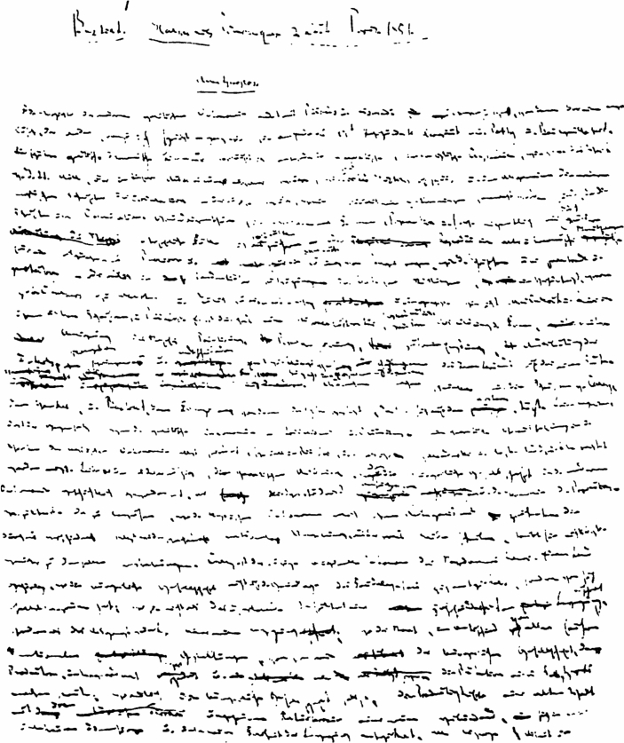

写有《巴师夏和凯里》的手稿笔记本第Ⅲ本第1页

凯里对英国人关于土地所有制、工资、人口和阶级对立等等的理论的批判，无非就是拿美国的关系和英国对比。［他认为，］在英国，资产阶级社会的存在不具有纯粹形式，不符合它的概念，同自身不相适合。英国经济学家关于资产阶级社会的概念怎么能真实地、清楚地反映他们所不认识的现实呢？

在凯里看来，资产阶级社会的自然关系所受到的传统的、并非来自这个社会本身内部的影响的干扰作用，最终归结为国家对资产阶级社会的影响，归结为国家的侵犯和干涉。例如，工资理应随同劳动生产率而增长。如果我们发现现实和这一规律不相符合，不管是发生在印度斯坦还是英国，我们只须抽掉政府的影响，即赋税、［国家的］垄断等等。他说，如果就资产阶级关系本身来考察，也就是说，除去国家的影响，那么，资产阶级经济学的和谐规律事实上总是会得到证实的。自然，凯里没有研究国家的这些影响，即公债、国税等等本身在多大程度上是从资产阶级关系中产生出来的，——因而，例如在英国，这些影响决不是表现为封建主义的结果，相反地表现为封建主义的瓦解和被制服的结果，而在北美本身，中央政府的权力是和资本的集中一起增长的。

如果说，凯里和英国的经济学家相反，强调北美的资产阶级社会具有较高的潜力，那么，巴师夏则和法国的社会主义者相反，强调法国资产阶级社会具有较低的潜力。［他对法国社会主义者喊道：］你们竟想在一个从来不允许实现资产阶级社会的规律的国家里反抗这些规律！你们只是在发育不全的法国形式中来认识这些规律，并且把这些规律的不过是法国的、民族的歪曲表现，看作是它们的内在形式。试看一看英国吧！在我们法国，任务在于使资产阶级社会从国家给它设置的桎梏中解放出来。你们却想要加重这种桎梏。你们先使资产阶级关系纯粹化，然后我们再来谈这个问题。（就下面这点来说巴师夏是正确的：在法国，由于它特有的社会形成，许多在英国是属于政治经济学的东西都被看作是社会主义。）

不过，以资产阶级社会从国家那里取得美国式的解放为出发点的凯里，最后要求国家干涉，以便使资产阶级关系的纯粹发展，像在美国实际发生的那样，不受外部影响的干扰。他是保护关税派，而巴师夏却是自由贸易论者。

经济规律的和谐在整个世界上表现为不和谐，使凯里感到惊讶的是，这种不和谐甚至在美国也开始出现。这种奇特的现象是从哪里产生的呢？凯里用竭力追求工业垄断的英国对世界市场的破坏作用来解释。起初，英国的关系在国内被经济学家们的错误理论搞乱了。现在，［Ⅲ—3］作为世界市场的统治力量的英国在国外搞乱了世界各国经济关系的和谐。这种不和谐是真实的，而不只是以经济学家们的主观理解为根据。

凯里眼中的英国的经济状况，同乌尔卡尔特眼中的俄国的政治状况是一样的。凯里认为，经济关系的和谐是建立在城市和乡村，工业和农业的和谐合作上的。在本国内瓦解了这种基本和谐的英国，通过竞争在世界市场上到处都破坏这种基本和谐，所以它是普遍和谐的破坏因素。能够防御这一点的，只有保护关税，这是抵制英国大工业破坏力量的国家强力的屏障。于是，国家成了“经济和谐”的最后避难所，而它最初被斥之为这些和谐的唯一的破坏者。

一方面，凯里在这里又表述了美国的一定的民族的发展，表述了美国同英国的对立和竞争。他是十分天真地表述这一点的，他建议美国在本国实行保护关税以加速发展工业制度，以此来摧毁英国所推广的工业制度。撇开这种天真不谈，在凯里那里，资产阶级的生产关系一旦在世界市场这个最广大的场所，以最巨大的发展规模，作为生产者国家的关系而出现，便以这些关系的极度不和谐而告终。在他看来，在一定的国家范围内，或者甚至在资产阶级社会的普遍关系的抽象形式上表现为和谐的那一切关系（资本的积聚、分工、雇佣劳动等等），一旦它们以其最发展的形式，以其世界市场的形式出现，表现为促使英国在世界市场上建立统治，并作为这种统治的结果而成为破坏性势力的那些内在关系时，他就认为是不和谐的。

如果在某一国家里，家长制的生产让位于工业生产，而伴随这一发展的瓦解过程只是从它的肯定方面去理解，那么这是和谐的。如果英国的大工业瓦解了外国的家长制的或者小资产阶级的或者其他处于较低阶段的生产形式，那么这就是不和谐的。他只看到一国内部的资本积聚和这种积聚的瓦解作用的肯定的方面。但是，积聚起来的英国资本的垄断和它对其他民族的较小的民族资本的瓦解作用则是不和谐的。凯里不懂得，这种世界市场的不和谐只是那种作为抽象关系在经济范畴中被确定下来，或者在最小的规模上取得某种局部存在的不和谐的最后的、恰如其分的表现。

毫不奇怪，另一方面他忘记了这一瓦解过程在世界市场上的充分的表现中所具有的肯定内容，而这正是他在抽象形式的经济范畴上，或者在这些范畴由以抽象出来的一定国家内部的现实关系上所观察到的唯一的一个方面。因此，经济关系以其真实性即以其普遍现实性出现在他面前的时候，他便从他的原则上的乐观主义转变为带有控诉性的和愤怒的悲观主义。这种矛盾使他的著作具有独创性并具有自己的意义。他无论确认资产阶级社会内部的和谐，或者确认同样一些关系在其世界市场的形式上的不和谐，都同样是一个美国人。

在巴师夏那里，这一切都不存在。这些关系的和谐是一种彼岸性，这种彼岸性正好从法国疆界的尽头开始，存在于英国和美国。这只是非法国的即英国和美国的关系的想象的、理想的形式，而不是像他在他自己的国土上所看到的那种现实的形式。因此，如果说在他那里和谐决不是来自丰富的生动的直观，而相反地是从贫乏的、紧张的、对立的反思中产生的夸张的产物，那么，在他那里唯一现实的要素就是要求法国放弃它的经济上的疆界。

一旦经济关系在世界市场上表现为英国式的关系时，凯里就看到了这种经济关系的矛盾。而仅仅想象和谐的巴师夏，只是在法国的尽头，并且在资产阶级社会的一切民族分立的组成部分摆脱了国家监督而相互竞争的地方，才开始看到和谐的实现。不过，他的这一最终的和谐本身——同时也是他所有以前想象的和谐的前提——无非又是一个要借助自由贸易的立法来实现的要求。

［Ⅲ—4］因此，如果说凯里（完全撇开他的研究的科学价值不谈）至少有这样的功劳，即他以抽象的形式表述了庞大的美国关系，而且是在同旧大陆的对比中来表述的，那么，在巴师夏那里，法国关系的细小性似乎是唯一现实的背景，这种关系在他的和谐中到处都显露出来。不过，这种功劳是多余的，因为像法国这样一个如此古老国家的关系是人们所充分了解的，完全不需要经过那样否定的曲折的道路去认识。因此，凯里在经济科学方面，如关于信贷、地租等等方面，是富于可以说是真诚的研究的。巴师夏所从事的，只是对那种以对照而结束的研究做出令人满足的解释——一种虚假的满足。

凯里的普遍性是美国人的普遍性。对他来说，法国和中国是同样近的。他总是表现为居住在太平洋和大西洋沿岸的人。巴师夏的普遍性是无视一切国家。作为真正的美国人，凯里从四面八方收集旧大陆给他提供的大量材料，但不是为了去认识这些材料的内在精神，从而承认这些材料特有的生存权利，而是把它们作为死的例子，作为毫无差别的材料来进行加工，用来达到他自己的目的，用来证实他从美国人的立场出发抽象出来的论点。所以他漫游世界，占有大量未加批判的统计材料，像图书目录似的博学多识。相反，巴师夏提供的是虚构的历史，他提供的抽象有时采取理性的形式，有时采取假想事变的形式，不过，这些事变在任何时候和任何地方都没有发生过，就像神学家那样，把罪恶有时看作人的本质的规律，有时看作原罪的历史。

因此，两个人都是非历史的和反历史的。但是，在凯里那里，非历史的因素是现在北美的历史原则，而在巴师夏那里，非历史的要素只不过是对18世纪的法国概括方式的留恋。因此，凯里不拘形式，杂乱冗长，巴师夏则矫揉造作，注重形式逻辑。巴师夏所提供的充其量不过是一些以反论方式表述的、经过精雕细刻的陈词滥调。在凯里那里，先是以学理形式提出几个一般论题。接着堆积一些未加整理的材料作为例证——他的论题的材料完全没有经过加工。在巴师夏那里，除某些局部的例子或者把英国的正常现象加以想象的编撰以外，他的唯一材料只是经济学家们的一般论题。

凯里的主要对立面是李嘉图，总之，是现代英国经济学家；巴师夏的主要对立面是法国社会主义者。[^v30-c3-annotation-6a493db2fdb192c5]

[^v30-c3-jz_1_29]: 指《政治经济学原理及其对社会哲学的某些应用》。——编者注

[^v30-c3-annotation-6a493db2fdb192c5]: 手稿笔记本第4页上半页至此中断。下半页空着。可以设想，继1—3页和第4页上半页之后，即在对凯里和巴师夏的立场作一般评论的《前言》之后，马克思打算更详细地评述他所研究的巴师夏的这本书。可能是想谈这本书前13章的某些内容。不过这种打算没有实现。在笔记本的下一页上，马克思评论的已是第14章的基本论点了。——11。
<!-- END SOURCE v30c3 -->

<!-- BEGIN SOURCE v30c4 OEBPS/chapters/chapter-0004.xhtml -->
#### ［Ⅲ—5］（XIV）论工资 [^v30-c4-annotation-55d743b998107aa2]

下面是巴师夏的主要论点：

所有的人都追求收入的固定性，固定收入。

〔纯粹是法国的例子：（1）每个人都想当官，或者让自己的儿子当官（见［巴师夏著作］第371页）。〕

工资是报酬的固定形式（第376页），因此是联合体的一种极完美的形式，而在联合体的最初的形式中“偶然性”占统治地位，因为在这里“联合体的一切成员都要受到事业的各种偶然性的支配”［（第380页）］。

〔“如果资本自己承担风险，劳动报酬便以工资的名称固定下来。如果劳动本身想承担好的和坏的结果，资本的报酬就以利息的名称分离出来和固定下来。”（第382页。关于这种对比的进一步论述，见第382—383页）〕

但是，最初在劳动者的状况中，偶然性占统治地位，而在雇佣劳动制度下，稳定性还没有充分保证。雇佣劳动制度是“偶然性和稳定性之间的中间阶段”［（第384页）］。

稳定性阶段的达到，是通过

“在有工作的日子里进行节约，以此来满足年老或生病时的需要”（第388页）。

这后一个阶段依靠“互助会”而发展（同上），最后，依靠“工人养老金”[^v30-c4-annotation-3b1b6ec7e597a78c]而发展（第393页）。

（正像一个人从满足需要出发而当官一样，他由于领取养老金而满意地终其余生。）

关于第一点。假定巴师夏关于工资的固定性所说的一切都是正确的。然而，把工资归入“固定收入”之列，仍旧不能使我们了解工资的特有的性质，它的具有特征的规定性。这里只是强调了工资的一种关系，这种关系对工资以及其他收入来源来说是共同的。仅此而已。自然，这已经给那些想为雇佣劳动制度的优越性进行辩护的辩护士提供了一点东西。不过，这对于想了解整个这种关系的特点的经济学家来说，却没有提供任何东西。把某种关系、某种经济形式的某个片面的规定固定下来，颂扬这个规定，排斥相反的规定——这种律师和辩护士的惯用手法正是说教者巴师夏的特点。

于是，“收入的固定性”代替了“工资”。难道收入的固定性不好吗？难道不是每个人都乐于指望某种固定 的东西吗？特别是每个庸俗的、低级趣味的法国人，这种总是拮据的人，难道不就是这样吗？替奴隶制辩护也是用的同样的方法，而且理由也许更充分。

不过，也可能有相反的主张，而且确实有这样的主张。假定工资等于某种不固定的东西，即超过一定点继续前进的东西。谁不喜欢前进而愿停滞不前？因此，有可能给资产阶级无止境的进步创造机会的一种关系难道是坏的吗？自然，巴师夏本人在另外一个地方也认为雇佣劳动制度是一种不固定的东西。难道不是只有通过非固定化，通过变动，工人才能像巴师夏所希望的那样不再劳动而成为资本家[^v30-c4-annotation-be0d11249b89b257]吗？

可见，雇佣劳动制度是好的，因为它是固定的东西；它是好的，因为它是不固定的东西；它是好的，因为它既非这个也非那个，既是这个也是那个。不论何种关系，如果被归结为片面的规定，这种规定又被看作肯定的东西，而不是否定的东西，那么，这种关系不是好的吗？一切反思的、忽东忽西的空谈，一切辩护，一切老实的诡辩，都是建立在这种抽象上的。

在作了这种一般的引论之后，我们来研究巴师夏的实际的结构。

（只是还要顺便指出，他所说的［（第378—379页）］朗德省的分成制佃农，那兼受雇佣工人的不幸和小资本家的遭遇的人，如果领取固定工资，确实是会感到幸福的。）

蒲鲁东的“叙事的和哲学的历史”[^v30-c4-annotation-05cee0883e0b7954]不见得能赶上他的对手巴师夏的同类著述。巴师夏认为，一切成员分享一切偶然机会的联合体的最初形式，应让位于联合体的更高的、双方自愿［Ⅲ—6］议定的阶段，在这个阶段上，工人的报酬是固定的。这个天才先假定一方存在资本家，另一方存在工人，然后好通过双方的协议建立资本和雇佣劳动之间的关系。对于这样的天才，我们在这里不想让人们再去注意了。

在联合体的最初形式中，工人在收入上要取决于一切偶然机会，一切生产者都同样取决于这种机会，并且这种联合体的形式，正像正题出现在反题之前一样，直接出现在劳动报酬借以取得固定性，成为固定东西的那种工资之前——这种联合体的形式，正像我们从巴师夏那里听到的，是捕鱼、狩猎、畜牧在其中成为占统治地位的生产形式和社会形式的一种状态。先有不定居的渔夫、猎人、牧人，然后才有雇佣工人。从半野蛮状态到现代状态的这种历史的过渡是在什么地方和什么时候实现的呢？顶多是在《喧声报》上实现的。

在现实的历史上，雇佣劳动是从奴隶制和农奴制的解体中产生的，或者像在东方和斯拉夫各民族中那样是从公有制的崩溃中产生的，而在其最恰当的、划时代的、囊括了劳动的全部社会存在的形式中，雇佣劳动是从行会制度、等级制度、劳役和实物收入、作为农村副业的工业、仍为封建的小农业等等的衰亡中产生的。在所有这些现实的历史过渡中，雇佣劳动表现为一些关系的解体、消灭，在这些关系中，劳动从它的收入、它的内容、它的场所和它的规模等等所有方面来说都是固定的。所以，雇佣劳动表现为劳动和它的报酬的固定性的否定。从非洲人的偶像直接过渡到伏尔泰的“最高存在物”[^v30-c4-annotation-d4ff53c573f4fc81]，或者从北美野蛮人的猎具直接过渡到英格兰银行的资本，都不像巴师夏所说的从渔夫过渡到雇佣工人这样荒谬和反历史。

（此外，在所有这一切发展中，并没有显示出自愿的、根据相互的协议而发生的变动的任何迹象。）

同这一历史结构——巴师夏就是凭借这种结构来用事变的形式杜撰他的肤浅的抽象理论——完全相适合的是这样一种合题，按照这种合题，英国的互助会和储蓄银行表现为雇佣劳动制度的最新成就和社会的一切二律背反的扬弃。

因此，在历史上，不固定性是雇佣劳动制度的特点，这和巴师夏的结构是相反的。但是，他是怎样把固定性看作雇佣劳动制度的弥补一切的规定而得出这种固定性的结构的呢？他又是怎样企图把具有这一规定的雇佣劳动制度当作报酬的更高形式，即当作其他社会形式或联合体形式中的劳动报酬的更高形式而从历史上加以说明的呢 ？

当一切经济学家谈论资本和雇佣劳动、利润和工资的现存关系，并向工人证明，工人无权分享取得利润的机会的时候，当他们想劝慰工人安于对资本家的从属地位的时候，他们向工人指出，工人与资本家相反，工人取得收入的某种固定性，这在或大或小的程度上并不为资本的巨大冒险行为所左右。这完全像唐·吉诃德安慰桑乔·藩萨那样：虽然老是挨揍，并不需要勇敢。可见，经济学家们在同利润相对立的意义上赋予雇佣劳动制度的那个规定，在巴师夏那里变成同过去的劳动形式相对立的意义上的雇佣劳动制度的规定，被看作比这些过去关系下的劳动报酬前进了一步。被塞进现存关系中的、安慰其中一方去容忍另一方的这种陈腐思想，被巴师夏先生从现存关系中搬出来，并说成是产生这一关系的历史基础。

经济学家们说，在工资和利润、雇佣劳动和资本的关系中，固定性的优点属于工资。

巴师夏先生说，固定性，即工资和利润之间的关系的一个方面，是产生雇佣劳动制度的历史基础（或者说，属于不是同利润相对立意义上的工资，而是同劳动报酬的过去形式相对立意义上的工资），因此也是产生利润，产生整个关系的历史基础。

这样，在他那里，关于工资和利润的关系的一个方面的这种陈腐思想就悄悄地变为整个这种关系的历史基础。这种情况之所以发生，是由于他一直在为这样一种社会主义而冥思苦想，这种社会主义往后到处都被他梦想为联合体的最初形式。这个例子表明，在经济学家们的论述中只是占次要地位的那些辩护性的陈腐思想，在巴师夏那里具有多么重要的形式。

［Ⅲ—7］我们再回来谈谈经济学家们。工资的这种固定性究竟是什么呢？工资是永远固定的吗？这同确定工资的基础即供求规律是完全矛盾的。没有一个经济学家会否认工资的变动，即提高和降低。或者，工资与危机无关？或者，与造成雇佣劳动过剩的机器无关？或者，与调配劳动的分工无关？主张这一切会是荒谬的，而且也没有这样的主张。

这里包含的意思是，在某种平均状况下，工资实现一个相当的平均量，即巴师夏如此憎恶的整个阶级的工资最低额，并且劳动会保持某种平均连续性，例如工资甚至在利润下降或者暂时完全消失的情况下可以继续支付。但这不过表明：如果雇佣劳动是占统治地位的劳动形式，是生产的基础，那么，工人阶级就靠工资生活，而单个工人在平均状况下就取得为工资而劳动的固定性。换句话说，这是同义反复。在资本和雇佣劳动是占统治地位的生产关系的地方，只要存在着工人工资的固定性，就存在着雇佣劳动的平均连续性。在存在雇佣劳动的地方，就存在工人工资的固定性。而这就被巴师夏先生看作是雇佣劳动的弥补一切的性质！

其次，说什么在资本发达的社会状态下，同资本即生产还没有发展到这一阶段的地方比较起来，社会生产整个说来更有规则、更有连续性、更全面，从而从事生产的成员的收入也更“固定”，这又是一种同义反复，这种同义反复是随着资本的概念和建立在资本上的生产本身的概念一起出现的。换句话说，雇佣劳动普遍存在的前提是生产力的发展高于雇佣劳动出现以前的阶段，这一点谁会否认呢？社会主义者如果不是以雇佣劳动造成的社会生产力的这一更高的发展为前提，他们怎么会想到提出更高的要求呢？这种更高的发展倒正好是他们的要求的前提。

注：工资表现为普遍现象的第一个形式就是军饷，这种军饷出现在国民军和民兵衰落的时期。最初，军饷是发给市民本身。后来，市民很快被雇佣兵代替了，后者不再是市民。

（2）（不能再谈这些毫无意义的东西了。因此，我们抛开巴师夏先生。）

写于1857年7月

第一次用德文发表于《新时代》第22年卷（1903—1904年）第2卷第27期

原文是德文

中文根据《马克思恩格斯全集》1976年历史考证版第2部分第1卷第1分册并参考1983年德文版第42卷翻译

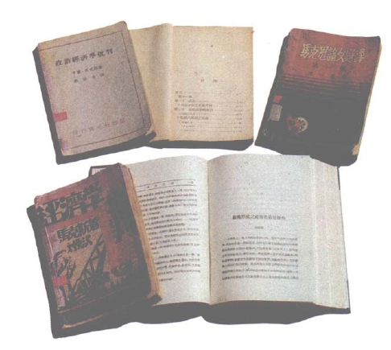

1930—1931年分别刊载马克思《导言》一文中译文的上海社会科学研究会出版的《马克思论文选译》、上海乐群书店出版的《经济学批判》、上海神州国光社出版的《政治经济学批判》等书和上海《萌芽》月刊第1卷第1期的封面和部分译文

[^v30-c4-annotation-55d743b998107aa2]: 《（XIV）论工资》是巴师夏《经济的和谐》一书的第14章，1851年巴黎出版的该书第2版共有25章。马克思在手稿笔记本的第5—7页上对巴师夏关于工资的基本论点作了批判性的评论。——12。

[^v30-c4-annotation-3b1b6ec7e597a78c]: 工人养老金是巴师夏的主张，用工人本人的工资扣款来建立养老金以满足年老或生病时的需要。他认为只有这样，工人养老金才能保证必要程度的“稳定性”。见弗·巴师夏《经济的和谐》1851年巴黎第2版第395页。——13。

[^v30-c4-annotation-be0d11249b89b257]: 巴师夏在同上书第402页上说：“工资的提高……有利于积蓄，也有利于雇佣工人成为资本家”。——13。

[^v30-c4-annotation-05cee0883e0b7954]: 马克思这里说的蒲鲁东的“叙事的和哲学的历史”，指蒲鲁东《经济矛盾的体系，或贫困的哲学》（1846年巴黎版）中的错误的哲学理论和历史理论，对蒲鲁东的这些错误理论，马克思在1847年写的《哲学的贫困。答蒲鲁东先生的〈贫困的哲学〉》一书中曾专门进行了分析批判。——14。

[^v30-c4-annotation-d4ff53c573f4fc81]: 最高存在物（supr me）是伏尔泰对上帝的称呼。和所谓的“天启”宗教相反，他把上帝描绘成似乎是创造世界、制定世界规律和赋予世界第一推动力，但在此以后就不再对事变的自然进程进行任何干预的某种非人格的理性本原。——15。
<!-- END SOURCE v30c4 -->

## 二、导言

> 范围说明（整理者）：1857年8月底；第30卷书页19—53。未完成手稿，保留现存作者目录。

<!-- BEGIN SOURCE v30c5 OEBPS/chapters/chapter-0005.xhtml -->
### 导言[^v30-c5-annotation-fc7fe6697aea2176]

写于1857年8月底

第一次用德文发表于《新时代》第21年卷（1902—1903年）第1卷第23—25期

原文是德文

中文根据《马克思恩格斯全集》1976年历史考证版第2部分第1卷第1分册并参考1983年德文版第42卷翻译

[^v30-c5-annotation-fc7fe6697aea2176]: 《导言》是马克思为他计划写的总标题为《政治经济学批判》的经济学巨著而写的，《导言》包含在标以“M”字母的笔记本上，笔记本封页上注明：“1857年8月23日，伦敦”。这很可能就是马克思开始写《导言》的日期。《导言》没有写完就中断了，历史考证版编者根据各种情况判断，可能是8月底中断的。马克思在1859年1月写的《政治经济学批判》第1分册的序言中关于《导言》写道：“我把已经起草好的一篇总的导言压下了，因为仔细想来，我觉得预先说出正要证明的结论总是有妨害的，读者如果真想跟着我走，就要下定决心，从个别上升到一般。”《导言》虽然带有未完成的草稿性质，却具有非常重要的意义，因为马克思在这里比在任何地方都更详细地叙述了自己关于政治经济学的对象和方法的思想，还说明了关于社会的物质基础同意识形态这一上层建筑之间的关系的一系列极为重要的想法。《导言》在马克思生前没有发表过。考茨基在1903年3月把这一手稿第一次发表在《新时代》（斯图加特）第21年卷（1902—1903年）第1卷第710—718、741—745、772—781页上。1939—1941年本手稿又用德文原文发表在莫斯科出版的《政治经济学批判大纲》上。《导言》的中译文第一次全文发表在1930年2月上海社会科学研究会出版的《马克思论文选译》上。——19。
<!-- END SOURCE v30c5 -->

### 目录[^v30-e9-restored]

A．导言

1．生产一般

2．生产、分配、交换和消费的一般关系

3．政治经济学的方法

4．生产资料（生产力）和生产关系，生产关系和交往关系等等

[^v30-e9-restored]: 这一目录也许是马克思在已经起草完《导言》正文以后才写的，因为目录中的标题比《导言》正文中的某些节的标题更确切地反映出《导言》的一般逻辑结构。该目录写在包含《导言》的手稿笔记本“M”的第二封面上。——21。

### ［M—1］A．导言

<!-- BEGIN SOURCE v30c6 OEBPS/chapters/chapter-0006.xhtml -->
#### Ⅰ.生产、消费、分配、交换（流通）[^v30-c6-annotation-9b1c84ac20d1c43b]

[^v30-c6-annotation-9b1c84ac20d1c43b]: 标题《Ⅰ.生产、消费、分配、交换（流通）》，在马克思写在手稿笔记本“M”封面上的目录中是没有的。这个标题严格地说只包括《导言》的前两节，即《生产》一节（在笔记本“M”的封面上，这一节有一个更确切的标题《生产一般》）和《生产与分配、交换、消费的一般关系》一节。马克思在《生产、消费、分配、交换（流通）》这一节前面标明的罗马数字“Ⅰ”，在《导言》往后的正文中再也没有相应的罗马数字与之相连接。——22。
<!-- END SOURCE v30c6 -->

<!-- BEGIN SOURCE v30c7 OEBPS/chapters/chapter-0007.xhtml -->
##### 1.生产

（α）摆在面前的对象，首先是物质生产。

在社会中进行生产的个人，——因而，这些个人的一定社会性质的生产，当然是出发点。被斯密和李嘉图当作出发点的单个的孤立的猎人和渔夫[^v30-c7-annotation-f00adffd3e3a0ff6]，属于18世纪的缺乏想象力的虚构。这是鲁滨逊一类的故事，这类故事决不像文化史家想象的那样，仅仅表示对过度文明的反动和要回到被误解了的自然生活中去。同样，卢梭的通过契约来建立天生独立的主体之间的关系和联系的“社会契约”[^v30-c7-annotation-9eb1498155057e72]，也不是以这种自然主义为基础的。这是假象，只是大大小小的鲁滨逊一类故事所造成的美学上的假象。其实，这是对于16世纪以来就作了准备、而在18世纪大踏步走向成熟的“市民社会”[^v30-c7-annotation-d9a451da9325d0fa]的预感。在这个自由竞争的社会里，单个的人表现为摆脱了自然联系等等，而在过去的历史时代，自然联系等等使他成为一定的狭隘人群的附属物。这种18世纪的个人，一方面是封建社会形式解体的产物，另一方面是16世纪以来新兴生产力的产物，而在18世纪的预言家看来（斯密和李嘉图还完全以这些预言家为依据），这种个人是曾在过去存在过的理想；在他们看来，这种个人不是历史的结果，而是历史的起点。因为按照他们关于人性的观念，这种合乎自然的个人并不是从历史中产生的，而是由自然造成的。这样的错觉是到现在为止的每个新时代所具有的。斯图亚特在许多方面同18世纪对立并作为贵族比较多地站在历史基础上，从而避免了这种局限性。

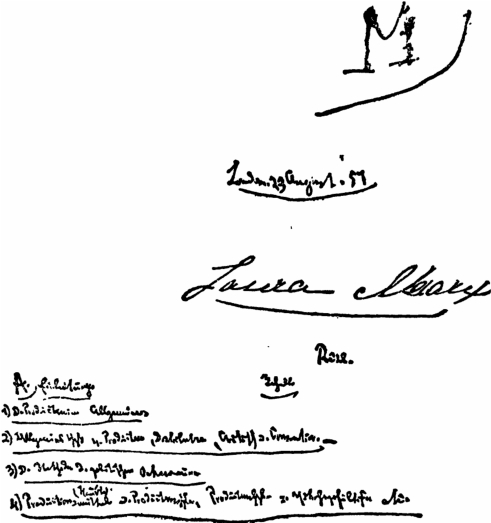

写有《导言》的手稿笔记本M的封面

我们越往前追溯历史，个人，从而也是进行生产的个人，就越表现为不独立，从属于一个较大的整体：最初还是十分自然地在家庭和扩大成为氏族[^v30-c7-annotation-12202b5a3f7fe000]的家庭中；后来是在由氏族间的冲突和融合而产生的各种形式的公社中。只有到18世纪，在“市民社会”中，社会联系的各种形式，对个人说来，才表现为只是达到他私人目的的手段，才表现为外在的必然性。但是，产生这种孤立个人的观点的时代，正是具有迄今为止最发达的社会关系（从这种观点看来是一般关系）的时代。人是最名副其实的政治动物[^v30-c7-annotation-4abb4c198b45d42f]，不仅是一种合群的动物，而且是只有在社会中［M—2］才能独立的动物。孤立的一个人在社会之外进行生产——这是罕见的事，在已经内在地具有社会力量的文明人偶然落到荒野时，可能会发生这种事情——就像许多个人不在一起生活和彼此交谈而竟有语言发展一样，是不可思议的。在这方面无须多说。18世纪的人们有这种荒诞无稽的看法是可以理解的，如果不是巴师夏、凯里[^v30-c7-jz_1_53]和蒲鲁东[^v30-c7-annotation-c6757f7c4713a7fc]等人又把这种看法郑重其事地引进最新的经济学中来，这一点本来可以完全不提。蒲鲁东等人自然乐于用编造神话的办法，来对一种他不知道历史来源的经济关系的起源作历史哲学的说明，说什么亚当或普罗米修斯已经有了现成的想法，后来这种想法就被实行了等等。再没有比这类想入非非的陈词滥调更加枯燥乏味的了。

因此，说到生产，总是指在一定社会发展阶段上的生产——社会个人的生产。因而，好像只要一说到生产，我们或者就要把历史发展过程在它的各个阶段上一一加以研究，或者一开始就要声明，我们指的是某个一定的历史时代，例如，是现代资产阶级生产——这种生产事实上是我们研究的本题。可是，生产的一切时代有某些共同标志，共同规定。生产一般是一个抽象，但是只要它真正把共同点提出来，定下来，免得我们重复，它就是一个合理的抽象。不过，这个一般，或者说，经过比较而抽出来的共同点，本身就是有许多组成部分的、分为不同规定的东西。其中有些属于一切时代，另一些是几个时代共有的。［有些］规定是最新时代和最古时代共有的。没有它们，任何生产都无从设想；但是，如果说最发达的语言和最不发达的语言共同具有一些规律和规定，那么，构成语言发展的恰恰是有别于这个一般和共同点的差别。对生产一般适用的种种规定所以要抽出来，也正是为了不致因为有了统一（主体是人，客体是自然，这总是一样的，这里已经出现了统一）而忘记本质的差别。那些证明现存社会关系永存与和谐的现代经济学家的全部智慧，就在于忘记这种差别。例如，没有生产工具，哪怕这种生产工具不过是手，任何生产都不可能。没有过去的、积累的劳动，哪怕这种劳动不过是由于反复［M—3］操作而积聚在野蛮人手上的技巧，任何生产都不可能。资本，别的不说，也是生产工具，也是过去的、客体化了的劳动。可见资本是一种一般的、永存的自然关系；这样说是因为恰好抛开了正是使“生产工具”、“积累的劳动”成为资本的那个特殊。因此，生产关系的全部历史，例如在凯里看来，是历代政府的恶意篡改。

如果没有生产一般，也就没有一般的生产。生产总是一个个特殊的生产部门——如农业、畜牧业、制造业等，或者生产是总体。可是，政治经济学不是工艺学。生产的一般规定在一定社会阶段上对特殊生产形式的关系，留待别处（后面）再说。

最后，生产也不只是特殊的生产，而始终是一定的社会体即社会的主体在或广或窄的由各生产部门组成的总体中活动着。科学的叙述对现实运动的关系，也还不是这里所要说的。生产一般。特殊生产部门。生产的总体。

现在时髦的做法，是在经济学的开头摆上一个总论部分——就是标题为《生产》的那部分（参看约·斯·穆勒的著作[^v30-c7-annotation-b509fb6bbf9fc5c7]），用来论述一切生产的一般条件。

这个总论部分包括或者据说应当包括：

（1）进行生产所必不可缺少的条件。因此，这实际上不过是摆出一切生产的基本要素。可是，我们将会知道，这些要素实际上归纳起来不过是几个十分简单的规定，而这些规定却扩展成浅薄的同义反复。

（2）或多或少促进生产的条件，如像亚当·斯密所说的前进的和停滞的社会状态[^v30-c7-annotation-032169deba60d7be]。要把这些在亚·斯密那里作为提示而具有价值的东西提到科学意义上来，就得研究在各个民族的发展过程中各个时期的生产率程度——这种研究超出本题的范围，而这种研究同本题有关的方面，应在叙述竞争、积累等等时来谈。照一般的提法，答案总是这样一个一般的说法：一个工业民族，当它一般地达到它的历史高峰的时候，也就达到它的生产高峰。实际上，一个民族的工业高峰是在这个民族的主要任务还不是维护利润，而是谋取利润的时候达到的。就这一点来说，美国人胜过英国人。或者是这样的说法：例如，某些种族素质，气候，自然环境如离海的远近，土地肥沃程度等等，比另外一些更有利于生产。这又是同义反复，即财富的主客观因素越是在更高的程度上具备，财富就越容易创造。

［M—4］但是，这一切并不是经济学家在这个总论部分所真正要说的。相反，他们所要说的是，生产不同于分配等等（参看穆勒的著作[^v30-c7-annotation-c80674a01dbb0b65]），应当被描写成局限在与历史无关的永恒自然规律之内的事情，于是资产阶级关系就被乘机当作社会一般的颠扑不破的自然规律偷偷地塞了进来。这是整套手法的多少有意识的目的。在分配上，他们则相反地认为，人们事实上可以随心所欲。即使根本不谈生产和分配的这种粗暴割裂以及生产和分配的现实关系，总应该从一开始就清楚地看到：无论在不同社会阶段上分配方式如何不同，总是可以像在生产中那样提出一些共同的规定来，可以把一切历史差别混合或融化在一般人类规律之中。例如，奴隶、农奴、雇佣工人都得到一定量的食物，使他们能够作为奴隶、农奴和雇佣工人来生存。靠贡赋生活的征服者，靠税收生活的官吏，靠地租生活的土地所有者，靠施舍生活的僧侣，靠什一税生活的教士，都得到一份社会产品，而决定这一份产品的规律不同于决定奴隶等等的那一份产品的规律。一切经济学家在这个项目下提出的两个要点是：（1）财产，（2）司法、警察等等对财产的保护。对此要极简短地答复一下：

关于第一点。一切生产都是个人在一定社会形式中并借这种社会形式而进行的对自然的占有。在这个意义上，说财产（占有）是生产的一个条件，那是同义反复。但是，可笑的是从这里一步就跳到财产的一定形式，如私有财产。（而且还以对立的形式即无财产作为前提条件。）历史却表明，共同财产（如印度人、斯拉夫人、古克尔特人等等那里的共同财产）是原始形式，这种形式还以公社财产形式长期起着显著的作用。至于财富在这种还是那种财产形式下能更好地发展的问题，还根本不是这里所要谈的。可是，如果说在任何财产形式都不存在的地方，就谈不到任何生产，因此也就谈不到任何社会，那么，这是同义反复。什么也不占有的占有，是自相矛盾。

关于第二点。对既得物的保护等等。如果把这些滥调还原为它们的实际内容，它们所表示的就比它们的说教者所知道的还多。就是说，每种生产形式都产生出它所特有的法的关系、统治形式等等。粗率和无知之处正在于把有机地［M—5］联系着的东西看成是彼此偶然发生关系的、纯粹反思联系中的东西。资产阶级经济学家只是感到，在现代警察制度下，比在例如强权下能更好地进行生产。他们只是忘记了，强权也是一种法，而且强者的权利也以另一种形式继续存在于他们的“法治国家”中。

当与生产的一定阶段相应的社会状态刚刚产生或者已经衰亡的时候，自然会出现生产上的紊乱，虽然程度和影响有所不同。

总之：一切生产阶段所共有的、被思维当作一般规定而确定下来的规定，是存在的，但是所谓一切生产的一般条件，不过是这些抽象要素，用这些要素不可能理解任何一个现实的历史的生产阶段。

[^v30-c7-jz_1_53]: 见本卷第10—11、14—15页。——编者注

[^v30-c7-annotation-f00adffd3e3a0ff6]: 把单个的孤立的猎人和渔夫当作出发点的观点，见亚·斯密《国民财富的性质和原因的研究》（附《英国和美国》的作者［爱·吉·威克菲尔德］的注释，1835—1839年伦敦版）一书的序论和大·李嘉图《政治经济学和赋税原理》1821年伦敦第3版第1章第3节。——22。

[^v30-c7-annotation-9eb1498155057e72]: 社会契约论（Contrat social）是卢梭关于人从自然状态过渡到市民状态的相互关系的理论。按照这个理论，人们最初生活在某种自然状态中，在这种状态下，人人都是平等的。私有财产的形成和不平等的占有关系的发展决定了人们从自然状态向市民状态的过渡，并导致以社会契约为基础的国家的形成。政治上的不平等的进一步发展破坏了这种社会契约，导致某种新的自然状态的形成。能够消除这一自然状态的，据说是以某种新的社会契约为基础的理性国家。让·雅·卢梭在1755年阿姆斯特丹版的《论人间不平等的起源和原因》和1762年阿姆斯特丹版的《社会契约论》这两部著作中详细阐述了这一理论。——22。

[^v30-c7-annotation-d9a451da9325d0fa]: 市民社会这一术语出自乔·威·弗·黑格尔《法哲学原理》（《黑格尔全集》1833年柏林版第8卷第182节附录）。在马克思的早期著作中，这一术语的使用有两重含义。广义地说，是指社会发展各历史时期的经济制度，即决定政治制度和意识形态的物质关系总和；狭义地说，是指资产阶级社会的物质关系。因此，应按照上下文作不同的理解。根据这里的上下文并参照马克思在《政治经济学批判》第1分册序言中有关经济基础和上层建筑的论述，此处应为后一种含义。——22。

[^v30-c7-annotation-12202b5a3f7fe000]: 德语Stamm这一术语在19世纪中叶的历史科学中含义比现在要广，它表示渊源于同一祖先的人们的共同体，包括近代所谓的“氏族”（Gens）和“部落”（Stamm）两个概念。另外，马克思关于原始社会和早期部落制中家庭关系的观点，即认为人们最初先是形成为“家庭”，然后从家庭发展和扩大而成为“氏族”，也是沿用当时历史科学中的观点。美国的著名民族学家路·亨·摩尔根在《古代社会》（1877年）中第一次把“氏族”和“部落”区分开来，并下了准确的定义，第一次阐明了氏族是原始公社制度的主要基层单位，从而为原始社会的全部历史奠定了科学的基础。瑞士历史学家约·雅·巴霍芬的《母权论》（1861年）也在古代社会和民族学的研究方面作出了新贡献。马克思和恩格斯后来吸收了这些新研究成果，从马克思对摩尔根著作的摘录中可以看出他关于氏族和家庭之间关系的新观点，即氏族是以血缘为基础的人类社会的原始形式，氏族纽带的解体，才发展起各种形式的家庭。恩格斯在《家庭，私有制和国家的起源》（1884年）中全面阐述了这些新见解。恩格斯还为《资本论》第1卷第12章加了关于氏族和家庭的关系的第（50a）注。——25、107、120、466。

[^v30-c7-annotation-4abb4c198b45d42f]: 政治动物（ ） ，从更广泛意义来说是“社会动物”。这是亚里士多德在他的《政治学》第1册开头给人下的定义。马克思在《资本论》第1卷第11章第（13）注中指出：“确切地说，亚里士多德所下的定义是：人天生是城市的市民”。——25、489。

[^v30-c7-annotation-c6757f7c4713a7fc]: 见注6。关于下一句话中蒲鲁东所说的普罗米修斯，参看马克思在《哲学的贫困》第1章第3节末尾作的评论。——25。

[^v30-c7-annotation-b509fb6bbf9fc5c7]: 约·斯·穆勒《政治经济学原理及其对社会哲学的某些应用》（两卷集）1848年伦敦版第1卷第1篇《生产》第1章，就加上了《生产的要素》这一标题。——27。

[^v30-c7-annotation-032169deba60d7be]: 前进的和停滞的社会状态，见亚·斯密《国民财富的性质和原因的研究》1776年伦敦版第1篇第8章和第11章结束语。——27。

[^v30-c7-annotation-c80674a01dbb0b65]: 关于生产不同于分配的内容，见约·斯·穆勒《政治经济学原理及其对社会哲学的某些应用》（两卷集）1848年伦敦版第1卷第25—26页。——28。
<!-- END SOURCE v30c7 -->

<!-- BEGIN SOURCE v30c8 OEBPS/chapters/chapter-0008.xhtml -->
##### 2.生产与分配、交换、消费的一般关系

在进一步分析生产之前，必须考察一下经济学家拿来与生产并列的几个项目。

肤浅的表象是：在生产中，社会成员占有（开发、改造）自然产品供人类需要；分配决定个人分取这些产品的比例；交换给个人带来他想用分配给他的一份去换取的那些特殊产品；最后，在消费中，产品变成享受的对象，个人占有的对象。生产制造出适合需要的对象；分配依照社会规律把它们分配；交换依照个人需要把已经分配的东西再分配；最后，在消费中，产品脱离这种社会运动，直接变成个人需要的对象和仆役，供个人享受而满足个人需要。因而，生产表现为起点，消费表现为终点，分配和交换表现为中间环节，这中间环节又是二重的，分配被规定为从社会出发的要素，交换被规定为从个人出发的要素。在生产中，人客体化，在消费[^v30-c8-jz_1_58]中，物主体化；在分配中，社会以一般的、占统治地位的规定的形式，担任生产和消费之间的中介；在交换中，生产和消费由个人的偶然的规定性来中介。

分配决定产品归个人的比例（数量）；交换决定个人拿分配给自己的一份［M—6］所要求的产品。

生产、分配、交换、消费因此形成一个正规的三段论法：生产是一般，分配和交换是特殊，消费是个别，全体由此结合在一起。这当然是一种联系，然而是一种肤浅的联系。生产决定于一般的自然规律；分配决定于社会的偶然情况，因此它能够或多或少地对生产起促进作用；交换作为形式上的社会运动介于两者之间；而消费这个不仅被看成终点而且被看成最后目的的结束行为，除了它又会反过来作用于起点并重新引起整个过程之外，本来不属于经济学的范围。

反对政治经济学家的人们——不论这些反对者是不是他们的同行——责备他们把联系着的东西粗野地割裂了，这些反对者或者同他们处于同一水平，或者低于他们。最庸俗不过的责备就是，说政治经济学家过于重视生产，把它当作目的本身。说分配也是同样重要的。这种责备的立足点恰恰是这样一种经济观点，即把分配当作与生产并列的独立自主的领域。或者是这样的责备，说没有把这些要素放在其统一中来考察。好像这种割裂不是从现实进到教科书中去的，而相反地是从教科书进到现实中去的，好像这里的问题是要对概念作辩证的平衡，而不是解释现实的关系！

[^v30-c8-jz_1_58]: 原手稿中是“人”。——编者注
<!-- END SOURCE v30c8 -->

<!-- BEGIN SOURCE v30c9 OEBPS/chapters/chapter-0009.xhtml -->
###### （a）［生产和消费］

生产直接也是消费。双重的消费，主体的和客体的。［第一，］个人在生产过程中发展自己的能力，也在生产行为中支出、消耗这种能力，这同自然的生殖是生命力的一种消费完全一样。第二，生产资料的消费，生产资料被使用、被消耗、一部分（如在燃烧中）重新分解为一般元素。原料的消费也是这样，原料不再保持自己的自然形状和自然特性，而是丧失了这种形状和特性。因此，生产行为本身就它的一切要素来说也是消费行为。不过，这一点是经济学家所承认的。他们把直接与消费同一的生产，直接与生产合一的消费，称作生产的消费。生产和消费的这种同一性，归结为斯宾诺莎的命题：“规定即否定”[^v30-c9-annotation-12f5b85de1e097cd]。

［M—7］但是，提出生产的消费这个规定，只是为了把与生产同一的消费跟原来意义上的消费区别开来，后面这种消费被理解为起消灭作用的与生产相对的对立面。现在我们来考察一下这个原来意义上的消费。

消费直接也是生产，正如在自然界中元素和化学物质的消费是植物的生产一样。例如，在吃喝这一种消费形式中，人生产自己的身体，这是明显的事。而对于以这种或那种方式从某一方面来生产人的其他任何消费方式也都可以这样说。消费的生产。可是，经济学却说，这种与消费同一的生产是第二种生产，是靠消灭第一种生产的产品引起的。在第一种生产中，生产者物化，在第二种生产中，生产者所创造的物人化。因此，这种消费的生产——虽然它是生产和消费的直接统一——是与原来意义上的生产根本不同的。生产同消费合一和消费同生产合一的这种直接统一，并不排斥它们直接是两个东西。

可见，生产直接是消费，消费直接是生产。每一方直接是它的对方。可是同时在两者之间存在着一种中介运动。生产中介着消费，它创造出消费的材料，没有生产，消费就没有对象。但是消费也中介着生产，因为正是消费替产品创造了主体，产品对这个主体才是产品。产品在消费中才得到最后完成。一条铁路，如果没有通车、不被磨损、不被消费，它只是可能性的铁路，不是现实的铁路。没有生产，就没有消费；但是，没有消费，也就没有生产，因为如果没有消费，生产就没有目的。消费从两方面生产着生产：

（1）因为产品只是在消费中才成为现实的产品，例如，一件衣服由于穿的行为才现实地成为衣服；一间房屋无人居住，事实上就不成其为现实的房屋；因此，产品不同于单纯的自然对象，它在消费中才证实自己是产品，才成为产品。消费是在把产品消灭的时候才使产品最后完成，因为产品之所以是产品，不在于它是物化了的活动，而只是在于它是活动着的主体的对象。

（2）因为消费创造出新的生产的需要，也就是创造出生产的观念上的内在动机，后者是生产的前提。消费创造出生产的动力；它也创造出在生产中作为决定目的的东西而发生作用的对象。如果说，生产在外部提供消费的对象是显而易见的，那么，［M—8］同样显而易见的是，消费在观念上提出生产的对象，把它作为内心的图象、作为需要、作为动力和目的提出来。消费创造出还是在主观形式上的生产对象。没有需要，就没有生产。而消费则把需要再生产出来。

与此相应，就生产方面来说：

（1）它为消费提供材料，对象。消费而无对象，不成其为消费；因而在这方面生产创造出、生产出消费。

（2）但是，生产为消费创造的不只是对象。它也给予消费以消费的规定性、消费的性质，使消费得以完成。正如消费使产品得以完成其为产品一样，生产使消费得以完成。首先，对象不是一般的对象，而是一定的对象，是必须用一定的而又是由生产本身所中介的方式来消费的。饥饿总是饥饿，但是用刀叉吃熟肉来解除的饥饿不同于用手、指甲和牙齿啃生肉来解除的饥饿。因此，不仅消费的对象，而且消费的方式，不仅在客体方面，而且在主体方面，都是生产所生产的。所以，生产创造消费者。

（3）生产不仅为需要提供材料，而且它也为材料提供需要。一旦消费脱离了它最初的自然粗野状态和直接状态，——如果消费停留在这种状态，那也是生产停滞在自然粗野状态的结果，——那么消费本身作为动力就靠对象来作中介。消费对于对象所感到的需要，是对于对象的知觉所创造的。艺术对象创造出懂得艺术和具有审美能力的大众，——任何其他产品也都是这样。因此，生产不仅为主体生产对象，而且也为对象生产主体。

因此，生产生产着消费：（1）是由于生产为消费创造材料；（2）是由于生产决定消费的方式；（3）是由于生产通过它起初当作对象生产出来的产品在消费者身上引起需要。因而，它生产出消费的对象，消费的方式，消费的动力。同样，消费生产出生产者的素质，因为它在生产者身上引起追求一定目的的需要。

因此，消费和生产之间的同一性表现在三方面：

（1）直接的同一性：生产是消费；消费是生产。消费的生产。生产的消费。国民经济学家把两者都称为［M—9］生产的消费，可是还作了一个区别。前者表现为再生产；后者表现为生产的消费。关于前者的一切研究是关于生产的劳动或非生产的劳动的研究；关于后者的研究是关于生产的消费或非生产的消费的研究。

（2）每一方表现为对方的手段；以对方为中介；这表现为它们的相互依存；这是一个运动，它们通过这个运动彼此发生关系，表现为互不可缺，但又各自处于对方之外。生产为消费创造作为外在对象的材料；消费为生产创造作为内在对象，作为目的的需要。没有生产就没有消费；没有消费就没有生产。这一点在经济学中是以多种形式出现的。

（3）生产不仅直接是消费，消费不仅直接是生产；生产也不仅是消费的手段，消费也不仅是生产的目的，就是说，每一方都为对方提供对象，生产为消费提供外在的对象，消费为生产提供想象的对象；两者的每一方不仅直接就是对方，不仅中介着对方，而且，两者的每一方由于自己的实现才创造对方；每一方是把自己当作对方创造出来。消费完成生产行为，只是由于消费使产品最后完成其为产品，只是由于消费把它消灭，把它的独立的物体形式消耗掉；只是由于消费使得在最初生产行为中发展起来的素质通过反复的需要上升为熟练技巧；所以，消费不仅是使产品成为产品的终结行为，而且也是使生产者成为生产者的终结行为。另一方面，生产生产出消费，是由于生产创造出消费的一定方式，其次是由于生产把消费的动力，消费能力本身当作需要创造出来。这第三项所说的这个最后的同一性，在经济学中常常是以需求和供给、对象和需要、社会创造的需要和自然需要的关系来说明的。

这样看来，对于一个黑格尔主义者来说，把生产和消费等同起来，是最简单不过的事。不仅社会主义美文学家[^v30-c9-annotation-ac32d4ac6d90a4e4]这样做过，而且平庸的经济学家也这样做过。例如，萨伊说，就一个民族来说，它的生产也就是它的消费。或者就人类一般来说也是如此。施托尔希指出过萨伊的错误，他说，例如一个民族不是把自己的产品全部消费掉，而是还要创造生产资料等等，固定资本等等。[^v30-c9-annotation-5f9dd5aa83d2ec7c]此外，把社会当作一个单一的主体来考察，是对它作了不正确的考察；思辨式的考察。就一个主体来说，生产和消费表现为一个行为的两个要素。这里要强调的主要之点［M—9’］[^v30-c9-annotation-ef7184be0717f6b5]是：无论我们把生产和消费看作一个主体的活动或者许多个人的活动，它们总是表现为一个过程的两个要素，在这个过程中，生产是实际的起点，因而也是起支配作用的要素。消费，作为必需，作为需要，本身就是生产活动的一个内在要素。但是生产活动是实现的起点，因而也是实现的起支配作用的要素，是整个过程借以重新进行的行为。个人生产出一个对象和通过消费这个对象返回自身，然而，他是作为生产的个人和自我再生产的个人。所以，消费表现为生产的要素。

但是，在社会中，产品一经完成，生产者对产品的关系就是一种外在的关系，产品回到主体，取决于主体对其他个人的关系。他不是直接获得产品。如果说他是在社会中生产，那么直接占有产品也不是他的目的。在生产者和产品之间出现了分配，分配借社会规律决定生产者在产品世界中的份额，因而出现在生产和消费之间。

那么，分配是否作为独立的领域，和生产并列，处于生产之外呢？

[^v30-c9-annotation-12f5b85de1e097cd]: 规定即否定（Determinatio est negatio），马克思此处援引的斯宾诺莎的这一命题是采用黑格尔的有名的解释。斯宾诺莎自己用这个说法来表示“限定即否定”（见巴·斯宾诺莎《通信集》第50封信。1674年6月2日致贾利克·杰里斯）。在黑格尔的著作中，这里强调任何一个有规定的存在即任何“某物”内部所固有的否定的要素（见黑格尔《逻辑学》1833年柏林版第1部第1编第2章注释“实在或现实与否定”，以及黑格尔《哲学全书》1840年柏林版第1部《逻辑》第91节附释）。——31。

[^v30-c9-annotation-ac32d4ac6d90a4e4]: 社会主义美文学家，马克思在这里指的是这样一些庸俗社会主义者，如德国“真正的社会主义者”，特别是卡尔·格律恩，以及法国的小资产阶级社会主义者蒲鲁东。有关的内容还可参看马克思恩格斯《德意志意识形态》第2卷第4章第4节和马克思《哲学的贫困》第1章第3节末尾。——35。

[^v30-c9-annotation-5f9dd5aa83d2ec7c]: 对萨伊和施托尔希关于生产和消费之间的关系的观点，马克思在《剩余价值理论》第1册第3章第9节作了专门的评介。——35、393。

[^v30-c9-annotation-ef7184be0717f6b5]: 在这一页上，马克思标重了页码，结果出现了两个［M—9］。——35。
<!-- END SOURCE v30c9 -->

<!-- BEGIN SOURCE v30c10 OEBPS/chapters/chapter-0010.xhtml -->
###### （b）［生产和分配］

如果看看普通的经济学著作，首先令人注目的是，在这些著作里什么都被提出两次。举例来说，在分配上出现的是地租、工资、利息和利润，而在生产上作为生产要素出现的是土地、劳动、资本。说到资本，一开始就清楚，它被提出了两次：（1）作为生产要素；（2）作为收入源泉，作为决定一定的分配形式的东西。因此，利息和利润本身，就它们作为资本增长和扩大的形式，因而作为资本生产本身的要素来说，也出现在生产中。利息和利润作为分配形式，是以资本作为生产要素为前提的。它们是以资本作为生产要素为前提的分配方式。它们又是资本的再生产方式。

同样，工资是在另一个项目中被考察的雇佣劳动：在雇佣劳动的场合劳动作为生产要素所具有的规定性，在工资的场合表现为分配的规定。如果劳动不是规定为雇佣劳动，那么，劳动参与产品分配的方式，也就不表现为工资，如在奴隶制度下就是这样。最后，地租——我们直接来看地产参与产品分配的最发达的分配形式［M—10］——的前提，是作为生产要素的大地产（其实是大农业），而不是土地一般，就像工资的前提不是劳动一般一样。所以，分配关系和分配方式只是表现为生产要素的背面。个人以雇佣劳动的形式参与生产，就以工资形式参与产品、生产成果的分配。分配的结构完全决定于生产的结构。分配本身是生产的产物，不仅就对象说是如此，而且就形式说也是如此。就对象说，能分配的只是生产的成果，就形式说，参与生产的一定方式决定分配的特殊形式，决定参与分配的形式。把土地放在生产上来谈，把地租放在分配上来谈，等等，这完全是幻觉。

因此，像李嘉图那样一些经常被人责备为只看到生产的经济学家，却专门把分配规定为经济学的对象，[^v30-c10-annotation-0b1c96cfbeaa93e4]因为他们直觉地把分配形式看成是一定社会中的生产各要素借以得到确定的最确切的表现。

在单个的个人面前，分配自然表现为一种社会规律，这种规律决定他在生产中的地位，他在这个地位上生产，因而分配先于生产。这个个人一开始就没有资本，没有地产。他一出生就由社会分配指定从事雇佣劳动。但是这种指定本身是资本、地产作为独立的生产要素存在的结果。

就整个社会来看，分配似乎还从一方面先于生产，并且决定生产；似乎是先于经济的事实。一个征服民族在征服者之间分配土地，因而造成了地产的一定的分配和形式；由此决定了生产。或者，它使被征服的民族成为奴隶，于是使奴隶劳动成为生产的基础。或者，一个民族经过革命把大地产分割成小块土地，从而通过这种新的分配使生产有了一种新的性质。或者，立法使地产永久属于一定的家庭，或者，把劳动［当作］世袭的特权来分配，因而把劳动像社会等级一样地固定下来。在所有这些历史上有过的情况下，似乎不是生产安排和决定分配，而相反地是分配安排和决定生产。

［M—11］照最浅薄的理解，分配表现为产品的分配，因此它离开生产很远，似乎对生产是独立的。但是，在分配是产品的分配之前，它是（1）生产工具的分配，（2）社会成员在各类生产之间的分配（个人从属于一定的生产关系）——这是同一关系的进一步规定。这种分配包含在生产过程本身中并且决定生产的结构，产品的分配显然只是这种分配的结果。如果在考察生产时把包含在其中的这种分配撇开，生产显然是一个空洞的抽象；相反，有了这种本来构成生产的一个要素的分配，产品的分配自然也就确定了。正因为如此，力求在一定的社会结构中来理解现代生产并且主要是研究生产的经济学家李嘉图，不是把生产而是把分配说成现代经济学的本题。从这里，又一次显出了那些把生产当作永恒真理来论述而把历史限制在分配范围之内的经济学家是多么荒诞无稽。

这种决定生产本身的分配究竟和生产处于怎样的关系，这显然是属于生产本身内部的问题。如果有人说，既然生产必须从生产工具的一定的分配出发，至少在这个意义上分配先于生产，成为生产的前提，那么就应该答复他说，生产实际上有它的条件和前提，这些条件和前提构成生产的要素。这些要素最初可能表现为自然发生的东西。通过生产过程本身，它们就从自然发生的东西变成历史的东西，并且对于这一个时期表现为生产的自然前提，对于前一个时期就是生产的历史结果。它们在生产本身内部被不断地改变。例如，机器的应用既改变了生产工具的分配，也改变了产品的分配。现代大地产本身既是现代商业和现代工业的结果，也是现代工业在农业上应用的结果。

上面提出的一些问题，归根到底就是：一般历史条件在生产上是怎样起作用的，生产和一般历史运动的关系又是怎样的。这个问题显然属于对生产本身的讨论和阐述。

［M—12］然而，这些问题即使照上面那样平庸的提法，同样也可以给予简短的回答。所有的征服有三种可能。征服民族把自己的生产方式强加于被征服的民族（例如，英国人本世纪在爱尔兰所做的，部分地在印度所做的）；或者是征服民族让旧生产方式维持下去，自己满足于征收贡赋（如土耳其人和罗马人）；或者是发生一种相互作用，产生一种新的、综合的东西（日耳曼人的征服中一部分就是这样）。在所有的情况下，生产方式，不论是征服民族的，被征服民族的，还是两者混合形成的，总是决定新出现的分配。因此，虽然这种分配对于新的生产时期表现为前提，但它本身又是生产的产物，不仅是一般历史生产的产物，而且是一定历史生产的产物。

例如，蒙古人根据他们生产即放牧的特点把俄罗斯弄成一片荒凉，因为大片无人居住的地带是放牧的主要条件。在日耳曼蛮族，用农奴耕作是传统的生产，过的是乡村的孤独生活，他们能够非常容易地让罗马各行省服从这些条件，因为那里发生的地产的积聚已经完全推翻了旧的农业关系。

有一种传统的看法，认为在某些时期人们只靠掠夺生活。但是要能够掠夺，就要有可以掠夺的东西，因此就要有生产。而掠夺的方式本身又决定于生产的方式。例如，掠夺一个从事证券投机的民族就不能同掠夺一个游牧民族一样。

在奴隶的场合，生产工具直接被掠夺。但在这种情况下，掠夺奴隶的国家的生产必须安排得容许使用奴隶劳动，或者必须建立一种适于使用奴隶的生产方式（如在南美等[^v30-c10-annotation-02ce3b7d00c11ba6]）。

法律可以使一种生产资料，例如土地，永远属于一定家庭。这些法律，只有当大地产同社会生产处于和谐中的时候，如像在英国那样，才有经济意义。在法国，尽管有大地产，但经营的是小规模农业，因而大地产就被革命打碎了。但是，土地分成小块的状态是否例如通过法律永远固定下来了呢？尽管有这种法律，财产却又积聚起来了。法律在巩固分配关系方面的影响和它们由此对生产发生的作用，要专门加以规定。

[^v30-c10-annotation-0b1c96cfbeaa93e4]: 大·李嘉图在《政治经济学和赋税原理》的序言中专门把分配规定为经济学的对象。——37。

[^v30-c10-annotation-02ce3b7d00c11ba6]: 这里除了指南美洲之外，可能还包括美国南部各州。——39。
<!-- END SOURCE v30c10 -->

<!-- BEGIN SOURCE v30c11 OEBPS/chapters/chapter-0011.xhtml -->
###### ［M—13］（c）最后，交换和流通

流通本身只是交换的一定要素，或者也是从交换总体上看的交换。

既然交换只是生产和由生产决定的分配一方同消费一方之间的中介要素，而消费本身又表现为生产的一个要素，交换显然也就作为生产的要素包含在生产之内。

第一，很明显，在生产本身中发生的各种活动和各种能力的交换，直接属于生产，并且从本质上组成生产。第二，这同样适用于产品交换，只要产品交换是用来制造供直接消费的成品的手段。在这个限度内，交换本身是包含在生产之中的行为。第三，所谓实业家之间的交换[^v30-c11-annotation-5db8a6af6982e837]，不仅从它的组织方面看完全决定于生产，而且本身也是生产活动。只有在最后阶段上，当产品直接为了消费而交换的时候，交换才表现为独立于生产之旁，与生产漠不相干。但是，（1）如果没有分工，不论这种分工是自然发生的或者本身已经是历史的结果，也就没有交换；（2）私人交换以私人生产为前提；（3）交换的深度、广度和方式都是由生产的发展和结构决定的。例如，城乡之间的交换，乡村中的交换，城市中的交换等等。可见，交换就其一切要素来说，或者是直接包含在生产之中，或者是由生产决定。

我们得到的结论并不是说，生产、分配、交换、消费是同一的东西，而是说，它们构成一个总体的各个环节，一个统一体内部的差别。生产既支配着与其他要素相对而言的生产自身，也支配着其他要素。过程总是从生产重新开始。交换和消费不能是起支配作用的东西，这是不言而喻的。分配，作为产品的分配，也是这样。而作为生产要素的分配，它本身就是生产的一个要素。因此，一定的生产决定一定的消费、分配、交换和这些不同要素相互间的一定关系。当然，生产就其单方面形式来说也决定于其他要素。例如，当市场扩大，即交换范围扩大时，生产的规模也就增大，生产也就分得更细。随着分配的变动，例如，随着资本的积聚，随着城乡人口的不同的分配等等，生产也就发生变动。最后，消费的需要决定着生产。不同要素之间存在着相互作用。每一个有机整体都是这样。

[^v30-c11-annotation-5db8a6af6982e837]: 马克思所说的“所谓实业家之间（zwischen dealers und dealers）的交换”，指的是亚·斯密把整个流通划分为两个不同的领域，一个领域是只在实业家之间的流通，另一个领域是实业家和消费者个人之间的流通。马克思在《剩余价值理论》第1册第3章第10节（b）中直接摘录了斯密这一论点。——40。
<!-- END SOURCE v30c11 -->

<!-- BEGIN SOURCE v30c12 OEBPS/chapters/chapter-0012.xhtml -->
##### ［M—14］3.政治经济学的方法

当我们从政治经济学的角度考察某一国家的时候，我们从该国的人口，人口的阶级划分，人口在城乡、海洋、在不同生产部门的分布，输出和输入，全年的生产和消费，商品价格等等开始。

从实在和具体开始，从现实的前提开始，因而，例如在经济学上从作为全部社会生产行为的基础和主体的人口开始，似乎是正确的。但是，更仔细地考察起来，这是错误的。如果我，例如，抛开构成人口的阶级，人口就是一个抽象。如果我不知道这些阶级所依据的因素，如雇佣劳动、资本等等，阶级又是一句空话。而这些因素是以交换、分工、价格等等为前提的。比如资本，如果没有雇佣劳动、价值、货币、价格等等，它就什么也不是。因此，如果我从人口着手，那么，这就是关于整体的一个混沌的表象，并且通过更切近的规定我就会在分析中达到越来越简单的概念；从表象中的具体达到越来越稀薄的抽象，直到我达到一些最简单的规定。于是行程又得从那里回过头来，直到我最后又回到人口，但是这回人口已不是关于整体的一个混沌的表象，而是一个具有许多规定和关系的丰富的总体了。

第一条道路是经济学在它产生时期在历史上走过的道路。例如，17世纪的经济学家总是从生动的整体，从人口、民族、国家、若干国家等等开始；但是他们最后总是从分析中找出一些有决定意义的抽象的一般的关系，如分工、货币、价值等等。这些个别要素一旦多少确定下来和抽象出来，从劳动、分工、需要、交换价值等等这些简单的东西上升到国家、国际交换和世界市场的各种经济学体系就开始出现了。

后一种方法显然是科学上正确的方法。具体之所以具体，因为它是许多规定的综合，因而是多样性的统一。因此它在思维中表现为综合的过程，表现为结果，而不是表现为起点，虽然它是现实的起点，因而也是直观和表象的起点。在第一条道路上，完整的表象蒸发为抽象的规定；在第二条道路上，抽象的规定在思维行程中导致具体的再现。

因此，黑格尔陷入幻觉，把实在理解为自我综合、自我深化和自我运动的思维的结果，其实，从抽象上升到具体的方法，只是思维用来掌握具体、把它当作一个精神上的具体再现出来的方式。但决不是具体本身的产生过程。举例来说，最简单的经济范畴，如交换价值，是以人口即在一定关系中进行生产的人口为前提的；也是以［M—15］某种家庭、公社或国家等为前提的。交换价值只能作为一个具体的、生动的既定整体的抽象的单方面的关系而存在。相反，作为范畴，交换价值却有一种洪水期前的存在。因此，在意识看来（而哲学意识就是被这样规定的：在它看来，正在理解着的思维是现实的人，而被理解了的世界本身才是现实的世界），范畴的运动表现为现实的生产行为（只可惜它从外界取得一种推动），而世界是这种生产行为的结果；这——不过又是一个同义反复——只有在下面这个限度内才是正确的：具体总体作为思想总体、作为思想具体，事实上是思维的、理解的产物；但是，决不是处于直观和表象之外或驾于其上而思维着的、自我产生着的概念的产物，而是把直观和表象加工成概念这一过程的产物。整体，当它在头脑中作为思想整体而出现时，是思维着的头脑的产物，这个头脑用它所专有的方式掌握世界，而这种方式是不同于对于世界的艺术精神的，宗教精神的，实践精神的掌握的。实在主体仍然是在头脑之外保持着它的独立性；只要这个头脑还仅仅是思辨地、理论地活动着。因此，就是在理论方法上，主体，即社会，也必须始终作为前提浮现在表象面前。

但是，这些简单的范畴在比较具体的范畴以前是否也有一种独立的历史存在或自然存在呢？要看情况而定。例如，黑格尔论法哲学，是从占有开始，把占有看作主体的最简单的法的关系，[^v30-c12-annotation-864214e4dcb4d6cf]这是对的。但是，在家庭或主奴关系这些具体得多的关系之前，占有并不存在。相反，如果说存在着还只是占有，而没有所有权的家庭和部落整体，这倒是对的。所以，同所有权相比，这种比较简单的范畴，表现为比较简单的家庭团体或部落团体的关系。它在比较高级的社会中表现为一个发达的组织的比较简单的关系。但是那个以占有为关系的比较具体的基础总是前提。可以设想有一个孤独的野人占有东西。但是在这种情况下，占有并不是法的关系。说占有在历史上发展为家庭，是错误的。占有倒总是以这个“比较具体的法的范畴”为前提的。但是，不管怎样总可以说，简单范畴是这样一些关系的表现，在这些关系中，较不发展的具体可以已经实现，而那些通过较具体的范畴在精神上表现出来的较多方面的联系或关系还没有产生；而比较发展的具体则把这个范畴当作一种从属关系保存下来。在资本存在之前，银行存在之前，雇佣劳动等等存在之前，货币能够存在，而且在历史上存在过。因此，从这一方面看来，可以说，比较简单的范畴可以表现一个比较不发展的整体的处于支配地位的关系或者一个比较发展的整体的从属关系，这些关系在整体向着以一个比较具体的范畴表现出来的方面发展之前，在历史上已经存在。在这个限度内，从最简单上升到复杂这个抽象思维的进程符合现实的［M—16］历史过程。

另一方面，可以说，有一些十分发展的、但在历史上还不成熟的社会形式，其中有最高级的经济形式，如协作、发达的分工等等，却不存在任何货币，秘鲁就是一个例子[^v30-c12-annotation-f4a0ad8a5b96f9d5]。就在斯拉夫公社中，货币以及作为货币的条件的交换，也不是或者很少是出现在各个公社内部，而是出现在它们的边界上，出现在与其他公社的交往中，因此，把同一公社内部的交换当作原始构成因素，是完全错误的。相反地，与其说它起初发生在同一公社内部的成员间，不如说它发生在不同公社的相互关系中。其次，虽然货币很早就全面地发生作用，但是在古代它只是在片面发展的民族即商业民族中才是处于支配地位的因素。甚至在最文明的古代，在希腊人和罗马人那里，货币的充分发展——在现代的资产阶级社会中这是前提——只是出现在他们解体的时期。因此，这个十分简单的范畴，在历史上只有在最发达的社会状态下才表现出它的充分的力量。它决没有历尽一切经济关系。例如，在罗马帝国，在它最发达的时期，实物税和实物租仍然是基础。那里，货币制度原来只是在军队中得到充分发展。[^v30-c12-annotation-4e9f18ab0327d16c]它也从来没有掌握劳动的整个领域。

可见，比较简单的范畴，虽然在历史上可以在比较具体的范畴之前存在，但是，它在深度和广度上的充分发展恰恰只能属于一个复杂的社会形式，而比较具体的范畴在一个比较不发展的社会形式中有过比较充分的发展。

劳动似乎是一个十分简单的范畴。它在这种一般性上——作为劳动一般——的表象也是古老的。但是，在经济学上从这种简单性上来把握的“劳动”，和产生这个简单抽象的那些关系一样，是现代的范畴。例如，货币主义把财富看成还是完全客观的东西，看成自身之外的物，存在于货币中。同这个观点相比，重工主义或重商主义把财富的源泉从对象转到主体的活动——商业劳动和工业劳动，已经是很大的进步，但是，他们仍然只是把这种活动本身理解为局限于取得货币的活动。同这个主义相对立的重农主义把劳动的一定形式——农业——看作创造财富的劳动，不再把对象本身看作裹在货币的外衣之中，而是看作产品一般，看作劳动的一般成果了。这种产品还与活动的局限性相应而仍然被看作自然规定的产品——农业的产品，主要是土地的产品。

［M—17］亚当·斯密大大地前进了一步，他抛开了创造财富的活动的一切规定性，——干脆就是劳动，既不是工业劳动，又不是商业劳动，也不是农业劳动，而既是这种劳动，又是那种劳动。有了创造财富的活动的抽象一般性，也就有了被规定为财富的对象的一般性，这就是产品一般，或者说又是劳动一般，然而是作为过去的、对象化的劳动。这一步跨得多么艰难，多么巨大，只要看看连亚当·斯密本人还时时要回到重农主义，就可想见了。这也许会造成一种看法，好像由此只是替人——不论在哪种社会形式下——作为生产者在其中出现的那种最简单、最原始的关系找到了一个抽象表现。从一方面看来这是对的。从另一方面看来就不是这样。

对任何种类劳动的同样看待，以各种现实劳动组成的一个十分发达的总体为前提，在这些劳动中，任何一种劳动都不再是支配一切的劳动。所以，最一般的抽象总只是产生在最丰富的具体发展的场合，在那里，一种东西为许多东西所共有，为一切所共有。这样一来，它就不再只是在特殊形式上才能加以思考了。另一方面，劳动一般这个抽象，不仅仅是各种劳动组成的一个具体总体的精神结果。对任何种类劳动的同样看待，适合于这样一种社会形式，在这种社会形式中，个人很容易从一种劳动转到另一种劳动，一定种类的劳动对他们说来是偶然的，因而是无差别的。这里，劳动不仅在范畴上，而且在现实中都成了创造财富一般的手段，它不再是同具有某种特殊性的个人结合在一起的规定了。在资产阶级社会的最现代的存在形式——美国，这种情况最为发达。所以，在这里，“劳动”、“劳动一般”、直截了当的劳动这个范畴的抽象，这个现代经济学的起点，才成为实际上真实的东西。所以，这个被现代经济学提到首位的、表现出一种古老而适用于一切社会形式的关系的最简单的抽象，只有作为最现代的社会的范畴，才在这种抽象中表现为实际上真实的东西。人们也许会说，在美国表现为历史产物的东西——对任何劳动同样看待——，例如在俄罗斯人那里，就表现为天生的素质。但是，首先，是野蛮人具有能被使用于一切的素质，还是文明人自动去从事一切，是大有区别的。其次，在俄罗斯人那里，实际上同对任何种类劳动同样看待这一点相适应的，是传统地固定在一种十分确定的劳动上，他们只是由于外来的影响才从这种状态中解脱出来。

［M—18］劳动这个例子令人信服地表明，哪怕是最抽象的范畴，虽然正是由于它们的抽象而适用于一切时代，但是就这个抽象的规定性本身来说，同样是历史条件的产物，而且只有对于这些条件并在这些条件之内才具有充分的适用性。

资产阶级社会是最发达的和最多样性的历史的生产组织。因此，那些表现它的各种关系的范畴以及对于它的结构的理解，同时也能使我们透视一切已经覆灭的社会形式的结构和生产关系。资产阶级社会借这些社会形式的残片和因素建立起来，其中一部分是还未克服的遗物，继续在这里存留着，一部分原来只是征兆的东西，发展到具有充分意义，等等。人体解剖对于猴体解剖是一把钥匙。反过来说，低等动物身上表露的高等动物的征兆，只有在高等动物本身已被认识之后才能理解。因此，资产阶级经济为古代经济等等提供了钥匙。但是，决不是像那些抹杀一切历史差别、把一切社会形式都看成资产阶级社会形式的经济学家所理解的那样。人们认识了地租，就能理解代役租、什一税等等。但是不应当把它们等同起来。

其次，因为资产阶级社会本身只是发展的一种对立的形式，所以，那些早期形式的各种关系，在它里面常常只以十分萎缩的或者完全歪曲的形式出现。公社所有制就是个例子。因此，如果说资产阶级经济的范畴适用于一切其他社会形式这种说法是对的，那么，这也只能在一定意义上来理解。这些范畴可以在发展了的、萎缩了的、漫画式的种种形式上，总是在有本质区别的形式上，包含着这些社会形式。所说的历史发展总是建立在这样的基础上的：最后的形式总是把过去的形式看成是向着自己发展的各个阶段，并且因为它很少而且只是在特定条件下才能够进行自我批判，——这里当然不是指作为崩溃时期出现的那样的历史时期，——所以总是对过去的形式作片面的理解。基督教只有在它的自我批判在一定程度上，可说是在可能范围内完成时，才有助于对早期神话作客观的理解。同样，资产阶级经济学只有在资产阶级社会的自我批判已经开始时，才能理解封建的、古代的和东方的经济。在资产阶级经济学没有用编造神话的办法把自己同过去的经济完全等同起来时，它对于以前的经济，特别是它曾经还不得不与之直接斗争的封建经济的批判，是与基督教对异教的批判或者新教对旧教的批判相似的。

［M—19］在研究经济范畴的发展时，正如在研究任何历史科学、社会科学时一样，应当时刻把握住：无论在现实中或在头脑中，主体——这里是现代资产阶级社会——都是既定的；因而范畴表现这个一定社会即这个主体的存在形式、存在规定、常常只是个别的侧面；因此，这个一定社会在科学上也决不是在把它当作这样一个社会来谈论的时候才开始存在的。这必须把握住，因为这对于分篇直接具有决定的意义。

例如，从地租开始，从土地所有制开始，似乎是再自然不过的了，因为它是同土地，即同一切生产和一切存在的源泉结合着的，并且它又是同一切多少固定的社会的最初的生产形式即同农业结合着的。但是，这是最错误不过的了。在一切社会形式中都有一种一定的生产决定其他一切生产的地位和影响，因而它的关系也决定其他一切关系的地位和影响。这是一种普照的光，它掩盖了一切其他色彩，改变着它们的特点。这是一种特殊的以太，它决定着它里面显露出来的一切存在的比重。

以游牧民族为例（纯粹的渔猎民族还没有达到真正发展的起点）。他们偶尔从事某种形式的耕作。这样就规定了土地所有制。它是共同的，这种形式按照这些民族保持传统的程度而或多或少地保留下来，斯拉夫人中的公社所有制就是个例子。在从事定居耕作（这种定居已是一大进步），而且这种耕作像在古代社会和封建社会中那样处于支配地位的民族那里，连工业、工业的组织以及与工业相应的所有制形式都多少带着土地所有制的性质；或者像在古代罗马人中那样工业完全附属于耕作；或者像在中世纪那样工业在城市中和在城市的各种关系上模仿着乡村的组织。在中世纪，甚至资本——不是指纯粹的货币资本——作为传统的手工工具等等，也具有这种土地所有制的性质。

在资产阶级社会中情况则相反。农业越来越变成仅仅是一个工业部门，完全由资本支配。地租也是如此。在土地所有制处于支配地位的一切社会形式中，自然联系还占优势。在资本处于支配地位的社会形式中，社会、历史所创造的因素占优势。不懂资本便不能懂地租。不懂地租却完全可以懂资本。资本是资产阶级社会的支配一切的经济权力。它必须成为起点又成为终点，必须放在土地所有制之前来说明。分别考察了两者之后，必须考察它们的相互关系。

［M—20］因此，把经济范畴按它们在历史上起决定作用的先后次序来排列是不行的，错误的。它们的次序倒是由它们在现代资产阶级社会中的相互关系决定的，这种关系同表现出来的它们的自然次序或者符合历史发展的次序恰好相反。问题不在于各种经济关系在不同社会形式的相继更替的序列中在历史上占有什么地位。更不在于它们在“观念上”（蒲鲁东[^v30-c12-annotation-f35f38ad17a4a015]）（在关于历史运动的一个模糊的表象中）的顺序。而在于它们在现代资产阶级社会内部的结构。

古代世界中商业民族——腓尼基人、迦太基人——表现的单纯性（抽象规定性），正是由农业民族占优势这种情况本身决定的。作为商业资本和货币资本的资本，在资本还没有成为社会的支配因素的地方，正是在这种抽象中表现出来。伦巴第人和犹太人对于经营农业的中世纪社会，也是处于这种地位。

还有一个例子，说明同一些范畴在不同的社会阶段有不同的地位，这就是资产阶级社会的最新形式之一：股份公司。但是，它还在资产阶级社会初期就以拥有特权和垄断权的大商业公司的形式出现。

17世纪经济学家无形中是这样接受国民财富这个概念的，即认为财富的创造仅仅是为了国家，而国家的实力是与这种财富成比例的，——这种观念在18世纪的经济学家中还部分地保留着。这是一种还不自觉的伪善形式，通过这种形式，财富本身和财富的生产被宣布为现代国家的目的，而现代国家被看成只是生产财富的手段。

显然，应当这样来分篇：（1）一般的抽象的规定，因此它们或多或少属于一切社会形式，不过是在上面所阐述的意义上。（2）形成资产阶级社会内部结构并且成为基本阶级的依据的范畴。资本、雇佣劳动、土地所有制。它们的相互关系。城市和乡村。三大社会阶级。它们之间的交换。流通。信用事业（私人的）。（3）资产阶级社会在国家形式上的概括。就它本身来考察。“非生产”阶级。税。国债。公共信用。人口。殖民地。向国外移民。（4）生产的国际关系。国际分工。国际交换。输出和输入。汇率。（5）世界市场和危机。

[^v30-c12-annotation-864214e4dcb4d6cf]: 关于黑格尔把占有看作主体的最简单的法的关系，见他的《法哲学原理》第40、45、49—52节。——43。

[^v30-c12-annotation-f4a0ad8a5b96f9d5]: 关于秘鲁被西班牙征服以前不存在任何货币的材料，马克思采自美国历史学家普雷斯科特的著作《秘鲁征服史。附印加文化概述》（三卷集）1850年伦敦第4版。马克思从这一著作第1卷所作的摘录，包含在马克思1850—1853年期间在伦敦写的经济学摘录笔记（以下简称《伦敦笔记》）的第ⅪⅤ本笔记本中。关于印加人中不存在货币的情况，见该书第1卷第147页。——44。

[^v30-c12-annotation-4e9f18ab0327d16c]: 马克思在1857年9月25日致恩格斯的信中，较多地谈到了军队在经济发展中所起的重要作用，其中也涉及了货币在军队中的发展。——44、461。

[^v30-c12-annotation-f35f38ad17a4a015]: 蒲鲁东的观念顺序的历史，见他的《经济矛盾的体系，或贫困的哲学》（两卷集）1846年巴黎版，特别是第1卷第145—146页，马克思曾摘录并批判了蒲鲁东的这种观点。见《哲学的贫困》第2章第1节《方法》中的《第一个说明》，还可参看《剩余价值理论》第1册第2章第6节。——49。
<!-- END SOURCE v30c12 -->

<!-- BEGIN SOURCE v30c13 OEBPS/chapters/chapter-0013.xhtml -->
##### ［M—21］4.生产。生产资料和生产关系。生产关系和交往关系。国家形式和意识形式同生产关系和交往关系的关系。法的关系。家庭关系

注意：应该在这里提到而不该忘记的各点：

（1）战争比和平发达得早；某些经济关系，如雇佣劳动、机器等等，怎样在战争和军队等等中比在资产阶级社会内部发展得早。生产力和交往关系的关系在军队中也特别显著。

（2）历来的观念的历史叙述同现实的历史叙述的关系。特别是所谓的文化史[^v30-c13-annotation-820b0206a4db8302]，这所谓的文化史全部是宗教史和政治史[^v30-c13-annotation-559f295dad299b6f]。（顺便也可以说一下历来的历史叙述的各种不同方式。所谓客观的。主观的（伦理的等等）。哲学的。）

（3）第二级的和第三级的东西，总之，派生的、转移来的、非原生的生产关系。国际关系在这里的影响。

（4）对这种见解中的唯物主义的种种非难。同自然主义的唯物主义的关系。

（5）生产力（生产资料）的概念和生产关系的概念的辩证法，这样一种辩证法，它的界限应当确定，它不抹杀现实差别。

（6）物质生产的发展例如同艺术发展的不平衡关系。进步这个概念决不能在通常的抽象意义上去理解。就艺术等等而言，理解这种不平衡还不像理解实际社会关系本身内部的不平衡那样重要和那样困难。例如教育。美国同欧洲的关系。可是，这里要说明的真正困难之点是：生产关系作为法的关系怎样进入了不平衡的发展。例如罗马私法（在刑法和公法中这种情形较少）同现代生产的关系。

（7）这种见解表现为必然的发展。但承认偶然。怎样。（对自由等也是如此。）（交通工具的影响。世界史不是过去一直存在的；作为世界史的历史是结果。）

（8）出发点当然是自然规定性；主观地和客观地。部落、种族等。

（1）[^v30-c13-annotation-7cce435fc6b0b0cf]关于艺术，大家知道，它的一定的繁盛时期决不是同社会的一般发展成比例的，因而也决不是同仿佛是社会组织的骨骼的物质基础的一般发展成比例的。例如，拿希腊人或莎士比亚同现代人相比。就某些艺术形式，例如史诗来说，甚至谁都承认：当艺术生产一旦作为艺术生产出现，它们就再不能以那种在世界史上划时代的、古典的形式创造出来；因此，在艺术本身的领域内，某些有重大意义的艺术形式只有在艺术发展的不发达阶段上才是可能的。如果说在艺术本身的领域内部的不同艺术种类的关系中有这种情形，那么，在整个艺术领域同社会一般发展的关系上有这种情形，就不足为奇了。困难只在于对这些矛盾作一般的表述。一旦它们的特殊性被确定了，它们也就被解释明白了。

［M—22］我们例如先说希腊艺术同现代的关系，再说莎士比亚同现代的关系。大家知道，希腊神话不只是希腊艺术的武库，而且是它的土壤。成为希腊人的幻想的基础、从而成为希腊［艺术］的基础的那种对自然的观点和对社会关系的观点，能够同走锭精纺机、铁道、机车和电报并存吗？在罗伯茨公司[^v30-c13-annotation-77a8fced6500f153]面前，武尔坎又在哪里？在避雷针面前，丘必特又在哪里？在动产信用公司[^v30-c13-annotation-270ba57c91040c38]面前，海尔梅斯又在哪里？任何神话都是用想象和借助想象以征服自然力，支配自然力，把自然力加以形象化；因而，随着这些自然力实际上被支配，神话也就消失了。在印刷所广场[^v30-c13-annotation-1ae288395805dc07]旁边，法玛还成什么？希腊艺术的前提是希腊神话，也就是已经通过人民的幻想用一种不自觉的艺术方式加工过的自然和社会形式本身。这是希腊艺术的素材。不是随便一种神话，就是说，不是对自然（这里指一切对象的东西，包括社会在内）的随便一种不自觉的艺术加工。埃及神话决不能成为希腊艺术的土壤或母胎。但是无论如何总得是一种神话。因此，决不是这样一种社会发展，这种发展排斥一切对自然的神话态度，一切把自然神话化的态度；因而要求艺术家具备一种与神话无关的幻想。

从另一方面看：阿基里斯能够同火药和铅弹并存吗？或者，《伊利亚特》能够同活字盘甚至印刷机并存吗？随着印刷机的出现，歌谣、传说和诗神缪斯岂不是必然要绝迹，因而史诗的必要条件岂不是要消失吗？

但是，困难不在于理解希腊艺术和史诗同一定社会发展形式结合在一起。困难的是，它们何以仍然能够给我们以艺术享受，而且就某方面说还是一种规范和高不可及的范本。

一个成人不能再变成儿童，否则就变得稚气了。但是，儿童的天真不使成人感到愉快吗？他自己不该努力在一个更高的阶梯上把儿童的真实再现出来吗？在每一个时代，它固有的性格不是以其纯真性又活跃在儿童的天性中吗？为什么历史上的人类童年时代，在它发展得最完美的地方，不该作为永不复返的阶段而显示出永久的魅力呢？有粗野的儿童和早熟的儿童。古代民族中有许多是属于这一类的。希腊人是正常的儿童。他们的艺术对我们所产生的魅力，同这种艺术在其中生长的那个不发达的社会阶段并不矛盾。这种艺术倒是这个社会阶段的结果，并且是同这种艺术在其中产生而且只能在其中产生的那些未成熟的社会条件永远不能复返这一点分不开的。

[^v30-c13-annotation-820b0206a4db8302]: 从马克思的《伦敦笔记》来看，他在1852—1853年期间阅读并在他的第ⅪⅩ、ⅩⅩ和ⅩⅪ笔记本中做了摘录的至少有三部文化史：（1）威·瓦克斯穆特《文化通史》1850年莱比锡版第1部，1851年莱比锡版第2部；（2）威·德鲁曼《文化史大纲》1847年柯尼斯堡版，（3）古·克列姆《人类文化通史》1847年莱比锡版第6卷，1849年莱比锡版第7卷。——50。

[^v30-c13-annotation-559f295dad299b6f]: 这里指以德国著名历学家兰克为代表的学派，他们首先感兴趣的是政治史和外交史，声称对外政策高于国内政策，忽视社会关系的历史，夸大杰出人物的作用。 莱奥波德·冯·兰克（1795—1886年）的观点是在哲学唯心主义和新教的影响下形成的。按照兰克的观点，宗教在国家生活中起着关键作用，另一个重要因素则是体现在国家中的政治思想。他的历史观是带有沙文主义色彩的欧洲中心论。——50。

[^v30-c13-annotation-7cce435fc6b0b0cf]: 这个（1）的内容没有写完，马克思还打算在其中谈论莎士比亚同现代的关系，但未能实现。在这里写完对希腊艺术的评论以后，马克思随即中断了《导言》的写作，因而也没有写以后各点。——51。

[^v30-c13-annotation-77a8fced6500f153]: 曼彻斯特的罗伯茨公司，是英国发明家理查·罗伯茨从1843年起主持生产各种工具、机器和机车的公司。罗伯茨是19世纪机械方面的著名发明家之一，自动走锭精纺机就是他发明的。——52。

[^v30-c13-annotation-270ba57c91040c38]: 动产信用公司（Crédit Mobilier全称Sociét générale du Crédit Mobilier）是法国的一家大股份银行，由贝列拉兄弟于1852年创立并为1852年11月18日法令所批准。动产信用公司的主要目的是充当信贷的中介和参加工业企业和其他企业的创立。该公司广泛地参加了法国、奥地利、匈牙利、瑞士、西班牙和俄国的铁路建设。它的收入的主要来源是靠它所开办的股份公司在交易所进行的有价证券投机买卖。动产信用公司用发行本公司的股票得来的资金收买各种公司的股票，它自己的股票只是以它持有的其他企业的有价证券作担保，而各种公司的股票则是以它们本身的财产价值担保。因此，同一实际财产产生了双倍的虚拟资本。一种形式是该企业的股票，一种形式是拨款给该企业并收买其股票的动产信用公司的股票。该公司同拿破仑第三的政府有密切的关系，并在它的保护下进行投机活动。1867年该公司破产，1871年清算完毕。动产信用公司在19世纪50年代作为新型金融企业出现，是由反动时代的特征所引起的，在这个时代里交易所买空卖空、投机倒把活动异常猖獗。中欧的其他国家也仿照动产信用公司建立类似的机构。马克思对动产信用公司所作的分析，参看他1856—1857年间在《纽约每日论坛报》上发表的几篇文章和《政治经济学批判》第1分册中《B.关于货币计量单位的学说》部分有关伊·贝列拉的脚注。——52、67。

[^v30-c13-annotation-1ae288395805dc07]: 印刷所广场（Printing House Square）是伦敦一个不大的广场，英国最大的日报《泰晤士报》编辑部和印刷所所在地，印刷所广场的转义是指以优秀报业组织闻名于19世纪中叶的该报编辑部和印刷所本身。——52。
<!-- END SOURCE v30c13 -->

## 三、政治经济学批判（1857—1858年手稿）

> 范围说明（整理者）：本版注明大约写于1857年底—1858年5月；第30卷书页55—623接第31卷书页3—294。主体从货币章开始，后部包含未完成的《Ⅰ.价值》及《金称量机》摘录。

<!-- BEGIN SOURCE v30c14 OEBPS/chapters/chapter-0014.xhtml -->
### 政治经济学批判（1857—1858年手稿）[^v30-c14-annotation-e1861b4638bbe501] ［手稿前半部分］

大约写于1857年底—1858年5月

1939—1941年第一次用德文以单行本形式在莫斯科出版，书名是：《政治经济学批判大纲（草稿）（1857—1858）》

原文是德文

中文根据《马克思恩格斯全集》1976、1981年历史考证版第2部分第1卷第1、2分册并参考1983年德文版第42卷翻译

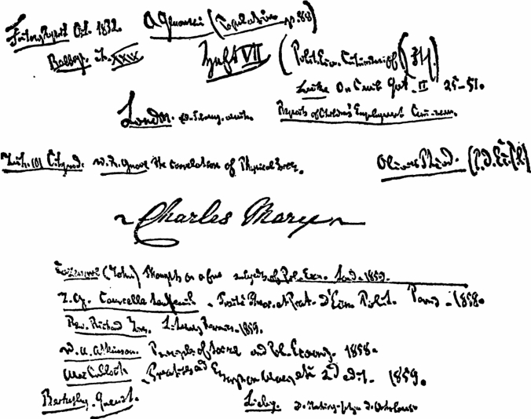

《政治经济学批判》（1857—1858年手稿） 手稿笔记本第Ⅶ本封面

[^v30-c14-annotation-e1861b4638bbe501]: 马克思的这个手稿是后来的《资本论》最初的草稿，包含在马克思用罗马数字注明Ⅰ—Ⅶ的七个笔记本中。在最后一本即第Ⅶ本的封面上，马克思亲笔写明：《Political Economy Criticism of（Fortsetzung）》，即《政治经济学批判（续）》。“续”这个词表示第七本是前六本的继续，而《政治经济学批判》则可以认为是全部手稿的主要标题。马克思在1858年11月29日致恩格斯的信中，谈到自己1857—1858年期间的这部经济学手稿时把它叫作“草稿”。手稿确实具有明显的草稿性质。马克思在1858年5月31日致恩格斯的信中指出，这个手稿“很乱，其中有许多东西只是以后的篇章才用得上”。手稿一开始是第2章，即《货币章》，后面接着是篇幅很大的第3章，即《资本章》。在手稿的最后一页上，马克思起草了第1章的开头，这一章应该是论述商品的，不过马克思当时还把它放在《价值》的标题下。手稿的写作很可能始于1857年底，因为马克思在第Ⅰ笔记本第46页（见本卷第166页）上引用了1857年11月8日《每周快讯》上的一段话。但也不排除另一种可能性，即马克思在此之前就已开始了手稿的写作，不过中断了较长的时间。因为马克思在1857年1月10日致恩格斯的信中已经对达里蒙的著作作了简短评论，手稿第Ⅰ笔记本第18页（见本卷第101—102页）上还引用了1857年1月24日《经济学家》杂志和1857年2月12日《晨星报》的一些话。但无论如何，第Ⅰ笔记本的结尾部分不可能早于1857年11月8日。这部手稿不是为出版而写的，它很少分段，并不是按事先确定的计划写的，相反，它的结构是在写作过程中逐步形成的。马克思在写作时，利用了他在40年代特别是50年代写的大量摘录笔记，许多引文注有这些摘录笔记的页码。在本卷中，这部手稿是按照马克思原来的顺序刊印的，不过由编者加了些标题，划分了节和小节，并把过长的段落划分成较短的段落。只有在极个别场合，即非常明显地可以看出是前面内容的补充的地方，才作了个别的挪动。这些极个别的挪动之处都在方括号内标明了笔记本的号数和页码。马克思、恩格斯在世时，本手稿没有发表，1939—1941年第一次在莫斯科用德文原文出版，编者加的标题是《政治经济学批判大纲（草稿）》。——55。
<!-- END SOURCE v30c14 -->

<!-- BEGIN SOURCE v30c15 OEBPS/chapters/chapter-0015.xhtml -->
### ［Ⅰ—1］Ⅱ.货币章 [^v30-c15-annotation-e5e6ead3662b4f45]

[^v30-c15-annotation-e5e6ead3662b4f45]: 马克思把蒲鲁东主义者阿·达里蒙的著作《论银行改革》（1856年巴黎版）作为《货币章》的起点，对它进行了尖锐的批判。马克思在1857年1月10日致恩格斯的信中提到过达里蒙的这本书。马克思在《货币章》里不是仅仅批判了蒲鲁东主义者关于货币和银行在资本主义社会中作用的幻想，而是在深入研究中分析了作为商品发展的必然结果的货币的形成和本质。《货币章》这一标题是马克思后来补加的，他以后又补加了罗马数字“Ⅱ”。引文后圆括号里的数字指的是达里蒙的著作《论银行改革》的页码。——59。
<!-- END SOURCE v30c15 -->

<!-- BEGIN SOURCE v30c16 OEBPS/chapters/chapter-0016.xhtml -->
#### 阿尔弗勒德·达里蒙《论银行改革》1856年巴黎版

Ⅰ.

“一切弊病，都来自人们顽固地保持贵金属在流通和交换中的优势地位。”（［达里蒙《论银行改革》1856年巴黎版］第1—2页）

达里蒙开头就谈到1855年10月法兰西银行为制止其库存现金不断减少而采取的措施（第2页）。他想给我们提供这家银行在10月采取措施前的最后五个月中的状况的统计表。为此目的，他把这家银行这五个月中每个月的金银储备和“证券总存额的波动”即这家银行贴现的数量（在它的证券总存额中的商业证券即汇票的数量）加以对比。按照达里蒙的说法，表明银行持有的证券的价值的数字，

“代表公众所感到的对银行服务的或大或小的需要，或者代表流通的需要，而这两者是一回事”（第2页）。

两者是一回事吗？根本不是。如果待贴现的汇票的数量同“流通的需要”，即真正的货币流通的需要是一回事，那么，银行券的流通就必然由贴现的汇票的数量决定。但这种运动，平均说来，不仅不是平行的，而且往往是相反的。贴现的汇票的数量及其波动，表明信贷的需要，而流通的货币的数量是由完全不同的影响决定的。如果要得出关于流通的结论，达里蒙首先应当在金银储备栏和贴现的汇票栏之外，再加上流通的银行券总额栏。

实际上很明显，要谈论流通的需要，首先应该弄清楚实际流通中的波动。把对比中的这一必要环节略去，立即暴露出他一知半解，非常拙劣，并且故意把信贷的需要和货币流通的需要混淆起来，——蒲鲁东式的智慧的全部秘密事实上正是建立在这种混淆之上的。（死亡统计表的一方是疾病，另一方是死亡事件，而出生情况却被忘记了。）

达里蒙提出的两栏（见第3页），一方是4月至9月银行的金属储备栏，另一方是银行的证券总存额的变动栏，它们所反映的无非是并不需要用统计例证来说明的同义反复的事实：交到银行多少汇票，就从银行取出多少金属，银行的证券总存额中就增添多少汇票，银行的地库就失去多少金属。甚至连达里蒙想用他的表来证明的这种同义反复，在他的表中也不是表现得很清楚。这个表倒是表明，从1855年4月12日至9月13日，银行的金属储备大约减少14 400万，而银行的证券总存额中的证券，却大约增加10 100万[^v30-c16-annotation-3b3b229ed46fe354]。因此，金银储备的减少额比所贴现的商业证券的增加额多4 300万。五个月变动的这个总结果表明，两种变动不是一回事。

把数字更仔细地对比一下，我们就看到另外的不一致。

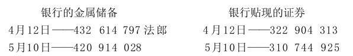
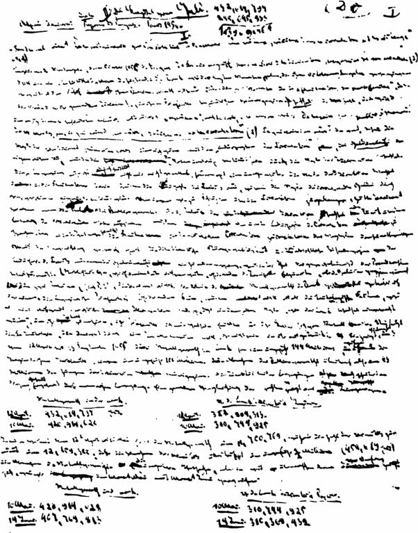

《政治经济学批判》（1857—1858年手稿） 手稿笔记本第Ⅰ本第1页

换句话说，从4月12日至5月10日，金属储备减少11 700 769，而证券的数目增加[^v30-c16-annotation-5682fb87400cfe77]12 159 388；也就是说，证券的增加额比金属储备的减少额大约多50万（458 619法郎）。如果我们把5月同6月加以对比，那就会出现更令人吃惊的相反的事实：

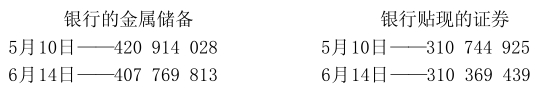

［Ⅰ—2］可见，从5月10日至6月14日，金属储备减少13 144 215法郎。银行的证券是不是以同样程度增加了呢？相反，在这期间，银行的证券减少375 486法郎。因此，在这里，我们看见的不再是一方减少、另一方增加的单纯量上的不成比例。两种变动本身的反比例关系消失了。一方大幅度减少，而另一方相对来说减少较少。

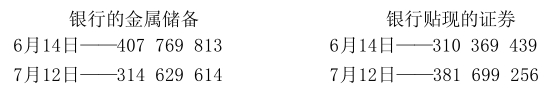

6月和7月的对比表明，金属储备减少93 140 199，证券增加71 329 817，也就是说，金属储备的减少额比证券总存额的增加额多21 810 382法郎。

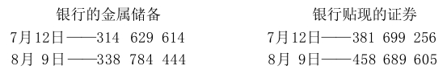

我们看见双方都增加了，金属储备一方增加24 154 830，证券总存额一方增加多得多，达76 990 349法郎。

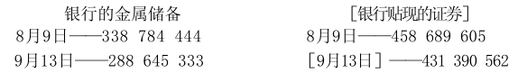

在这里，金属储备减少50 139 111法郎，同时证券减少27 299 043法郎（尽管法兰西银行采取了限制措施，1855年12月它的库存现金仍然减少2 400万）。

烧公鹅的调料，也是烧母鹅的调料。对五个月的连续对比得出的实际情况，同达里蒙先生对头尾两个月所作的对比得出的实际情况，是同样可信的。对比表明了什么？实际情况是错综复杂的。——有两次是证券总存额增加，同时金属储备减少，不过后者的减少额赶不上前者的增加额（4月至5月和6月至7月）。有两次是金属储备减少，同时证券总存额减少，不过后者的减少额赶不上前者的减少额（5月至6月和8月至9月）。最后，有一次是金属储备增加，证券总存额也增加，不过前者赶不上后者。

一方减少，另一方增加；双方都减少；双方都增加；因此，可以是各种情况，而恰好不是始终不变的规律，首先不是反比例的关系，甚至也不是相互作用，因为证券总存额的减少不可能是金属储备减少的原因，而证券总存额的增加不可能是金属储备增加的原因。甚至连达里蒙对头尾两个月所作的孤立的对比，也不能证实反比例的关系和相互作用。既然证券总存额的增加额10 100万抵不上金属储备的减少额14 400万，那剩下的可能性就是，一方的增加［Ⅰ—3］同另一方的减少之间根本没有因果联系。统计例证没有作出回答，倒是提出了大量错综复杂的问题，不再是一个谜，而是一大堆谜。

如果达里蒙先生除了他的金属储备栏和证券总存额（贴现的证券）栏之外，还提出“银行券流通”栏和“存款”栏，那么谜事实上就会消失。如果金属储备一方的减少额小于证券总存额的增加额，那可以这样来说明：金属的储存同时增加了；或者一部分为贴现而发行的银行券没有换成金属，而是仍然在流通中，最后，或者发行的银行券没有使通货增多，而立即以存款的形式或以支付到期汇票的形式流回了。如果金属储备减少，同时证券总存额减少较少，则可以这样来说明：从银行取出了存款，或者人们拿银行券向银行兑换金属，于是银行自己的贴现业务受到取出的存款或兑现的银行券的所有者的损害。最后，如果金属储备减少较少，同时证券总存额减少也较少，这也可以用同样的原因来说明（我们把为补偿国内的银币而发生的流出完全撇开，因为达里蒙没有把这一点包括在他的考察范围之内）。

但是，这些可以这样互相说明的各栏，也会证明他本来不想证明的东西，那就是：银行方面要满足日益增长的商业需要，并不一定要增加它的银行券的流通；这种流通的减少或增加并不与银行的金属储备的减少或增加相符合；银行不能控制流通手段的数量等等，——这些结果全都不合达里蒙先生的心意。由于他匆忙地大喊大叫地提出他的先入之见，即以银行的金属储备为代表的银行的金属基础同他所谓的以证券总存额为代表的流通的需要之间的对立，所以他就列出这两栏而撇开了它们的必要的补充，但把这两栏这样地孤立起来，它们就失去了任何意义，或至多证明事情和他的愿望是相反的。我们之所以谈论这件事情，是为了用一个例子来说明蒲鲁东派的统计的和实证的例证的全部价值。经济事实并没有验证他们的理论，而是证明他们不会掌握和利用事实。他们利用事实的方式倒是表明了他们的理论抽象是怎样产生的。

我们往下看达里蒙讲了些什么。

当法兰西银行看到它的金属储备减少14 400万，它的证券总存额增加10 100万的时候，就在1855年10月4日和18日对它的地库采取了保护措施，以免受证券总存额的影响。它接连地把贴现率从4%提高到5%，从5%提高到6%，并且把汇票贴现的期限从90天减少到75天。换句话说，银行使商业取得金属的条件变得困难了。这证明了什么呢？

达里蒙说：“这证明了，一个按照现行原则组织起来的，即建立在金银的统治地位上的银行，正是在公众最需要它服务的时候，逃避为公众服务。”（同上，第3页）

难道达里蒙先生需要用他的数字来证明，需求向供给提出的要求（和超过供给）有多少，供给就使它的服务变贵多少？在银行面前代表“公众”的先生们不是遵循同样的“令人愉快的生活习惯”[^v30-c16-jz_1_94]吗？博爱的谷物商人把他们的汇票提交银行兑现，以便取得银行券，用银行券兑换银行的黄金，用银行的黄金换取外国的谷物，用外国的谷物换取法国公众的货币，难道他们的出发点是考虑到：因为公众现在最需要谷物，所以他们有义务在较便宜的条件下把谷物出让给公众吗？或者不如说，难道他们不是求助于银行，以便利用谷物价格的上涨，公众的急需，谷物的供求失调而捞到好处吗？银行可以不受这个普遍的经济规律的支配吗？这是什么样的想法！

但是不妨认为现今的银行组织有可能储存大量黄金，使那种在粮荒时可以按照对国民最有利的方式使用的购买手段处于闲置状态，使本来应该通过生产的转化而获利［Ⅰ—4］的资本成为非生产的和呆滞的流通基础。因此，在这种情况下，问题在于，在现今的银行组织中，非生产的金属储备仍然超过它的必要的最低限额，因为流通中金银的节省还没有达到它的经济极限。这是同一基础上的量的多少问题。但是，问题就会从社会主义的高处降到资产阶级实践的平地上来，而我们发现，英国资产阶级中反对英格兰银行的大多数人就是在这个平地上绕来绕去的。怎样的坠落啊！

或者问题不在于通过银行券和其他银行手段节省多少金属，而在于完全抛弃金属基础？但这样一来，统计寓言及其寓意又都不适用了。如果银行不管在什么条件下，在急需时，都要把贵金属运往国外，那么，它必须预先积累贵金属，而如果要外国接受贵金属以换出它的商品，那么，贵金属就必须已经保持住了自己的统治地位。

达里蒙认为，夺走银行的贵金属的原因是歉收，从而必须从国外进口粮食。他忘记了蚕丝减产，因而必须从中国大量购入蚕丝。达里蒙还说，在最近几个月的巴黎工业博览会[^v30-c16-annotation-d0bb448bce9b819f]期间进行了巨大的、为数众多的交易活动。他又忘记了动产信用公司及其竞争者在国外进行的大量投机活动和企业活动，它们进行这些活动，正如伊萨克·贝列拉所说，是要表明，法国资本比其他资本出色的地方是它的世界性，正如法国语言比其他语言出色的地方是它的世界性一样。此外还要加上东方战争[^v30-c16-annotation-6a562acd5ce1f098]引起的非生产开支：75 000万债款。

因此，一方面是法国两个最重要的生产部门突然大量减产！另一方面是在国外市场上，在那些根本不创造直接的等价物，其中一部分可能从来不能弥补自己的生产费用的企业中，不寻常地使用法国资本！一方面，为了通过进口来弥补国内生产的缩减，另一方面，为了适应国外工业企业的增长，所需要的都不是用于等价物交换的流通符号，而是等价物本身，不是货币，而是资本。法国国内生产的缩减无论如何不是法国资本在国外活动的等价物。

现在假定，法兰西银行不是建立在金属基础上，并且外国愿意接受任何形式的，而不只是贵金属这种特殊形式的法国等价物或法国资本。难道银行不正是在“公众”最急需它的服务的时候，也被迫提高它的贴现条件吗？银行用来为公众的汇票进行贴现的银行券，现在无非是取得金银的凭证。而在我们的假设下，它们就会是取得国家的产品储备和直接可以利用的劳动力的凭证：产品储备是有限的，而劳动力只是在非常肯定的限度内和在一定的时期内才能增加。另一方面，印刷纸币的机器是不会疲惫的，好像魔杖一挥就会转动。同时，当谷物和蚕茧歉收，使国家的可供直接交换的财富大大减少的时候，国外的铁路、矿山等企业却把这种可供直接交换的财富固定在这样一种形式上，这种形式不创造直接的等价物，因而一时无偿地吞没了这种财富！因此，可供直接交换的、能够流通的、可以运到外国去的国家财富是绝对地减少了！另一方面，银行凭证是无限制地增加了。直接的结果是产品、原料和劳动的价格上涨。另一方面是银行凭证价格下跌。银行不能靠魔杖一挥使国家财富增加，而只会通过十分平常的活动使自己的纸币贬值。随着这种贬值而来的，难道不是生产的突然瘫痪 ？

不是这样——蒲鲁东主义者叫道。我们的新的银行组织不会［Ⅰ—5］满足于这种消极的业绩：废除金属基础，而让其余一切仍旧是老样子。它会创造崭新的生产条件和交往条件，因而在崭新的前提下进行干预。难道现代银行的出现在当时不也使生产条件发生革命吗？如果没有银行促成的信贷的积聚，没有银行创立的、与地租相对立的国债利息，从而没有与地产相对立的金融，没有与地主相对立的金融家，如果没有这种新的流通设施，难道会有现代大工业、股份企业等等，会有这些既是现代工商业的产物、又是现代工商业的生产条件的成千上万种形式的流通券吗？

在这里，我们涉及到基本问题，它同起点已经不再有联系。这个问题一般说来就是：是否能够通过改变流通工具——改变流通组织——而使现存的生产关系和与这些关系相适应的分配关系发生革命？进一步要问的是：如果不触动现存的生产关系和建立在这些关系上的社会关系，是否能够对流通进行这样的改造？如果流通的每一次这样的改造本身，又是以其他生产条件的改变和社会变革为前提的，那么，下面这种学说自然一开始就是站不住脚的，这种学说提出一套流通把戏，以图一方面避免这些改变的暴力性质，另一方面要让这些改变本身不是成为改造流通的前提，而相反地成为改造流通的逐步产生的结果。这一基本前提的荒谬足以证明，这种学说同样不了解生产关系、分配关系和流通关系之间的内部联系。

上述历史上的例证当然不可能具有决定性的意义，因为现代信用设施既是资本积聚的结果，又是资本积聚的原因，它只构成资本积聚的一个要素，而财产的积聚既因流通的缺乏（如在古罗马）而加快，也因流通的易于进行而加快。

接下来应该研究，或者不如说应该提出一个普遍性的问题：货币的各种不同的文明形式——金属货币、纸币、信用货币、劳动货币（后者作为社会主义的形式）——能否达到对它们提出的要求，而又不消灭在货币范畴上表现出来的生产关系本身；另一方面，想通过一种关系的形式上的改变而摆脱这种关系的重要条件，这是否又是一个自行取消的要求？货币的不同形式可能更好地适应不同阶段的社会生产；一种货币形式可能消除另一种货币形式无法克服的缺点；但是，只要它们仍然是货币形式，只要货币仍然是一种重要的生产关系，那么，任何货币形式都不可能消除货币关系固有的矛盾，而只能在这种或那种形式上代表这些矛盾。任何雇佣劳动的形式，即使一种形式能够消除另一种形式的缺点，也不能消除雇佣劳动本身的缺点。一种杠杆可能比另一种杠杆更好地克服静止的物质的阻力。但是，每种杠杆都是以阻力始终存在这一点为依据的。

关于流通同其余的生产关系的关系这个一般性的问题当然只能在结束部分提出来。从一开始就值得怀疑的是，蒲鲁东及其同伙从来就没有直截了当地提出这个问题，而只是偶尔装腔作势地叫喊一番。凡涉及到这个问题的地方，每次都应该密切注意。

从达里蒙的开头部分就可以看出，他把货币流通和信贷完全等同起来，这在经济学中是错误的。（附带指出，无息信贷无非是财产就是盗窃[^v30-c16-annotation-7633f0e19585f031]这一论点的虚伪的、市侩的、怯懦的形式。不是让工人从资本家那里夺取资本，而是让资本家不得不把资本交给工人。）这个问题以后还要谈。

至于所讨论的题目本身，达里蒙只得出这样的结论：银行出卖信贷，就像商人出卖商品，工人出卖劳动一样，当需求与供给相比增加的时候，就卖得贵一些，也就是说，正当公众最需要银行的服务的时候，银行使公众得到它的服务变得困难了。我们看到，不管银行发行可兑现的还是不可兑现的银行券，它都必须这样做。

法兰西银行在1855年10月的做法引起了一片“大喊大叫声”（同上，第4页），引起了银行和公众代言人之间的一场“大争论”。达里蒙对这场争论进行总结或者说佯装进行总结。我们在这里只是顺便地看看他总结些什么，因为他的总结表明论战双方的弱点，他们经常随意离题，在外部原因上兜圈子。论战双方的每一方都随时抛掉自己的武器，找出另外的武器。双方之所以交不了锋，不仅是因为他们经常调换他们用来战斗的武器，而且也因为他们只要在一个场地上相遇，就立即逃到另一个场地上去。

（从1806年至1855年，法国的贴现率没有达到过6%；50年来，商业汇票最长的支付期限几乎始终是90天。）

达里蒙让银行自我辩护时所带有的弱点，以及他自己的错误见解，例如，从他的虚构的对话中的下列地方［Ⅰ—6］就可以看出来：

银行的反对者说：

“由于您的垄断，您成了信贷的分配者和调节者。当您显得严厉的时候，贴现业者不仅模仿您，并且比您更严厉……由于您的一些措施，您已经使营业停滞。”（同上，第5页）

银行则说，并且是“谦恭地”说：

“您想要我怎样做？——银行谦恭地说……——为了提防外国人，我必须提防本国同胞……首先我必须阻止硬币的外流，没有硬币我就什么也不是，什么也做不了。”（同上，第5页）

银行被说得荒谬可笑。让它离开问题，说一番空话，以便人们有可能也用空话来回答它。在这一对话中，银行也抱有达里蒙的幻想：银行由于自己的垄断确实调节着信贷。实际上，银行的权力只是在私人“贴现业者”的权力终止的地方才开始，也就是说，在它的权力本身已经受到极大限制的时候才开始。在货币市场松动、每人都按

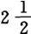%进行贴现时，让银行仍然按5%贴现，这时，贴现业者就不会模仿它，而会把一切贴现业务从它鼻子底下夺走。1844年法令[^v30-c16-annotation-cbac97e82738de30]实行以来的英格兰银行的历史再清楚不过地说明了这一点。这个法律使英格兰银行在贴现业务等等方面成为私人银行家的真正对手。英格兰银行为了在货币市场松动时期保证自己在贴现业务方面占有一个份额，并且是日益增多的份额，经常被迫降低贴现率，不仅降低到私人银行家的水平，而且往往更低。因此，银行“对信贷的调节”应该有保留地来理解，而达里蒙却把自己关于银行无条件地控制货币市场和信贷的偏见当作出发点。

达里蒙不是批判地研究银行对货币市场拥有真正权力的条件，而是立即抓住这样一句话：硬币对于银行说来就是一切，银行必须防止硬币流往国外。法兰西学院[^v30-c16-annotation-9b2e7aa2d9ca6cb9]的一位教授（舍伐利埃）回答说：

“金银是同其他一切商品一样的商品……银行的金属储备之所以需要，只是为了在紧急时期把它运往国外去买东西。”

银行回答说：

“金属货币不是同其他商品一样的商品，而是交换工具，由于这一称号，它享有为其他一切商品规定法律的特权。”

在这里，达里蒙突然在战斗双方之间出现：

“因此，不仅现今的危机，而且周期性的商业危机，都应该归因于金银享有的这种特权，即唯有金银才能充当可靠的流通工具和交换工具。”

为了消除危机造成的种种不愉快，

“只要做到下面这一点就够了：金银成为同其他商品一样的商品，或者，准确地说，一切商品都具有和金银一样的等级（由于同样的名义）而成为交换工具；产品确实同产品交换”（同上，第5—7页）。

在这里，把争论的问题想象得多么肤浅。既然银行发行货币凭证（银行券）和可用金（银）偿还的资本债券（存款），那么，不言而喻，银行对自己的金属储备的减少只能在一定的程度内听任和容忍，而不予理会。这种论调同金属货币理论毫无关系。达里蒙的危机理论我们以后还要谈到。

在《流通危机简史》[^v30-c16-annotation-402d9dd0424c19eb]一章中，达里蒙先生略而不谈1809—1811年英国的危机，仅仅在谈到1810年时，指出任命金条委员会[^v30-c16-annotation-a79f870292a802c7]，在谈到1811年时，又略去了实际的危机（1809年开始），而只提到两点：一是下院通过的决议：

“银行券同金银条块相比的贬值，不是由纸币的贬值引起的，而是由金银条块的腾贵引起的”；

二是持相反论断的李嘉图的小册子[^v30-c16-jz_1_101]，他认为从李嘉图的论断中应得出如下结论：

“最完善状态的货币是纸币”（第22—23页）。

在这里，1809到1811年的危机是重要的，因为银行当时发行的是不可兑现的银行券，可见，危机决不是由银行券可兑换成金（金属）而产生的，因此，也决不能通过废除这种可兑换性来加以防止。达里蒙用灵巧的裁剪手法避开了这些会驳倒他的危机理论的事实。他抓住李嘉图的格言，虽然这与问题的实际内容和小册子——论银行券的贬值——的实际内容毫无关系。他忽略了李嘉图的货币理论及其错误的前提已经完全被驳倒。这种理论的错误前提是认为银行控制流通的银行券的数量，流通手段的数量决定价格，然而情况正好相反，是价格决定流通手段的数量等等。在李嘉图时代，对货币流通现象还没有作任何详细的研究。这一点顺便提一下。

金银是同其他商品一样的商品。金银不是同其他商品一样的商品：作为一般交换工具，金银是享有特权的商品，并且正是由于这种特权，金银使其他商品降了级。这就是达里蒙对这种对立所作的最终分析。达里蒙最后做出判决：要废除金银的特权，把它们降到其他一切商品的等级。那时，你们消除的不是金银货币的特有的弊病，或者说可以兑换成金银的银行券的特有的弊病。你们消除的是一切弊病。或者不如说，把一切商品提高到现在只有金银才享有的垄断地位。让教皇存在，但是使每个人都成为教皇。废除货币，办法是你们把每个商品都变成货币，并且赋予它以货币的特性。

在这里，不禁要问，这个问题是否表明了它本身的荒谬，因而，任务所提出的条件本身已经包含着这个问题不可能得到解决。回答往往只能是对问题的批判，而问题往往只能［Ⅰ—7］由对问题本身的否定来解决。

实际问题是：资产阶级交换制度本身是否需要一种特有的交换工具？它是否必然会创造一种一切价值的等价物？这种交换工具的或这种等价物的一种形式可能比其他形式更顺手、更合适、更少一些不便。但是，由一种特殊的交换工具，一种特殊的然而又是一般的等价物的存在而造成的不便，必然会在任何一种——虽然各不相同的——形式中重复产生。当然，达里蒙竭力回避这个问题本身。要废除货币而又不要废除货币！要废除金银由于作为货币这种排他物而具有的排他的特权，但是要把一切商品变成货币，也就是说，要使一切商品都具有离开排他性就不再存在的属性。

在贵金属的外流中确实出现了矛盾，达里蒙对这一矛盾的理解以及克服办法是同样肤浅的。显然，金银不是同其他商品一样的商品，而现代经济学突然惊恐地看到，它竟不时一再地回到重商主义体系的偏见上去。英国经济学家企图通过某种区分来克服困难。他们说，在发生这种货币危机的时候，所需要的不是作为货币的金银，不是作为铸币的金银，而是作为资本的金银。他们忘记加上一句：资本，然而是在一定的金银形式上的资本。如果任何形式上的资本都能够输出，那么，为什么输出的恰恰是这种商品，而大多数其他商品却由于输出不足而跌价呢？

我们举些特定的例子来说：贵金属外流是由于国内某种主要食物（例如谷物）歉收，是由于某种进口的主要消费品（例如茶叶）在国外歉收并因而涨价引起的；贵金属外流是由于具有决定意义的工业原料（棉花、羊毛、丝、亚麻）歉收引起的；贵金属外流是由于进口过剩（因投机、战争等等）引起的。在国内歉收的情况下，对（谷物、茶叶、棉花、亚麻等）突然的或长期的减产进行补偿，给国民带来双重的损害。国民所投的资本的或劳动的一部分不能再生产出来——这是生产的真正缩减。为了填补这一漏洞，必须拿出再生产出来的资本的一部分，而且这一部分同减产量并不是形成简单的算术比例，因为欠缺的产品由于供给减少，需求增大，在世界市场上会涨价，而且必然会涨价。

必须仔细地研究，如果抛开货币不说，这类危机会呈现出什么样子，而在这里既定的关系内，货币带来什么样的规定性。（谷物歉收和进口过剩是主要的场合。战争是不言而喻的，因为直接从经济上来看，这就像一个国家把自己的一部分资本扔到水中一样。）

谷物歉收的场合。把该国同另一个国家加以比较，那就很清楚，它的资本（不仅是它的实际财富）减少了，这就像一个农民把做面包的生面团烧掉了，他不得不向面包师购买，于是他少掉了购买面包的金额。至于国内，看来，谷物价格的上涨，就价值来说，使一切仍保持原状。只不过撇开下面这一点不说：在真正歉收的情况下，减少的谷物数量乘以上涨的价格，决不等于正常的谷物数量乘以较低的价格。

假定英国只生产1夸特小麦，而这1夸特小麦的价格达到以前3 000万夸特小麦的价格。在这种情况下，撇开该国缺少再生产生命和谷物的手段不说，如果我们假定再生产1夸特小麦所需要的工作日为a，那么，该国就要以a×3 000万工作日（生产费用[^v30-c16-annotation-2af536349951fa9a]）来交换a×1工作日（产品）；它的资本的生产力就会减小到原来的几千万分之一，而国内拥有的价值总额就会减少，因为每个工作日就会贬值到原来的三千万分之一。每一份资本现在只代表自己以前价值的、自己的等价物即生产费用的

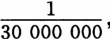虽然在上述场合一国资本的名义价值并未减少（把土地的跌价撇开不说），因为其余产品的价值的减少正好由1夸特小麦的价值的增加所补偿。小麦价格提高到3 000万倍就是其余一切产品以同样程度跌价的表现。

此外，本国和外国的这种区别是完全虚妄的。一个国家，谷物遭到歉收，向外国购买谷物，这个国家同外国的关系，和这个国家的每个个人同租地农场主或谷物商人的关系是一样的。个人必须用于购买谷物的追加数额，是他的资本即他自行支配的资金的直接减少。

为了使问题不致被一些不重要的影响搞混，应该假定一国实行粮食的自由买卖。即使进口的谷物像自己生产的谷物一样便宜，该国仍然少掉了租地农场主没有再生产出来的那部分资本。但是，在我们所作的假定下，该国进口的外国谷物的数量总是等于正常价格下可能进口的数量。因此，进口的增长是以价格上涨为前提的。

谷物价格的上涨等于其余一切商品价格的下跌。一夸特谷物的生产费用（表现为价格）的提高，等于在其他一切形式上存在的资本的生产率的降低。用于购买谷物的数额增加了，对其他一切产品的购买必然相应减少，因而这些产品的价格必然相应降低。不管是有或没有金属货币或其他任何货币，该国会处于危机之中，这场危机不仅波及谷物，而且波及其他一切生产部门，这不仅因为它们的生产率确实降低了，它们的产品的价格同正常生产费用所决定的价值相比下降了，而且也因为一切契约、债务等等都是以产品的平均价格为基础的。举例来说，必须提供x舍费耳谷物来支付国债，而这x舍费耳的生产费用按一定的比例增加了。

因此，完全不考虑货币的情况，［Ⅰ—8］该国也会处于普遍危机之中。不仅撇开货币，甚至撇开产品的交换价值不说，产品仍会贬值，该国的生产率仍会下降，而该国的一切经济关系是以它的劳动的某种平均生产率为基础的。

因此，谷物歉收引起的危机决不是由贵金属外流造成的，虽然为制止这种外流而设置的障碍可以加剧这种危机。

无论如何也不能附和蒲鲁东[^v30-c16-annotation-b3a4b641443872b0]，说什么危机之所以产生，是由于只有贵金属同其他商品相对立而具有可靠的价值；这是因为，仔细考察一下，谷物价格的上涨只不过意味着必须拿出更多的金银来交换一定量的谷物，也就是说，金银的价格同谷物的价格相比下跌了。因此，金银和其他一切商品一起，同谷物相比贬值了，任何特权也不能保护金银免于贬值。金银同谷物相比的贬值和谷物价格的上涨是一回事。（这并不完全正确。例如一夸特谷物从50先令上涨到100先令，也就是上涨50%，但是棉织品下降100%。这样，银同谷物相比只下降50%，而棉织品（由于需求停滞等等）同银相比下降了100%。[^v30-c16-annotation-590194c67b845725]也就是说，其他一切商品价格的下跌，超过谷物价格的上涨。但是，也有相反的情况。例如，最近几年，谷物有时上涨100%，而工业品并不是按照金同谷物相比下跌的同一比例下跌。这种情况并不直接影响一般原理。）也不能说，金享有特权，是由于金作为铸币，它的量是准确和可靠地规定的。一塔勒（银）在任何情况下始终是一塔勒。同样，一舍费耳小麦始终是一舍费耳，一码麻布始终是一码。

因此，在谷物严重歉收的情况下，大多数商品（包括劳动）的跌价以及由此产生的危机，不能简单地归咎于金的输出，因为即使本国的金根本不输出，外国谷物根本不输入，跌价和危机还是会发生的。危机只是归结于供求规律，大家知道，这一规律在生活必需品领域内（从全国范围来看）所起的作用，比在其他一切领域内所起的作用，要强烈和有力得不可比拟。金的输出不是谷物危机的原因，而谷物危机却是金的输出的原因。

如果就金银本身来考察，那么可以断言，它们只是在两个方面影响危机，使危机的症状更加恶化：（1）金的输出因银行受金属条件的约束而变得困难；银行因而针对这种金的输出所采取的措施对国内流通产生不利的反作用；（2）金的输出是必需的，因为外国只愿意以金的形式而不愿意以任何其他形式接受资本。

即使第一点困难得到克服，第二点困难可能仍然存在。英格兰银行正是当它在法律上有权发行不可兑现的银行券的时期经历这种困难的。银行券同金条相比贬值了，而金的造币局价格同金条价格相比也下跌了。对银行券来说，金成了特种商品。可以说，从银行券名义上代表一定数量的金来说，银行券还依赖于金，而实际上用银行券是不能换回金的。金仍然是银行券的名称，虽然在法律上银行券已经不再能够向银行换回这一数量的金。

只要纸币从金得到名称（也就是说，例如五镑银行券是5索维林的纸代表），对银行券说来，银行券可兑换为金就仍然是经济规律，不管这一规律在政策上是否存在，这是不容置疑的（？）（这要在以后来考察，并且不直接属于所研究的问题）。英格兰银行的银行券在1799—1819年时期[^v30-c16-annotation-a133b714b9508ed1]还继续声称，它们代表一定量金的价值。除了通过银行券实际上支配多少金条这个事实之外，还能通过其他办法来检验这种声明吗？从五镑银行券不再能够得到等于5索维林的金条价值的时刻起，银行券就贬值了，虽然它是不能兑现的。银行券的名称所表明的银行券价值和一定量金的价值相等，立即同银行券和金的实际上的不相等发生矛盾。

因此，坚持把金当作银行券的名称的英国人中间争论的问题，实际上不是银行券兑换为金的问题，——这种兑现只不过是把银行券的名称在理论上所表明的那种相等，从实践上表示出来，——而是怎样保证这种兑现的问题，是通过在法律上对银行作出限制来保证这种兑现呢，还是让这种兑现放任自流呢？持后一种看法的人断言，发行银行凭票据发放贷款，因而它的银行券保证能够流回，这种兑现平均说来是有保证的，而他们的反对者反正从来没有提供比这个平均保证更多的东西。后一情况是事实。顺便说一下，这种平均是不容忽视的，并且平均计算能够和应该既成为银行的根据，也成为一切保险机构等等的根据。站在这方面的，首先是苏格兰的各银行，它们理所当然地被当作典范。

严格的金条主义者则说：他们是认真对待［Ⅰ—9］兑现的；这种兑现的必要性是由银行券本身的命名造成的；银行负有兑现的义务，就使银行券始终成为可兑现的，这就形成对过量发行的限制；他们的反对者是不可兑现论的虚假的维护者。在这两派之间，有各种不同色彩的派别，有一群小的“品种”。

最后，不可兑现论的辩护者，坚定的反金条主义者，自己不知道他们只是不可兑现论的虚假的拥护者，正如他们的反对者只是可兑现论的虚假的拥护者一样，因为反金条主义者坚持银行券的命名，也就是把具有一定命名的银行券同一定金量的实际相等当作计量自己的银行券的十足价值的尺度。

在普鲁士存在着强制流通的纸币。（由于一定量的税必须以纸币支付，就此而言，纸币的流回是有保证的。）这些纸塔勒不是支取银的凭证，根据法律它们不能向任何银行换取银等等。它们不是由商业银行凭票据而贷出的，而是政府为负担自己的费用发出的。但是，它们的命名就是银的命名。一个纸塔勒声称代表和一个银塔勒同样的价值。如果对政府的信任发生根本的动摇，或者这种纸币以大于流通的需要所要求的比例发行，那么，在实践中纸塔勒就不再与银塔勒处于同等地位，就会贬值，因为它会降到它的名称所表示的价值之下。如果不是发生上述情况，而是产生了对银的特别需要，例如，为了输出，使银与纸塔勒相比拥有特权，那么，纸塔勒也会贬值。

因此，可兑换为金银成了以金银命名的任何纸币的实际价值尺度，不管这种纸币在法律上是否可以兑现。名义价值只是像影子那样跟随着它的实体；两者是否一致，那要由它们的实际可兑现性（可交换性）来证明。实际价值降低到名义价值以下就是贬值。实际的互相平行运动，互相交换，就是兑现。就不可兑现的银行券来说，可兑现性不是表现在银行的出纳上，而是表现在具有用金属货币命名的纸币和金属货币之间的日常交换上。实际上，如果不再是通过在全国各地的日常交易，而是要通过在银行出纳处进行特别的大量试验来确认可兑现银行券的可兑现性，那么，这种兑现就已经是受到危害的了。

在苏格兰，纸币在农村中甚至比金属货币更受欢迎。苏格兰在1845年以前，也就是在英国1844年法令强加于它以前，自然也经历了英国的一切社会危机，而有些危机甚至更加厉害，因为“清扫”土地[^v30-c16-annotation-3ad95cbde1208eda]在这里进行得更加肆无忌惮。但是，苏格兰并没有发生真正的货币危机（某些银行由于轻率地提供贷款而破产，这是例外情形，和这里的问题无关）；没有银行券贬值，没有抱怨，没有对于流通的货币的数量是否够用的研究等等。

在这里，苏格兰之所以重要，是因为它一方面表明在现存基础上可以怎样充分调节货币制度——消除达里蒙所抱怨的一切弊病——而不必屏弃现存的社会基础；与此同时，这个社会基础的矛盾、对抗、阶级对立等等比世界上任何其他国家都更为尖锐。

足以说明问题的是，达里蒙和他的保护者，那位为他的书写序的埃米尔·日拉丹——他以理论上的空想来补充前者实践上的欺骗——不是在苏格兰去发现同英格兰银行和法兰西银行这类垄断银行相对立的东西，而是在美国去寻找，而在美国，由于要得到州的特许证，银行制度只在名义上是自由的，那里没有银行的自由竞争，只存在着垄断银行的联邦制度。

确实，苏格兰的银行制度和货币制度是流通魔术师的幻想所碰到的最危险的暗礁。尽管金币或银币（在没有铸币的法定复本位制的地方）对其他一切商品的相对价值经常发生变化，但人们不说金币和银币贬值了。为什么不说呢？因为它们就是它们自己的名称，因为它们的名称不是一种价值的名称，也就是说，它们不是以某一第三种商品来估价，而只是表示自身物质的可除部分，即一索维林等于若干重量的金量。

因此，金在名义上是不可能贬值的，这不是因为只有金才表现可靠的价值，而是因为金作为货币所表现的根本不是价值，而是自身物质的一定量，它在自己额头上标明的，是自己的量的规定性。（以后应当更详细地研究，金币和银币的这种特征归根到底是不是一切货币的内在属性。）

达里蒙及其同伙被金属货币的这种名义上的不可贬值性所迷惑，只看到在危机中表现出来的一个方面：金银同几乎所有其他商品相比升值了；他们没有看到另一个方面：在所谓的繁荣时期，即价格暂时普遍上涨的时期，金银或者货币同其他一切商品（劳动也许除外，但并非总是如此）相比贬值了。由于金属货币（以及以它为基础的一切种类的货币）的这种贬值总是先于它的升值，他们本来应该按相反的方式提出自己的问题：要预防货币的周期重复的贬值（用他们的话来说，就是废除商品对货币的特权）。如果采用后一种提法，任务就会立即解决，这就是要取消价格的涨落。取消价格的涨落就是消灭价格。这也就是废除交换价值。为此就要废除与资产阶级社会组织［Ⅰ—10］相适应的交换。要这样，就要在经济上对资产阶级社会实行革命。可见，一开始本来就可以看到，资产阶级社会的弊病不是通过“改造”银行或建立合理的“货币制度”所能消除的。

可见，可兑现性——法定的或不是法定的——始终是对每一种这样的货币所提出的要求，这种货币的名称使它成为一个价值符号，也就是说，使它和一定量的第三种商品等同。等同已经包含着对立面——可能的不等同；可兑现性包含着它的对立面——不可兑现性；升值包含着贬值，如果用亚里士多德的话来说，就是潜在地包含着。

例如，假定索维林不仅叫作索维林，——这只是一盎司金的x可除部分的尊称（计算名称），正如米是一定长度的尊称一样，——而且它还例如叫作x小时劳动时间。事实上，

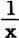盎司金无非是物化的即对象化的x小时劳动时间。但是，金是过去的劳动时间，是一定的劳动时间。它的名称使一定量劳动成为它的标准。一磅金必须能兑现为x小时劳动时间，必须能够随时购买这些劳动时间；一旦它能够购买的劳动时间多了或少了，它就是升值或贬值了；在后一情况下，它的可兑现性就终止了。

决定价值的，不是体现在产品中的劳动时间，而是现在必要的劳动时间。我们就拿一磅金本身来说：假定它是20小时劳动时间的产品。假定由于某些情况，后来生产一磅金只需要10小时。一磅金的名称表明它＝20小时劳动时间，现在它只＝10小时劳动时间，因为20小时劳动时间＝2磅金。10小时劳动实际上交换一磅金；也就是说，一磅金不能再交换20劳动小时。

具有x劳动小时这种平民名称的金币发生的变动，会大于任何其他货币，特别是大于现在的金币；因为金和金相比是不能提高或降低的（它和它本身相等），但是，一定量金包含的过去的劳动时间同现在的活劳动时间相比，必定不断地提高或降低。要使它保持可以兑现，就必须使劳动小时的生产率保持不变。但一般经济规律是，生产费用不断地降低，活劳动的生产率不断地提高，以致对象化在产品中的劳动时间不断地贬值，因此，不断贬值就会是这种金劳动货币不可避免的命运。要防止这种弊病，人们也许会说，不应该让金获得劳动小时的名称，正如魏特林[^v30-c16-annotation-a7f03e31b1ad2678]和在他之前的英国人及在他之后的法国人，其中包括蒲鲁东之流所建议的那样，而应该让纸币即单纯的价值符号来获得这种名称。在这里，体现在纸本身中的劳动时间，和银行券的纸的价值一样，在计算上是微不足道的。纸券将纯粹是劳动小时的代表，正如银行券纯粹是金或银的代表一样。如果劳动小时的生产率提高了，代表劳动小时的纸券的购买力就会提高，反之亦然；正如现在一张五镑银行券会由于金同其他商品相比的相对价值的提高或降低而买到较多或较少的东西一样。

根据会使金劳动货币不断贬值的同一规律，纸劳动货币会不断地升值。社会主义者会说，这正是我们所希望的：工人从自己劳动生产率的提高中会得到快乐，而不像现在他随着劳动生产率的提高创造别人的财富，造成自身的贬值。社会主义者就是这样说的。可是，不幸，这里产生了一些小小的疑虑。

首先：如果我们假定存在着货币，即使这只是小时券，那么我们也必须假定存在着这种货币的积累，存在着以这种货币形式订立的契约、债务和固定负担等等。积累的纸券和新发行的纸券一样，会不断地升值，因此，一方面，劳动生产率的增长使非劳动者得到好处，另一方面，以前缔约的债务负担随着劳动生产率的增长而同步增长。如果世界随时可以重新开始，如果已订立的要用一定量金来偿付的债务没有持续到金价值发生波动的时刻，那么，金价值或银价值的降低或提高就会是完全无关紧要的。在这里，小时券和小时生产率的情况就是这样。

这里应该研究的是小时券的兑现问题。我们通过迂回的道路，也会达到同一目的。虽然为时过早，但还是可以谈一谈作为小时券依据的那些幻想，这些幻想使我们能够看到把蒲鲁东的流通理论和他的一般理论——他的价值决定［Ⅰ—11］理论——联系起来的最深奥的秘密。例如在布雷和格雷那里，我们也能找到这种同样的联系。其中是否有正确的东西作为根据，我们以后再去研究（先要顺便指出：如果银行券单纯被看作金的支取凭证，那么，它要不贬值，它的发行量就不能超过它所要代替的金币量。如果我凭同一十五镑的金，向三个不同的债权人开出三张十五镑的支取凭证，那么，事实上每一张只是

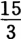镑即5镑的支取凭证。因此，每一张银行券从一开始就贬值到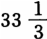%）。

一切商品（包括劳动）的价值（实际交换价值），决定于它们的生产费用，换句话说，决定于制造它们所需要的劳动时间。价格就是这种用货币来表现的商品的交换价值。因此，由那种用劳动时间本身命名的劳动货币来代替金属货币（以及用它命名的纸币或信用货币），就会把商品的实际价值（交换价值）和商品的名义价值、价格、货币价值等同起来。实际价值和名义价值等同，价值和价格等同。但是，要达到这一点，前提只能是：价值和价格只是名义上不同。可是，情况完全不是这样。由劳动时间决定的商品价值，只是商品的平均价值。只要平均数是作为一个时期的平均数合计计算出来的，例如，按25年的咖啡价格平均计算，一磅咖啡值一先令，那么平均数就表现为外在的抽象；但是，如果把平均数同时理解为商品价格在一定时期内所经历的波动的推动力和起推动作用的原则，那么平均数就是十分现实的。

这种现实性不只是具有理论上的重要意义：它是商业投机的基础，因为商业投机进行概率计算时，既要从被它当作价格波动中心的中等平均价格出发，也要从在这个中心以上和以下波动的平均高度和平均低度出发。商品的市场价值总是不同于商品的这个平均价值，总是或者高于或者低于它。

市场价值平均化为实际价值，是由于它不断波动，决不是由于和实际价值这个第三物相等，而是由于和它自身经常不相等（要是黑格尔的话，就会这样说：不是由于抽象的同一性，而是由于不断的否定的否定[^v30-c16-annotation-c836a3b0b172d799]，也就是说，是由于对作为实际价值的否定的它自身的否定）。而实际价值本身——不以它对市场价格波动的支配为转移（撇开它是这些波动的规律不说）——又否定自己，并使商品的实际价值不断和它自身的规定发生矛盾，使现有商品的实际价值贬值或升值——这一点我在我那本驳斥蒲鲁东的小册子中已经指出[^v30-c16-annotation-e0bae449289adc30]，在这里不需要详细论述。

因此，价格和价值的差别不只是像名和实的差别；不只是由于以金和银为名称，而是由于价值表现为价格运动的规律。但是它们不断地不同，从来不一致，或者只是在完全偶然和例外的情况下才一致。商品价格不断高于或低于商品价值，商品价值本身只存在于商品价格的上涨和下跌之中。供求不断决定商品价格；供求从来不一致，或者只是在偶然的情况下才一致；而生产费用又决定供求的波动。

表现商品价格的，表现商品市场价值的金或银，本身是一定量的积累劳动，是一定数量的物化劳动时间。假定商品的生产费用和金银的生产费用都保持不变，商品市场价格的上涨或下跌就无非表示，一个等于x劳动时间的商品，在市场上不断地支配着大于或小于x的劳动时间，不断地高于或低于由劳动时间决定的这一商品的平均价值。

主张实行小时券的人的第一个基本错觉在于：他们以为只要取消实际价值和市场价值之间，交换价值和价格之间名义上的差别，——也就是说，不用劳动时间的一定对象化，比如说金和银，而用劳动时间本身来表现价值，——他们也就消除了价格和价值之间的实际差别和矛盾。这样说来，不言而喻，单是实行小时券，资产阶级生产的一切危机，一切弊病就都消除了。商品的货币价格＝商品的实际价值；需求＝供给；生产＝消费；既废除货币，又保存货币；似乎只要确认生产商品的、物化在商品中的劳动时间，就能以价值符号，货币，以小时券的形式创造出一种和这种劳动时间相当的摹本。这样一来，每个商品就会直接转化为货币，而金和银则下降到其他一切商品的等级。

没有必要详细地说明，交换价值和价格之间的矛盾——平均价格和价格（其平均数就是平均价格）之间的矛盾——，一定量和其平均量之间的差别，［Ⅰ—12］是不会由于下面这种办法而消除的：取消这两者的单纯名称的差别，即不说1磅面包值8便士，而说1磅面包＝

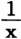劳动小时。相反，如果8便士＝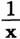劳动小时，如果物化在1磅面包中的劳动时间多于或少于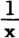劳动小时，那么，由于价值尺度同时又是表现价格的要素，价值和价格之间的差别只会使它们的隐藏在金价格和银价格中的差别明显地表现出来。这样就会得出一个无限的等式。（包含在8便士中或由一张纸券表现的）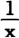劳动小时大于或小于（包含在1磅面包中的）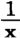劳动小时。

代表平均劳动时间的小时券决不会和实际劳动时间一致，也决不能和它兑换；也就是说，对象化在一个商品中的劳动时间，所能支配的决不是和它本身等量的劳动货币，反过来说也一样，而是较多或较少的劳动货币，正如现在市场价值的任何波动都表现为其金价格和银价格的提高或降低。

我们在前面已经讲过[^v30-c16-jz_1_115]，商品同小时券相比——在一个较长时期内——的不断贬值，产生于劳动时间的生产率不断提高的规律，产生于相对价值本身的混乱，这种混乱是由相对价值固有的原则即劳动时间所造成的。我们现在说的小时券不可兑换无非是实际价值和市场价值之间，交换价值和价格之间不可兑换的另一种说法。小时券和一切商品相反，代表一个观念上的劳动时间，这个劳动时间有时交换较多的实际劳动时间，有时交换较少的实际劳动时间，并且在纸券上取得一种和这一实际不等相适应的、独立的、特有的存在。商品的一般等价物、流通手段和尺度，又会作为个体化的、遵循自身规律的、异化的东西和商品相对立，也就是说，它具有现在的货币的一切属性，而不提供这种货币的服务。但是，由于比较各商品即各对象化劳动时间量所用的手段，不是一个第三种商品，而是这些商品本身的价值尺度即劳动时间本身，所以混乱就更严重了。

商品a，3小时劳动时间的对象化＝2劳动小时券；商品b，也是3劳动小时的对象化＝4劳动小时券。这个矛盾事实上已表现在货币价格中，只是隐蔽地表现罢了。价格和价值之间的差别，用生产商品的劳动时间来衡量的商品和这个商品与之交换的劳动时间的产品之间的差别，需要有一个第三种商品来充当表现商品的实际交换价值的尺度。由于价格不等于价值，所以决定价值的要素——劳动时间——就不可能是表现价格的要素，因为不然的话，劳动时间就会同时是决定者，又不是决定者，和自身相等，又和自身不相等。因为劳动时间作为价值尺度，只是观念地存在着，所以它不能充当对价格进行比较的材料。（在这里，同时弄清楚了，价值关系是怎样和为什么在货币上取得了物质的、独立的存在。这一点在后面再详细论述。）价格和价值的差别，需要以另外一种尺度而不是以价值本身的尺度去衡量作为价格的价值。和价值不同，价格必然是货币价格。由此可见，价格和价值之间名义上的差别，是由它们实际上的差别决定的。

[^v30-c16-jz_1_94]: 歌德《爱格蒙特》第5幕。——编者注

[^v30-c16-jz_1_101]: 指李嘉图《金银条块价格高昂是银行券贬值的证明》1810年伦敦版。——编者注

[^v30-c16-jz_1_115]: 见本卷第82—83页。——编者注

[^v30-c16-annotation-3b3b229ed46fe354]: 马克思采用了达里蒙著作中的数字10100万，但正确的数字很可能是10800万。——60、64、66。

[^v30-c16-annotation-5682fb87400cfe77]: 从列举的数字来看，应为“减少”。据此，以下的有关数字和结论也应作相应的变动。不过，这并不影响马克思从达里蒙的统计表中得出的结论。——63。

[^v30-c16-annotation-d0bb448bce9b819f]: 巴黎世界工业博览会于1855年5—11月举行。——67。

[^v30-c16-annotation-6a562acd5ce1f098]: 东方战争即克里木战争，是1853—1856年俄国同英国、法国、土耳其和撒丁的联盟的战争。战争是由于这些国家在近东的经济政治利益冲突引起的，俄国战败，战争以签订巴黎和约而结束。——67。

[^v30-c16-annotation-7633f0e19585f031]: “财产就是盗窃”的论点是蒲鲁东的著作《什么是财产？》（1840年巴黎版）的基本论题。蒲鲁东在《无息信贷。弗·巴师夏先生和蒲鲁东先生的辩论》（1850年巴黎版）一书中阐述了“无息信贷”的理论。关于马克思对这种理论的评论，见《资本论》第3卷第36章和《剩余价值理论》第3册《附录》第6节。——70。

[^v30-c16-annotation-cbac97e82738de30]: 1844年法令指英格兰银行改革法。马克思在《资本论》第3卷第34章对1844年银行法的内容和意义作了专门评论。——71、80。

[^v30-c16-annotation-9b2e7aa2d9ca6cb9]: 法兰西学院（Collge de France）是法国最早的高等学校之一，1530年在巴黎建立。——72。

[^v30-c16-annotation-402d9dd0424c19eb]: 阿·达里蒙《论银行改革》一书第3章的标题是《流通银行简史》，见阿·达里蒙《论银行改革》1856年巴黎版第20—27页。——73。

[^v30-c16-annotation-a79f870292a802c7]: 金条委员会（Bullionkomitee）是英国下院于1810年成立的一个委员会，它的任务是研究银行券贬值、贵金属价格上涨的原因，揭示流通手段和英国与其他国家的汇兑率的状况。——73。

[^v30-c16-annotation-2af536349951fa9a]: 生产费用是马克思在这里和在其他地方所使用的一个术语，其含义是“商品的内在的生产费用等于商品的价值”（见《剩余价值理论》第3册第20章第1节（c）），“商品本身的实在的生产费用”（见同上书，第3册《附录》第5节），而不是只支付商品中包含的一部分劳动时间的资本家所耗费的生产费用。——76。

[^v30-c16-annotation-b3a4b641443872b0]: 蒲鲁东关于产生危机的观点见他的著作《经济矛盾的体系，或贫困的哲学》1846年巴黎版第1卷第68—70页。——77。

[^v30-c16-annotation-590194c67b845725]: 这些百分比显然是不正确的。这个例子可能是这样的：1夸特谷物从50先令上涨到100先令，而棉织品从100先令下降到20先令，银同谷物相比只下降50%，棉织品（由于需求停滞等等）同银相比下降了80%。——77。

[^v30-c16-annotation-a133b714b9508ed1]: 1799—1819年时期指英国银行限制法（Bank Restriction Act）生效时期。为使英格兰银行不致破产，1797年5月英国政府颁布了银行限制法，该法规定英格兰银行银行券的强制性牌价，并且停止用银行券兑换黄金。1819年通过了恢复银行券兑换黄金的法令。实际上这种兑换到1821年才完全恢复。马克思在《资本论》第3卷第33章中把银行限制法的实施期间写成1797—1820年。——78。

[^v30-c16-annotation-3ad95cbde1208eda]: 清扫土地或清扫领地（Clearing of the land；Clearing of estates）是资本原始积累的典型例子之一。在16、17世纪，甚至在19世纪，英国资本主义化的农村贵族用暴力把农民从土地上驱逐出去（参看《资本论》第1卷第24章第2节）。——80、212、237。

[^v30-c16-annotation-a7f03e31b1ad2678]: 指威·魏特林在《和谐与自由的保证》（1842年斐维版）一书中阐述的劳动货币理论。在英国，持这种理论的有约·弗·布雷、托·霍吉斯金、威·汤普逊以及欧文的其他一些追随者。马克思在《哲学的贫困》第1章第3节中批判地分析了这些空想社会主义者的观点。恩格斯在《反杜林论》第3编第4节中也批判了魏特林的这一理论。——83。

[^v30-c16-annotation-c836a3b0b172d799]: 关于黑格尔的“否定的否定”这一术语，参看他的《逻辑学》1834年柏林版下册第1篇第2章A节《同一》。——85。

[^v30-c16-annotation-e0bae449289adc30]: 见马克思《哲学的贫困。答蒲鲁东先生的〈贫困的哲学〉》第1章第2节。——85。
<!-- END SOURCE v30c16 -->

<!-- BEGIN SOURCE v30c17 OEBPS/chapters/chapter-0017.xhtml -->
#### ［货币的产生和本质］

商品a＝1先令（即＝

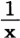银）；商品b＝2先令（即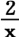银）。因此，商品b＝商品a的价值的两倍。a和b之间的价值比例是通过两者与一定量的第三种商品银相交换的比例得到表现的，而不是通过与一个价值比例相交换的比例得到表现的。

每一个商品（产品或生产工具）都等于一定劳动时间的对象化。它的价值，即它与其他商品相交换或其他商品与它相交换的比例，等于在它身上实现的劳动时间量。例如，如果一个商品＝1小时劳动时间，那么，它就可以同都是1小时劳动时间的产品的其他一切商品相交换。（整个这一论断的前提是，交换价值＝市场价值；实际价值＝价格。）

商品的价值和商品本身不同。商品仅仅在交换（实际的或想象的）中才是价值（交换价值）：价值不仅是这种商品的一般交换能力，而且是它的特有的可交换性。价值是这种商品与其他商品相交换的比例的指数，同时是这种商品在生产中已经与其他商品（物化劳动时间）相交换的比例的指数；价值是量上一定的［Ⅰ—13］可交换性。例如，1码棉布和1升油，作为棉布和油来看，这些商品自然互不相同，具有不同的属性，要用不同的尺度来计量，是不可通约的。作为价值，一切商品在质上等同而只在量上不同，因此全都可以按一定的量的比例互相计量和互相替换（互相交换，可以互相兑换）。

价值是商品的社会关系，是商品的经济上的质。一本有一定价值的书和一个有同一价值的面包相交换，它们是同一价值，只是材料不同罢了。作为价值，商品按一定的比例同时是其他一切商品的等价物。作为价值，商品是等价物；作为等价物，商品的一切自然属性都消失了；它不再和其他商品发生任何特殊的质的关系，它既是其他一切商品的一般尺度，也是其他一切商品的一般代表，一般交换手段。作为价值，商品是货币。

但是，因为商品——或者确切地说，产品或生产工具——和作为价值的自身不同，所以，作为价值，它和作为产品的自身不同。它作为价值的属性不仅可能，而且必然同时取得一个和它的自然存在不同的存在。为什么呢？因为各种商品作为价值彼此只是在量上不同，所以每种商品必然在质上和自身的价值不同。因此，商品的价值也必然取得一个在质上可以和商品区别的存在，并且在实际交换中，这种可分离性必然变成实际的分离，这是因为商品的自然差别必然和商品的经济等价发生矛盾，两者所以能够并存，只是由于商品取得了二重存在，除了它的自然存在以外，它还取得了一个纯经济存在；在纯经济存在中，商品是生产关系的单纯符号，字母，是它自身价值的单纯符号。

作为价值，每一种商品都可以等分；在它的自然存在中，它却不是这样。作为价值，商品无论经历多少形态变化和具有多少存在形式，都保持不变；在实际中，商品进行交换，只是因为它们不相同并且适合于各种不同的需要。作为价值，商品是一般的，作为实际的商品，商品是一种特殊性。作为价值，商品总是可交换的；在实际的交换中，只有当商品符合特殊的条件，商品才是可交换的。作为价值，商品的可交换性的尺度决定于商品本身；交换价值所表现的正是这个商品换成其他商品的比例；在实际的交换中，商品只有在和自己的自然属性相联系的并且和交换者的需要相适应的数量上，才是可交换的。

（总之，当作货币的特殊属性列举的一切属性，都是商品作为交换价值的属性，是产品作为价值——不同于价值作为产品——的属性。）（商品的交换价值，作为同商品本身并列的特殊存在，是货币；是一切商品借以互相等同、比较和计量的那种形式；它是一切商品向之转化，而本身又转化为一切商品的那种形式；是一般等价物。）

任何时候，在计算，记账等等时，我们都把商品转化为价值符号，把商品当作单纯交换价值固定下来，而把商品的物质和商品的一切自然属性抽象掉。在纸上，在头脑中，这种形态变化是通过单纯的抽象进行的；但是，在实际的交换中，必须有一种实际的中介，一种手段，来实现这种抽象。商品在其自然属性上，既不总是可交换的，也不是可同任何其他商品交换的；它可以和其他商品交换，并不是由于它和自身在自然上等同，而是由于它被设定[^v30-c17-annotation-13ded2b801f6c8d3]为和自身不等同，设定为和自身不同的东西，设定为交换价值。我们首先必须把商品转变为作为交换价值的自身，然后才能拿这个交换价值和其他交换价值进行比较和交换。

在最原始的物物交换中，当两种商品互相交换时，每一种商品首先等于一个表现出它的交换价值的符号，例如，在西非海岸的某些黑人那里，等于x金属条块[^v30-c17-annotation-ba62fd04463e13c8]。一种商品＝1金属条块；另一种商品＝2金属条块。它们按照这个比例交换。在商品互相交换之前，先在头脑中和在语言上把它们转化为金属条块。在商品相交换以前，就要对它们估价，而要对它们估价，就必须使它们彼此处于一定的数字比例中。要使它们处于这样的数字比例中，使它们可以通约，它们就必须具有同一名称（单位）。（金属条块具有一个单纯想象的存在，正如一般说来，一种关系只有通过抽象，才能取得一个特殊的化身，才能使自身重新个体化。）为了抵偿在交换中一个价值超过另一个价值的余额，为了进行结算，在最原始的物物交换中，就像在现在的国际贸易中一样，要求用货币支付。

产品（或者活动）只是作为商品相交换；在交换本身中，商品只是作为价值而存在；只有作为这样的东西，它们才进行比较。为了确定我用一码麻布能交换的面包的重量，我先使一码麻布＝自己的交换价值，也就是＝

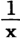劳动时间。同样，我使一磅面包＝自己的交换价值＝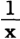或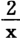等等劳动时间。我使每一个商品＝某个第三物；也就是说，［Ⅰ—14］使它和自身不相同。这个第三物不同于这两种商品，因为它表现一种关系，所以它最初存在于头脑中，存在于想象中，正如一般说来，要确定不同于彼此发生关系的主体[^v30-c17-annotation-d4d508bbbb4a2c35]的那些关系，就只能想象这些关系。

当一种产品（或活动）成为交换价值时，它不仅转化为一定的量的比例，转化为比例数，——也就是说，转化为一个数字，这个数字表明若干量的其他商品和它相等，是它的等价物，或者说，它按什么比例是其他商品的等价物，——而且同时还必须在质上转化，变为另一种要素，以便两种商品变成具有同一单位的名数，也就是说，变成可以通约的。

商品首先必须转化为劳动时间，也就是说，转化为某种在质上和它不同的东西（其所以在质上不同，（1）因为商品不是作为劳动时间的劳动时间，而是物化的劳动时间；劳动时间不是处于运动形式，而是处于静止形式；不是处于过程形式，而是处于结果形式；（2）因为商品不是只存在于想象之中的一般劳动时间的对象化（这种劳动时间本身只是和自身的质相分离的、仅仅在量上不同的劳动），而是一定的、自然规定的、在质上和其他劳动不同的劳动的一定结果），然后才能作为一定的劳动时间量即一定的劳动量，和其他的劳动时间量即其他的劳动量相比较。

为了对产品进行单纯的比较——估价，为了在观念上决定产品的价值，只要在头脑中进行这种形态变化就够了（在这种形态变化中，产品单纯作为量的生产关系的表现而存在）。在对商品进行比较时，这种抽象就够了；而在实际交换中，这种抽象又必须对象化，象征化，通过一种符号来实现。这种必然性的出现是由于：（1）正如我们已经说过，两个待交换的商品，是在头脑中转化为共同的量的比例即交换价值，从而互相进行估价的。但是，它们要在实际中进行交换，它们的自然属性就同它们作为交换价值和单纯名数的规定发生矛盾。它们是不能够随意分割的，等等。（2）在实际交换中，总是特殊的商品和特殊的商品相交换，每一个商品是否可交换，以及它可交换的比例怎样，要取决于地点和时间等条件。

但是，商品转化为交换价值，并不是使这个商品和一定的其他商品相等，而是表明这个商品是等价物，表明这个商品可以和其他一切商品相交换的比例。在头脑中一下子就作出的这种比较，在实际中只是在一定的、由需要决定的范围以内实现的，并且只是相继实现的。（例如，我用100塔勒的收入，按照我的需要的顺序交换总共等于100塔勒交换价值的一系列商品。）

可见，要使商品一下子作为交换价值而实现，并使它具有交换价值的一般作用，它只和一种特殊的商品相交换是不够的。商品必须和一个第三物相交换，而这第三物本身不再是一种特殊的商品，而是作为商品的商品的象征，是商品的交换价值本身的象征；因而，可以说，它代表劳动时间本身，例如，一张纸或一张皮代表劳动时间的一个可除部分。（这样一种象征是以得到公认为前提的；它只能是一种社会象征；事实上，它只表现一种社会关系。）

这种象征代表劳动时间的一些可除部分，代表这样一些可除部分的交换价值：它们通过简单的算术组合，能够表现出各交换价值互相间的一切比例。这种象征，这种交换价值的物质符号，是交换本身的产物，而不是一种先验地形成的观念的实现。（事实上，被用作交换中介的商品，只是逐渐地转化为货币，转化为一个象征；一旦出现这种情况，这种商品的一个象征又可能代替这种商品本身。这种商品现在成了交换价值的被人承认的符号。）

因此，过程简单地说是这样：产品成为商品，也就是说，成为单纯的交换要素。商品转化为交换价值。为了使商品同作为交换价值的自身相等，商品换成一种符号，这种符号代表作为交换价值本身的商品。然后，作为这种象征化的交换价值，商品又能够按一定的比例同任何其他商品相交换。由于产品成为商品，商品成为交换价值，产品开始在头脑中取得了二重存在。这种观念上的二重化造成（并且必然造成）的结果是，商品在实际交换中二重地出现：一方面作为自然的产品，另一方面作为交换价值。也就是说，商品的交换价值取得了一个在物质上和商品相分离的存在。

［Ⅰ—15］可见，产品作为交换价值的规定，必然造成这样的结果：交换价值取得一个和产品相分离即相脱离的存在。同各种商品本身相脱离并且自身作为一种商品又同这些商品并存的交换价值，就是货币。商品作为交换价值的一切属性，在货币上表现为和商品不同的对象，表现为和商品的自然存在形式相脱离的社会存在形式。（在列举货币的通常的属性时，还要进一步论证这一点。）（表现这种象征的材料决不是无关紧要的，虽然在历史上曾出现过各种各样的材料。社会的发展，在产生出这种象征的同时，也产生出越来越适合于这种象征的材料，而以后社会又竭力摆脱这种材料；一种象征如果不是任意的，它就要求那种表现它的材料具有某些条件。例如，文字符号有自己的历史，拼音文字等等。）

这样，产品的交换价值产生出同产品并存的货币。因此，货币同特殊商品的并存所引起的混乱和矛盾，是不可能通过改变货币的形式而消除的（尽管可以用较高级的货币形式来避免较低级的货币形式所具有的困难），同样，只要交换价值仍然是产品的社会形式，废除货币本身也是不可能的。必须清楚地了解这一点，才不致给自己提出无法解决的任务，才能认识到货币改革和流通革新可能改造生产关系和以生产关系为基础的社会关系的界限。

货币的属性是：（1）商品交换的尺度；（2）交换手段；（3）商品的代表（因此是契约的对象）；（4）同特殊商品并存的一般商品。所有这些属性都单纯来自货币是同商品本身相分离的和对象化的交换价值这一规定。（货币是和其他一切商品相对立的一般商品，是其他一切商品的交换价值的化身，——货币的这种属性，使货币同时成为资本的已实现的和始终可以实现的形式，成为资本的始终有效的表现形式。这个属性在金银外流时表现得特别明显；这个属性使资本在历史上最初只以货币的形式出现；最后，这个属性说明了货币和利息率的关系以及货币对利息率的影响。）

生产越是发展到使每一个生产者依赖于自己的商品的交换价值，也就是说，产品越是在实际上成为交换价值，而交换价值越是成为生产的直接对象，那么，货币关系以及货币关系的内在矛盾，即产品同作为货币的自身的关系的内在矛盾就必然越是发展。交换的需要和产品向纯交换价值的转化，是同分工按同一程度发展的，也就是随着生产的社会性而发展的。但是，随着生产的社会性的增长，货币的权力也按同一程度增长，也就是说，交换关系固定为一种对生产者来说是外在的、不依赖于生产者的权力。最初作为促进生产的手段出现的东西，成了一种对生产者来说是异己的关系。生产者在什么程度上依赖于交换，看来，交换也在什么程度上不依赖于生产者，作为产品的产品和作为交换价值的产品之间的鸿沟也在什么程度上加深。货币没有造成这些对立和矛盾；而是这些矛盾和对立的发展造成了货币的似乎先验的权力。

（要详细说明一切关系转化为货币关系所产生的影响：实物税转化为货币税，实物地租转化为货币地租，义务兵制转化为雇佣兵制，总之，一切人身的义务转化为货币的义务，家长制的、奴隶制的、农奴制的、行会制的劳动转化为纯粹的雇佣劳动。）

产品成为商品；商品成为交换价值；商品的交换价值是商品内在的货币属性；商品的这个货币属性作为货币同商品相脱离，取得了一个同一切特殊商品及其自然存在形式相分离的一般社会存在；产品对作为交换价值的自身的关系，成为产品对同它并存的货币的关系，或者说，成为一切产品对在它们全体之外存在的货币的关系。正像产品的实际交换产生产品的交换价值一样，产品的交换价值产生货币。

现在面临的下一个问题是：货币同商品并存，是否从一开始就掩盖了随着这种关系本身而产生的矛盾？

第一，商品二重地存在这个简单的事实，即一方面商品作为一定的产品存在，而这个产品在自己的自然存在形式中观念地包含着（潜在地包含着）自己的交换价值；另一方面商品作为表现出来的交换价值（货币）存在，而这个交换价值又抛弃了同产品的自然存在形式的一切联系，——这种二重的、不同的存在必然发展为差别，差别必然发展为对立和［Ⅰ—16］矛盾。商品作为产品的特殊性同商品作为交换价值的一般性之间的这个矛盾，产生了二重设定商品的必要性，即一方面表现为这种一定的商品，另方面表现为货币——商品的特殊的自然属性同商品的一般的社会属性之间的这个矛盾，从一开始就包含着商品的这两个分离的存在形式不能互相转换的可能性。商品的可交换性作为同商品并存的物存在于货币上，作为某种和商品不同的东西，不再和商品直接同一的东西而存在。一旦货币成为同商品并存的外在的物，商品同货币的可交换性马上就和可能出现或可能不出现的外部条件联系在一起；受外部条件的支配。

在交换中要得到商品，是由于商品的自然属性，是由于需要（商品是需要的对象）。相反，要得到货币只是由于它的交换价值，只是由于它是交换价值。因此，商品是否能够转化为货币，是否能够同货币相交换，它的交换价值是否能够实现，取决于本来和作为交换价值的商品毫不相干的、不以它为转移的各种情况。商品转化的可能性取决于产品的自然属性；货币转化的可能性是和货币作为象征化的交换价值的存在结合在一起的。因此，可能出现这样的情况：商品在它作为产品的一定形式上，不再能同它的一般形式即货币相交换和相等同。

因为商品的可交换性是作为货币存在于商品之外，所以它就成为某种和商品不同的东西，对商品来说是异己的东西；商品还必须和这种东西等同，可见，商品最初是和这种东西不等同的；而等同本身取决于外部条件，也就是说，是偶然的。

第二，正像商品的交换价值二重地存在，即作为一定的商品和作为货币而存在，同样，交换行为也分为两个互相独立的行为：商品交换货币，货币交换商品；买和卖。因为买和卖取得了一个在空间上和时间上彼此分离的、互不相干的存在形式，所以它们的直接同一性就终止了。它们可能互相适应和不适应；它们可能彼此相一致或不一致；它们可能出现彼此不协调。固然，它们不断力求达到平衡；但是，现在代替过去的直接相等的，是不断的平衡的运动，而这种运动正是以不断的不相等为前提的。现在完全有可能只有通过极端的不协调，才能达到协调。

第三，随着买和卖的分离，随着交换分裂为两个在空间上和时间上互相独立的行为，又出现了另一种新的关系。

正像交换本身分裂为两个互相独立的行为一样，交换的总运动本身也同交换者，商品生产者相分离。为交换而交换同为商品而交换相分离。在生产者之间出现了一个商人阶层，这个阶层只是为卖而买，只是为再买而卖，这种活动的目的，不是占有作为产品的商品，而只是取得交换价值本身，取得货币。（在单纯的物物交换中，也可能形成一个商人阶层。但是，因为他们支配的只是双方生产的剩余物，所以他们对生产本身的影响以及他们总的来说所起的作用，仍然是完全次要的。）

交换价值脱离产品而在货币形式上独立化，与此相适应，交换（商业）则作为脱离交换者的职能而独立化。过去，交换价值是商品交换的尺度，但是，商品交换的目的是直接占有所交换的商品，是消费这种商品（不论这种消费是把商品当作产品来直接满足需要，还是又把商品本身当作生产工具）。

现在，商业的目的不是直接消费，而是谋取货币，谋取交换价值。由于交换的这种二重化——为消费而交换和为交换而交换，产生了一种新的不协调。商人在交换中只受商品的买和卖之间的差额支配；而消费者则必须最终补偿他所购买的商品的交换价值。流通即商人阶层内部的交换，与流通的结局即商人阶层和消费者之间的交换，尽管归根到底必然是互相制约的，但它们是由完全不同的规律和动机决定的，彼此可能发生最大的矛盾。在这种分离中已经包含了商业危机的可能性。但是，因为生产是直接为了商业，只是间接为了［Ⅰ—17］消费，所以生产既造成了商业同为消费而交换之间的不一致，同样又受这种不一致的影响。（供求关系完全颠倒。）（从真正的商业中又分离出货币经营业。）

警句。（一切商品都是暂时的货币；货币是永久的商品[^v30-c17-annotation-a18bfdd044a03492]。分工越发达，直接产品就越不再是交换手段。必须有一种一般交换手段，也就是说，必须有一种不依赖于每一个人的特定生产的交换手段。在货币上，物的价值同物的实体分离开。货币本来是一切价值的代表；在实践中情况却颠倒过来，一切实在的产品和劳动竟成为货币的代表。在直接的物物交换中，不是每一种物品都能和任何一种物品相交换，一定的活动只能和一定的产品相交换。货币所以能够克服物物交换中包含的困难，只是由于它使这种困难一般化，普遍化了。被强制分离的而本质上是同属一体的各要素，绝对必须通过暴力的爆发，来证明自己是一种本质上同属一体的东西的分离。统一是通过暴力恢复的。一旦敌对的分裂导致了爆发，经济学家就指出本质上的统一，而把异化抽象掉。他们的辩护才智就在于，在一切紧要关头忘记他们自己的规定。作为直接的交换手段的产品，（1）和自己的自然的质还直接联系在一起，因而受这种质的各种方式的限制；例如，它可能变坏，等等；（2）和别人对这种产品或我对别人的产品有没有直接需要联系在一起。一旦劳动产品和劳动本身受交换的支配，它们同自己的占有者分离的时刻也就来临。它们是否会在另一种形式下从这种分离重新回到它们自己的占有者手中，这是偶然的。因为货币加入交换，我不得不用我的产品交换一般交换价值或一般交换能力，所以我的产品依赖于整个商业，并且摆脱了产品的地方的、自然的和个体的界限。正因为如此，它可以不再是产品。）

第四，正像交换价值在货币上作为一般商品与一切特殊商品并列出现一样，交换价值因此也作为特殊商品在货币上（因为货币具有一个特殊的存在）与其他一切商品并列出现。问题不仅在于，货币由于只存在于交换之中，因而作为一般交换能力同商品的特殊交换能力相对立，并且直接使后者消失，尽管如此，它同商品又应当始终是可以互相转换的，这样便产生了不一致；问题还在于，货币由于以下原因而同它本身以及它的规定发生矛盾：它本身是一种特殊商品（即使只是符号），因此在它同其他商品的交换中又受特殊交换条件的支配，这些条件是同它的绝对的一般可交换性相矛盾的。（这里还完全没有说到货币固定在一定产品的实体上，等等。）

交换价值除了在商品上的存在以外，还在货币上取得自身的存在，它之所以同自身的实体分离，正是因为这个实体的自然规定性同交换价值作为交换价值的一般规定发生了矛盾。作为交换价值，每一种商品都和其他商品等同（或可以相比较）（在质上：每一种商品只代表量上或多或少的交换价值）。因此，商品的这种等同，它们的这种统一，不同于它们的自然差别，从而在货币上，既表现为商品共同的要素，又表现为与商品相对立的第三物。但是，一方面，交换价值自然仍旧是商品固有的质，然而它同时却存在于商品之外；另一方面，货币不再作为商品的属性，不再作为商品的一般性质存在，而是与商品并列而个体化了，因此它本身成为一种与其他商品并列的特殊商品（可以通过供求来决定；分为各种特殊的货币，等等）。

货币成了和其他商品一样的商品，同时又不是和其他商品一样的商品。货币虽然有它的一般规定，它仍然是一种与其他可交换物并列的可交换物。货币不仅是一般交换价值，同时还是一种与其他特殊交换价值并列的特殊交换价值。这里就是在实践中表现出来的矛盾的新的根源。（在货币经营业从真正的商业分离出来时，货币的特殊性质再次显现出来。）

由此可见，货币内在的特点是：通过否定自己的目的同时来实现自己的目的；与商品相对立而独立；由手段变成目的；通过使商品同交换价值分离来实现商品的交换价值；通过使交换分裂，来使交换易于进行；通过［Ⅰ—18］使直接商品交换的困难普遍化，来克服这些困难；生产者在多大程度上依赖于交换，就使交换在多大程度上与生产者相对立而独立。

（往后，在结束这个问题之前，有必要对唯心主义的叙述方式作一纠正，这种叙述方式造成一种假象，似乎探讨的只是一些概念规定和这些概念的辩证法。因此，首先是弄清这样的说法：产品（或活动）成为商品；商品成为交换价值；交换价值成为货币。）

（1857年1月24日《经济学家》。在研究银行时，要考虑下面这段话：

“既然商业阶段现在通常参与银行利润的分配，——他们由于股份银行更广泛地发展，废除一切社团特权，把完全的自由扩展到银行业，而能够在更大的程度上参与银行利润的分配，——所以这些阶级由于利息率提高而发财致富了。的确，按存款量来看，商业阶级事实上是他们自己的银行家；既然如此，贴现率对这些人来说必然也就没有什么重要意义。当然，所有银行的和其他的准备金，都必然是不断勤劳和把利润储蓄起来的结果；因此，把商业阶级和工业阶级当作一个整体来看，他们必然是他们自己的银行家，而这只需要把自由贸易的原则推广到一切行业，使它们在货币市场的一切波动中损益均衡或抵销。”）

货币制度的和货币制度下产品交换的一切矛盾，是产品作为交换价值的关系的发展，是产品作为交换价值或价值本身的规定的发展。

（1857年2月12日《晨星报》：“去年的货币荒和因此而实行的高贴现率，对法兰西银行获取利润，是非常有利的。该行的股息一直在提高：1852年为118法郎，1853年为154法郎，1854年为194法郎，1855年为200法郎，1856年为272法郎。”）

还必须注意下面这些论述：英国银币发行时的价格，高于它所含银的价值。1磅银的内在价值为60—62先令（平均合3金镑），铸成银币后为66先令。造币局支付是按照“目前的市场价格，即每盎司5先令至5先令2便士，而发行则按照每盎司5先令6便士。有两个原因防止了这种措施〈以银符号为依据而不是以内在价值为依据〉所造成的一切实际不便：第一，这种铸币只能从造币局获得，而且是按照上述价格获得；因此，作为国内通货，它不能贬值，并且由于它在国内流通时高于它的内在价值，也不能运往国外；第二，作为法定货币，它仅以40先令为限，因此，它决不会和金币发生冲突，也不会影响金币的价值”。建议法国“以银符号为依据而不是以内在价值为依据发行银辅币，并限定其作为法定货币的数额”。但同时：“确定铸币的成色，使内在价值和名义价值之间的差额比我们英国的更大，因为同金相比，银的价值不断提高，很可能不久以后就会上升到目前我们的造币局价格，到那时我们不得不又改变造币局价格。现在，我们的银币比内在价值低5%，而在不久前比内在价值低10%。”（1857年1月24日《经济学家》）

可能有人认为，发行小时券就能克服这一切困难。（当然，小时券的存在要以公共信用、银行等等这样一些条件为前提，这些条件在研究交换价值和货币的关系时还没有直接提供出来，而且没有这些条件，交换价值和货币也能存在并且存在着；不过，在这里不必更多地谈论这一切；因为主张实行小时券的人自然把小时券看作“一定系列”[^v30-c17-annotation-b7939b977c7ebf99]的最后的产物，当这个产物最符合货币的“纯粹”概念时，便最后“出现”在现实中。）

首先，如果假定商品的价格＝商品的交换价值这个前提已经实现，如果供求平衡，生产和消费平衡，归根到底是按比例的生产[^v30-c17-annotation-32cd8bcc33befd7d]（所谓的分配关系本身就是生产关系），那么，货币问题就成为完全次要的了，特别是这样的问题：是发行票券（不管是蓝色的还是绿色的，是金属的还是纸的），还是以另外一种什么形式进行社会簿记。在这样的情况下，还坚持必须对现实的货币关系进行研究这样的借口，就是极端荒谬的了。

［Ⅰ—19］银行（任何银行）发行小时券。等于交换价值x即等于x劳动时间的商品a，同代表x劳动时间的货币相交换。银行也必须购买商品，即把这个商品换成它的货币代表，例如，正像现在英格兰银行必须发行银行券去换取黄金一样。商品，即交换价值的实体的因而偶然的存在，同作为交换价值的交换价值的象征性存在相交换。因此，使商品由商品形式转化为货币形式并不困难。只需要确切地证实商品中包含的劳动时间（顺便说一下，这并不像检验金银的成色和重量那样容易），马上就会得出商品的对等价值，商品的货币存在。

不论我们怎样谈论问题，它最后总是归结为：发行小时券的银行，按商品的生产费用购买商品，购买一切商品，它除了生产纸券以外，没有为这种购买花费分文，它给予卖者的，不是卖者在某种特定的实体形式上占有的交换价值，而是商品的象征性的交换价值，换句话说，是领取具有等量交换价值的其他一切商品的凭证。当然，交换价值本身只能象征地存在，虽然这个象征——为了能够把它当作物，而不是只当作观念形式来使用——具有物的存在；它不仅是想象的观念，而且通过某种对象的方式实际表现出来。尺度可以保留在手中；交换价值充当尺度，但是只有当这种尺度从一个人手中转到另一个人手中，交换价值才进行交换。[^v30-c17-annotation-02b1b71f4af66964]）

可见，银行为了商品而付出货币；货币确实是商品的交换价值的凭证，也就是说，是领取等量价值的一切商品的凭证；银行进行购买。银行是总的买者，不仅是这种或那种商品的买者，而且是一切商品的买者。因为银行正是必须使每一种商品都转化为它的作为交换价值的象征性存在。但是，既然银行是总的买者，它也必然是总的卖者，不仅是储存一切商品的堆栈，不仅是总的商店，而且也是商品的占有者，正像每个其他商人都是商品的占有者一样。

我用我的商品a换成代表它的交换价值的小时券b；但这只是为了使我能够再把这个b任意变为一切实在商品c、d、e等等。这种货币能不能在银行之外流通呢？能不能不只在小时券的所有者和银行之间流通呢？用什么来保证这种券可以兑现呢？只可能有两种情况。或者是，商品（产品或劳动）的全体所有者都想按商品的交换价值出售他们的商品，或者是，有的商品所有者想这样做，有的商品所有者不想这样做。如果他们全都想按商品的交换价值出售，那么他们就不会等着看是否会有买者，而是马上到银行去，把商品出让给银行，换取商品的交换价值符号，货币：用商品兑换银行本身的货币。在这种情况下，银行一身二任，同时是总的买者和卖者。

或者情况与此相反。在这种情况下，银行券是纯粹的纸票，它只不过声称是交换价值的公认的象征，而没有任何价值；因为这个象征的特点是，它不仅代表交换价值，而且在实际交换中是交换价值。在这后一种情况下，银行券就不是货币，或者，只是银行及其顾客之间的习惯的货币，而不是一般市场上的习惯的货币。这就和我在一个餐厅老板那里预订的十二张餐券或和十二张戏票一样；这两者都代表货币，但是，前者只是在这一定的餐厅里代表货币，后者只是在这一定的剧场里代表货币。这种银行券不再适应货币的要求了，因为它不是在全体公众之中流通，而是在银行及其顾客之间流通。因此，我们必须抛弃后一种假定。

这样，银行会是总的买者和卖者。它也可以不发行银行券，而开支票，可以不开支票，而记简单的银行往来账。x根据他出让给银行的商品价值额，要求银行给予他别种商品形式的同等价值额。银行的第二个职能是必须确切地确定一切商品的交换价值，即物化在一切商品中的劳动时间。但是，银行的职能不止于此。它必须规定能够用平均的产业手段生产出商品的劳动时间，即必须生产出商品的时间。

但这还不够。银行不仅要规定必须生产出一定量产品的时间，不仅要使生产者处于这样的条件下，即他们劳动的生产率相同（可见，也要使劳动资料的分配得到平衡和调整），而且银行还要规定不同生产部门所要使用的［Ⅰ—20］劳动时间量。后面这一点是必要的，因为要使交换价值得到实现，要使银行的货币真正可以兑现，就必须使整个生产得到保证，并且按照使各交换者的需要得到满足的那种比例进行。

不仅如此。最大的交换，不是商品的交换，而是劳动同商品的交换。（接着马上来详谈这一点。）工人不是把他们的劳动卖给银行，而是得到他们劳动的全部产品的交换价值等等。这样，仔细考察就可看到，银行不仅是总的买者和卖者，而且也是总的生产者。或者，银行事实上是生产的专制统治机构和分配的管理者，或者，银行事实上无非是一个为共同劳动的社会进行记账和计算的部门。生产资料的共有是前提条件，等等。圣西门主义者把他们的银行变成了统治生产的教皇政权。

一切产品和活动转化为交换价值，既要以生产中人的（历史的）一切固定的依赖关系的解体为前提，又要以生产者互相间的全面的依赖为前提。每个个人的生产，依赖于其他一切人的生产；同样，他的产品转化为他本人的生活资料，也要依赖于其他一切人的消费。价格古已有之，交换也一样；但是，价格越来越由生产费用决定，交换延及一切生产关系，这些只有在资产阶级社会里，自由竞争的社会里，才得到充分发展，并且发展得越来越充分。亚当·斯密按照真正的18世纪的方式列为史前时期的东西，先于历史的东西[^v30-c17-annotation-6804720fb5646921]，倒是历史的产物。

这种互相依赖，表现在不断交换的必要性上和作为全面中介的交换价值上。经济学家是这样来表述这一点的：每个人追求自己的私人利益，而且仅仅是自己的私人利益；这样，也就不知不觉地为一切人的私人利益服务，为普遍利益服务。关键并不在于，当每个人追求自己私人利益的时候，也就达到私人利益的总体即普遍利益。从这种抽象的说法反而可以得出结论：每个人都互相妨碍别人利益的实现，这种一切人反对一切人的战争[^v30-c17-annotation-3fab100e5a189210]所造成的结果，不是普遍的肯定，而是普遍的否定。关键倒是在于：私人利益本身已经是社会所决定的利益，而且只有在社会所设定的条件下并使用社会所提供的手段，才能达到；也就是说，私人利益是与这些条件和手段的再生产相联系的。这是私人利益；但它的内容以及实现的形式和手段则是由不以任何人为转移的社会条件决定的。

毫不相干的个人之间的互相的和全面的依赖，构成他们的社会联系。这种社会联系表现在交换价值上，因为对于每个个人来说，只有通过交换价值，他自己的活动或产品才成为他的活动或产品；他必须生产一般产品——交换价值，或本身孤立化的，个体化的交换价值，即货币。另一方面，每个个人行使支配别人的活动或支配社会财富的权力，就在于他是交换价值的或货币的所有者。他在衣袋里装着自己的社会权力和自己同社会的联系。

不管活动采取怎样的个人表现形式，也不管活动的产品具有怎样的特性，活动和活动的产品都是交换价值，即一切个性，一切特性都已被否定和消灭的一种一般的东西。这种情况实际上同下述情况截然不同：个人或者自然地或历史地扩大为家庭和氏族（以后是共同体）的个人，直接地从自然界再生产自己，或者他的生产活动和他对生产的参与依赖于劳动和产品的一定形式，而他和别人的关系也是这样决定的。

活动的社会性质，正如产品的社会形式和个人对生产的参与，在这里表现为对于个人是异己的东西，物的东西；不是表现为个人的相互关系，而是表现为他们从属于这样一些关系，这些关系是不以个人为转移而存在的，并且是由毫不相干的个人互相的利害冲突而产生的。活动和产品的普遍交换已成为每一单个人的生存条件，这种普遍交换，他们的相互联系，表现为对他们本身来说是异己的、独立的东西，表现为一种物。在交换价值上，人的社会关系转化为物的社会［Ⅰ—21］关系；人的能力转化为物的能力。交换手段拥有的社会力量越小，交换手段同直接的劳动产品的性质之间以及同交换者的直接需要之间的联系越是密切，把个人互相联结起来的共同体的力量就必定越大——家长制的关系，古代共同体，封建制度和行会制度（见我的笔记本第Ⅻ本第34b页[^v30-c17-annotation-06eabb3ce4cd705b]）。

每个个人以物的形式占有社会权力。如果从物那里夺去这种社会权力，那么你们就必然赋予人以支配人的这种权力。人的依赖关系（起初完全是自然发生的），是最初的社会形式，在这种形式下，人的生产能力只是在狭小的范围内和孤立的地点上发展着。以物的依赖性为基础的人的独立性，是第二大形式，在这种形式下，才形成普遍的社会物质变换、全面的关系、多方面的需要以及全面的能力的体系。建立在个人全面发展和他们共同的、社会的生产能力成为从属于他们的社会财富这一基础上的自由个性，是第三个阶段。第二个阶段为第三个阶段创造条件。因此，家长制的，古代的（以及封建的）状态随着商业、奢侈、货币、交换价值的发展而没落下去，现代社会则随着这些东西同步发展起来。

交换和分工互为条件。因为每个人为自己劳动，而他的产品并不是为他自己使用，所以他自然要进行交换，这不仅是为了参加总的生产能力，而且是为了把自己的产品变成自己的生活资料（见我的《经济学评论》第Ⅴ（13、14）页）[^v30-c17-annotation-eb8d421a28de302d]。以交换价值和货币为中介的交换，诚然以生产者互相间的全面依赖为前提，但同时又以生产者的私人利益完全隔离和社会分工为前提，而这种社会分工的统一和互相补充，仿佛是一种自然关系，存在于个人之外并且不以个人为转移。普遍的需求和供给互相产生的压力，作为中介使漠不关心的人们发生联系。

个人的产品或活动必须先转化为交换价值的形式，转化为货币，并且个人通过这种物的形式才取得和证明自己的社会权力，这种必然性本身证明了两点：（1）个人还只能为社会和在社会中进行生产；（2）他们的生产不是直接的社会的生产，不是本身实行分工的联合体的产物。个人从属于像命运一样存在于他们之外的社会生产；但社会生产并不从属于把这种生产当作共同财富来对待的个人。因此，正像前面谈到发行小时券的银行时看到的那样，设想在交换价值，在货币的基础上，由联合起来的个人对他们的总生产实行控制，那是再错误再荒谬不过的了。

一切劳动产品、能力和活动进行私人交换，既同以个人相互之间的统治和从属关系（自然发生的或政治性的）为基础的分配相对立（不管这种统治和从属的性质是家长制的，古代的或是封建的）（在这种情况下，真正的交换只是附带进行的，或者大体说来，并未触及整个共同体的生活，不如说只发生在不同共同体之间，决没有征服全部生产关系和交往关系），又同在共同占有和共同控制生产资料的基础上联合起来的个人所进行的自由交换相对立。（这种联合不是任意的事情，它以物质条件和精神条件的发展为前提，这一点在这里就不进一步论述了。）

分工产生出密集、结合、协作、私人利益的对立、阶级利益的对立、竞争、资本积聚、垄断、股份公司，——全都是对立的统一形式，而统一又引起对立本身，——同样，私人交换产生出世界贸易，私人的独立性产生出对所谓世界市场的完全的依赖性，分散的交换行为产生出银行制度和信用制度，这些制度的簿记［Ⅰ—22］至少可以使私人交换进行结算。虽然每个民族的私人利益把每个民族有多少成年人就分成多少个民族，并且同一民族的输出者和输入者之间的利益在这里是互相对立的；可是在汇率中，民族商业却获得了存在的假象，等等。谁也不会因此认为，通过交易所改革就可以铲除对内或对外的私人商业的基础。但是，在以交换价值为基础的资产阶级社会内部，产生出一些交往关系和生产关系，它们同时又是炸毁这个社会的地雷。（有大量对立的社会统一形式，而这些形式的对立性质决不是通过平静的形态变化就能炸毁的。另一方面，如果我们在现在这样的社会中没有发现隐蔽地存在着无阶级社会所必需的物质生产条件和与之相适应的交往关系，那么一切炸毁的尝试都是唐·吉诃德的荒唐行为。）

我们已经看到，虽然交换价值＝物化在产品中的相对劳动时间，而货币又＝同商品实体相分离的商品的交换价值；在这种交换价值或货币关系中，包含着商品同它的交换价值之间的矛盾，包含着作为交换价值的商品同货币之间的矛盾。我们已经看到，通过劳动货币形式直接创造商品的摹本的银行，是一种空想。因此，虽然货币仅仅是同商品实体相分离的交换价值，而且只是由于这种交换价值要使自身在纯粹形式上确定下来的趋势，货币才得以产生出来，但商品却不能直接转化为货币；也就是说，实现在商品中的劳动时间量的真凭实据，并不能在交换价值世界中充当商品的价格。怎么会是这样的呢？

（对于货币的一种形式——指货币充当交换手段（而不是交换价值的尺度）——经济学家们都清楚，货币存在的前提是社会联系的物化；这里指的是货币表现为抵押品，一个人为了从别人那里获得商品，就必须把这种抵押品留在别人手里。在这种场合，经济学家自己就说，人们信赖的是物（货币），而不是作为人的自身。但为什么人们信赖物呢？显然，仅仅是因为这种物是人们互相间的物化的关系，是物化的交换价值，而交换价值无非是人们互相间生产活动的关系。每一种别的抵押品对抵押品持有者可以直接作为抵押品来用，而货币对于他只作为“社会的抵押品”[^v30-c17-annotation-fa3992ad3716faa8]来用，但货币所以是这种抵押品，只是由于它具有社会的（象征性的）属性；货币所以能拥有社会的属性，只是因为各个人让他们自己的社会关系作为对象同他们自己相异化。）

在一切价值都用货币来计量的行情表中，一方面显示出，物的社会性离开人而独立，另一方面显示出，在整个生产关系和交往关系对于个人，对于所有个人表现出来的异己性的这种基础上，商业的活动又使这些物从属于个人。因为世界市场（其中包括每一单个人的活动）的独立化（如果可以这样说的话）随着货币关系（交换价值）的发展而增长，以及后者随着前者的发展而增长，所以生产和消费的普遍联系和全面依赖随着消费者和生产者的相互独立和漠不关心而一同增长；因为这种矛盾导致危机等等，所以随着这种异化的发展，在它本身的基础上，人们试图消除它；行情表、汇率、商业经营者间的通信和电报联系等等（交通工具当然同时发展），通过这些东西，每一单个人可以获知其他一切人的活动情况，并力求使本身的活动与之相适应。（就是说，虽然每个人的需求和供给都与一切其他人无关，但每个人总是力求了解普遍的供求情况；而这种了解又对供求产生实际影响。虽然这一切在现有基地上并不会消除异己性，但会带来一些关系和联系，这些关系和联系本身包含着消除旧基地的可能性。）（普遍的统计等等的可能性。）

（此外，这应当在考察“价格、需求和供给”这些范畴时加以阐述。这里只须指出一点，在行情表上实际呈现出来的整个商业和整个生产的概况，事实上提供了最好的证据，表明单个人本身的交换和他们本身的生产是作为独立于他们之外的物的关系而与他们相对立。在世界市场上，单个人与一切人发生联系，但同时这种联系又不以［Ⅰ—23］单个人为转移，这种情况甚至发展到这样的高度，以致这种联系的形成同时已经包含着超越它自身的条件。）

比较代替了实际的共同性和普遍性。

（人们说过并且还会说，美好和伟大之处，正是建立在这种自发的、不以个人的知识和意志为转移的、恰恰以个人互相独立和漠不关心为前提的联系即物质的和精神的新陈代谢这种基础上。毫无疑问，这种物的联系比单个人之间没有联系要好，或者比只是以自然血缘关系和统治从属关系为基础的地方性联系要好。同样毫无疑问，在个人创造出他们自己的社会联系之前，他们不可能把这种社会联系置于自己支配之下。如果把这种单纯物的联系理解为自然发生的、同个性的自然（与反思的知识和意志相反）不可分割的、而且是个性内在的联系，那是荒谬的。这种联系是各个人的产物。它是历史的产物。它属于个人发展的一定阶段。这种联系借以同个人相对立而存在的异己性和独立性只是证明，个人还处于创造自己的社会生活条件的过程中，而不是从这种条件出发去开始他们的社会生活。这是各个人在一定的狭隘的生产关系内的自发的联系。

全面发展的个人——他们的社会关系作为他们自己的共同的关系，也是服从于他们自己的共同的控制的——不是自然的产物，而是历史的产物。要使这种个性成为可能，能力的发展就要达到一定的程度和全面性，这正是以建立在交换价值基础上的生产为前提的，这种生产才在产生出个人同自己和同别人相异化的普遍性的同时，也产生出个人关系和个人能力的普遍性和全面性。在发展的早期阶段，单个人显得比较全面，那正是因为他还没有造成自己丰富的关系，并且还没有使这种关系作为独立于他自身之外的社会权力和社会关系同他自己相对立。留恋那种原始的丰富，是可笑的，相信必须停留在那种完全的空虚化之中，也是可笑的。资产阶级的观点从来没有超出同这种浪漫主义观点[^v30-c17-annotation-112666e3d5ff25cf]的对立，因此这种浪漫主义观点将作为合理的对立面伴随资产阶级观点一同升入天堂。）

（这里可以用单个人对科学的关系作例子。）

（把货币比作血液——“流通”一词为这种比喻提供了理由——这大体上就像梅涅尼·阿格利巴把贵族比作胃[^v30-c17-annotation-ebe052b40c8aecdf]一样不正确。）

（把货币比作语言[^v30-c17-annotation-a0d3635c77ad600d]同样不正确。观念不是这样转化为语言：观念的特性消失了，而观念的社会性同观念并存于语言中，就像价格同商品并存一样。观念不能离开语言而存在。观念必须先从本族语言翻译成别族语言才能流通，才能进行交流，这种场合的观念才可作较多的类比；但是这种类比不在于语言，而在于语言的异族性。）

（一切产品、活动、关系可以同第三者，同物的东西相交换，而这第三者又可以无差别地同一切相交换，就是说，交换价值（以及货币关系）的发展，同普遍的贿赂，普遍的收买是一回事。普遍的卖淫现象，表现为人的素质、能力、才能、活动的社会性质发展的一个必然阶段。说得文雅一点就是：普遍的效用关系和适用关系。使不同的东西等同起来，——莎士比亚对货币就有过这样中肯的理解[^v30-c17-annotation-763e043fa1ed4519]。没有货币，就不可能有致富欲本身；其他的一切积累和积累欲，表现为自然发生的、有限的、一方面受需要、另一方面受产品的有限本性制约的东西（万恶的求金欲[^v30-c17-annotation-dd804f53ce210294]）。）

（货币制度的发展，显然已经以其他的一般发展为前提。）

如果考察的是产生出不发达的交换、交换价值和货币的制度的那种社会关系，或者有它们的不发达程度与自身相适应的那种社会关系，那么一开始就很清楚，虽然个人之间的关系表现为较明显的人的关系，但他们只是作为具有某种规定性的个人而互相发生关系，如作为封建主和臣仆、地主和农奴等等，或作为种姓成员等等，或属于某个等级等等。在货币关系中，在发达的交换制度中（而这种表面现象使民主主义受到迷惑），人的依赖纽带、血统差别、教养差别等等事实上都被打破了，被粉碎了（一切人身纽带至少都表现为人的关系）；各个人看起来似乎独立地（这种独立一般只不过是错觉，确切些说，可叫作——在彼此关系冷漠的意义上——彼此漠不关心）自由地互相接触并在这种自由中互相交换；但是，只有在那些不考虑个人互相接触的条件即生存条件的人看来（而这些条件又不依赖于个人而存在，它们尽管由社会产生出来，却表现为似乎是自然条件，即不受个人控制的条件），各个人才显得是这样的。

［Ⅰ—24］在前一场合表现为人的限制即个人受他人限制的那种规定性，在后一场合则在发达的形态上表现为物的限制即个人受不以他为转移并独立存在的关系的限制。（因为单个人不能摆脱自己的人的规定性，但可以克服和控制外部关系，所以在第二个场合他的自由看起来比较大。但是，对这种外部关系或这些条件的进一步考察表明，属于一个阶级等等的各个人作为全体来说如果不消灭这些关系或条件，就不能克服它们。个别人偶尔能战胜它们；受它们控制的大量人却不能，因为它们的存在本身就表明，各个人从属于而且必然从属于它们。）

这些外部关系并未排除“依赖关系”，它们只是使这些关系变成普遍的形式；不如说它们为人的依赖关系造成普遍的基础。个人在这里也只是作为一定的个人互相发生关系。这种与人的依赖关系相对立的物的依赖关系也表现出这样的情形（物的依赖关系无非是与外表上独立的个人相对立的独立的社会关系，也就是与这些个人本身相对立而独立化的、他们互相间的生产关系）：个人现在受抽象统治，而他们以前是互相依赖的。但是，抽象或观念，无非是那些统治个人的物质关系的理论表现。

关系当然只能表现在观念中，因此哲学家们认为新时代的特征就是新时代受观念统治，从而把推翻这种观念统治同创造自由个性看成一回事。从意识形态角度来看更容易犯这种错误，因为上述关系的统治（上述物的依赖关系，不用说，又会转变为一定的，只不过除掉一切错觉的人的依赖关系）在个人本身的意识中表现为观念的统治，而关于这种观念的永恒性即上述物的依赖关系的永恒性的信念，统治阶级自然会千方百计地来加强、扶植和灌输。

（当然，对于封建时代的“纯粹人的关系”等等的错觉，一刻也不能忘记：（1）这种关系本身在自己的范围内，在一定的阶段上具有物的性质，例如，从纯粹军事隶属关系到地产关系的发展就表明这一点；但是（2）由这些关系没落而转变成的物的关系，其本身具有狭隘的、为自然所决定的性质，因而表现为人的关系，而在现代世界中，人的关系则表现为生产关系和交换关系的纯粹产物。）

产品成为商品。商品成为交换价值。商品的交换价值与商品并列获得特殊的存在，即商品采取这样一种形式，通过这种形式（1）它可以同其他一切商品相交换；（2）因而成为一般商品，它的自然特性消失了；（3）它的交换能力的尺度已经确定，即它与其他一切商品赖以相等的一定比例已经确定，它是作为货币的商品，而且不是作为货币一般，而是作为一定数量的货币的商品，因为，要表现交换价值的一切差别，货币必须是可以计数的，在量上是可分的。

货币，一切商品作为交换价值转化成的共同形式，一般商品，其本身必须作为特殊商品与其他商品并存，因为商品不仅在人的头脑中必须用货币来计量，而且在实际交换中必须与货币相交换和相兑换。由此而产生的矛盾，留待其他地方去阐述。正像国家一样，货币也不是通过协定产生的。货币是从交换中和在交换中自然产生的，是交换的产物。

最初充当货币的商品——不是作为需要和消费的对象，而是为着用它再去交换其他商品而换进来的商品——是最经常地作为需要的对象换进来的，即进行流通的商品；因而能够最可靠地用来再去交换其他特殊商品；因而在当时社会组织下最能代表财富，是最普遍的供求的对象，并且具有特殊的使用价值。如盐、毛皮、牲畜、奴隶。这样的商品在其作为商品的特殊形态上，实际上比其他商品更符合于作为交换价值的自身（遗憾的是，德语中没有合适的词来表达denrée和marchandise的区别[^v30-c17-jz_1_144]）。

商品的特殊有用性，不管是作为特殊的消费品（毛皮），还是作为直接的生产工具（奴隶），在这里给商品打上货币的烙印。但在发展的过程中恰好会发生相反的情况，就是说，那种最不容易直接成为消费品或生产工具的商品反而最适于代表这一方面：它为交换本身的需要服务。在前一种［Ⅰ—25］情况下，商品由于自己的特殊使用价值而成为货币；在后一种情况下，商品由于充当货币而获得自己的特殊使用价值。耐久性、不变性、易于分割和重新合并、因较小的体积包含着较大的交换价值而便于运送，——这一切使得贵金属在较后阶段特别适于充当货币。同时，它们构成从货币的最初形式开始的自然过渡。在生产和交换的略高一些的阶段上，生产工具比产品重要；而金属（起初是石块）是最初的和最不可缺少的生产工具。就在古代人的货币中扮演了重大角色的铜来说，充当生产工具的特殊使用价值，和不是来自商品的使用价值而是与商品作为交换价值（包括交换手段）的规定相适应的其他属性，在它身上还是结合在一起的。

以后，贵金属又从其他金属中分离出来，因为它不氧化等等，质地均匀等等，其次，贵金属更适于较高的发展阶段，因为它们对消费和生产的直接有用性降低了，而它们由于稀少却能更好地代表纯粹以交换为基础的价值。它们一开始就表示剩余，即财富最初表现的形式。而且人们更乐意用金属换金属，而不是换其他商品。

货币的最初形式是与交换和物物交换的低级阶段相适应的，那时货币更多地还是出现在它作为尺度而不是作为实际的交换工具的规定上。在这个阶段上，尺度还能够纯粹是想象的（不过在黑人那里，金属条块指的是铁）。（但贝壳等等更适于以金银为末端的那个系列。）

由于商品成为一般交换价值，结果交换价值成为一种特殊商品：交换价值之所以能够如此，只是因为一种特殊商品与其他一切商品相对立而获得代表或象征它们的交换价值的特权，即成为货币的特权。一种特殊商品与一切商品的货币属性相对立，作为货币主体而出现——这是由交换价值自身的本质产生的。在发展的过程中，货币的交换价值又能够获得一个脱离货币材料，脱离货币实体的存在，如纸币，但这种特殊商品的特权并没有消失，因为这种特殊的存在必须继续从这种特殊商品那里得到自己的名称。

因为商品是交换价值，所以它可以同货币交换，同货币相等。它同货币相等的关系，即它的交换价值的规定性，是它转化为货币的前提。特殊商品同货币相交换的比例，即一定的商品量可以转化成的货币量，决定于对象化在商品中的劳动时间。作为一定的劳动时间的体现，商品是交换价值；在货币上，商品所代表的劳动时间份额，不仅被计量，而且包含在它的一般的、符合概念的、可以交换的形式中。货币是这样一种物质中介：交换价值隐藏在其中，从而取得了一种符合自己一般规定的形态。亚当·斯密说，劳动（劳动时间）是用来购买一切商品的最初的货币[^v30-c17-annotation-d1a3d5dad3ef0053]。如果考察的是生产行为，那么这始终是正确的（就相对价值的规定来说，也始终是正确的）。在生产中，每个商品总是不断地同劳动时间相交换。

与劳动时间不同的货币的必然性，正是由于下述原因产生的：一定份额的劳动时间不应当表现在自己直接的和特殊的产品上，而应当表现在某种间接的和一般的产品上，即表现在与含有同一劳动时间的其他一切产品相等和可以相兑换的那种特殊产品上；这种劳动时间不是包含在一种商品中，而是同时包含在一切商品中，因而包含在代表其他一切商品的一种特殊商品中。

劳动时间本身不能直接成为货币（换句话说，这等于要求每个商品直接成为它自己的货币），正是因为劳动时间（作为对象）实际上始终只是存在于特殊产品中：作为一般对象，劳动时间只能象征性地存在，它恰好又存在于被设定为货币的那种特殊商品中。劳动时间并不是作为一般的、与商品的自然特殊性相脱离和相分离（相隔绝）的交换对象而存在。然而，要直接实现货币的条件，劳动时间又必须作为这样的交换对象而存在。正是劳动（从而交换价值中所包含的劳动时间）的一般性即社会性的对象化，使劳动的产品成为交换价值，赋予商品以货币的属性，而这种属性又意味着有一个独立存在于商品之外的货币主体。

一定的劳动时间对象化在具有特殊属性并与需要发生特殊关系的一定的特殊商品中；而作为交换价值，劳动时间必须对象化在这样一种商品中，这种商品只表现劳动时间的份额或量而同劳动时间的自然属性无关，因而可以变形为——即交换成——对象化着同一劳动时间的其他任何商品。作为对象，它们必须具有这种一般性质，［Ⅰ—26］而这种性质是与它们的自然特殊性相矛盾的。这种矛盾只有通过矛盾本身的对象化才能解决，即只有使商品成为双重的东西才行：一方面处于自己自然的直接形式中，另一方面处于作为货币的间接形式中。这后一种情况要成为可能，只有某种特殊商品成为比如说交换价值的一般实体才行，或者说，只有把商品的交换价值跟某一区别于其他一切商品的特殊实体，跟某一特殊商品视为同一个东西才行。也就是说，商品必须先同这种一般商品，同劳动时间的象征性的一般产品或化身相交换，然后才能作为交换价值随便同任何其他商品相交换，变形为任何其他商品。

货币是作为一般对象的劳动时间，或者说，是一般劳动时间的对象化，是作为一般商品的劳动时间。劳动时间由于调节交换价值，它实际上就不仅是交换价值内在的尺度，而且是交换价值的实体本身（因为作为交换价值，商品没有任何其他实体，没有自然属性），并且还能直接充当交换价值的货币，即提供使交换价值本身得以实现的因素；如果说这一切看来十分简单，那么，这种简单的外表是骗人的。实际情况正相反，交换价值关系——商品作为彼此相同和彼此可以相等的劳动时间化身的关系——包含着矛盾，这种矛盾在与劳动时间不同的货币上取得了自己的物的表现。

在亚当·斯密那里，这种矛盾还是表现为同时并存的东西。除了特殊的劳动产品（作为特殊对象的劳动时间）以外，劳动者还必须生产某些数量的一般商品（作为一般对象的劳动时间）。斯密认为，交换价值的两种规定是在外部同时并存的[^v30-c17-annotation-a86fd27b3381736a]。整个商品的内在实质显得尚未被矛盾所贯穿和浸透。这是与他所处的生产阶段相适应的，那时劳动者还直接在自己的产品中取得一部分自己的生存资料；无论是劳动者的全部活动还是他的全部产品，都不依赖于交换，也就是说，维持生活的农业（或斯图亚特的类似说法[^v30-c17-annotation-45919912f5da5753]）还在很大程度上占优势，而且家长制的工业（与农业结合在一起的家庭手工织布和纺纱）也是这样。只有剩余物才在国内大范围内进行交换。交换价值及由劳动时间来决定，还没有在全国范围内充分发展起来。

（附带说明：如果认为商品的消费只能随着它们的生产费用的减少而增加，这种看法对金银来说比对任何其他商品来说更不正确。不如说，金银的消费随着一般财富的增加而增加，因为金银的使用专门代表财富、富裕、奢侈，因为它们本身代表一般财富。撇开作为货币使用不谈，金银的消费随着一般财富的增加而增加。因此，如果它们的供给突然增加，即使生产费用或它们的价值并没有相应降低，它们也会找到迅速扩大的市场，从而会阻碍它们的贬值。由于澳大利亚和加利福尼亚[^v30-c17-annotation-b525dad6735ee96e]而发生的许多问题，对于那些认为金银的消费完全取决于它们生产费用的降低的经济学家来说，是无法理解的，他们在这些问题上总是兜圈子，现在这些问题得到说明了。这正好是同金银代表财富相联系的，即同它们充当货币的属性相联系的。）

（我们在配第的著作[^v30-c17-jz_1_148]中看到的作为永久商品的金银同其他商品的对立，早在色诺芬的著作《雅典国家的收入》第一章谈到大理石和银时就已有论述：

“这块国土不仅就每年成长和凋谢的作物来说是上等的，而且还有长久的利益。它丰产石头〈即大理石〉……有这样的土地，播种后毫无收成，但如深挖下去，却比生产五谷能养活更多的人……”[^v30-c17-annotation-1a4416057e18f464]）

（应当指出，不同的部落或民族之间的交换——交换的最初形态正是这种交换，而不是私人交换——起初是开始于从未开化部落那里购买（骗取）剩余物，这不是它的劳动产品，而是它所占领的土地和自然界的自然产物。）

（由于货币必须通过一定的商品而象征性地表现出来，于是就要说明这种商品本身（金等等），说明由此产生的通常的经济矛盾。这是第二。其次，一切商品为要作为价格确定下来，必须与货币相交换，而不管这种交换是实际地进行还是仅仅想象地进行，因此就要确定金或银的量同商品价格的比例。这是第三。很明显，单是用金或银来计量，金银的量并不会影响商品价格；然而，只要货币真正充当流通工具，由于实际的交换，困难就产生了；供求关系等等。但是，凡是影响作为流通工具的货币的价值的因素，显然也会影响作为尺度的货币。）

［Ⅰ—27］劳动时间本身只是作为主体存在着，只是以活动的形式存在着。从劳动时间本身可以交换（本身是商品）来说，它不仅在量上被规定了，而且在质上也被规定了，并且，不仅在量上不相同，而且在质上也不相同；它决不是一般的、自我等同的劳动时间；作为主体的劳动时间同决定交换价值的一般劳动时间不相符合，正像特殊的商品和产品同作为客体的劳动时间不相符合一样。

亚·斯密认为，劳动者除了自己的特殊商品以外，还必须生产一般商品，换句话说，还必须赋予自己的一部分产品以货币形式，总之，只要他的商品对于他自己不是充当使用价值，而是充当交换价值，就要赋予它们以货币形式，——这种论点从主体方面来表达无非是说：劳动者的特殊劳动时间不能直接同任何其他特殊劳动时间相交换，它的这种一般交换能力还需要通过中介而取得，它必须采取与本身不同的、对象的形式，才能获得这种一般交换能力。

从生产行为本身来考察，单个人的劳动就是他用来直接购买产品即购买自己特殊活动的对象的货币；但这是一种只能用来购买这种特定产品的特殊货币。为了直接成为一般货币，单个人的劳动必须一开始就不是特殊劳动，而是一般劳动，也就是说，必须一开始就成为一般生产的环节。但在这种前提下，不是交换最先赋予单个人的劳动以一般性质，而是单个人的劳动预先具有的共同性决定着对产品的参与。生产的共同性一开始就使产品成为共同的、一般的产品。最初在生产中发生的交换——这不是交换价值的交换，而是由共同需要，共同目的所决定的活动的交换——一开始就意味着单个人参与共同的产品界。在交换价值的基础上，劳动只有通过交换才能被设定为一般劳动。而在共同生产的基础上，劳动在交换以前就会被设定为一般劳动；也就是说，产品的交换决不会是促使单个人参与一般生产的中介。当然，中介必定是有的。

在以单个人的独立生产为出发点的第一种情况下，——不管这些独立生产通过自己的互相联系而在事后怎样确立和发生形态变化，——中介作用来自商品交换，交换价值，货币，它们是同一关系的表现。在第二种情况下，前提本身起中介作用；也就是说，共同生产，作为生产的基础的共同性是前提。单个人的劳动一开始就被设定为社会劳动。因此，不管他所创造的或协助创造的产品的特殊物质的形态如何，他用自己的劳动所购买的不是一定的特殊产品，而是共同生产中的一定份额。因此，他也不需要去交换特殊产品。他的产品不是交换价值。这种产品无须先变成一种特殊形式，才对单个人具有一般性质。在这里，不存在交换价值的交换中必然产生的分工，而是某种以单个人参与共同消费为结果的劳动组织。

在第一种情况下，生产的社会性，只是由于产品变成交换价值和这些交换价值的交换，才在事后成立。在第二种情况下，生产的社会性是前提，并且参与产品界，参与消费，并不是以互相独立的劳动或劳动产品之间的交换为中介。它是以个人在其中活动的社会生产条件为中介的。

因此，要想使单个人的劳动（就是说，也使他的产品）直接成为货币，成为已经实现的交换价值，那就等于把它直接规定为一般劳动，这就恰好否定了使劳动必须成为货币和交换价值并依赖于私人交换的那些条件。使单个人的劳动直接成为货币的要求，只有在不再能提出这种要求的条件下，才能得到满足。因为以交换价值为基础的劳动的前提恰好是：不论是单个人的劳动还是他的产品，都不直接具有一般性；他的产品只有通过对象的中介作用，通过与它不同的货币，才能获得这种形式。

如果共同生产已成为前提，时间的规定当然仍有重要意义。社会为生产小麦、牲畜等等所需要的时间越少，它所赢得的从事其他生产，物质的或精神的生产的时间就越多。正像在单个人的场合一样，社会发展、社会享用和社会活动的全面性，都取决于时间的节省。一切节约归根到底都归结为时间的节约。正像单个人必须正确地分配自己的时间，才能以适当的比例获得知识或满足对他的活动所提出的各种要求一样，社会必须合乎目的地分配自己的时间，才能实现符合社会全部需要的生产。因此，时间的节约，以及劳动时间在不同的生产部门之间有计划的分配，在共同生产的基础上仍然是首要的经济规律。这甚至在更加高得多的程度上成为规律。然而，这同用劳动时间计量交换价值（劳动或劳动产品）有本质［Ⅰ—28］区别。同一劳动部门的各单个人劳动，以及不同种类的劳动，不仅在量上不同，而且在质上也不同。物只在量上不同的前提是什么呢？是它们的质的同一性。因此，从量上计量劳动，其前提是它们的质的同类性，同一性。

（斯特拉本，第11卷，高加索阿尔巴尼亚人[^v30-c17-annotation-2fe48960daac864a]：

“居民长得漂亮，身材魁梧，他们纯朴，无商人习气；他们通常不使用钱币，不知道一百以上的数目，但进行物物交换。”接着还说：“他们既不知道精确的尺度，也不知道重量。”［（斯特拉本《地理学》（十七卷集）1829年莱比锡铅印版第2卷第11篇第4章第415—416页）］）

货币充当尺度（例如，在荷马著作中充当这种尺度的是公牛），先于充当交换手段，因为在物物交换时，每个商品本身还是它自己的交换手段。但商品不能成为自己的尺度或本身的比较标准。

[^v30-c17-jz_1_144]: 法语“denrée”和“marchandise”不同，前者指作为消费品的商品，后者指作为贸易品的商品。——编者注

[^v30-c17-jz_1_148]: 见本卷第185页。——编者注

[^v30-c17-annotation-13ded2b801f6c8d3]: 设定，被设定的（das Gesetzte）是黑格尔的哲学术语，指和无条件的、原初的、第一性的东西相区别的某种受制约的东西，不以本身为根据而以他物为根据的某种东西。关于商品的价值表现为设定的东西，还可参看《剩余价值理论》第3册第20章第3节（d）。——91、232。

[^v30-c17-annotation-ba62fd04463e13c8]: 金属条块（bars）最初指铁块。马克思在下列一些作者的著作中读到过有关金属条块的论述：威·杰科布《贵金属生产和消费的历史研究》1831年伦敦版第2卷第326—327页；戴·乌尔卡尔特《家常话》1856年伦敦版第112页。——91、117、146。

[^v30-c17-annotation-d4d508bbbb4a2c35]: “主体”这一术语，在这里和在其他许多地方一样，马克思是在康德以前的意义上使用的，即指宾词、属性、规定、特征、关系的担当者。——92、139。

[^v30-c17-annotation-a18bfdd044a03492]: 从马克思的《伦敦笔记》第二加工阶段的笔记《完成的货币体系》（1851年）第19页可以看出，“一切商品都是暂时的货币；货币是永久的商品”这段话是从威·配第《政治算术》中概括出来的。——99。

[^v30-c17-annotation-b7939b977c7ebf99]: 暗指蒲鲁东在《贫困的哲学》中所作的假黑格尔的论述，他说什么“经济理论有它自己的逻辑顺序和理性中的一定系列”。马克思在《哲学的贫困》中对此作了揭露和嘲笑。——102。

[^v30-c17-annotation-32cd8bcc33befd7d]: “按比例的生产”是约·格雷在他的著作《关于货币的本质和用途的讲义》（1848年爱丁堡版）中喜欢用的表达方式，见该书第67、108、123、142—148页。——102、394。

[^v30-c17-annotation-02b1b71f4af66964]: 马克思在这里简短地概括了约·洛克1695年所写《再论货币价值的提高》一文中关于作为价值尺度的银同码（长度）或夸特（容量）这些计量单位之间的原则区别的论述：码或夸特可以始终保留在买者或卖者手中，而银币不但充当所购买的物品的价值尺度，并且必然从买者手中转入卖者手中。见《洛克著作集》（四卷集）1768年伦敦第7版第2卷第92页。马克思后来在本手稿第Ⅶ笔记本第34页上全文引用了这些话。——103。

[^v30-c17-annotation-6804720fb5646921]: 指亚·斯密在《国富论》第1卷第6章开头所提出的论断：“在资本积累和土地私有制产生之前的社会原始不发达状态中”，商品的交换价值由生产这些商品所必需的劳动时间决定。马克思对斯密这一论点的评述，参看《剩余价值理论》第1册第3章第1节。马克思在这里所使用的“生产费用”这一术语，其含义是“商品的内在的生产费用等于商品的价值，也就是等于商品生产所必需的劳动时间总量。”（见注48）。——106。

[^v30-c17-annotation-3fab100e5a189210]: “一切人反对一切人的战争”（Bellum omnium contra omnes），英国哲学家托·霍布斯的这一用语，出自他1642年的论文《论公民》（《霍布斯哲学全集》1668年阿姆斯特丹版第1卷第7页）以及他用英文写的《利维坦：或教会国家和市民国家的实质、形式和权力》1651年伦敦版的拉丁文译本（《霍布斯哲学全集》1668年阿姆斯特丹版第2卷第83页）。——106。

[^v30-c17-annotation-06eabb3ce4cd705b]: 马克思的这个笔记本至今尚未找到。——107。

[^v30-c17-annotation-eb8d421a28de302d]: 马克思的这篇手稿至今尚未找到。——108。

[^v30-c17-annotation-fa3992ad3716faa8]: 马克思把货币称为“抵押品”或“社会的抵押品”，一方面是指亚里士多德的用语（见《尼科马赫伦理学》第5卷第8章第14节），另一方面是指英国经济学家贝勒斯对货币下的定义（见贝勒斯《论贫民、工业、贸易、殖民地和道德堕落》1699年伦敦版第13页）。马克思在《七个笔记本的索引》中引用了亚里士多德的话，在《资本论》第1卷第3章第（88）注中引用了贝勒斯的话。马克思在他的《伦敦笔记》第二加工阶段的笔记《完成的货币体系》第34页中简短地概括了毕希的论点：“货币是资产阶级社会的普遍抵押品。”（见毕希《从国家经济和商业来看的货币流通》1800年汉堡—基尔第2版第1卷第298—299页），马克思在《伦敦笔记》第Ⅵ笔记本中还摘录了洛克关于“货币是抵押品”的说法（见洛克1691年的著作《论降低利息和提高货币价值的后果》，载于《洛克著作集》（四卷集）1768年伦敦版第2卷第15页）。——110。

[^v30-c17-annotation-112666e3d5ff25cf]: 指与资本主义形成对照的关于资本主义社会以前个人地位的浪漫描述。亚·亨·弥勒在《治国艺术原理》1809年柏林版下册第72—217页，托·卡莱尔在《宪章运动》1840年伦敦版第49—80页都有这类描述。——112。

[^v30-c17-annotation-ebe052b40c8aecdf]: “阿格利巴把贵族比作胃”，出典于罗马历史传说：罗马贵族梅涅尼·阿格利巴劝说公元前494年举行起义并上圣山反对贵族压迫的平民，要他们屈服，他向他们讲了一则人体各部反抗胃的寓言。阿格利巴把他当时的社会比作有生命的机体，说贫民是这个机体的手，他们供养这个机体的胃即贵族。手和胃分离开来，就要引起生命机体的必然死亡，同样，平民拒绝履行他们的义务，就等于古罗马国家的灭亡。——112。

[^v30-c17-annotation-a0d3635c77ad600d]: 所谓把货币比作语言，显然是指约·弗·布雷《对待劳动的不公正现象及其解决办法》1839年里子版第141页上的比喻。——112。

[^v30-c17-annotation-763e043fa1ed4519]: 莎士比亚对货币的中肯理解，见他的《雅典的泰门》第4幕第3场。马克思在《资本论》第1卷第3章第3节第（91）注、《德意志意识形态》第1卷第3章第6节（B）和《1844年经济学哲学手稿》第3手稿的《货币》一节中，都曾直接引用过莎士比亚这段话。——113。

[^v30-c17-annotation-dd804f53ce210294]: 万恶的求金欲是罗马诗人维吉尔《亚尼雅士之歌》第3卷第57行的用语。——113、174。

[^v30-c17-annotation-d1a3d5dad3ef0053]: 亚·斯密在《国民财富的性质和原因的研究》第1篇第5章的原话是：“劳动是第一性的价格，是用来购买一切物品的最初的货币。”——117。

[^v30-c17-annotation-a86fd27b3381736a]: 亚·斯密关于交换价值由特殊劳动产品量和一般商品量两方面决定的论断，见他的《国民财富的性质和原因的研究》第1篇第4章：“有思虑的人……除自己劳动生产物外，随时身边带有一定数量的某种物品，这种物品，在他想来，拿去和任何人的生产物交换，都不会被拒绝。”——119、121。

[^v30-c17-annotation-45919912f5da5753]: 詹·斯图亚特在《政治经济学原理研究》1770年都柏林版第1卷第88页中，把农业分成两种：“作为商业部门的农业”和“作为生产直接生存资料的农业”。——119。

[^v30-c17-annotation-b525dad6735ee96e]: 指1848年在加利福尼亚和1851年在澳大利亚发现了丰富的金矿。这一发现对欧美各国经济发展产生了很大影响。从欧洲和美洲向这些地方大批移民，这就是所谓的“黄金热”。“黄金热”引起商品价格猛涨，英国和美国殖民主义者趁机进行投机而发财。1850年1月，在发现加利福尼亚金矿后18个月，马克思和恩格斯就已经指出了这些发现对欧洲、美洲、亚洲整个资产阶级社会的工商业发展，以及对新兴国家的殖民，都将有巨大的意义（参看马克思和恩格斯1850年1月底写的《时评（一）》和1850年11月写的《时评（三）》）。——120、177。

[^v30-c17-annotation-1a4416057e18f464]: 这段引文摘自色诺芬《论增加雅典国家的收入或赋税》第1章第4节和第5节。载于《色诺芬文存》，约·哥·施奈德编，1815年莱比锡版第6卷第143页。——120。

[^v30-c17-annotation-2fe48960daac864a]: 高加索阿尔巴尼亚人指古代高加索阿尔巴尼亚国的居民。高加索阿尔巴尼亚国为公元前1世纪—公元10世纪外高加索东部古国，位于里海西南岸库拉河和阿拉斯河流域，首都为卡巴拉。——123。
<!-- END SOURCE v30c17 -->

<!-- BEGIN SOURCE v30c18 OEBPS/chapters/chapter-0018.xhtml -->
#### ［贵金属作为货币关系的承担者］

2.从上面的叙述可以得出如下的看法：一种特殊的产品（商品）（物质）必须成为当作每一交换价值的属性而存在的货币的主体。体现这种象征的主体并不是无关紧要的，因为被体现者的条件——它的概念规定，它的一定的关系——中包含着对体现者的要求。因此，对于作为货币关系的主体，即货币关系的化身的贵金属的研究，决不是像蒲鲁东所认为的那样超出了政治经济学的范围[^v30-c18-annotation-f1a6d44433af2471]，就像颜料和大理石的物理性质没有超出绘画和雕刻的范围一样。商品作为交换价值所具有的、商品的自然的质所不适应的那些属性，反映着对那些主要是充当货币材料的商品所提出的要求。在我们目前所能谈到的阶段上，这些要求最完满地实现在贵金属身上。本身作为生产工具的金属比其他商品优越，而在各种金属中，最先被人们在其完全的和纯粹的物理形态上找到的是金；后来是铜，再后来是银和铁。如果用黑格尔的话来说，贵金属又比其他金属能更好地实现金属。

“贵金属就其物理性质来说是同一的，所以它们的相同的量必定是完全相同的，以致没有任何根据认为一部分比另一部分好。而例如同量牲畜和同量谷物的情况就不是这样。”[^v30-c18-annotation-cb9ae443a3d37071]

[^v30-c18-annotation-f1a6d44433af2471]: 蒲鲁东在他的著作《贫困的哲学》中断言，贵金属充当货币首先是由于“君主的神圣化”，君主“占有了贵金属，并且在上面打了自己的印章”。因此，他认为研究贵金属本身超出了政治经济学的范围。马克思指出，用纯政治因素来说明货币的起源是荒谬的（参看《哲学的贫困》第1章第3节中《货币》）。——124。

[^v30-c18-annotation-cb9ae443a3d37071]: 这段英文引文摘自赛·贝利《货币及其价值的变动》1837年伦敦版第5—6页。马克思在《政治经济学批判》第1分册的初稿中也引用了这段英文引文（见马克思《〈政治经济学批判〉第1分册第2章初稿片断和第3章开头部分》笔记本B’第14页）。——124。
<!-- END SOURCE v30c18 -->

<!-- BEGIN SOURCE v30c19 OEBPS/chapters/chapter-0019.xhtml -->
##### （a）金银和其他金属的比较

非贵金属在空气中氧化；贵金属（水银、银、金、白金）在空气中不起变化。

金（Au）。密度＝19.5；熔点：1 200℃。

“明晃晃的黄金是所有金属中最华美的，因此，早在古代它就被称为金属中的太阳或金属之王。分布很广，但从来都不是大量的，所以比其他金属都贵。通常发现的是纯金，一部分是较大的块状，一部分是散布在其他岩石里的小颗粒。由于岩石风化，形成含金的沙子，许多河流携带有这种含金的沙子，金由于密度大，可以从含金的沙子里淘洗出来。金有惊人的延展性：一克冷可以抽成500英尺长的丝，敲打成厚度不到

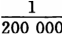［英寸］的箔。金不受任何单一酸类的腐蚀，只溶解于游离氯（王水，硝酸和盐酸的混合剂）。镀金。”[^v30-c19-annotation-57ed17d3bd901d20]

银（Ag）。密度＝10。熔点＝1 000℃。光泽明亮；一切金属中最令人喜爱的；洁白和有延展性；可以用于制成精美的制品和抽成细丝。以纯银的形式存在；通常在银铅矿里和铅混合在一起。

上面讲的是金和银的化学性质。（纯金和纯银可以分割和重新熔合，质地均匀，等等，这是人所共知的。）

矿物学性质：

金。确实值得注意的是，金属越贵重，就越单独出现，越和日常出现的物体相分离，更高级的性质和一般物体迥异。所以，通常我们发现的金是纯的，结晶为不同形式的立方体或者具有不规则的块状和颗粒，砂状和粉末等多样的形式，金以这样一些形式散布在很多岩石，例如花岗岩中，由于这些岩石的碎裂，可以在河沙［Ⅰ—29］和冲积的河床的卵石里找到。因为在这种状况下，金的密度达19.4，如果用水淘洗含金的沙子，甚至可以得到很细小的金颗粒。比重较大的金属首先从这种沙子里沉淀下来，因而正像人们所说的，被淘洗出来。最常见的是银同金合在一起，是含0.16—38.7%银的两种金属的天然合金；结果，颜色和密度自然有所不同。

银。银矿种类相当多，是一种比较常见的金属，既有纯银，也有和其他金属混合在一起的，或者同砷和硫化合。（氯化银、溴化银、银的碳酸氧化物、铋银矿、硫银铁矿、硫锑铜银矿等等。）

主要的化学性质：一切贵金属——在空气中不氧化；金（和白金）——不溶解于酸，而金只溶解于氯。在空气中不氧化使它们保持纯洁，不生锈；它们呈现出本来的样子。不受氧的侵蚀——不朽性（古代的金银迷如此称颂）。

物理性质：比重大，也就是说，很小的体积就有很大的重量；这对流通工具来说特别重要。金：19.5；银：10。光泽。金明亮，银洁白，华美，延展性；因此，它们很适合于装饰品和美化其他物品。银洁白（它反射出一切光线的自然的混合）；金橙黄（它吸收投射在金上的混合光中的一切有色光线，而只反射红色）。很难熔化。

地质性质：常见于纯粹状态（特别是金），和其他物体分离；单独的，个体化的。个体的，对其他元素的东西来说是独立出现的。

关于其他两种贵金属：（1）白金：无光泽，暗淡（金属的烟尘）；十分罕见；古代不认识它；只是在美洲发现以后才被认识；19世纪在乌拉尔也发现过；只受氯腐蚀；总是纯粹状态；比重＝21；极高的温度下也不熔化；科学价值很高。（2）水银：呈流体；可蒸发；气体有毒；可成为流体混合物（汞合金）。（密度＝13.5，沸点＝360℃。）因此，白金，尤其是水银都不适合于充当货币。

一切贵金属的一个共同的地质性质是稀有性。稀有性（撇开供求不谈）只有在下述意义上才构成价值的要素：那种本身并不稀有、是稀有性的否定、是天然元素的东西，没有任何价值，因为它不表现为生产的结果。在最初的价值规定中，那种多半同有意识的预计的生产无关的东西，只要存在着需求，倒最有价值。鹅卵石相对地说没有价值，因为它无须生产（即使生产也不过是寻找）就已经存在。一种东西要成为交换对象，具有交换价值，就必须是每个人不通过交换的中介就不能得到的，必须不是以这种天然元素的形式即作为共同财富的形式而出现的。稀有性就这一点来说是交换价值的要素。因此，贵金属的这种性质即使抛开供求的具体关系也是重要的。

如果一般来考察作为生产工具的金属的优越性，那么金所处的地位是有利的，它实质上是作为金属首先被发现的金属。而这是由于以下的双重原因：第一，它在自然界里是一切金属中最具有金属特色的，最容易区别和识别的金属；第二，在准备它的过程中，自然界代替了人工，它的最初发现，既不需要科学，也不需要发达的生产工具，只需要粗笨的劳动。

“毫无疑问，金应当是人们最先知道的金属，在人类进步的最初的记录上，它被认为是人类状况的尺度。”［（《为指导即将赴澳洲的移民所作的关于金的讲演》1852年伦敦版第172页）］

（因为金作为一种剩余是财富最初出现的形式。价值的第一个形式是使用价值，是反映个人对自然的关系的日常用品；价值的第二个形式是与使用价值并存的交换价值，是个人支配他人的使用价值的权力，是个人的社会关系：最初它本身又是节日使用的、超出直接需要之外而使用的价值。）

［Ⅰ—30］金很早就被人发现：

“金和其他金属（除极少数例外）迥然不同的地方是，它在自然界呈金属状态。铁和铜、锡、铅以及银，通常见到的是同氧、硫、砷或碳的化合物；这些金属处于非化合状态，或者像以前所说的那样处于纯粹状态，这是罕见的例外的情况，这可以说是矿物学上的奇迹，而不是一般的现象。金却常见于天然状态或金属状态……因此，像金这样一种由于它的黄色光泽而显得珍奇的金属体，一定会引起没有文化的人的注意，相反，同样摆在他的路上的其他东西则没有任何突出的地方会引起他的刚刚觉醒的观察力。另外，金由于含在最容易受大气影响的岩石中，在山地崩落的碎石中可以找到。由于大气、温度的变化、水的作用，这些破坏影响，特别是由于冰的作用，岩石的碎片继续变碎。它们被洪水冲到山谷，由于流水的不断作用而变成卵石。在这些卵石中间可以发现金的微粒。夏天天热，河水干涸，那些曾经是河道和冬季水路的河床，由此成为迁徙者行经的道路，我们可以推测，这里最早发现金。”［（同上，第171—172页）］

“金最常见的是纯金，或者说，至少是接近纯金，因此无论在河流里或者在石英矿脉里，都可以立刻认出它的金属性质。”［（同上，第8页）］

“石英和大多数其他沉重坚实的岩石的比重大约是

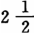，而金的比重则是18或19。可见，金比它通常与之结合在一起的其他岩石约重6倍。因此，流水足以把沙粒或小块石英或任何其他岩石带走，却不能把分散在它们当中的金沙冲走。可见，从前流水对含金的岩石所起的作用，正像现在矿工所做的那样：把它粉碎，淘去较轻的微粒，把金留下来。”［（同上，第10页）］

“河流的确是巨大的天然淘金器，它立刻把一切较轻的和较小的微粒淘去，而较重的物质或者是碰着自然的障碍物而被拦住，或者是当流水减弱了力量或速度的时候停留下来。”（同上，第12和13页）

“根据传说和古代的历史，大概在河流的沙子和砂砾里发现金是认识金属的第一步。在欧洲、非洲和亚洲的几乎所有的，也许是所有的国家里，很早以前就开始用简单的装置从含金的沉积物里淘出不同数量的金……有时，含金河流的大丰产会造成一时轰动一个地区的淘金热，但是后来这种淘金热又沉寂下来……760年，很多穷人去布拉格南边的河沙里淘金，三个人一天可以获得重1马克（$\frac{1}{2}$ 磅）的金；结果涌向‘金矿’的人如此之多，致使这个国家在下一年遭受了饥荒。我们知道，在往后的几个世纪里，类似的事件多次出现，虽然在这里也和在其他地方一样，随着地表财富的开发失去了吸引力，人们转向了正规的系统的采矿。”［（同上，第93—95页）］

“含金的两种矿床：一种是和地平线略成垂直方向而断开坚硬岩石的矿脉；另一种是砂砾矿床或‘冲积矿床’，在那里，同砂砾、沙子或泥土混合在一起的金由于水对岩石（直到很深很深的地方都有矿脉穿过这些岩石）表面的机械作用而沉积下来。前一种矿床需要比较特殊的采矿技术，后一种矿床则只需要简单的采掘操作……金矿业，说实在的，也和其他的矿业一样，是需要［Ⅰ—31］使用资本和需要运用多年经验才能获得的技能的行业。任何另外一种被文明人所掌握的技术要得到充分的发展，都不需要应用这样多的知识和相应的技能。这些知识虽然对矿工是十分重要的，但对于淘金工或手工采金工人就简直没有必要，他主要依靠他的胳膊的力气和健壮的体魄……他所使用的工具必定是简单的，以便于从一个地方搬到另一个地方，损坏了也易于修复，并且不需要细致的操作，因为那将使他为得到一点点金而花费很多时间。”［（同上，第95—97页）］

“金的砂砾矿床（最好的例子现在是西伯利亚、加利福尼亚和澳大利亚的金矿）和每年被河流冲来的细沙（其中有时包含着值得开采的金量）这两者之间是有区别的。自然，后者的确在表面就可以看到，而前者则蕴藏在1至70英尺厚的、由土壤、泥煤、沙子和砾石等组成的地层中。采金方法在这两种场合原则上应该是相同的。”［（同上，第97页）］

“对淘金工来说，大自然已把矿脉的最高处的、最好的和最富的部分挖了下来，并把原料加以粉碎和淘洗，河流已经替他干了最繁重的那部分劳动；而开采较贫瘠的，但更持久、更深厚的矿脉的矿工，则必须采用一切高超的技术。”［（同上，第98页）］

“金由于各种物理性质和化学性质而被公正地认为是最贵重的金属。它在空气中不起变化和不生锈〈这种不朽性正好抵制住大气中的氧气〉。它在凝聚状态下具有明亮的橙黄色，密度很大。具有很大的延展性……需要高温才能熔化……比重。”［（同上，第72—73页）］

可见，有三种生产金的形式：（1）在河沙里。简单地在表面寻找。淘洗。（2）在冲积的河床里。采掘。（3）矿山开采。所以，金的生产不需要生产力的发展。大自然已经做了其中的大部分工作。

（金、银等等的词源（见格林[^v30-c19-annotation-6223750a5bf654d6]）；在这里，使人自然地想起很快就转移到一些词上的关于光泽、颜色的纯粹一般概念。银——白，金——黄……青铜和金，青铜和铁可以相互交换它们的名称。从前，在德意志人那里，青铜的使用比铁早。拉丁文aes［铜］和aurum［金］直接是同一个词源的。）

铜（青铜：锡和铜）和金的使用早于银和铁的使用。

“使用金比使用银早得多，因为金以纯粹形式存在，只有少数和银混合；用简单淘洗的办法就可以得到。银一般存在于包含在原始岩层的最坚硬的岩石中的矿脉里；开采银需要机器和复杂的劳动。在南美洲，矿脉中的金没有被开采，而只是采集散布在冲积层里的粉状或颗粒状的金。在希罗多德时代，情况也是这样。希腊、亚洲、北欧和新大陆的古物表明，把金用作器具和装饰品在半野蛮状况下就有了可能，而把银用于同样用途，本身就证明了社会状况已经相当发达。”（参看杜罗·德拉马尔［《罗马人的政治经济学》1840年巴黎版第1卷第48—49页］，［L .ⅪⅤ，］1） [^v30-c19-annotation-fc465da7f9046bf2]

铜在战争时期和和平时期都是主要工具（同上［，第56页］，［L.ⅪⅤ，］2）（在意大利用作货币，同上［，第57页］）。

[^v30-c19-annotation-57ed17d3bd901d20]: 这段德文引文的出处没有找到。下面的正文，虽然没有用括号括起来，但从各方面看，也是马克思从某一德文著作中转引来的，并且有的地方被马克思简化了。——125。

[^v30-c19-annotation-6223750a5bf654d6]: 雅·格林关于贵金属的词尾联系，见他的《德意志语言史》1848年莱比锡版第1卷第12—14页。马克思在《政治经济学批判》第1分册第2章第4节中也曾提到格林的这一看法。——129。

[^v30-c19-annotation-fc465da7f9046bf2]: 在本手稿中，马克思的许多引文都是转摘自他自己在此以前各个时期所作的摘录笔记。除特别注明者外，编者加的［L］是指《伦敦笔记》（共24个笔记本），罗马数字指笔记本的编号，阿拉伯数字指笔记本中含有该引文的页码。编者在方括号中注明了引文的原著出处。——130。
<!-- END SOURCE v30c19 -->

<!-- BEGIN SOURCE v30c20 OEBPS/chapters/chapter-0020.xhtml -->
##### （b）各种金属之间价值比例的变动

如果我们总的考察金属作为货币体来使用的情况，考察金属彼此的相对用途，考察它们出现的迟早，那就必须同时考察它们的相对价值的变动（勒特龙纳、伯克、杰科布[^v30-c20-annotation-707d87c96739f9a7]）。（至于这个问题同流通中的金属一般数量，以及同这种数量对价格的关系有什么联系，以后将作为货币同价格的关系这一章的历史附录来进行研究。）

“金、银和铜之间的价值比例在不同时代的不断变动，首先必然取决于这三种金属的矿床的性质和它们的纯度。其次，政治变动对这方面也有影响，如波斯人和马其顿人入侵亚洲和入侵非洲的一部分，后来罗马人征服了三个大陆的一部分（罗马帝国等等）。”［（杜罗·德拉马尔《罗马人的政治经济学》1840年巴黎版第1卷第63—64页）］

因此，要取决于所发现的金属的相对纯度和它们的矿床的相对状况。

不同的金属之间的价值比例不考虑价格就能确定，即通过它们相互交换时的简单的量的比例来确定。一般来说，我们只是在比较少数［Ⅰ—32］具有同名尺度的商品时才能采用这种方法；例如，若干夸特的黑麦、大麦、燕麦换取若干夸特的小麦。在物物交换的情况下就采用这种方法，一般来说，那时很少进行交换，进入交易的还只是少数商品，因此还不需要货币。

“据斯特拉本说，在与萨巴人邻近的阿拉伯人那里，天然金如此丰富，以致10磅金换1磅铁，2磅金换1磅银。”［（同上，第52页）］

巴克特里亚地区（巴克特拉等地，总之，土耳其斯坦）以及位于帕鲁帕米苏斯山脉（兴都库什山脉）和喜马山脉（慕士塔格山脉）之间的亚洲部分，即多金的沙漠（戈壁沙漠），金的藏量丰富。因此，按照杜罗·德拉马尔的说法，大约“从公元前15世纪到6世纪，金银的价值比例是1∶6或1∶8，这样的比例在中国和日本一直存在到19世纪初；希罗多德断定，在大流士·希斯塔斯普时代的波斯，这种比例为1∶13。”［（同上，第54页）］

“根据公元前1300年和600年之间写成的摩奴法典[^v30-c20-annotation-b425ae2870e1d094]的记载，金银的价值比例是

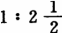。银矿事实上几乎只分布在原始的岩层里，特别是在原生岩和某些次生的矿脉里……银矿通常不是在冲积的沙里，而是在最结实和最坚硬的岩石里，例如石英等等……在那些寒冷的——或者是由于它们的纬度高，或者是由于它们的绝对地势高——地区，银比金较为常见，而金一般来说在炎热的国家较多。和金相反，纯银极为少见等等（通常和砷或硫化合）〈盐酸盐，硝酸盐〉。至于这两种金属的蕴藏量〈在澳大利亚和加利福尼亚发现金矿以前〉，1811年洪堡估计美洲金和银的比例是1∶46，欧洲（包括俄国亚洲部分）是1∶40。根据法国科学院矿物学家们估计，现在〈1840年〉这种比例是1∶52；但是1磅金仅值15磅银，因此，价值比例＝1∶15。”［（同上，第54—56页）］

铜。密度＝8.9。美丽的朝霞色；有相当的硬度；需要很高的温度才能熔化。纯铜并不少见，铜常和氧或硫化合。

“铜矿脉包含在最原始的岩层里。但是，同其他矿物相比，它也更经常地在地表或在不太深的地方凝成纯金属块，有时还有相当的重量。在战争中和在和平时期，铜的使用都比铁早。”［（同上，第56页）］

（在历史的发展中，作为货币材料的金和银的关系，正像作为劳动工具的铜和铁的关系一样。）

“在罗马人统治的意大利，从罗马共和国第100—500年，铜大量进入流通……只要知道一个民族用什么金属——金、铜、银或铁——制造自己的武器、工具或装饰品，就可以事先确定该民族的文明程度……”“赫西俄德在他的关于农业的诗里写道：‘用铜干所有的活，因为尚无黑铁’[^v30-c20-annotation-68ce14a4f97727c1]。”“卢克莱修：铜的使用比铁早。”[^v30-c20-annotation-b02df90e9fedcd15]［（同上，第57页）］

杰科布提到努比亚和西伯利亚古代的铜矿（见杜罗［·德拉马尔《罗马人的政治经济学》］第1卷第58页）。

“希罗多德说，马萨格泰人只有青铜而无铁。根据牛津大理石古迹的记载，在公元前1431年以前还不知道铁。在荷马的著作里很少提到铁；相反铜（青铜）的使用非常普遍，希腊和罗马社会甚至长期利用这种铜、锌和锡的合金来制造斧子和剃刀。”［（同上，第58页）］

“意大利的天然铜非常丰富；因此，在公元前247年以前，铜币即使不是统一的货币，至少也是意大利中部的标准货币，即货币单位。意大利南部的希腊殖民地直接从希腊和亚洲或者通过推罗（提尔）和迦太基得到银，他们从公元前6—5世纪就开始用银制造货币。”［（同上，第64页）］

“看来，在驱逐皇帝以前，罗马人就已经使用银币，但是普林尼说‘这是命令要爱护意大利〈即意大利的银矿〉的元老院的旧决议所禁止的’［（普林尼《博物志》第3卷第24章）］。元老们害怕一种方便的流通手段产生的后果——奢侈，奴隶数目增多，积累，地产集中。”［（杜罗·德拉马尔《罗马人的政治经济学》第1卷第65—66页）］

在伊特鲁里亚人那里，铜也比金更早用作货币。

加尔涅以下的说法是错误的：

“当然是从矿物界寻找和挑选预定用作积累的材料。”（见［热·加尔涅《货币史》1819年巴黎版第1卷第7页］，［L.］Ⅲ，22）

正相反，积累是在采用金属货币（无论作为真正的货币或者只是作为大家偏爱的、按重量计算的交换手段）以后开始的。关于这一点，讲到金时特别需要加以论述。

赖特迈埃尔正确指出：

“金、银和铜，尽管它们比较软，在古代民族那里首先被用来制造采伐工具和采掘工具，——比用铁早，也比它们被用作货币早”……“当人们学会淬火，使铜的硬度提高到能够敌得过坚硬的岩石的时候”，工具得到了改进。“人们用炼得很硬的铜来制造加工石头的凿子和锤子……最后发现了铁。”（见［约·弗·赖特迈埃尔《古代民族采矿和冶金的历史》1785年格丁根版第14—16、32页］，［L.］Ⅲ，34）

杰科布说：

“在家长制状态下，用来制造武器的金属，如（1）黄铜和（2）铁，同当时普通的食物和衣服相比，既稀少而又非常昂贵，虽然人们还不知道用贵金属来铸币，但当时金和银已经能够比谷物和牲畜更容易和更方便地同其他金属相交换。”（见［威·杰科布《贵金属生产和消费的历史研究》1831年伦敦版第1卷第142页］，［L.］Ⅳ，3）

［Ⅰ—33］“此外，为了从兴都库什山脉和喜马拉雅山脉之间的巨大的冲积层里开采纯粹的或者接近纯粹的金，只需要简单的淘洗就行了。那时亚洲的这些国家的人口稠密，因而人力很便宜。银由于开采方面的〈技术上的〉困难，比较昂贵……从亚历山大死后开始，亚洲和希腊出现了相反的现象。含金的沙子被取尽了；奴隶和人力的价格上涨；从欧几里得开始到阿基米德期间，力学和几何学有了很大的发展，使开发亚洲、色雷斯和西班牙的丰富的银矿能够有利可图；而由于银的蕴藏量是金的52倍，所以两种金属的价值比例必然改变，在公元前350年色诺芬时代1磅金换10磅银，在公元422年值18磅银。”［（杜罗·德拉马尔《罗马人的政治经济学》第1卷第62—63页）］

因此，从1∶10提高到1∶18。

公元5世纪末现金的量大大减少了，采矿停止了。在15世纪末以前的中世纪，相当大的一部分货币都是金铸币（［现金的］减少特别涉及到过去最常流通的银）。15世纪的比例是1∶10；18世纪在大陆上是1∶14，在英国是1∶15。

在近代亚洲，银在贸易中大都当作商品；特别是在铜币（钱——铜、锌和铅的合金）作为地方铸币的中国；在中国，金（和银）被当作商品按照重量用于对外贸易的结算。[^v30-c20-annotation-f4b0d2fc2d542bcb]

在罗马，铜和银（铸币）的价值之间的比例波动剧烈。

“在塞尔维乌斯以前用来交换的是金属条块；未铸造的铜……货币单位是铜阿司＝1磅铜……在塞尔维乌斯时代，银和铜的比例＝279∶1；……布匿战争[^v30-c20-annotation-547165ec395f1e10]爆发以前＝400∶1；……在第一次布匿战争期间＝140∶1；……在第二次布匿战争期间＝112∶1。”［（杜罗·德拉马尔《罗马人的政治经济学》第1卷第66—68、73、76、82页）］

“金最初在罗马很贵，而银来自迦太基（和西班牙）；直到［罗马建城］第547年，金只是以条块形式使用。在商业上金和银的比例＝13.71∶1，在铸币上＝17.14∶1；在凯撒统治时期＝12∶1（在国内战争爆发的时候），在凯撒掠夺了国库以后只＝8.9∶1；在霍诺里乌斯和阿尔卡狄乌斯时期（397年）固定为14.4∶1；在霍诺里乌斯和小狄奥多希时期（422年）＝18∶1。银和铜的比例＝100∶1；金和银的比例＝18∶1。”［（同上，第85—91和95—96页）］

“罗马的第一批银币是罗马建城第485年铸造的，第一批金币是罗马建城第547年铸造的……在第二次布匿战争以后，阿司的重量缩减到1盎司，它成了辅币；色士杰尔色〈银〉成了货币单位，一切大宗的支付都用银来进行。（在日常交往中，铜（后来是铁）仍然是主要的金属。）在东罗马帝国和西罗马帝国皇帝的统治时期，起调节作用的货币单位是索里达〈aureus［奥留斯］，因而是金〉。”［（同上，第65、86、81、84、96页）］

因此，在古代世界，情况平均说来如下：

第一，相对来说银价高于金。除去金比银便宜以及甚至比铁便宜这种个别现象（在阿拉伯人那里）外，在亚洲从公元前15—6世纪，金和银的价值比例是6∶1或8∶1（后一比例在中国和日本一直保持到19世纪初）。在摩奴法典中甚

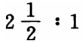这种较低的比例是由于使金成为最先被发现的金属的同样原因产生的。金当时主要产自亚洲和埃及。在意大利的发展过程中，这个时期是用铜作为货币的，而一般地说，当金是起主导作用的贵金属的时候，铜则是和平与战争的主要工具。早在色诺芬时代，金和银的价值比例＝10∶1。

第二，从亚历山大死后，由于含金沙子取尽，由于技术和文明的进步，金与银相比价值提高了；于是开采银矿；银在地下的蕴藏量比金多这一事实从此发生了影响。特别是迦太基人开发西班牙银矿，必然使金和银的价值比例发生像15世纪末美洲银的发现所引起的那样一种革命。凯撒时代以前的比例＝17∶1；以后＝14∶1；最后，从公元422年开始＝18∶1。（在凯撒时代，金价值下跌是由于偶然原因。）当银同金相比价值下降的时候，铁是战争与和平时期的主要生产工具。

如果说在第一个时期是从东方输入金，那么在第二个时期便是从较凉爽的西方输入银。

第三，在中世纪。又和色诺芬时期的比例一样，即10∶1。（有些地方＝12∶1？）

第四，在发现美洲以后。又和霍诺里乌斯和阿尔卡狄乌斯时期（397年）的比例相近，即从14∶1到15∶1。虽然大约从1815年底到1844年金的生产提高了，金还是取得贴水（例如在法国）。

第五，金在加利福尼亚和澳大利亚的发现，大概又导致罗马皇帝时代的比例，即18∶1，甚至更高[^v30-c20-annotation-100ca46ed7d66fe0]。

无论是在古代还是在现代，从东方到西方，银随着贵金属生产的进步而变得相对便宜，直到加利福尼亚和澳大利亚把这种状况扭转过来。在个别情况下会产生剧烈的波动；但是，如果考察主要的差别，那么这种情况的反复是很明显的。

［Ⅰ—34］在古代，铜比现在贵二至三倍（加尔涅[^v30-c20-annotation-0495d503c23865bf]）。

（c）现在应当考察金和银的供给来源以及它们同历史发展的联系。

（d）货币作为铸币。关于铸币的简短的历史材料。铸币成色的降低和提高等等。

[^v30-c20-annotation-707d87c96739f9a7]: 指杜·德拉马尔引用的下列著作：安·让·勒特龙纳《关于希腊和罗马货币的估价以及美洲发现前金银价值的概述》1817年巴黎版；奥·伯克《雅典人的国家经济》1817年柏林版；威·杰科布《贵金属生产和消费的历史研究》1831年伦敦版。——130。

[^v30-c20-annotation-b425ae2870e1d094]: 《摩奴法典》是古印度的一部关于宗教、法律和礼仪的戒律集成，是按照印度奴隶制国家的需要和婆罗门教的教义编纂的早期习惯法法典之一。它规定了每个印度人按照婆罗门教义应尽的义务。据传这部法典是出自神话中的人类始祖摩奴（梵文中的“人”）之手。这部法典的材料是在许多世纪中逐渐积累起来的，在将近公元开始时初具规模。《摩奴法典》反映了尚有许多原始公社制残余的印度奴隶制社会发展的特点。——131、135。

[^v30-c20-annotation-68ce14a4f97727c1]: 见赫西俄德的诗《劳动和时间》第151行，马克思转引自杜·德拉马尔《罗马人的政治经济学》第1卷第57页。——132。

[^v30-c20-annotation-b02df90e9fedcd15]: 见卢克莱修《物性论》第5卷第1286行，马克思转引自杜·德拉马尔《罗马人的政治经济学》第1卷第57页。——132。

[^v30-c20-annotation-f4b0d2fc2d542bcb]: 见古·居利希《关于当代主要商业国家的商业、工业和农业的历史叙述》1845年耶拿版第5卷第110—111页和第115、131页。——134。

[^v30-c20-annotation-547165ec395f1e10]: 布匿战争是古代两个最大的奴隶制国家——罗马和迦太基——为了确立在地中海西部的统治，为了争夺新的土地和奴隶而进行的战争。第一次布匿战争发生于公元前264—241年、第二次布匿战争发生于公元前218—201年；第三次布匿战争发生于公元前149—146年；结果以迦太基的灭亡而告终。——134。

[^v30-c20-annotation-100ca46ed7d66fe0]: 这里看来是马克思的笔误，因为在下面一段里马克思谈到，随着生产方法的进步，银变得相对便宜，后来“加利福尼亚和澳大利亚把这种状况扭转过来”，即金变得相对便宜。而在《政治经济学批判》第1分册第2章第4节《贵金属》末尾他又写道：“澳大利亚、加利福尼亚和哥伦比亚金矿的发现大概又会使金的价值跌落”。——136。

[^v30-c20-annotation-0495d503c23865bf]: 见热·加尔涅《从上古至查理大帝在位时期的货币史》1819年巴黎版第1卷第253页。——136。
<!-- END SOURCE v30c20 -->

<!-- BEGIN SOURCE v30c21 OEBPS/chapters/chapter-0021.xhtml -->
#### ［货币流通和货币的三种规定］

货币流通是同方向相反的商品流通相适应的。商品从A转到B的手里，同时货币就从B转到A的手里，如此等等。货币流通像商品流通一样，从无数不同的点出发，又回到无数不同的点。在我们这里所考察的货币流通阶段上，即在货币的直接流通阶段上，货币不会从一个中心出发到达圆周的不同点，并且从圆周的一切点回到一个中心，这种情况只有在以银行制度为中介的流通中才会发生。然而这种最初的自然形成的流通，是由大量流通组成的。而真正的流通，只在金银不再是商品的地方才开始发生。在贵金属输出国和输入国之间，不会有这种意义的流通，只有简单的交换，因为这里金银不是充当货币，而是充当商品。

货币是商品交换的中介，在这里也就是商品流通的中介，因而是交换手段，就这一点来说，货币是流通工具，流通车轮[^v30-c21-annotation-c5570ed4daddf7ec]；而在这一过程中，货币本身也流通，进行自己的运动，就这一点来说，货币本身进行某种流通，即货币流通。必须弄明白，这种流通究竟在多大程度上由特殊规律决定。早就清楚，如果说货币是商品的流通车轮，那么商品同样是货币的流通车轮。如果说货币使商品流通，那么商品则使货币流通。因此，商品流通和货币流通是相互制约的。

货币流通应从三个方面来考察：（1）运动的形式本身，运动所经历的路线（运动的概念）；（2）流通的货币量；（3）货币完成自身运动的速度，即流通的速度。这种考察只有同商品流通联系起来才能进行。早就清楚，商品流通的一些因素是完全不以货币流通为转移的，并且相反，这些因素或者直接决定货币流通，或者以下述方式决定货币流通：例如决定商品流通速度的同一些情况，也决定货币流通的速度。生产方式的总的性质决定这两种流通，而更直接地决定商品流通。

交换者的人数（人口数）：他们在城乡间的分布；商品，产品和各生产因素的绝对量；投入流通的商品的相对数量；交通运输工具的发展，这种发展有二重意义：它既决定彼此交换者即相互接触者的范围，又决定原料到达生产者手里和产品到达消费者手里的速度；最后，工业的发展，这种发展使不同的生产部门如纺纱、织布、染色等等集中起来，从而使一系列中间交换行为成为多余。商品流通是货币流通的最初前提。而货币流通又决定商品流通，就这一点来说，货币流通是我们要加以考察的。

首先必须确定流通的一般概念。

还必须指出，使货币进入流通的，是交换价值，因而也就是价格。因此，在考察商品流通时，不仅要考察商品的数量，同样还要考察商品的价格。交换价值低或价格低而数量大的商品，同价格高一倍但数量小的商品相比，商品流通所需要的货币显然要少。因此，在论述流通概念以前，本应先说明价格的概念。流通就是价格的设定，就是商品转化为价格的运动；就是商品作为价格而实现。货币具有二重规定：（1）作为尺度，或商品作为交换价值借以实现的要素；（2）作为交换手段，流通工具。这两种规定循着完全不同的方向发生作用。货币使之流通的商品，不仅在单个人的头脑中，而且在社会的观念中（直接地在买卖过程双方的观念中）已观念地转化为货币。而观念地转化为货币和实在地转化为货币决不是由同一些规律决定的。必须研究它们相互间的关系。

[^v30-c21-annotation-c5570ed4daddf7ec]: 流通车轮（The great wheel of circulation）是亚·斯密对货币的称呼。见亚·斯密《国民财富的性质和原因的研究》1776年伦敦版第2篇第2章。——137。
<!-- END SOURCE v30c21 -->

<!-- BEGIN SOURCE v30c22 OEBPS/chapters/chapter-0022.xhtml -->
##### （a）［货币作为价值尺度］

流通的一个本质的规定，就在于它使交换价值，而且是使规定为价格的交换价值流通。因此，并不是任何一种商品交换，如物物交换、实物贡赋、封建劳役等等，都形成流通。流通首先必须具备两个条件：第一，商品预先确定为价格；第二，存在的不是个别的交换行为，而是川流不息的、或多或少发生在社会整个表面上的交换总和，交换总体，即交换行为的体系。

［Ⅰ—35］商品被规定为交换价值。作为交换价值，商品按一定比例（按商品所包含的劳动时间的比例）成为其他一切价值（商品）的等价物；但是商品不能直接适应自己的这种规定性。作为交换价值，商品不同于它本身的自然存在。商品要表现为交换价值，必须有一种中介。因此，在货币中，交换价值作为某种他物同商品相对立。被当作货币的商品才是作为纯交换价值的商品，或者说，作为纯交换价值的商品就是货币。但同时，现在货币存在于商品之外和商品之旁；商品的交换价值，一切商品的交换价值，获得一种不依赖于商品的，在一种特别的材料、特有的商品上独立化的存在。商品的交换价值表现其他一切商品可以与该商品相交换的量的比例的总体，这种比例由同一劳动时间内所能生产的不等的商品量来决定。现在货币作为一切商品的交换价值存在于一切商品之旁和一切商品之外。

货币首先是商品为取得作为交换价值的自由存在而必须潜入其中并在其中金银化的一般材料。商品必须翻译成货币，用货币表现出来。货币成为交换价值的公分母，即作为交换价值的商品的公分母。用货币来表现的，即与货币相等同的交换价值，就是价格。当货币成为同交换价值相对立的独立的东西以后，交换价值就表现在那个作为主体同交换价值相对立的货币的规定性上。但是任何交换价值都是某种一定的量，都是量上被规定的交换价值。交换价值本身等于一定量的货币。这种规定性按照一般规律是由实现在交换价值中的劳动时间决定的。因此，一个交换价值，例如是一日的产品，表现为一定量的金银，这一定量的金银等于一日的劳动时间，也就是一个工作日的产品。交换价值的一般尺度，现在已成为每个交换价值和它与之相等同的货币之间的尺度。

（金银价值首先由金银出产国的金银生产费用决定。

“在矿产国中，一切价格最终取决于贵金属的生产费用；……矿工的薪金……是计算其他一切生产者的薪金的标度……在非矿产国中，一切非垄断商品的金价值和银价值，取决于出口一定量劳动的成果所获得的金银，取决于当时的利润率，而在每一个别场合取决于支付的工资额和预付工资的时间。”（西尼耳［《关于取得货币的费用以及私人纸币和国家纸币的某些影响的三篇演讲》1830年伦敦版第15、13—14页］）

换句话说，上述价值取决于用一定量的劳动（可出口的产品）直接或间接地从矿产国换得的金银量。货币首先是表现一切交换价值的相等关系的东西：一切交换价值在货币上都是同名的。）

表现在货币规定性上的交换价值，就是价格。在价格上，交换价值表现为一定量的货币。在价格上，货币首先表现为一切交换价值的单位；其次表现为各交换价值所包含的一定数目的单位，这样，通过同货币相比较，各交换价值的量的规定性，量的相互比例就表现出来。因此，货币在这里表现为交换价值的尺度；价格则表现为用货币来计量的交换价值。货币是价格的尺度，因而交换价值用货币来相互比较，这是自然而然得出的规定。但是在阐述上更为重要的是：在价格上交换价值同货币相比较。当货币表现为同商品相独立的、相分离的交换价值以后，单个商品，特殊交换价值，现在又同货币相等，即同一定量的货币相等，表现为货币，翻译成货币。由于商品都同货币相等，它们相互之间又发生关系，正如它们作为交换价值在概念上已经表明：它们按一定比例互相等同和比较。

特殊的交换价值，商品，都表现在，总括和设定在独立的交换价值即货币的规定性上。这是怎样发生的（即一定量的交换价值同一定量的货币之间的量的比例是怎样发现的），上面已经谈到[^v30-c22-jz_1_168]。但由于货币在商品之外具有独立存在，商品的价格就表现为交换价值或商品对货币的外在关系；商品不是价格，虽然商品就其社会实体来说是交换价值；这种规定性并不是直接同商品结合在一起，而是以商品同货币相比较为中介；商品是交换价值，但它有价格。交换价值和商品直接合为一体，是商品的直接的规定性，而商品同样又直接和这种规定性相分离，因此一方是商品，另一方（在货币中）是商品的交换价值，但现在在价格中，商品一方面同货币这种商品之外的存在物发生关系，另方面在观念上它本身又表现为货币，因为货币具有和商品不同的实在性。价格是商品的一个属性，是商品借以被想象为货币的一个规定。价格不再是商品的直接的规定性，而是商品的反思的规定性。［Ⅰ—36］现在商品作为观念上的货币同实在的货币并存。

货币作为尺度，商品作为价格的这种最初的规定，可以用实在货币和计算货币之间的区别来最简便地加以说明。货币作为尺度，总是充当计算货币，而商品作为价格，始终只是观念地转化为货币。

“卖主对商品估价，买主还价、记账、债务、租金、财产登记等等，总之，一切引起有形支付行为和先于这一行为的情况，都必须表现为计算货币。实在货币只是为了实现支付，结清〈清算〉账目才参与进来……假定我必须支付24利弗尔12苏，那么计算货币就代表24个某种单位和12个另一种单位，而我实际上要支付两种有形的钱币：一种是值24利弗尔的金币，一种是值12苏的银币……实在货币总额在流通的需要上有一个必要的极限。计算货币是观念的尺度，除想象以外没有任何极限。如果只是从财富的交换价值的观点来考察财富，计算货币可用来表现任何一种财富……例如表现国民财富，国家收入和个人收入；不管价值以何种形式存在，各计算价值都按同一形式确定；因此，在大量的消费品中没有一件消费品不是多次在思想上转化为货币，而同这一数量相比较，现实的货币总额最多＝1∶10。”（加尔涅［《货币史》1819年巴黎版第1卷第72、73、77、78页］）

（这个比例不恰当。1∶几百万才较为确切。然而这根本无法计量。）

因此，如果说货币起初表现交换价值，那么现在商品作为价格，作为表现在观念上的、实现在头脑中的交换价值，表现一个货币额：一定比例的货币。作为价格，一切商品，在不同形式下都是货币的代表，而先前货币作为独立的交换价值是一切商品的代表。货币在实际上表现为商品之后，商品就在观念上表现为货币。

现在首先清楚的是，当商品这样观念地转化为货币，或商品表现为价格时，实际存在的货币量从以下两方面来说是完全无关紧要的：第一，一目了然，商品观念地转化为货币同实在的货币量无关，不受它限制。这一过程不需要任何一块货币，正如要用某种尺度（如码）来表现地球赤道的长度，无须实际使用码。例如，如果用货币估价英国的全部国民财富，即把它表现为价格，那谁都知道，全世界的货币也不够用来实现这种价格。这里需要货币只是作为范畴，作为想象的关系。第二，既然货币充当单位，从而商品通过自身包含一定数额的货币可除部分而表现出来，通过货币来计量，那么，两者之间的尺度就是交换价值的共同尺度——生产费用或劳动时间。因此，如果

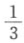盎司金是1个工作日的产品，而x量商品是3个工作日的产品，那么x量商品＝1盎司金或3镑17先令7便士。在计量货币和商品时，最初的交换价值尺度又重现出来。商品不是表现在3个工作日中，而是表现在作为3个工作日的产品的金量或银量中。实际存在的货币量显然和这种比例无关。

（詹姆斯·穆勒的错误[^v30-c22-annotation-c61e48c997ec6b54]在于：他忽视了，贵金属的价值和以金属价值计量的商品价格，是由生产费用决定，而不是由贵金属的量决定。）

（“商品在交换中互为尺度……但是这种办法要求的是流通中有多少商品就要有多少比较项。如果一种商品只是与一种商品而不是与两种商品相交换，它就不能成为比较项……这样就需要有一个共同的比较项……这种比较项可以纯粹是观念的……作为尺度的规定是最初的规定，它比作为抵押品的规定更为重要……俄国和中国之间的贸易，是用银估价一切商品，然而这种贸易是物物交换。”（施托尔希［《政治经济学教程》1823年巴黎版第1卷第81、83—84、87、88页］）

“货币用于计量，就像重量用于比较物质的量一样。用来计算每个物的重量和价值的两种单位是同一名称的。重量尺度和价值尺度是同名称的……总是具有同一重量的某种标准，是很容易见到的。就货币来说，问题仍然是每磅银的价值＝它的生产费用。”（西斯蒙第［《政治经济学概论》1838年布鲁塞尔版第2卷第264—265、267、268页］）

（不仅是同名称。金银起初就是用秤称的。例如罗马人的阿司（as）＝1磅铜。）

［Ⅰ—37］“在荷马和赫西俄德的作品中，作为价值尺度的货币，不是金银，而是绵羊和公牛……在特洛伊战场上进行物物交换。”（杰科布［《贵金属生产和消费的历史研究》1831年伦敦版第1卷第109页］）（在中世纪，奴隶也起过同样的作用。（同上［，第351页］））

货币无须实现在它的进一步规定上，就可以表现在尺度和交换价值一般要素的规定上；也就是说，还在它取得金属货币形式以前，就可以这样。在简单的物物交换中，情况就是这样。不过这时的前提是：交换一般说来还很少发生，商品还没有发展成为交换价值，因而也没有发展成为价格。

（“某物要取得一个共同的价格标准，该物的让渡就必须是经常的和人们熟悉的。在简单的社会状态下，这种情况不会发生。在非工业国中，许多物并没有一定的价格……只有出售才能确定价格，并且只有经常出售才能定出一个标准。生活必需品的经常出售，取决于城乡之间的关系”等等。）［（詹·斯图亚特《政治经济学原理研究》1770年都柏林版第1卷第395、396页）］

发达的价格规定的前提是：个人不是直接生产自己的生存资料，他的直接产品是交换价值，因此必须通过某种社会过程的中介才能成为他的生活资料。在工业社会的这一基础得到充分发展的状态和家长制状态之间，存在着许多中间阶段，无数的色层。

从（a）点得出：贵金属的生产费用提高，所有商品的价格就降低；贵金属的生产费用降低，所有商品的价格就提高。这是一般规律，我们将会看到，它在个别情况下会发生变形。

[^v30-c22-jz_1_168]: 见本卷第88—95页。——编者注

[^v30-c22-annotation-c61e48c997ec6b54]: 指詹·穆勒在其《政治经济学原理》1821年伦敦版第3章第7、8两节中论述的货币数量论。马克思在《政治经济学批判》第1分册第2章C节中，一面摘引穆勒此书两节中的大段话，一面对穆勒的观点进行批判。正文中所说的詹·穆勒的错误，马克思摘自托·图克《通货原理研究》1844年伦敦第2版第136页。——142。
<!-- END SOURCE v30c22 -->

<!-- BEGIN SOURCE v30c23 OEBPS/chapters/chapter-0023.xhtml -->
##### （b）［货币作为流通手段］

如果说交换价值在价格上观念地转化为货币，那么，它在交换中，在买卖中则实在地转化为货币，同货币相交换，然后再作为货币同商品相交换。特殊的交换价值先要同一般的交换价值相交换，然后才能再同特殊的交换价值相交换。商品只有通过这种以货币为中介的中介运动，才能作为交换价值而实现。因此，货币流通的方向同商品流通的方向相反。货币表现为商品交换的中介，表现为交换手段。货币是商品流通的流通车轮，流通工具；但是它作为这样的工具同时又有自己的流通——货币流通。商品的价格只有通过商品同实际的货币相交换，或通过商品实际地同货币相交换才能实现。

从以上所说可得出如下论点。商品只有事先观念地转化为货币，即获得价格规定，表现为价格，才能实在地同货币相交换，转化为实际的货币。因此，价格是货币流通的前提，虽然价格的实现表现为货币流通的结果。使商品的交换价值，从而使商品的价格高于或低于商品的平均价值而上涨或下跌的情况，应在论交换价值的一篇中阐述，这些情况在价格实际地实现为货币的过程之前就已经存在，因而一开始就和这个过程完全无关。数字的相互关系，即使我用小数来表达，自然仍旧不变。这不过是换个名称罢了。

要使商品实际进行流通，就要有运输工具，而这是货币无能为力的。如果我用x镑的金额买来1 000磅铁，那么铁的所有权就转到我的手里。我的x镑起了交换手段的作用，并且进行了流通，就像所有权证书一样。反之，卖主实现了铁的价格，实现了作为交换价值的铁。但是，要把铁从卖主那里运到我这里来，货币是无能为力的；这需要车辆、马匹、道路等等。商品的实际流通，在空间和时间上，都不是由货币来实现的。货币只是实现商品的价格，从而把商品要求权转让给买主，转让给提供交换手段的人。货币使之流通的不是商品，而是商品的所有权证书；在这一流通中，当同货币交换时，不管是买还是卖，所实现的也不是商品，而是商品的价格。

因此，流通所需要的货币量，首先是由投入流通的商品的价格高低决定的。而这种价格的总额取决于：第一，各单个商品的价格；第二，按一定价格投入流通的商品数量。例如，为了使一夸特小麦按60先令流通，所需要的先令就要比按30先令价格流通时多一倍。如果使500夸特小麦按每夸特60先令流通，那就需要30 000先令，而使200夸特小麦流通则只需要12 000先令。因此，这取决于商品价格的高低和具有固定价格的商品的量。

第三，但是流通所需要的货币量，不仅取决于待实现的价格总额，而且取决于货币流通的速度，即货币完成这种实现业务的速度。如果1塔勒每小时完成每次价格为1塔勒的10次购买，即交换10次，那么它所完成的业务，恰好等于每小时只购买1次的10塔勒所完成的业务。速度是个否定因素；它代替数量；它使一块货币倍增成许多块货币。

有些情况，一方面决定待实现的商品价格量，另一方面决定货币流通速度，这要留到以后来考察。但有一点是清楚的，价格的高低，并不是由流通中的货币的多少，相反，流通中货币的多少，是由价格的高低造成的；其次，货币流通的速度不取决于流通的货币量，而是［Ⅰ—38］流通手段的量取决于流通手段的速度（大量支付时，货币不是计数而是过秤；这可以缩短时间）。

然而，如上所述[^v30-c23-jz_1_174]，货币流通不是从一个中心出发，也不会从圆周的一切点回到一个中心（像在发行银行的场合和部分地像国家货币那样）；而是从无数的点出发，又回到无数的点（这种回流本身和回流经历的时间是偶然的）。因此，流通手段的速度只在一定限度内能够代替流通手段的量。（例如，工厂主和租地农场主向工人支付货币；工人又支付给小贩等等；货币又从小贩那里回到工厂主和租地农场主手里。）不管流通速度怎样，同一货币量只能相继完成一连串的支付。但一定量的支付必须同时完成。流通同时从许多点出发。因此，需要一定的货币量投入流通，它总是处于流通中，是由流通中同时存在的出发点所汇成的总额决定的，并且是由这个总额完成自己的行程（回流）的速度决定的。尽管流通手段的这个量有涨有落，但有一个平均水平；因为持久性的变动只是缓慢进行的，只是在长时期内发生的，并且像我们将要看到的那样，会经常由于许多次要的情况而受到阻碍。

（对（a）点的补充）。（“作为货币属性来使用的尺度，是价值的指示器”……可笑的是，有人认为，“既然商品以值若干盎司的金来估价，而该国的金储备减少时，价格就必然下降……作为价值指示器的金的效能，不会因为某一个别国家拥有金量的多少而受影响。即使通过银行的措施能把该国的整个纸币流通和金属货币流通缩减一半，金和商品的相对价值仍会不变”。例子是16世纪从秘鲁输出金以及19世纪金从法国流入英国时的情形。（哈伯德［《通货和国家》1843年伦敦版第44—46页］，［L .］Ⅷ，45））[^v30-c23-annotation-91af9d9b7b3cf5af]

（“在非洲沿岸，充当价值尺度的既不是金，也不是银，而是观念的标准，想象的金属条块57。”（杰科布［《贵金属生产和消费的历史研究》1831年伦敦版第2卷第326—327页］，［L.］Ⅴ，15））

在作为尺度的规定上，货币同本身的量无关，或者说货币的现存量是无关紧要的。在作为交换手段，作为流通工具的规定性上，货币的量是经过计量的。货币的这两种规定相互间是否会发生矛盾，这要在以后来考察。

（强制的、非自愿的流通的概念（见斯图亚特[^v30-c23-annotation-bb85c0440277f4cc]），在这里还没有涉及。）

属于流通的本质的东西是：交换表现为一个过程，表现为买卖的流动的总体。流通的第一个前提是商品本身的流通，是不断从许多方面出发的商品流通。商品流通的条件是：商品作为交换价值来生产，即不是作为直接的使用价值，而是作为以交换价值为中介的使用价值来生产。通过转让和让渡并以它们为中介而实行占有，是基本的前提。在流通中即交换价值的实现过程中包含着：（1）我的产品只有对别人成为产品，才是产品；也就是说，只有成为被扬弃的个别，成为一般，才是产品；（2）我的产品只有转让，对别人成为产品，对我才是产品；（3）别人只有把他自己的产品转让，我的产品对他才是产品；由此得出（4）生产对于我不是表现为目的本身，而是表现为手段。

流通是这样一种运动，在这种运动中，普遍转让表现为普遍占有，普遍占有表现为普遍转让。这一运动的整体虽然表现为社会过程，这一运动的各个因素虽然产生于个人的自觉意志和特殊目的，然而过程的总体表现为一种自发形成的客观联系；这种联系尽管来自自觉的个人的相互作用，但既不存在于他们的意识之中，作为总体也不受他们支配。他们本身的相互冲突为他们创造了一种凌驾于他们之上的异己的社会权力；他们的相互作用表现为不以他们为转移的过程和强制力。流通由于是社会过程的一种总体，所以它也是第一个这样的形式，在这个形式中，不仅像在一块货币或交换价值的场合那样，社会关系表现为某种不以个人为转移的东西，而且社会运动的总体本身也表现为这样的东西。个人相互间的社会联系作为凌驾于个人之上的独立权力，不论被想象为自然的权力，偶然现象，还是其他任何形式的东西，都是下述状况的必然结果，这就是：这里的出发点不是自由的社会的个人。从作为经济范畴中第一个总体的流通中，就可以清楚地看到这一点。

［Ⅰ—39］初看起来，流通表现为恶的无限[^v30-c23-annotation-50872aa494a2447c]过程。商品换成货币，货币换成商品，如此反复，无穷无尽。同一过程的这种不断更新，实际上构成流通的一个本质的要素。但仔细地考察一下，流通还呈现出另外的现象：连接在一起或从出发点回到出发点的现象。商品换成货币，货币换成商品。这样，商品就换成商品，只不过这种交换是间接的交换。买者又成为卖者，卖者又成为买者。因此，每一方都被设定在二重的和对立的规定中，于是就形成两种规定的生动的统一。

但是，如果像有些经济学家那样，当货币制度的矛盾一旦暴露出来，便突然仅仅抓住最终结果而忽视促成结果的中介过程，抓住统一而忽视区别，抓住肯定而忽视否定，那是完全错误的。商品在流通中换成商品；同样可以说它不是换成商品，因为它换成货币。换句话说，买卖行为表现为彼此无关的、在空间上和时间上相分离的两种行为。如果有人说，卖者由于买进货币因而也是买者，买者由于卖出货币因而也是卖者，这恰好忽视了区别，忽视了商品和货币之间的特有区别。

有些经济学家先是再好不过地向我们指明，两种行为合而为一的物物交换是不能满足较发达的社会形式和生产方式的，然后他们突然又把以货币为中介的物物交换看作直接的物物交换而忽视了这种交易的特有性质。他们先是向我们指明，同商品相区别的货币是需要的，然后他们突然又断言，货币和商品之间没有区别。他们求助于这种抽象，是因为在货币的实际发展中所产生的矛盾，同资产阶级常识上的辩护论格格不入，因此必须加以掩盖。既然买和卖这两个流通的本质的要素彼此无关，在空间上和时间上相分离，它们也就没有必要合而为一。它们的彼此无关，可以导致一方对一方的固定化和彼此表面上的独立。但是，既然它们构成一个整体的两个本质的要素，就必然会出现这样的时刻，这时独立形态遭到暴力的破坏，内部的统一通过暴力的爆发在外部恢复起来。这样，在货币作为中介的规定中，在交换分成两种行为的分裂中，已经蕴藏着危机的萌芽，至少是危机的可能性，而这种可能性只有当取得典型发展的、与自身概念相符合的流通的各种基本条件已经存在的时候，才有可能成为现实。

此外，已经指出，货币在流通中只是实现价格。价格起初表现为商品的观念的规定；而同商品相交换的货币则是商品的已经实现的价格，商品的实际价格。因此，价格观念地存在于商品上，同样又存在于商品之外，独立于商品之旁。如果商品不能实现为货币，它就不再具有流通能力，它的价格就只是幻想；正像起初转化为交换价值的产品，如果不在实际上被交换出去，就不成其为产品。（这里不谈价格的涨落。）

从（a）点看来，价格表现为商品上的规定；但从（b）点看来，货币表现为商品之外的价格。所需要的不仅仅是对商品的需求，而是那种由货币体现的需求。因此，如果商品的价格不能实现，如果商品不能转化为货币，那么商品就会丧失价值，丧失价格。一旦这种变为货币的特有的转化成为必要，就不得不牺牲表现在商品价格上的交换价值。因此，例如布阿吉尔贝尔抱怨说，货币是万物的刽子手，是把一切都当作供自己享用的祭品的摩洛赫，是商品的暴君。[^v30-c23-annotation-32db632cee065c15]在君主专制确立的时期，一切赋税都变成货币税，货币事实上表现为把实在财富当作供自己享用的祭品的摩洛赫。每次货币恐慌时，货币也表现为这样的情况。布阿吉尔贝尔说，货币从商业的奴仆变成商业的暴君。而事实上，这种在同货币的交换中表现出来的情况，即货币不再代表商品，而是商品代表货币，这在价格规定中已经自在地存在了。从封建时代向现代过渡的时期的不少著作家们，抱怨用货币进行的贸易是不正当的贸易，后来有些社会主义者也是这样。

（α）分工越向前发展，产品就越不是交换手段。于是就需要一种独立于每个人的特有生产之外的一般交换手段。在直接为生存而从事生产的情况下，并不是任何物品都能同任何物品相交换，一定的活动只能［Ⅰ—40］同一定的产品相交换。产品越是特殊化，越是多样化，越是不能独立，就越需要有一种一般交换手段。起初，劳动产品或劳动本身就是一般交换手段。但是，产品越是特殊化，它就越不能成为一般交换手段。多少有些发展的分工的前提就是：每个人的需要是相当多方面的，而他的产品是颇为片面的。交换的需要和直接的交换手段彼此是按反比例发展的。因此，必须有一般交换手段，在这种情况下一定产品和一定劳动必须换成交换能力。物的交换价值，无非是它充当交换手段的能力在量上的特定表现。在货币上，交换手段本身成为物，或者说物的交换价值在物以外获得独立存在。因为商品在货币面前只是力量有限的交换手段，所以它在货币面前可以不再是交换手段。

（β）交换分为买和卖，这种分离使我可以只买不卖（囤积商品），或者只卖不买（积累货币）。这种分离使投机成为可能。它使交换成为一种特殊行业，就是说，它造成商人阶层。这种分离使商品在最终完成交换之前可能经过许多交易，使许多人有可能利用这种分离来牟利。它使许多虚假的交易成为可能。有时，看起来本质上分离的行为，却是本质上属于一个整体的东西；有时，被认为本质上属于一个整体的行为，其实是本质上分离的东西。当买和卖确定不移地表现为本质上不同的行为的时候，就发生一切商品的普遍跌价。当货币明显地表现为只是交换的手段的时候，就发生货币贬值。价格普遍下跌或者普遍上涨。

随着货币的产生也产生了绝对分工的可能性，因为劳动不依赖于该劳动的特有产品，不依赖于劳动产品对于该劳动的直接的使用价值。

投机时期的价格普遍上涨，不能认为是由商品的交换价值或商品的生产费用普遍提高引起的；因为，如果金的交换价值或生产费用随着其他一切商品的交换价值或生产费用同样提高，那么用货币表现的商品的交换价值，即商品的价格就不变。同样，这也不能认为是由金的生产价格[^v30-c23-annotation-0db689b63200b5a3]的下跌引起的。（这里还没有谈到信用问题。）但是，货币不仅是一般商品，而且也是特殊商品，作为特殊商品，它受供求规律支配，因此，对于同货币相对立的种种特殊商品的普遍需求，必然使货币跌价。

我们知道，货币的性质就在于，货币只是通过使直接的物物交换的矛盾以及交换价值的矛盾普遍化，来解决这些矛盾。特殊交换手段是否能换取某种特殊交换手段，这是偶然的事情；但是现在商品必须同一般交换手段相交换，而商品的特殊性同这种一般交换手段则陷入更大的矛盾之中。为了保证商品的交换能力，交换能力本身便作为某种独立的商品同商品相对立。（货币由手段变成目的。）从前问题在于：特殊商品是否会遇到特殊商品。可是货币却把交换行为本身分解成两个彼此无关的行为。

（在进一步说明流通，它的强弱等等问题以前，特别是在说明关于流通货币量和价格的争论点以前，必须在货币的第三种规定上来考察货币。）

流通的一个要素是：商品通过货币同商品交换。但同样还有另一个要素：不仅商品换货币，货币换商品，而且货币换商品，商品换货币；就是说，货币以商品为中介同自身发生关系，表现为在自身流通中自己和自己结合的统一体。这样，货币不再表现为流通的手段，而表现为流通的目的（如在商人阶层那里）（总之在商业中）。如果不仅把流通看作不断的交替，而且看作它本身所完成的循环，那么这种循环就表现为二重的东西：“商品—货币—货币—商品”；另一方面是“货币—商品—商品—货币”；这就是说，如果我可以为买而卖，那么我同样可以为卖而买。在第一种情况下，货币只是获得商品的手段，商品是目的；在第二种情况下，商品只是获得货币的手段，货币是目的。只要把流通的各个要素综合在一起，就可以看到这种情形。作为纯粹的流通来考察，不论我抓住哪一点来把它确定为出发点，都是无关紧要的。

不过，流通中的商品和流通中的货币之间毕竟存在特有的区别。商品只要最终从流通中被抽出，不论在生产行为中被消费或［Ⅰ—41］在本来意义的消费中被消费，它就在某一个点上被抛出流通，完成自己最后的使命。相反，货币的使命是要留在流通中充当流通车轮；充当周而复始地进行流通的永动机。

当然，上述第二种规定像第一种规定一样在流通中也是存在的。但有人会说，商品同商品交换是有意义的，因为商品作为价格虽然是等价物，但在质上是不同的，所以商品交换归根到底是满足质上不同的需要。相反，货币同货币交换就毫无意义，除非量上出现差额，即以较少的货币换取较多的货币，贱买而贵卖，至于利润的范畴，我们还没有涉及。这样，我们在分析流通时所得出的“货币—商品—商品—货币”这一结果，便仿佛只是任意的和毫无意义的抽象，这就有点像人们想把生命的循环描绘成“死—生—死”一样；尽管在后一种场合毕竟不能否认，个体化的东西不断分解为元素的东西是自然过程的要素，正如元素的东西不断个体化是自然过程的要素一样。在流通行为中，商品不断货币化，货币不断转化为商品，也存在同样的情况。在为卖而买的现实过程中，动机当然是从中获取利润，最终目的是以商品为中介用较少的货币换取较多的货币，因为货币和货币之间没有质的区别（这里既不涉及特殊金属货币也不涉及各特种铸币）。然而不能否认，这种交易可能落空，这样，货币对货币的没有量的差额的交换，甚至在现实中也是经常发生，因而是能够发生的。但是，这个作为贸易基础的、因而就广度来说构成流通的主要现象的过程，一般说来要成为可能，“货币—商品—商品—货币”这一循环就必须被看作流通的特殊形式。这种形式同货币表现为商品的单纯交换手段，表现为中项，表现为推论中的小前提的那种形式，有独特的区别。这种循环，除了在贸易中具有量的规定性外，必须按照它的纯粹质的形式，按照它的特有的运动，把它区别出来。

其次：上述循环已经意味着：货币既不是仅仅充当尺度也不是仅仅充当交换手段，又不是仅仅充当这两者，货币还有第三种规定。货币在这里首先表现为目的本身，商品交易和交换只是为实现这一目的而服务的。其次，循环在这里以货币结束，因此货币就跨出循环之外，正像商品通过货币同自己的等价物相交换而被抛出流通一样。货币只要仅仅被规定为流通的代表，就始终留在货币循环中，这样说是正确的。但是这里表明，货币除充当这种流通工具以外，还是一种别的东西，它在流通之外还有一种独立的存在，而且在这种新的规定上它也可以从流通中被抽出，正像商品从流通中不断地被最终抽出一样。因此，我们必须从货币的第三种规定上来考察货币。货币在这个规定上包含了前两种规定，就是说，既包含充当尺度的规定，又包含充当一般交换手段并从而实现商品价格的规定。

[^v30-c23-jz_1_174]: 见本卷第136—137页。——编者注

[^v30-c23-annotation-91af9d9b7b3cf5af]: 这本笔记本原编号为Ⅷ，后来编为Ⅶ。——146。

[^v30-c23-annotation-bb85c0440277f4cc]: 詹·斯图亚特在《政治经济学原理研究》1770年都柏林版第2卷第389页，把债务人在规定的期限内必须偿还债款的这种强制支付，称为“非自愿的流通”；把花钱购买某些物品称为“自愿的流通”，以区别于这种“非自愿的流通”。——147。

[^v30-c23-annotation-50872aa494a2447c]: 恶的无限是黑格尔的哲学术语，意思是同一件事按下列公式无限重复：“某物”成为“他物”，而这个“他物”本身又是正在成为“他物”的“某物”，如此反复，以至无穷。——148。

[^v30-c23-annotation-32db632cee065c15]: 皮·布阿吉尔贝尔的《论财富、货币和赋税的性质》于1697年和1707年间问世，后又收入1843年巴黎出版的《十八世纪的财政经济学家》（附欧·德尔编写的作者史料、评注和注解）一书。布阿吉尔贝尔的“货币是万物的刽子手”这种说法，见该书第413页。他还在第395页上把货币说成“暴君”，马克思在《政治经济学批判》第1分册第2章C节也曾提到这一说法。——150。

[^v30-c23-annotation-0db689b63200b5a3]: 马克思在这里把“生产价格”和前一句中的“交换价值或生产费用”理解为同一个意思。“生产费用”这一术语，其含义是“商品的内在生产费用，等于商品的价值，即等于生产商品所必需的全部劳动时间”（见《剩余价值理论》第3册第20章第1节（c）和《附录》第5节）。“生产价格”一词在马克思40年代的摘录笔记中就已出现。如1845年在布鲁塞尔写的摘录笔记（通称《布鲁塞尔笔记》）中，马克思曾用德文“Produktionspreis”（生产价格）一词来转述萨伊的下述提法：“生产费用，也就是开采和提炼它们（金和银）所花费的时间和劳动。”（见路·萨伊的《国家和个人致富或贫穷的基本原因》1818年巴黎版第32页）。——151。
<!-- END SOURCE v30c23 -->

<!-- BEGIN SOURCE v30c24 OEBPS/chapters/chapter-0024.xhtml -->
##### （c）货币作为财富的物质代表（货币积累；在此之前货币还作为缔结契约的一般材料等等）

循环的性质中包含着这样的情况：每一点同时表现为起点和终点，并且只有在它表现为终点的时候，它才表现为起点。因此，G—W—W—G这一形式规定也和另一个表现为最初的形式规定的W—G—G—W同样正确。困难在于：末端的商品在质上是不同的，末端的货币却不是这样。货币只能在量上不同。

货币如果作为尺度来考察，那么，它的物质实体具有本质意义，虽然它的现实存在，确切些说它的量，即充当单位的那份金或银的数目，对于这一规定上的货币来说是完全无关紧要的，而且货币在这里一般只是充当想象的、不存在的单位。在这种规定上，货币是作为单位，而不是作为数目而必须现实存在。如果我说1磅棉花值8便士，我就是说1磅棉花等于$\frac{1}{116}$ 盎司金（1盎司金值3镑17先令7便士）（931便士）。于是，这同时就反映了1磅棉花作为一切其他商品的交换价值的规定性，反映了1磅棉花作为一切其他商品的等价物的规定性，其他这些商品由于都同1盎司金相比较而总是按某种比例包含1盎司金。［Ⅰ—42］1磅棉花中包含的金量通过1磅棉花同金的比例来确定，这两者的这个最初的比例，是由实现在两者中的劳动时间的量，即由交换价值的现实的共同实体的量决定的。这一点应以关于交换价值本身那一章[^v30-c24-annotation-b815e3b5be048e19]中的论述为前提。

发现这种等式并不像表面看起来那样困难。例如，在直接生产金的劳动中，一定量的金直接表现为例如一个工作日的产品。竞争加以必要的修正之后，使其他的工作日和这一工作日相等——直接地或者是间接地。总而言之，在金的直接生产中，一定量的金直接表现为一定劳动时间的产品，因而表现为一定劳动时间的价值，表现为一定劳动时间的等价物。因此，只要确定实现在不同商品中的劳动时间，并使它和直接生产金的劳动时间相等，就能说出一定商品中包含多少金。

把一切商品作为价格——作为被计量的交换价值——来规定，这是一个过程，这个过程只是逐渐发展的，是以经常的交换为前提的，因此是以商品经常作为交换价值来比较为前提的；但是，只要商品作为价格的存在已经成为前提，——这种前提本身是社会过程的产物，是社会生产过程的结果，——新价格的规定就很简单，因为生产费用的要素本身已经以价格的形式存在，只要把它们加在一起就行了。（经常的让渡，出售，经常的出售，斯图亚特[^v30-c24-jz_1_184]。为了使价格取得一定的经常性，具有连续性，这一切的确都是必需的。）

而我们在这里要研究的一点是：从金必然被确定为计量单位来说，它同各种商品的关系就像一切其他商品之间的关系一样，是通过以物易物，即直接的物物交换确定的。不过，在物物交换中，产品只自在地是交换价值；这是交换价值的最初表现形式，不过产品还没有设定为交换价值。首先，这一规定［交换价值］并没有遍及整个生产，而只是涉及到生产的多余部分，因此它本身或多或少是多余的（正像交换本身那样）；它涉及到满足范围，享受范围的偶然扩大（和新的客体有关）。因此，交换只是在少数地方发生（最初在原始共同体的尽头，在它们与外人的接触中），限制在小范围内，对生产来说是一种暂时的、附带的现象；它的消失和它的发生都是偶然的。偶然用自己产品的剩余来交换外人产品的剩余，这种物物交换只是产品作为一般交换价值的最初表现，是由偶然的需要、欲望等等决定的。但是，如果这种物物交换继续下去，成为一种自身包含着自己不断更新的手段的连续行为，那么就会渐渐地，同样是外在地和偶然地出现通过调节相互的生产来调节相互的交换的情况，而最终全部归结为劳动时间的那些生产费用，就会成为交换尺度。这就告诉我们，交换和商品的交换价值是怎样产生的。

不过，一种关系最初出现时的环境，无论如何既没有在纯粹性上，也没有在完整性上向我们表明这种关系。被设定为交换价值的产品，本质上已经不再被规定为简单的产品；它被看作和它的自然的质不同的质；它被看作是一种关系，而且这种关系是一般的关系，不是对一种商品的关系，而是对一切商品的关系，对一切可能的产品的关系。因此，它表现一种一般的关系；这种产品把自己看作是一定量的一般劳动即社会劳动时间的实现，从这个意义来说，它在它的交换价值所表现的比例上，是一切其他产品的等价物。交换价值是以社会劳动作为一切产品的实体为前提的，而完全撇开产品的自然性质。不跟某种东西发生关系，便不能表示任何关系，不跟某种一般的东西发生关系，便不能表示一般的关系。因为劳动是运动，所以时间是它的自然尺度。最原始的物物交换形式是以劳动作为商品实体和劳动时间作为商品尺度为前提的；以后，只要这种交换成为经常的和连续的，在自身中包含自己更新的相互条件的时候，这一点就显露出来。

商品只有表现在另一种商品上，从而表现为一种关系的时候，才是交换价值。1舍费耳小麦值若干舍费耳黑麦；在这种情况下，从小麦表现在黑麦上而言，小麦是交换价值，从黑麦表现在小麦上而言，黑麦是交换价值。如果二者之一只同自身发生关系，它就不是交换价值。现在，在货币作为尺度出现的关系中，货币本身不是表现为一种关系，不是表现为交换价值，而是表现为某种物质的自然量，表现为金或银的自然重量。总之，表现另一种商品的交换价值的商品，根本不表现为交换价值，不表现为关系，而是表现为其自然属性的一定量。如果1舍费耳小麦值3舍费耳黑麦，那么，表现为价值的，只是1舍费耳小麦，而不是1舍费耳黑麦。诚然，1舍费耳黑麦也自在地表现为价值，就是说1舍费耳黑麦＝

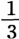舍费耳小麦；但是，这一点并没有［Ⅰ—43］表现出来，而只是第二种关系，当然，它直接包含在第一种关系中。如果一种商品通过另一种商品表现出来，那么它就被看作是一种关系，而另一种商品则被看作是一定物质的单纯的量。3舍费耳黑麦本身不是价值，而是充满一定空间的、可以用容量单位计量的黑麦。

作为尺度，作为计量其他商品交换价值的单位的货币，也是这样。货币是货币得到表现的那种自然实体即金银等等的一定重量。如果1舍费耳小麦具有77先令7便士的价格，那么它就表现为与之相等的另一种东西，表现为1盎司金，表现为关系，表现为交换价值。但是，1盎司金本身不是交换价值，并不表现为交换价值，而是表现为它自身的、它的自然实体的即金的一定量。如果1舍费耳小麦具有77先令7便士或1盎司金的价格，那么这可能是较大或较小的价值，因为1盎司金的价值随着生产金所需要的劳动量而相应提高或降低。但是，这一点对于小麦的价格规定本身是无关紧要的；因为它的价格77先令7便士准确地表现出它成为一切其他商品的等价物所依据的比例，即它能够据以购买一切其他商品的比例。不管1夸特小麦值77先令或是值1780先令，这种价格规定的规定性，完全超出了价格规定的范围，即超出了把小麦设定为价格的范围。不管1夸特小麦值100先令还是1先令，它总有一个价格。价格只是用一切商品共有的单位来表现小麦的交换价值；因此，前提条件是：这一交换价值已经由其他关系调节。

当然，1夸特小麦具有1盎司金的价格这一事实——因为金和小麦，作为自然物相互间根本没有任何关系，它们作为自然物不能互为尺度，它们彼此毫不相干——是通过以下的途径发现的：1盎司金本身又和生产它所必需的劳动时间发生关系，于是，小麦和金两者都同一个第三者——劳动发生关系，在这种关系中彼此等同；于是，两者作为交换价值互相比较。但是，这一点只是告诉我们，小麦的价格即它与之相等的金量是怎样求得的。在货币表现为小麦价格的这种关系本身中，货币本身又不是被看作一种关系，不是被看作交换价值，而是被看作自然物质的一定量。

在交换价值中，商品（产品）被看作是和它们的社会实体即和劳动发生的关系；但是，作为价格，它们依照其他产品的自然属性而表现在这些产品的量上。自然可以说，货币的价格也表现在1夸特小麦，3夸特黑麦和价格为1盎司金的不同商品的种种其他量上。不过，这样一来，为了表现货币的价格，就必须罗列一大串和1盎司金相等的每一种商品的量。于是，用货币本身来表现价格的商品有多少，货币的价格便有多少。价格的主要规定——统一性也就会不存在了。没有一种商品会表现货币的价格，因为没有一种商品会表现货币同其他一切商品的关系，会表现货币的一般交换价值。但是，价格的特点是：交换价值本身必须表现在它的一般性上，同时又必须表现在一定的商品上。不过，甚至这一点也是无关紧要的。只要货币表现为反映、计量一切商品价格的物质，那么货币本身便被看作是金银等等的一定量，总之，被看作是货币的自然物质的一定量；仅仅被看作是一定物质的单纯的量，而它本身不被看作是交换价值，不被看作是一种关系。同样，把另一种商品作为价格来表现的每一种商品，本身都不是被设定为交换价值，而是被设定为它本身的单纯的量。

在货币作为交换价值的单位，作为交换价值的尺度，即作为交换价值的一般比较标准的规定中，货币的自然物质金银具有本质意义，因为货币作为商品的价格，不是交换价值，不是一种关系，而是一定重量的金银；例如磅和磅以下的单位；所以货币起初表现为磅，aes grave［1磅铜］[^v30-c24-annotation-36ee68acb6fd10fa]。正是这一点把价格和交换价值区别开来，而我们已经看到，交换价值必然导致价格规定。因此，有些人想使劳动时间本身成为货币，也就是既想确定又不想确定价格和交换价值之间的区别，这是荒谬的。

因此，作为尺度，作为价格规定的要素，作为交换价值的计量单位，货币呈现出这样的现象：（1）1盎司金对任何一种商品的交换价值一旦确定，货币只是作为想象的单位才是需要的；它的实际存在是多余的，而它的现实存在量更是多余的；作为指示器（价值的指示器），它在一个国家中的数额是无关紧要的；它只是作为计算单位才是需要的；（2）因此，货币只需要在观念上存在，并且实际上，作为商品的价格，货币只是观念地在商品上表现出来，同时，货币又作为它借以表现自身的那一自然实体的单纯的量，作为金银等的一定的、被采用为单位的重量而充当比较标准，单位，尺度。交换价值（商品）在想象中转化为金或银的一定重量，并且在观念上与金等等的这一想象的量相等；被当作这个量的表现。

［Ⅰ—44］但是，如果我们现在来考察货币的第二种规定，即货币作为交换手段和价格的实现者的规定，那么我们就会发现，货币在这里必须存在一定的量；确定为单位的金或银的重量必须有一定的数目，才能适合这一规定。如果一方面已知待实现的价格总额，即由一定的商品的价格和该商品的数量的乘积所决定的价格总额，另一方面已知货币流通的速度，那就需要一定量的流通手段。但是，如果我们比较仔细地考察流通所表现的最初的形式，直接的形式，即W—G—G—W这一形式，那么，在这一形式中，货币表现为纯粹的交换手段。商品和商品相交换，货币只是表现为交换的手段。第一种商品的价格实现为货币，是为了用货币去实现第二种商品的价格，并且用这种方法使第一种商品换得第二种商品。在第一种商品的价格实现以后，现在以货币的形式取得了它的价格的人，其目的不是为了取得第二种商品的价格，而是支付它的价格以便取得它。因此，归根到底货币只是帮助他用第一种商品交换第二种商品。作为单纯的流通手段，货币没有其他目的。卖出自己商品而换得货币的人，想要再购买商品，而把商品卖给他的那个人也需要货币来购买商品，如此等等。

现在，在充当纯粹流通手段的这一规定上，货币本身的使命只在于通过事先确定自身的量，自身的数目来实现这一流通。货币本身作为单位在商品中被包含的倍数，预先已在商品的价格中决定，而作为流通工具，货币只表现为这一预先决定的单位的数目。既然货币实现商品的价格，商品便和它的实在的等价物金银相交换；它的交换价值实际上是表现在作为另一种商品的货币上；但是，既然这一过程的进行仅仅是为了使货币再转化为商品，从而用第一种商品交换第二种商品，那么，货币就仅仅在一瞬间出现，而且货币的实体仅仅在于它不断地表现为这种转瞬即逝的东西，表现为这一中介行为的承担者。作为流通手段的货币仅仅是流通手段。货币要能够起这种性质的作用，对它来说唯一本质的规定性就是货币在流通中的量或数量的规定性。（因为货币数量也由速度决定，所以在这里不需要单独加以说明。）就货币实现价格来说，它作为金银的物质存在是本质性的；但是，因为这种实现只是转瞬即逝的，并且要自我扬弃，它的物质存在就无关紧要了。问题似乎是商品和作为特殊商品的金银相交换，但这只是一种假象；当金银又和商品交换，于是商品和商品交换，从而这一过程完结时，这种假象便消失了。因此，作为单纯流通手段的金银，或作为金银的流通手段，对货币作为特殊自然商品的性质来说是无关紧要的。

假定流通中的商品的总价格＝10 000塔勒。其尺度为1塔勒，等于x重量的银。假定要使这些商品在6小时内完成流通需要100塔勒，即每1塔勒在6小时内支付100塔勒的价格。这时具有本质意义的是，现有100个塔勒，即用来计量商品价格总额的金属单位的现有数目为100；100个这样的单位。这些单位由银构成，这对过程本身并不重要。这一点已经在下面的事实中表现出来：虽然1塔勒在每一一定的交换中只代表1塔勒银的重量，但是在流通的循环中1塔勒代表的银量却等于它实际包含的100倍。

因此，如果整个地来观察这一流通，那么，1塔勒代表100塔勒，等于它实际包含的银重量的100倍。它实际上只是100塔勒中所包含的银重量的符号。它所实现的价格等于它作为银量来考察时所实际实现的价格的100倍。

假定1镑例如等于

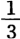盎司金（它并不包含这么多金）。如果商品的价格1镑得到支付，也就是说，它的价格1镑得到实现，它和1镑相交换，那么，具有决定意义的是1镑实际包含着 $\frac{1}{3}$ 盎司金。假如这是用某种非贵金属铸成的伪造的镑，只在表面上是1镑，那么实际上商品的价格并未实现；为了实现这一价格，商品就必须用等于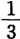盎司金的非贵金属来支付。

由此可见，就这种分离的流通环节来考察，具有本质意义的是，货币单位现实地代表一定量的金银。但是，如果我们把流通看成是一个整体，把流通看成是联结在一起的过程：W—G—G—W，那么，情况就不同了。在第一种情况下，价格的实现似乎只是表面上的：商品的价格似乎只有一部分实现。商品中在观念上设定的价格，似乎在实际上没有设定。在观念上设定为同若干重量的金相等的商品，似乎在现实的交换中并没有换回那样多重量的金。但是，如果伪造的镑被当成真的镑流通，那么，在整个的流通中，它所起的作用就完全像它是真的一样。如果价格1镑的商品A同伪造的1镑相交换，而这伪造的1镑又和价格1镑的商品B相交换，那么，这一伪造的镑所起的作用就完全像它［Ⅰ—45］是真的一样。

因此，如果所考察的不是用真正的镑来实现价格这一环节，而是考察整个过程，在这一整个过程中，镑只是充当流通手段，并且价格的实现只是一种假象，是转瞬即逝的中介过程，那么，真正的镑在这一过程中实际上只是一种符号。在这里，金镑只是用来使商品A同具有同一价格的商品B相交换。在这里，真正实现商品A的价格的是商品B，而真正实现商品B的价格的是商品A或C或D，这一点对于这种关系的形式来说，意义是一样的，对于这种关系来说，商品的特殊内容完全无关紧要。价格相等的商品相互交换。不是商品A直接和商品B相交换，而是商品A的价格和商品B交换，商品B的价格和商品A交换。

由此可见，对商品来说，货币只是表现它的价格。商品按照它们的价格相互交换。商品的价格本身在商品上观念地表明，商品是金或银即体现货币的材料的一定自然单位（重量）的数目。在货币上，或在已经实现的商品价格上，现在和商品相对立而出现的，是这种单位的一个现实数目。但是，只要价格的实现不是最后的行为，并且不是要取得作为价格的商品价格，而是要取得作为另一商品价格的价格，那么货币的材料，例如金或银，便是无关紧要的。作为流通工具，作为交换手段，货币成为主体，而体现货币的自然材料则表现为一种偶然的东西，其意义消失在交换行为本身之中；因为和货币相交换的商品最后不是实现在这种材料中，而是实现在另一商品的材料中。这就是说，现在我们看到，在流通中（1）货币实现价格，（2）所有权证书在流通，除了这两个方面以外，（3）还有一个方面：不能直接发生的事情靠流通作中介而发生了，即商品的交换价值表现在任何一种其他商品上。假如1码麻布值2先令，而1磅糖值1先令，那么，1码麻布就以2先令为中介而实现在2磅糖上，因此，糖转化为麻布的交换价值的材料，转化为麻布的交换价值借以实现的材料。

货币作为单纯的流通手段，就它在川流不息的流通过程中所起的作用来看，它不是价格尺度，因为作为价格尺度，它已经表现在价格本身中；它也不是实现价格的手段，因为作为实现价格的手段，货币虽然存在于流通的一个环节中，却消失在流通环节的总体中；货币对一切商品来说仅仅是价格的代表，仅仅充当商品按照相等的价格进行交换的手段。货币和某一种商品相交换，因为它是商品交换价值的一般代表，而作为这种代表，它是具有相等的交换价值的每一其他商品的代表，是一般代表，作为这种代表，它处在流通本身中。货币对一切其他商品来说，代表一个商品的价格，或者对一个商品来说，代表一切商品的价格。在这种关系中，货币不仅是商品价格的代表，而且是货币本身的符号；也就是说，在流通行为本身中，货币的材料金和银是无关紧要的。

货币是价格；货币是一定量的金或银；但是，由于价格的这种实在性在这里只是转瞬即逝的，注定要不断地消失，不断地被扬弃，不能看作是最终的实现，而总是只能看作是中间的、起中介作用的实现；由于这里的问题根本不在于价格的实现，而在于一个特殊商品的交换价值通过另一个商品的材料来实现，所以货币本身的材料是无关紧要的，货币作为价格的实现是转瞬即逝的，因为这一实现本身是转瞬即逝的；由于货币处在这种不断的运动中，所以它只是交换价值的代表，而这一交换价值，只是由于实际的交换价值不断地替代这个代表，不断地和这个代表换位，不断地和这个代表相交换，才成为实际的交换价值。

因此，在这个过程中，货币的实在性并不在于它是价格，而在于它代表价格，它是价格的代表；是以物的形式存在的价格的代表，因而也就是货币本身的代表，并且作为这种代表，它又是商品交换价值的代表。货币作为交换手段实现商品的价格，只是为了把一个商品的交换价值表现在作为这一个商品的单位的另一个商品上，为了在另一个商品上实现这一个商品的交换价值，也就是使另一个商品成为这一个商品的交换价值的材料。

因此，货币只有在流通中才是这种物质符号；货币一旦脱离流通，便又成为已实现的价格；但是，在这一过程中，正如我们所看到的，货币单位的这一物质符号的量，这一符号的数目就具有本质意义。因此，在货币表现为与商品相对立的存在物的流通中，货币的物质实体，货币作为一定量的金和银的那种基质是无关紧要的，相反，货币的数目却具有本质意义，因为货币只是这种单位的一定数目的一种符号。而在货币作为尺度的规定上，货币只存在于观念之中，它的物质基质具有本质意义，但是它的量，甚至它的存在却是无关紧要的。由此可以得出如下的结论：当作为金银的货币只是流通手段，交换手段的时候，可以由［Ⅰ—46］表现一定量的货币单位的任何其他符号来代替，从而象征性的货币可以代替实在的货币，因为作为单纯交换手段的物质货币本身是象征性的。

根据货币作为尺度，作为价格的实现和作为单纯交换手段这几种相互矛盾的规定，可以说明在别的情况下无法说明的现象：当金属货币金银用掺进便宜金属的办法来伪造时，货币便贬值，价格便上涨；因为在这种情况下价格尺度不再是比如说1盎司金的生产费用，而是掺入$\frac{2}{3}$ 的铜等等的1盎司的生产费用（如果伪造铸币只在于伪造或改变贵金属重量的可除部分的名称，例如把1盎司的 $\frac{1}{8}$ 叫作1索维林，那就是让尺度完全照旧不变而只改变它的名称。如果过去 $\frac{1}{4}$ 盎司叫作1索维林，而现在 $\frac{1}{8}$ 盎司叫作1索维林，那么1索维林的价格只表现 $\frac{1}{8}$ 盎司金，因此，要表现过去1索维林所表现的价格，现在需要（大约）2索维林）；或者说，在只是伪造贵金属可除部分的名称的情况下，尺度照旧不变，但每一可除部分却用以前两倍的法郎等等来表示；另一方面，当货币的基质即金银完全取消，而用印有一定量的实在货币的符合的纸币来代替时，这些纸币在流通所需要的数量以内，会按十足的金银价值进行流通。在第一种情况下，是因为流通手段同时既是作为尺度的货币的材料，又是价格作为最后价格借以实现的材料，在第二种情况下，是因为货币只具有充当流通手段的规定。

下面是把货币的相互矛盾的规定笨拙地混淆起来的例子：

“价格正是由用来进行购买的现有的货币量决定的。世界上全部商品卖得的货币不可能超过世界上现有的全部货币。”（引自伦敦《每周快讯》［1857年］11月8日）

第一，价格规定和实际的出售毫无关系；在价格规定中，货币只是尺度。第二，如果每一块货币流通1 000次，全部（处在流通中的）商品卖得的货币就能等于世界上现有货币的1 000倍。

因为在流通中待实现的价格总额随商品的价格和投入流通的商品数量而变化；另一方面，因为处在流通中的流通手段的速度也是由不以流通手段本身为转移的那些情况决定的，所以流通手段的量必须能够变化，能够扩大和缩小——流通的收缩和膨胀。

货币作为单纯的流通手段，可以说它不再是商品（特殊商品），因为货币的材料是无关紧要的，货币只是满足交换本身的需要，而不再满足任何其他的直接需要：金银一旦作为货币流通，它们就不再是商品。另一方面，也可以说货币只是商品（一般商品），是具有商品的纯粹形式的商品，它的自然特殊性无关紧要，因而一切直接需要也无关紧要，它和一定的需要本身没有天然的联系。货币主义的拥护者，甚至一部分保护关税制度的拥护者（例如见费里埃的著作第2页[^v30-c24-annotation-bed12d8df75a0de5]）坚持第一方面，现代经济学家坚持第二方面；例如萨伊说，货币是一种“特殊”商品，是同一切其他商品一样的商品[^v30-c24-annotation-b913cb02fa5212a1]……

作为交换手段，货币表现为生产和消费之间的必要的中介。在发达的货币制度下，生产只是为了交换，或者生产只是由于交换。因此，如果取消货币，那么人们或者会倒退到生产的较低的阶段（和这一阶段相适应的，是起附带作用的物物交换），或者前进到更高的阶段，在这个阶段上，交换价值已经不再是商品的首要规定，因为以交换价值为代表的一般劳动，不再表现为只有通过中介才取得共同性的私人劳动。

至于作为流通手段的货币是生产的还是非生产的，这一问题同样也很容易地解决了。亚当·斯密认为货币是非生产的[^v30-c24-annotation-1ca51cdcf127a53c]。可是例如费里埃却说：

“货币创造价值，因为没有货币，价值就不能存在。”［（费里埃《论政府同贸易的相互关系》第52页）］不仅应当考察“作为金属的货币的价值，而且同样要考察作为货币的货币属性”［（同上，第18页）］。

亚·斯密是正确的，因为货币不是任何特殊生产部门的工具；费里埃是正确的，［Ⅰ—47］因为以交换价值为基础的一般生产的要素之一，就在于产品和生产因素被纳入货币的规定，而这种规定是以不同于产品的货币为前提的；因为，如果从生产的总体上来考察生产，货币关系本身就是生产关系。

只要W—G—G—W分解为两个环节，那么，虽然商品的价格是前提条件（而这一点构成主要区别），流通仍会分成两个直接的物物交换行为。W—G：商品的交换价值表现在另一种特殊商品即货币的材料上，而货币的交换价值表现在商品上；在G—W中，情况也是一样。从这方面来看，亚·斯密说作为交换手段的货币只是物物交换的更复杂的形式[^v30-c24-annotation-f0102a3913bdcac0]，他是正确的。但是，如果考察整个过程，而不是把商品实现在货币上和货币实现在商品上看作两个没有关系的行为，那么，亚·斯密的论敌的说法是正确的，他们说，斯密误解了货币的性质，他们说，货币流通排挤掉了物物交换；这只是由于用货币来对分工产生的“算术除法”进行结算。这些“算术数字”正像尺度那样不需要用金银制成。（见索利［《目前的困难及其和货币理论的关系》1830年伦敦版第5—6页］，［L.Ⅲ，］20）。

商品从贸易品变成消费品，进入消费。作为流通手段的货币不是这样，只要它具有流通手段的规定，它不会在任何一点上中止其为商品。

现在，我们来谈货币的第三种规定，它是流通的第二种形式G—W—W—G的直接的产物。

在这种形式中，货币不是仅仅表现为手段，也不是表现为尺度，而是表现为目的本身，因而就像一旦完成自己的循环并从贸易品变成消费品的一定商品一样，离开了流通。

还必须预先指出，一旦货币作为以交换价值为基础的一般生产的内在关系这种规定而成为前提，那么也可以从某些个别方面去论证作为生产工具的货币的作用。

“金银的用处在于它们代替劳动。”（罗德戴尔［《论公共财富的性质和起源》1808年巴黎版第140页］，［B.］11）

“没有货币，人们必须先进行大量的物物交换才能在交换中获得所希求的对象。此外，人们还必须在每一次特殊的交换中考察商品的相对价值。货币作为交换工具（贸易工具），避免了前者；作为一切商品的价值尺度和代表，避免了后者。”（同上，［第142、140、144页］）

相反的主张认为，货币是非生产的[^v30-c24-jz_1_197]，这种主张只不过是说，除了货币作为尺度、流通工具和价值代表而具有生产性这一规定性之外，货币便是非生产的，只不过是说，只有在货币的量是实现这些规定所需要的量的范围内，货币的量才是生产的。一旦所使用的货币超出实现货币的这些生产规定的需要，货币就不仅成为非生产的，而且成为生产上的非生产费用，这是一个真理，这一真理也适用于任何其他生产工具或交换工具，适用于机器和运输工具。但是，如果因此就认为，货币只是交换现存的实际财富，那就错了，因为用货币同样可以交换和购买劳动，也就是生产活动本身，潜在的财富。

充分发展的货币的第三种规定，以前两种规定为前提，并且是它们的统一。因此，货币在流通之外具有独立存在；它离开了流通。作为特殊商品，货币能够从货币形式变为奢侈品、金银饰品的形式（当美术工艺十分简单的时候，例如，在英国古代，银币变为银器，银器变为银币，是经常发生的。见泰勒的著作[^v30-c24-annotation-3e2fe2ab24e23551]）；或者，它能够作为货币积累起来，因而成为贮藏货币。既然独立存在的货币从流通中产生，这种独立存在的货币本身就表现为流通的结果；货币通过流通而和自己结合起来。在这个规定性上已经潜在地包含了货币作为资本的规定。作为单纯交换手段的货币被否定了。但是，在历史上，货币在表现为交换手段以前，就可以充当尺度；货币在充当尺度以前，就可以表现为交换手段，——在后一场合，货币只是作为人们喜爱的商品[^v30-c24-jz_1_198]而存在，——因此，在历史上，货币在取得前两种规定以前，也可以表现在第三种规定上。但是，只有当金银已经存在于前两种规定中的一种规定上，它们才能作为货币积累起来，只有当货币在前两种规定上已经发展，它才能以发展的形式出现在第三种规定上。否则，它的积累就只是金银的积累，而不是货币的积累了。

［Ⅰ—48］（可以举出罗马共和国早期积累铜币的情况，作为特别有趣的例子。）

既然货币作为财富的普遍物质代表是从流通中产生，作为这样的代表本身是流通的产物，——这种流通同时是更高层次的交换和一种特殊的交换形式，——因此，货币在这第三种规定上也和流通发生关系；货币同流通相对立而独立存在，但它的这种独立性不过是流通自身的过程。货币既从流通中来，又进入流通。如果不和流通发生任何关系，那它就不是货币，而是单纯的自然物——金和银。在这种规定上，货币既是流通的前提，又是流通的结果。货币的独立性本身，不是同流通的关系的终止，而是同流通的否定的关系。这正是作为G—W—W—G的结果的独立性的特点。

在作为资本的货币上，货币本身就包含着：（1）货币既是流通的前提，又是流通的结果；（2）因此，货币的独立性本身只是否定的关系，但始终是同流通的关系；（3）货币本身表现为生产工具，因为流通已不再表现为流通的最初的简单性，即量的交换，而是表现为生产过程，即实在的物质变换。于是，货币本身就被规定为这种生产过程的特殊要素。在生产中，问题不仅在于简单的价格规定即把商品的交换价值化为某种共同单位，而且还在于创造交换价值，因而也创造价格的规定性。不仅在于单纯地设定形式，而且还在于设定内容。因此，如果说在简单流通中，只要流通一般地表现为生产体系的一个环节，货币一般来说也就表现为生产的，那么这一规定仅仅对我们来说是设定了，但还没有设定在货币上。（4）因此，作为资本，货币也表现为以流通为中介而发生的自己对自己的关系——利息和资本的关系。但是，在这里我们还不去谈这些规定，而只是从货币的第三种关系上，把货币作为从流通中来的，其实也就是从它的前两种规定中来的独立物加以考察。

（“货币的增加，只是计算手段的增加。”（西斯蒙第［《政治经济学概论》1838年布鲁塞尔版第2卷第278页］）

这种说法，只有在货币被规定为单纯的交换手段时，才是正确的。就货币的另一属性来说，货币的增加也是支付手段的增加。）

“贸易把影子和肉体分开了，造成了分别占有它们的可能性。”（西斯蒙第［，同上，第300页］）

因此，货币现在是一般形式上的独立化的交换价值（作为这样的交换价值，货币总是表现为仅仅是转瞬即逝的交换手段）。的确，货币具有一种特殊的物体或实体，即金和银，而且正是这一点赋予货币以独立性，因为只是附在另一物上，作为另一物的规定或关系而存在的东西，是不独立的。另一方面，货币在这种物体的独立性上，作为金银，不仅在另一种商品面前代表一种商品的交换价值，而且在一切商品面前代表交换价值；它本身一方面具有一种实体，而它在自己作为金和银的特殊存在中同时又表现为其他商品的一般交换价值。一方拥有作为商品的交换价值的货币，另一方是作为同样多交换价值的特殊实体的各种商品，因此，交换价值通过交换可以转化为任何一种这样的实体，而它对这些实体的规定性和特殊性是无所谓和不在乎的。因此，商品只是一些偶然的存在物。货币是“万物的结晶”[^v30-c24-annotation-2ec1b977e6c5b088]，在货币上，商品的特殊性质消失了；一般财富作为精练的概括而同财富在商品世界中的扩散和分散相对立。在特殊商品上，财富表现为商品的一个要素，或者说，商品表现为财富的一个特殊要素，而在金和银上，一般财富本身集中地表现在一种特殊物质上。

每种特殊商品，就它是交换价值，具有价格来说，它本身只不过是以一种不完备的形式表示一定量的货币，因为商品必须投入流通，才能实现，并且由于它的特殊性，它是否能实现，仍然是偶然的事情。但是，就商品不是作为价格，而是作为自然规定性上的商品来说，它只是由于它和它所满足的某种特殊需要的关系，才成为财富的要素，并且在这种关系中只是表示：（1）一种使用的财富，（2）这种财富的一个极其特殊的方面。与此相反，撇开货币作为贵重商品的特殊有用性不谈，货币是（1）实现了的价格；（2）它满足任何需要，因为它可以换取任何需要的对象，对任何特殊性都不在乎。商品只有以货币为中介，才具有这种属性。而货币对于一切商品，因而对于整个财富世界，对于财富本身，则直接具有这种属性。在货币上，一般财富不但是形式，而且同时就是内容本身。可以说，财富的概念实现在一种特殊对象上了，个体化了。［Ⅱ—1］就特殊商品是价格这一点来说，在特殊商品上，财富只表现为尚未实现的观念的形式；就商品具有一定的使用价值这一点来说，商品只表示财富的一个极其个别化的方面。与此相反，在货币上，价格实现了，货币实体就是财富本身，后者既作为财富特殊存在方式的抽象，又作为财富总体。

交换价值构成货币实体，交换价值就是财富。因此，另一方面，货币又是与构成财富的所有特殊实体相对立的财富的物体化形式。因此，如果就货币本身来考察，那么，一方面，在货币上，财富的形式和内容是同一的；另一方面，货币与其他一切商品相对立，在它们面前是财富的一般形式，而这些特殊性的总体则构成财富的实体。根据前一规定，货币是财富本身，根据后一规定，货币是财富的一般物质代表。这个总体作为想象的商品总汇存在于货币本身之中。由此可见，财富（既作为总体又作为抽象的交换价值）只是由于其他一切商品被排斥，才作为个体化在金银上的财富而存在，作为个别的可以捉摸的对象而存在。因此，货币是商品中的上帝。

这样，作为个别化的可以捉摸的对象，货币可以偶然地被寻求，被找到，被偷盗，被发现，因而一般财富能够在可以捉摸的形式上被单个的个人所占有。货币从它表现为单纯流通手段这样一种奴仆形象，一跃而成为商品世界中的统治者和上帝。货币代表商品的天上的存在，而商品代表货币的人间的存在。每种形式的自然财富，在它被交换价值取代以前，都以个人对于对象的本质关系为前提，因此，个人在自己的某个方面把自身对象化在物品中，他对物品的占有同时就表现为他的个性的一定的发展；拥有羊群这种财富使个人发展为牧人，拥有谷物这种财富使个人发展为农民，等等。与此相反，货币是一般财富的个体，它本身是从流通中来的，它只代表一般，仅仅是社会的结果，它完全不以对自己占有者的任何个性关系为前提；占有货币不是占有者个性的某个本质方面的发展，倒不如说，这是占有没有个性的东西，因为这种社会［关系］同时作为一种可感觉的外在的对象而存在着，它可以机械地被占有，也可以同样丧失掉。

因此，货币对个人的关系，表现为一种纯粹偶然的关系，而这种对于同个人个性毫无联系的物品的关系，却由于这种物品的性质同时又赋予个人对于社会，对于整个享乐和劳动等等世界的普遍支配权。这种情形就如同我发现一块石头就使我占有全部科学，而同我的个性毫不相干一样。占有货币使我同财富（社会财富）发生的关系，就同哲人之石使我同科学发生的关系完全一样。

因此，货币不仅是致富欲望的一个对象，而且是致富欲望的唯一对象。这种欲望本质上就是万恶的求金欲。致富欲望本身是一种特殊形式的欲望，也就是说，它不同于追求特殊财富的欲望，例如追求服装、武器、首饰、女人、美酒等等的欲望，它只有在一般财富即作为财富的财富个体化为一种特殊物品的时候，也就是说，只有在货币设定在它的第三种规定上的时候，才可能发生。因此，货币不仅是致富欲望的对象，同时也是致富欲望的源泉。贪欲在没有货币的情况下也是可能的；致富欲望本身则是一定的社会发展的产物，而不是与历史产物相对立的自然产物。因此，古代人哀叹货币是万恶之源。一般形式的享受欲以及吝啬，是货币欲的两种特殊形式。抽象的享受欲要求有一个包含一切享受可能性的对象。货币在它作为财富的物质代表的规定上，使抽象的享受欲得到实现；货币在它单纯是同作为财富的特殊实体的商品相对立的一般形式的财富时，使吝啬得到实现。为了把货币本身保存下来，吝啬不得不牺牲掉对于特殊需要对象的一切关系，放弃这一切关系，以便满足货币欲本身的需要。货币欲或致富欲望必然导致古代共同体的没落。由此产生了对立物。货币本身就是共同体[^v30-c24-jz_1_203]，它不能容忍任何其他共同体凌驾于它之上。但是，这要以交换价值的充分发展，从而以相应的社会组织的充分发展为前提。

在古代人那里，交换价值不是物的联系[^v30-c24-annotation-06bee368e0dfdd4e]；它只在商业民族中表现为这种联系，而这些商业民族只从事转运贸易，自己不进行生产。至少在腓尼基人和迦太基人等等那里，生产是附带的事情。他们能够生活在古代世界的空隙中，正像犹太人生活在波兰或中世纪的情形一样。不如说，这种世界本身，是这些商业民族的前提。只要他们和古代共同体发生严重冲突，每次他们都要灭亡。

在罗马人、希腊人等那里，货币起初自然地出现在作为尺度和作为流通手段这两种最初的规定上，在这两种规定上并不很发展。但是，一旦他们的商业等等发展起来，或者像罗马人那样，当征服给他们带来大量货币时［Ⅱ—2］——总之，在他们经济发展的一定阶段上，货币不可避免地突然出现在它的第三种规定上，而且货币在这种规定上越发展，就越是表现出他们的共同体的没落。我们已经看到，第三种规定上的货币要起生产的作用，它就不但必须是流通的前提，而且也必须是流通的结果，并且作为流通的前提，货币本身必须是流通的一个要素，是流通设定的一种东西。例如，在罗马人那里，货币是从全世界掠夺来的，情况就不是这样。

货币的简单规定本身包含着这样一点：货币作为发达的生产要素，只能存在于雇佣劳动存在的地方；也就是说，只能存在于这样的地方，在那里，货币不但决不会使社会形式瓦解，反而是社会形式发展的条件和发展一切生产力即物质生产力和精神生产力的主动轮。今天单个的个人仍然可以偶然地弄到货币，因而占有货币也会像对古代人的共同体起的作用那样，对他起瓦解的作用。但是，在现代社会里，这种个人的瓦解本身，只不过是社会上从事生产的一部分人发财致富。古代意义上的货币占有者已被工业的发展过程所瓦解，他违背自己的意愿而为这种过程服务。瓦解只涉及他本人。作为一般财富的物质代表，作为个体化的交换价值，货币必须直接是一般劳动的即一切个人劳动的对象、目的和产物。劳动必须直接生产交换价值，也就是说，必须直接生产货币。因此，劳动必须是雇佣劳动。

因为每个人都想生产货币，所以致富欲望是所有人的欲望，这种欲望创造了一般财富。因此，只有一般的致富欲望才能成为不断重新产生的一般财富的源泉。由于劳动是雇佣劳动，劳动的目的直接就是货币，所以一般财富就成为劳动的目的和对象。（在这方面，必须谈谈转变为雇佣兵制度的古代军队组织。）作为目的的货币在这里成了普遍勤劳的手段。生产一般财富，就是为了占有一般财富的代表。这样，真正的财富源泉就打开了。

由于劳动的目的不是为了特殊产品，即同个人的特殊需要发生特殊关系的产品，而是为了货币，是一般形式的财富，所以，首先个人的勤劳是没有止境的；勤劳具有怎样的特殊性都无所谓，它采取可以达到目的的任何形式；在为社会需要等创造新的对象方面，勤劳是富有发明创造才能的。

因此，很清楚，在以雇佣劳动为基础的地方，货币不是起瓦解的作用，而是起生产的作用；而古代共同体本身则已经同作为一般基础的雇佣劳动发生矛盾。只有当每种劳动所生产的都是一般财富而不是特定形式的财富，从而个人的报酬也都是货币时，普遍的产业劳动才是可能的。否则，只有特殊形式的技艺上的勤劳才是可能的。作为劳动直接产物的交换价值，就是作为劳动直接产物的货币。因此，生产交换价值本身的直接劳动就是雇佣劳动。凡是在货币本身不是共同体的地方，货币必然使共同体瓦解。

古代人可以直接购买劳动，购买奴隶；但是奴隶却不能用自己的劳动购买货币。货币的增加可以使奴隶变贵，但不能使他们的劳动更有生产效率。黑奴制——纯粹的产业奴隶制——必然随着资产阶级社会的发展而消失，它是和资产阶级社会的发展不相容的。黑奴制以资产阶级社会为前提，如果没有实行雇佣劳动的其他自由的各州与黑奴制并存，如果黑奴制是孤立的，那么，黑奴制各州的一切社会状态就会立即转变为文明前的形式。

货币作为个体化的交换价值，从而作为躯体化的财富，曾在炼金术中被人追求。在货币主义[^v30-c24-jz_1_205]那里，货币就是出现在这种规定上。现代工业社会发展的预备时期，是以个人的和国家的普遍货币欲开始的。财富源泉的真正开辟，作为取得财富代表的手段，似乎是在具有货币欲的个人和国家的背后进行的。在货币不是来自流通而是在实体形式上被发现的地方，如在西班牙，国家变穷了；可是为了从西班牙人那里取得货币而不得不进行劳动的那些国家，则开辟了财富的源泉，因而真正富裕起来了。因此，在新大陆和新的地区探求和发现金矿，在革命的历史上起了巨大的作用，因为在那里，殖民活动立即兴起，像在温室里生长起来一样。

到各地区追逐黄金使一些地区被发现，使新的国家形成；首先使进入流通的商品的范围扩大，这些商品引起新的需要，把遥远的大陆卷进交换和物质变换的过程。因此，从这个方面来看，作为财富的一般代表，作为个体化的交换价值，货币也是一种双重手段，它使财富扩大到具有普遍性，并把交换的范围扩展到整个地球；它在物质上和在空间上创造了交换价值的真正一般性。但是，在这里所阐述的货币的规定中，隐藏着关于货币性质的幻想，——也就是说，死抱住货币的一种抽象规定，而无视这种规定中所包含的矛盾，——这种幻想在个人的背后赋予货币以这种确实神奇的意义。实际上，货币由于这种自相矛盾的、因而是幻想的规定，由于货币的这种抽象，便在社会生产力的实际发展中成为如此强大的［Ⅱ—3］[^v30-c24-jz_1_206]工具。

资产阶级社会的基本前提是：劳动直接生产交换价值，从而生产货币；而货币也直接购买劳动，从而购买工人，只要后者在交换中让渡自己的活动。因此，一方的雇佣劳动和另一方的资本，都只不过是发达的交换价值和作为交换价值化身的货币的另一些形式。所以，货币同时直接是现实的共同体，因为它是一切人赖以生存的一般实体；同时又是一切人的共同产物。但是，正如我们已经看到的，在货币上共同体只是抽象，对于单个人来说只是外在的、偶然的东西；同时又只是作为孤立的单个人的个人满足需要的手段。古代共同体以一种完全不同的个人关系为前提。因此，货币在其第三种规定上的发展，破坏了古代共同体。任何生产都是个人的对象化。但是，在货币（交换价值）上，个人的对象化不是个人在其自然规定性上的对象化，而是个人在一种社会规定（关系）上的对象化，同时这种规定对个人来说又是外在的。

设定在流通手段形式上的货币，就是铸币。作为铸币，货币丧失了它的使用价值本身；它的使用价值同它作为流通手段的规定合而为一了。例如，它只有被熔化，才能作为货币本身来使用。它不得不停止流通。因此，铸币形式的货币只是符号，与它的材料无关。但是，作为铸币，货币还丧失了它的普遍性，而具有民族性、地方性。它按照它由以构成的金、铜、银等等材料，分为各种不同的铸币。它取得一个政治头衔，并且可以说在不同的国家操着不同的语言。最后，它在同一个国家取得不同的名称，等等。因此，货币在第三种规定上，作为离开流通并同流通相对立的独立物，还否定了货币作为铸币的性质。货币重新作为金银出现，而不管它是被熔化为金银，还是只按它的金银重量来估价。它再度丧失了它的民族性，而充当各国之间的交换手段，充当普遍的交换手段，但已不再是符号，而是一定数量的金银。因此，在最发达的国际交换制度中，金银又出现在这样一种形式中，在这种形式中它们所起的作用同它们在原始物物交换中起过的作用完全一样。我们已经指出，金银和交换本身一样，最初不是出现在一个社会共同体的范围内，而是出现在它的尽头，它的边界上，它和别的共同体接触的少数地点上。因此，货币现在表现为商品本身，普遍的商品，这种商品在所有地方都保持它作为商品的性质。在这一形式规定上，它在所有地方一律通用。只有这样，它才是一般财富的物质代表。因此，在重商主义那里，金银被当作是衡量各个不同共同体的实力的尺度。

“一旦贵金属成为商业对象，成为一切物品的普遍等价物，它们也就成为衡量各国实力的尺度。”由此就产生了重商主义。（斯图亚特［《政治经济学原理研究》1770年都柏林版第1卷第327页］）

尽管现代经济学家自以为比重商主义高明，但在1857年普遍危机时期[^v30-c24-annotation-3c70c2570ca0d644]也和在1600年[^v30-c24-jz_1_208]一样，金银又完全出现在这一规定上。由于这种性质，金银在建立世界市场方面起了重要的作用。例如，美洲的银从西方流到东方；从近代开始，一方面美洲和欧洲之间发生了贵金属的联系，另一方面同亚洲发生了贵金属的联系。在原始共同体，这种金银贸易只起次要的作用，同整个交换一样，只涉及剩余物。但是，在发达的贸易中，金银的贸易却成为和整个生产等等有本质联系的一个要素。货币的出现不再是为了交换剩余物，而是为了结算国际商品交换总过程中的差额。货币现在只有作为世界铸币才是铸币。但是，作为世界铸币，货币本质上同它作为流通手段的形式规定无关，它的材料就是一切。在这一规定上，金银作为形式仍然是到处通行的商品，是商品本身。

（在考察交换价值、货币、价格的这个第一篇[^v30-c24-annotation-6b6d1ba82d330891]里，商品始终表现为现成的东西。形式规定很简单。我们知道，商品表现社会生产的各种规定，但是社会生产本身是前提。然而，商品不是被设定在这一规定上。事实上，最初的交换也只是表现为剩余物的交换，并不涉及和决定整个生产。这是一种处于交换价值世界之外的总生产的现成的剩余物。即使在发达的社会中，这些剩余物同样会作为直接现成的商品世界而出现在社会表面上。但是，商品世界通过它自身便超出自身的范围，显示出表现为生产关系的经济关系。因此，生产的内部结构构成第二篇。［资产阶级社会］在国家上的概括构成第三篇，［生产的］国际关系构成第四篇，世界市场构成末篇；在末篇中，生产以及它的每一个要素都被设定为总体，但是同时一切矛盾都展开了。于是，世界市场又构成整体的前提和承担者。于是，危机就是普遍指示超越这个前提，并迫使采取新的历史形态。）

“货物数量和货币数量可以不变，尽管如此，价格可以上涨或下降”（例如，由于金融资本家、地租所得者、政府官吏等的支出增加了。马尔萨斯［《政治经济学原理》1836年伦敦第2版第391页脚注］，［L.］Ⅹ，43[^v30-c24-annotation-d0533b7ed0de6094]）。

［Ⅱ—4］我们已经看到，货币作为离开流通并同流通相对立的独立物，是货币作为流通手段和尺度这两种规定的否定（否定的统一）。我们已经说明：

〔只要货币是流通手段，

“流通的货币量就决不能由个人使用，这一货币量必须不断地流通”（施托尔希［《政治经济学教程》1823年巴黎版第2卷第113—114页］）。

个人只有出让货币，使货币变为为他的存在，使货币具有社会规定，才能使用货币。正像施托尔希正确地指出的，就是由于这个理由，货币材料“对人的生存不应是绝对必需的”［（同上，第113页）］，

就像例如在一些民族中充当货币的兽皮、食盐等等那样，因为处于流通中的货币量是不能用于消费的。因此，第一，金属充当货币一般说来比其他商品优越，第二，贵金属又比用作生产工具的金属优越。施托尔希关于这个问题的下述看法对于经济学家们来说是很典型的：货币材料必须“具有直接的价值，但这种价值以人为的需要为基础”［（同上，第114页）］。

这位经济学家把下面两种需要称为人为的需要：第一，从个人的社会存在所产生的需要；第二，不是从作为自然物的个人的赤裸裸的存在所产生的需要。这显示出构成资产阶级财富及其科学的基础的那种内在的绝望的贫乏。〕

第一，货币是流通手段本身即铸币的否定。但是，货币同时又把铸币当作自身的规定包含在内，从否定意义上说，是因为货币可以不断地转化为铸币；从肯定意义上说，货币就是世界铸币；而货币作为世界铸币，同形式规定无关，本质上就是商品本身，是无所不在的不受地方限制的商品。这种同形式规定无关的性质表现在两方面：首先，货币现在不是作为符号，不是由于铸币的形式，而只是作为金银才是货币。因此，国家赋予货币的铸币形状没有价值，只有货币的金属含量才有价值。甚至在国内贸易中，货币也只有一时一地的价值。

“因为货币对占有它的人的用处，并不比对占有待购商品的人的用处大。”［（施托尔希，同上，第175页）］

国内贸易越是全面地受对外贸易制约，这种铸币形状的价值就越是消失，就是说，这种价值不存在于私人交换中，而只表现为赋税。其次，作为这种一般商品，作为世界铸币，金银不必回到出发点，甚至流通本身也不必要了。实例就是亚洲和欧洲。因此，货币主义的追随者抱怨说，货币在异教徒那里消失了，一去不复返了。（见米塞尔登1600年左右的著作[^v30-c24-annotation-85c89d8a9512a34d]）对外流通越是为国内流通所制约和囊括，世界铸币本身就越是进入流通（循环）。这种较高级的阶段在这里同我们还没有关系，在我们这里所考察的简单关系中还不存在。

第二，货币是它作为商品价格的单纯实现的否定，在这种实现中本质的东西始终是特殊商品。相反，货币成为在自身中实现的价格，而且作为这样的东西，它既成为财富的物质代表，又成为财富的一般形式，而与只是作为财富的特殊实体的一切商品相对立；但是，

第三，货币也在它只是作为交换价值尺度这一规定上被否定。货币作为财富的一般形式和作为财富的物质代表，不再是其他东西的观念尺度，不再是交换价值的观念尺度。因为货币本身是交换价值的最适当的现实，它在自己的金属存在上才是这种现实。尺度规定在这里必然存在于货币本身上。货币是它自身的单位，并且货币价值的尺度，作为财富、作为交换价值的货币的尺度，就是货币自身所表示的量。充当单位的就是货币本身的某一量的数目。作为尺度，货币的数目是无关紧要的；作为流通手段，货币的物质性，充当单位的材料是无关紧要的；作为这第三种规定上的货币，作为一定的物质的量的货币本身的数目就具有本质意义了。如果作为一般财富的货币的质已经作为前提，那么，货币就只有量的差别而不再有别的差别。货币所表示的一般财富的多寡，要看它作为一定量的一般财富而被占有的数目的多寡。

既然货币是一般财富，那么谁占有的货币越多，他就越富，而无论对个人还是对国家来说，唯一重要的过程就是积累货币。货币按其规定来说，在这里表现为退出流通的货币。现在，从流通中取出货币并贮存起来，这表现为致富欲的本质对象和致富的本质过程。我通过金银而占有纯粹形式的一般财富，我积累的金银越多，我占为己有的一般财富也就越多。既然金银代表一般财富，那么一定量的金银就只在一定限度内代表一般财富，但是这种限度可以无限地扩大。金银的这种积累，表现为从流通中反复取出金银，同时把一般财富保存起来不让它进入流通，因为在流通中，一般财富总是同特殊的、最终消失在消费中的财富相交换而丧失。

在一切古代民族那里，积累金银最初表现为僧侣和王室的特权，因为商品之神和商品之王只属于神和王。只有他们才配占有财富本身。此外，这种积累一方面只是用来炫耀富裕，即把财富当作不寻常的节日的用品来炫耀；用作向神庙及其神灵奉献的供品；用作公共的艺术品；最后，用作应急的保障手段，购买武器等等。后来，在古代人那里，积累就成为政策。国库成为准备金，而神庙是保存这种圣体的最初的银行。在现代银行中，积累和贮存达到最后发展阶段；然而在这里［Ⅱ—5］它们具有了进一步发展了的规定。另一方面，在私人那里，这种贮存就是把财富在其纯粹形式上保存起来，以应付外部世界的变迁，而财富在其纯粹形式上可以埋藏起来等等，总之，同个人发生完全秘密的关系。在亚洲，这种情况还正处于一个巨大的历史阶段。在资产阶级社会里，每当发生恐慌、战争等等，这种情况就会重新出现，这时资产阶级社会就回到野蛮状态。同样，在半野蛮人那里，也贮存黄金等等用于装饰和显示豪华。然而在最发达的资产阶级社会里，也有很大一部分并且越来越大的一部分黄金从流通中取出来用作奢侈品（见杰科布的著作[^v30-c24-annotation-e7cdf60c3645294b]等等）。

把黄金当作一般财富的代表保存起来，不把它投入流通，不用它来满足特殊需求，这正是个人财富的证明，而且随着货币在它的各种规定上的发展，即随着财富本身成为个人价值的一般尺度，炫耀财富的欲望，从而炫耀作为财富代表的金银的现象也发展起来；如像冯·路特希尔德先生那样，据我所知，他把两张各值10万镑的银行券分别放在镜框里挂出来，当作自己的显赫的徽记。野蛮人炫耀黄金等等，仅仅是现代人的炫耀的较朴素的形式，因为那时的炫耀同作为货币的黄金较少联系。在野蛮人那里，看重的还只是黄金的光辉。在现代人这里，则是反思的着眼点。着眼点就在于黄金不是用作货币；在这里重要的是同流通相对立的形式。

其他一切商品的积累晚于金银的积累：

（1）因为其他一切商品易于损坏。与其他商品相比，金属本身具有耐久性，还因为金属比较稀少，并且多半因为不适于用作生产工具，所以人们很喜欢贮存它。贵金属在空气等等中不氧化，又不像非贵金属易于损坏。其他商品所损坏的正是它们的形式；但正是这种形式赋予它们以交换价值，而它们的使用价值则在于这种形式的扬弃，在于消费。货币则相反，它的实体，它的物质性，就是它用来代表财富的那种形式本身。就空间规定来说，货币到处表现为一般商品，现在就时间规定来说，货币也表现为这种商品。货币在任何时候都可以作为财富保存。它有独特的耐久性。它是既不蛀又不锈的财宝。一切商品只是暂时的货币；货币是永久的商品。货币是无所不在的商品；商品只是地方性的货币。而积累本质上是在时间中发生的过程。在这方面配第说：

“商业的伟大的和最后的成果，不是一般财富，而主要是充裕的白银、黄金和珠宝，它们不像其他商品那样易于损坏，易于变质，而是一切时间和一切地方的财富。充裕的葡萄酒、谷物、家禽、肉类等等是财富，但只是一时一地的财富。因此，生产这些商品和从事这种贸易，以保证国家获得金银，这比其他活动更为有利。”（［配第《政治算术论文集》1699年伦敦版第178—179页］，［M.］3）“如果通过税收把一个人用在吃喝上的货币拿来，交给另一个人去改良土地、捕鱼、开矿、办工厂、甚至做衣服，对于社会总有好处，因为即使衣服也不像吃喝那样不长久。如果把货币用来购买家具，好处就更大，用来盖房子，好处还要大。改良土地、开矿、捕鱼，好处就更多了。而好处最大的，是把货币投放出去，以便把金银运回国内，因为只有金银不会毁坏，并且不论何时何地作为财富都受到珍视。”（［同上，第195—196页］，［M.］5）

17世纪的一位著作家就是这样写的。我们看到，随着金银被看作财富的物质代表和财富的一般形式，金银的积累怎样受到了真正的刺激。货币崇拜产生禁欲主义，节欲，自我牺牲——节俭和悭吝，蔑视世俗的、一时的、短暂的享受，追求永恒的财宝。因此，英国的清教和荷兰的新教都离不开搞钱。17世纪初，一位著作家（米塞尔登）十分坦率地说出这种情况：

“贸易的自然材料是商品，贸易的人为材料是货币……货币无论从性质上说或从时间上说都是在商品之后出现的，虽然如此，现在它在使用中却居于首要地位。”他把商品和货币比作老雅各的两个孙子，雅各“伸出右手按在次孙的头上，伸出左手按在长孙的头上”[^v30-c24-annotation-3ee02c9ee61aaed7]（［米塞尔登《自由贸易》1622年伦敦版第7页］，［M.］24）。

“我们消费了过多的西班牙的、法兰西的、莱茵地区的、黎凡特的和各岛屿的葡萄酒，西班牙的葡萄干，黎凡特的无核小葡萄干，埃诺和尼德兰的麻纱布，意大利的丝绸，西印度的糖和烟草，东印度的香料，这一切都不是我们必需的物品，可是这些东西都得用硬币来买……如果出售外国的产品较少，而出售本国的产品较多，那么余额就会以金银的形式，作为财宝流入我国。”（同上［，第12、13页］）

现代经济学家自然会在经济学概论部分中嘲笑这种论调。但是，如果看一看特别在货币学说中流露出来的恐惧不安和在危机时期人们在实践上注视金银的流进流出时所表现出来的极度惊慌，那就很清楚，货币主义和重商主义的信徒所幼稚片面地理解的货币规定，不仅在想象中，而且作为现实的经济范畴，仍然完全不失其正确性。

［Ⅱ—6］替生产的现实需要辩护而反对货币的这种至上权力的对立见解，在布阿吉尔贝尔的著作中叙述得最有说服力（见我的笔记本中十分醒目的摘录[^v30-c24-annotation-204a9b08eb21913d]）。

（2）积累其他商品，除易于损坏外，在以下两个方面和积累金银（在这里，金银也就是货币）有本质的区别。一方面，积累其他商品没有积累一般财富的性质，而只有积累特殊财富的性质，因此，它本身是一种同单纯积累无关的特殊生产行为。贮存粮食需要特殊的设备等等。积累羊群使人不变成牧人[^v30-c24-jz_1_215]；积累奴隶或土地使主奴关系等等成为必要。可见，这一切都要求与单纯积累，与增加财富本身不同的行为和一定的关系。另一方面，为了使积累起来的商品实现为一般财富，使我能占有一切特殊形式的财富，我必须用我积累起来的特殊商品进行贸易，成为粮商、畜商等等。而作为财富的一般代表的货币却使我避免了这些麻烦。

积累金银，即积累货币，是积集资本的最初的历史现象，并且是积集资本的最初的重要手段；但它本身还不是积累资本。为了积累资本，必须把积累起来的金银重新加入流通这种行为本身当作积累的因素和手段。

现在，货币在其最后的完成的规定上，从所有方面来看都表现为自我消灭的矛盾，导致货币自身消灭的矛盾。整个实际财富的世界都和作为财富的一般形式的货币相对立。货币是实际财富的纯粹抽象——因此，保留在这种抽象上的货币只是一种空想。在财富显得是以完全物质的，可以捉摸的形式本身存在的地方，财富仅仅存在于我的头脑里，是一种纯粹的幻想。迈达斯。另一方面，货币作为一般财富的物质代表，只有当它重新投入流通，和个别特殊方式的财富相交换而消失的时候，才能够实现。在流通中，货币始终是流通手段；但对从事积累的个人来说，货币消失了，而这种消失正是保证货币成为财富的唯一可能的方式。花费积蓄来满足个人享受，这就是货币的实现。这样，货币又会被别的个人积蓄起来，不过那时同一过程又重新开始。我只有把货币当作纯粹为他的存在而付出去，才能实现货币的为我的存在。如果我把货币保留下来，它就会在我的手里蒸发为实际财富的纯粹的幻影。

其次，认为通过积累货币可以增加货币，从而货币本身的量是货币价值的尺度，这也是错误的。如果没有其他财富的积累，货币本身会按它积累的程度而丧失它的价值。看起来货币是增加了，实际上是减少了。货币的独立性只是一种假象。货币对流通的独立性仅在于它总要顾及流通，也就是依赖流通。

货币自命为一般商品，但是，由于货币的自然特点，它又是一种特殊商品，这种特殊商品的价值不但取决于需求和供给，而且随它的特有生产费用而变动。并且，因为货币本身体现在金和银上，所以它在每一种实际形式上都是片面的，如果一个表现为货币，另一个便表现为特殊商品，反过来也是一样，所以每一个都表现在两种规定上。

货币是绝对可靠的、完全不以我的个体性为转移的财富，同时又是完全外在于我的、可能由于任何偶然变故而离开我的绝对不可靠的东西。货币作为尺度、作为流通手段和作为货币本身的这几种完全矛盾的规定，都有这样的情况。最后，在后一种规定上，货币所以自相矛盾，还因为它应当代表价值本身，而实际上它只代表价值可变的［金银的］一个同一量。因此，货币作为完成的交换价值扬弃了它自己。

货币作为单纯的尺度，已经在作为流通手段的自身中被否定了；货币作为流通手段和尺度，已经在作为货币的自身中被否定了。因此，货币在这后一种规定上被否定，同时也就是它在前两种规定上被否定。因此，当货币作为纯粹的财富的一般形式被否定时，它必须实现为实际财富的特殊实体；但是当货币这样在实际上证明它是财富总体的物质代表时，它必须同时保持作为一般形式的自己。货币加入流通这一行为本身必须是保持自己的一个要素，而它要保持自己必须加入流通。也就是说，货币作为已经实现的交换价值，必须同时表现为交换价值借以实现的过程。货币同时就是作为纯粹物的形式的自身的否定，是作为对个人来说是外在的和偶然的财富形式的自身的否定。不如说，货币必须表现为财富的生产，而财富必须表现为个人在生产中的相互关系的结果。

可见，交换价值现在不再是被规定为这样一种简单的物，对这种简单的物来说，流通只是一种外在的运动，或者说，这种物是作为个体而存在于某种特殊的物质上，——现在交换价值是被规定为一个过程，被规定为通过流通过程而和自己发生的关系。另一方面，流通本身已不再只是被规定为商品换货币和货币换商品的简单交换过程，已不再只是被规定为旨在实现不同商品的价格、使商品作为交换价值彼此相等的中介运动。在这种中介运动中，商品和货币出现在流通之外：一方面是预先确定的交换价值，是商品被最终取出而转入消费，就是说，是交换价值的消灭；另一方面是取出货币，是交换价值对其实体的独立化，而这又是另一种形式的交换价值的消灭。

交换价值本身，——并且现在不再是［Ⅱ—7］交换价值一般，而是计量过的交换价值，——作为前提本身必须表现为由流通设定的东西，而作为由流通设定的东西，又表现为流通的前提。流通过程同样必须表现为交换价值的生产过程。因此，这一方面是交换价值回归为劳动，另一方面是货币回归为交换价值；不过这个交换价值现在被设定在更深的规定上。对于流通来说，一定的价格是前提，作为货币的流通只是在形式上设定这个价格。交换价值本身的规定性，或价格的尺度，现在又必须表现为流通行为。这样被设定的交换价值就是资本，而流通同时被设定为生产行为。

补充：在表现为货币流通的流通中，总是以交换的两极的同时性为前提。但是，在相互交换的商品的存在之间可能出现时间差异。在互相支付的性质中，就包含这样的可能性：今天进行了支付，但是一年以后才能得到对方的支付，等等。

西尼耳说：“在多数情况下缔结契约时，只有缔约的一方有可以自由支配的物品，并把这种物品贷给别人；如果要进行交换，就要在以后才能取得等价物这样的条件下立即把这种物品转让出去。而由于一切物品的价值在一定时间里都会变动，所以，人们用作支付手段的，就是那种价值最少变动，能在最长时间里保持购买物品的一定平均能力的物品。”于是，货币就成了“价值的表现或代表。”［（西尼耳《政治经济学基本原理》，选自已出版和未出版的讲义，1836年巴黎版第116、117页）］

照他这种说法，货币的后一种规定和它以前的规定根本没有关系。但是，这种说法是错误的。只有当货币表现为价值的独立代表的时候，契约比如说才不再按谷物的量或待实现的劳役来计算。（后者，例如通行于封地制度下。）认为货币具有保持其价值的“较长时间的平均能力”，这是西尼耳先生的反思。事实是，货币作为契约上的一般材料（贝利说是“契约上的一般商品”[^v30-c24-annotation-558546a300c05730]），是由于它被当作一般商品，“一般财富的代表”（施托尔希的说法[^v30-c24-annotation-b7d593a99f0fc166]），独立化的交换价值来用的。货币必须在其前两种规定上已经非常发展，才能在第三种规定上普遍发挥这种作用。这里，事实上已经表明，即使货币的量完全不变，它的价值却会变动；货币作为一定的量，总要受到一切价值的可变性的影响。在这里，货币作为特殊商品的性质是和它的一般规定相对立的。［对于］作为尺度的［货币来说］，这种价值变动是没有关系的，因为“对同一种东西的两种不同的关系，可以用某种可变的手段来表示，同样也完全可以用某种不变的手段来表示”[^v30-c24-annotation-2c5ce8d1051ab166]。

这种价值变动［对于］作为流通手段［的货币来说］也是没有关系的，因为货币作为流通手段的量已由尺度决定。但是，作为在契约中出现的货币，这种价值变动就具有本质的意义，因为，一般来说，正是在这一规定上货币的矛盾显露出来了。

应以专门的篇作如下补充：

（1）货币作为铸币。极简略地论述铸币制度。（2）对金银来源地的历史叙述。金银的发现等等。金银生产的历史。（3）贵金属以及金属货币价值变动的原因；这种变动对产业和不同阶级的影响。（4）首先，流通的量和价格涨落的关系（16世纪。19世纪）。不过，同时还必须考察［流通手段的］量的增加对作为尺度的货币产生怎样的影响等等。（5）关于流通：速度，必要量，流通的影响；发展程度的高低等等。（6）货币的瓦解作用。

（此点应补充。）（这里应进行专门的经济学研究。）

（金银的比重，和其他金属相比，在较小的体积里包含很大的重量，这也反映到价值世界，就是说它们在较小的体积里包含很大的价值（劳动时间）。实现在金银里的劳动时间，即交换价值，就是商品的比重。这一点使贵金属特别适合于为流通服务（因为，人们可以把颇大数量的价值放在衣袋里随身携带），并且也使它们特别适合于积累，因为人们在很小的空间里就能保存和积累大量的价值。而且金在贮存期间不像铁、铅等等那样会发生变化，它始终保持原状。）

“假如西班牙从来没有占据墨西哥和秘鲁的矿山，它也就从来不会需要波兰的谷物。”（莱文斯顿［《论公债制度及其影响》1824年伦敦版第20页］）

“他们同心合意，把力量和权柄授予那只兽……凡没有这种印记即没有这个兽名或兽名的数字者，都不能买或卖。”（《启示录》圣经拉丁文译本[^v30-c24-annotation-b76cbe3e73c61a40]）

“相互售出的商品的相关数量，构成商品的价格。”（施托尔希［《政治经济学教程》1823年巴黎版第1卷第72页］）

“价格是交换价值的度数。”（同上［，第73页］）

我们已经看到，在简单流通本身中（即处于运动中的交换价值中），个人相互间的行为，按其内容来说，只是彼此关心满足自身的需要，按其形式来说，只是交换，设定为等同物（等价物），所以在这里，所有权还只是表现为通过劳动占有劳动产品，以及通过自己的劳动占有他人劳动的产品，只要自己劳动的产品被他人的劳动购买便是如此。对他人劳动的所有权是以自己劳动的等价物为中介而取得的。所有权的这种形式——正像自由和平等一样——就是建立在这种简单关系上的。在交换价值进一步的发展中，这种情况就会发生变化，并且最终表明，对自己劳动产品的私人所有权也就是劳动和所有权的分离；而这样一来，劳动＝创造他人的所有权，所有权将支配他人的劳动。

[^v30-c24-jz_1_184]: 见本卷第143页。——编者注

[^v30-c24-jz_1_197]: 见本卷第167页。——编者注

[^v30-c24-jz_1_198]: 可能与这一说法有关，马克思后来在手稿第Ⅱ笔记本第8页上方页边上写了一段引文：“在文明初期，人们确定自己劳动产品的交换价值，不是通过比较在这种或那种场合下用于交换的产品，而是通过把这些产品同大家都喜爱的某一产品相比较”（加尼耳［《政治经济学的各种体系》1809年巴黎版第2卷第64—65页］，［B.］13a）。——编者注

[^v30-c24-jz_1_203]: “共同体”原文是“Gemeinwesen”，俄文版译为“社会联系”。——编者注

[^v30-c24-jz_1_205]: 在手稿中，马克思在“货币主义”上方写了“重商”字样。——编者注

[^v30-c24-jz_1_206]: 在手稿本页右上角有马克思的如下批注：“物物交换、买卖、商业——交换的三个阶段（斯图亚特）”。——编者注

[^v30-c24-jz_1_208]: 指米塞尔登1600年左右的著作，见注111。——编者注

[^v30-c24-jz_1_215]: 这句话在马克思《政治经济学批判》第1分册第2章第3节（a）《货币贮藏》中是这样写的：“积累羊群使我变成牧人。”——编者注

[^v30-c24-annotation-b815e3b5be048e19]: 交换价值章当时还没有写成，因为马克思是从第2章，即货币章开始写作的。马克思在他的《政治经济学批判》（1857—1858年手稿）的末尾把价值章的开头部分作了扼要的叙述。在这以后不久，他就认为他的著作的第1章不应当是价值章，而应当是商品章。——155。

[^v30-c24-annotation-36ee68acb6fd10fa]: aes grave（1磅铜）是古代未经铸造的铜币，在古罗马是重量单位和铸币单位。——159。

[^v30-c24-annotation-bed12d8df75a0de5]: 指马克思的《布鲁塞尔笔记》第2页。这一页上有费里埃《论政府同贸易的相互关系》1805年巴黎版第31—73页的摘录。费里埃在该书第33和35页谈到银，认为在银从矿山里生产出来的地方，它是商品，因为它充当购买它的那些人的直接需求的对象。但是，费里埃接着说：“一俟银成为货币，它就不再是商品，因为在这种情况下，它成了生产和消费之间的必要中介，并且已不能直接满足任何需要”。——167。

[^v30-c24-annotation-b913cb02fa5212a1]: 让·巴·萨伊在《论政治经济学》1817年巴黎第3版第2卷第432—433、461页上说：“货币是一种经常处在流通中的商品，总是为交换而存在的……这种商品的增加或减少也和一切其他商品的增加和减少一样，并不说明该国的总资本必定增加或减少……因为一种商品量的减少可以由另一种商品量的增加而抵销。”——167。

[^v30-c24-annotation-1ca51cdcf127a53c]: 亚·斯密关于货币是非生产的观点，见他的《国民财富的性质和原因的研究》第2篇第2章；第4篇第1章。——167。

[^v30-c24-annotation-f0102a3913bdcac0]: 爱·索利在《目前的困难及其和货币理论的关系》1830年伦敦版第3页上，用“货币只是物物交换更复杂的形式”来表达亚·斯密的观点。斯密的这一观点，见他的《国民财富的性质和原因的研究》第1篇第4章。——168。

[^v30-c24-annotation-3e2fe2ab24e23551]: 指詹·泰勒的《论征服时期以来英国的货币制度；附建立一种可靠稳定的信用货币的建议》1828年伦敦版。——169。

[^v30-c24-annotation-2ec1b977e6c5b088]: 转引自布阿吉尔贝尔的说法，布阿吉尔贝尔的原话是：“一切商品的结晶（Précis de toutes les denrées）。见他的《论财富、货币和赋税的性质》，载于欧·德尔编《十八世纪的财政经济学家》1843年巴黎版第399页。马克思在《政治经济学批判》第1分册第2章第3节《货币》的开头部分、《资本论》第1卷第3章第（105）注，都曾提到过布阿吉尔贝尔的说法。——172、228。

[^v30-c24-annotation-06bee368e0dfdd4e]: 马克思在《伦敦笔记》第二加工阶段的笔记《完成的货币体系》第41页中摘录了一段引文，其中把货币说成“物和人之间的纽带”（nexu s rerum et hominum），而不只是“物的联系”（nexus rerum）。同时他在引文后注明第34页。不能确定这段引文与什么问题有关。因为我们没有找到前面的那些页笔记。马克思把货币说成“物和人之间的纽带”，他指的是人的社会关系的状况，这种状况是过去占统治地位的一切关系——家长制的、封建的、家族的、宗教的，即被迫让位于“现金”统治的那一切关系——解体的结果。——175。

[^v30-c24-annotation-3c70c2570ca0d644]: 1857年底，当马克思写《货币章》时，已经可以明显地感觉到1857—1858年经济危机的到来，这是资本主义历史上的第一次世界经济危机，它从美国开始，席卷了欧洲的所有大国。——180。

[^v30-c24-annotation-6b6d1ba82d330891]: 马克思在《导言》第3节末尾首次草拟的分篇法（见本卷第50页）里，说他的经济学著作的第1篇内容是：“一般的抽象的规定，因此它们或多或少属于一切社会形式，不过是在上面所阐述的意义上。”——180。

[^v30-c24-annotation-d0533b7ed0de6094]: 马克思摘录的托·罗·马尔萨斯《政治经济学原理》1836年伦敦第2版第391页的这段话，实际上是在马尔萨斯去世后，出版该书第2版的编者为使马尔萨斯的论点更明确而写的。——181。

[^v30-c24-annotation-85c89d8a9512a34d]: 爱·米塞尔登关于基督教的欧洲同非基督教的一些亚洲国家如土耳其、波斯、印度等国家之间的贸易，见他的《自由贸易或贸易繁荣之道》1622年伦敦版第19—24页。马克思在《政治经济学批判》第1分册第2章第3节（a）《货币贮藏》中也多次提到这一著作中的论点。——182。

[^v30-c24-annotation-e7cdf60c3645294b]: 威·杰科布关于把黄金从流通领域中取出用作奢侈品的描述，见他的《贵金属生产和消费的历史研究》1831年伦敦版第2卷第270—323页。马克思在《政治经济学批判》第1分册第2章第3节（a）《货币贮藏》中曾提到杰科布的观点。——184。

[^v30-c24-annotation-3ee02c9ee61aaed7]: 这里是用圣经故事作比喻：传说中的犹太人的始祖雅各晚年预感到死期到来，他为他的孙子（约瑟的儿子）祝福。雅各不顾古代犹太人中流行的习惯，没有把主要的祝福（伸出右手按头）给予长孙，而是给了次孙，这表明次孙将比长孙有更光明的前途（见《圣经·创世记》第48章第13—21节）。——186。

[^v30-c24-annotation-204a9b08eb21913d]: 指马克思1845年在布鲁塞尔写的摘录笔记。其中许多从布阿吉尔贝尔的著作中作的摘录，都是摘自欧·德尔所编的《十八世纪的财政经济学家》1843年巴黎版。对某些摘录马克思还加了注释。这些摘录的一小部分马克思引用在《政治经济学批判》第1分册第2章第3节《货币》开头部分以及《资本论》第1卷第3章第（105）注之中。——186。

[^v30-c24-annotation-558546a300c05730]: 赛·贝利关于货币是契约上的一般商品，见他的《货币及其价值的变动》1837年伦敦版第3页。马克思在《政治经济学批判》第1分册第2章第3节（b）《支付手段》中也引用了这句话。——190。

[^v30-c24-annotation-b7d593a99f0fc166]: 亨·施托尔希关于货币是一般财富的代表，见他的《政治经济学教程》1823年巴黎版第2卷第135页。马克思在《政治经济学批判》第1分册第2章第3节（a）《货币贮藏》中也引用了这句话。——190。

[^v30-c24-annotation-2c5ce8d1051ab166]: 这是马克思用简化的形式转述的赛·贝利的话。原话出自贝利的著作《货币及其价值的变动》1837年伦敦版第9—10页。马克思在《政治经济学批判》第1分册第2章第1节《价值尺度》中也引用了贝利的这段话。——191。

[^v30-c24-annotation-b76cbe3e73c61a40]: 见《圣经·启示录》第17章第13节和第13章第17节。《启示录》（或《约翰启示录》）是收入《新约全书》的早期基督教著作之一。写于一世纪。《启示录》的作者表达了对罗马帝国的公愤，把它打上“兽”的印记，并把它看作魔鬼的化身。马克思在这里引用这句话是暗指货币。——192。
<!-- END SOURCE v30c24 -->

<!-- BEGIN SOURCE v30c25 OEBPS/chapters/chapter-0025.xhtml -->
### ［Ⅲ.资本章］[^v30-c25-annotation-2154e07d1ba7a976]

[^v30-c25-annotation-2154e07d1ba7a976]: 《资本章》在本手稿中占很大篇幅，构成第Ⅱ至Ⅶ笔记本的主要内容。在这里，马克思第一次研究了资本主义剥削的整个机制，它的条件、历史性质、发展趋势以及它灭亡的不可避免性。马克思在开始写这一章时把它称为《货币作为资本章》（第Ⅱ笔记本第8页）；在第Ⅲ笔记本第8页上继续写作这一章时，他又写成《资本章。（续）（从第Ⅱ本开始）》。在以后的笔记本中一直把它称为《资本章》。虽然篇幅很大的《资本章》不是按照明确的章节划分写下来的，但是从手稿可以看出，关于资本的全部研究分为三个部分：1.资本的生产过程；2.资本的流通过程；3.资本作为结果实的东西（利息、利润、生产费用等等）。马克思在1858年3月11日致拉萨尔的信中把这一部分称为资本生产过程和流通过程的统一，或“资本和利润、利息”。——193。
<!-- END SOURCE v30c25 -->

<!-- BEGIN SOURCE v30c26 OEBPS/chapters/chapter-0026.xhtml -->
#### ［第一篇　资本的生产过程］

##### ［货币转化为资本］

在货币作为货币的完全的规定性上理解货币特别困难，——政治经济学企图回避这些困难，办法是抓住货币的一种规定忘记另一种规定，而当面临一种规定时又求助于另一种规定，——因为在这里，社会关系，个人和个人彼此之间的一定关系，表现为一种金属，一种矿石，一种处在个人之外的、本身可以在自然界中找到的纯物体，在这种物体上，形式规定和物体的自然存在再也区分不开了。金银本身不是货币。自然界并不出产货币，正如自然界并不出产汇率或银行家一样。[^v30-c26-annotation-be4b735d5010fec8]在秘鲁和墨西哥，以前金银并没有充当货币，尽管已经有用金银做的装饰品，尽管那里已经有成熟的生产体系。充当货币不是金银的自然属性，因而这是物理学家和化学家等等所根本不了解的。但货币直接是金银。货币作为尺度来看，形式规定仍占优势，作为铸币就更是这样，因为形式规定甚至通过铸币的花纹在外表上显示出来；但是在第三种规定上，也就是在货币的完成形态上，即充当尺度和铸币仅仅表现为货币的职能时，一切形式规定都消失了，或者说，一切形式规定都同货币的金属存在直接合而为一了。在金银上丝毫也看不出它们作为货币的规定不过是社会过程的结果；金银是货币。

理解作为货币的金银之所以更加困难，是因为金银对于活的个人的直接使用价值同它们作为货币的作用毫无关系，而且一般说来，在作为纯粹交换价值的化身的金银身上，人们丝毫也不会想到不同于交换价值的使用价值。因此，包含在交换价值以及与之相适应的社会生产方式中的基本矛盾，在这里最纯粹地表现出来了。我们在前面[^v30-c26-jz_1_222]已经批判了企图消除这一矛盾的一些尝试，这些尝试是要剥掉货币的金属形式，并且也从外表上使货币成为由社会设定的东西，成为某种社会关系的表现；这些尝试的最新形式可能就是劳动货币的形式。现在可以很清楚地看到，只要交换价值的基础保持不变，所有这些尝试都是徒劳的，而那种认为金属货币似乎使交换遭到歪曲的错觉，是由于根本不了解金属货币的性质产生的。另一方面，同样可以很清楚地看到，随着占统治地位的生产关系的对立面的成长，以及这种生产关系本身越来越强烈地要蜕皮，攻击的矛头就越来越指向金属货币或货币本身，因为货币是使制度表现得非常明显的一种最引人注目、最矛盾、最尖锐的现象。于是有人就在货币身上费尽心机，企图消除对立，其实货币只是这些对立的明显的现象。同样可以很清楚地看到，只要对货币的攻击看起来会使一切其他东西原封不动，而且只是做一些修补，那么人们可以在货币上采取一些革命措施。在这种情况下，人们是手打麻袋意在驴子。但是，只要驴子没有感到麻袋上的打击，人们实际上打的就只是麻袋而不是驴子。一旦驴子感觉到了，那么，人们打的就是驴子而不是麻袋。只要这些措施针对货币本身，这就只是对结果的攻击，而产生这些结果的原因仍然存在；可见，这只是对生产过程的干扰，但生产过程的牢固基础仍然有力量通过或多或少暴力的反作用，使这种干扰成为只是暂时的干扰并加以控制。

另一方面，既然迄今为止对货币关系的阐述是在其纯粹形式上进行的，并没有同发展程度较高的生产关系联系起来，那么，货币关系的规定的特点就在于：在从简单意义上来理解的货币关系中，资产阶级社会的一切内在的对立在表面上看不见了，因此，资产阶级民主派比资产阶级经济学家（后者至少是前后一贯的，以致他们会后退到交换价值的和交换的更简单的规定上去）更多地求助于这种简单的货币关系，来为现存的经济关系辩护。

实际上，只要把商品或劳动还只是看作交换价值，只要把不同商品互相之间发生的关系看作这些交换价值彼此之间的交换，看作它们之间的等同，那就是把进行这一过程的个人即主体只是单纯地看作交换者。只要考察的是形式规定，——而且这种形式规定是经济规定，是个人借以互相发生交往关系的规定，是他们的社会职能的或彼此之间社会关系的指示器，——那么，在这些个人之间就绝对没有任何差别。每一个主体都是交换者，也就是说，每一个主体和另一个主体发生的社会关系就是后者和前者发生的社会关系。因此，作为交换的主体，他们的关系是平等的关系。在他们之间看不出任何差别，更看不出对立，甚至连丝毫的差异也没有。其次，他们所交换的商品作为交换价值是等价物，或者至少当作等价物（在相互估价时只可能发生主观上的错误，如果一个人欺骗了另一个人，那么这种情况不是由于他们借以互相对立的社会职能的性质造成的，因为这种社会职能是一样的；他们在社会职能上是平等的；而只是由于有的人生来狡猾、能言善辩等等造成的，总之，只是由于一个人对另一个人具有纯粹个人的优势造成的。差别只会是同关系自身的性质毫不相干的自然差别。从以后的研究中可以看到，这种自然差别甚至还会由于竞争等等而缩小，并失去其原有的力量）。

只要考察的是纯粹形式，关系的经济方面，——处在这一形式之外的内容在这里其实还完全不属于经济学的范围，或者说，表现为不同于经济内容的自然内容，可以说，它同经济关系还是完全分开的，因为它同经济关系还是直接重合的[^v30-c26-annotation-3a1409b267d3ef21]，——那么，在我们面前出现的就只是形式上不同的三种要素：关系的主体，交换者，他们处在同一规定中；他们交换的对象，交换价值，等价物，［Ⅱ—9］它们不仅相等，而且确实必须相等，还要被承认为相等；最后，交换行为本身，中介作用，通过这种中介作用，主体才表现为交换者，相等的人，而他们的客体则表现为等价物，相等的东西。等价物是一个主体对于其他主体的对象化；这就是说，它们本身的价值相等，并且在交换行为中证明自己价值相等，同时证明彼此漠不关心。主体只有通过等价物才在交换中彼此作为价值相等的人，而且他们只是通过彼此借以为对方而存在的那种对象性的交换，才证明自己是价值相等的人。因为他们只有作为等价物的所有者，并作为在交换中这种相互等价的证明者，才是价值相等的人，所以他们作为价值相等的人同时是彼此漠不关心的人；他们在其他方面的个人差别与他们无关；他们不关心他们在其他方面的一切个人特点。

交换行为不仅设定并证明交换价值，而且设定并证明作为交换者的主体，至于说交换行为以外的内容，那么这个处在经济形式规定之外的内容只能是：（1）被交换的商品的自然特性，（2）交换者的特殊的自然需要，或者把二者合起来说，被交换的商品的不同的使用价值。因此，这种使用价值，即完全处在交换的经济规定之外的交换内容，丝毫无损于个人的社会平等，相反地却使他们的自然差别成为他们的社会平等的基础。如果个人A和个人B的需要相同，而且他们都把自己的劳动实现在同一对象中，那么他们之间就不会有任何关系；从他们的生产方面来看，他们根本不是不同的个人。他们两个人都需要呼吸，空气对他们两个人来说都是作为大气而存在；这一切都不会使他们发生任何社会接触；作为呼吸着的个人，他们只是作为自然物，而不是作为人格互相发生关系。只有他们在需要上和生产上的差别，才会导致交换以及他们在交换中的社会平等化；因此，这种自然差别是他们在交换行为中的社会平等的前提，而且也是他们相互作为生产者出现的那种关系的前提。从这种自然差别来看，个人［A］是个人B所需要的某种使用价值的所有者，B是A所需要的某种使用价值的所有者。从这方面说，自然差别又使他们互相发生平等的关系。但是，他们因此并不是彼此漠不关心的人，而是互为一体，互相需要，于是客体化在商品中的个人B就成为个人A的需要，反过来也一样；于是他们彼此不仅处在平等的关系中，而且也处在社会的关系中。

不仅如此。一个人的需要可以用另一个人的产品来满足，反过来也一样；一个人能生产出另一个人所需要的对象，每一个人在另一个人面前作为这另一个人所需要的客体的所有者而出现，这一切表明：每一个人作为人超出了他自己的特殊需要等等，他们是作为人彼此发生关系的；他们都意识到他们共同的类的本质。而且，大象为老虎生产，或者一些动物为另一些动物生产的情况，是不会发生的。例如，一窝蜜蜂实质上只是一只蜜蜂，它们都生产同一种东西。

其次，既然个人之间以及他们的商品之间的这种自然差别（产品、劳动等等在这里还是完全没有差别的，而只以商品的形式，或者像巴师夏先生采用萨伊的用语所说的，以服务[^v30-c26-annotation-1362a151a28337f7]的形式存在；巴师夏把交换价值的经济规定归结为交换价值的自然内容，即商品或服务，也就是说，他没有能力掌握交换价值本身的经济关系，而他却自以为，比起那些能够在生产关系的规定性上即生产关系的纯粹形式上掌握生产关系本身的英国古典经济学家来，他是前进了一大步），是使这些个人结为一体的动因，是使他们作为交换者发生他们被假定为和被证明为平等的人的那种社会关系的动因，那么除了平等的规定以外，还要加上自由的规定。尽管个人A需要个人B的商品，但他并不是用暴力去占有这个商品，反过来也一样，相反地他们互相承认对方是所有者，是把自己的意志渗透到商品中去的人格。因此，在这里第一次出现了人格这一法的因素以及其中包含的自由的因素。谁都不用暴力占有他人的财产。每个人都是自愿地转让财产。

但还不仅如此：只有当个人B用商品b为个人A的需要服务，并且只是由于这一原因，个人A才用商品a为个人B的需要服务。反过来也一样。每个人为另一个人服务，目的是为自己服务；每一个人都把另一个人当作自己的手段互相利用。这两种情况在两个个人的意识中是这样出现的：（1）每个人只有作为另一个人的手段才能达到自己的目的；（2）每个人只有作为自我目的（自为的存在）才能成为另一个人的手段（为他的存在）；（3）每个人是手段同时又是目的，而且只有成为手段才能达到自己的目的，只有把自己当作自我目的才能成为手段，也就是说，每个人只有把自己当作自为的存在才把自己变成为他的存在，而他人只有把自己当作自为的存在才把自己变成为前一个人的存在，——这种相互关联是一个必然的事实，它作为交换的自然条件是交换的前提，但是，这种相互关联本身，对交换主体双方中的任何一方来说，都是他们毫不关心的，只有就这种相互关联把他的利益当作排斥他人利益的东西，与他人的利益不相干而加以满足这一点来说，才和他有利害关系。

换句话说，表现为全部行为的动因的共同利益，虽然被双方承认为事实，但是这种共同利益本身不是动因，它可以说只是发生在自身反映[^v30-c26-annotation-b70658fa2153770a]的特殊利益背后，发生在同另一个人的个别利益相对立的个别利益背后。就最后这一点来说，个人至多还能有这样一种安慰感：他的对立的个别利益的满足，正好就是被扬弃的［Ⅱ—10］对立面即一般社会利益的实现。从交换行为本身出发，个人，每一个个人，都自身反映为排他的并占支配地位的（具有决定作用的）交换主体。因而这就确立了个人的完全自由：自愿的交易；任何一方都不使用暴力；把自己当作手段，或者说当作提供服务的人，只不过是当作使自己成为自我目的、使自己占支配地位和主宰地位的手段；最后，是自私利益，此外并没有更高的东西要去实现；另一个人也被承认并被理解为同样是实现其自私利益的人，因此双方都知道，共同利益恰恰只存在于双方、多方以及各方的独立之中，共同利益就是自私利益的交换。一般利益就是各种自私利益的一般性。

因此，如果说经济形式，交换，在所有方面确立了主体之间的平等，那么内容，即促使人们去进行交换的个人和物质材料，则确立了自由。可见，平等和自由不仅在以交换价值为基础的交换中受到尊重，而且交换价值的交换是一切平等和自由的生产的、现实的基础。作为纯粹观念，平等和自由仅仅是交换价值的交换的一种理想化的表现；作为在法律的、政治的、社会的关系上发展了的东西，平等和自由不过是另一次方上的这种基础而已。而这种情况也已为历史所证实。这种意义上的平等和自由恰好是古代的自由和平等的反面。古代的自由和平等恰恰不是以发展了的交换价值为基础，相反地是由于交换价值的发展而毁灭。上面这种意义上的平等和自由所要求的生产关系，在古代世界还没有实现，在中世纪也没有实现。古代世界的基础是直接的强制劳动；当时共同体就建立在这种强制劳动的现成基础上；作为中世纪的基础的劳动，本身是一种特权，是尚处在特殊化状态的劳动，而不是生产一般交换价值的劳动。［资本主义社会里的］劳动既不是强制劳动，也不是中世纪那种要听命于作为上级机构的共同组织（同业公会）的劳动。

交换者之间［的关系］从交换的动因来看，也就是从经济过程之外的自然动因来看，也要以某种强制为基础，这种说法虽然是正确的，但是，这种关系，从一方面来看，本身只是表示另一个人对我的需要本身漠不关心，对我的自然个性漠不关心，也就是表示他同我平等和他有自由，但是他的自由同样也是我的自由的前提；另一方面，就我受到我的需要的决定和强制来说，对我施行强制的，不是异己的东西，只是作为需要和欲望的总体的我自己的自然（或者说，处在一般的反思形式上的我的利益）。但使我能强制另一个人，驱使他进入交换制度的，也正是这一方面。

因此，罗马法规定奴隶是不能通过交换为自己取得任何东西的人，这是有道理的（见《法学阶梯》[^v30-c26-annotation-7b4980a434835e30]）。由此也可以明白，罗马法虽然是与交换还很不发达的社会状态相适应的，但是，从交换在一定的范围内已有所发展来说，它仍能阐明法人，进行交换的个人的各种规定，因而能成为工业社会的法的先声（就基本规定来说），而首先为了和中世纪相对抗，它必然被当作新兴资产阶级社会的法来看。不过，罗马法的发展本身和罗马共同体的解体也是完全一致的。

因为货币才是交换价值的实现，因为只有在发达的货币制度下交换价值制度才能实现，或者反过来也一样，所以货币制度实际上只能是这种自由和平等制度的实现。作为尺度，货币只是给予等价物以特定的表现，使它在形式上也成为等价物。在流通中固然还可以看到下述形式的差别：交换者双方作为买者和卖者在不同的规定中出现；交换价值一次是在货币的形式上表现为一般交换价值，另一次是在具有价格的自然商品上表现为特殊交换价值，但是，首先，这些规定会互相转换；流通本身不会产生不平等，而只会产生平等，把那仅仅是想象的差别扬弃。不平等只是纯粹形式上的不平等。最后，货币本身是流通的，所以时而出现在这个人手里，时而又出现在那个人手里，而出现在谁手里对货币来说是无所谓的，——在这种货币上，现在平等甚至在物质上也表现出来了。就交换过程来考察，每一个人对另一个人表现为货币所有者，表现为货币本身。因此，彼此漠不关心和相互等值的情况明显地以物的形式存在着。商品身上的特殊的自然差别消失了，并且不断地由于流通而消失。对卖者来说，一个用3先令购买商品的工人和一个用3先令购买商品的国王，两者职能相同，地位平等——都表现为3先令的形式。他们之间的一切差别都消失了。卖者作为卖者只表现为一个价格3先令的商品的所有者，所以双方完全平等，只是这3先令一次是以银的形式存在，另一次是以砂糖等等的形式存在。

在货币的第三种形式上，过程的各个主体之间似乎可能出现某种不同的规定。但是，当货币在这里表现为契约上的材料，契约上的一般商品时，立约者和立约者之间的一切差别反而消失了。当货币成为积累的对象时，主体在这里就只是从流通中抽出货币即财富的一般形式，［Ⅱ—11］而不是从流通中抽出同等价格的商品。因而，如果一个人积累，另一个人不积累，那么他们中间谁也没有给对方造成损失。一个人享有现实财富，另一个人占有财富的一般形式。如果一个人变穷了，另一个人变富了，那么这是他们的自由意志，而决不是由经济关系即他们彼此发生的经济联系本身所造成的。甚至遗产继承以及使由此引起的不平等永久化的这类的法的关系，都丝毫无损于这种自然的自由和平等。只要个人A的最初状况同这个制度并不矛盾，那么这种矛盾也决不会由于个人B代替了个人A并使A的最初状况永久化而产生出来。相反地，这种情况却会使社会规定的效力超过个人生命的自然界限：巩固这种社会规定以对抗自然的偶然作用，因为自然的影响本身反而会消灭个人的自由。此外，因为个人在这种关系中只是货币的个体化，所以个人本身同货币一样也是不死的，而个人通过继承人来代表自己倒可以说是这种社会规定的贯彻。

如果这种看法不是从它的历史意义上提出，而是被利用来反驳比较发达的经济关系，——在这种发达的关系中，个人不再仅仅表现为交换者即买者和卖者，而是出现在一定的相互关系中，不再是所有的人都处于同一的规定性之中，——那么，这就等于断言，自然物之间不存在任何差别，更不用说对立和矛盾了，因为它们，例如从重量这个规定来看，都有重量，因此都是等同的；或者说，它们是等同的，因为它们都存在于三维空间。在这里，同样也是抓住交换价值本身的简单规定性，来反对交换价值的比较发达的对抗形式。从科学的进程来考察，这些抽象规定恰恰是最早的和最贫乏的规定；它们部分地在历史上也是这样出现过的；比较发达的规定是较晚出现的规定。在现存的资产阶级社会的总体上，商品表现为价格以及商品的流通等等，只是表面的过程，而在这一过程的背后，在深处，进行的完全是不同的另一些过程，在这些过程中个人之间这种表面上的平等和自由就消失了。

一方面，人们忘记了：交换价值作为整个生产制度的客观基础这一前提，从一开始就已经包含着对个人的强制，个人的直接产品不是为个人自己的产品，只有在社会过程中它才成为这样的产品，因而必须采取这种一般的并且诚然是外部的形式；个人只有作为交换价值的生产者才能存在，而这种情况就已经包含着对个人的自然存在的完全否定；因而个人完全是由社会所决定的；其次，这种情况又要以分工等等为前提，个人在分工中所处的关系已经不同于单纯交换者之间的关系，等等。也就是说，人们忘记了，交换价值这一前提决不是从个人的意志产生，也不是从个人的直接自然产生，它是一个历史的前提，它已经使个人成为由社会决定的人了。

另一方面，人们忘记了，那些现在存在着交换或靠交换来实现的生产联系的较高级的形式，决不会停留在这样一种简单的规定性上，在这种规定性上，所达到的最大差别是形式上的差别，因而是无关紧要的差别。

最后，人们没有看到，在交换价值和货币的简单规定中已经潜在地包含着工资和资本的对立等等。可见，［资产阶级辩护论者的］这全部聪明才智不过是要停留在最简单的经济关系上，这些经济关系单独来看，是纯粹的抽象，但在现实中却是以各种最深刻的对立为中介的，并且只反映上述对立表现消失不见的那一个方面。

另一方面，这里恰好也暴露了社会主义者的愚蠢（特别是法国社会主义者的愚蠢，他们想要证明，社会主义就是实现由法国革命所宣告的资产阶级社会的理想），他们论证说，交换、交换价值等等最初（在时间上）或者按其概念（在其最适当的形式上）是普遍自由和平等的制度，但是被货币、资本等等歪曲了。或者他们论证说，历史迄今为止企图以适合自由和平等的真实性质的方式来实现自由和平等的一切尝试都失败了，而现在他们，例如蒲鲁东，发现了用这些关系的真正历史来代替它们的虚假历史的真正秘诀。对于这些社会主义者必须这样回答：交换价值，或者更确切地说，货币制度，事实上是平等和自由的制度，而在这个制度更进一步的发展中对平等和自由起干扰作用的，是这个制度所固有的干扰，这正好是平等和自由的实现，这种平等和自由证明本身就是不平等和不自由。认为交换价值不会发展成为资本，或者说，生产交换价值的劳动不会发展成为雇佣劳动，这是一种虔诚而愚蠢的愿望。这些先生不同于资产阶级辩护论者的地方就是：一方面他们觉察到这种制度所包含的矛盾，另一方面抱有空想主义，不理解资产阶级社会的现实的形态和观念的形态之间必然存在的差别，因而愿意做那种徒劳无益的事情，希望重新实现观念的表现本身，而观念的表现实际上只是这种现实的映象。

［Ⅱ—12］堕落的最新经济学（这种经济学就其平淡庸俗、装腔作势的辩证法、赤裸裸的高傲自大、幼稚的自满自足的陈词滥调，以及完全没有能力理解历史过程这些方面来说，其典型代表就是弗雷德里克·巴师夏，因为美国人凯里至少还强调了某些不同于欧洲的美国条件）为了反对上述社会主义者而提出的平庸论证，是企图证明，经济关系到处都表示同一些简单规定，因而到处都表示交换价值相交换的简单规定中的平等和自由。这完全是儿戏般的抽象法。例如，资本和利息的关系就被归结为交换价值的交换。也就是说，先是从日常经验中借用一个事实，即交换价值不仅存在于这种简单的规定性上，而且也存在于本质上不同的资本的规定性上这个事实，然后再把资本归结为交换价值的简单概念，同样，把也表示资本本身的一定关系的利息，从规定性中分离出来，使它成为与交换价值相同的东西；把具有特殊规定性的全部关系抽掉，退回到商品同商品相交换的不发达关系。只要我把具体东西不同于它的抽象东西的一切方面抽掉，那么具体东西当然就成了抽象东西，丝毫没有不同于抽象东西的地方。这样，一切经济范畴就总只是同一关系的各种不同的名称，而这种无法理解现实差别的彻底无能于是就被认为是纯粹的常识本身。巴师夏先生的“经济的和谐”实际上就等于说：存在着某种唯一的经济关系，不过具有各种不同的名称，或者说，只是就名称而言才有差别。这种归结法是把构成发展的差别抛掉，使一切都归结为某种现实的经济关系，单从这点来说，它至少在形式上也是不科学的；何况它是时而抛掉这一方面，时而抛掉那一方面，以便时而从这一方面，时而从那一方面来制造同一性。

例如，工资是一个人向另一个人提供服务所取得的报酬。（前面已经指出，经济形式本身在这里被抛掉了。）利润也是一个人向另一个人提供服务所取得的报酬。因而工资和利润是相同的东西，而把一种报酬称为工资，把另一种报酬称为利润，这本身就是说法上的混乱。现在来看看利润和利息。在利润上，服务的报酬会因机遇而变动，在利息上，这种报酬是固定不变的。因而，既然在工资上相对地说报酬是固定不变的，而在利润上则与劳动相反报酬会因机遇而变动，那么利息和利润之间的关系就等于工资和利润之间的关系，而我们已经看到，这种关系是等价物的相互交换。于是论敌们[^v30-c26-annotation-fd232c3dbd682e43]从字面上抓住这种平庸的论调（这种平庸的论调在于，它从已经表现出对立的经济关系倒退到对立还只是处于潜伏状态、因而显得模糊不清的经济关系），并且指出，例如在资本和利息之间就不是简单的交换，因为资本不是由等价物来补偿，而是在［资本］所有者以利息形式二十次吞食等价物以后，他仍然以资本形式保持着这笔资本，并且还能同二十个新的等价物相交换。由此产生了令人厌烦的争论，一派断言，在发达的和不发达的交换价值之间不存在差别，另一派则认为，这种差别可惜是存在的，但按理说不应该存在。

作为资本的货币是超出了作为货币的货币的简单规定的一种货币规定。这可以看作是更高的实现；正如可以说猿发展为人一样。但是，这里较低级的形式是作为包容较高级的形式的主体出现的。无论如何，作为资本的货币不同于作为货币的货币。这个新的规定必须加以说明。另一方面，作为货币的资本，看来好像是资本倒退到较低级的形式。其实那不过是资本处在这样一种特殊性上，这种特殊性作为非资本，在资本以前就已经存在，而且是资本的一个前提。货币又会在以后的一切关系中出现；但那时它已经不再充当单纯的货币。如果像这里一样，首先是要研究货币直至它作为货币市场的整体，那么，其他关系的发展就是前提，因而有时必须纳入研究范围。因此，我们在考察作为货币的资本的特殊性以前，必须在这里先考察资本的一般规定。

如果我像萨伊[^v30-c26-annotation-d97e4bf22365103d]那样说资本是一个价值额，那我不过是说，资本＝交换价值。每个价值额是一个交换价值，每个交换价值是一个价值额。我不能用简单的加法从交换价值达到资本。我们已经知道，通过单纯的货币积累，还产生不出资本化的关系。

在所谓的零售商业中，在生产者和消费者之间直接进行的资产阶级生活的日常交易中，在一方的目的是以商品换货币，另一方的目的是以货币换商品以满足个人需要的小额贸易中，即在资产阶级世界的表面上发生的这种运动中，交换价值的运动，交换价值的流通才以纯粹的形式进行。一个购买面包的工人和一个购买面包的百万富翁，在这一行为中都只是单纯的买者，而零售商对他们来说只是卖者。其他一切规定在这里都消失了。他们购买的内容以及购买的数量，对［Ⅱ—13］这种形式规定来说是无关紧要的。

在理论上，价值概念先于资本概念，而另一方面，价值概念的纯粹的展开又要以建立在资本上的生产方式为前提，同样，在实践上也是这种情况。因此，经济学家们必然会在一些场合把资本看作价值的创造者，价值的源泉，而在另一些场合又把价值看作资本形成的前提，并且把资本本身说成只是执行某种特定职能的价值额。纯粹的和一般的价值存在要以这样一种生产方式为前提，在这种生产方式下，单个的产品对生产者本身来说已经不是产品，对单个劳动者来说更是如此，而且，如果不通过流通来实现，就等于什么也没有。对于生产一码布的极微小部分的人来说，一码布是价值，是交换价值，这一点决不是形式规定。如果他没有创造交换价值，没有创造货币，他就什么也没有创造。因此，价值规定本身要以社会生产方式的一定的历史阶段为前提，而它本身就是和这种历史阶段一起产生的关系，从而是历史的关系。

另一方面，价值规定的各要素是在历史的社会生产过程的一些较早的阶段上发展起来的，而且表现为这一过程的结果。

因此，在资产阶级社会制度内，价值之后紧接着就是资本。在历史上则先有其他的制度形成尚不充分的价值发展的物质基础。因为在这里交换价值在使用价值之旁只起次要的作用，所以表现为交换价值的真实基础的，不是资本而是土地所有权关系。相反，现代土地所有权如果没有资本这个前提就根本无法理解，因为它没有这个前提就不能存在，而且在历史上也确实表现为由资本把以前的土地所有权的历史形态改变成适合于资本的形式。因此，正是在土地所有权的发展中才能研究资本逐步取得的胜利和资本的形成，由于这个缘故，现代的经济学家李嘉图为了确定资本、雇佣劳动和地租的关系的特殊形式，以伟大的历史眼光把这些关系放在土地所有权范围内进行了考察。产业资本家对土地所有者的关系，表现为土地所有权以外的关系。但是，这种关系作为现代租地农场主对地租所得者的关系，表现为土地所有权本身的内在关系，而土地所有权则表现为只是在对资本的关系中才存在的关系。土地所有权的历史表明了封建地主逐步转化为地租所得者，世袭的半交代役租的而且常常是不自由的终身租佃者逐步转化为现代租地农场主，以及依附于土地而没有迁徙自由的农奴和徭役农民逐步转化为农业短工的过程，这种历史也许事实上就是现代资本的形成史。它本身也许就包含着对城市资本，对贸易等等的关系。但是，我们在这里要研究的是已经生成的、在自身基础上运动的资产阶级社会。

资本首先来自流通，而且正是以货币作为自己的出发点。我们已经看到[^v30-c26-jz_1_236]，进入流通并同时从流通返回到自身的货币，是货币借以扬弃自身的最后形式。这同时就是资本的最初的概念和最初的表现形式。货币作为只是消溶在流通中的东西否定了自己；但它也作为与流通相独立的东西否定了自己。这种否定从整体来看，在它肯定的规定中，包含着资本的最初的一些要素。货币是资本借以表现自己的最初形式。G—W—W—G；即货币同商品交换和商品同货币交换；这种为卖而买的运动，即构成商业的形式规定的运动，作为商业资本的资本，出现在经济发展的最早的状态中；这是以交换价值本身为内容的最初的运动，交换价值在这种运动中不仅是形式，而且是运动本身的内容。这种运动可以发生在交换价值还根本没有成为生产的前提的那些民族内部和民族之间。这种运动所涉及的，只是这些民族为满足直接需要而进行的生产的剩余部分，而且只发生在它们的边界上。正如犹太人在古代波兰社会或整个中世纪社会中所处的情形一样，所有一切商业民族，例如古代的商业民族以及后来的伦巴第人，可以在交换价值还没有成为生产方式的基本前提的那些民族之间，占有同样的地位。

商业资本不过是流通资本，而流通资本是资本的最初形式；资本在这种形式上还决不会成为生产的基础。进一步发展的形式是货币资本和货币利息，即高利贷，它的独立出现同样是早期发展阶段的事情。最后是W—G—G—W这一形式，——在这个形式中，货币和流通本身对流通的商品来说表现为单纯的手段，而流通的商品又会退出流通并直接满足需要，——这一形式本身就是上述商业资本最初出现的前提。或者是这些前提分散在各民族之间，或者是商业资本本身在社会内部只由这种纯粹以消费为目的的流通所决定。另一方面，流通的商品，即只有取得另一种退出流通并满足直接［Ⅱ—14］需要的商品的形式才能得到实现的那种商品，也是本质上作为商品资本的那种资本的最初形式。

另一方面，同样清楚的是，在纯粹流通中进行的交换价值的简单运动，决不能实现资本。这种运动可能导致货币的抽出和积累，但是，货币一旦又进入流通，货币就会消溶在同供消费用的商品相交换的一系列过程中；因此，一旦货币的购买力用尽，货币就消失了。同样，以货币为中介同另一个商品相交换的商品也会退出流通，然后被消费，被消灭。但是，如果商品在货币上与流通相对而独立起来，那么，它就只是表示无实体的一般财富形式。因为等价物可以互相交换，所以，作为货币固定下来的财富形式，一旦同商品相交换，也就消失了，而存在于商品中的使用价值，一旦同货币相交换，也就消失了。通过简单的交换行为，每一方一旦实现在另一方身上，就会失去自己和另一方相对立的规定。任何一方都不能在它过渡到另一规定时仍保持自己原有的规定。因此，为了反对资产阶级经济学家企图把资本归结为纯粹的交换来美化资本的诡辩，人们反过来提出了同样是诡辩的、但针对这些经济学家来说却是合理的要求：把资本真正归结为纯粹的交换，从而使资本作为权力消失，而且不管资本采取商品形式还是货币形式都被消灭[^v30-c26-jz_1_238]。

从货币或商品这两个点上开始的过程的反复进行，并不是交换本身的条件造成的。这一行为只能反复到交换完成时为止，也就是交换价值总额完成交换时为止。它不能由它自己重新发动起来。因此，流通本身不包含自我更新的原理。流通的要素先于流通而存在，而不是由流通本身创造出来的。商品必须不断地从外面重新投入流通，就像燃料被投入火中一样。否则，流通就会无所作为而消失。流通会在货币这个无所作为的结果上消失，货币只要不再和商品、价格、流通发生关系，就不再是货币，不再表现生产关系；货币所留下来的，只有它的金属存在，而它的经济存在则消灭了。所以，流通这个表现为直接存在于资产阶级社会表面上的东西，只有不断通过中介才能存在。就流通本身来看，它是预先存在的两极的中介。但是它不会创造这两极。因此，流通不仅在它的每一个要素上，而且作为中介的整体，作为全部过程本身，都必须通过中介才存在。因而流通的直接存在是纯粹的假象。流通是在流通背后进行的一种过程的表面现象。

现在，流通在它的每一个要素上——作为商品，作为货币，并且作为两者之间的关系，作为两者之间的简单交换和简单流通——都被否定了。如果说最初是社会生产行为表现为交换价值的设定，而交换价值的设定在进一步的发展中又表现为流通，——表现为各交换价值彼此之间的充分发展了的运动，——那么，现在是流通本身返回到设定或生产交换价值的活动。流通返回到这种活动，就是返回到自身的根据。流通的前提是商品（不管是特殊形式的商品，还是货币这种一般形式的商品），而商品是一定劳动时间的体现，它作为这种体现是价值；因而流通的前提既是通过劳动进行的商品的生产，又是作为交换价值的商品的生产。这是流通的出发点，流通通过本身的运动返回到创造交换价值的生产，返回到它的结果。

这样，我们又到达出发点，到达设定即创造交换价值的生产。但是，这一次是这样的生产：它的前提是作为发展了的要素的流通，并且表现为引起流通又不断地从流通返回到自身以便重新引起流通的不断的过程。因而，设定交换价值的运动，在这里现在以复杂得多的形式出现，因为它不再只是作为前提的交换价值的运动，或者在形式上使交换价值设定为价格的运动，而且同时是把交换价值作为前提创造出来，生产出来的运动。生产本身在这里不再先于自己的结果而存在，也就是不再作为前提而存在，而是表现为自身同时产生这些结果的生产。但是它产生这些结果，已不再像在最初阶段那样只是作为导致流通的生产，而是作为在自身过程中同时还以流通，以发达的流通为前提的生产。（流通实际上只是把交换价值一次表现在商品的规定上，另一次表现在货币的规定上的形式过程。）

这种运动以不同的形态出现，既在历史上导致产生价值的劳动，另一方面，又出现在资产阶级的生产制度内部，即设定交换价值的生产制度本身内部。起初是经营商业的民族出现在半开化或未开化的民族之间，或者是由于自然条件不同而进行不同生产的各个部落发生接触和交换他们的剩余物。第一种情况是比较典型的形式，所以我们来考察一下。剩余物的交换是设定交换和交换价值的交易。但是，这种交易仅仅涉及［剩余物的］交换，因而只是在生产［Ⅱ—15］本身之旁起次要的作用。但是，如果从事交换的商人（伦巴第人、诺曼人等等几乎对所有的欧洲民族都扮演这个角色）一再地出现，从而继续不断的贸易发展起来，——在这种贸易中，从事生产的民族仍然只经营所谓被动的贸易，因为推动它从事设定交换价值的活动的动力来自外面，不是来自它的生产的内部结构，——那么，生产的剩余物就必然不仅仅是偶然的、间或存在的东西，而且是不断反复出现的东西，因而本地的生产本身就具有一种以流通，以设定交换价值为目的的趋势。

最初，对生产的影响较多地来自物质方面。需求的范围不断扩大；满足新的需求已成为目的，因而生产就更有规则性并且扩大了。本地生产的组织本身已经被流通和交换价值改变了；但是流通和交换还没有影响到生产的全部广度和深度。这就是所谓对外贸易的传播文明的作用。设定交换价值的运动究竟在多大程度上触及整个生产，这部分地取决于这种外来影响的强度，部分地取决于本地的生产要素——分工等等——已经发展的程度。例如16世纪和17世纪初在英国，由于尼德兰商品的输入，英国用于交换的剩余羊毛就具有决定性的意义。于是，为了出产更多的羊毛，耕地变成了牧羊场，小租佃制遭到了破坏等等，发生了清扫领地等等。

因此，农业失去了为使用价值而劳动的性质，而农业的剩余物的交换对于农业的内部结构来说不再是无关紧要的了。在某些地方，农业本身完全由流通决定，转变为设定交换价值的生产。这样一来，不仅生产方式改变了，而且一切与之相适应的旧的人口关系和生产关系，经济关系都解体了。可见，在这里，流通的前提是一种仅仅以剩余物形式创造交换价值的生产；但是现在这种生产却返回到只与流通相联系的生产，返回到以设定交换价值为唯一内容的生产。

另一方面，在以交换价值和发达的流通为前提的现代生产中，一方面是价格决定生产，另一方面是生产决定价格。

如果说资本是“作为手段被用于新劳动〈生产〉的那种积累的〈已实现的〉劳动〈确切地说，对象化劳动〉”[^v30-c26-annotation-90d969afb86a2db3]，那就是只看到了资本的物质，而忽视了使资本成为资本的形式规定。这无非是说，资本就是生产工具，因为从最广泛的意义来说，任何东西，甚至纯粹由自然提供的对象，例如石头，也必须先通过某种活动被占有，然后才能用作工具，用作生产资料。按照这种说法，资本存在于一切社会形式中，成了某种完全非历史的东西。按照这种说法，人体的四肢也是资本，因为要使它们能发挥器官的作用，就必须通过活动，通过劳动来使它们发育，以及使它们取得营养，把它们再生产出来。这样，臂，尤其是手，都是资本。资本也就只是一个同人类一样古老的事物的新名称了，因为任何一种劳动，甚至最不发达的劳动，如狩猎、捕鱼等等，都要有一个前提，就是把过去劳动的产品用作直接的活劳动的手段。

上述定义中所包含的进一步的规定是，产品的物质材料完全被抽掉了，过去的劳动本身被看作是产品的唯一内容（材料）；同样，这个产品现在应再作为手段来实现的那种一定的、特殊的目的，也被抽掉了，相反，作为目的的，只是生产一般。所有这一切似乎只是抽象的产物，而这种抽象据说对一切社会状态都同样是真实的，并且和往常的做法比起来，只会使分析更彻底，使表述更抽象（更一般）。

如果这样抽掉资本的一定形式，只强调内容，而资本作为这种内容是一切劳动的一种必要要素，那么，要证明资本是一切人类生产的必要条件，自然就是再容易不过的事情了。抽掉了使资本成为人类生产某一特殊发展的历史阶段的要素的那些特殊规定，恰好就得出这一证明。要害在于：如果说一切资本都是作为手段被用于新生产的对象化劳动，那么，并非所有作为手段被用于新生产的对象化劳动都是资本。资本被理解为物，而没有被理解为关系。

另一方面，如果说资本是一个用来生产价值的价值额，那么这就是说：资本是自己再生产自己的交换价值。但是从形式上看，交换价值在简单流通中也会再生产自己。这种说法固然抓住了使交换价值成为出发点的形式，但是忽略了同内容的关系（这种关系对资本来说并不像对简单的交换价值那样是无关紧要的）。

如果说资本是生产利润的交换价值，或者至少是怀着生产利润的意图而使用的交换价值，那么，资本就已成为说明资本自身的前提了，因为利润就是资本对它自身的一定的关系。资本决不是简单的关系，而是一种过程，资本在这个过程的各种不同的要素上始终是资本。因而这个过程需要加以说明。

在积累的劳动这个概念中也已经包含一些诡辩，因为［Ⅱ—16］资本按概念规定只应是对象化的劳动，在其中当然积累着一定量的劳动。但是积累的劳动已经意味着一定数量的体现着劳动的物品。

“最初每个人都是自给自足的，拿去进行交换的只是那些对每个交换者来说没有价值的物品；人们不重视这种交换，每个人都满足于以无用的东西换有用的东西。但是当分工把每个人都变成商人并把社会变成商业社会以后，每个人就都只愿把自己的产品同等价物相交换了；因此，为了确定这个等价物，就必须知道所得到的那个东西的价值。”（加尼耳［《论政治经济学的各种体系》1809年巴黎版第2卷第11—12页］，［B.］12b）

换句话说，交换不会只限于在形式上设定交换价值，它必然会进一步使生产本身从属于交换价值。

[^v30-c26-jz_1_222]: 见本卷第73—88页。——编者注

[^v30-c26-jz_1_236]: 见本卷第188—190页。——编者注

[^v30-c26-jz_1_238]: 正如在货币上，交换价值即作为交换价值的商品的一切关系，以物的形式出现一样，在资本上，创造交换价值的活动即劳动的一切规定，也是以物的形式出现的。

[^v30-c26-annotation-be4b735d5010fec8]: 马克思后来在《政治经济学批判》第1分册第2章第4节《贵金属》中，再次阐述了自然界不出产货币的观点。——193。

[^v30-c26-annotation-3a1409b267d3ef21]: 关于交换过程的自然内容最初“仍然是同经济关系完全分开的，因为它仍然是同经济关系直接重合的”这一论点，马克思后来在《政治经济学批判》第1分册第1章《商品》中作了说明。马克思在那里说，在直接的物物交换（交换过程的最初形式）的情况下，“交换价值还没有取得独立的形式，它还直接和使用价值结合在一起”。在交换的这一发展阶段上，使用价值构成财富的内容，而同财富的社会形式“无关”。“同经济上的形式规定像这样无关的使用价值……不属于政治经济学的研究范围”。——196。

[^v30-c26-annotation-1362a151a28337f7]: 关于萨伊、巴师夏及其他庸俗经济学家所说的“服务”这一范畴，参见《政治经济学批判》第1分册第1章《商品》、《资本论》第1卷第5章第（16）注、《剩余价值理论》第1册《附录》第12节（e）。全部商品交换，无论是直接的物物交换条件下的商品交换，还是商品货币流通条件下的商品交换，他们都归结为互相交换“服务”。巴师夏指的是农业劳动者、面包业主、制鞋业者、织布业者、机器制造业者、教师、医生、律师等的“服务”。见弗·巴师夏《经济的和谐》1851年巴黎第2版第87—169页。——198。

[^v30-c26-annotation-b70658fa2153770a]: 自身反映（Reflexion in sich）是黑格尔的哲学用语。在黑格尔《逻辑学》的本质论中，他认为在概念发展的第一阶段上，某一概念规定反映在自己身上，如“甲＝甲”，也就是尚未反映在他物上。——199。

[^v30-c26-annotation-7b4980a434835e30]: 《罗马法全书》是调节罗马奴隶制社会的关系的一部民法汇编，它是6世纪查士丁尼皇帝在位时编纂的。全书包括《查士丁尼法典》、《学说汇纂》、《法学阶梯》和《新律》四个部分。马克思在这里可能引自《法学阶梯》的下列条文：1.“凡奴隶所得之物，皆为其主人所得之物”（《法学阶梯》Ⅰ，8）。3.“受另一人支配的奴隶本身不得拥有财产”。（同上，Ⅱ，9）。——200。

[^v30-c26-annotation-fd232c3dbd682e43]: 指巴师夏的一些论敌，如蒲鲁东及其追随者舍韦，他们于1849—1850年期间发表七封公开信同巴师夏进行辩论，这七封信同巴师夏的七封答辩信一起于1850年以小册子的形式在巴黎出版，书名是《无息信贷。弗·巴师夏先生和蒲鲁东先生的辩论》。——205。

[^v30-c26-annotation-d97e4bf22365103d]: 让·巴·萨伊关于资本是一个价值额的说法，见他的《论政治经济学》1817年巴黎第3版第2卷第428、478页。——206。

[^v30-c26-annotation-90d969afb86a2db3]: 见大·李嘉图《政治经济学和赋税原理》1821年伦敦版第327、499页。亚·斯密《国富论》1836年伦敦版第2卷第356页上也有类似说法。——213、269。
<!-- END SOURCE v30c26 -->

<!-- BEGIN SOURCE v30c27 OEBPS/chapters/chapter-0027.xhtml -->
###### 1.流通和来自流通的交换价值是资本的前提

要阐明资本的概念，就必须不是从劳动出发，而是从价值出发，并且从已经在流通运动中发展起来的交换价值出发。从劳动直接过渡到资本是不可能的，正像不可能从不同的人种直接过渡到银行家，或者从自然直接过渡到蒸汽机一样。我们已经知道，交换价值已经在货币本身上取得一种与流通相独立的形式，但是这种形式只是一种消极的，转瞬即逝的形式，或者，即使是固定化的，也只是一种虚幻的形式。货币只有同流通联系起来并且作为进入流通的可能性才存在；但是货币一旦实现，它就会失掉这种规定，重新回到它过去的两种规定上来，即作为交换价值尺度和作为交换手段。一旦货币表现为不仅与流通相独立并且在流通中保存自己的交换价值，它就不再是货币，——因为货币作为货币不能超出消极的规定，——而是资本了。

货币是交换价值达到资本的规定的最初形式，因而资本的最初表现形式被混同为资本本身，或者被看作是资本的唯一适当形式，——这种情况是历史事实，从以上的阐述可以看出，这种历史事实与我们的阐述毫不矛盾，反而证实了我们的阐述。所以资本的最初的规定是：起源于流通，因而以流通为前提的交换价值，在流通中并通过流通保存自己；交换价值不会由于进入流通而消失；流通不是交换价值消失的运动，反而是交换价值实际上使自己设定为交换价值的运动，是交换价值实现为交换价值的运动。

不能说在简单流通中交换价值会实现为交换价值。它总是只在它消失的时候才得到实现。如果商品以货币为中介同商品相交换，那么，商品的价值规定就会在商品实现的时候消失，商品就会脱离这种关系，同这种关系毫不相干，而只不过是直接的需要对象。如果货币同商品相交换，那么，交换的形式作为占有商品自然材料的单纯形式上的中介甚至注定要消失。如果商品同货币相交换，那么，交换价值的形式，设定为交换价值的交换价值，货币，只有在它处于交换之外，退出交换的时候才能保存下来，因而在交换价值的独立性以可以捉摸的形式存在的这种形式中，货币纯粹是虚幻的实现，纯粹是观念上的实现。最后，如果货币［以商品为中介］同货币相交换，——这是可以对流通进行分析的第四种形式，但实际上不过是以交换的形式表现出来的第三种形式，——那么，不同东西之间连形式上的差别也没有了；这是无差别的区别；不仅交换价值消失了，而且使它消失的那种形式上的运动也消失了。实际上简单流通的这四种形式规定可以归结为两种，其实这两种原来也是重合的；区别在于：两要素之间哪一个是重点，强调哪一个；两要素即货币和商品中哪一个是出发点。也就是说，是货币交换商品，即商品的交换价值同商品的物质内容[^v30-c27-jz_1_244]相交换而消失；还是商品交换货币，即商品的内容同商品的作为交换价值的形式相交换而消失。在第一个场合，消失的是交换价值的形式，在第二个场合，消失的是交换价值的实体；可见，在这两个场合，交换价值的实现都是转瞬即逝的。

只有在资本中交换价值才能作为交换价值存在，因为它在流通中保存了自己，也就是说，一方面，它并没有丧失实体，而是不断地实现在另外的实体中，实现在这些实体的总体中；另一方面，它也没有失掉它的形式规定，而是在每一个不同的实体中保存了它的自我同一性。因而它始终是货币，又始终是商品。它在每一瞬间都是这两者，而这两个要素在流通中一个消失在另一个中。交换价值之所以会这样，只是因为它本身就是交换的不断更新的循环。甚至就这方面来说，它的流通也不同于简单交换价值本身的流通。事实上，简单流通只有从观察者的角度来看才是流通，或者说是自在的流通，还没有设定为流通。不是同一个交换价值——因为交换价值的实体是一定的商品——先变为货币然后又变为商品；而是不断更换的交换价值，不断更换的商品同货币相对立。流通，循环，只是在于商品规定和货币规定的［Ⅱ—17］简单的反复和交替，而不在于实际的出发点也是复归点。因此，就简单流通本身来考察，并且，就只有货币是保存下来的要素这一点来说，简单流通只能称为货币流通。

“资本的价值是永存的。”（萨伊［《论政治经济学》1817年巴黎第3版第2卷第185页］，［P.］14）

“资本是永久的〈“自行倍增的”还不是这里研究的对象〉不会再消失的价值；这种价值与创造这种价值的商品无关；它永远是一种形而上的、非实体的质，永远掌握在同一个农场主〈在这里也不妨可以说所有者〉手里，只不过是外表形式不同罢了。”（西斯蒙第［《政治经济学新原理》1827年巴黎第2版第1卷第89页］，Ⅵ）[^v30-c27-annotation-f696c952a0df3d3f]

货币由于对流通采取否定态度，退出流通，才获得了不灭性，而资本获得这种不灭性，则恰恰是由于把自己的命运交给流通，从而保存了自己。资本作为先于流通而存在的交换价值，或者作为以流通为前提并在流通中保存自己的交换价值，它不仅在观念上在每一瞬间都是简单流通所包含的两个要素中的每一个要素，而且交替地采取一个要素和另一个要素的形式；但是已不再像在简单流通中那样，只是从一个要素过渡到另一个要素，而是在这两个规定中的每一个规定上同时又是跟对立规定发生的关系，也就是说，在观念上包含着这种关系。

资本交替地成为商品和货币；但是第一，资本本身是这两种规定的交替；第二，资本成为商品；但不是这种或那种商品，而是商品的总体。资本并不是不在乎实体，而是不在乎一定的形式；从这方面来看，资本表现为这种实体的不断的形式变换；因此，就资本表现为交换价值的特殊内容来说，这种特殊性本身是特殊性的总体；因而资本并不是不在乎这种特殊性本身，而是不在乎个别的或个别化的特殊性。资本取得的同一性，即一般性的形式，就在于资本是交换价值，而作为交换价值，它是货币。因此，资本仍然表现为货币，事实上它是作为商品换成货币的。但是，如果资本表现为货币，也就是说，表现为交换价值一般性的这种对立的形式，那么，资本同时也就包含这样的意思：它不应该像在简单流通中那样失去一般性，而应该失去一般性的对立规定，或者说，只是暂时地采取这种一般性的对立规定，也就是重新和商品相交换，但是这个商品是这样的商品，它本身在其特殊性上表现交换价值的一般性，因而不断地变换自己的特定形式。

如果我们在这里谈的是资本，那么，它在这里还不过是一个名称而已。把资本同直接的交换价值和货币区别开来的唯一规定性，就是那种在流通中并通过流通保存自己，并且使自己永存的交换价值的规定性。以上我们只考察了一个方面，即在流通中并通过流通保存自己的方面。另一个同样重要的方面是，交换价值是前提，而不再是在商品进入流通以前单纯作为观念上的规定存在于商品中的那种简单的交换价值，或者更确切些说，不再是作为只是想象的规定的那种简单的交换价值，因为商品只有当它在流通中消失的时候才成为交换价值；这种交换价值也不是作为流通中的一个要素——作为货币——而存在的那种交换价值；它在这里是作为货币，作为对象化的交换价值而存在的，但它具有刚才说过的那种关系。

第二种规定与第一种规定的区别在于：交换价值（1）存在于对象性的形式中；（2）来自流通，因而以流通为前提，但同时又是从作为流通前提的自身出发的。

可以从两方面来表明简单流通的结果：

单纯的否定：投入流通的商品达到了它们的目的；它们互相进行了交换；每个商品成了需要的对象并被消费。流通就此结束。只有货币作为单纯的残余留下来。但货币作为这种残余已不再是货币，失去了自己的形式规定。它沉入作为整个过程的无机灰烬留下来的货币物质之中。

肯定的否定：货币并不是作为对象化的，自为存在的——即并非单纯在流通中消失的——交换价值被否定；被否定的是对立的独立性，是货币固定在其中的单纯抽象的一般性；但是

第三，作为流通的前提同时又作为流通的结果，交换价值曾被假定是从流通中出来的，它同样必须重新从流通中出来。如果这种情况只是在形式上发生，那么，交换价值就又单纯成了货币；如果像在简单流通中那样，交换价值是作为真实的商品从流通中出来，那么，它就成了单纯的需要对象，作为这种东西被消费，同时也失掉自己的形式规定。交换价值要真正从流通中出来，它也必须成为需要的对象并作为需要的对象被消费，但它必须由劳动来消费，并由此重新把自己再生产出来。

换一种说法就是：交换价值按其内容来说，本来是劳动或劳动时间的对象化的一定量；它作为这样的东西，通过流通在自己的客体化进程中达到了作为货币的存在，作为可以捉摸的货币的存在。现在交换价值本身必须重新设定流通的这样一个出发点，这个出发点曾处于流通之外，是流通的前提，从而流通本身对它来说曾表现为一种从外部抓住它并在流通内部使它发生变形的运动，也就是说，现在交换价值本身必须重新设定劳动；但交换价值现在已经不再是简单的等价物或劳动的简单的对象化，而是对象化了的并且独立化了的这样的交换价值：它只是为了更新自己并从自己出发重新开始流通，才把自己提供给劳动，变成劳动的材料。因此，这也不再像在流通中那样是单纯的相等即保持交换价值的同一性，而是自行倍增。交换价值只有增殖，即增大其价值的时候才能使自己成为交换价值。货币（作为从流通中复归于自身的东西）作为资本失掉了自己的僵硬性，从一个可以捉摸的东西变成了一个过程。另一方面，劳动也改变了它对自己的对象性的关系：劳动也复归于自身了。但这是这样一种复归：对象化在交换价值中的劳动把活劳动变成再生产自己的手段，而起初交换价值只不过表现为劳动的产品。

[^v30-c27-jz_1_244]: 在手稿中，马克思在“商品的物质内容”和“商品的内容”上面都加了“实体”一词。——编者注

[^v30-c27-annotation-f696c952a0df3d3f]: 指马克思1844—1847年期间写的一个摘录笔记本的页码，那里摘录了西斯蒙第的这段引文。马克思的这个笔记本没有留传下来。——217、536。
<!-- END SOURCE v30c27 -->

<!-- BEGIN SOURCE v30c28 OEBPS/chapters/chapter-0028.xhtml -->
###### ［Ⅱ—18］2.来自流通的交换价值是流通的前提，在流通中保存自己并通过劳动使自己倍增

〔Ⅰ.（1）资本的一般概念。（2）资本的特殊性：流动资本，固定资本。（资本作为生活资料，作为原料，作为劳动工具。）（3）资本作为货币。Ⅱ.（1）资本的量。积累。（2）用自身计量的资本。利润。利息。资本的价值：即同作为利息和利润的自身相区别的资本。（3）诸资本的流通。（α）资本和资本相交换。资本和收入相交换。资本和价格。（β）诸资本的竞争。（γ）诸资本的积聚。Ⅲ.资本作为信用。Ⅳ.资本作为股份资本。Ⅴ.资本作为货币市场。Ⅵ.资本作为财富的源泉。资本家。在资本之后可以考察土地所有制。然后考察雇佣劳动。以所有这三者为前提，价格运动，现在是作为在流通的内在整体性上被规定的流通。另一方面，三个阶级作为在生产的三种基本形式上和流通的各种前提上来看的生产。然后是国家。（国家和资产阶级社会。——赋税或非生产阶级的存在。——国债。——人口。——国家对外：殖民地。对外贸易。汇率。货币作为国际铸币。——最后，世界市场。资产阶级社会越出国家的界限。危机。以交换价值为基础的生产方式和社会形式的解体。个人劳动实际成为社会劳动以及相反的情况。）〕

（经济学家和社会主义者从经济条件的角度来考察社会时所采取的那种方式，是再错误不过的了。例如蒲鲁东反驳巴师夏（［《无息信贷。弗·巴师夏先生和蒲鲁东先生的辩论》1850年巴黎版第250和248—249页］，［L.］ⅩⅥ，29）说：

“对社会来说，资本和产品之间的区别是不存在的。这种区别对个人来说完全是主观的。”

可见，蒲鲁东恰恰是把社会的东西称为主观的东西，而把主观的抽象称为社会。产品和资本之间的区别恰恰在于：产品作为资本表示着属于某个历史的社会形式的一定关系。所谓从社会的角度来考察，只不过是把那些恰恰表示着社会关系（资产阶级社会关系）的区别忽略掉。社会不是由个人构成，而是表示这些个人彼此发生的那些联系和关系的总和。这就好比有人这样说：从社会的角度来看，并不存在奴隶和公民；两者都是人。其实正相反，在社会之外他们才是人。成为奴隶或成为公民，这是社会的规定，是人和人或A和B的关系。A作为人并不是奴隶。他在社会里并通过社会才成为奴隶。蒲鲁东先生在这里就资本和产品所说的话，意思指的是，从社会的角度来看，资本家和工人之间不存在区别；其实恰恰只有从社会的角度来看才存在着这种区别。）

（蒲鲁东在《无息信贷》中同巴师夏辩论时无非是说，他要把资本和劳动之间的交换归结为作为交换价值的商品的简单交换，归结为简单流通的要素，也就是说，正好把决定一切的特殊区别抽掉。他说：

“一切产品在一定时间内都成为资本，因为一切被消费的东西在一定时间内都是被再生产地消费的。”［（同上，第177页）］

这是非常错误的，但我们不去管它。

“为什么产品的概念突然变成资本的概念呢？是由于价值的观念。也就是说，产品要变成资本就必须经过准确的估价，必须经过买和卖，它的价格必须经过争议并用一种合法的协定确定下来。例如来自屠宰场的皮，是屠夫的产品。如果制革者买了这些皮，那会怎样呢？后者就会立刻把它们或它们的价值并入自己的经营基金。通过制革者的劳动，这笔资本又成为产品”等等。［（同上，第179—180页）］

在这里，任何资本都是“完成的价值”。货币是“最完善的价值”，是完善到顶的价值。可见，这就是说：（1）产品由于成为价值而成为资本。换句话说，资本不外是简单的价值。它们之间不存在任何区别。因此，蒲鲁东交替地一会儿说商品（表现为产品的商品的自然方面），一会儿说价值，或者不如说价格，因为他假定有买和卖的行为。（2）因为货币表现为简单流通中出现的价值的完成形式，所以货币也是真正的“完成的价值”。）

从简单的交换价值及其流通向资本的过渡也可以这样来表述：在流通中交换价值出现两次，一次作为商品，另一次作为货币。当它具有一种规定时，它就不具有另一种规定。任何特殊商品都是这样。但是，流通的全程就其本身来看，就在于，同一交换价值，作为主体的交换价值，一次作为商品出现，另一次作为货币出现，并且它正是这样的一种运动，在这种运动中它在这两个规定上出现，在每一个规定上都作为这一规定的对立面保存自己，即在商品上作为货币，在货币上作为商品保存自己。这种情况在简单流通中就自在地存在着，但没有表现出来。设定为商品和货币的统一体的交换价值，就是资本，而这种设定过程本身，是资本的流通。（不过这种流通是螺旋线，是不断扩展的曲线，而不是简单的圆圈。）

我们先分析在资本和劳动的关系中包含的各种简单规定，以便找出这些规定的内在联系，以及这些规定的进一步发展同先前的规定之间的内在联系。

［Ⅱ—19］第一个前提是：一方是资本，另一方是劳动，两者作为独立的形态互相对立；因而两者也是作为异己的东西互相对立。与资本对立的劳动是他人的劳动，与劳动对立的资本是他人的资本。对立的两极的特点不同。在简单交换价值最初被设定的时候，劳动曾这样被规定：产品对于劳动者来说不是直接的使用价值，不是直接的生存资料。这曾是创造交换价值和交换本身的一般条件。否则，劳动者生产的就只是产品，即他自己的直接的使用价值，而不是交换价值了。不过，这种交换价值是物化在产品中的，这种产品本身对于别人具有使用价值，是别人需要的对象。而工人要向资本提供的使用价值，也就是工人要向他人提供的使用价值，并不是物化在产品中的，它根本不存在于工人之外，因此不是现实地存在，而只是在可能性上，作为工人的能力存在。这种使用价值只有在资本的要求下，推动下，才能变成现实，因为没有对象的活动什么也不是，或者最多是一种思想活动，在这里我们不谈它。只要这种使用价值受到资本的推动，它就会变成工人的一定的生产活动；这是工人的用于一定目的的、因而是在一定的形式下表现出来的生命力本身。

在资本和劳动的关系中，交换价值和使用价值彼此发生这样的关系：一方（资本）首先作为交换价值同另一方相对立[^v30-c28-jz_1_252]，而另一方（劳动）首先作为使用价值同资本相对立。在简单流通中，每一种商品都可以交替地在这一或另一规定上加以考察。在这两种场合下，如果商品作为商品本身出现，它就会作为需要的对象退出流通，从而完全处于经济关系之外。如果商品固定化为交换价值——货币，——它就会竭力取得同一的无形式性，不过这种无形式性处在经济关系之内。无论如何，商品所以在交换价值关系（简单流通）中具有意义，只是因为商品有交换价值；另一方面，商品的交换价值所以只具有暂时的意义，是因为它扬弃了片面性，——扬弃了只同一定的个人相联系的、从而直接为一定的个人而存在的有用性即使用价值，——但不是扬弃这种使用价值本身；相反，它设定和中介使用价值；使之成为他人的使用价值，等等。但是，当交换价值本身固定化在货币上的时候，使用价值就只是作为抽象的浑沌与交换价值相对立；并且交换价值正是由于脱离了自己的实体才重归于自身，并离开了简单交换价值——它的最高的运动就是简单流通，它的最高的完成形态就是货币——的领域。但是在这个领域内部，［商品和货币之间］实际上只存在表面上的区别，纯粹是形式上的区别。货币本身在其最高的固定状态下又是商品，它作为这样的商品与其他商品不同的地方只在于：它更完善地表现交换价值，但正因为这样，它作为铸币［Ⅱ—20］丧失了交换价值这个内在的规定，变成了单纯的使用价值，虽然是用于确定商品价格等等的使用价值。两个规定仍然直接重合同样又直接分离。在它们彼此相独立的场合，从肯定的意义来说，即在成为消费品的商品的场合，那么这里的规定不再是经济过程的要素；从否定的意义来说，即在货币的场合，那么这里的规定变成错乱的东西；当然，这种错乱的东西是经济学上的一个要素，并且决定着各民族的实际生活。

我们在前面已经看到[^v30-c28-jz_1_254]，不能说交换价值在简单流通中实现自己。所以有这种情形，是因为使用价值不是作为使用价值，不是作为由交换价值本身决定的使用价值而同交换价值相对立；相反，使用价值本身不是同交换价值发生关系，而只是由于各种使用价值都用它们的共同性——都是劳动时间——作为外在的尺度来计量，所以才成为一定的交换价值。两者的统一还是直接相分离的，两者的区别还是直接统一的。现在应当肯定的是：使用价值通过交换价值而生成为使用价值，交换价值以使用价值作为自己的中介。以前我们在货币流通中只看到交换价值的两种不同形式（商品的价格—货币），或者只是各种不同的使用价值（商品—商品），对于后者来说，货币即交换价值不过是转瞬即逝的中介。交换价值和使用价值之间的真正的关系还不曾出现。因此，商品本身——它的特殊性——还是一个无所谓的、只是偶然的和笼统想象的内容，这种内容处于经济的形式关系之外；或者说，这种经济的形式关系只是一种外表上的形式，一种形式上的规定，而真正的实体处在这种规定的范围之外，并且这种规定同上述实体本身根本不发生关系；因此，如果这种形式规定本身固定在货币上，它就不知不觉地转化成一种无所谓的自然产品，一种金属，在这种金属上，不论是同个人的还是同个人之间的交往的最后联系都消失了。金属本身当然不表现任何社会联系；在金属身上，连铸币的形式也消失了；即金属具有社会意义的最后的生命符号也消失了。

作为关系的一方而与使用价值本身相对立的交换价值，是作为货币与之相对立的，但是这样与之相对立的货币，已经不再是作为货币这个规定上的货币，而是作为资本这个规定上的货币了。与资本或与已设定的交换价值相对立的使用价值或商品，已经不再是与货币相对立时出现的那种商品，即其形式规定性与其内容都是无所谓的、并只表现为任何一种一般实体的那种商品。

第一，它表现为对于资本的使用价值，因而也就是表现为这样一种对象，资本在同这种对象交换时，并不会例如像货币同一定的商品交换时那样，失去自己的价值规定。对资本来说，任何一个对象本身所能具有的唯一的有用性，只能是使资本保存和增大。我们在货币上已经看到[^v30-c28-jz_1_255]，作为价值而独立化的价值——或者说财富的一般形式——除了量上的变动，除了自身的增大外，不可能有其他的运动。这种价值按其概念来说，是全部使用价值的总汇；但由于它始终只是一定量的货币（在这里是资本），所以它在量上的界限是与它的质相矛盾的。因此，它的本性是要经常地越出自己的界限。（因此，这种价值作为享乐用的财富，例如在罗马帝国时代，就表现为无限的奢侈，这种奢侈甚至要使享乐达到想象中的无限的程度，竟要吞食凉拌珍珠等等。）所以，对于自己坚持为价值的那个价值来说，增大和保存自己已经合而为一，它能保存自己，只是由于经常地越出自己在量上的界限，而这种界限是同它的形式规定，同它的内在的一般性相矛盾的。

因此，发财致富就是目的本身。资本的合乎目的的活动只能是发财致富，也就是使自身变大或增大。一定的货币额（而货币对于它的所有者来说，总是只以一定的量存在，总是一定的货币额）（这一点本应在货币章中阐述）对于使货币恰恰不再成为货币的一定消费来说，可能完全够用。但是货币作为一般财富的代表，就不会是这样了。作为一定量的数额，作为有限的数额，货币只是一般财富的有限的代表，或者说，有限财富的代表，这个财富同这个财富的交换价值一样大小，前者是用后者来确切计量的。因此，货币根本不具有按照它的一般概念所应当具有的那种能力，即购买全部享受、全部商品、全部物质财富实体的能力；它并不是“万物的结晶”等等。因此，作为财富，作为财富的一般形式，作为起价值作用的价值而被固定下来的货币，是一种不断要超出自己的量的界限的欲望：是无止境的过程。它自己的生命力只在于此；它只有不断地自行倍增，才能保持自己成为不同于使用价值的自为的交换价值。

（要在理论上从资本价值的自我保存过渡到它的倍增，就是说，把这种倍增建立在它的基本规定上，而不只是看作偶然现象或只是看作结果，这对于经济学家先生们来说是极端困难的。例如可以看一下施托尔希是怎样用一个副词“其实”[^v30-c28-annotation-d0f8b6aecc5403f3]来引进这个基本规定的。固然，经济学家们企图把这一点当作本质的东西引进资本的关系，但是，他们如果不是以粗暴的形式做到这一点，即把资本规定为一种带来利润的东西，这样一来资本的增大本身已经在利润上被确立为特殊的经济形式，那么［Ⅱ—21］他们也只是偷偷摸摸地、软弱无力地做到这一点。关于这些情况，我们在以后简略地评论经济学家们为了规定资本的概念而提出的各种论点时再来说明。至于说得不到利润就没有人会使用自己的资本，这种无稽之谈，或者等于十分愚蠢地主张，好样的资本家即使不使用他们的资本也仍然是资本家；或者等于极其庸俗地说，资本的概念已经包含着投资取利的意思。好吧。不过这正是必须加以证明的。）

货币作为货币额，是用它的量来计量的。这种可计量的性质同货币的必然追求无限目的的规定是相矛盾的。这里关于货币所说的一切，更适用于资本，其实，货币在其完成的规定上是在资本中才得以展开的。能够作为使用价值，即作为有用的东西来同资本本身相对立的，只有那种使资本增大，使资本倍增，从而使资本作为资本保存下去的东西。

第二[^v30-c28-jz_1_257]，资本按其概念来说是货币，但是这种货币不再以简单的金银形式存在，也不再作为与流通相对立的货币存在，而是以一切实体的即各种商品的形式存在。因此，就这一点来说，它作为资本不是与使用价值相对立，而正是只存在于货币以外的各种使用价值之中。因此，资本的这种实体本身现在都是暂时的实体，它们如果没有使用价值，也就没有交换价值；但是，如果它们不被实际使用，它们作为使用价值就会失去自己的价值，会由于自然界的单纯物质变换作用而解体；如果它们被实际使用，它们就越是会消失。从这方面来看，资本的对立面本身不可能是某种特殊的商品；特殊的商品本身不构成资本的对立面，因为资本的实体本身就是使用价值；资本不是这种或那种商品，而是任何一种商品。所有商品的共同实体——不是作为商品的物质材料，从而作为物的规定的那种实体，而是作为商品，从而作为交换价值的那种共同实体——就在于：商品是对象化劳动。

〔但是，关于使用价值的这种经济的（社会的）实体，也就是说，关于使用价值的作为内容的即不同于它们的形式（它们作为这种形式就是价值，因为是这种劳动的一定量）的那种经济规定，只有在寻找这一内容的对立面时，才能谈到。至于说到使用价值的自然差别，那么，只要任何这种差别不排斥交换价值的和商品的规定，那任何这种差别也不会妨碍资本扩展到这种使用价值上，用这种使用价值构成自己的躯体。〕

唯一不同于对象化劳动的是非对象化劳动，是还在对象化过程中的、作为主体性的劳动。换句话说，对象化劳动，即在空间上存在的劳动，也可以作为过去的劳动而同在时间上存在的劳动相对立。如果劳动作为在时间上存在的劳动，作为活劳动而存在，它就只能作为活的主体而存在，在这个主体上，劳动是作为能力，作为可能性而存在；从而它就只能作为工人而存在。因此，能够成为资本的对立面的唯一的使用价值，就是劳动〔而且是创造价值的劳动，即生产劳动。

这个附带说明提前了，以后还需要一步步地加以发挥。劳动作为满足直接需要的单纯劳务，同资本毫无关系，因为资本寻求的不是这种劳动。如果有一个资本家为了烤羊肉而让别人替他砍柴，那么不仅砍柴者对他的关系，而且他对砍柴者的关系都是简单交换的关系。砍柴者向资本家提供自己的服务，即一种没有使资本增大反而使资本消费掉的使用价值；而资本家给砍柴者以另一种货币形式的商品作为报酬。劳动者用来直接同他人的货币相交换并且被这些人所消费的一切劳务，都是这样。这是收入的消费，不是资本的消费，而收入本身总是属于简单流通的事情。由于当事人的一方不是作为资本家同另一方相对立，这种服务者的工作就不能属于生产劳动的范畴。从娼妓到教皇，有一大群这样的无赖之徒。不过诚实的和“劳动的”流氓无产阶级也属于这一类；例如在通商口岸等地有大批帮人提东西的零工等等。代表货币的人需要这种服务，只是因为它有使用价值，这种使用价值经他使用便消失了；而零工需要货币。因为提供货币的人要得到商品，而提供商品的人要得到货币，所以他们只是代表简单流通的双方而互相对立。无论如何有一点是很清楚的：需要货币，也就是直接需要财富的一般形式的零工，企图靠他的临时共事者的开支来赚钱，而这却使他这位斤斤计较的共事者格外伤心，因为后者现在需要这种劳务，纯粹是由于他的常人的弱点引起的，根本不是他作为资本家所需要的。

亚·斯密关于生产劳动和非生产劳动的见解在本质上是正确的，从资产阶级经济学的观点来看是正确的。[^v30-c28-annotation-ff54f6a42fd1413d]其他的经济学家对这个见解提出的反驳，要么纯属胡说八道（如施托尔希，更卑鄙的是西尼耳，等等[^v30-c28-annotation-05bbe4852049ceb2]），他们硬说，任何行动总会产生某种结果，这样他们就把自然意义上的产品同经济意义上的产品混为一谈了；照这样说，小偷也是生产劳动者了，因为他［Ⅱ—22］间接地生产出刑事法典；（至少这种推论和下面的说法是同样正确的：法官也可以叫作生产劳动者，因为他防止偷盗）。要么就是现代经济学家向资产者大献殷勤，他们要资产者确信，谁要是替他去捉头上的虱子或者抚摸他的下身，那都是生产劳动，因为例如后一动作会使他的笨脑袋瓜第二天在账房里工作起来愉快些。因此，前后一贯的经济学家认为，例如奢侈品作坊的工人是生产工人，而消费这些奢侈品的家伙则被断然地斥责为非生产的浪费者，这种看法是完全正确的，同时也是有代表性的。事实是，这些工人就他们增加他们主人的资本来说，的确是生产的；而从他们劳动的物质结果来看，则是非生产的。其实，这个“生产的”工人对他所必须制造的没用东西的关心程度，完全同雇用他的资本家本人一样，资本家对这种废物也是毫不关心的。但是更仔细地来看，事实上生产工人的真正定义是：他是这样的人，对他的需要和要求仅限于使他能够为资本家带来最大程度的利益。所有这些都是闲话。题外之言。不过，关于生产的和非生产的问题，还必须回头来更详细地考察。[^v30-c28-annotation-6eaf537bce061e52]〕

[^v30-c28-jz_1_252]: 〔是否应把价值理解为使用价值和交换价值的统一？价值本身是同使用价值和交换价值这些价值的特殊形式相对立的一般东西吗？这在经济学上有意义吗？使用价值在简单交换或单纯交换中也是前提。但是在这里，在双方只是为了相互使用商品而进行交换的地方，使用价值，即内容，商品的自然特性本身，不是作为经济的形式规定而存在的。相反，商品的形式规定是交换价值。这种形式以外的内容是无关紧要的；它不是作为社会关系的那种关系的内容。但是这种内容本身不会在一个需要和生产的体系中发展起来吗？使用价值本身不会作为经济形式本身的决定因素，加入形式本身吗？例如在资本和劳动的关系中？在劳动的各种形式中？——农业、工业等——地租？季节对原产品价格的影响？等等。如果只有交换价值本身在经济学中起作用，那么，那些只同使用价值有关的要素后来怎么能加进来呢，例如就像在作为原料等等的资本的场合那样。在李嘉图那里怎么会突然出现土地的自然属性呢？等等。“商品”［Ware］这个词（德文的G üter［财物］［不同于Ware］，也许类似法文的denrée［消费品］不同于marchandise［商品］？）包含着关系。价格表现为商品的纯粹形式规定。这与交换价值是主要规定并不矛盾。但是，使用只由交换决定当然并不会使使用停止；虽然使用的方向当然是由交换决定的。无论如何，在研究价值时必须对这一点加以详细的研究，不能像李嘉图那样索性把它抽掉，也不能像庸俗的萨伊那样，只是把“有用性”一词郑重其事地当作前提。在阐述各篇章时，首先并且必定会表明，使用价值在怎样的范围内作为物质前提处在经济学和经济的形式规定之外，又在怎样的范围内进入经济学。关于蒲鲁东的胡说八道，见《哲学的贫困》[^v30-c28-annotation-f956fe7c690e88e5]。无论如何有一点是确实无疑的：我们在交换中（在流通中）看到商品——使用价值——表现为价格；它在自己的价格之外是商品，是需要对象，这是不言而喻的。两个规定根本不会彼此发生关系，除非特殊的使用价值表现为商品的自然界限，从而同时使货币，即商品的交换价值，表现为商品本身以外的货币存在，不过只是在形式上表现为这种存在。货币本身是商品，它以某种使用价值为实体。〕

[^v30-c28-jz_1_254]: 见本卷第216页。——编者注

[^v30-c28-jz_1_255]: 见本卷第152—153页。——编者注

[^v30-c28-jz_1_257]: 参看本卷第227页。——编者注

[^v30-c28-annotation-f956fe7c690e88e5]: 关于蒲鲁东的胡说八道，详见马克思《哲学的贫困。答蒲鲁东先生的〈贫困的哲学〉》第1章第1、2节。——225。

[^v30-c28-annotation-d0f8b6aecc5403f3]: 马克思的《布鲁塞尔笔记》中，有一本的内容是从施托尔希的著作《政治经济学教程》1823年巴黎版第1卷中所作的摘录。在这个笔记本中，马克思把施托尔希的著作第154页上的论点概括为：“人的勤劳只有在它生产出足以补偿生产费用的价值时才是生产的……其实，这种再生产还不够，它必须生产出超额价值。”——228。

[^v30-c28-annotation-ff54f6a42fd1413d]: 亚·斯密关于生产劳动和非生产劳动的观点，马克思在《剩余价值理论》第1册第4章第1—4节中作了详细的分析。——231。

[^v30-c28-annotation-05bbe4852049ceb2]: 关于施托尔希、西尼耳等人在生产劳动和非生产劳动这一问题上的观点，马克思在《剩余价值理论》第1册第4章第5—19节作了详细的评介。——231。

[^v30-c28-annotation-6eaf537bce061e52]: 马克思后来在《剩余价值理论》中详细地考察了生产劳动和非生产劳动的问题（见《剩余价值理论》第1册第4章和《附录》第12节）。——232。
<!-- END SOURCE v30c28 -->

<!-- BEGIN SOURCE v30c29 OEBPS/chapters/chapter-0029.xhtml -->
##### ［资本和劳动的交换］

同资本这个已设定的56交换价值相对立的使用价值，就是劳动。资本只有同非资本，同资本的否定相联系，才发生交换，或者说才存在于这种规定性上，它只有同资本的否定发生关系才是资本；实际的非资本就是劳动。

当我们考察资本和劳动的交换时，我们看到，这种交换分解为两个不仅在形式上而且在质上不同的、甚至是互相对立的过程：

（1）工人拿自己的商品，劳动，即作为商品同其他一切商品一样也有价格的使用价值，同资本出让给他的一定数额的交换价值，即一定数额的货币相交换。

（2）资本家换来劳动本身，这种劳动是创造价值的活动，是生产劳动；也就是说，资本家换来这样一种生产力，这种生产力使资本得以保存和倍增，从而变成了资本的生产力和再生产力，一种属于资本本身的力。

这两个过程的分离是一目了然的，它们可以在时间上分开，完全不必同时发生。第一个过程可以在第二个过程刚开始以前就已完成，或者在一定程度上已大部分完成。第二个行为的完成以产品的完成为前提。工资的支付不能等到产品完成的时候。我们将会看到，工资不能等到产品完成时才支付这一点，甚至是关系的本质规定。

在简单交换中，在流通中，不发生这种二重的过程。如果商品a同货币b相交换，而后者又同供消费用的商品c——它是a本来的交换对象——相交换，那么商品c的使用即消费，完全是在流通以外进行的；这是与这种关系的形式毫不相干的；这是在流通本身的彼岸实现的，并且是纯粹物质方面的事情，它只是表示自然状态的个人A同他的个别需要对象之间的关系。对于商品c如何处理，这是属于经济关系以外的问题。

相反，在这里，用货币交换来的东西的使用价值表现为特殊的经济关系，用货币交换来的东西的一定用途构成两个过程的最终目的。因此，这一点已经在形式上把资本和劳动间的交换同简单交换区别开了，这是两个不同的过程。

其次，如果我们考察资本和劳动间的交换同简单交换（流通）在内容上的区别，那么我们会发现，这种区别不是通过外表上的关联或比较而产生的，而是在资本和劳动相交换的过程的总体中，第二个形式本身就使自己同第一个形式区别开了，这种比较本身已经包含在过程中。第二个行为——资本占有劳动的特殊过程就是第二个行为——同第一个行为的区别，恰恰是资本和劳动间的交换同以货币为中介的商品交换的区别。在资本和劳动的交换中第一个行为是交换，它完全属于普通的流通范畴；第二个行为是在质上与交换不同的过程，只是由于滥用字眼，它才会被称为某种交换。这个过程是直接同交换对立的；它本质上是另一种范畴。

〔资本。

Ⅰ.一般性：（1）（a）由货币生成资本。（b）资本和劳动（以他人劳动为中介）。（c）按照同劳动的关系而分解成的资本各要素（产品。原料。劳动工具）。（2）资本的特殊化：（a）流动资本，固定资本。资本流通。（3）资本的个别性：资本和利润。资本和利息。资本作为价值同作为利息和利润的自身相区别。

Ⅱ.特殊性：（1）诸资本的积累。（2）诸资本的竞争。（3）诸资本的积聚（资本的量的差别同时就是质的差别，就是资本的大小和作用的尺度）。

［Ⅱ—23］Ⅲ.个别性：（1）资本作为信用。（2）资本作为股份资本。（3）资本作为货币市场。

在货币市场上资本是以它的总体出现的；在这里它是决定价格、提供工作、调节生产的东西，一句话，生产的源泉；但是，资本不仅是自己生产自己（物质上通过产业等等，设定价格，发展生产力），同时是价值创造者，它必须设定一种与资本具有不同特点的价值或财富形式。这就是地租。这是资本所创造的唯一与它本身不同的，与它本身的生产不同的价值。不论是按照资本的本性还是从历史上来看，资本都是现代土地所有权的创造者，地租的创造者；因而它的作用同样也表现为旧的土地所有权形式的解体。新形式的产生是由于资本对旧形式发生了作用。资本是现代土地所有权的创造者，从某一方面来看，它表现为现代农业的创造者。因此，在表现为地租—资本—雇佣劳动这样一个过程（这个三段论的形式也可以另外表达为：雇佣劳动—资本—地租；不过资本必须总是作为活动的中项出现）的现代土地所有权的经济关系中，包含着现代社会的内在结构，或者说包含着处在资本的各种关系的总体上的资本。

现在要问：从土地所有权过渡到雇佣劳动是怎样进行的？（从雇佣劳动过渡到资本是自发进行的；因为资本在这里是回到了它的能动的根据。）从历史上来看，这种过渡是不容争辩的。它已经包含在［现代］土地所有权是资本的产物这一事实中。因此我们到处看到，凡是在土地所有权由于资本对较早的土地所有权形式发生反作用而转化为货币地租（这种情况在现代农民被创造出来的地方，则以另一种方式发生），因而与此同时农业作为资本经营的农业转化为产业化农艺的地方，茅舍贫农、农奴、徭役农民、世袭租佃者、无地农民等等就必然转化为短工，雇佣工人；可见，雇佣劳动就其总体来说，起初是由资本对土地所有权发生作用才创造出来的，后来在土地所有权已经作为形式形成以后，则是由土地所有者自己创造出来的。这时，正如斯图亚特所说的[^v30-c29-annotation-a590b8916b31777c]，土地所有者本身清扫土地上的过剩人口，把大地的儿女从养育他们的怀抱里拉走，于是，甚至按性质来说是直接生存源泉的土地耕作，也变成了纯粹依存于社会关系的间接生存源泉。（在能够设想现实的社会共同性之前，首先必须以纯粹的形式造成相互的依赖性。一切关系都是由社会决定的，不是由自然决定的。）只有这样，科学的应用才有可能，全部生产力才能发展。

因此，毫无疑问，典型形式的雇佣劳动，即作为扩展到整个社会范围并取代土地而成为社会立足基地的雇佣劳动，起初是由现代土地所有权创造出来的，就是说，是由作为资本本身创造出来的价值而存在的土地所有权创造出来的。因此，土地所有权反过来导致雇佣劳动。从一方面来看，这不外是雇佣劳动从城市传播到农村，即雇佣劳动扩展到社会的整个范围。旧式的土地所有者，如果他是富有的，不需要资本家就能转变成现代土地所有者。他只要把他手下的劳动者变成雇佣工人，并且不是为收入而是为利润进行生产就行了。于是，他一身兼任现代租地农场主和现代土地所有者。但是，他取得收入的形式的改变，或者劳动者得到报酬的形式的改变，这不是形式上的区别，而是以（农业）生产方式本身的全面改造为前提的；因而前提条件是以产业、商业和科学的一定发展，简言之，以生产力的一定发展为基础的。

同样，一般说来，以资本和雇佣劳动为基础的生产，不仅在形式上和其他生产方式不同，而且也要以物质生产的全面革命和发展为前提。虽然作为商业资本的资本没有土地所有权的这种改造也能充分发展（只是在量上没有这么大），但是作为产业资本的资本就做不到这一点。甚至工场手工业的发展也要以旧的土地所有权的经济关系开始解体为前提。另一方面，新的形式，就其总体和广度来说，只有在现代工业达到高度发展程度时才会从这种局部的解体中产生，但是现代农业、与它相适应的所有制形式、与它相适应的经济关系越是发展，现代工业本身的发展也就越快。因此，英国在这方面是其他大陆国家的榜样。

同样，如果说工业的最初形式，即大工场手工业，已经以土地所有权的解体为前提，那么这种解体又要取决于在城市中发生的、还处于不发达（中世纪）形式上的资本的比较从属性的发展，同时也取决于其他国家随商业一道繁荣起来的工场手工业所产生的影响（如荷兰在16世纪和17世纪上半叶对英国就产生过这种影响）。在这些国家里，旧土地所有权解体的过程已经完成，农业已经为畜牧业而牺牲，而谷物则从落后国家，例如，从波兰等等进口（荷兰又可以作为例子）。

必须考虑到，新的生产力和生产关系不是从无中发展起来的，也不是从空中，也不是从自己设定自己的那种观念的母胎中发展起来的，而是在现有的生产发展过程内部和流传下来的、传统的所有制关系内部，并且与它们相对立而发展起来的。如果说，在完成的资产阶级体制中，每一种经济关系都以具有资产阶级经济形式的另一种经济关系为前提，从而每一种设定的东西同时就是前提，那么，任何［Ⅱ—24］有机体制的情况都是这样。这种有机体制本身作为一个总体有自己的各种前提，而它向总体的发展过程就在于：使社会的一切要素从属于自己，或者把自己还缺乏的器官从社会中创造出来。有机体制在历史上就是这样生成为总体的。生成为这种总体是它的过程即它的发展的一个要素。

另一方面，如果在一个社会内部，现代生产关系，即资本，已发展成总体，而这个社会又占领了新的领土，如像在殖民地那样，那么这个社会，它的代表即资本家就会发现，他的资本没有雇佣劳动就不再成为资本，因此，前提之一是不仅要有土地所有权一般，而且要有现代土地所有权；这种土地所有权作为资本化的地租十分昂贵，从而排除了个人直接利用土地的可能性。韦克菲尔德的殖民理论[^v30-c29-annotation-3d08e911761230c1]就是由此而来的，这个理论已由英国政府在澳大利亚付诸实践了。在这里，地产被人为地抬高价格，以便使劳动者成为雇佣工人，使资本起资本的作用，从而使新殖民地变成生产的殖民地；使殖民地的财富发展起来，而不是像在美国那样，只利用殖民地来在短期内提供雇佣工人。韦克菲尔德的理论对于正确理解现代土地所有权是极端重要的。

这样，资本作为地租的创造者，重新回到作为资本总创造根据的雇佣劳动的生产。资本从流通中出来，并且把劳动设定为雇佣劳动；资本就是这样形成的，并且，在作为整体发展时，把土地所有权既设定为自己的条件又设定为自己的对立面。不过这里表明，资本由此只是把雇佣劳动作为自己的总前提创造出来。因此，现在应当就雇佣劳动本身来考察。另一方面，在清扫领地52和农业劳动者变成雇佣工人的过程中，现代土地所有权本身最强有力地表现出来了。

可见，向雇佣劳动的过渡是双重的。这是从肯定方面来看的。从否定方面来看，资本只要设定了土地所有权，从而达到自己的双重目的，也就是，（1）有了产业化的农业，从而发展了土地的生产力，（2）有了雇佣劳动，也就是资本普遍地支配了农村，这时，资本就把土地所有权本身的存在看成只是资本对旧土地所有权关系发生作用所需要的暂时的发展过程，看成是上述关系解体的产物；但是，一旦达到了这一目的，这种暂时的发展过程就不过是利润的限制，而不是生产所必需的东西了。因此，资本竭力取消作为私有权的土地所有权，力求把它转交给国家。这就是否定方面。于是国内整个社会就要转化成资本家和雇佣工人。

资本发展到怎样的范围，雇佣劳动也就发展到怎样的范围，结果，一方面，为了简化关系、减轻赋税等等，雇佣劳动力求以资产者同样的形式把土地所有者当作赘瘤切除；另一方面，为了摆脱雇佣劳动，为了成为直接为消费而劳动的独立生产者，雇佣劳动要求分割大地产。

这样，土地所有权就从两方面被否定了：从资本方面来的否定只是［私有权的］形式变化，其目的是达到资本的独裁。（把地租变成一般的国债（国税），这样，资产阶级社会就以另一种方式再现了中世纪的制度，不过是作为中世纪制度的完全的否定而再现这一制度的。）从雇佣劳动方面来的否定只是对资本的隐蔽的否定，从而是对雇佣劳动本身的隐蔽的否定。因此，现在要把雇佣劳动当作与资本相独立的东西来考察。

因此，过渡是双重的：（1）肯定的过渡，从现代土地所有权，或以现代土地所有权为中介从资本过渡到一般的雇佣劳动；（2）否定的过渡：资本否定土地所有权，这也就是资本否定独立价值，这恰恰也就是资本自己否定自己。但是，它们的否定就是雇佣劳动。接着就是从雇佣劳动方面来的对土地所有权的否定和由此对资本的否定。也就是想使自己成为独立物的雇佣劳动。〕

〔市场，它最初在经济学上作为抽象的规定出现，采取总体的形态。首先是货币市场。它包括票据市场；一般的借贷市场；也就是货币经营业，金银条块市场。货币市场也通过银行，例如，在银行贴现业务的形式上，表现为货币借贷市场：借贷市场，票据经纪人等等；但还表现为一切有息证券市场：国债券和股票市场。股票又分成几大类。首先是货币机构本身的股票；银行股票；股份银行的股票；交通工具的股票（铁路股票最重要；运河股票；轮船公司股票，电报局股票，公共马车公司股票）；一般工业企业的股票（矿业股票是最主要的）。其次是公用事业企业股票（煤气公司股票，自来水公司股票）。各式各样的股票，千差万别。保管商品的企业股票（船坞股票等等）。股票五花八门，多不胜数，如以股份为基础的各种工业公司或商业公司等企业的股票。最后，作为全体的保证，有各种保险公司的股票。

正如市场整个来说分为本国市场和外国市场一样，国内市场本身又分为本国股票、本国公债券等市场和外国公债券、外国［Ⅱ—25］股票等市场。不过，所有这些情况其实属于世界市场，世界市场不仅是同存在于国内市场以外的一切外国市场相联系的国内市场，而且同时也是作为本国市场的构成部分的一切外国市场的国内市场。

在一个国家内，货币市场集中在一个主要地方，而其余的市场大多按照分工分散在各地；即使如此，如果首都同时是出口港，在首都也会有相当大的集中。

与货币市场不同的各种市场，首先像产品和生产部门一样是各不相同的，并同样形成各不相同的市场。这些各不相同的产品的主要市场在各个中心地点形成，这些地点所以成为中心地点，或者是由于进出口的关系，或者是由于它本身要么是某种生产的中心，要么是这种中心的直接供应地。但是，这些市场还要从单纯的各不相同进一步多少有机地划分为几大类，而几大类市场又必然按照资本本身的基本要素而划分为：产品市场和原产品市场。生产工具本身不形成特殊的市场；生产工具本身在市场上主要存在于：首先是作为生产资料出售的原料本身；其次特别是金属，因为金属绝不会使人想到直接消费，再其次是像煤炭、油类、化学原料这样的产品，它们作为辅助的生产资料是要消灭的。染料、木材、药材等也是这样。

按照上面所说，可分为：

Ⅰ.产品。（1）谷物市场及其各种细目。例如，种子市场：稻谷、西米、马铃薯等。这种市场在经济上非常重要；它既是为生产服务的市场，又是为直接消费服务的市场。（2）殖民地产品市场。咖啡、茶叶、可可、糖；烟草，香料（胡椒、辣椒、肉桂、桂皮、丁香、姜、干豆蔻皮、肉豆蔻等）；（3）果实。杏仁、无核小黑葡萄干、无花果干、李干、梅干、葡萄干、橘子、柠檬等。糖蜜（用于生产等）；（4）食品。奶油；干酪；腌肉；火腿；猪油；猪肉；牛肉（熏制），鱼等。（5）酒。葡萄酒、罗木酒、啤酒等。

Ⅱ.原产品。（1）机器工业的原料。亚麻；大麻；棉花；丝；羊毛；兽皮；皮革；古塔波胶等；（2）化学工业的原料。碳酸钾，硝石；松节油；硝酸钠等。

Ⅲ.同时作为生产工具的原料。金属（铜、铁、锡、锌、铅、钢等）。木材。原木。建筑木材。染料木材。造船木材等。辅助生产资料和辅助材料。药材和染料（胭脂红、靛蓝等）。树脂。脂油。油类。煤炭等。

自然，每一种产品都必定要投入市场；但是，与零售商业不同，真正形成大市场的，只有大量的消费品（在经济上具有重要意义的只有谷物市场、茶叶、糖、咖啡市场；在一定程度上有葡萄酒市场以及在普遍意义上还有酒精市场）或者还有作为工业原料的产品（羊毛、丝、木材、金属市场等）。市场的抽象范畴应该放在什么地方，以后将会知道。〕

工人和资本家的交换是简单交换；双方都得到一个等价物，一方得到的是货币，另一方得到的是商品，这个商品的价格正好等于为它支付的货币；资本家在这个简单交换中得到的是使用价值：对他人劳动的支配权。从工人方面来看——在这个交换中工人表现为卖者——很明显，对于他来说，也像对于任何其他商品即某种使用价值的卖者一样，买者使用卖给自己的商品并不涉及关系的形式规定。工人出卖的是对自己劳动的支配权，这种劳动是一定的劳动，一定的技能等等。

资本家用工人的劳动做什么，这完全无关紧要，尽管他自然只能根据劳动的一定性质使用劳动，而且他的支配权本身只限于一定的劳动和一定的时间（若干劳动时间）。的确，计件劳动报酬制度造成一种假象，似乎工人得到了产品的一定份额。但这只是计量时间的另一种形式（不说你劳动12小时，而说你每件产品得到多少报酬；也就是说，我们按产品的数量计量你劳动的时间），这同我们这里考察一般关系完全无关。

即使资本家只满足于单纯的支配权，而不让工人实际劳动，例如，把工人的劳动作为后备等等，或者为了从他的竞争者手里夺走这种支配权（例如剧院经理购买女歌手一个季度，不是为了让她唱歌，而是为了不让她在竞争者的剧院里唱歌），交换还是完全实现了。工人确实以货币形式得到了交换价值，得到了一定数量的财富的一般形式，并且依照他得到的数量的多少，而在一般财富中占有或大或小的份额。这个数量的多少是怎样确定的，他得到的货币量是怎样计量的，这些和一般关系毫不相干，所以不能从一般关系本身来说明。整个说来，他的商品的交换价值不是由买者使用这个商品的方式决定的，而只能由商品本身中存在的对象化劳动量决定；在这里也就是说，由把工人本身生产出来所花费的那个劳动量决定。因为工人提供的使用价值［Ⅱ—26］只是作为他的身体的才能，能力而存在，所以在身体之外是不存在的。不仅为了从身体上维持工人的劳动能力[^v30-c29-annotation-492c14a3916fcad1]借以存在的一般实体即工人本身所必需的那些对象化劳动，而且为了把这个一般实体改变得能够发挥特殊能力所必需的那些对象化劳动，都是对象化在这个实体中的劳动。总之，是用这个对象化劳动来计量工人在交换中得到的价值量即货币额。至于进一步阐述工资怎样像一切其他商品一样由把工人本身生产出来所必需的劳动时间来计量，还不属于现在考察的范围。

在流通中，如果我用商品交换货币，再用货币购买商品来满足我的需要，行为就结束了。对工人来说，情况也是这样。但是工人却有可能重新开始这样的行为，因为他的生命力是一种源泉，他自己的使用价值在一定的时期内，在耗尽以前，能够从这个源泉中不断地重新发动起来，并且不断地同资本相对立，以便重新开始这样的交换。工人像每一个作为主体处在流通中的个人一样，是一种使用价值的所有者；他把这种使用价值换成货币，即财富的一般形式，但这只是为了再把财富的一般形式换成商品，换成他的直接消费对象，满足他的需要的资料。由于工人把他的使用价值换成财富的一般形式，他就在他得到的等价物的界限内——这是量的界限，它当然会像在所有的交换中一样转变为质的界限——成为一般财富的分享者。但工人既不受特殊对象的束缚，也不受满足需要的特殊方式的束缚。工人的享受范围并不是在质上受到限制，而只是在量上受到限制。这就把工人同奴隶、农奴等等区别开了。

当然，消费会对生产本身起反作用；但是这种反作用不会影响进行交换的工人，就像不会影响任何其他的商品卖者一样；从简单流通的观点来看——我们还没有涉及到其他发展了的关系——倒不如说，消费处于经济关系之外。不过现在可以顺便指出，工人享受范围的相对的界限——只是量的而不是质的，并且只是由于量才引起的质的界限——还会使工人作为消费者（在进一步阐述资本时，必须更详细地考察消费和生产的关系）所具有的作为生产当事人的重要性，完全不同于例如古代或中世纪的劳动者或亚洲的劳动者所具有的这种重要性。但是，正如我们已经指出的，这些还不属于现在考察的范围。

同样，由于工人以货币形式，以一般财富形式得到了等价物，他在这个交换中就是作为平等者与资本家相对立，像任何其他交换者一样；至少从外表上看是如此。事实上这种平等已经被破坏了，因为这种表面上的简单交换是以如下事实为前提的：他是作为工人同资本家发生关系，是作为处在与交换价值不同的独特形式中的使用价值，是同作为价值而设定的价值相对立；也就是说，他已经处在某种另外的在经济上具有不同规定的关系中了——在使用价值的性质，商品的特殊使用价值本身都是无关紧要的那种交换关系之外。

但是，这种外表却作为工人方面的错觉存在着，而且在对方也一定程度上存在着，从而使工人的关系在本质上发生变形，而不同于其他社会生产方式中劳动者的关系。但是本质的东西，就是交换的目的对于工人来说是满足自己的需要。他交换来的东西是直接的必需品，而不是交换价值本身。他得到的虽然是货币，但只是作为铸币来用，即只是自行扬弃的、转瞬即逝的中介。因而，他交换来的不是交换价值，不是财富，而是生活资料，是维持他的生命力的物品，是满足他的身体的、社会的等等需要的物品。这是生活资料形式上的，对象化劳动形式上的，用工人的劳动的生产费用来计量的一定的等价物。

工人让出的是对自己劳动的支配权。另一方面，这也是事实：铸币即使在简单流通范围内也会成为货币，因而，只要工人在交换中得到铸币，他就可以把这些铸币积蓄起来等等，把它们从流通中抽出，把它们不是作为转瞬即逝的交换手段，而是作为财富的一般形式固定下来，从而把铸币转化为货币。从这方面可以说，工人在和资本交换时的目的物——也就是他交换的产物——不是生活资料，而是财富，不是某种特殊的使用价值，而是交换价值本身。从这一点来说，就像财富只能表现为等价交换基础上的简单流通的产物那样，工人只能使交换价值成为他自己的产物，也就是说，工人要为了财富的形式而牺牲物质的满足，即通过禁欲、节约、紧缩自己的消费，做到从流通中取出的财物少于他提供给流通的财物。这就是通过流通本身唯一可能产生的致富形式。

此外，禁欲还会在更积极的、不是简单流通所产生的形式上表现出来：工人可以更多地放弃休息，放弃他作为工人的生活之外的一切生活，并且尽可能只是作为工人出现；这样就可以更经常地更新交换行为，或在数量上扩大这种行为，也就是说，靠勤劳。由此可见，在今天的社会里，勤劳、特别是节约、禁欲的要求，不是向资本家提出的，而是向工人提出的，而且恰恰是由［Ⅱ—27］资本家提出的。现代社会恰好提出了极其离奇的要求：应该实行禁欲的，是以生活资料为交换目的的人，而不是以致富为交换目的的人。有一种错觉，以为资本家实际上是“节欲”的，似乎正因为这样他们才成为资本家，——这是一种在以前的时期，即资本从封建等等的关系中发展起来的时期才有意义的要求和想法，——这种错觉已被一切有健全判断能力的现代经济学家所抛弃。他们认为，工人应当节约，并且围绕储蓄银行等等吵吵嚷嚷。

（不过，关于储蓄银行，连经济学家们也承认，它们的真正目的并不是财富，而只是更有目的的分配开支，使工人在年老或生病、发生危机等情况下，不会成为贫民院、国家的负担，或者行乞（一句话，负担要落在工人阶级自己身上，而决不要落在资本家身上，不要依赖资本家的钱袋度日），也就是为资本家而节约，减少他们为此支出的生产费用。）

但是，经济学家都不否认，假如工人一般说来，也就是作为工人（个别出类拔萃的工人所做或所能做的事情，只能作为例外，而不能作为通例，因为这不属于关系本身的规定之内），作为通例，达到了这种节约的要求，那么（撇开这对一般消费所带来的损害不说，——消费的缩减会是巨大的，——因而也撇开对生产，对工人和资本所能进行的交换的次数和规模，以及对他们作为工人本身的损害不说），毫无疑问，工人所采用的手段就会毁灭他自己的目的，而且必然会使工人降低到爱尔兰人的水平，降低到这样的雇佣工人的水平，这样的工人同资本交换的唯一对象和目的，就是维持动物般的最低限度的需要和生活资料。

因此，如果工人不把使用价值当作自己的目的，而把财富当作自己的目的，他就不仅得不到任何财富，而且还会失去使用价值。因为作为通例，最高限度的勤劳即劳动和最低限度的消费——而后者就是工人最高限度的禁欲和货币积蓄——所能产生的结果，只会是工人付出最高限度的劳动而得到最低限度的工资。工人经过努力只会降低他自己劳动的生产费用的一般水平，从而降低劳动的一般价格。工人由于毅力、体力、耐性、吝啬等等，能够把他的铸币转化为货币，这只是一种例外，是他的阶级和他存在的一般条件的例外。

如果全体或多数工人过度勤劳（指的是现代工业中总的说来还容许自由发挥的勤劳，不过在最重要和最发达的生产部门中却不存在这种情况），那么他们所增加的就不是他们的商品的价值，而只是商品的数量；也就是对他们自己作为使用价值所提出的要求。如果所有工人都积蓄，那么工资的普遍降低就会使他们又回到应有的水平，因为工人普遍积蓄就会向资本家表明：工人的工资普遍过高了，他们得到的工资超过了他们的商品——即对他们劳动的支配能力——的等价物。简单交换——工人和资本家就是处于这种关系中——的实质恰恰在于，任何人投入流通的并不比他取出的多，而他从流通中取出的也只能和他投入的一样多。

个别工人的勤劳所以能够超过一般水平，超过维持工人生活所必需的程度，只是因为另一个人在这个水平之下，比较懒惰一些；他所以能够积蓄，只是因为另一个人浪费，而且只有当另一个人浪费时，他才能够积蓄。平均起来说，工人通过节约所能做到的，顶多是能够较好地承受价格的调整——价格的涨落，价格的循环变动；也就是说，只是更合乎目的地分配自己的享受，而不是赚取财富。这也正是资本家本来的要求。工人在营业兴旺时应该节约，以便在营业不振时能够勉强维持生活，忍受开工不足或工资降低等情况。（在这种情况下，工资会降得更低。）可见，这就是要求工人始终保持最低限度的生活享受，减轻资本家在危机时的负担等等。工人应该作为纯粹的工作机被支付报酬，而且应该尽可能自己支付自己的磨损。至于这种情况造成了工人纯粹牲畜般的处境，这里就不用谈了——这种处境使工人根本没有可能去谋求一般形式的财富，即作为货币，作为积累货币的财富。

（工人参与更高一些的享受，以及参与精神享受——为自身利益进行宣传鼓动，订阅报纸，听课，教育子女，发展爱好等等——这种使工人和奴隶区别开来的分享文明的唯一情况，在经济上所以可能，只是因为工人在营业兴旺时期，即有可能在一定程度上进行积蓄的时期，扩大自己的享受范围。）

撇开这些不谈。如果工人真的用禁欲的方法进行了储蓄，从而为流氓无产阶级、小偷等等（这些人会与需求成比例地增加）积累了奖金，而且，如果工人的积蓄超过了官方储蓄银行贮金柜的容纳量，——这种官方储蓄银行付给工人最低利息，以便让资本家从工人的存款中赚取巨额利息，或者让国家吃掉这些存款，这样，工人只是加强了自己敌人的力量和他自己的依附地位，——那么，工人要能保存这些积蓄并使它们带来收入，就只有把它们存入一般银行等等，这样一来，在繁荣时期工人放弃了一切生活享受，从而增加了资本的力量，而以后在危机时期工人又会失去自己的存款；可见，不管怎样，工人都不是［Ⅱ—28］为自己节约，而是为资本节约。

再者，即使所有这些并不是资产阶级“博爱”的伪善词句，——这种“博爱”只是用“虔诚的愿望”来款待工人而已，——那么，每个资本家虽然要求他的工人节约，但也只是要求他的工人节约，因为他的工人对于他来说是工人，而决不要求其余的工人界节约，因为其余的工人界对于他来说是消费者。因此，资本家不顾一切“虔诚的”词句，寻求一切办法刺激工人的消费，使自己的商品具有新的诱惑力，强使工人有新的需求等等。资本和劳动关系的这个方面正好是重要的文明因素，资本的历史的合理性就是以此为基础的，而且资本今天的力量也是以此为基础的。（生产和消费的这种关系，要在资本和利润等部分才加以阐述。）（或者在诸资本的积累和竞争部分，才加以阐述。）

不过，所有这一切都是表面的考察，它们在这里所以合适，只是因为它们证明了，伪善的资产阶级博爱要求是自相矛盾的，因而，这些伪善的要求恰好证明了它们应该去反驳的观点，即工人在同资本的交换中处于简单流通的关系之中，因而他得到的不是财富，而是生活资料，是用于直接消费的使用价值。关于［积蓄的］要求同［资本和劳动的］关系本身相矛盾这一点，可以从下面的简单反思中看出来（最近常常有人自鸣得意地提出要求，要让工人分享一定份额的利润，关于这一点放在工资那一篇里谈；至于特殊津贴，它只能作为常规的例外来达到自己的目的，而且在事实上，可以提到的实际情况也只限于，为维护雇主的利益反对工人阶级的利益而收买个别监工等等；只限于收买职员等等，一句话，这种津贴已经不再发给普通工人，因而也不再适用于一般关系了；或者，这是一种特殊的手法，用来欺骗工人，并在以营业状况为转移的更不可靠的利润形式下扣除工人的一部分工资），这就是：如果工人的积蓄不再是流通的单纯产物，不再是只有迟早变为财富的实体内容，变为享受品时才能实现的积蓄的货币，那么，积累的货币本身就必然会变为资本，也就是说，必然会购买劳动，把劳动当作使用价值来对待。这样一来，这些积蓄又要求本身不是资本的那种劳动，并且要求劳动变成自己的对立物——非劳动。这些积蓄要变成资本，本身就要求劳动作为非资本来同资本相对立。于是，在一个场合应被扬弃的对立又在另一个场合建立起来。

因此，如果在最初的关系本身中，工人交换的对象和产物——作为单纯交换的产物，它不可能是别的产物——不是使用价值，不是生活资料，不是用来满足直接需要，不是从流通中抽出被投入流通的等价物以便通过消费来消灭它，那么劳动就不是作为劳动，不是作为非资本，而是作为资本来同资本相对立了。但是，如果劳动不同资本相对立，那么资本也不能同资本相对立，因为资本只有作为非劳动才是资本，只有在这种对立的关系中，才是资本。可见，在这种情况下，资本的概念和关系本身也就被消灭了。

当然谁也不否认，独立劳动的所有者彼此交换的状态是存在的。但这种状态不是资本本身已经得到发展的社会状态，因而这种社会状态到处都因资本的发展而被消灭。资本只有把劳动当作非资本，当作单纯的使用价值，才能使自己成为资本。

（作为奴隶，劳动者具有交换价值，具有价值；作为自由工人，他没有价值；只有通过同工人交换而得到的对工人劳动的支配权，才具有价值。不是工人作为交换价值同资本家相对立，而是资本家作为交换价值同工人相对立。工人没有价值和丧失价值，是资本的前提和自由劳动的条件。兰盖认为这是一种退步[^v30-c29-annotation-e56d71762d3af9c9]；他忘记了，由此工人在形式上被设定为人格，他除了自己的劳动以外，本身还是某种东西，他只是把他的生命表现当作他自己谋生的手段来让渡。只要劳动者本身具有交换价值，产业资本本身就不可能存在，也就是说，根本不可能存在发达的资本。与资本相对立的，必须是作为单纯使用价值的劳动，这种使用价值被它的所有者本身当作商品提供出来与资本交换，与它的交换价值［铸币］交换，当然，铸币在工人手中只有作为一般交换手段来用才是现实的；否则它就消逝了。）好吧。

可见，工人只处于简单流通，简单交换的关系之中，他用他的使用价值得到的只是铸币；他得到的是生活资料，但这是通过中介得到的。我们已经看到，这种中介形式对这种关系具有本质的意义，并且是它的特征[^v30-c29-jz_1_278]。工人可以进一步把铸币变为货币，进行积蓄，这种情况恰恰只是证明，工人的关系是简单流通关系；他可以或多或少进行积蓄，但是他超不出简单流通的范围，他只能通过暂时扩大自己的享受范围来实现所积蓄的东西。重要的是，——而且这一点会影响关系本身的规定，——由于货币是工人交换的产物，所以一般财富会作为幻想激励着工人，使工人有产业进取精神。与此同时，由于这种情况，不仅在形式上开辟了为实现……而任意活动的余地［Ⅱ—29］[^v30-c29-annotation-065f154323c828fd]

［工人在这种交换中得到的实际上只是作为铸币的货币，也就是说，他得到的只是他交换来的生活资料的转瞬即逝的形式。对工人来说，交换的目的是生活资料，而不是财富。

人们把劳动能力称作工人的资本，说它是这样一种基金：工人通过某次个别的交换并没有把它消耗掉，相反，他在他作为工人的生命期间能够不断重复这一交换。按照这种说法，］［Ⅲ—8］[^v30-c29-annotation-7cd3f918356c7297]同一主体［反复经历的］过程［的基金都是资本］，例如说，眼睛的实体是视力的资本等等。这种按照某种类比任意把一切东西拉扯在一起的美文学的言辞，在第一次说出来的时候，看起来甚至是富有才华的，而且越是把极不同类的东西混为一谈，就越显得如此。如果重复这样说，而且自鸣得意地当作有科学价值的名言来重复，那么这些言辞简直就是愚蠢的。这些言辞只有对于蹩脚的美文学家和信口开河的饶舌家们才是有用的，这些人总爱用他们像甘草一样甜的肮脏东西来涂饰一切科学。

只要工人能够劳动，劳动总是工人进行交换的新的源泉，——不是一般交换，而是同资本交换，——这是包含在概念规定本身中的，就是说，工人出卖的只是对自己劳动能力的定时的支配权，因此，只要工人得到相当数量的物质，能够再生产他的生命表现，他就可以不断重新开始交换。资产阶级经济学的巧于粉饰的献媚者们，对于工人只要睡足吃饱就会活下去，因而可以每天重复一定的生活过程这一点，无须表示惊讶，也无须把这些算作资本对工人的伟大功绩，相反，他们倒是应该看到：工人在不断重复劳动之后，仍然只能拿自己的直接的活劳动本身去交换。［过程的］重复本身实际上只是表面现象。工人同资本进行交换的，是他例如在二十年内可以耗尽的全部劳动能力。资本给工人的全部劳动能力的报酬不是一次付清，而是像工人把劳动能力分期提供给资本支配一样，分期支付，例如按周支付。可见，这丝毫也不会改变事情的本质，并且绝对没有理由得出结论说，因为工人必须休息10—12小时才能重复他的劳动和他同资本的交换，所以劳动就构成工人的资本。实际上在这里被理解为资本的东西，是工人劳动的界限，是工人劳动的中断，就是说，工人不是永动机。争取十小时工作日法案等等的斗争[^v30-c29-annotation-3cbac3e02d60dbd2]证明，资本家最大的愿望是让工人尽可能不间断地挥霍他那份生命力。

现在我们来研究第二个过程，即在这种交换之后劳动和资本之间形成的关系。在这里，我们只打算再补充一点，经济学家们自己是这样表达上述论点的：工资是非生产的。他们所说的生产，当然是指财富的生产。因为工资是工人和资本之间交换的产物，——而且是这个行为本身产生的唯一产物，——所以经济学家们认为，工人在这个交换中没有生产财富，既不为资本家生产财富，也不为工人生产财富：工人不为资本家生产财富，因为对资本家来说，为使用价值而支付货币——而且这种支付是资本在这种关系中的唯一职能——是放弃财富，不是创造财富，因而资本家力图尽可能少支付一些；工人也不为自己生产财富，因为工资使他得到的只是生活资料，只是他的个人消费的或多或少的满足，而决不是财富的一般形式，决不是财富。

工人在同资本的交换中不能生产财富，还因为工人出卖的商品的内容决不会使商品超出流通的一般规律：工人通过他投入流通的价值，只能以铸币为中介取回一个等价物，这个等价物处在另一种为他所消费的使用价值的形式上。当然，这样的行动决不会使人致富，而必然会使行动的完成者在过程终了时恰好回到他最初的出发点。正如我们已经看到的[^v30-c29-jz_1_280]，这种情况并不排除工人直接满足需要的范围可以有一定的伸缩，而是包含着这种伸缩。另一方面，如果资本家——他在这个交换中还完全不是作为资本家出现，而只是作为货币出现——不断地一再重复这种行为，他的货币似乎很快就会被工人吃光，而且他［Ⅲ—9］会把这些货币浪费在一系列的其他享受上，如修裤子，擦皮靴，一句话，浪费在他所接受的劳务上。无论如何，重复这种行动的可能性正是要由资本家钱袋的大小来计量。这种重复不会使资本家致富，就像为他的贵体而把货币花费在其他使用价值上不会使他致富一样，众所周知，所有这些使用价值给资本家带来的不是收入而是支出。

虽然在劳动和资本的关系中，在两者之间交换的这种最初关系中，工人购买交换价值，资本家购买使用价值，而且劳动不是作为某一种使用价值而是作为使用价值本身同资本相对立，但是资本家得到的却是财富，工人得到的却只是在消费中消失的使用价值，这种情况似乎很奇怪。〔凡是涉及资本家方面的问题，在分析第二个过程时再说明。〕这表现为辩证法，它恰好转变为人们所期待的东西的反面。但是更进一步的考察表明，用自己的商品进行交换的工人，在交换过程中完成的是W—G—G—W这种形式。如果我们在流通中从商品出发，从作为交换原则的使用价值出发，那么我们必然会再回到商品，因为货币只是表现为铸币，而且作为交换手段只是转瞬即逝的中介；而商品本身在完成自己的循环之后，则作为需要的直接对象被消费。另一方面，资本代表相反的运动G—W—W—G。

所有权同劳动相分离表现为资本和劳动之间的这种交换的必然规律。被设定为非资本本身的劳动是：

（1）从否定方面看的非对象化劳动（本身还是对象的东西；在客体形式上是非对象的东西）。作为这样的东西，劳动是非原料，非劳动工具，非原产品：是同一切劳动资料和劳动对象相分离的，同劳动的全部客体性相分离的劳动。是抽掉了劳动的实在现实性的这些要素而存在的活劳动（同样是非价值）；这是劳动的完全被剥夺，缺乏任何客体的、纯粹主体的存在。是作为绝对的贫穷的劳动：这种贫穷不是指缺少对象的财富，而是指完全被排除在对象的财富之外。或者也可以说：是作为现存的非价值，因而是未经中介而存在的纯粹对象的使用价值，这种对象性只能是不脱离人身的，只能是同人的直接肉体结合在一起的对象性。因为这种对象性是纯粹直接的，它也就同样直接是非对象性。换句话说，不是处于个人本身的直接存在之外的对象性。

（2）从肯定方面看的非对象化劳动，非价值，或者说，自己对自己的否定性，劳动是劳动本身的非对象化的存在，因而是劳动本身的非对象的，也就是主体的存在。劳动不是作为对象，而是作为活动存在；不是作为价值本身，而是作为价值的活的源泉存在。［劳动］这种一般财富同资本相反，在资本上，财富是作为对象即作为现实性而存在，劳动则表现为财富的一般可能性，这种可能性在活动中得到实现。因而，一方面，劳动作为对象是绝对的贫穷，另一方面，劳动作为主体，作为活动是财富的一般可能性，这两点决不是矛盾的，或者不如说，这个在每种说法下都是自相矛盾的命题是互为条件的，并且是从劳动的下述本质中产生出来的：劳动作为资本的对立物，作为与资本对立的存在，被资本当作前提，另一方面，劳动又以资本为前提。

在同资本相对立的劳动方面，还应该注意的最后一点是：劳动作为同表现为资本的货币相对立的使用价值，不是这种或那种劳动，而是劳动本身，抽象劳动；同自己的特殊规定性决不相干，但是可以有任何一种规定性。当然，对于构成一定资本的特殊实体来说，必须有作为特殊劳动的劳动与之相适应；但是，因为资本本身同自己实体的任何一种特殊性都毫不相干，并且它既是所有这些特殊性的总体，又是所有这些特殊性的抽象，所以，同资本相对立的劳动在主体上也自在地包含有同样的总体和抽象。例如，在行会的、手工业的劳动条件下，资本本身还具有有限的形式，还完全局限于一定的实体，因而还不是资本本身，那时劳动还只是表现为局限于它的特殊规定性的东西，而不像同资本相对立的那种劳动那样表现为总体和抽象。也就是说，劳动虽然在每一个别场合是一定的劳动；但是资本可以同每个一定的劳动相对立；从可能性来说，同资本相对立的是所有劳动的总体，而究竟哪一种劳动同资本相对立则是偶然的事情。

另一方面，工人劳动的规定性对于工人本身是全无差别的；这种规定性本身是工人不感兴趣的，只要是劳动，并且作为劳动对资本来说是使用价值就行。［Ⅲ—10］充当这种劳动——对于资本来说是使用价值的劳动——的承担者，这就是工人的经济性质；他是同资本家对立的工人。手工业者、行会会员等等的性质就不是这样，他们的经济性质恰恰在于他们的劳动所具有的规定性以及他们同一定的师傅所发生的关系等等。

因此，这种经济关系——资本家和工人作为一种生产关系的两极所具有的性质——随着劳动越来越丧失一切技艺的性质，也就发展得越来越纯粹，越来越符合概念；劳动的特殊技巧越来越成为某种抽象的、无差别的东西，而劳动越来越成为纯粹抽象的活动，纯粹机械的，因而是无差别的、同劳动的特殊形式漠不相干的活动；单纯形式的活动，或者同样可以说单纯物质的活动，同形式无关的一般意义的活动。这里再一次表明：生产关系的即范畴的——这里指资本和劳动的——特殊规定性，只有随着特殊的物质生产方式的发展和在工业生产力的特殊发展阶段上，才成为真实的。（一般来说，这一点在以后谈到［劳动和资本的］这种关系时应该特别加以阐述，因为这一点在这里已经包括在关系本身中了，而在考察交换价值、流通、货币这些抽象规定时，这一点还更多地属于我们的主观反思。）

2.现在我们来看看过程的第二方面。如果是一般说的交换过程，那么资本或资本家同工人之间的交换现在是完成了。现在接着发生的是资本同作为资本的使用价值的劳动的关系。劳动不仅是同资本相对立的使用价值，而且是资本本身的使用价值。作为对象化价值的价值非存在，劳动是作为非对象化价值的价值存在，是价值的观念存在；它是价值的可能性，并且作为活动是价值创造。与资本相对立的劳动，是单纯抽象的形式，是创造价值的活动的单纯可能性，这种活动只是作为才能，作为能力，存在于工人的身体中。然而，通过同资本接触，它成为实际的活动，——它不能自己进行活动，因为它是无对象的，——从而成为实际创造价值的生产活动。就资本来说，这种活动只能是资本本身的再生产——保存和增大资本这种实际的和有效的价值，而不是像在货币身上表现出来的那样，仅仅是想象的价值。资本通过同工人交换，占有了劳动本身；劳动成了资本的一个要素，它现在作为有生产能力的生命力，对资本现存的、因而是死的对象性发生作用。

资本是货币（自为设定的交换价值），但已不再是存在于同交换价值的其他实体并存的特殊实体中的货币，因而不再是从交换价值的其他实体中排除出来的货币；而是在一切实体中，在对象化劳动的任何形式和存在方式的交换价值中保持自己观念规定的货币。资本作为存在于对象化劳动的一切特殊形式中的货币，只要现在同非对象化的、作为过程和行为而存在的活劳动一起进入过程，那么资本首先就是它存在的实体同它现在又作为劳动存在的形式之间的这种质的区别。正是在形成和扬弃这种区别的过程中，资本本身成为过程。

劳动是酵母，它被投入资本，使资本发酵。一方面，资本借以存在的对象性必须被加工，即被劳动消费；另一方面，作为单纯形式的劳动，其纯粹主体性必须被扬弃，而且劳动必须被对象化在资本的物质中。资本（按其内容来说）对劳动的关系，对象化劳动对活劳动的关系——在这种关系中，资本在劳动面前表现为被动的东西，资本的被动存在作为特殊实体同作为造形活动的劳动发生关系——只能是劳动对它的对象性的关系，劳动对它的物质的关系（所有这些，在交换价值一章以前研究生产一般的第一章中就应该说明）；物质，对象化劳动，对于作为活动的劳动来说只有两种关系：一种是作为原料，即无形式的物质，作为劳动的创造形式的、有目的的活动的单纯材料；另一种是作为劳动工具，即主体活动用来把某个对象作为自己的传导体置于自己和对象之间的那种对象手段[^v30-c29-annotation-46e8e9a5dff006b6]。

经济学家们在这里所提到的［与活劳动相对立的对象化劳动］作为产品的规定，还完全不属于这里的考察范围，它是同原料和劳动工具不同的规定。产品表现为资本的被动内容和作为活动的劳动之间的过程所产生的结果，而不表现为这个过程的前提。产品作为前提，跟原料和劳动工具没有什么两样，都是对象同劳动的关系，因为原料和劳动工具作为价值实体，本身已经是对象化劳动，是产品了。价值实体决不是特殊的自然实体，而是对象化劳动。对象化劳动本身［Ⅲ—11］在与活劳动的关系中又表现为原料和劳动工具。如果考察单纯的生产行为本身，那么劳动工具和原料可以表现为自然界现成的东西，因此只需要占有它们，也就是说，把它们变为劳动的对象和资料，而这本身还不是劳动过程。因而，对这样的原料和劳动工具来说，产品表现为某种质上不同的东西，产品不仅仅表现为劳动借助于工具对材料发生作用的结果，而且与它们并存而表现为劳动的最初的对象化。但是作为资本的组成部分，原料和劳动工具本身已经是对象化劳动，因而是产品。

这还没有完全说明这里的关系。因为，例如在完全没有交换价值，因而不存在资本的生产中，劳动产品也可以成为新劳动的资料和对象。例如，在纯粹为了使用价值而进行生产的农业中就是这样。猎人的弓，渔夫的网，总之，最简单的状态已经要以下面这样的产品为前提：这种产品不再被看作产品，而是变成了原料，或者特别是变成了生产工具，因为这本来就是产品表现为再生产资料的最初的特有形式。可见，这种关系决没有完全包括原料和劳动工具借以表现为资本本身要素的那种关系。

此外，经济学家们还从完全不同的角度把产品当作资本实体的第三种要素引进来。这种产品的使命是，既要退出生产过程，又要退出流通并成为直接的个人消费品，舍尔比利埃把它叫作生活资料基金[^v30-c29-annotation-c6e708a4d3050d98]。就是说，这是这样的产品，它们是使工人作为工人活着，并且使他们在生产期间，在新产品创造出来之前能够生活的前提。资本家所以具有保证工人这样生活的能力，是由于：资本的每一个要素都是货币，它作为货币可以从作为财富一般形式的自身转化为财富的物质，转化为消费品。因此，经济学家们所说的生活资料基金只同工人有关；也就是说，这种基金是以消费品形式，以使用价值形式表现出来的货币，这种货币是工人在他们和资本家进行交换的行为中从资本家那里得到的。但是，这属于［资本和劳动交换的］第一个行为。至于第一个行为同第二个行为的联系，这里还没有谈到。由生产过程本身造成的唯一的划分，是由对象化劳动和活劳动的区别所造成的最初的划分，即原料和劳动工具的划分。经济学家们混淆这些规定是毫不奇怪的，因为他们不能不混淆资本和劳动之间关系的这两个因素，也决不能确定它们的特有区别。

于是，原料被消费了，因为它被劳动改变了，塑形了；劳动工具被消费了，因为它在这个过程中被使用了，磨损了。另一方面，劳动也被消费了，因为劳动被使用，被推动了，以致工人的一定量体力等等被耗费了，结果是工人精疲力尽。但是劳动不仅被消费，而且同时从活动形式被固定为，被物化为对象形式，静止形式；劳动在改变对象时，也改变自己的形态，从活动变为存在。过程的终点是产品，在这个产品中，原料表现为同劳动结合在一起，劳动工具由于变成劳动的现实传导体也从单纯可能性变为现实性；但是，劳动工具本身由于它对劳动材料发生力学或化学的关系，它也在它的静止形式上被消费。

过程的所有三个要素，材料、工具、劳动，融合成为一个中性的结果——产品。同时，在生产过程中被消费的生产过程的各要素，都在产品中再生产出来。因而，整个过程表现为生产消费，也就是表现为这样的消费，它的结局既不是无，也不是对象的东西的单纯主体化，而是它本身再成为某种对象。这种消费不是物质的东西的简单消费，而是消费本身的消费；在物质的东西的扬弃中包含着这种扬弃的扬弃，因而是物质的东西的设定。创造形式的活动消费对象并且消费它自己，但它消费的只是对象的既定形式，以便赋予对象以新的对象形式，并且它只是在它的作为活动的主体形式上消费它自己。它消费对象的对象的东西，——与形式无关，——消费活动的主体的东西；它赋予对象以形式，使活动物质化。但是作为产品，生产过程的结果是使用价值。

［Ⅲ—12］如果我们现在考察以上得到的结果，我们会发现：

第一，由于劳动被占有、被并入资本，——货币，即购买对工人的支配权这个行为，在这里只表现为引起这个过程的手段，而不表现为这个过程本身的要素，——资本开始发酵并且成为过程，成为生产过程，在这个过程中，资本作为整体来说，它作为活劳动不仅是同作为对象化劳动的自己发生关系，而且，由于这是对象化劳动，它是同作为单纯劳动对象的自己发生关系。

第二，在简单流通中，商品和货币的实体本身对于形式规定是无关紧要的，也就是说，只要商品和货币仍然是流通的要素，情况就是如此。商品，就它的实体来说，是作为消费（需要）对象处于经济关系之外的；货币，就它的形式已经独立化来说，仍然和流通发生关系，但只是否定地发生关系，因而只是这种否定的关系。只要货币自为地固定下来，它也就消失在死的物质性中，不再成为货币了。商品和货币是交换价值的两种表现，只是具有作为一般交换价值和作为特殊交换价值的差别。这种差别本身又纯粹是想象的，因为，不仅在实际流通中两种规定互相交替，而且就它们每一个本身来考察，货币本身是特殊商品，商品作为价格本身是一般货币。差别只是形式上的。每一种规定只是因为并且只有当它不表现为另一种规定时，才表现为这一种规定。而现在，在生产过程中，资本本身作为形式同作为实体的自身区别开了。资本同时是这两种规定，并且同时是这两种规定彼此的关系。但是：

第三，资本还只是自在地表现为这种关系。这种关系还没有被设定，或者说，这种关系本身只被设定在两种要素之一的，即物质要素的规定之中，而这种物质要素自身作为物质（原料和工具）和作为形式（劳动）是不同的，并且作为两者的关系，作为实际过程，本身又只是物质的关系——是这样两种物质要素的关系，这两种要素形成资本的内容，而不同于资本作为资本的形式关系。

如果我们就资本最初表现出来的与劳动不同的方面来考察资本，那么资本在过程中只是被动的存在，只是对象的存在，在这种存在中，使资本成为资本——即某种自为存在[^v30-c29-annotation-69a5103fff2ea804]的社会关系——的形式规定完全消失了。资本只是从它的内容来说——作为对象化劳动一般——才进入过程；但是，资本是对象化劳动这件事对于劳动——而这种劳动同资本的关系形成为过程——是完全无所谓的；而且，资本只是作为对象，而不是作为对象化劳动，进入过程，被加工的。变成棉纱的棉花，或变成布的棉纱，或变成印染材料的布，它们的存在对于劳动来说，只不过是已经存在的棉花、棉纱、布。就它们本身是劳动产品，是对象化劳动来说，它们根本不进入过程，只有作为具有一定自然属性的物质存在，它们才进入过程。至于它们是怎样获得这些属性的，这与活劳动同它们的关系完全无关；对于活劳动来说，它们所以存在，只是由于它们是不同于活劳动的东西，也就是说，它们是作为劳动材料而存在的。

只要从作为劳动前提的对象形式上的资本出发，情况就是如此。另一方面，只要劳动本身通过资本同工人相交换而变成资本的对象要素之一，劳动同资本本身的对象要素的差别就只是对象的差别，一个具有静止的形式，另一个具有活动的形式。这种关系是资本的一个要素同另一个要素的物质关系；而不是资本自己同两者的关系。

这样，一方面资本只表现为被动的对象，在其中一切形式关系都消失了；另一方面资本只表现为简单的生产过程，资本作为资本，作为与自己的实体不同的东西不进入这种过程。资本甚至也完全没有以它本身固有的实体——即作为对象化劳动，因为这是交换价值的实体——表现出来，而只是以这个实体的自然存在形式表现出来，在这个形式中，同交换价值，对象化劳动，同作为资本的使用价值的劳动本身的一切关系——因而同资本本身的一切关系——都消失了。

从这方面［Ⅲ—13］来看，资本的过程和简单生产过程本身是一致的，在这个过程中，资本作为资本的规定在过程形式中消失了，就像作为货币的货币在价值形式中消失一样。从我们到目前为止所考察的过程来说，自为存在的资本即资本家，还根本没有参加进来。被劳动当作原料和劳动工具消费掉的，不是资本家。进行消费的也不是资本家，而是劳动。这样，资本的生产过程并不表现为资本的生产过程，而是表现为一般生产过程，而且资本与劳动不同，只表现在原料和劳动工具的物质规定性上。正是这个方面——这并不仅仅是任意的抽象，而是在过程本身中进行的抽象——被经济学家们抓住固定下来，以便把资本说成是一切生产过程的必要要素。当然，他们这样做只是因为他们忘记了，应该注意资本在这个过程中作为资本的行为。

在这里应当注意一个要素，它在这里不仅是从观察的角度产生出来的，而且是存在于经济关系本身之中的。在第一个行为中，在资本和劳动的交换中，劳动作为劳动，作为自为存在的劳动，必然表现为工人。同样在这里，在第二个过程中，资本本身被设定为自为存在的、所谓利己的价值（这一点在货币中还只是被追求的）。然而，自为存在的资本就是资本家。诚然，社会主义者说，我们需要的是资本，而不是资本家。[^v30-c29-annotation-e22bc48c3c75025b]在这种情况下，资本被看作纯粹的物，而不是被看作生产关系，这种生产关系在自身中的反映恰恰就是资本家。我当然可以使资本同单个资本家分开，而且资本可以转移到另一个资本家手里。然而资本家失去了资本也就失去了成为资本家的属性。可见，资本诚然可以脱离单个资本家，但不能脱离与工人本身相对立的资本家本身。同样，单个工人也可以不再是劳动的自为存在；他可以通过继承、偷窃等等得到货币。但是，这时他就不再是工人了。作为工人，他只是自为存在的劳动。（这一点以后还要进一步阐述。）

[^v30-c29-jz_1_278]: 见本卷第241—245页。——编者注

[^v30-c29-jz_1_280]: 见本卷第241—247页。——编者注

[^v30-c29-annotation-a590b8916b31777c]: 詹·斯图亚特关于土地所有者清扫土地上的过剩人口的说法，见他的《政治经济学原理研究》1770年都柏林版第1卷第50、153、156和157页。——235。

[^v30-c29-annotation-3d08e911761230c1]: 韦克菲尔德的殖民理论，马克思在《资本论》第1卷第25章作了考察。——237。

[^v30-c29-annotation-492c14a3916fcad1]: 劳动能力（），是马克思在1857—1858年手稿等经济学手稿中使用的术语。当时马克思一般不用“劳动力”（Arbeitskraft）这一术语，而用“劳动能力”这一术语。后来马克思在《资本论》中把这两个术语当作意义相同的术语来使用：“我们把劳动力或劳动能力，理解为人的身体即活的人体中存在的、每当人生产某种使用价值时就运用的体力和智力的总和。”（见《资本论》第1卷第4章第3节《劳动力的买和卖》）。——242、517。

[^v30-c29-annotation-e56d71762d3af9c9]: 见尼·兰盖《民法论，或社会的基本原理》1767年伦敦版第1卷第462—513页。兰盖的观点，马克思在《剩余价值理论》第1册第7章作了考察。——249。

[^v30-c29-annotation-065f154323c828fd]: 本手稿第Ⅱ笔记本最后一页即第29页没有保存下来。这一页上的正文采自1861—1863年手稿第Ⅱ笔记本A页上的一段文字（放在四角括号内）。这段文字，马克思显然是从1857—1858年经济学手稿第Ⅱ笔记本第29页转抄下来的，因为从内容来看，1857—1858年经济学手稿第Ⅲ笔记本第8页的正文，恰好是第Ⅱ笔记本第29页正文的继续。——250。

[^v30-c29-annotation-7cd3f918356c7297]: 从本手稿第Ⅲ笔记本第8页开始，是第Ⅱ笔记本的正文的继续。第Ⅲ本的头七页的内容，是几个月以前写的关于庸俗经济学家巴师夏、凯里的未写完的概述（见本卷《巴师夏和凯里》）。——250。

[^v30-c29-annotation-3cbac3e02d60dbd2]: 十小时工作日法案是英国议会在1847年6月8日通过的，1848年5月1日起作为法律生效。该法案将妇女和少年的日劳动时间限制为十小时，但是，许多英国工厂主并没有遵守这项法律。他们寻找各式各样的借口把工作日从早晨5时半延长到晚上8时半。例如，工厂视察员莱昂纳德·霍纳的报告就是很好的证明。（参看《资本论》第1卷第8章第6节第（161）—（165）注）恩格斯在《十小时工作制问题》和《英国的十小时工作制法案》中对该法案作了详细的分析。关于英国工人阶级争取正常工作日的斗争，马克思在《资本论》第1卷第8章中作了详细考察。——251、418。

[^v30-c29-annotation-46e8e9a5dff006b6]: 参看《资本论》第1卷第5章第1节《劳动过程》中类似的地方：“劳动资料是劳动者置于自己和劳动对象之间，用来把自己的活动传导到劳动对象上去的物或物的综合体。”——256。

[^v30-c29-annotation-c6e708a4d3050d98]: 舍尔比利埃在他的《富与贫》1841年巴黎版第16页上说：“资本就是原料、工具、生活资料基金（approvisionnement）。”马克思在《剩余价值理论》第3册和第23章《舍尔比利埃》中对他的观点作了详细的评介。——258。

[^v30-c29-annotation-69a5103fff2ea804]: 自为存在（Fürsichsein）是黑格尔的哲学用语，表示任何一种确定的、相对独立的质。——260。

[^v30-c29-annotation-e22bc48c3c75025b]: 马克思在《剩余价值理论》关于英国社会主义者托马斯·霍吉斯金的那一节中，概括地评述了英国社会主义者的这一观点（见《剩余价值理论》第3册第21章第3节（d））。在未写完的关于英国社会主义者约翰·布雷的那一节中（同上，第4节），马克思从布雷的著作《对待劳动的不公正现象及其解决办法》1839年里子版第59页上引用了他的这样一段话：“对生产者的操作具有重大意义的不是资本家，而是资本。资本和资本家之间的区别就像船上装的货物和提货单之间的区别一样大。”——262、508。
<!-- END SOURCE v30c29 -->

<!-- BEGIN SOURCE v30c30 OEBPS/chapters/chapter-0030.xhtml -->
##### ［劳动过程和价值增殖过程］

凡在过程开始时不是作为过程的前提和条件出现的东西，在过程结束时也不可能出现。但是另一方面，一切［作为前提和条件的东西］在过程结束时必然会出现。因此，如果说在以资本为前提而开始的生产过程结束时，资本最后作为形式关系看起来消失了，那么这只能是由于资本贯穿整个过程的那些看不见的线被忽略了。因此，让我们来考察一下这个方面。

第一个结果是：

（α）由于劳动并入资本，资本便成为生产过程；但它首先是物质生产过程；是一般生产过程，因此，资本的生产过程同一般物质生产过程没有区别。它的形式规定完全消失了。由于资本把它的对象存在的一部分同劳动相交换，它的对象存在本身就在自身内部分为对象和劳动；两者的关系构成生产过程，或者说得更确切一些，构成劳动过程。因此，在价值之前出现的、作为出发点的劳动过程——这种劳动过程，由于它的抽象性、纯粹的物质性，同样是一切生产形式所共有的——又在资本内部表现为在资本的物质内部进行的过程、构成资本内容的过程。

（就是在生产过程本身中，这种形式规定的消失也只是一种假象，这一点以后将加以说明。）

资本是价值，但作为过程首先表现为简单生产过程，即不带有任何特殊经济规定性的生产过程，一般生产过程；就这方面而言，可以说——这要看注意力放在简单生产过程的哪一特殊方面而定（我们已经看到，这种简单生产过程本身决不是以资本为前提的，而是一切生产方式所共有的）——资本是产品，或者说，资本是劳动工具或者也是劳动原料。其次，如果把资本又理解成作为物质或者作为单纯手段而同劳动相对立的一方，那就完全有理由说，资本是非生产的[^v30-c30-annotation-d38614fda37e4e5a]，因为在这种情况下，资本恰恰只是被看作与劳动对立的对象，被看作物质；只是被动的东西。不过，正确的说法是，资本不是作为一方出现，或不是作为一方本身的差别出现，也不是作为单纯的结果（产品）出现，而是作为简单生产过程本身出现；这个生产过程现在表现为资本的自我运动的内容。

［Ⅲ—14］（β）现在来考察一下形式规定这方面，看它在生产过程中是怎样保存和变化的。

〔什么是生产劳动或非生产劳动，自从亚当·斯密作出这一区别[^v30-c30-annotation-c336493b7848bc4e]以来反复争论过多次的这个问题，必须从对资本本身的不同方面的分析中得出结论。生产劳动只是生产资本的劳动。例如西尼耳先生问道（至少是有类似的意思），钢琴制造者要算是生产劳动者，而钢琴演奏者倒不算，虽然没有钢琴演奏者，钢琴也就成了毫无意义的东西，这不是岂有此理吗？[^v30-c30-annotation-1464e82c658424eb]但事实的确如此。钢琴制造者再生产出资本；钢琴演奏者只是用自己的劳动同收入相交换。但钢琴演奏者生产音乐，满足我们的音乐感，不是也在某种意义上生产音乐感吗？事实上他是这样做了：他的劳动是生产了某种东西；但他的劳动并不因此就是经济意义上的生产劳动；就像生产幻觉的傻子的劳动不是生产劳动一样。劳动只有在它生产了它自己的对立面时才是生产劳动。因此，其他经济学家就把所谓非生产劳动者说成是间接生产的。例如，钢琴演奏者刺激生产；部分地是由于他使我们的个性更加精力充沛，更加生气勃勃，或者在通常的意义上说，他唤起了新的需要，为满足这种需要，就要用更大的努力来从事直接的物质生产。这种说法已经承认：只有生产资本的劳动才是生产的；因此，没有做到这一点的劳动，无论怎样有用，——它也可能有害，——对于资本化来说，不是生产劳动，因而是非生产劳动。

另一些经济学家说，生产劳动和非生产劳动的区别不应当同生产相联系，而应当同消费相联系。完全相反。烟草的生产者是生产的，而烟草的消费是非生产的。为非生产消费进行的生产和为生产消费进行的生产同样都是生产的；这两种生产总是以它们生产或再生产资本为条件。因此，马尔萨斯（［L.］Ⅹ，40）[^v30-c30-annotation-81ccbc8855cf24f4]说得很对：

“生产劳动者是直接增加自己主人财富的人。”

这至少从一方面来看是对的。但这种说法太抽象，因为这种说法对于奴隶也同样适用。与工人相对的主人财富，是与劳动相对的财富形式本身，即资本。生产工人是直接增加资本的人。〕

劳动只有对资本来说才是使用价值，而且是资本本身的使用价值，也就是使资本自行增殖的中介活动。再生产自身价值和增加自身价值的资本，是作为过程即价值增殖过程的独立的交换价值（货币）。因此，劳动对于工人来说不是使用价值；因此，劳动对于工人来说不是生产财富的力量，不是致富的手段或活动。工人拿劳动作为使用价值来同资本交换，因而资本不是作为资本，而是作为货币同工人相对立。由于消费劳动，资本才在与工人的关系上是作为资本的资本，而这种消费最初是在这种交换以外并且不取决于这种交换。劳动对于资本来说是使用价值，对于工人来说只是交换价值；是现有的交换价值。劳动作为交换价值，是在同资本的交换行为中，通过自身的出卖以换得货币而实现的。

一物的使用价值与它的卖者本身毫无关系，而只与他的买者有关。硝石可以用来制造火药的属性并不决定硝石的价格，而这种价格是由硝石本身的生产费用决定的，由对象化在硝石中的劳动量决定的。在使用价值以价格的形式加入的流通中，使用价值的价值不是流通的结果，虽然它只有在流通中才能实现；它是流通的前提，只有通过同货币相交换才得到实现。

劳动也是这样，由工人作为使用价值卖给资本的劳动，对于工人来说，是他要实现的属于他的交换价值，不过这个交换价值是在这种交换行为以前已经决定了的，是交换的前提条件，就像任何其他商品的价值一样，是由需求和供给决定的，或者一般来说——我们在这里也只能这样做——是由生产费用，即生产出工人的劳动能力所需的对象化劳动量决定的，因而工人要把它作为等价物收回。

可见，［Ⅲ—15］在与资本家进行交换的过程中实现的劳动的交换价值，是预先存在的，预先决定了的，它所经历的仅仅是任何一个只在观念上存在的价格在实现自身时都要发生的形式变化。劳动的交换价值不是由劳动的使用价值决定的。对于工人本身来说，劳动所以具有使用价值，只是由于它是交换价值，而不是由于生产交换价值。对于资本来说，劳动所以具有交换价值，只是由于它是使用价值。劳动不是对工人本身来说，而只是对资本来说，才是不同于它的交换价值的使用价值。因此，工人换出的劳动是简单的、预先决定的、由已经过去的过程决定的交换价值——工人换出的劳动本身是对象化劳动；这只是由于它已经是一定量劳动的对象化，因此，它的等价物已经是测定了的，是已知的。

资本换进的这种劳动是活劳动，是生产财富的一般力量，是增加财富的活动。可见，很明显，工人通过这种交换不可能致富，因为，就像以扫为了一碗红豆汤而出卖自己的长子权[^v30-c30-annotation-f94fffb8efe612aa]一样，工人也是为了一个既定量的劳动能力［的价值］而出卖劳动的创造力。相反，我们往下就会知道，工人必然会变得贫穷，因为他的劳动的创造力作为资本的力量，作为他人的权力而同他相对立。他把劳动作为生产财富的力量转让出去；而资本把劳动作为这种力量据为己有。可见，劳动和劳动产品所有权的分离，劳动和财富的分离，已经包含在这种交换行为本身之中。作为悖论的结果出现的东西，已经存在于前提本身之中。经济学家们或多或少地凭经验表达了这一点。

因此，对于工人来说，他的劳动的生产性成了他人的权力，总之，他的劳动如果不是能力，而是运动，是实际的劳动，就会是这样的；相反，资本是通过占有他人劳动而使自己的价值增殖。（至少，价值增殖的可能性是由此产生的；是作为劳动和资本交换的结果出现的。这种关系只有在资本实际消费他人劳动的生产行为本身中才得到实现。）

劳动被工人作为预先存在的交换价值同货币形式的等价物相交换，而这些货币又被工人用来同商品形式的等价物相交换，这些商品由工人消费。劳动在这个交换过程中不是生产的；它只是对资本来说才变成生产的；劳动只能从流通中取出它已经投入流通的东西，即一个预定的商品量，而这既不是它本身的产品，也不是它本身的价值。

西斯蒙第说，工人拿他们的劳动换取谷物，并消费这些谷物，与此同时，他们的劳动“变成了他们主人的资本”（西斯蒙第［《政治经济学新原理》1827年巴黎第2版第1卷第90页］，Ⅵ）[^v30-c30-annotation-3d6d3f82f98cce94]。

“工人以自己的劳动来交换，从而把劳动变成资本。”（同上［，第105页］，Ⅷ）

“工人把自己的劳动卖给资本家，他得到的只是对劳动价格的权利，而不是对这一劳动的产品的权利，也不是对这一劳动加到产品上的价值的权利。”（舍尔比利埃［《富或贫》1841年巴黎版第55—56页］，ⅩⅩⅧ）[^v30-c30-annotation-ffca53546591be6a]

“出卖劳动＝放弃一切劳动果实。”（同上［，第64页］，ⅩⅩⅧ）

因此，文明的一切进步，或者换句话说，社会生产力的一切增长，也可以说劳动本身的生产力的一切增长，如科学、发明、劳动的分工和结合、交通工具的改善、世界市场的开辟、机器等等所产生的结果，都不会使工人致富，而只会使资本致富；也就是只会使支配劳动的权力更加增大；只会使资本的生产力增长。因为资本是工人的对立面，所以文明的进步只会增大支配劳动的客体的权力。

劳动（活的、合乎目的的活动）转化为资本，从自在意义上说，是资本和劳动交换的结果，因为这种交换给资本家提供了对劳动产品的所有权（以及对劳动的支配权）。这种转化只有在生产过程本身中才得到实现。可见，关于资本是否是生产的这个问题，是荒谬的。在资本构成生产的基础，从而资本家是生产的指挥者的地方，劳动本身只有在被资本吸收时才是生产的。正如商品的一般交换价值固定在货币上一样，劳动的生产性也会变成资本的生产力。与资本相对立的、自为地存在于工人身上的劳动，也就是在自己的直接存在中的、与资本相分离的劳动，是非生产的。作为工人活动的劳动也是非生产的，因为它只加入简单的、仅仅在形式上发生变化的流通过程。因此，有些人证明说，归于［Ⅲ—16］资本的一切生产力是劳动生产力的倒置，换位，这些人恰恰忘记了，资本本身在本质上就是这种倒置，这种换位，而雇佣劳动本身以资本为前提，因而从劳动方面来看，它也是这种变体；是把这种劳动本身的力量变成对工人来说的异己力量的必然过程。因此，要求保存雇佣劳动，同时又要扬弃资本，这是自相矛盾和自相取消的要求。

其他一些人，如本身是经济学家的李嘉图、西斯蒙第等等则说，只有劳动是生产的，而资本不是生产的。[^v30-c30-annotation-26457075e6439863]但是他们不是把资本看作处在特有形式规定性上的资本，即在自身中反映的生产关系，而只是想到资本的物质实体，原料等等。可是这种物质要素还不能把资本变成资本。另一方面，他们其次又想到，资本从某一方面来说是价值，因此是某种非物质的东西，同它的物质构成无关的东西。例如，萨伊说：

“资本按其质来说始终是非物质的东西，因为构成资本的不是物质，而是这种物质的价值，在这个价值中没有任何物体的东西。”（萨伊［《论政治经济学》1817年巴黎第3版第2卷第429页］，［P.］21）

或者，西斯蒙第说：

“资本是商业概念。”（西斯蒙第［《政治经济学概论》1838年布鲁塞尔版第2卷第273页］，［B.］LX）

但是，后来他们又想到，资本终究是一种与价值不同的经济规定，因为，否则就根本不必说资本和价值不相同了，并且一切资本虽然都是价值，而价值本身还不是资本。于是他们又回到资本在生产过程中的物质形态上，例如，李嘉图把资本说成是生产新劳动时所使用的积累劳动，也就是单纯的劳动工具或劳动材料。127在这个意义上，萨伊甚至说“资本的生产性服务”[^v30-c30-annotation-971ead80d5db61eb]，说这种服务就是资本取得报酬的理由，好像劳动工具本身有权索取工人的酬谢，好像它不是恰恰靠了工人才成为劳动工具，才成为生产性的东西。劳动工具的独立性，即它的社会规定，即它的作为资本的规定这样被当作前提，是为了推论出资本的索取权。蒲鲁东说“资本有价值，劳动在生产”[^v30-c30-annotation-d5028a8e20ece846]，这无非就是说，资本是价值，而因为在这里除了说资本是价值以外，关于资本什么也没有说，所以等于说价值是价值（判断的主词在这里不过是宾词的别名）；至于劳动在生产，是生产活动，这也就是说，劳动是劳动，因为劳动除了“生产”以外什么也不是。

非常明显，这些同义反复的判断并没有包含什么特别高深的见解，它们尤其不可能表明价值和劳动所发生的关系，在这种关系中，价值和劳动本身彼此相互联系又相互区别，并不是相互并存而毫不相干。劳动与资本对立而作为主体出现，即工人只是在劳动的规定上出现，而劳动并不是工人本身，仅仅这一点就会打开人们的眼界。即使撇开资本不谈，在这里已存在着工人同他自己的活动的联系、关系，这种关系决不是“自然的”，而是本身已经包含着某种独特的经济规定。

在这里作为必须同价值和货币相区别的关系来考察的资本，是资本一般，也就是把作为资本的价值同单纯作为价值或货币的价值区别开来的那些规定的总和。价值、货币、流通等等，价格等等，还有劳动等等也一样，都是前提。但是我们研究的既不是资本的某一特殊形式，也不是与其他各单个资本相区别的某一单个资本，等等。我们研究的是资本的产生过程。这种辩证的产生过程不过是产生资本的实际运动在观念上的表现。以后的关系应当看作是这一萌芽的发展。但是，必须把资本在某一定点上表现出来的一定形式固定下来。否则就会发生混乱。

［Ⅲ—17］迄今为止，资本都是从它的物质方面被看作简单生产过程。但是，这个过程从形式规定性方面来看，是价值自行增殖过程。价值自行增殖既包括预先存在的价值的保存，也包括这一价值的倍增。

价值作为主体出现。劳动是合乎目的的活动，因而，从物质方面来看已经事先确定：在生产过程中劳动工具是实际用来达到某种目的的手段，而原料无论是由于化学的物质变换还是由于机械的变化，它在变成产品时取得了比它原有的使用价值更高的使用价值。但是，这一方面只同使用价值有关，仍然属于简单生产过程。这里问题不在于——这一点不如说已经包含在内，已经被当作前提——创造出更高的使用价值（这本身是极其相对的；当谷物变成烧酒时，更高的使用价值本身已经在对流通的关系上确定了）；这也不是为个人，为生产者创造出更高的使用价值（至少，这是偶然的事情，并不涉及关系本身），而是为他人创造出更高的使用价值。问题在于产生出更高的交换价值。

在简单流通中，对于单个商品来说，只要它作为使用价值找到自己的买主，被消费掉，过程就结束了。商品因此脱离了流通；丧失了自己的交换价值，总之丧失了自己的经济的形式规定。资本通过劳动消费了自己的材料，并通过自己的材料消费了劳动；资本把自己作为使用价值来消费，不过只是作为它自己的使用价值，即作为资本来消费。可见，作为使用价值的资本消费本身在这里也进入流通，或者不如说，资本本身在这里使流通开始，或者也可以说使流通结束。在这里，使用价值的消费本身进入经济过程，因为在这里使用价值本身是由交换价值决定的。在生产过程的任何一瞬间，资本都没有不再是资本，或者说价值都没有不再是价值，而作为这样的价值是交换价值。像蒲鲁东先生那样[^v30-c30-annotation-58f2f2392c643ef6]，说什么资本由于交换行为，也就是由于资本重新进入简单流通，便从产品变成交换价值，这是再愚蠢不过的了。这样，我们就会又被抛回到开端去，甚至抛回到直接的物物交换中去，在那里可以看到交换价值如何从产品产生。

资本预先就作为自行保存的交换价值而存在，这种情况已经意味着，资本在生产过程结束以后，在资本作为使用价值被消费以后，又作为商品进入流通并且能够进入流通。但是，从资本现在只是作为产品才又成为商品，只是作为商品才又成为交换价值来说，从资本取得了价格并作为价格在货币上得到实现来说，资本是简单商品，是一般交换价值，并且资本作为一般交换价值在流通中也要遭到这样的命运：它或者在货币上得到实现，或者不在货币上得到实现；也就是说，它的交换价值或者变成货币，或者变不成货币。于是，资本的交换价值——在此以前它存在在观念上——与其说已经产生出来，不如说还成为问题。至于说资本在流通中真正被设定为更高的交换价值，那么这不可能从流通本身产生，因为按照流通的简单规定，在流通中进行交换的只是等价物。如果资本作为更高的交换价值退出流通，那么它必定是作为更高的交换价值进入流通的。

从形式来说，资本不是由劳动对象和劳动构成的，而是由价值构成的，更确切地说，是由价格构成的。至于资本的各价值要素在生产过程中有着各种实体，这同它们作为价值的规定毫无关系；它们并不因此而有所改变。如果说它们从非静止的——过程的——形式开始，到过程结束时又在产品上结合成静止的、客体的形态，那么就价值来说，这仍然不过是物质变换，并不会使价值有所改变。固然，这些实体本身是被破坏了，但并不是化为乌有，而是变成其他形式的实体。过去它们表现为产品的基本的互不相关的条件。现在它们是产品。因此，产品的价值只能＝已物化在生产过程的一定物质要素即原料、劳动工具（其中也包括充当单纯仪器的商品）和劳动本身中的价值总和。原料完全消费了；劳动完全消费了；工具只有一部分消费了，因而在这种生产过程之前就已具有的资本存在方式上继续保存着资本的一部分价值。而在这里完全用不着考察这一部分价值，因为它没有发生任何变化。价值的各种存在方式纯粹是现象，价值本身在这些存在方式的消失过程中构成始终不变的本质。从这一方面来看，被看作价值的产品并不是产品，而是始终如一的、不变的价值，不过是处在另一种存在方式上的价值，但这种存在方式对价值来说也是毫无关系的，并且是可以同货币相交换的。

产品的价值＝原料的价值＋劳动工具已被消耗的部分的、即已转移到产品上的、扬弃了其原来形式的那一部分的价值＋劳动的价值。或者说，产品的价格等于它的生产费用，也就是＝在生产过程中消费掉的各商品的价格总和。换句话无非是说，生产过程就其物质方面来看，同价值［Ⅲ—18］毫无关系；因此，价值始终不变，只是采取了另一种物质存在方式，体现在另一种实体和形式上。（实体的形式同经济形式即价值本身无关。）

如果资本原先＝100塔勒，那么它现在照旧等于100塔勒，尽管这100塔勒在生产过程中存在于50塔勒的棉花，40塔勒的工资＋10塔勒的纺纱机上，而现在存在于价格100塔勒的棉纱上。100塔勒的这种再生产是单纯的自行保持不变，只不过这种自行保持不变是通过物质生产过程来实现的。因此，这种生产过程必须一直进行到生产出产品，否则棉花就会丧失其价值，劳动工具就会白白受到磨损，工资就会白白支付。价值自行保存的唯一条件是，生产过程是真正完整的过程，也就是一直进行到生产出产品。生产过程的完整性，即生产过程一直进行到生产出产品，在这里事实上是价值自行保存、自行保持不变的条件，而这已经包含在资本实际成为使用价值，成为实际的生产过程这个最初的条件中了；因而，在这一点上，已经是前提。

另一方面，生产过程所以是资本的生产过程，只是因为在这个过程中，从而在产品中，资本作为价值保存了自己。因此，说必要的价格＝生产费用的价格总和，这种命题纯粹是分析的。[^v30-c30-annotation-73862b53388121b5]这是资本本身的生产的前提。起初资本以100塔勒，即以简单价值出现；然后在这个过程中表现为一定的，即由生产过程本身所决定的资本本身各价值要素的价格总和。资本的价格，资本在货币上表现出来的价值＝它的产品的价格。这就是说，作为生产过程的结果的资本价值和作为这一过程的前提的资本价值相等。

资本价值在生产过程中既不是处在它在开始时具有的简单性中，也不是处在它在结束时作为结果重新具有的简单性中，而是分解为各个起初毫不相关的量的组成部分，即劳动的价值（工资）、劳动工具的价值和原料的价值。这里所出现的关系还只不过是：在生产过程中简单价值在数量上分解为一定数目的价值，这些价值又在产品上重新结合起来而具有简单性，不过现在已经成为一个总和了。但是这个总和＝原来的统一体。就价值来考察，在这里除了量上的分割以外，在各个价值量之间的关系上还没有包含任何差别。100塔勒曾是原有资本；100塔勒现在是产品，但这100塔勒现在成为50＋40＋10塔勒的总和。我也可以从一开始就把这100塔勒看成是50＋40＋10塔勒的总和，但也可以看成是60＋30＋10塔勒的总和，等等。100塔勒现在所以表现为一定数目的单位的总和，是因为资本在生产过程中分解成的各种物质要素各代表资本价值的一个部分，不过是一个已经确定的部分。

以后就会看到，原来的统一体分割成的这些数目本身有着一定的相互关系，但这在这里还与我们无关。就生产过程中价值本身所发生的运动来说，这个运动纯粹是形式上的运动，它是由以下的简单行为构成的：首先，价值作为统一体存在，即作为被看作统一体，被看作整体的一定数目的单位存在，即作为100塔勒的资本存在；其次，在生产过程中这个统一体被分割为50塔勒、40塔勒、10塔勒，就劳动材料、工具和劳动都是按一定的量来使用这一点来说，这一分割是很重要的，但是在这里对这100塔勒本身来说，这种分割是无关紧要的，不过是把同一个统一体分割为各个不同的数目而已；最后，这100塔勒又作为总和重新在产品上出现。就价值来说，唯一的过程是：它先是一个整体、统一体；然后这个统一体分割为一定的数目；最后表现为一个总和。最后表现为总和的这100塔勒同样是并且恰恰是开始时表现为统一体的同一总和。总和的即加总的规定，只是由于生产行为中发生的分割造成的，但在产品本身中并不存在。因此，说产品价格＝生产费用价格，或者说资本价值＝产品价值，这无非就是说，资本价值在生产行为中保存了自己，并且现在表现为一个总和。

就资本的这种单纯的同一性，或者就通过生产过程而再生产资本价值这一点来说，我们丝毫也没有比开始时前进一步。开始时作为前提存在的东西，现在［Ⅲ—19］作为结果而存在，连形式也没有改变。很清楚，当经济学家们说价格由生产费用决定时，他们实际上指的并不是这个意思。否则就绝对不可能创造出比原有的价值更大的价值；绝对不可能创造出更大的交换价值，尽管有可能创造出更大的使用价值，而这里谈的完全不是这种使用价值。这里谈的是资本本身的使用价值，而不是商品的使用价值。

当有人说某商品的生产费用或必要价格＝110时，他是这样计算的：原有资本＝100（就是说，例如原料＝50，劳动＝40，工具＝10）＋5%利息＋5%利润。因此，生产费用＝110，而不是＝100；也就是说，生产费用[^v30-c30-annotation-4d40cb0c7830fc4e]大于生产成本。

像某些经济学家喜欢做的那样，从商品的交换价值逃到商品的使用价值上去找出路，那是无济于事的。不管这种使用价值是更高的还是更低的使用价值，它本身都不决定交换价值。商品［的价格］往往低于它们的生产价格[^v30-c30-annotation-94ca57ce269720cc]，虽然它们无疑获得了比它们在生产以前的时期已有的使用价值更高的使用价值。逃到流通中去找出路，同样毫无用处。我用100来生产，但是卖了110。

“利润不是由交换产生的。如果利润不是先前就已存在，那么，在这种交易以后也不会有。”（拉姆赛［《论财富的分配》1836年爱丁堡版第184页］，［L.］Ⅸ，88）

这是想从简单流通来说明价值的增加，然而简单流通显然只把价值设定为等价物。即使从经验来看也很清楚，如果大家都贵卖10%，那也就等于大家都按生产费用来卖一样了。在那种情况下，剩余价值[^v30-c30-annotation-0c3760eaa4c5fc87]就会是纯粹名义上的、虚拟的、假定的东西，是一句空话。因为货币本身也是商品，是产品，所以它也会贵卖10%，也就是说，卖者虽然得到110塔勒，实际上只得到100塔勒。

（参看李嘉图关于对外贸易的论述，他把对外贸易看成简单流通，因此他说：

“对外贸易决不可能增加一国的交换价值。”（李嘉图［《政治经济学和赋税原理》1821年伦敦第3版第131页］，［L.］39、40）[^v30-c30-annotation-213a950416e3c370]

他为此举出的理由，正是用来“证明”交换本身，简单流通，也就是作为简单流通来看的一般商业决不能增加交换价值，决不能创造交换价值的那些理由。）

否则，价格＝生产费用这种说法，也就可以说成：商品的价格总是大于商品的生产费用。

除了简单的数目上的分割和加总以外，在生产过程中还有形式要素加在价值上，这就是价值要素现在表现为生产费用，也就是说，生产过程本身的要素不是在它们的物质规定性上保存下来，而是作为价值保存下来，这些价值是在生产过程以前就已具有的存在形式上被消费的。

另一方面，很明显，如果生产行为只是资本价值的再生产，那么资本发生的就只会是物质变化，而不会是经济变化，而资本价值的这种简单保存是同资本的概念相矛盾的。固然，资本不会像独立的货币那样留在流通以外，而是会取得各种商品的形态，但这是毫无意义的；这会是个无目的的过程，因为到结束时资本只会代表同一货币额，只会是冒一场在生产行为中有可能遭受损失的风险——生产行为可能失败，而在这一行为中货币失掉了自己不朽的形式。

好了。生产过程现在结束了。产品也在货币上重新得到实现，重新取得了100塔勒原有的形式。但是，资本家也必须吃喝；他不能靠货币的这种形式变换来生活。因此，100塔勒的一部分必须不作为资本，而作为铸币来同作为使用价值的商品相交换，并在这个形式上被消费。于是100塔勒会变成90塔勒，而因为资本家最后总是以货币的形式，而且是以他开始生产时所用的货币额的形式，把资本再生产出来，所以归根到底这100塔勒会被吃光，资本会消失。但是，资本家把100塔勒作为资本投入了生产过程，而不是把它吃掉，他应该由于从事这种劳动而得到报酬。可是他应该从哪里取得报酬呢？由于资本包含着工资，工人也就能靠生产费用的简单再生产来生活，而资本家却不能这样，那资本家的劳动不是显得完全无益吗？可见资本家看来应属于生产上的非生产费用项下。然而不管资本家有多大功劳，没有资本家，再生产也能进行，因为工人在生产过程中要求得到的价值只是他们带进的价值，也就是说，为了不断地重新开始生产过程，并不需要资本的全部关系；再说，也不存在支付资本家报酬的基金，因为商品价格＝生产费用。如果资本家的劳动被看作是同工人的劳动并列并且是在工人的劳动以外的特殊劳动，如监督劳动等等，那么他也会像工人一样得到一定的工资，于是他也就属于工人的范畴，而决不是作为资本家同劳动发生关系了；他也决不会发财致富，而只会得到一个他必须通过流通来消费的交换价值。

同劳动对立的资本的存在，要求自为存在的资本即资本家能够作为非工人而存在，而生活。另一方面，同样很明显，即使从［Ⅲ—20］通常的经济规定来看，仅仅能保存自己价值的资本也是不可能保存这个价值的。生产上的风险必须得到补偿。资本必须在价格波动中保存自己。由于生产力的提高而不断发生的资本贬值必须得到补偿，等等。因此，连经济学家们也直率地说，如果没有盈利，没有利润，谁都会把他的货币吃掉，而不是投入生产，当作资本来用。一句话，假定资本价值是这样不增殖的，即不倍增的，那就是假定资本不是生产的实际环节，不是特殊的生产关系；也就是假定有这样一种情况，即生产费用不具有资本的形式，资本不表现为生产条件。

劳动如何能增加使用价值，这一点不难理解；困难在于，劳动如何能创造出比原先存在的交换价值更高的交换价值。

假定资本支付给工人的交换价值正好是劳动在生产过程中创造的价值的等价物。在这种情况下，产品的交换价值不可能增加。劳动本身带进生产过程中来的超过预先存在的原料价值和劳动工具价值的部分，会被支付给工人。产品本身的价值，就其超过原料价值和工具价值的余额来说，会落入工人手中；只不过资本家是把这个价值以工资的形式付给工人，而工人则把这个价值以产品的形式还给资本家。

〔不能把生产费用理解为加入生产的价值的总和，——甚至提出这一主张的经济学家们也不这样理解，——这一点在贷出的资本的利息上看得很清楚。对于产业资本家来说，利息直接属于他的支出，属于他的实际生产费用。但是，利息本身已经预示着：资本是从生产中作为剩余价值产生出来的，因为利息本身只是这种剩余价值的一种形式。既然从借债人来看利息已经加入他的直接生产费用，这就表明，资本是作为资本加入生产费用的，但资本作为资本并不是自己的价值组成部分的单纯相加。

在利息上资本本身又表现出商品的规定，不过是不同于其他任何商品的独特商品；资本是作为资本——不是作为交换价值的单纯总和——进入流通并成为商品的。在这里，商品本身的性质是作为经济的、独特的规定存在，它既不是像在简单流通中那样无关紧要，也不是像在产业资本——即处在从生产和流通中产生出来的直接规定上的资本——中那样直接同作为对立面、作为资本的使用价值的劳动发生关系。因此，作为资本的商品或者作为商品的资本在流通中不是同等价物交换；资本通过进入流通保存了它的自为存在；也就是说，即使资本落入另一个占有者手中，它同它的所有者仍保存着原有的关系。因此，资本只是被贷出。对资本的所有者来说，它的使用价值本身是它的价值增殖，这是作为货币的货币，而不是作为流通手段的货币；它的使用价值是充当资本。

蒲鲁东先生要求资本不应当贷放和生息，而应当像其他任何商品一样作为商品出售，以换取等价物，他提出的这种要求只不过是要求交换价值永远不应当变成资本，而应当始终是简单交换价值；要求资本不应当作为资本存在。[^v30-c30-annotation-a6a69aea933f9039]除了这一要求外，他同时还要求雇佣劳动应当始终是生产的一般基础，这就表明他在最简单的经济概念上混乱到了可笑的地步。这就使他在同巴师夏的论战中扮演了可怜的角色，关于这一点以后再谈。关于公平和正义的空谈，归结起来不过是要用适应于简单交换的所有权关系或法的关系作为尺度，来衡量交换价值的更高发展阶段上的所有权关系和法的关系。因此，巴师夏又十分强调简单流通中那些向资本推进的因素，虽然他是无意识地这样做的。

作为商品出现的资本本身，是作为资本的货币，或者是作为货币的资本。〕

〔在资本概念的形成中需要阐明的第三个因素，是与劳动对立的原始积累，从而也是与积累对立的无对象的劳动。

第一个因素是从流通中产生的并以流通为前提的价值出发的。这是资本的简单概念；是进一步直接规定为资本的货币。第二个因素是从作为生产的前提和结果的资本出发的；第三个因素把资本设定为生产和流通的一定的统一。

原始积累应当同资本［Ⅲ—21］[^v30-c30-jz_1_308]积累区别开；后者以资本为前提，以现存的资本的关系为前提，因而也就是以资本同劳动、价格（固定资本和流动资本）、利息以及利润的关系为前提。但是，为要生成资本，就要以一定的积累为前提，这种积累已经包含在对象化劳动与活劳动的独立的对立中，包含在这种对立的独立存在中。这种积累是生成资本所必需的，因而已经作为前提，即作为一个因素包含在资本的概念中，这种积累应当在本质上同已成为资本的资本积累区别开，在后一种积累中资本必然已经存在。〕

〔至此我们已经看到[^v30-c30-jz_2_308]，资本的前提是：（1）生产过程一般，它是一切社会状态所共有的，也就是没有历史性，也可以说是人类的；（2）流通，就它的每个因素来说，尤其是就它的总体来说，本身已经是一定的历史产物；（3）资本，是两者的一定的统一。

一般生产过程本身，当它只是作为资本的因素出现时，会发生怎样的历史变化，这必然会在它的分析过程中显示出来；就像从对资本的各特有区别的单纯把握中，必然会显示出资本的一般历史前提一样。〕

〔其他一切都是空话。在第一篇关于生产一般和第二篇第一部分关于交换价值一般中，应当包括哪些规定，这只有在全部阐述结束时并且作为全部阐述的结果才能显示出来。例如，我们已经看到[^v30-c30-jz_1_309]，使用价值和交换价值的区别属于经济学本身，而不是像李嘉图认为的那样，使用价值始终只是作为前提呆在那里不起作用。关于生产的一章从客体上说以作为结果的产品而结束；关于流通的一章从商品开始，商品本身既是使用价值又是交换价值（因而也是与两者不同的价值），流通是两者的统一；——但是这个统一只是形式上的统一，因此分解成作为单纯消费品的商品（这处于经济关系之外）和作为独立化的货币的交换价值。〕

资本在生产过程结束时具有的剩余价值，——这种剩余价值作为产品的更高的价格，只有在流通中才得到实现，但是，它同一切价格一样，它们在流通中得到实现，是由于它们在进入流通以前，已经在观念上成为流通的前提了，已经决定了，——按照交换价值的一般概念来说，表示对象化在产品中的劳动时间或者说劳动量（就静止状态来说，劳动量的大小表现为空间的量，就运动状态来说，劳动量的大小只能用时间来计量）大于资本原有各组成部分所包含的劳动量。而这种情况只有当对象化在劳动价格中的劳动小于用这种对象化劳动所购买的活劳动时间时才是可能的。

我们已经知道，对象化在资本中的劳动时间表现为一个由三部分组成的总额：（a）对象化在原料中的劳动时间；（b）对象化在工具中的劳动时间；（c）对象化在劳动价格中的劳动时间。（a）和（b）这两个资本组成部分是始终不变的，虽然它们在过程中也会改变自己的形态，改变自己的物质存在方式，但作为价值，它们是始终不变的。只有（c）被资本用来同性质不同的东西相交换：一定量对象化劳动同一定量活劳动相交换。如果活劳动时间只是再生产出对象化在劳动价格中的劳动时间，那么，这种交换也只是形式上的，而就价值来说，这只是跟作为同一价值的另一种存在方式的活劳动发生了交换，正像就劳动材料和工具的价值来说，只是它们的物质存在方式发生了变化一样。如果资本家付给工人的价格等于一个工作日，而工人的一个工作日加在原料和工具上的也只是一个工作日，那么，资本家就只是用一种形式的交换价值交换了另一种形式的交换价值。他就没有起到资本的作用。另一方面，工人就没有停留在简单的交换过程中：他事实上在报酬中得到了他的劳动的产品，只不过资本家帮了他的忙，在产品实现以前就把产品的价格预付给他了。资本家给了他信贷，而且是无息信贷，是为普鲁士国王干的。[^v30-c30-jz_1_310]如此而已。

资本和劳动之间的交换——其结果是劳动价格——尽管从工人方面来说是简单交换，但从资本家方面来说，必须是非交换。资本家得到的价值必须大于他付出的价值。从资本方面来看，交换必须只是一种表面的交换，这就是说，必须属于与交换的形式规定不同的另一种经济形式规定，否则，资本就不可能作为资本，劳动就不可能作为与资本相对立的劳动。资本和劳动就只是作为在不同的物质存在方式上存在的相等的交换价值来互相交换。

因此，经济学家们为要证实资本的合理，替资本辩护，就求助于这个简单的［Ⅲ—22］过程，恰好用这个使资本不能存在的过程来说明资本。为了证明资本，他们就证明资本不存在。你付给我劳动报酬，用劳动来换取劳动自身的产品，并从我这里扣除你提供给我的原料和材料的价值。这就是说，我们是联合的伙伴，我们把不同的要素带进生产过程，并按照它们的价值进行交换。于是，产品变成货币，货币被这样分配：你资本家得到你的原料和工具的价格，我工人得到劳动加在原料和工具上的价格。对你的好处是，你的原料和工具现在具有可以消费的形式，对我的好处是，我的劳动的价值得到了实现。当然，你也许很快就会落得把你的货币形式上的资本吃光，而我作为工人也许会占有两者［原料和劳动工具］。

工人用来和资本相交换的东西，是他的劳动本身（出现在交换中的，是对工人劳动的支配权）；工人转让自己的劳动。工人作为价格得到的东西，是这种转让的价值。工人用创造价值的活动交换一个预先决定的价值，而不管自己活动的结果如何。

〔巴师夏先生表现了非凡的智慧，他断言雇佣劳动制度是一种非本质的、纯粹外表的形式，是一种联合体形式，这种联合体形式本身同劳动和资本的经济关系无关[^v30-c30-jz_1_311]。他说，如果工人很富裕，能维持到产品完成和出售的时候，那么，雇佣劳动制度就不会妨碍工人即雇佣劳动去同资本家订立那种像资本家与资本家之间订立的同样有利的合同。因此，坏处并不在于雇佣劳动制度的形式，而在于不以雇佣劳动制度为转移的各种条件。巴师夏先生自然没有想到，这些条件本身就是雇佣劳动制度的条件。如果工人同时又是资本家，那么，他们事实上就不是作为劳动的工人，而是作为劳动的资本家——也就是不以雇佣工人的形式——来和不劳动的资本发生关系。因此，对巴师夏先生来说，正如利润和利息是同一个东西一样，工资和利润本质上也是同一个东西。[^v30-c30-annotation-f3e2a2ef980f480b]他把这称作经济关系的和谐：各经济关系只是表面上存在，而在本质上其实只有一种关系，即简单交换的关系。因此，在巴师夏先生看来，本质的形式本身是无内容的，也就是非现实的形式。〕

那么，工人的价值是怎样决定的呢？是由包含在他的商品中的对象化劳动决定的。这种商品存在于工人的生命力之中。工人为了天天保持这种生命力，——这里我们还没有谈到工人阶级，还没有谈到工人阶级作为一个阶级维持下去所需要的消耗的补偿，因为在这里工人还是作为工人，从而作为事先存在的、多年生的主体而和资本相对立，还没有作为工人种属中易逝的个体，——他就得消费一定量的生活资料，以补偿已消耗的血液等等。工人得到的只是等价物。也就是说，到了明天，交换完成以后，——工人在形式上结束交换以后，才开始在生产过程中来完成这种交换，——工人的劳动能力存在于和以前一样的方式中：他得到了一个丝毫不差的等价物，因为他得到的价格使他仍然具有他以前具有的同一交换价值。包含在他的生命力中的对象化劳动量已由资本付给他报酬。他消费了这个量，而因为它不是作为物，而是作为活人的能力而存在，所以工人由于他的商品的独特性质——生命过程的独特性质——能够重新进行交换。至于说除了对象化在工人生命力中的劳动时间，即为了支付维持工人的生命力的必要产品所必需的劳动时间以外，在工人的直接存在中还对象化着更多的劳动，即工人为了获得一定的劳动能力，某种特殊的技能而消费的价值，——而这种能力或特殊技能的价值，表现为生产出同样一种劳动技能需要多少生产费用，——在这里还与我们无关，因为这里所谈的不是某种特殊的熟练劳动，而是劳动本身，简单劳动。

如果维持工人一个工作日的生存，需要一个工作日，那么，资本就不存在，因为这样就等于工作日和它自己的产品相交换，从而资本就不能作为资本增殖价值，也就不能作为资本保存自己。资本的自行保存就是它的自行增殖。如果资本为了生存也必须劳动，那么它就不是作为资本而是作为劳动来保存自己了。对原料和劳动工具的所有权也就只是名义上的了；如果说它们在经济上［Ⅲ—23］属于资本家，那它们同样恰恰也属于工人，因为它们只有在资本家本身是工人的时候才为他创造价值。因此，他就不是把它们看作资本，而是像工人本身在生产过程中所做的那样，把它们看作单纯的劳动材料和劳动资料。

相反，如果维持工人整个工作日的生存，只需要例如半个工作日，那么，产品的剩余价值就自然产生出来了，因为资本家在［劳动］价格中只支付了半个工作日，而在产品中得到的却是整个对象化的工作日；也就是说，没有什么东西同后半个工作日相交换。使他得以成为资本家的，不是交换，而是这样一个过程：他在这个过程中不经过交换就得到了对象化的劳动时间，即价值。半个工作日没有花费资本分文；也就是说，资本没有付出任何等价物就得到一个价值。因此，价值所以能够增加，只是由于获得了也就是创造了一个超过等价物的价值。

剩余价值总是超过等价物的价值。等价物，按其规定来说，只是价值同它自身的等同。所以，剩余价值决不会从等价物中产生；因而也不是起源于流通；它必须从资本的生产过程本身中产生。这种情况也可以表述如下：如果工人只需花费半个工作日就能生活一整天，那么，他要维持他作为工人的生存，就只需要劳动半天。后半个工作日是强制劳动；剩余劳动[^v30-c30-annotation-9e686e24253ce7f5]。在资本方面表现为剩余价值的东西，正好在工人方面表现为超过他作为工人的需要，即超过他维持生命力的直接需要的剩余劳动。

资本的伟大的历史方面就是创造这种剩余劳动，即从单纯使用价值的观点，从单纯生存的观点来看的多余劳动，而一旦到了那样的时候，即一方面，需要发展到这种程度，以致超过必要劳动的剩余劳动本身成为普遍需要，成为从个人需要本身产生的东西，另一方面，普遍的勤劳，由于世世代代所经历的资本的严格纪律，发展成为新的一代的普遍财产，最后，这种普遍的勤劳，由于资本的无止境的致富欲望及其唯一能实现这种欲望的条件不断地驱使劳动生产力向前发展，而达到这样的程度，以致一方面整个社会只需用较少的劳动时间就能占有并保持普遍财富，另一方面劳动的社会将科学地对待自己的不断发展的再生产过程，对待自己的越来越丰富的再生产过程，从而，人不再从事那种可以让物来替人从事的劳动，——一旦到了那样的时候，资本的历史使命就完成了。

因此，资本和劳动的关系在这里就像货币和商品的关系一样；如果说一方是财富的一般形式，那么，另一方就只是以直接消费为目的的实体。但是，资本作为孜孜不倦地追求财富的一般形式的欲望，驱使劳动超过自己自然需要的界限，来为发展丰富的个性创造出物质要素，这种个性无论在生产上和消费上都是全面的，因而个性的劳动也不再表现为劳动，而表现为活动本身的充分发展，而在这种发展状况下，直接形式的自然必然性消失了；这是因为一种历史地形成的需要代替了自然的需要。由此可见，资本是生产的，也就是说，是发展社会生产力的重要的关系。只有当资本本身成了这种生产力本身发展的限制时，资本才不再是这样的关系。

在1857年11月份的《泰晤士报》上，一位西印度的种植园主发出了十分可爱的叫嚣。[^v30-c30-annotation-1d39359b367fe600]这位辩护士像发表主张恢复黑人奴隶制的辩护词那样满腔激愤地诉说，这些黑鬼（牙买加的自由黑人）只满足于生产他们自己消费所绝对必需的东西，除了这种“使用价值”以外，他们把游手好闲本身（放纵和懒惰）视为真正的奢侈品；他们对糖和投在种植园中的固定资本满不在乎，却幸灾乐祸地嘲笑那行将破产的种植园主，甚至把传授给他们的基督教只用来为这种幸灾乐祸和懒惰辩护。

他们不再是奴隶了，但并没有成为雇佣工人，而是成为自给自足的、为自己十分有限的消费而劳动的农民。对他们来说，资本不是作为资本而存在，因为独立的财富只有靠直接的强制劳动即奴隶制，或者靠间接的强制劳动即雇佣劳动才能存在。与直接的强制劳动相对立的财富不是资本，而是统治关系。因而在直接的强制劳动的基础上再生产出来的也只是这种统治关系，对这种关系来说，财富本身只有享乐的意义，而没有作为财富本身的意义，因而这种关系［Ⅲ—24］决不能创造出普遍的产业。（我们以后还要谈奴隶制和雇佣劳动的这种关系。）

理解［剩余］价值的产生是困难的，这一点表现在（1）现代英国经济学家们身上，他们责难李嘉图不懂得余额，不懂得剩余价值[^v30-c30-annotation-d6c2818c6a9b4a0d]（见马尔萨斯《论价值》[^v30-c30-annotation-7e197190808017d8]，马尔萨斯至少试图科学地处理问题），尽管李嘉图反对亚·斯密把价值由工资决定和由对象化在商品中的劳动时间决定这两件事混为一谈[^v30-c30-annotation-46deccde667e2e03]，从而表明他是所有经济学家中唯一懂得剩余价值的人。

新的经济学家们纯粹是些浅薄的蠢人。诚然，李嘉图自己也常常陷入混乱，因为，他虽然把剩余价值的产生看作是资本的前提，但是，他在这个基础上理解价值的增加时，除了认为由于同一产品中包含了更多的对象化劳动时间，换句话说，由于生产变得更困难这一点外，往往困惑不解。因此，在李嘉图那里就出现了价值和财富之间的绝对对立。因此，他的地租理论具有片面性；他的国际贸易理论是错误的，他认为国际贸易只会产生使用价值（他称为财富），不会产生交换价值。[^v30-c30-annotation-8d3b6375586f943c]他认为，增加价值本身的唯一途径，除了生产越来越困难（地租理论）外，只有增加人口（由于资本的增加而引起的工人人数的自然增长），虽然他自己对这种关系从未作过简要的说明。他的根本错误在于，他从来没有研究价值由工资决定和由对象化劳动决定之间的区别究竟是从何而来的。因而货币和交换本身（流通）在他的经济学中只表现为纯粹形式上的要素；虽然他认为经济学所涉及的只是交换价值，但利润等等在他那里只表现为分享产品的份额，这在奴隶制基础上同样也会发生。他从未研究过中介形式。

（2）重农学派。在他们身上可以明显地看到理解资本，理解价值的自行增殖，从而理解资本在生产活动中创造的剩余价值是困难的，而这种困难在现代经济学的鼻祖[^v30-c30-annotation-dab3874ab3ac128e]那里必然会出现，正如李嘉图最后完成古典经济学时以地租形式理解剩余价值的创造必然会出现困难一样。

这实质上是关于资本和雇佣劳动的概念的问题，因而是在现代社会制度的入口处出现的基本问题。货币主义所理解的价值的独立性，只是价值从简单流通中出来时所具有的形式——货币。因此，货币主义把财富的这种抽象形式，看成恰好是跨入发财致富本身表现为社会本身的目的这一时期的各民族的唯一目标。

后来出现了重商主义，它产生于这样的时代，当时产业资本，从而雇佣劳动出现在工场手工业中，与非产业财富即封建地产相对立并靠牺牲后者的利益而发展起来。在重商主义者看来，货币已经表现为资本，但实际上又只是在货币形式中，只是在商业资本即不断转化为货币的资本的流通形式中表现为资本。对他们来说，产业资本具有价值，而且具有最高的价值，——作为财富生产过程中的手段，而不是作为财富本身，——因为它创造商业资本，而商业资本在流通中变为货币。工场手工业劳动，实质上也就是产业劳动，但农业劳动对他们来说却相反，主要地是生产使用价值的劳动。原产品经过加工会有更多的价值，因为它具有明显的形式，具有更适于流通，适于贸易的商业形式，会带来更多的货币（这是非农业民族，特别是例如荷兰，对财富的历史看法，同农业民族，封建民族的看法是对立的；当时农业一般地说不是以产业的形式出现，而是以封建的形式出现，因而表现为封建财富的源泉，而不是资产阶级财富的源泉）。雇佣劳动的形式之一即产业劳动，和资本的形式之一即产业资本，被承认是财富的源泉，但只是就它们创造货币这一点来说的。因而还没有在资本的形式上理解交换价值本身。

现在来谈重农学派。他们把资本同货币区别开来，在资本的一般形式上把资本看作是在生产中保存自己并通过生产增大自己的独立的交换价值。因此，他们也考察［雇佣劳动和资本之间的］关系本身；他们不是把这种关系看作简单流通的要素，相反地把它看作简单流通的前提，并且这种前提本身又不断地从简单流通中产生，重新成为流通的前提。所以他们是现代经济学的鼻祖169。

重农学派也懂得，雇佣劳动创造剩余价值就是资本价值的自行增殖，即资本的实现。但是，资本即现有价值怎样借助于劳动来创造剩余价值呢？在这个问题上，重农学派完全抛弃了形式，仅仅考察单纯的生产过程。因而在他们看来，只有在劳动工具的自然力明显地能够使劳动者所生产的价值多于他所消费的价值的领域中，劳动才是生产的。因此，剩余价值不是来自劳动本身，而是来自劳动所利用和支配的［Ⅲ—25］自然力——农业。可见，农业是唯一的生产劳动，因为他们已经达到这样的认识：只有创造剩余价值的劳动才是生产劳动（认为剩余价值必然要表现在某种物质产品上，这种粗浅看法在亚·斯密那里[^v30-c30-annotation-227943c39a4456d9]也能见到。演员所以是生产劳动者，并不是因为他们生产戏剧，而是因为他们增加自己老板的财富。但是，进行的是何种劳动，从而劳动以什么形式物化，对这种关系是无关紧要的。但是从以后的观点来看，这又不是无关紧要的）；但是，这种剩余价值在他们那里悄悄地变成了从生产中产生的使用价值量超过在生产中消费的使用价值量的余额。

只有在自然界的种子同它的产品的关系上才能明显地表现出使用价值的这种倍增，即产品超过必须用于新生产的那部分产品而有剩余——因而一部分余额可以被非生产地消费掉。从收成中只需要拿一部分作为种子重新直接播入土地；然后种子又通过自然界存在的产物，如空气、水、土壤、阳光这些要素，以及作为肥料等等加进来的各种物质，以倍增的数量把这部分作为谷物等等生产出来。一句话，人类劳动只要用在化学的物质变换上（在农业中），并且部分地还用机械手段来促进这种变换，或者用在生命本身的再生产上（畜牧业），就能获得剩余产品，也就是说，就能把同一自然实体从不适用的形式变为适用的形式。因而，真正的一般财富形态就是土地产品（谷物、牲畜、原料）的余额。

因此，从经济上来看，只有地租是财富形式。于是，资本的最早的预言家们只把非资本家，封建土地所有者，看作是资产阶级财富的代表。但是，由此产生的结果，即一切赋税都从地租身上征收，是完全有利于资产阶级的资本的。资产阶级在原则上颂扬封建主义——这使某些封建主义者，例如老米拉波受了骗——只是为了在利用中摧毁它。

其他一切价值只代表原料＋劳动；劳动本身代表劳动者所消费的谷物或其他土地产品；因而工厂工人等等加在原料上的并不多于他从原料中所消费的。因而他的劳动以及他的雇主，没有使财富增加分毫，——财富是超过生产中所消耗的商品的余额，——而只是赋予财富以适于消费和对消费有用的形式。

当时，自然力在产业中的应用还不发达，提高劳动本身的自然力的分工等等也是如此。但是，到了亚·斯密时代，这一切都已具备了。因此，在斯密那里，劳动一般是价值的源泉，也是财富的源泉，但是，劳动创造剩余价值，其实也只是因为余额在分工中表现为社会的自然赐予，表现为社会的自然力，正如在重农学派那里这个余额表现为土地的赐予一样。因此，亚·斯密强调分工。

另一方面，在斯密那里，资本最初并不表现为把雇佣劳动要素当作自己对立面包含在自身中的东西（因为，虽然斯密认为劳动创造价值，但是他把劳动本身理解为使用价值，理解为自为存在的生产性，理解为一般的人类自然力（这正是斯密不同于重农学派的地方），而不是把劳动理解为雇佣劳动，理解为同资本相对立的独特形式规定上的劳动），而是表现为来自流通的东西，表现为货币，因而资本是通过节约从流通中产生的。可见，［斯密认为］资本最初不会自行增殖，因为在资本的概念本身中恰恰不包含对他人劳动的占有。资本只是在事后，在它已经作为资本被当作前提以后，才表现为——这是恶性循环——对他人劳动的支配权。因此，按照亚·斯密的看法，劳动本来应该得到它自己的产品作为报酬，工资＝产品，就是说劳动不是雇佣劳动，资本不是资本。因此，为了把利润和地租作为生产费用的最初要素引进来，也就是说，为了使剩余价值从资本的生产过程中产生出来，他就以最粗暴的形式把利润和地租的存在作为前提。资本家不愿意无偿地使用他的资本，同样，土地所有者也不愿意无偿地为生产提供他的土地。他们要求得到某种报酬。这样，他们连同他们的要求就被作为历史事实引进来，却没有加以说明。工资本来是经济上唯一合理的东西，因为它是生产费用的必要组成部分。利润和地租只是工资的扣除，是在历史过程中被资本和土地所有权任意榨取的东西，因而是法律上的合理存在，而不是经济上的合理存在。

但是另一方面，因为斯密又在地产和资本的形式上把生产资料和生产材料作为独立的形态同劳动对立起来，那他在本质上就是把劳动设定为雇佣劳动。这样就产生了矛盾。由此造成了他在价值规定上的动摇；利润和地租被置于同一层次；关于工资对价格的影响的错误［Ⅲ—26］看法，等等。

现在来谈李嘉图（见第一点[^v30-c30-jz_1_320]）。在他那里，也是把雇佣劳动和资本理解为生产作为使用价值的财富的自然形式，而不是历史上一定的社会形式；这就是说，正因为把雇佣劳动和资本的形式本身理解为自然的形式，这些形式的本身就是无关紧要的了，因而没有从这种形式同财富形式的一定联系上去理解，而财富本身在其交换价值形式上，则被看作财富物质存在的单纯形式上的中介。因此，李嘉图不理解资产阶级财富的特定性质，这正是由于在他看来资产阶级财富是一般财富的最适当形式。因此，在经济上，虽然从交换价值出发，但是交换的特定经济形式本身在他的经济学中不起丝毫作用，他所谈的始终只是劳动和土地的总产品在三个阶级中间的分配，似乎以交换价值为基础的财富只涉及使用价值，而交换价值似乎只是一种礼仪的形式，这种形式在李嘉图那里就像货币作为流通手段消失在交换中一样消失了。因此，为了表明经济学的真正规律的作用，李嘉图也喜欢把这种货币关系看作只是形式的东西。由此也就产生了他的货币理论本身的弱点。

准确地阐明资本概念是必要的，因为它是现代经济学的基本概念，正如资本本身——它的抽象反映就是它的概念——是资产阶级社会的基础一样。明确地弄清关系的基本前提，就必然会得出资产阶级生产的一切矛盾，以及这种关系超出它本身的那个界限。

〔重要的是应当指出，财富本身，即资产阶级财富，当它表现为中介，表现为交换价值和使用价值这两极间的中介时，总是在最高次方上表现为交换价值。这个中项总是表现为完成的经济关系，因为它把两个对立面综合在一起，并且，归根到底，这个中项总是表现为片面的较高次方的东西而同两极本身相对立；因为最初在两极间起中介作用的运动或关系，按照辩证法必然会导致这样的结果，即这种运动或关系表现为自身的中介，表现为主体，两极只是这个主体的要素，它扬弃这两极的独立的前提，以便通过这两极的扬弃本身来把自己确立为唯一独立的东西。在宗教领域内也是这样，耶稣，即上帝与人之间的中介——两者之间的单纯流通工具——变成了二者的统一体，变成了神人，而且作为神人变得比上帝更重要；圣徒比耶稣更重要；牧师比圣徒更重要。

完整的经济表现，虽然本身对两极来说是片面的，但在它设定为中间环节时，总是交换价值；例如，货币在简单流通中就是这样；资本本身表现为生产和流通之间的中介时也是这样。在资本本身内部，资本的一种形式又处于使用价值的地位，而和作为交换价值的另一种形式相对立。例如，产业资本表现为生产者，而和表现为流通的商人相对立。这样，前者就代表物质方面，后者就代表形式方面，因而代表作为财富的财富。同时，商业资本本身又是生产（产业资本）和流通（消费的公众）之间或者交换价值和使用价值之间的中介，而这两个方面又是互相交替的：有时生产表现为货币，流通表现为使用价值（消费的公众），有时前者表现为使用价值（产品），后者表现为交换价值（货币）。

在商业本身内部也有同样的情形：批发商作为工厂主和零售商之间，或工厂主和农业家之间，或不同工厂主之间的中介，他也是这样的较高的中项。商品经纪人对批发商来说也是这样。此外，银行对产业家和商人来说；股份公司对简单生产来说也是这样；金融家则是国家和资产阶级社会之间最高级的中介。

财富本身越是远离直接生产，越是又对两个各自就其本身来看已表现为经济的形式关系的方面起中介作用，它就表现得越是明确和广泛。货币从手段变成目的，较高级的中介形式到处都作为资本把较低级的中介形式又表现为劳动，单纯表现为剩余价值的源泉。例如，拿票据经纪人或银行家等等同工厂主和农场主的关系来说，后者对于前者相对地处在劳动（使用价值）的规定上，而前者对于后者则表现为资本，表现为剩余价值的创造。这种情况在金融家身上表现为最疯狂的形式。〕

资本是产品和货币的直接统一，或者更确切些说，是生产和流通的直接统一。因此，资本本身又是一种直接的东西，而它的发展就在于，作为这种统一——这种统一表现为特定的关系，因而表现为简单的关系——它自己确立自己并扬弃自己。这种统一最初在资本上表现为一种简单的东西。

［Ⅲ—27］〔简单地说，李嘉图的思路是这样：

产品互相交换——因而资本和资本相交换——是按照它们所包含的对象化劳动量进行的。工作日总是和工作日相交换。这是前提。因此，可以把交换本身完全撇在一边不管。产品——表现为产品的资本——自在地是交换价值，交换不过是替它加上形式，在李嘉图看来是形式上的形式。

现在问题只在于，这种产品按照什么比例进行分配。这些比例，无论被看成作为前提存在的交换价值的一定份额，还是被看成交换价值的内容即物质财富的一定份额，都是同一的。是啊，既然交换本身只是流通——作为流通的货币——，所以最好是把它完全抽象掉，而只考察在生产过程中或作为生产过程的结果在不同当事人之间进行分配的物质财富的份额。一切价值等等，在交换的形式上，只是名义上的；在比例的形式上，才是实在的。整个交换就它不创造更加多种多样的物质来说，是名义上的。因为总是整个工作日和整个工作日相交换，所以价值总额始终不变——生产力的增长只影响财富的内容，而不影响财富的形式。因此，价值的增加只能是由于在农业中生产遇到了更大的困难——这种情况只能发生在花费同量人类劳动时自然力不再产生同样效果的场合，也就是自然要素的肥沃程度减低的场合。因此，利润的下降是由地租引起的。

首先，认为在任何社会状态下总是用整个工作日劳动，这一前提是错误的；等等（见前面[^v30-c30-jz_1_324]）。〕

我们已经看到[^v30-c30-jz_2_324]，工人只需要劳动例如半个工作日，就可以维持全日生活；因而可以在第二天重新开始同一过程。对象化在工人的劳动能力——就这种能力存在于作为有生命的物，或者说作为有生命的劳动工具的工人身上来说——中的只是半个工作日。工人生活一整天（一个生活日）是半日劳动的静止的结果，是半日劳动的对象化。资本家通过同对象化在工人身上的劳动——即半日劳动——相交换，占有了整个工作日，然后在生产过程中把这个工作日消费在构成他的资本的材料上，从而创造出他的资本的剩余价值——按照我们的假定是半日对象化劳动。

假定现在劳动生产力提高一倍，也就是说，同一劳动在同一时间内提供的使用价值多一倍。（在现在考察的关系中，使用价值暂时还只是指工人为了维持工人的生活所消费的东西，即工人用对象化在自己活的劳动能力中的劳动以货币为中介换来的生活资料的量。）在这种情况下，工人只要劳动$\frac{1}{4}$ 日就可以生活一整天；而资本家在交换中只要给工人 $\frac{1}{4}$ 日对象化劳动，就能够通过生产过程把自己的剩余价值从 $\frac{1}{2}$ 增加到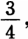这样，资本家得到的就不是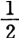日对象化劳动，而是 $\frac{3}{4}$ 日对象化劳动了。资本的价值在资本退出生产过程时就不是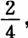而是提高到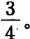这就是说，资本家只要让工人劳动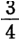日，就可以给资本带来同样多的剩余价值，即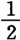或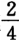日对象化劳动。

但是，资本作为财富一般形式——货币——的代表，是力图超越自己界限的一种无限制的和无止境的欲望。任何一种界限都是而且必然是对资本的限制。否则它就不再是资本即自我生产的货币了。只要资本不再感到某种界限是限制，而是在这个界限内感到很自在，那么资本本身就会从交换价值降为使用价值，从财富的一般形式降为财富的某种实体存在。资本作为资本创造的是一定的剩余价值，因为它不能一下子生出无限的剩余价值；然而它是创造更多剩余价值的不停的运动。剩余价值的量的界限，对资本来说，只是一种它力图不断克服和不断超越的自然限制即必然性。

〔限制表现为必须克服的一种偶然。这一点甚至通过最肤浅的观察就能看到。如果资本从100增长到1 000，那么现在1 000就是增大的出发点；增长到10倍即1 000%也是一样；利润和利息本身又会变成资本。曾经表现为剩余价值的东西，现在表现为简单的前提等等，表现为包含在资本的简单存在本身中的东西。〕

因此，资本家（我们完全撇开以后会出现的规定，如竞争、价格等等）不会因为$\frac{3}{4}$ 日给他提供的剩余价值和过去全日提供的一样多，就只让工人劳动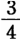日，他会让工人劳动全天。生产力的提高使工人劳动 $\frac{1}{4}$ 工作日就能生活全天，这种提高现在却仅仅表现为：工人现在［Ⅲ—28］必须为资本劳动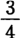日，而以前他只为资本劳动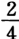日。工人劳动的提高了的生产力，由于缩短了补偿对象化在工人身上的劳动（为创造使用价值即生存资料）所必需的时间，因而表现为工人用在资本价值增殖（创造交换价值）上的劳动时间延长了。

从工人方面来看，为了生活一日，他现在必须完成$\frac{3}{4}$ 日的剩余劳动，而以前他只需要完成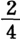日的剩余劳动。由于生产力的提高，由于生产力提高一倍，工人的剩余劳动增加了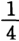日。这里应当指出一点：生产力提高了一倍，工人的剩余劳动却不是增加一倍，而是只增加 $\frac{1}{4}$ 日；同样，资本的剩余价值也不是增加一倍，而是只增加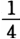日。由此可见，剩余劳动（从工人方面来看）或剩余价值（从资本家方面来看）并不是按照生产力提高的同一数字比例增加。这种情况是怎样造成的呢？

生产力提高一倍表示必要劳动[^v30-c30-annotation-e672c144ac886cad]（为工人的）减少

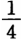日，而剩余价值的生产也就［增加］ $\frac{1}{4}$ 日，因为原来的比例曾假定为 $\frac{1}{2}$ 。如果工人原来必须劳动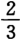日才能生活一日，那么剩余价值就是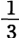日，剩余劳动也是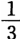日。这样，劳动生产力提高一倍，就使得工人能够把必要劳动缩减为的一半，即 $\frac{2}{6}$ 或 $\frac{1}{3}$ 日，资本家就能赚到 $\frac{1}{3}$ 日的价值。而全部剩余劳动就会是日。生产力提高一倍，在第一个例子中表现为 $\frac{1}{4}$ 日剩余价值和剩余劳动，而现在则表现为日剩余价值或剩余劳动。

可见，生产力的乘数，即用来乘生产力的数，并不是剩余劳动或剩余价值的乘数，而是这样：如果对象化在劳动价格中的劳动所占的原有比例是对象化在一个工作日——工作日总是表现为一种界限（不过，工厂主先生们还把工作日延长到了夜间。十小时工作日法案。见伦纳德·霍纳的报告。）（工作日本身并不以自然日为界限；它可以延长到深夜；这个问题在工资一章中考察。）——中的劳动的$\frac{1}{2}$ ，那么生产力提高一倍就等于 $\frac{1}{2}$ （原有的比例）除以2，即等于如果原有的比例是那么生产力提高一倍就等于 $\frac{2}{3}$ 除以2，即等于 $\frac{2}{6}$ 或

因此，生产力的乘数从来不是原有比例的乘数，而是它的除数，不是原有比例的分子的乘数，而是它的分母的乘数。如果生产力的乘数就是分子的乘数，那么剩余价值的乘法就和生产力的乘法相一致了。但是，剩余价值总是等于原有比例除以生产力的乘数。如果原有比例是

也就是说，工人为了生活需要 $\frac{8}{9}$ 工作日，而资本在同活劳动的交换中只得到，剩余劳动等于 $\frac{1}{9}$ ；那么，现在工人用工作日的一半就能生活，即用工作日（不管是除分子或乘分母都一样），而资本家现在让工人全天劳动，得到的全部剩余价值就是 $\frac{5}{9}$ 工作日；从中减去原有的剩余价值，尚余。因而，在这里生产力提高一倍＝剩余价值或剩余时间增加

这种情况只是由于：剩余价值总是等于整个工作日同维持工人生活所必需的工作日部分之比。用来计算剩余价值的单位总是个分数，也就是说，是一日中恰好代表劳动价格的一定部分。如果这一部分＝

，那么［Ⅲ—29］生产力提高一倍就＝必要劳动减少到如果这一部分＝ $\frac{1}{3}$ ，那么必要劳动就减少到；因此，全部剩余价值在前一场合＝ $\frac{3}{4}$ ，在后一场合＝；相对剩余价值，[^v30-c30-annotation-324f6dea4bc12819]即同原有剩余价值相比而言的剩余价值，在前一场合等于 $\frac{1}{4}$ ，在后一场合等于

可见，资本的价值不是按生产力提高的比例增加，而是按这样的比例增加：表示属于工人的那一部分工作日的分数，除以生产力的提高数，即生产力的乘数。因此，劳动生产力的提高究竟能使资本的价值增加多少，这取决于对象化在工人身上的那一部分劳动同他的活劳动之间的原有比例。这个部分总是表现为整个工作日的一个分数，

等等。生产力的提高数，即生产力乘以某一数字，同用该数字除这个分数的分子或乘它的分母是一回事。因此，价值增加的多少不仅取决于生产力提高的倍数，而且还取决于以前属于劳动价格的那一部分工作日所占的比例。如果这个比例是 $\frac{1}{3}$ ，那么工作日的生产力提高一倍就＝这个比例减少到如果这个比例是 $\frac{2}{3}$ ，那么这个比例就减少到

劳动价格所包含的对象化劳动总是整个工作日的一部分；在算术上总是表现为一个分数；总是一个数字比例，而决不是一个整数。如果生产力提高一倍，即乘以2，那么工人只需要劳动原来时间的

就能挣到劳动价格；但是他现在为达到这个目的究竟需要多少劳动时间，则取决于当初已经存在的比例，即取决于他在生产力提高以前为达到这个目的所需要的时间。生产力的乘数是这个原有分数的除数。因此，［剩余］价值或剩余劳动并不是和生产力按同一数字比例增加。如果原有比例是，生产力提高一倍，那么必要劳动时间（为工人的）就会减少到，剩余价值就只增加如果生产力提高到四倍，那么原有比例就变为而［剩余］价值就只增加

［剩余］价值决不可能等于整个工作日，也就是说，工作日的一定部分总是必须用来同对象化在工人身上的劳动相交换。剩余价值只不过是活劳动同对象化在工人身上的劳动之间的比例；因而比例中的一项必然始终存在。虽然比例中的因数可以变化，但是比例仍旧是比例，这就决定了生产力的提高和剩余价值的增加之间存在着一定的比例。因此，我们一方面看到，相对剩余价值恰好等于相对剩余劳动：如果［必要］工作日是$\frac{1}{2}$ ，生产力提高一倍，那么属于工人的部分，即必要劳动就缩减到新加价值恰好也是而全部［剩余］价值现在是当剩余价值增加 $\frac{1}{4}$ ，即与工作日的比是1∶4时，全部剩余价值就＝，即＝3∶4。

现在我们假定，原有的必要工作日为$\frac{1}{4}$ ，生产力提高一倍，那么必要劳动就缩减到，［增加的］剩余劳动或［增加的剩余］价值恰好＝ $\frac{1}{8}$ ，即＝1∶8。相反，全部剩余价值＝7∶8。在第一个例子中，原有的全部剩余价值＝，现在增加到3∶4；在第二个例子中，原有的全部剩余价值为 $\frac{3}{4}$ ，现在增加到。在第一个场合，全部剩余价值从 $\frac{1}{2}$ 或增加到在第二个场合，从 $\frac{3}{4}$ 或增加到 $\frac{7}{8}$ ；第一个场合增加了 $\frac{1}{4}$ ，第二个场合增加了 $\frac{1}{8}$ ；也就是说，剩余价值的增加在第一个场合比在第二个场合高一倍；［Ⅲ—30］但是，全部剩余价值在第一个场合只有或 $\frac{6}{8}$ ，在第二个场合却是 $\frac{7}{8}$ ，即多

假定必要劳动是

那么全部剩余价值就＝而在以前的比例[^v30-c30-annotation-d7cc37fe28588181]中它是因而，按照我们新的假定，全部剩余价值比以前提高现在假定生产力提高一倍，必要劳动就＝而过去＝ 这样，剩余时间，从而剩余价值，就增加了如果我们考察全部剩余价值，它原来是或而它现在是如果同前面的比例（在那里必要劳动是或）相比较，全部剩余价值现在是 $\frac{31}{32}$ ，而在前面它只是，也就是增加了。但是，相对来看，全部剩余价值在前一场合由于生产提高一倍而增加 $\frac{1}{8}$ 或 $\frac{4}{32}$ ，而现在它只增加因而比前一场合少

如果必要劳动已经缩减到

工作日，那么全部剩余价值就＝工作日。如果生产力现在提高到1000倍，必要劳动就下降到工作日，全部剩余价值就占工作日，而在生产力提高之前只占或因此它增加了（还可以说是），这就是说，在生产力提高到1000倍时，全部剩余价值还增加不到，也就是说增加不到，而在前一场合，生产力仅仅提高一倍，它就增加了如果必要劳动从减少到它就恰好减少了（因为 $\frac{1}{1000}$ ＝），也就是说，剩余价值就增加了这么多。

综上所述，我们可以看到：

第一，活劳动生产力的提高所以会增加资本的价值（或者说减少工人的价值），并不是因为这种提高增加了同一劳动所创造的产品量或使用价值量，——劳动的生产力是劳动的自然力，——而是因为它减少了必要劳动，从而，以它减少必要劳动的同一比例创造出剩余劳动，或者同样可以说创造出剩余价值；因为资本通过生产过程获得的资本的剩余价值，只不过是超过必要劳动的剩余劳动部分。生产力的提高所以能增加剩余劳动，——即对象化在作为产品的资本中的劳动超过对象化在工作日的交换价值中的劳动所形成的余额，——只是因为它缩小了必要劳动对剩余劳动的比例，而且只是按照缩小这个比例的比例来增加剩余劳动。剩余价值恰好等于剩余劳动；剩余价值的增加可以用必要劳动的减少来准确地计量。

第二，资本的剩余价值的增加数并不是生产力的乘数即生产力（作为单位，作为被乘数来看）的增加数，而是活的工作日中原来代表必要劳动的部分超出该部分除以生产力的乘数之后的余额。因而，如果必要劳动＝

活的工作日，生产力提高一倍，那么，资本的价值就不是增加一倍，而是［Ⅲ—31］增加 $\frac{1}{8}$ ；这就等于或 $\frac{2}{8}$ （工作日中原来代表必要劳动的部分）减去 $\frac{1}{4}$ 除以2之商，或者说＝（价值增加一倍，也可以说它增加到或 $\frac{16}{8}$ 倍。因此，拿上述例子来说，生产力提高到而利润只增加了。利润的增加和生产力的提高之比＝1∶16。[^v30-c30-annotation-d93344f0bf56d4d3]就是这样！）如果工作日中原来代表必要劳动的部分是，生产力提高到1 000倍，那么资本的价值［剩余价值］就不是增加到1 000倍，而是还增加不到工作日；资本的价值增加了）

可见，资本由于生产力的一定提高而增加的价值绝对额，取决于工作日中的既定部分，取决于工作日中代表必要劳动，因而表示必要劳动和活的工作日之间的原有比例的那个可除部分。所以，生产力的一定比例的提高，例如在不同的国家，会使资本价值的增加各不相同。生产力按同一比例普遍提高，会使不同产业部门中的资本价值的增加各不相同；而这种情况是由这些部门中必要劳动同活的工作日之间的不同比例决定的。当然，只要劳动到处都是简单劳动，因而必要劳动是相同的（即代表同量的对象化劳动），那么，在自由竞争制度下，这种比例在一切生产部门就会是相同的。

第三，在生产力提高以前资本的剩余价值越大，作为前提存在的资本的剩余劳动量或剩余价值量越大，或者说，工作日中构成工人的等价物即表示必要劳动的那部分越小，资本由于生产力的提高而得到的剩余价值的增加就越少。资本的剩余价值不断增加，但是同生产力的发展相比，增加的比例却越来越小。因而，资本越发展，它创造出来的剩余劳动越多，它也就必然越要疯狂地发展生产力，以便哪怕是以很小的比例来增殖价值，即增添剩余价值，——因为资本的界限始终是一日中体现必要劳动的部分和整个工作日之比。资本只能在这个界限以内运动。用于必要劳动的部分越小，剩余劳动就越大，生产力不管怎样提高都越是不可能明显地减少必要劳动；因为分母已经变得很大了。资本已有的价值增殖程度越高，资本的自行增殖就越困难。于是，提高生产力对资本来说似乎会成为无关紧要的事情；价值增殖本身似乎会成为无关紧要的事情，因为这种增殖的比例已经变得很小了，并且资本似乎会不再成其为资本了。

如果必要劳动是$\frac{1}{1000}$ ，生产力提高到三倍，那么，必要劳动就只会减少到或者说，剩余劳动只会增加但是，这种情况的发生，并不是因为工资已经提高了，或者说，劳动在产品中所占的份额已经扩大了，而是因为从工资对劳动产品或活的工作日的比例来看，工资已经降得很低了。

〔在这里，对象化在工人身上的劳动本身表现为工人自己的活的工作日的一部分；因为这就是工人作为工资形式从资本那里得到的对象化劳动对整个工作日之比。〕

（所有这些论点只有从现在的观点出发来抽象地考察这种关系时才是正确的。在以后的研究中，还要加进一些新的关系，那将大大改变这些论点。这一切一旦不再完全从一般形式上［来表述］，那就属于利润学说了。）

我们先来概括一下：劳动生产力的发展——首先是剩余劳动的创造——是资本的价值增加或资本的价值增殖的必要条件。因此，资本作为无止境地追求发财致富的欲望，力图无止境地提高劳动生产力并且使之成为现实。但是另一方面，劳动生产力的任何提高——我们撇开它为资本家增加使用价值这一点不谈——都是资本的生产力的提高，而且，从现在的观点来看，这种提高只有就它是资本的生产力来说，才是劳动的生产力。

[^v30-c30-jz_1_308]: 在手稿第21页的下面空白处马克思写着：“资本和劳动的关系，资本家和工人的关系，本身表现为生产过程的结果”。——编者注

[^v30-c30-jz_2_308]: 见本卷第189、211—212、215—220页。——编者注

[^v30-c30-jz_1_309]: 见本卷第223—225页。——编者注

[^v30-c30-jz_1_310]: “为普鲁士国王干的”一语的原文是“pour le roi de Prusse”，转义是：白干的。——编者注

[^v30-c30-jz_1_311]: 见本卷第12—17、204—205页。——编者注

[^v30-c30-jz_1_320]: 见本卷第287—288页。——编者注

[^v30-c30-jz_1_324]: 见本卷第287—288页。——编者注

[^v30-c30-jz_2_324]: 见本卷第285—286页。——编者注

[^v30-c30-annotation-d38614fda37e4e5a]: 资本的非生产性是托·霍吉斯金的匿名小册子《保护劳动反对资本的要求，或资本非生产性的证明》（1825年伦敦版）中的论点。马克思在《剩余价值理论》第3册第21章第3节《霍吉斯金》中详细地分析了这本小册子。——263。

[^v30-c30-annotation-c336493b7848bc4e]: 关于亚·斯密将生产劳动和非生产劳动区别开来的论述，见他的《国民财富的性质和原因的研究》第2篇第3章。——264。

[^v30-c30-annotation-1464e82c658424eb]: 西尼耳在生产劳动和非生产劳动问题上的观点，见他的《政治经济学基本原理》1836年巴黎版第197—206页。马克思在《剩余价值理论》第1册第4章第17节中专门批判了西尼耳的这种观点。马克思在《剩余价值理论》中更详细地分析说：“钢琴制造厂主的工人是生产劳动者……相反，假定我买到制造钢琴所必需的全部材料（或者甚至假定工人自己就有这种材料），我不是到商店去买钢琴，而是请工人到我家里来制造钢琴。在这种情况下，钢琴匠就是非生产劳动者，因为他的劳动直接同我的收入相交换。”（见《剩余价值理论》第1册第4章第3节末尾）马克思同时指出：“一个自行卖唱的歌女是非生产劳动者。但是，同一个歌女，被剧院老板雇用，老板为了赚钱而让她去卖唱，她就是生产劳动者，因为她生产资本”。（见同上书，《附录》第12节（d）末尾）——264。

[^v30-c30-annotation-81ccbc8855cf24f4]: 指马克思《伦敦笔记》第Ⅹ笔记本的页码，那里摘录了托·罗·马尔萨斯《政治经济学原理》1836年伦敦第2版第47页上的这段引文。但是，这段话实际上是在马尔萨斯去世后，出版该书第2版的编者为使马尔萨斯的论点更明确而写的。——264。

[^v30-c30-annotation-f94fffb8efe612aa]: “为了一碗红豆汤而出卖长子权”出典于圣经故事：一天，雅各熬红豆汤，其兄以扫打猎回来，累得昏了，求雅各给他汤喝。雅各说，须把你的长子名分让给我。以扫就起了誓，出卖了自己的长子权。（见《圣经·创世记》第25章）。——266。

[^v30-c30-annotation-3d6d3f82f98cce94]: 指马克思写于1844—1847年期间的一本没有保留下来的摘录笔记本的页码，那里摘录了西斯蒙第的这段话。——267。

[^v30-c30-annotation-ffca53546591be6a]: 指马克思写于1844—1847年期间的一本没有保留下来的摘录笔记本的页码，那里摘录了舍尔比利埃的这段话。——267。

[^v30-c30-annotation-26457075e6439863]: 关于资本的非生产性质的观点，见大·李嘉图的《政治经济学和赋税原理》1821年伦敦第3版第334—337页。并见让·沙·莱·西蒙德·德·西斯蒙第《政治经济学概论》1837—1838年布鲁塞尔版第1卷第22页。马克思在《剩余价值理论》第2册第16章第3节（e）和第3册第21章第3节（a）中对这一观点作了评介。——268。

[^v30-c30-annotation-971ead80d5db61eb]: 让·巴·萨伊关于资本的生产性服务的观点，见他的《论政治经济学》1817年巴黎第3版第2卷第424、425、429页。——269。

[^v30-c30-annotation-d5028a8e20ece846]: 蒲鲁东的“劳动在生产，资本有价值”这句话出自他的《经济矛盾的体系，或贫困的哲学》1846年巴黎版第1卷第61页。马克思在《哲学的贫困》第1章第2节中引用了这句话。——269。

[^v30-c30-annotation-58f2f2392c643ef6]: 见《无息信贷。弗·巴师夏先生和蒲鲁东先生的辩论》1850年巴黎版第177—181页。并参看本卷第221—222页。——271。

[^v30-c30-annotation-73862b53388121b5]: 分析判断，按照康德的说法，是指判断的宾词只说明判断的主词所包含的内容，而综合判断则不同，它的宾词会给主词添上判断的主词没有包含的特征。——273。

[^v30-c30-annotation-4d40cb0c7830fc4e]: 生产费用这一术语，在这里和上一句中，马克思是在“商品的内在的生产费用等于商品的价值，也就是等于商品生产所必需的劳动时间总量”（见《剩余价值理论》第3册第20章第1节（c））这一意义上使用的。马克思在本手稿中还没有明确区分价值（c＋v＋m）和生产价格（c＋v＋平均利润）。关于“生产费用”这一术语的三种用法，见同上书《附录》第5节。——275。

[^v30-c30-annotation-94ca57ce269720cc]: 马克思在这里赋予“生产价格”的含义同前面他赋予“商品生产费用或必要价格”的含义一样（见注98和注157）。——275。

[^v30-c30-annotation-0c3760eaa4c5fc87]: 马克思在这里第一次使用“剩余价值”（Mehrwert）这一术语来表示资本家无偿占有的、超出最初预付价值的余额。马克思在1842年10月所写的一篇早期论文中也几次使用了“Mehrwert”这一术语，但那里译为“额外价值”，表示林木占有者由于林木失窃而得到的追加价值，即罚款。见《第六届莱茵省议会的辩论》第三篇论文。——275。

[^v30-c30-annotation-213a950416e3c370]: 指马克思《伦敦笔记》第Ⅷ笔记本的页码，在该笔记本第39—40页上，马克思把李嘉图上述著作第7章《论对外贸易》中的重要片断译成德文记录下来，并作了批判。本书中的这段话是马克思对李嘉图论对外贸易的主要思想的概括。——276。

[^v30-c30-annotation-a6a69aea933f9039]: 马克思在《剩余价值理论》第3册《附录》第6节中考察了蒲鲁东在《无息信贷。弗·巴师夏先生和蒲鲁东先生的辩论》中表达的对利息的看法。——279。

[^v30-c30-annotation-f3e2a2ef980f480b]: 弗·巴师夏关于利润和利息是同一个东西等等，见他的《经济的和谐》1851年巴黎第2版第378、381—383页。——284。

[^v30-c30-annotation-9e686e24253ce7f5]: 马克思在这里第一次使用“剩余劳动”（Surplus Arbeit）这一术语。——286。

[^v30-c30-annotation-1d39359b367fe600]: 指匿名论文《黑人和奴隶贸易》，该论文以“一个专家”（Expertus）写给编辑的信的形式刊登于1857年11月21日的《泰晤士报》。——287。

[^v30-c30-annotation-d6c2818c6a9b4a0d]: 马克思在他的《伦敦笔记》第Ⅷ笔记本第58页上，就英国经济学家对李嘉图的批评写了如下一段话：“李嘉图的大多数论敌，例如像威克菲尔德等人，都断言他不能说明余额。例如：一位工厂主把30镑用在原料上，把20镑用在机器上，把50镑用在工资上。总共用了100镑。他出售他的商品得到110镑。这10镑是从哪里来的？”马克思在《剩余价值理论》第2册第15章B第3节中也谈到了李嘉图缺乏剩余价值起源的分析。——287。

[^v30-c30-annotation-7e197190808017d8]: 指马尔萨斯的《价值的尺度。说明和例证》1823年伦敦版。关于马尔萨斯的价值理论，特别是关于马尔萨斯对李嘉图学说的批评，马克思在《剩余价值理论》第3册第19章第1—10节中作了详细的分析。——287。

[^v30-c30-annotation-46deccde667e2e03]: 大·李嘉图反对亚·斯密把价值由工资决定和由对象化在商品中的劳动时间决定这两件事混为一谈的观点，见他的《政治经济学和赋税原理》1821年伦敦第3版第1—12页。——287。

[^v30-c30-annotation-8d3b6375586f943c]: 关于李嘉图在价值的产生方面存在的一些混乱看法，见他的《政治经济学和赋税原理》1821年伦敦第3版第60—61、131—132页。——288。

[^v30-c30-annotation-dab3874ab3ac128e]: 关于把重农学派称为“现代经济学的鼻祖”，马克思在《剩余价值理论》第1册第2章第1节中作了说明。——288、289。

[^v30-c30-annotation-227943c39a4456d9]: 指亚·斯密的著作《国民财富的性质和原因的研究》第2篇第3章，斯密在这里研究了生产劳动和非生产劳动的问题。关于斯密把生产劳动看成物化在商品中的劳动的论述，马克思在《剩余价值理论》第1册第4章第4—5节中作了详细的说明。——290。

[^v30-c30-annotation-e672c144ac886cad]: 马克思在这里第一次使用“必要劳动”（notwendige Arbeit）这一术语。——298。

[^v30-c30-annotation-324f6dea4bc12819]: 马克思在这里第一次使用“相对剩余价值”（relativer Surpluswert）这一术语。——299。

[^v30-c30-annotation-d7cc37fe28588181]: 这里指原有的全部剩余价值为的第二个场合。——302。

[^v30-c30-annotation-d93344f0bf56d4d3]: 这里不应是利润，而是剩余价值，不应是1∶16，而是∶100或者说1∶6，因为在马克思所说的第二个场合（见本卷第301页），生产力提高100%，而剩余价值从一个工作日的增加到也就是说只增加了%。——304。
<!-- END SOURCE v30c30 -->

<!-- BEGIN SOURCE v30c31 OEBPS/chapters/chapter-0031.xhtml -->
##### ［绝对剩余价值和相对剩余价值］

［Ⅲ—32］现在已经很清楚，至少可以预先指出的是：生产力的提高本身并不会提高价格。我们以1蒲式耳小麦为例。如果在1蒲式耳小麦中对象化了半个工作日，并且这半个工作日就是工人的价格，那么，剩余劳动就只能生产1蒲式耳小麦。因此，2蒲式耳小麦就是一个工作日的价值，如果用货币来表现＝26先令，那么2蒲式耳小麦就＝26先令。1蒲式耳小麦＝13先令。

如果现在生产力提高一倍，那么1蒲式耳小麦就只＝$\frac{1}{4}$ 工作日，即＝先令。商品的这一组成部分的价格由于生产力的提高而下降了。但是总价格没有变；只不过剩余劳动现在是 $\frac{3}{4}$ 工作日了。每四分之一工作日＝1蒲式耳小麦＝先令。因而总产品＝26先令＝4蒲式耳。［产品价格］同以前一样。资本的价值从13先令增加到先令。劳动的价值从13先令减少到先令。物质生产从2蒲式耳增加到4蒲式耳。［资本的剩余价值］现在是先令。

如果开采金的生产力也提高了一倍，也就是说，如果13先令以前是半个工作日的产品，而必要劳动也是半个工作日，那么，现在是$\frac{1}{4}$ 工作日，所以生产出的是52先令，也就是说，多生产52 -13即39先令。现在，1蒲式耳小麦＝13先令；商品同一组成部分的价格和以前一样；但是总产品＝52先令；而以前只＝26先令。另一方面，52先令现在可以买4蒲式耳，而以前26先令只能买2蒲式耳。

好了。首先很清楚，如果说资本已经把剩余劳动扩大到了这样的程度，以致整个活的工作日都用于生产过程（我们在这里把工作日假定为工人能够让人支配的劳动时间的自然量；工人让人支配他的劳动能力，始终只限于一定的时间，即他让人支配的只是一定的劳动时间），那么，生产力的提高就不可能增加劳动时间，从而也就不可能增加对象化的劳动时间。对象化在产品中的是一个工作日，而不管必要劳动时间是由6小时还是由3小时，是由$\frac{1}{2}$ 工作日还是由 $\frac{1}{4}$ 工作日来代表。资本的剩余价值增加了；也就是说，资本的价值与工人相比增加了；因为资本的价值以前只＝对象化劳动时间的，现在它＝对象化劳动时间的；但是，资本价值的增加，并不是由于绝对的劳动量增加了，而是由于相对的劳动量增加了；也就是说，不是劳动的总量增加了；现在仍然同以前一样劳动一天，因而剩余时间（剩余劳动时间）没有绝对增加，但是必要劳动量减少了，因而相对的剩余劳动增加了。

实际上，工人以前劳动一整天，剩余时间只占

天，现在他同以前一样劳动一整天，但剩余时间却占工作日。可见，在这种情况下，价格（假定金银价值不变）或资本的交换价值并没有由于生产力提高一倍而增加。因而，这涉及利润率，并不涉及产品价格或在产品的形式上重新变成商品的资本的价值。但是事实上，绝对价值在这种场合也增加了，因为表现为资本即表现为自行增殖的价值的那一部分财富增加了。（资本的积累。）

我们再来看以前的例子[^v30-c31-jz_1_336]。假定资本＝100塔勒，而这笔资本在生产过程中分为以下几个部分：50塔勒棉花，40塔勒工资，10塔勒工具。同时，为了计算简便起见，我们假定全部劳动工具在一次生产行为中耗费掉（这一点在这里还完全无关紧要），因而它的价值在产品的形式上全部再现出来。假定在这种场合，劳动在与40塔勒交换时——这40塔勒表示对象化在它的活的劳动能力中的劳动时间，比如说4小时劳动时间——付给资本8小时。假定工具和原料已作为前提存在，如果工人只劳动4小时，也就是说，如果原料和工具属于工人，而且工人只劳动4小时，总产品就将是100塔勒。工人会在60塔勒上加上他可以用于消费的40塔勒，因为他首先要补偿这60塔勒——生产所必需的原料和工具，［其次］，他会加上40塔勒的追加价值[^v30-c31-jz_2_336]，这是他自己的活的劳动能力的再生产，或者说是对象化在这种劳动能力中的时间的再生产。他可以不断重新开始劳动，因为他在生产过程中既［Ⅲ—33］再生产了原料的价值，工具的价值，也再生产了劳动能力的价值，而他所以能再生产出后者，正是由于他不断地在原料和工具的价值上增加4小时对象化劳动。但是现在，他所以能得到40塔勒工资，只是由于他劳动了8小时，也就是说，只是由于他在那些现在作为资本同他相对立的劳动材料和工具上加上了80塔勒的追加价值[^v30-c31-jz_2_336]，而他原先在劳动材料和工具上加上的40塔勒的追加价值[^v30-c31-jz_2_336]，确切地说只是他的劳动的价值。这样，他会追加一个恰好等于剩余劳动或剩余时间的剩余价值。

〔在我们目前的研究阶段上，还没有必要考虑下述事实：随着剩余劳动或剩余时间的增加，材料和工具也必须增加。单纯剩余劳动会如何使原料增加，见拜比吉的著作，例如，关于金丝编织品等等。[^v30-c31-annotation-38cf8bc390498fb8]〕

可见，资本的价值会从100塔勒增加到140塔勒。

〔我们再假定，原料增加一倍，劳动工具增加（为了计算简便起见）［一倍］。这样，资本的支出现在是棉花100塔勒，工具20塔勒，共计120塔勒，而在劳动上支出的仍然同以前一样是40塔勒；总共就是160塔勒。如果4小时剩余劳动使100塔勒增加40%，那么它就会使160塔勒增加64塔勒。因而总产品＝224塔勒。在这里还假定，利润率在资本量变化时保持不变，劳动材料和劳动工具本身还没有被看作剩余劳动的实现，还没有被看作剩余劳动的资本化；我们已经看到[^v30-c31-jz_1_337]，已经存在的剩余时间越多，即资本本身的量越大，就越是会出现这种情况：劳动时间的绝对增加变得不可能，而由生产力的提高造成的劳动时间的相对增加也会按几何级数递减。〕

现在，作为简单交换价值来看的资本绝对地增大了，不再是100而是140塔勒，但是实际上，只创造了一个新价值，也就是说，不仅仅是一个补偿花费在劳动材料和工具上的60塔勒和花费在劳动上的40塔勒所必需的价值，还创造了40塔勒的新价值。处在流通中的价值增加了40塔勒，对象化劳动时间增加了40塔勒。

现在我们还是设定同样的前提。有一笔100塔勒的资本；即：50塔勒的棉花，40塔勒的劳动，10塔勒的生产工具；剩余劳动时间同前一场合一样多，即4小时，全部劳动时间为8小时。因此，产品在每个场合都只＝8小时劳动时间＝140塔勒。现在假定，劳动生产力提高一倍；也就是说，工人只要用2小时就可以使原料和工具的利用达到维持工人的劳动能力所需要的程度。如果40塔勒是体现在银上的4小时对象化劳动时间，那么20塔勒就是2小时对象化劳动时间。这20塔勒现在代表着以前40塔勒所代表的同一使用价值。劳动能力的交换价值减少了一半，因为用原来劳动时间的一半就创造出同一使用价值，而使用价值的交换价值只能用对象化在使用价值中的劳动时间来计量。

但是，资本家仍然同以前一样要工人劳动8小时，因而工人的产品同以前一样代表8小时劳动时间＝80塔勒劳动时间，而原料和工具的价值不变，即60塔勒；总计同以前一样为140塔勒。

（工人本身为了生活，只须在60塔勒的原料和工具上再追加20塔勒价值，因而他只是再创造出80塔勒价值。他的产品的总价值由于生产力提高一倍会从100减少到80，即减少20塔勒，也就是减少100的$\frac{1}{5}$ ＝20%。）

但是，剩余时间或资本的剩余价值现在不是4小时而是6小时，或者说，不是40塔勒而是60塔勒。它增加了2小时，即20塔勒。现在资本的计算就会是这样：原料50塔勒，劳动20塔勒，工具10塔勒；支出＝80塔勒。赢利＝60塔勒。资本家同以前一样按照140塔勒卖出产品，但得到的赢利不是从前的40塔勒，而是60塔勒。因而从一方面来看，他投入流通的只是同以前一样大的交换价值，即140塔勒。但是，他的资本的剩余价值增加了20塔勒。这就是说，只是他在140塔勒中所占的份额增大了，只是他的利润率提高了。实际上是工人无偿地为资本家多劳动了2小时，即不是4小时而是6小时，而这对工人来说，就像他在以前的条件下不是劳动8小时而是劳动10小时一样，就像他的绝对劳动时间延长了一样。

但是，这里实际上也产生出一个新价值；就是说，又有20塔勒表现为独立的价值，表现为这样一种对象化劳动，它游离出来，不用再去仅仅同原先的劳动力相交换。这可以通过两种方式表现出来。或者是这20塔勒转化为资本，形成一个增大了的交换价值，也就是使更多的对象化劳动成为新生产过程的起点，从而推动更多的劳动；或者是资本家把这20塔勒作为货币同他在生产中用作产业［Ⅲ—34］资本的那些商品以外的商品相交换；因此，除了劳动和货币本身以外的全部商品，都会同这追加的20塔勒相交换，会同这追加的2小时对象化劳动相交换。因而商品的交换价值的增长额恰好是这个游离出来的数额。

实际上，正如那位出版重农学派著作的非常“机智”的法国出版者在反驳布阿吉尔贝尔时说的[^v30-c31-annotation-b185f1c457cc67a1]，140塔勒就是140塔勒。但是认为这140塔勒只代表更多的使用价值，那就错了；它代表一个更大部分的独立的交换价值，货币，潜在资本；也就是说，它代表一个更大部分的被看作财富的财富。经济学家们自己也是承认这一点的，他们后来研究资本积累时不仅承认使用价值量的积累，而且承认交换价值量的积累；因为李嘉图本人也认为，相对剩余劳动完全同绝对剩余劳动一样，也可以创造出资本积累的要素，——事情也不可能是别的样子。

另一方面，在李嘉图本人阐述得最好的那些原理中已经包含如下内容：完全由于生产力的提高而创造出来的这笔超额的20塔勒，会重新变为资本。[^v30-c31-annotation-88ecd8b8cebdb221]以前，140塔勒中能够转化为新资本的（我们暂且把资本的消费撇开不谈）只有40塔勒；100并不是转化为资本，而是照旧是资本；现在，能够转化为新资本的是60塔勒，也就是说，现在存在着一个更大的资本，它的交换价值增加了20塔勒。因此，交换价值，即财富本身，已经增大，尽管财富总额同以前一样没有直接增加。为什么财富增大了？因为总额中的一个部分增大了，即不是单纯的流通手段而是货币，或者说，不是单纯的等价物而是自为存在的交换价值的部分增大了。

或者是这游离出来的20塔勒作为货币积累起来，也就是说，以抽象的交换价值形式追加到已经存在的交换价值上；或者是它们全部进入流通，在这种情况下，用它们购买的商品的价格就会提高；它们代表着全部增加的金，而因为金的生产费用并没有下降（相反，同生产效率变得更高的资本所生产的商品的生产费用相比，金的生产费用提高了），它们也就代表着增加的对象化劳动（这种情况导致如下结果：起初出现在一个进行生产的资本方面的余额，现在则出现在生产变贵了的商品的另一些资本方面）；或者是最初流通的资本本身直接把这20塔勒作为资本来使用。于是产生了一个20塔勒的新资本，即自行保存和自行增殖的财富额。资本增长了20塔勒的交换价值。

（流通其实还与我们无关，因为我们在这里考察的是资本一般，而流通只能在作为货币的资本形式和作为资本的资本形式之间起中介作用。第一种资本可以实现货币本身，也就是说，交换它要消费的比以前更多的商品；但是，在这些商品的生产者手中，这些货币会转化成资本。可见，货币或者会直接在第一种资本手中转化成资本，或者会通过迂回的道路在第二种资本手中转化成资本。但是，第二种资本始终又是资本本身；而我们在这里考察的是资本本身，也可以说是全社会的资本。资本的差别性等等还与我们无关。）

这20塔勒只能表现为两种形式。或者是表现为货币，这样资本本身又存在于还没有变成资本的货币——资本的出发点——的规定上；又以交换价值的或一般财富的抽象独立的形式而存在；或者是这20塔勒本身又表现为资本，表现为对象化劳动对活劳动的新的统治。〔在上面所举的例子中，生产力增加一倍，即提高100%，资本的价值增加50%。〕

（所使用的资本量的每一次增加都不仅能按算术级数，而且能按几何级数提高生产力；而资本作为生产力的提高者，却只能以小得多的比例来增加利润。因此，资本的增加对提高生产力的影响无可比拟地大于生产力的提高对资本增长的影响。）

这20塔勒作为一般财富，或者是物化在货币（只是财富抽象存在的物）形式上，或者是物化在新的活劳动形式上。

假定资本家以作为流通手段的货币为中介，比如说从140塔勒中拿出20塔勒，作为使用价值来自己消费。这样，资本家在原先的前提下，就只能用120塔勒（与100相比）这一较大资本即较大交换价值来开始自行增殖的过程。在生产力提高一倍以后，资本家无须缩减自己的消费，就可以用140塔勒来开始这一过程。一个增大的交换价值部分不是以使用价值的形式消失，而是固定化为交换价值（既可以直接地固定化，也可以通过生产而固定化）。创造更大的资本，就意味着创造更大的交换价值，尽管交换价值在它作为简单交换价值的直接形式上不会由于生产率的提高而增加，但是在它作为资本这一自乘形式上却会由于生产率的提高而增加。

一个更大的资本140塔勒比以前的资本120塔勒绝对地说代表更多的对象化劳动。［Ⅲ—35］因此，它至少相对地说也会推动更多的活劳动，从而最终也会再生产出一个更大的简单交换价值。120塔勒资本按40%生产出产品或简单交换价值60塔勒；140塔勒资本生产出简单交换价值64塔勒。[^v30-c31-annotation-b4d914dc90edce44]在这里，资本形式上的交换价值的增加也直接表现为简单形式上的交换价值的增加。

确认上述这一切，具有极其重要的意义。不能满足于像李嘉图那样，说明交换价值不会［由于生产力的提高而］增加；[^v30-c31-annotation-948ccba69001f2d2]也就是说，作为财富的抽象形式的交换价值不会增加，增加的只是作为资本的交换价值。李嘉图当时只看到了最初的生产过程。但是，如果相对剩余劳动增加了，——因而资本绝对增加了，——那么在流通中作为交换价值存在的相对交换价值，即货币本身，也必然会增加，因此，通过生产过程的中介作用，绝对交换价值也会增加。换句话说，从同一数量的交换价值即货币中——而价值增殖过程的产物正是表现在这种简单形式上（剩余价值只是在同资本的关系上，只是在同生产过程开始前存在的那个价值的关系上，才是产物；就其本身来看，作为独立的存在来看，剩余价值只是一定量的交换价值）——有一部分游离出来，这一部分不是作为现存的交换价值或者说现存的劳动时间的等价物而存在的。如果这部分与现存的交换价值相交换，那么它并不是现存的交换价值的等价物，而是超过等价物的东西，因而会使现存的交换价值方面有一部分交换价值游离出来。这种使社会变富的游离出来的交换价值，在静止的状态下，只能是货币；这样，增加的只是抽象形式的财富；而它在运动的状态下，只能实现在新的活劳动中（或者是推动以前闲置的劳动，或者是产生出新的工人（促进人口增长）；或者是扩大处在流通中的交换价值的新范围——这可以从生产方面通过以下办法来实现，即游离出来的交换价值开创新的生产部门，也就是创造出新的交换对象，新的使用价值形式上的对象化劳动；或者是通过扩大贸易，把一个新国家的对象化劳动引进流通范围，来达到同样的目的）。因而，这种新的活劳动必然被创造出来。

李嘉图力图弄清问题（而他在这方面是很模糊的）的方式，实质上不过表示他一下子就引进了某种关系，而不是简单地说：在同一数额的简单交换价值中，以简单交换价值（等价物）形式出现的部分较小，以货币形式出现的部分较大（这里所说的货币是指在最初的、洪水期前形式上的、不断重新产生资本的货币；是在货币规定上的货币，不是在铸币等等规定上的货币）；因而作为自为的交换价值即作为价值出现的部分增大了，财富形式上的财富增大了[^v30-c31-jz_1_343]。（而李嘉图恰恰得出了错误的结论，认为增大的只是作为使用价值的物的形式的、物质形式的财富。）因而，在李嘉图看来，财富只要不是来自地租，——也就是说，按照李嘉图的看法，财富不是产生于生产力的提高，而相反地是产生于生产力的下降，——那么，财富本身的起源就是完全不能理解的，他陷入了极端荒谬的矛盾。

我们再按照李嘉图的方式来考察一下这个问题。假定1 000资本推动50个工人，或50个活的工作日；由于生产力提高一倍，这笔资本可以推动100个工作日。但是，这100个工作日不是作为前提存在的，而是由他任意塞进来的，因为如果不是这样，——如果不加进较多的实际工作日，——他就无法理解交换价值会由于生产率提高而增加。另一方面，他在任何地方都没有把人口的增长作为增加交换价值的一个要素加以论述；他甚至在任何地方都没有明确地谈过这个问题。

根据上述前提，资本为1 000，工人为50。连李嘉图也得出的正确结论（见笔记本[^v30-c31-annotation-8265e392e31013dd]）是：［由于生产力提高一倍］500资本和25个工人就可以生产出同以前一样多的使用价值；其余的500资本和25个工人会创建一个新企业，也会生产出500的交换价值。利润仍旧不变，因为利润不是产生于500与500相交换，而是产生于这500最初分割为利润和工资的比例；相反，交换是等价物的交换，这种交换同对外贸易中的交换一样不会增加价值，李嘉图在谈到对外贸易时曾特别谈到过这种情况。因为等价物相交换无非表示，在A与B交换以前存在于A手中的价值，在A与B交换以后仍然存在于A手中。

总价值或财富仍旧不变。但是，使用价值或财富物质增加了一倍。单就生产力提高来看，绝对不存在任何理由能说明作为财富的财富即交换价值本身为什么一定会增加。如果这两个［Ⅲ—36］部门中的生产力又提高一倍，那么资本A和资本B各自又可以分成各为250的两笔资本和两个

工作日。现在有四笔资本，全部交换价值还是1 000镑，还是同过去一样共消费50个活的工作日〔活劳动消费资本这种说法是根本错误的，其实是资本（对象化劳动）在生产过程中消费活劳动〕，并且［就像］以前消费价值增加到两倍时一样，生产出四倍的使用价值。

李嘉图是古典学派，决不会像那些修正他的人那样愚蠢，竟认为因生产力提高而增大的价值，是来源于在流通中交换的一方卖得较贵。交换的一方不是把已经成为商品即简单交换价值的资本500与500相交换，而是与550相交换（附加10%），但这时另一方得到的交换价值显然只是450，而不是500，价值总额则同以前一样仍然是1000。这种情形在商业中是经常发生的，但只能说明一笔资本的利润是来自另一笔资本的亏损，因而不能说明资本的利润本身；如果没有这个前提，无论这一方或另一方就都不存在利润。

因此，李嘉图所描绘的过程可以一直进行下去，唯一的界限就是1 000资本和50个工人所能实现的生产力的提高程度（而这一点又具有物的性质，目前处在经济关系本身之外）。请看下面的论述：

“资本是一个国家为了未来生产而使用的那部分财富，它可以用增加财富的同样方法来增加。”［（大·李嘉图《政治经济学和赋税原理》1821年伦敦第3版第327页）］

（这就是说，在李嘉图看来，财富是使用价值的丰富，而且从简单交换的观点来看，同一对象化劳动可以表现在无限量的使用价值上，只要依然是同一对象化劳动量，它就始终是同一交换价值，因为它的等价物不是由它借以存在的使用价值量来计量，而是由它本身的量来计量。）

“追加资本无论是由于技艺和机器的改进而得到的，还是由于把更大的一部分收入用于再生产而得到的，在生产未来财富时都有同样的效力；因为财富〈使用价值〉总是取决于生产出来的商品量〈看来，在某种程度上也取决于商品的多样性〉，而与制造在生产中使用的工具的容易程度无关〈也就是说，与对象化在这些工具中的劳动时间无关〉。一定量的衣服和食物将维持和雇用同样的人数……但是在生产它们时如果用了200人，它们就会有加倍的价值〈交换价值〉。”［（同上，第327—328页）］

如果由于生产力的提高，100人生产的使用价值同以前200人生产的一样多，那么就会发生下述情况：

“如果把200人解雇一半，剩下的100人生产的东西会同以前200人生产的一样多。因此，资本的一半可以从该部门中抽出；在这里有多少劳动游离出来，就有多少资本游离出来。因为一半资本提供的服务会同以前全部资本提供的一样，所以现在就形成了两笔资本，等等。”（参看同上，［L .］Ⅷ，39、40，论国际贸易[^v30-c31-annotation-850cc7b5bf6a7481]，我们还要谈这个问题。）

李嘉图在这里谈的不是一个工作日，不是指资本家如果以前用半个对象化的工作日与工人的一整个活的工作日相交换，那他实质上是只赚得半个活的工作日，也就是他把另一半工作日在对象性的形式上付给工人并且在活生生的形式上从工人那里收回，就是说他付给工人的是半个工作日；相反，李嘉图谈的是同时并存的工作日，因而也就是不同工人的工作日。但是，这种情况丝毫也没有改变实质，而只是改变了说法。每一个这样的工作日都会提供更多的剩余时间。如果资本家以前遇到的界限是一个工作日，那么他现在遇到的界限便是50个工作日等等。前面已经指出，在这种形式上，由于生产率提高而引起的资本的增加，并不会使交换价值增加，而在李嘉图看来，人口也可能减少，例如从1 000万减少到1万，但交换价值或使用价值量不会减少（见李嘉图著作的最后部分[^v30-c31-annotation-76cdbdc06e4ac710]）。

我们决不否认资本中包含着矛盾这一事实。相反，我们的目的是要充分揭示这些矛盾。但是李嘉图却不是揭示这些矛盾，而是回避这些矛盾，认为交换价值对财富的形成无关紧要。这就是说，他断言在以交换价值和以来自交换价值的财富为基础的社会中，这种财富形式随着生产力的发展等等而陷入的那些矛盾并不存在，并且价值的增加在这样的社会里不是确保财富增加的必要条件，［Ⅲ—37］因此，这种价值作为财富的形式根本不会影响这种财富本身及其发展，也就是说，李嘉图把交换价值看作不过是形式的东西。

但是，李嘉图又想到了：（1）资本家所关心的是价值；（2）从历史上看，随着生产力的发展（他也必定想到国际贸易的发展），财富本身即价值总额不断增长。如何解释这种情况呢？资本的积累比人口的增长快；因而工资提高；接着人口增加；接着谷物价格上涨；接着生产的困难程度增加；因而交换价值也就增加了。这样，李嘉图通过迂回的道路终于达到了交换价值。

我们在这里暂时完全撇开同地租有关的要素不说，因为这里谈的不是生产的困难程度的增加，相反，是生产力的增长。随着资本的积累，只要人口不同时增长，工资就会提高；工人会结婚，生育会受到鼓励或者他们的子女会生活得好些，不会夭折等等。总之，人口会增长。但是，人口的增长会引起工人之间的竞争，从而迫使工人把自己的劳动能力重新按照其价值或者有时还要低于其价值出卖给资本家。现在，积累的资本——它在此期间增长得慢了——拥有一个余额，以前资本为了购买劳动的使用价值会以工资形式即作为铸币支出这个余额，现在它又把这个余额当作货币来用，以便作为资本通过活劳动而增殖，而因为资本现在也支配着更多的工作日，所以它的交换价值又会增加。

（甚至这一点在李嘉图那里也没有得到正确的说明，而是同地租理论纠缠在一起；因为资本以前在工资形式上失掉的这个余额，现在由于人口的增长又在地租的形式上从它那里被夺走了。）但是在李嘉图的理论中，即使对人口的增长也理解得不正确。他在任何地方都没有说明，对象化在资本中的全部劳动同活的工作日之间存在着一种内在关系（无论是把这个工作日设想为一个50×12小时的工作日，还是设想为50个工人的12小时劳动，对这种关系来说都一样）；而且这种内在关系恰恰就是，活的工作日中的一个组成部分，或者说支付给工人的对象化劳动的等价物这个组成部分，对活的工作日的关系；在这里，一天本身是一个整体，而内在关系则是必要劳动小时组成部分同剩余劳动小时组成部分之间的可变关系（一天本身是个不变量）。正因为李嘉图没有说明这种关系，所以他也没有说明（我们到目前为止还没有涉及这个问题，因为我们研究的是资本本身，而生产力的发展被看作引进来的外在关系），生产力的发展本身既以资本的增加又以同时并存的工作日的增加为前提，但是在推动一个工作日（这个工作日也可以是50×12小时即600小时）的资本的既定界限内，生产力的发展本身就是资本的生产力发展的界限。

工资不仅要维持工人本身，而且要维持工人的再生产；这样，工人阶级的一分子死了，就会有另一分子来递补；如果50个工人死了，就会有50个新的工人来代替。50个工人本身——作为活的劳动能力——不仅代表着生产他们自身的费用，而且也代表着他们作为个体应得的工资以外必须付给他们父母的费用，以便生产出50个新个体来接替自己。因此，即使工资不提高，人口也会增长。为什么人口增长得不够快？而且必须要有特殊的刺激？这仅仅是因为资本的目的不是单纯取得更多的、李嘉图所理解的那种“财富”，而是要支配更多的价值，更多的对象化劳动。但是，在李嘉图看来，只有当工资下降时，也就是说，只有当对象化劳动为同一资本换进更多的活的工作日，从而创造出更多的价值时，资本才能在事实上支配更多的对象化劳动。为了使工资下降，李嘉图假定人口增长了。为了在这里证明人口的增长，他假定对工作日的需求增长了，换句话说，资本能够购买更多的对象化劳动（对象化在劳动能力中的劳动），因而资本的价值增加了。但是，李嘉图最初恰恰是从相反的前提出发的，而且，只因为他是从这种前提出发，才走了弯路。在1 000镑能购买500工作日，而且生产力增长的情况下，资本就可以或者是在同一劳动部门中继续雇用500个工人，或者是分裂为：在一个劳动部门中雇用250个工人，在另一个劳动部门中雇用250个工人，于是资本也就分裂成两笔各为500的资本。但是资本所能支配的工作日决不会超过500，因为，如果不是这样，按照李嘉图的看法，不仅资本生产出来的使用价值必定倍增，而且这些使用价值的交换价值，即资本所支配的对象化劳动时间也必定倍增。因此，从李嘉图的前提出发，对劳动的需求不可能增长。但是，如果对劳动的需求［Ⅲ—38］增长了，那么资本的交换价值也就增加了。参看马尔萨斯的价值论，马尔萨斯感到了矛盾，但当他自己想进行阐述时，却陷入了困境。[^v30-c31-annotation-3468510d90a8af7b]

我们所谈过的始终只是资本的两个要素，活的工作日的两个部分，其中一部分代表工资，另一部分代表利润，一部分代表必要劳动，另一部分代表剩余劳动。那么，资本的其他两部分，即实现在劳动材料和劳动工具中的那些部分在哪里呢？就简单生产过程来说，劳动先要有可以减轻劳动的工具和劳动体现在其中并由劳动来赋予形式的材料。这种形式使材料具有使用价值。在交换中，这种使用价值只要包含着对象化劳动，它就成为交换价值。但是，劳动材料和劳动工具作为资本的组成部分是不是劳动必须补偿的价值呢？

在前面举过的例子中[^v30-c31-jz_1_349]，（李嘉图受到许多指摘，说他只把利润和工资看成生产费用的组成部分，而不把机器和材料看成生产费用的组成部分），一笔100塔勒的资本分成：50塔勒棉花，40塔勒工资，10塔勒工具；而40塔勒工资＝4小时对象化劳动，现在资本让工人劳动8小时，那么，工人好像应该再生产出40塔勒工资，40塔勒剩余时间（利润），10塔勒工具，50塔勒棉花，总计140塔勒，但是这个工人只再生产出80塔勒。因为40塔勒是半个工作日的产品，所以其余40塔勒是剩余的半个工作日。而60塔勒是资本的其他两个组成部分的价值。既然工人的实际产品等于80塔勒，那么他就只能再生产出80，而不是140。相反，工人似乎还会使60塔勒的价值减少，因为80中有40补偿他的工资，其余40剩余劳动比60还要少20。这样，资本家似乎不仅得不到40塔勒利润，而且他的资本中原来由工具和材料组成的部分还会损失20塔勒。

既然工人的半个工作日像他的工资所表明的那样，借助于工具和材料只创造40塔勒，另外半个工作日也只创造40塔勒；而且他只有一个工作日，又不能在一个工作日中劳动两天，那么，工人怎能在80塔勒之外再创造60塔勒价值呢？

假定50塔勒材料＝x磅棉纱，10塔勒工具＝纱锭。首先就使用价值来看，很明显，如果棉花不是已经具有纱的形式，木材和铁不是已经具有纱锭的形式，工人就不可能生产出布，不可能生产出更高的使用价值。对工人本身来说，这50塔勒和10塔勒在生产过程中无非是纱和纱锭，而不是交换价值。工人的劳动使它们具有更高的使用价值，并且给它们追加上80塔勒的对象化劳动量，即工人再生产自己的工资40塔勒，剩余时间40塔勒。使用价值——布——多包含了一个工作日，这个工作日的一半只补偿用来交换劳动能力支配权的那一部分资本。包含在纱和纱锭中并且构成产品的一部分价值的对象化劳动时间，不是这个工人创造的，对这个工人来说，纱和纱锭过去是现在仍然是材料，他赋予这种材料另一种形式并在这种材料中加进新劳动。唯一的条件是，他不要浪费它们，而他也并没有浪费，因为他的产品具有使用价值，而且和过去相比是更高的使用价值。现在产品中包含两部分对象化劳动：这个工人的工作日，和不取决于他而且在他劳动之前就已经包含在他的材料即纱和纱锭中的对象化劳动。

过去的对象化劳动是他的劳动的条件，只有这种过去的对象化劳动才使他的劳动成为劳动，而且不花费他什么。假定纱和纱锭事先并没有作为资本的组成部分即作为价值而存在；假定它们不花费资本什么。那么，工人劳动一整天，产品价值就会是80塔勒，劳动半天，产品价值就会是40塔勒。这个价值恰好＝一个对象化工作日。纱和纱锭在生产过程中实际上没有花费这个工人什么，但是对象化在它们上面的劳动时间并没有消失，它依然存在，只是取得了另一种形式。如果要工人在同一个工作日中除了布之外还必须创造出纱和纱锭，那么这个［生产］过程事实上是不可能的。因此，纱和纱锭无论作为原来形式上的使用价值，还是作为交换价值，都无须这个工人付出劳动，它们是已经存在的；这种情况所造成的结果恰好就是：这个工人用一个工作日所创造的产品具有高于一个工作日的价值。但是，工人所以能创造这样的产品，只是因为超过一个工作日的这个价值余额无须创造，而是作为材料，作为前提已经存在的。

因此，只有在下述意义上才能说工人再生产这些价值：没有劳动，它们就会腐坏，就会毫无用处；但没有它们，劳动同样也毫无用处。工人再生产这些价值，并不是因为工人给予它们更高的交换价值，或者同它们的交换价值一起进入某种过程，而只是因为工人使它们经受简单生产过程，只是因为工人进行了劳动。［Ⅲ—39］但是，工人除了对它们进行加工和增加它们的价值所必需的劳动时间以外，他并没有花费更多的劳动时间。这就是资本让工人进行劳动的条件。工人再生产它们，只是通过工人给予它们更高的价值，而给予这种更高的价值＝工人的工作日。除此以外，它们仍然和过去一样。它们的旧价值被保存下来，是因为给它们追加了新价值，而不是因为旧价值本身被再生产出来，被创造出来。因为它们是以前劳动的产品，所以这个以前劳动的产品，这个过去的对象化劳动量，依然是这个工人的产品的要素，后一产品除了包含自己的新价值之外，还包含旧价值。

所以，工人在这个产品中所生产的实际上只是他追加在产品上的一个工作日，除了追加新价值使他有所花费以外，保存旧价值并未使他有丝毫花费。对工人来说，以前劳动的产品只是材料，不管它的形式发生什么变化，它仍然只是材料；因而是不以该工人的劳动为转移的现存物。至于这些只因采取另一种形式才得以保存下来的材料本身已经包含劳动时间，这种情况只是资本的事情，不是工人的事情；同样，这种情况不以该工人的劳动为转移，并且在这种劳动之后继续存在，就像在这种劳动之前已经存在一样。这种所谓的再生产，不花费工人任何劳动时间，而是工人的劳动时间的条件，因为这种再生产无非是把现有物质当作工人劳动的材料，作为材料与工人发生关系。

因此，工人补偿原有劳动时间是通过劳动行为本身，而不是通过为此追加特殊的劳动时间。工人补偿原有劳动时间只是通过追加新劳动时间，由此原有劳动时间在产品中就被保存下来，并成为新产品的要素。因此，工人不是用自己的工作日来补偿作为价值的原料和工具。因此，资本家获得旧价值的这种保存，就像获得剩余劳动一样，是无偿的。但是，资本家无偿地获得这种保存，［不是］因为这种保存没有花费工人什么，而是因为：根据前提条件，材料和劳动工具已经在资本家手中，因而工人如果不把资本手中已有的对象化形式的劳动变为工人的劳动材料，从而把对象化在这种材料中的劳动保存下来，工人就不能劳动。因此，纱和纱锭——它们的价值——会按照其价值在布上再现出来，从而保存下来，而资本家为此并不向工人支付什么代价。实现这种保存，只是由于追加了创造更高价值的新劳动。

因此，从资本和劳动的最初关系中会得出这样的结果：活劳动由于作为活劳动同对象化劳动发生的关系而向对象化劳动提供服务，这种服务既不花费资本什么，也不花费工人什么，而只是表现一种关系，即材料和劳动工具对工人来说是资本，是不以工人为转移的前提条件。保存旧价值决不是一种同追加新价值分开的行为，而是自然而然地发生的行为，表现为追加新价值的自然结果。而这种保存既不花费资本什么也不花费工人什么的情况，已经包含在资本和劳动的关系之中，这种关系本身已经是一方获得利润，另一方获得工资。

个别资本家可以这样设想（而这对于他的计算是同样可行的）：如果他有一笔100塔勒的资本，50塔勒是棉花，40塔勒是维持劳动的生活资料，10塔勒是工具，并且他给他的生产费用算上10%利润；这样，劳动就必须为他补偿棉花上的50塔勒，生活资料上的40塔勒，工具上的10塔勒，还要为50、40、10各补偿10%；结果劳动在他的想象中就为他创造原料55塔勒，生活资料44塔勒，工具11塔勒，共计＝110塔勒。但是，这对经济学家们来说是一种奇怪的想象，尽管这种想象被大吹大擂地当作新发现来反对李嘉图。[^v30-c31-annotation-fc0632020910763a]

如果工人的工作日＝10小时，他在8小时中能创造40塔勒，即创造他的工资，或者同样可以说，能保持和恢复他的劳动能力，那么，他就需要

日来为资本补偿工资，而给资本提供 $\frac{1}{5}$ 日剩余劳动，即10塔勒。因此，资本用40塔勒工资，即8小时对象化劳动，换得10小时活劳动，而这个余额就构成资本的全部利润。因此，工人创造的全部对象化劳动是50塔勒，不管工具和原料的费用如何，工人都不可能在这笔费用上追加得更多些，因为工人的一日不能对象化为更多的劳动。至于工人把50塔勒即10小时劳动（其中8小时只补偿工资）追加到60塔勒原料和工具上，他同时由此保存了原料和工具，——而原料和工具所以被保存，恰好是由于它们同活劳动重新接触并且被当作工具和原料来使用，——这种情况不花费工人任何劳动（他也没有多余的时间从事这种劳动），工人也并未由此而得到资本家支付的任何报酬。劳动的这种起死回生的自然力，——它在使用原料和工具时以这种或那种形式保存了它们，从而保存了对象化在它们中的劳动，即它们的交换价值，——这种自然力就像劳动的每一种不是以前劳动的产物或不是必须重复的那种以前劳动的产物（例如工人的历史发展等等）的自然力或社会力一样，变成了资本的力量，而不是劳动的力量。因而也不会得到资本支付的报酬。就像工人不会因为能够思想等等而得到报酬一样。

［Ⅲ—40］我们已经看到[^v30-c31-jz_1_354]，资本由以产生的前提，最初是一种同流通相独立的价值，——也就是这样一种商品，对这种商品来说，交换价值的规定不单纯是使该商品可以和其他使用价值进行交换，并且最终作为消费对象而消失的那种形式上的、转瞬即逝的规定，——即作为货币的货币，退出流通并且对流通持否定态度的货币。另一方面，资本的产物，只要它不是资本本身的单纯再生产（其实这种再生产只是形式上的；因为资本价值的三个部分中只有一个部分真正被消费掉了，从而会再生产出来，这就是补偿工资的那一部分；利润不是再生产，而是价值的附加，剩余价值），结果就又会是这样一种价值，这种价值不再作为等价物进入流通，另一方面还没有重新发挥潜力而成为资本，从而是对流通持否定态度的独立价值——货币（第三种形式，即最适当形式的货币[^v30-c31-jz_2_354]）。最初货币表现为资本的前提，表现为资本的原因，而现在货币表现为资本的结果。在第一个运动中，货币是简单流通的产物；在第二个运动中，货币是资本的生产过程的产物。在第一个运动中，货币转化为资本；在第二个运动中，货币表现为由资本本身造成的资本的前提，因而已经自在地设定为资本；在自身中已经包含着同资本的观念上的关系。货币不再是简单地转化为资本，而是作为货币已经在自身中包含这样的安排：它可以转化为资本。

可见，价值的增加是资本自行增殖的结果；不管这种自行增殖是绝对剩余时间的结果，还是相对剩余时间的结果，或者说，不管是绝对劳动时间实际增加的结果，还是相对剩余劳动增加的结果，即工作日中规定为维持劳动能力的必要劳动时间，规定为一般必要劳动的那个可除部分减少的结果。

活的劳动时间再生产出来的只是对象化劳动时间（资本）的这样一部分，这一部分表现为对活劳动能力的支配权的等价物，因而，作为等价物，它必须补偿对象化在劳动能力中的劳动时间，也就是补偿活的劳动能力的生产费用，换句话说，必须维持工人作为工人的生活。活的劳动时间在此之外生产的，不是再生产，而是新的创造，并且是新的价值创造，因为这是新的劳动时间在一个使用价值中的对象化。至于原料和工具所包含的劳动时间与此同时被保存下来，这种情况并不是劳动的量的结果，而是劳动作为劳动的质的结果；而且劳动的一般的质，并不是劳动的特殊技能，不是特别规定的劳动，而在于劳动是作为劳动的那种劳动，——这种质是不用特别支付报酬的，因为资本在同工人的交换中已经购买了这种质。

然而，这种质（劳动的特有使用价值）的等价物，是单纯用生产这种质的劳动时间的量来计量的。工人把工具当作工具使用，赋予原料以形式，从而首先给原料和工具的价值追加上和他的工资中所包含的劳动时间相等的新劳动量；此外工人所追加的，就是剩余劳动时间，剩余价值。但是，由于这样一种简单的关系，即工具被用作工具，原料成为劳动的原料；由于这样一种简单的过程，即工具和原料同劳动接触，成为劳动的手段和对象，从而成为活劳动的对象化，成为劳动本身的要素；结果，原料和工具不是在形式上而是在实体上被保存下来，而从经济学的角度来看，它们的实体就是对象化劳动时间。对象化劳动时间不再以片面的对象的形式存在，从而不再作为单纯的物被化学等等过程分解，这是因为对象化劳动时间成了活劳动的物质存在方式——手段和对象。

从单纯对象化劳动时间，发展出物质对于形式的漠不相关性；在对象化劳动时间的物的存在中，劳动只是作为消失了的东西，作为这种对象化劳动时间的自然实体的外在形式而存在，这种形式对于这种实体本身来说是外在的（例如桌子的形式对于木头来说是外在的，轴的形式对于铁来说是外在的），劳动只是存在于物质的东西的外在形式中的东西。对象化劳动时间保存它的这种形式，并不像例如树木保存它的树木形式那样是由于再生产的活的内在规律造成的（木头所以在一定形式上作为树木保存自己，是因为这种形式是木头的形式；而桌子的形式对于木头来说则是偶然的，不是它的实体的内在形式），对象化劳动时间在这里只是作为物质的东西的外在形式而存在，或者说，它本身只是在物质上存在着。因此，它的物质遭到的分解，也会使形式遭到分解。可是，当原料和工具成为活劳动的条件时，它们本身又复活了。对象化劳动不再以死的东西在物质上作为外在的、漠不相关的形式而存在，因为对象化劳动本身又成为活劳动的要素，成为活劳动对处在某种对象材料中的自身的关系，成为活劳动的对象性（作为手段和对象）（活劳动的对象条件）。

这样，活劳动通过把自己实现在材料中而改变材料本身，这种改变是由劳动的目的和劳动的有目的的活动决定的，——（这种改变不像在死的对象中那样是创造作为物质的外在物，作为物质存在的仅仅转瞬即逝的外表的形式），——因此，材料在一定形式中保存下来，物质的形式变换就服从于劳动的目的。劳动是活的、造形的火；是物的易逝性，物的暂时性，这种易逝性和暂时性［Ⅲ—41］表现为这些物通过活的时间而被赋予形式。在简单生产过程中——撇开价值增殖过程不谈——物的形式的易逝性被用来造成物的有用性。

如果棉花变成纱，纱变成布，布变成印染布等，印染布再变成比如说衣服，那么，（1）棉花的实体在所有这些形式中都得到了保存（在化学过程中，在由劳动调节的物质变换中，到处都是等价物（自然的）相交换等等）；（2）在所有这些连续的过程中，物质取得越来越有用的形式，因为它取得越来越适合于消费的形式；直到最后，物质取得使它能够直接成为消费对象的形式，这时物质的消耗和它的形式的扬弃成了人的享受，物质的变化就是物质的使用本身。棉花的物质在所有这些过程中都得到了保存，它在使用价值的一种形式上消失，是为了让位给更高级的形式，直到对象成为直接的消费对象。

但是，当棉花变成纱的时候，棉花就被置于同下一种劳动的一定关系之中。如果下一步劳动不进行，那么，不仅已经赋予棉花的形式没有用处，也就是说，以前的劳动没有得到新劳动的确认，而且连物质也要腐坏，因为这种物质在纱的形式中只有再经加工才有使用价值：只有被下一步劳动使用，它才是使用价值；只有它的纱的形式被扬弃而代之以布的形式，它才是使用价值；而棉花在作为棉花的存在中则可以无止境地使用下去。

可见，如果没有下一步劳动，棉花和纱的使用价值，材料和形式，就会损坏；这种使用价值就会被消灭，而不是被生产出来。材料和形式，物质和形式，由于下一步劳动而被保存，——作为使用价值被保存，直到它们取得一种其使用就是消费的使用价值形态。因而，简单生产过程的情形就是：生产的前一阶段由生产的后一阶段保存下来；旧的使用价值由于创造出更高的使用价值而保存下来，或者说，旧的使用价值只是从它作为使用价值被提高这个意义上来说才发生了变化。正是活劳动通过使未完成的劳动产品成为下一步劳动的材料，才保存了这种产品的使用价值。但是，活劳动保存这种产品，也就是说，使它免于报废和毁灭，只是由于按照劳动的目的对它进行了加工，总之，使它成了新的活劳动的对象。

旧使用价值的这种保存，并不是在用新劳动增加旧使用价值或使旧使用价值完美化的过程之外发生的过程，而是由提高使用价值的这一新劳动本身来实现的。由于织布劳动把纱变成布，也就是把纱当作织布（一种特殊的活劳动）的原料（而且纱只有用来织布才有使用价值），织布劳动就保存了棉花本身所具有的并且在棉纱这种特殊形式中所保存的使用价值。织布劳动由于把劳动产品变成新劳动的原料而保存了这种产品，但是，它（1）并没有为此追加新劳动；（2）同时以另一种劳动保存了原料的使用价值。织布劳动通过把纱织成布而保存了棉花作为纱的有用性。（所有这些已经属于论述生产一般的第一章的内容。）织布劳动通过织布保存棉花。由于劳动产品成为新劳动的原料，重新被当作有目的的活劳动的物质对象性，作为产品的劳动便得到保存，或者说，劳动产品的使用价值便得到保存，这种保存在简单生产过程中就已存在。就使用价值来说，劳动具有下面这样的属性：它保存现有使用价值，则由于它提高现有使用价值，而它提高现有使用价值，是由于它把现有使用价值变成一种由最终目的所决定的新的劳动的对象；即从无所谓的存在形式重新变成劳动的对象材料形式，变成劳动的躯体形式。

（工具的情况也是这样。纱锭只有用于纺纱，才能作为使用价值被保存。否则，由于铁和木头在这里所具有的一定形式，无论是创造这种形式的劳动，还是劳动使之具有这种形式的物质，就都会毁坏而不能使用。只是由于纱锭成为活劳动的手段，成为活劳动的生命力的一个对象存在要素，木材和铁的使用价值以及它们的形式才得以保存。纱锭作为劳动工具的使命，就是要被消耗，但要在纺纱过程中被消耗。纱锭赋予劳动的更高的生产率，会创造出更多的使用价值，从而会补偿工具被消费时所消耗掉的使用价值。这种情况在农业中表现得最明显，因为［农产品］直接作为生活资料和使用价值，最容易同交换价值区别开来，表现为使用价值，因为最初便是如此。如果一个农民使用锄头获得的谷物比不用锄头时多一倍，那么他生产锄头本身所需的时间就比较少；他有足够的粮食来置备一个新锄头。）

现在，在价值增殖过程中，资本价值的各个组成部分——其中一部分以材料形式存在，另一部分以工具形式存在——对于工人，即对于活劳动来说（因为工人在这个过程中只是作为活劳动而存在），不是表现为价值，而是表现为生产过程的简单要素，表现为供劳动用的使用价值，表现为劳动发挥作用的对象的条件，或者说表现为劳动的对象的要素。而工人把工具当作工具来使用，赋予原料［Ⅲ—42］以更高形式的使用价值，从而把工具和原料保存下来，这是劳动本身的性质。但是，这样保存下来的劳动的使用价值，作为资本的组成部分是交换价值；而它们作为这种交换价值，是由它们所包含的生产费用，由它们所包含的对象化劳动的量决定的。（同使用价值有关的，只是已经对象化的劳动的质。）对象化劳动的量被保存下来，是由于对象化劳动通过同活劳动相接触，它的质作为下一步劳动的使用价值被保存下来。

棉花的使用价值以及棉花作为纱的使用价值被保存下来，是由于棉花作为纱被织成布，是由于棉花［作为纱］在织布时是对象的要素之一（此外还有纺车）。因此棉花和棉纱所包含的劳动时间量也就被保存下来。同一种情况，在简单生产过程中表现为过去劳动的质的保存，因而表现为体现过去劳动的那种材料的保存，而在价值增殖过程中则表现为已经对象化的劳动的量的保存。对于资本来说，这是对象化劳动量通过生产过程而得到的保存；对于活劳动本身来说，这只是已经存在的、为劳动而存在的使用价值的保存。

活劳动追加一个新的劳动量；但是它保存已经对象化的劳动量并不是由于这种量的追加，而是由于它作为活劳动的质，或者说，是由于它作为劳动同那些包含过去劳动的使用价值发生关系。但是，活劳动被支付报酬，又不是由于它作为活劳动具有的这种质，——如果它不是活劳动，根本就不会有人购买它，——而是由于它自身包含的劳动量。像其他一切商品一样，得到支付的，只是劳动的使用价值的价格。活劳动具有的特殊的质，即通过在已经对象化的劳动量上追加新的劳动量，同时把对象化劳动在其作为对象化劳动的质中保存下来这样一种质，是不被支付报酬的，而且也不花费工人什么，因为这是工人劳动能力的自然属性。

在生产过程中，劳动同它的对象的存在要素——工具和材料——的分离被扬弃了。资本和雇佣劳动的存在就是以这种分离为基础的。对于在生产过程中实际发生的这种分离的扬弃，——因为不扬弃就根本不能进行劳动，——资本并不支付报酬。（这种扬弃也不是通过同工人的交换来实现的，而是通过生产过程中的劳动本身来实现的。但是，作为这种当前的劳动，劳动本身已经被并入资本，成为资本的一个要素。因而，劳动的这种保存力表现为资本的自我保存力。工人只是追加了新劳动；过去的劳动——只要资本存在——作为价值具有永恒的存在，完全不以价值的物质存在为转移。对资本和工人来说，事情就是如此。）如果资本对于这种分离被扬弃，也必须支付报酬，那么资本就不成其为资本了。这种扬弃完全有赖于劳动按其性质在生产过程中所起的物质作用，有赖于劳动的使用价值。

但是，劳动作为使用价值属于资本家；作为单纯的交换价值属于工人。劳动在生产过程本身中的活的质，即通过把对象化劳动时间变成活劳动的对象的存在方式来保存对象化劳动时间的这种质，同工人毫不相干。在生产过程本身中，活劳动把工具和材料变成自己灵魂的躯体，从而使它们起死回生，——这种占有，事实上同下述情况相矛盾：劳动是无对象的，或者说，劳动只有在工人身上作为直接的生命力才是现实的；而劳动材料和劳动工具却在资本中作为自为存在的东西存在着。（这一点，以后要回头来谈。）

资本的价值增殖过程是通过简单生产过程并在简单生产过程中实现的，这是靠活劳动同它的物质存在要素发生合乎自然的关系。但是，只要活劳动进入这种关系，这种关系就不是为活劳动本身而存在，而是为资本而存在；活劳动本身已经是资本的要素。

由此可见，资本家通过同工人的交换过程，——由于资本家事实上为包含在工人劳动能力中的生产费用向工人支付了等价物，也就是说，给了工人维持他的劳动能力的资料，——资本家就占有了活劳动，他无偿地得到了双重的东西：第一，得到了增加他的资本价值的剩余劳动，第二，同时得到了活劳动的质，这种质使物化在资本的各个组成部分中的过去劳动得到保存，从而使原有的资本的价值得到保存。但是，这种保存并不是由于活劳动增大了对象化劳动的量，创造了价值，而只是由于活劳动在追加新劳动量时作为活劳动而存在，同劳动材料和劳动工具处于一种由生产过程决定的内在关系之中，也就是说，由于它作为活劳动的质。而作为这样的质，活劳动本身是简单生产过程的一个要素，它不要资本家花费什么，就像纱和纱锭除了它们的价格以外，并不由于它们也是生产过程的要素而要资本家再花费什么一样。

例如在商业等等的停滞时期，如果工厂停工，事实上就可以看到，机器和纱一旦中断了同活劳动的关系，机器就会生锈，纱就会成为无用的赘物，而且还会腐坏。如果说资本家让工人劳动只是［Ⅲ—43］为了创造剩余价值，——为了创造还不存在的价值，——那么我们就可以看到，只要资本家不再让工人劳动，就连他的已有的资本也会丧失价值，可见，活劳动不仅追加新价值，而且正是通过在旧价值上追加新价值的行为，也保存了旧价值，使其永久化。

（由此可以明显地看出，人们指责李嘉图，说他只把利润和工资看作生产费用的必要组成部分，而不把原料和工具中包含的资本部分也看作生产费用的必要组成部分，这种指责是十分愚蠢的。既然原料和工具中的原有价值只是被保存，所以就不会形成新的生产费用。至于谈到这些原有价值本身，那么它们又全部归结为对象化劳动——必要劳动和剩余劳动——工资和利润。单纯的自然物质，只要没有人类劳动对象化在其中，也就是说，只要它是不依赖人类劳动而存在的单纯物质，它就没有价值，因为价值只不过是对象化劳动；它就像一般元素一样没有价值。）

因此，原有资本通过增殖其价值的劳动而被保存下来，这并不花费资本分文，因而不计入生产费用。虽然原有的价值在产品中保存下来，因而在交换时这些价值也必须得到等价物，但是在产品中保存这些价值，并没有花费资本分文，因而也不能被资本列入生产费用。这些价值也不用劳动来补偿，因为它们没有被消费，至于被消费的，仅仅是它们的同劳动无关的、处于劳动之外的存在方式，也就是说，被劳动消费的（被扬弃的）恰恰是它们的易逝性。真正被消费的只是工资。

[^v30-c31-jz_1_336]: 见本卷第272—278页。——编者注

[^v30-c31-jz_2_336]: “追加价值”的原文是“Mehrwert”，通常译为“剩余价值”。——编者注

[^v30-c31-jz_1_337]: 见本卷第304—305页。——编者注

[^v30-c31-jz_1_343]: 与这句话有关，马克思在手稿第Ⅲ笔记本第36页空白处后来补加了这样一段话：“自为的货币既不应看作是使用价值，也不应看作是交换价值，而应看作是价值。”——编者注

[^v30-c31-jz_1_349]: 见本卷第306—310页。——编者注

[^v30-c31-jz_1_354]: 见本卷第206—232页。——编者注

[^v30-c31-jz_2_354]: 见本卷第169—170页。——编者注

[^v30-c31-annotation-38cf8bc390498fb8]: 拜比吉在他的《论机器和工厂的经济》1833年巴黎版第216—219页，考察了威尼斯金丝编织品生产中原料价值和劳动价值之比。——309。

[^v30-c31-annotation-b185f1c457cc67a1]: 指欧·德尔对布阿吉尔贝尔的著作《论财富、货币和赋税的性质》所写的评注（见《十八世纪的财政经济学家》。附欧仁·德尔先生编写的作者史料、评注和注解，1843年巴黎版第419—420页注解1和注解2）。——311。

[^v30-c31-annotation-88ecd8b8cebdb221]: 李嘉图关于资本积累的观点，见他的《政治经济学和赋税原理》1821年伦敦第3版第89、136和340页。马克思在《剩余价值理论》第2册第17章第15节中也评介了他的这些观点。——311。

[^v30-c31-annotation-b4d914dc90edce44]: 这里的数字显然是矛盾的，不能与前面所举的例子相一致，最初出现的40%应是20%。后面的140塔勒应是160塔勒。——313。

[^v30-c31-annotation-948ccba69001f2d2]: 李嘉图关于交换价值不会增加的观点，见他的《政治经济学和赋税原理》1821年伦敦第3版第325—328页。——314。

[^v30-c31-annotation-8265e392e31013dd]: 指马克思《伦敦笔记》第Ⅷ笔记本。在该笔记本第35—43页上，马克思对李嘉图《政治经济学和赋税原理》第3版的一些章作了详细摘录，并加了评注。这些摘录和评注的中译文包含在《关于大·李嘉图〈政治经济学和赋税原理〉》一文中。——315。

[^v30-c31-annotation-850cc7b5bf6a7481]: 指马克思《伦敦笔记》第Ⅷ笔记本第39、40页。这几页的内容是李嘉图《政治经济学和赋税原理》第一章《论对外贸易》开头部分的概述和摘录，并附有马克思的评注。——317。

[^v30-c31-annotation-76cdbdc06e4ac710]: 李嘉图著作的最后部分，即他的《政治经济学和赋税原理》1821年伦敦第3版的第26章《论总收入与纯收入》。——318。

[^v30-c31-annotation-3468510d90a8af7b]: 马尔萨斯的价值论，见他的《价值的尺度。说明和例证》1823年伦敦版。马克思在《剩余价值理论》第3册第19章中对马尔萨斯的价值观点和剩余价值观点作了详细的批判分析。——321。

[^v30-c31-annotation-fc0632020910763a]: 见乔·拉姆赛《论财富和分配》1836年爱丁堡—伦敦版第55页及纳·威·西尼耳《关于工厂法对棉纺织业的影响的书信》1837年伦敦版第12—13页。——325。
<!-- END SOURCE v30c31 -->

<!-- BEGIN SOURCE v30c32 OEBPS/chapters/chapter-0032.xhtml -->
##### ［利润和剩余价值。不变资本和可变资本的关系］

我们再一次回来看看前面举过的例子[^v30-c32-jz_1_363]。100塔勒的资本，即50塔勒的原料，40塔勒的劳动，10塔勒的生产工具。假定工人需要用4小时来创造他所必需的40塔勒的生活资料，即维持他的生活所必需的产品部分；他的工作日是8小时。资本家由此无偿地获得了4小时的剩余；他的剩余价值等于4个对象化小时，即40塔勒；因此，他的产品＝50＋10（这是保存下来的价值，不是再生产出来的价值；作为价值，它们始终是常量，不变量）＋40塔勒（工资，这是再生产出来的，因为它已经在工资形式上被消费掉了）＋40塔勒剩余价值。总额：140塔勒。

在这140塔勒中，现在有40塔勒余额。资本家在生产期间以及在他开始生产之前必须生活；例如为此需要20塔勒。资本家除了他的100塔勒资本外，还必须有这20塔勒；因而在流通中必须有这20塔勒的等价物。（这些等价物如何产生，这个问题在这里与我们无关。）资本假定流通是个不变量。这些等价物总是不断重新存在。因而，资本家不断地从他的利润中消费掉20塔勒。这20塔勒进入简单流通。100塔勒也进入简单流通，不过是为了再次变为新生产的条件：50塔勒原料，40塔勒工人的生活资料，10塔勒工具。这里还剩下20塔勒追加的、新创造的剩余价值。这种剩余价值是货币，是对于流通持否定态度的独立的价值。这些货币不能作为单纯的等价物进入流通去交换单纯的消费品，因为流通被假定是不变的。但是，货币的独立的即虚幻的存在已经被扬弃了；货币的存在，已经只是为了使自己增殖价值，也就是为了成为资本。

但要成为资本，货币必须重新交换生产过程的各个要素，即工人的生活资料、原料和工具；所有这些要素都归结为对象化劳动，只有通过活劳动才能创造出来。因此，货币由于现在已经自在地作为资本而存在，它就只是取得未来（新）劳动的凭证。它在对象形式上只是作为货币而存在着。剩余价值即对象化劳动的增长额，由于它自为地存在着，它就是货币；但这种货币现在已经自在地是资本；作为资本，它是取得新劳动的凭证。在这里，资本已经不再只和现有的劳动发生关系，而且和未来的劳动发生关系。资本看来也不再归结为它在生产过程中的各个简单要素，而是归结为作为货币的资本，但这种货币已经不再单纯是一般财富的抽象形式，而是取得一般财富的现实可能性即取得劳动能力的凭证，而且是取得正在生成的劳动能力的凭证。货币作为这样的凭证，它的作为货币的物质存在是无关紧要的，可以用任何一种要求权来代替。正如国债债权人一样，每一个资本家通过他新获得的价值，而拥有了取得未来劳动的凭证，他通过占有现有的劳动，同时也就占有了未来的劳动。（资本的这一方面以后要加以阐述。但从这里已经可以看出资本的特性，即它作为价值可以脱离自己的实体而存在。这里已经奠定了信用的基础。）因此，货币形式上的资本积累决不是劳动的物质条件的物质积累。相反，是对劳动的所有权证书的积累。未来的劳动被设定为雇佣劳动，设定为资本的使用价值。对新创造的价值来说，没有现成的等价物；后者的可能性只在新的［Ⅲ—44］劳动中。

因此，在这个例子中，通过绝对的剩余劳动时间——这是劳动8小时而不是劳动4小时——创造了新价值20塔勒，创造了这些货币，而且这些货币就其形式来说已经是资本（已经是资本的设定的可能性，而不是像过去那样，由于货币不再是货币本身，才成为这种可能性）；这些被追加到旧价值即现有的财富界中去。

如果现在生产力提高一倍，因而工人不需要付出4小时必要劳动，而只需要付出2小时，而资本家仍和过去一样要工人劳动8小时，那么就要这样计算：50塔勒原料，20塔勒工资，10塔勒劳动工具，60塔勒剩余价值（即6小时，而以前是4小时）。绝对剩余价值增长额是2小时或20塔勒。总额：140塔勒（在产品中）。[^v30-c32-annotation-41a0ce92fbde2494]

总额同过去一样，仍是140塔勒；但其中有60塔勒是剩余价值；而这60塔勒中，40塔勒同过去一样是由于剩余时间的绝对增加，20塔勒是由于剩余时间的相对增加。但是现在同过去一样，简单交换价值只包含140塔勒。那么，现在只是增加了使用价值呢，还是创造了新的价值呢？以前，资本为了使自己重新增加40%，必须再从100塔勒开始。这20塔勒的剩余价值将会怎样呢？以前资本消费掉了20塔勒；剩下20塔勒价值。现在资本消费掉了20塔勒；剩下40塔勒。另一方面，以前进入生产的资本是100塔勒；而现在它变成了80塔勒。在一方面以一种价值规定得到的价值，就是在另一方面以另一种价值规定失去的价值。

第一个资本再次进入生产过程；又生产出20塔勒（资本家的消费除外）的剩余价值。在这第二次活动结束时，出现一个没有等价物的新创造的价值。20塔勒加上第一次的20塔勒共计40塔勒。

现在我们来看第二个资本［它的生产力提高一倍］。50塔勒材料，20塔勒工资（＝2小时），10塔勒劳动工具。但是，资本用这2小时生产出8小时的价值，即80塔勒（其中20塔勒补偿［用于工资的］生产费用）。还剩下60塔勒，因为20塔勒只把工资再生产出来（因而作为工资消失了）。60＋60＝120。在这第二次活动结束时，20塔勒被［资本家］消费掉了，还剩下20塔勒剩余价值；[^v30-c32-annotation-a9cbed3382dc5236]加上第一次［活动］的剩余价值60。

在第三次活动时，第一个［资本］共积累60塔勒［剩余价值］，第二个资本共积累80塔勒；在第四次［活动］时，第一个［资本］共积累80塔勒，第二个资本共积累100塔勒。第一个资本的交换价值作为生产资本减少多少，它作为价值就增加多少。

假定这两个资本连同它们的剩余价值都能被用作资本，也就是说，它们都能用剩余价值交换新的活劳动，那么，我们就可以得出如下的计算数字（撇开消费）：第一个资本按40%［利润率］来生产；第二个资本按60%来生产。140的40%是56；140（即80资本，60剩余价值）的60%是84。在第一个场合总产品是140＋56＝196塔勒；在第二个场合总产品是140＋84＝224塔勒。因此，第二个场合的绝对交换价值比第一个场合增加了28塔勒。

第一个资本有40塔勒可以用于购买新的劳动时间；1劳动小时的价值已经假定是10塔勒；因而它用40塔勒购买4个新的劳动小时，这4劳动小时给它生产80塔勒（其中40塔勒补偿工资）（也就是说，提供了8个劳动小时）。［生产过程］结束时，第一个资本是140＋80（即再生产了资本100，剩余价值是40；或者说，再生产了140；第一个100塔勒再生产为140；第二个40塔勒生产了80，——因为它们只用来购买新的劳动，所以并不是价值的简单补偿；不过这样的假定是不可能的）。140＋80＝220。

第二个资本［在第一个生产周期完成后］是140塔勒；80塔勒生产了40塔勒［剩余价值］；或者说，80塔勒再生产为120；但追加的60塔勒［资本化的剩余价值］（因为它们完全用于购买劳动，所以并不是价值的简单补偿，而是从自身中再生产自己并创造剩余价值）再生产为180；就是说，120＋120＝240。（它比第一个资本多生产了40塔勒，精确地说它的剩余时间等于2小时，因为第一个资本的剩余时间也假定等于2小时）。因此，结果是第二个资本生产了更大的交换价值，因为对象化了更多的劳动；它的剩余劳动多2小时。

［Ⅲ—45］这里还必须指出另一点：140塔勒按40%计算带来56塔勒。资本加上利息[^v30-c32-annotation-b0da154bdc9675df]＝140＋56＝196；但是我们得到的却是220塔勒；按照这个数字，140塔勒的利息不应是56塔勒，而是84塔勒；那是140的60%（140∶84＝100∶

）。同样，在第二个场合，140按60%计算带来84；资本加上利息＝140＋84＝224；但是我们得到的却是240塔勒；按照这个数字，140塔勒的利息不应是84塔勒，而是100塔勒；（140＋100＝240）；即百分率（140∶100＝100∶x；）%。

怎么会得出这样的结果呢？（怎么会在第一个场合是60%而不是40%；在第二个场合是

%而不是60%呢？）在第一个场合是60%而不是40%，因而多出了20%；在第二个场合是%而不是60%，因而多出了%。那么，第一，这两个场合的差额怎么会不一样呢？第二，每个场合怎么会有差额呢？

在第一个场合，最初的100塔勒资本包括60塔勒（材料和劳动工具）和40塔勒劳动，即

（材料［和工具］）， $\frac{2}{5}$ 劳动。前一个占的部分根本没有带来利息；后一个占的部分带来100%。但按全部资本计算，只增加了40%；100的＝40。但是，40增加100%只等于整个100增加40%；也就是说，整个资本增加了 $\frac{2}{5}$ 。这样，如果新追加的40塔勒资本中也只有增加100%，那就是增加了16。40＋16＝56。这56再加上140＝196；实际上就是资本和利息相加的总数156塔勒增加了40%。

40塔勒增加100%，即增加一倍，是80；40的

增加100%，则是16。80塔勒中的40塔勒补偿资本。40塔勒是利润。

因而，算法如下：

100C[^v30-c32-jz_1_368]＋40Z[^v30-c32-jz_2_368]＋40C＋40Z＝220；

就是说，140塔勒资本，共得利息80塔勒；但是，如果我们用另一种算法，那就是：

100C＋40Z+40C＋16Z＝196；

就是说，140塔勒资本，共得利息56塔勒。

［按第一种算法，］利息算得太多了，40塔勒资本多算了24塔勒利息。而24＝40的

（3×8＝24）；这就是说，除原资本外，［新追加的］资本中只有 $\frac{2}{5}$ 增加100%；因而，全部［新追加的］资本只增长了 $\frac{2}{5}$ ，即16塔勒。

40塔勒资本多算了利息24塔勒（这就是40塔勒资本的

增加100%）；24比24是3×8（40的 $\frac{3}{5}$ ）的100%。但是，就总额140塔勒来说，是多算了60%而不是按40%计算；这就是说，40塔勒上多算了24塔勒（），24比40等于60%。因而，40塔勒的资本多算了60%（60%＝100的）。对140塔勒资本来说，多算了24塔勒（而这就是220和196的差额）；即多算了100的和100的；100的 $\frac{1}{5}$ ＝20%；100的 $\frac{1}{12}$ 是%或%；因而总共多算了%。因此，就整个资本来说，只是多算了%，而不像在40塔勒资本上那样多算了60%；由于对140塔勒资本中的40塔勒资本多算了24塔勒，这就形成了%的差额。

另一个例子的情况也一样[^v30-c32-annotation-311eaec184fe448d]。

在生产出120塔勒的第一个场合的80塔勒资本中，50＋10塔勒只是得到补偿；但是20塔勒却再生产了三倍的量：即60塔勒（其中20塔勒是再生产，40塔勒是剩余价值）。如果20塔勒生产了三倍的价值即60塔勒，那么，60会生产出180。

［Ⅳ—1］没有必要再停留在这种非常令人讨厌的计算上了。问题的关键只在于：如果像我们所举的第一个例子那样，$\frac{3}{5}$ （100塔勒中的60塔勒）是材料和工具，（40塔勒）是工资，而且，如果资本带来40%的利润，那么，在［生产过程］结束时，资本就等于140塔勒（这40%的利润等于资本家以6个必要劳动小时作代价而让工人劳动12个小时，因而他赚到的是必要劳动时间的100%）。如果赚到的40塔勒再次在同样的前提下作为资本执行职能，——从我们现在的立脚点来说，这些前提还没有改变，——那么，40塔勒的，即24塔勒又要花在材料和工具上，花在劳动上；结果又不过是16塔勒的工资加倍，变成32塔勒。因此，16是［工资的］再生产，16是剩余劳动；因而在生产结束时共有40＋16＝56或40%［利润率］。这样，总资本140塔勒在同样的情况下就会生产出196塔勒。不应该像在大多数经济学著作中那样假定：说什么这40塔勒全部投在工资上，用于购买活劳动，因而在生产结束时会提供80塔勒。

如果说，100塔勒的资本在某一时期带来10%，在另一时期带来5%，那么，像凯里[^v30-c32-annotation-324898dc66fb7507]之流那样由此得出下述结论，就是再错误不过的了。这一结论是：在前一场合，资本在产品中得到的份额是

，因而劳动得到的份额只是，而在后一场合，资本得到的份额只是因而劳动得到的份额是；也就是说，因为利润率降低了，所以劳动得到的份额增加了。资本根本没有意识到它的价值增殖过程的性质，只是在危机时期才由于切身利害关系而去认识这一性质，从资本的观点来看，100资本得到10%的利润，自然被看作是这一资本的各个价值组成部分即原料、工具、工资都同样地增长了10%，也就是说，资本作为100塔勒的价值额，作为这种一定价值单位的数量，增加了10%。

但是，实际上问题在于：（1）资本的各组成部分彼此间的比例怎样；（2）用工资，即用对象化在工资中的劳动小时购得的剩余劳动有多少。如果我知道资本的总额，知道它的各个组成部分彼此间的比例（实际上我还必须知道，生产工具有多大部分在生产过程中被磨损，即真正加入生产过程），并且知道所得到的利润，那么，我就会知道创造的剩余劳动有多少。

如果资本的

是材料（为了方便起见，这里我们假定这全部变成生产材料，在生产中被全部消费掉），即60塔勒，工资是40塔勒，如果这100塔勒的利润是10塔勒，那么，用40塔勒对象化劳动时间购得的劳动在生产过程中就创造了50塔勒的对象化劳动，也就是说，劳动的剩余时间或创造的剩余价值占必要劳动时间的25%即 $\frac{1}{4}$ 。因此，如果工人一天劳动12小时，那么，他的劳动就有3小时的剩余时间，而维持他一天生活所需的必要劳动时间是9劳动小时。[^v30-c32-annotation-ecd5763188cdf5e0]

在生产中创造的新价值虽然只是10塔勒，但是按实际的比率来说，这10塔勒在计算时应该同40塔勒相比，而不应该同100塔勒相比。60塔勒价值没有创造任何新价值；相反是工作日创造了新价值。因此，工人是把与劳动能力相交换的资本增加了25%，而不是增加了10%。总资本增长了10%。10是40的25%，它只是100的10%。可见，资本的利润率根本不能表示活劳动使对象化劳动增长的比率；因为这个增长只等于工人再生产他的工资以后的剩余，即等于工人在生产他的工资所必需的劳动以外多劳动的时间。

如果上例中的工人不是资本家的工人，他对100塔勒中所包含的使用价值的关系不是对资本的关系，而只是对他的劳动的对象条件的关系，那么，在他重新开始生产过程以前，他就必须拥有他在工作日中所要消费的40塔勒的生活资料，60塔勒的工具和材料。他就会只劳动$\frac{3}{4}$ 日即9小时，他的产品在工作日结束时就不会是110塔勒，而会是100塔勒，他会把这100塔勒再按上述比例来进行交换，并且不断地重新开始这一过程。但是这样，他也就少劳动了3小时，也就是说，在他拿40塔勒的生活资料与他的劳动时间相交换时，他节省了25%的剩余劳动，即25%的剩余价值；如果他因手头有材料和工具，有一次多劳动了3小时，那么他也不会想到说，他创造了10%的新收益，而是会说，他创造了25%的新收益，因为他可以多买的生活资料，他买到的生活资料不是40塔勒，而是50塔勒，而且对他来说，唯一有价值的东西就是生活资料，因为他关心的是使用价值。

臭名远扬的普赖斯博士的复利计算法，以及由此引起的特殊天才皮特关于还债基金的愚蠢措施[^v30-c32-annotation-272f836c2a25b7d8]，都是以下面这种幻想为基础的：认为新收益［Ⅳ—2］不是由于对象化在40塔勒中的9劳动小时同12小时活劳动相交换而创造出来的，也就是说，不是由这部分资本创造了25%的剩余价值，而是全部资本都均等地增加了10%；60的10%是6，40的10%是4。由于剩余收益和剩余劳动时间——绝对的和相对的剩余劳动时间——是同一的，这就为资本的积累设定了一个质的界限，那就是：工作日，即工人的劳动能力在24小时内所能活动的时间；生产力的发展程度；以及表示同时并存的工作日数的人口，等等。[^v30-c32-annotation-98672357e1a742f3]相反，如果把剩余收益只看作是利息，也就是说，只看作是资本通过某种幻想的魔术使自己增加的比率，那么，这个界限就只是量的界限；在这种情况下就绝对不能理解，为什么资本不能把利息重新作为资本日复一日地加到自己身上，因而利滚利地按几何级数无止境地增加下去。经济学家们已经从实践中看出普赖斯的利息增加法的不可能，但是他们从未揭示其中包含的荒谬。

在生产过程结束时得出的110塔勒中，60塔勒（材料和工具）就它们是价值来说，是绝对不变的。工人既没有从它们上面拿走什么，也没有在它们上面添加什么。工人由于他的劳动是活劳动这一事实而会无偿地为资本保存已经对象化的劳动，这种情况从资本家的立场看来无疑是：因为他资本家允许工人作为劳动与对象化要素即对象条件发生适当的关系，所以工人还必须为此向资本家支付报酬。至于其余的50塔勒，其中40塔勒不是单纯的保存，而是实际的再生产，因为它们已经被资本以工资形式让渡出去，已经被工人消费掉了；10塔勒是超过再生产以上的生产，即占$\frac{1}{4}$ 的剩余劳动（3小时）。

生产过程的产品只是这50塔勒。因此，如果像人们错误地断言的那样，认为工人是和资本家分享产品，工人得到

，那么，工人得到的必定不是40塔勒（他已预先得到这40塔勒，为此他把它们再生产出来；因而事实上工人已把这40塔勒全部归还给资本了，而且还无偿地替资本保存了已有的价值），那只是50的；而工人得到的必定是45塔勒，只给资本留下5塔勒。因此，资本家以100塔勒开始生产过程，而在结束时得到的这个过程的产品仅仅是65塔勒。

但是，在这再生产的40塔勒中工人什么也没有得到，同样，在10塔勒的剩余价值中工人也什么都没有得到。如果把再生产的40塔勒看作是重新花在工资上的，也就是供资本重新用来购买活劳动的，那么，按这里的比例只能说，9小时的对象化劳动（40塔勒）买到了12小时的活劳动（50塔勒），从而带来了一个占价值增殖过程的实际产品（这种实际产品一部分是作为工资基金再生产出来的，一部分是作为剩余价值新生产出来的）25%的剩余价值。

上面原有的100塔勒资本是：

生产出10塔勒剩余收益（25%剩余时间）。共计110塔勒。

现在假定，原有的100塔勒资本是：

假定［生产过程的］结果是110塔勒。平庸的经济学家和更加平庸的资本家将会说，这10%是资本所有各部分按同一比例生产出来的。但是，80塔勒资本仍然只是被保存下来，它的价值没有发生任何变化。只是20塔勒换成了30塔勒；因而，剩余劳动增加到［必要劳动时间的］50%，而不是像上例那样占25%。

现在再看第三种情况：

［生产过程的］结果是110塔勒。

这样，不变价值是90塔勒。新产品是20塔勒；因而剩余价值或剩余时间是100%。

这里，我们看到三种情况，全部资本的利润在这三种情况下始终都是10塔勒，但在第一种情况下，创造的新价值是用于购买活劳动的对象化劳动的25%，在第二种情况下是50%，在第三种情况下是100%。

这些该死的错误演算真是活见鬼！不过没有关系。再重新开始吧。

在第一种情况下我们看到：我们仍然假定工作日＝12小时。（我们也可以假定工作日是可以延长的，例如，原先只是x小时，现在是x＋b小时，而生产力仍然不变；或者也可以假定两个因素都是可变的。）

［Ⅳ—3］如果工人

在12小时中生产50塔勒，那么在1小时中生产

塔勒，

在12小时中生产50塔勒。

可见，工人的必要劳动时间是

小时（40塔勒）；因而剩余劳动是小时（10塔勒的价值）。小时是工作日的 $\frac{1}{5}$ 。工人的剩余劳动是 $\frac{1}{5}$ 日，因而等于10塔勒的价值。如果我们现在把这小时看作是资本用对象化在小时中的劳动时间交换活劳动所得到的百分数，那么，即12∶48＝1∶4。也就是资本的 $\frac{1}{4}$ ＝这一资本的25%。同样，10塔勒∶40塔勒＝1∶4＝25%。现在我们把全部结果综合如下：

（Ⅰ）

（可以说，劳动工具，它的价值不只是应该得到补偿，而且应该再生产出来，因为劳动工具实际上被磨损了，在生产中被消费掉了。这一点要在论固定资本的那部分进行考察。事实上工具的价值转移到材料的价值上了；就它是对象化劳动来说，它只改变了形式。如果在上例中，材料的价值是50塔勒，劳动工具的价值是10塔勒，那么，当劳动工具磨损5塔勒时，材料的价值是55塔勒，工具的价值是5塔勒；如果工具全部消失，则材料的价值就达到60塔勒。这是简单生产过程的情况。工具不像工资那样是在生产过程之外消费的。）

现在让我们来看第二个假定：

如果工人在12小时内生产30塔勒，那么，在1小时内生产

塔勒，在8小时内生产20塔勒，在4小时内生产10塔勒。10塔勒是20塔勒的50%，同样，4小时是8小时的50%；剩余价值＝4小时，的工作日或10塔勒。

因此：

（Ⅱ）

在第一种情况和第二种情况下，总资本100塔勒的利润都是10%，但是在第一种情况下，资本在生产过程中得到的实际剩余价值是25%，在第二种情况下是50%。

第Ⅱ表的前提本身如同第Ⅰ表的前提一样是可能的。但是，如果互相对比一下，便可以看出第Ⅱ表的前提是不合理的。材料和工具的价值从60塔勒提高到80塔勒，劳动生产率从每小时

塔勒下降到塔勒，而剩余价值却增加了100%。（但是，假定在第一种情况下多支出的工资表示较多的工作日，在第二种情况下表示较少的工作日，那么，这个前提就是正确的。）

必要工资的下降，即以塔勒表现的劳动价值的下降，这一点本身是无关紧要的。不管一个劳动小时的价值表现为2塔勒还是4塔勒，在第一种情况和第二种情况下，都是12劳动小时的产品（在流通中）同12劳动小时相交换，在两种情况下剩余劳动都表现为剩余价值。这个前提所以不合理，是由于：（1）我们把劳动时间的最高限规定为12小时，因而不可能采用较长或较短的工作日；（2）我们越是在一方面增加资本，我们就越是不仅缩短必要劳动时间，而且必须减少劳动的价值，而［预付资本和总产品的］价值不变。在第二种情况下，［总产品的］价格倒是应该提高。工人能够以较少的劳动维持生活，也就是说，工人用同样的小时数生产更多的东西，这一事实不应该表现为［Ⅳ—4］对必要劳动小时所支付的塔勒的减少，而应该表现为必要劳动小时数的减少。

如果像在第一例中那样，工人得到

塔勒，但这个价值（它为了表现价值（不是价格）应该是不变的）的使用价值却倍增起来，以致工人不再需要像在第一种情况下那样用小时来生产他的活劳动能力，而只需要4小时就行了，那么，这必然要表现在价值的剩余上。但是，按照我们假定的条件，我们在这里可以看到：“不变价值”是可变的；10%是不变的，它作为再生产劳动的附加额在这里是不变的，虽然它每次表现再生产劳动的不同的百分数。

第一种情况下的不变价值小于第二种情况，而劳动的总产品则较大；因为，如果100塔勒的一个组成部分较小，另一个组成部分必然较大，同时，因为绝对劳动时间的长度是始终不变的，此外还因为劳动的总产品随着“不变价值”的增加而减少，随着它的减少而增加，所以我们在同一劳动时间内，使用的资本越多，得到的劳动的（绝对）产品就越少。这种情况从下述原因来说是完全正确的：在一个已知额例如100塔勒中，花在“不变价值”上的较多，花在劳动时间上的就会较少，因而同所投的全部资本相比，创造的新价值相对来说就会较少。但是在这种情况下，劳动时间不应该像在这里一样固定不变，或者，如果劳动时间固定不变，那么，劳动小时创造的价值不应该像在这里一样减少，因为在“不变价值”增大而且剩余价值也增大的情况下，这是不可能的；而应该是劳动小时数减少。但是，劳动小时创造的价值的减少在我们的例子中却被作为前提。我们假定在第一种情况下12小时的劳动生产50塔勒；在第二种情况下只生产30塔勒。在前一场合，我们让工人［为再生产自己的工资等价物］劳动

小时；在后一场合，尽管工人每小时生产得较少，我们却只让他劳动6小时。这是荒谬的。

但是，如果从别的角度来理解，在这些数字中难道就没有正确的东西吗？当资本的组成部分中材料和工具同劳动相比占更大的比例时，虽然相对的新价值增加了，但绝对的新价值难道就不会减少吗？对一定的资本来说，使用的活劳动相对地减少了；因而，即使这个活劳动超过它的费用而形成的余额更大，从而它对工资的百分比，即它对实际消费的资本的百分比增大了，难道这个资本的绝对的新价值，就一定不会相对地少于使用较少的劳动材料和工具（这正是不变价值，即作为价值在生产过程中不发生变动的那一价值发生变动时的主要之点）并使用较多的活劳动的资本——正是因为这后一个资本相对地使用了更多的活劳动——的新价值吗？

在这种情况下，和劳动工具的增加相适应的是生产力的提高，因为资本［Ⅱ］的剩余价值，如同在以前的［资本Ⅰ的］生产方式下一样，并不和它的使用价值，和它的生产力成比例，并且单是提高生产力就创造出剩余价值，虽然决不是按同一数字比例来创造。

生产力的提高必然表现为工具价值的增加，表现为工具在投资中所占比重的增加，这就必然要引起材料的增加，因为必须有更多的材料被加工，才能生产出更多的产品。（但生产力的提高对产品的质量也有关系；如果一定质量的产品是已定的，那就只影响产品的数量；如果一定数量的产品是已定的，那就只影响产品的质量；生产力的提高也可能对质量和数量都有关系。）

虽然与剩余劳动相对而言，现在（必要）劳动较少，或者与资本相对而言，活劳动较少，虽然资本的剩余价值与全部资本相对而言减少了，也就是所谓的利润率降低了，难道资本的剩余价值就不可能增加吗？

例如，假定资本为100。起初材料是30，工具是30（不变价值共计60）。工资是40（4个工作日）。利润是10。在这里，利润同对象化在工资中的劳动相比是新价值25%，同资本相比则是10%。

现在假定材料是40，工具是40。假定生产率提高一倍，因此只需2个工作日［用于工资］＝20。现在假定绝对利润即按总资本来计算的利润小于10。难道按所使用的劳动来计算，利润就不可能大于25%，也就是说，在我们所假定的情况下，利润就不可能大于20的

吗？事实上，20的是，即小于10，［Ⅳ—5］但是按所使用的劳动来计算就是%，而在前一场合只是25%。我们在这里最后只得到，而在以前则得到110。同一数额资本（100）的剩余劳动，剩余收益，按所使用的劳动来计算还是比前一场合多。但是，因为从绝对数来说，所使用的劳动少了50%，而按所使用的劳动来计算的利润比前一场合只增加了%，所以后一场合的绝对结果就要少些，因而按全部资本来计算的利润也要少些。因为%小于40×25%。

这整个情况是不大可能的，也不能作为经济学中一般的例子；因为这里劳动工具的增加，被加工材料的增加已经是前提，虽然不仅工人的相对数减少了，而且绝对数也减少了。（当然，如果两个因素相加＝第三个因素，那么，当前者中一个因素增加时，另一个因素就必然会减少。）但是，劳动工具和劳动材料在资本价值中所占的比重增加，而同时使所使用的劳动相对减少，这要以整个［社会］的分工为前提，因此，即使不是同所使用资本的量成比例地增加工人的人数，至少也得增加工人的绝对数。

例如，就拿任何人都能使用的石印机来说吧。假定这种工具在刚发明出来时，它的价值比这种简便的东西发明出来以前的旧工具高；以前旧工具需要用4个工人，现在它只需要2个工人就行了（在这里，和许多类似工具的机器一样，根本谈不上更进一步的分工，相反，质的分工消失了）。假定工具的价值最初只是30塔勒，而必要劳动（即资本家为创造利润所需要的劳动）是4个工作日。

（有些机器，如暖气管，除了在一个地点需要劳动外，别处完全不需要劳动；暖气管在一个地点开放；要把暖气输送到其他地点，就根本不需要工人了。在动力传导方面也是这样（见拜比吉的著作[^v30-c32-annotation-0cee71e1637ecb86]）。以前动力通过相当数量的工人，即以前的锅炉工，以物质的形式从一个地方被输送到另一个地方，而现在把动力从一个空间传送到另一个空间已变为物理的过程了，表现为一定数量的工人的劳动。）

如果资本家把这种石印机作为利润的源泉，作为资本来用，而不是作为使用价值来用，那么，材料必然要增加，因为资本家在同一时间内可以印出更多的印刷品，而且他的利润正是由此而来的。因此，如果这个石印业者使用40塔勒的工具，40塔勒的材料，2个工作日（20塔勒），这2个工作日给他带来了20塔勒对象化劳动时间的

%，即塔勒，那么，如果他的资本和另一个［使用30塔勒的工具，30塔勒的材料，40塔勒工资的］石印业者的资本一样是100，他的资本就只给他带来%的利润，但是按所使用的劳动来计算，他得到的利润则是%；而另一个石印业者得到的利润按资本来计算是10%，但按所使用的劳动来计算却只有25%。

如果资本的其他组成部分所占的比例较小，尽管从所使用的劳动得到的价值可能比较小，但全部资本的利润却比较大。虽然如此，获得的利润占总资本的

%而占所使用劳动的%的企业，可能要比原来那个从劳动上获得25%利润而从总资本上获得10%利润的企业更为有利。

例如，假定谷物等涨价了，因而工人的生活费的价值上涨了25%。现在第一个石印业者要为4个工作日花费的就不是40塔勒，而是50塔勒。他所用的工具和材料仍旧是60塔勒。所以他必需投入资本110塔勒。他用110塔勒资本取得的利润是12塔勒，即为4个工作日所支出的50塔勒的25%。[^v30-c32-annotation-f171522daef5403c]就是说，12塔勒与110塔勒之比（即总资本110的

%）。

另一个石印业者在机器上花费40塔勒，在材料上花费40塔勒，但是他要在2个工作日上花费的不是20塔勒而是要多花费25%，即花费25塔勒。因而他必须投资105塔勒。他的剩余价值是劳动的

%，即，也就是塔勒。因而他用资本105塔勒会赚到塔勒，即%。

因此，假定在10年的周期中按上述平均比例有5个歉收年和5个丰收年，那么，第一个石印业者与第二个石印业者相比，在5个歉收年中会得到50塔勒的利息；在5个丰收年中会得到

塔勒；共计塔勒；10年的平均利息为塔勒。另一个资本家在5个歉收年中会得到塔勒；在5个丰收年中会得到塔勒；共计塔勒；10年中平均每年得到塔勒。

因为资本Ⅱ加工的材料价格相同但数量较多，所以他提供的产品较便宜。但是也可以反过来说，因为他耗费的工具较多，所以他提供的产品较贵；特别是因为他以怎样的比例增加所用机器的价值，他也就会以同样的比例消耗更多的材料。但是，如果说机器在加工更多材料时，也会按相同的程度更多地被磨损掉，也就是说，机器必须按同一时间得到补偿，这在实践上［Ⅳ—6］是错误的。但所有这些不属于这里的讨论范围。机器价值和材料价值之间的比例在这两个场合都假定是不变的。

这个例子只有在下述情况下才有重要意义：假定有一笔较小的资本，使用较多的劳动和较少的材料及机器，但是全部资本的利率较高；又假定有一笔较大的资本，使用较多的机器和较多的材料，使用相对量较小但绝对量相同的工作日，但是全部资本的利率较小，因为在生产率较高的劳动上，较少采用分工等等。在这里必须假定（在上面没有这样假定）机器的使用价值比它的价值大得多，也就是说，当机器用在生产中的时候，它并不是按它增加产品数量的同一比例丧失价值。

例如，像前面所说的印刷机（在前一场合是手摇印刷机，在后一场合是自动印刷机）。

资本Ⅰ是100塔勒，30塔勒用于材料，30塔勒用于手摇印刷机，4个工作日用于劳动＝40塔勒；利润为10%，因而是活劳动的25%（剩余时间是［必要时间的］$\frac{1}{4}$ ）。

资本Ⅱ是200塔勒，100塔勒用于材料，60塔勒用于印刷机，4个工作日（40塔勒）用于劳动；这4个工作日的利润为

塔勒，即个工作日，而在前一场合利润只等于1个工作日：现在的总额是塔勒。这就是说，［利润率］为%，[^v30-c32-annotation-48861e75c939dfb7]而在前一场合为10%。但在这后一场合，所用劳动的剩余价值为塔勒，在前一场合只有10塔勒；在前一场合，4日创造1个剩余日，在后一场合，4日创造个剩余日。但是，总资本的利润率在后一场合比在前一场合小或%，而利润总额却大

现在我们假定，［在这两个场合］30塔勒和100塔勒的材料都是纸张；工具在同一时期即10年内全部耗损掉，或者说每年耗损

这样，资本Ⅰ必须每年补偿30塔勒工具的 $\frac{1}{10}$ ，即3塔勒；资本Ⅱ必须每年补偿60塔勒的 $\frac{1}{10}$ ，即6塔勒。在这两个场合没有更多的工具价值加入我们在前面所考察的那种年生产（这4个工作日可以看作是每个工作日等于3个月时间）。

资本Ⅰ卖出30印张，价格为30塔勒（材料）＋3塔勒（工具）＋50塔勒（对象化［新加］劳动时间）＝83塔勒。

资本Ⅱ卖出100印张，价格为100塔勒（材料）＋6塔勒（工具）

［对象化新加劳动时间］＝塔勒。

资本Ⅰ卖出30印张，价格为83塔勒；1印张的价格为$\frac{83}{30}$ 塔勒＝2塔勒23银格罗申。

资本Ⅱ卖出100印张，价格为159塔勒10银格罗申；1印张的价格为

，即1塔勒9银格罗申10分尼。[^v30-c32-jz_1_385]

由此可以清楚地看到，资本Ⅰ的情况很糟，因为它卖得太贵了。尽管利润在前一场合按总资本来计算为10%，而在后一场合只有3

%，但是，按所用劳动时间来计算，前一资本只得到25%，而后一资本却得到%。资本Ⅰ的必要劳动同所用总资本的比例较大，因此，剩余劳动尽管绝对地小于资本Ⅱ的剩余劳动，但按较小的总资本来计算，却表现为较高的利润率。4个工作日同60塔勒之比大于4个工作日同160塔勒之比；在前一场合，1个工作日要同15塔勒现有［不变］资本相比；在后一场合，1个工作日要同40塔勒相比。但是，后一个资本的劳动的生产效率较高（这既是由于机器的总数较大，因而机器在资本的价值中占有较大的比重；同样，也是由于所用的材料较多，而这表示着1个工作日包含着［Ⅳ—7］更多的剩余时间，因而在同一时间内消费了更多的材料）。后一场合创造出较多的剩余时间（相对剩余时间，即由生产力的发展决定的剩余时间）。在前一场合，剩余时间为，在后一场合，剩余时间为 $\frac{1}{3}$ 。因而，在后一场合剩余时间会在同一时间内创造出更多的使用价值和更大的交换价值，但是交换价值并不和使用价值按同一比例增加，因为我们已经看到，交换价值并不按劳动生产率提高的同一数字比例增加。因此，单位产品的价格较小，而产品总价格较大，也就是单位产品的价格乘以所生产的产品量所得的积较大。

如果我们现在假定，工作日总数虽然相对地说比资本Ⅰ少，但绝对地说更多，那么情况就更明显了。因此，一个使用较多机器的较大资本的利润，所以会显得小于一个相对或绝对地使用较多活劳动的较小资本的利润，其原因恰恰在于：活劳动产生的较大的利润分配在总资本上显得较小，因为这个资本所用活劳动同总资本的比例较小；而活劳动产生的较小的利润却显得较大，因为较小的利润同较小的总资本的比例较大。而资本Ⅱ中的比例表明，这里会有更多的材料被加工，并且会有较大的价值部分用于劳动工具，这些情况只是劳动生产率的表现。

不幸的巴师夏的闻名的才智就表现在这里，他顽固地认为，由于较大的、生产效率较高的总资本的利润率显得较小，所以工人取得的份额更大了；其实恰好相反，是工人的剩余劳动更大了。关于这一点，蒲鲁东先生不知道如何回答他[^v30-c32-annotation-58993b902001767c]。

看来李嘉图也没有搞清楚这个问题，否则他就不会只用谷物价格的提高（从而用地租的提高）引起工资的上涨来说明利润的周期下降了。但是，剩余价值——就它虽然是利润的基础，但又不同于通常所说的利润这一点来说——实质上从来没有被阐明过。

不幸的巴师夏在这里也许会说：因为利润在前一例中是10%（即$\frac{1}{10}$ ），在后一例中只是%即（省略百分数部分），所以工人在前一场合得到 $\frac{9}{10}$ ，在后一场合得到 $\frac{32}{33}$ 。然而，无论这两个场合中任何一个场合的关系，还是这两个场合之间的相互关系，都是错误的。

至于说到资本的新价值和作为无差别的总价值的那一资本（一般说来，在我们考察生产过程以前，我们看到的资本就是这样，而且在生产过程结束时我们看到的资本必然还是这样）之间的进一步的关系，那么这个问题一部分要在利润项下加以阐述，那时新价值取得了新的规定；一部分要在积累项下加以阐述。我们在这里首先要阐明的只是剩余价值的性质，这种剩余价值就是由资本推动的超过必要劳动时间之外的绝对的或相对的劳动时间的等价物。

存在于工具上的价值组成部分在生产行为中的消费，根本不能把生产工具同材料区别开来，——在这里要说明的还只是剩余价值的创造，价值的自行增殖，——这种情况只是由于：这种消费属于简单生产过程本身，因而，为使这种简单生产过程能够重新开始，在这种过程中消费掉的工具（无论这是单纯的使用价值本身，还是——当生产已经发展到分工，至少是交换剩余物的时候——交换价值）的价值，必须重新存在于产品的价值（交换价值或使用价值）中。工具在怎样的程度上帮助提高原料的交换价值并作为劳动资料提供服务，它也就在怎样的程度上丧失其使用价值。这一点当然必须加以研究，因为把不变价值，即资本中照旧保存下来的部分，和另一部分，即再生产出来的价值（从资本来说是再生产，从劳动的实际生产来说是生产），以及新生产出来的价值加以区别，是非常重要的。

现在该结束由于生产力提高而产生价值这个问题了。我们已经看到，在这种场合会创造出剩余价值（而不只是创造出更多的使用价值），就像在剩余劳动绝对增加的场合一样。如果已知一定的界限，比如说，工人只需要劳动半天就能为自己生产出一整天的生活资料，并且工人以一定量的劳动来提供剩余劳动的自然界限已经达到，那么，要增加绝对劳动时间，就只有同时使用更多的工人，即同时增加实际工作日，而不只是延长工作日（按照假定，单个工人只能劳动12小时；如果要从24小时中取得剩余时间，那就要有2个工人）。在这种情况下，资本在进入价值自行增殖过程之前，在同工人的交换行为中就必须多购买6劳动小时，也就是必须付出更大一部分资本；另一方面，在待加工的材料上一般说来也必须增加支出（且不谈必须有过剩的工人，即劳动人口必须增长）。因此，进一步的［Ⅳ—8］价值增殖过程的可能性在这里取决于预先的资本积累（就资本的物质存在来看）。

相反，如果生产力提高了，从而相对剩余时间增加了，那么，——就目前的观点来说，我们仍然可以把资本看作直接生产生活资料、原料等等的东西，——工资上所需的支出就会减少，而材料的增加则是价值增殖过程本身造成的结果。但是，这个问题不如说与各资本的积累有关。

现在让我们回到我们在前面中断了的论点上来[^v30-c32-jz_1_388]。生产率的提高虽然不会增加交换价值的绝对量，但会增加剩余价值。它所以会增加价值，是因为它把一个新价值作为价值创造出来，就是说创造出一个这样的价值，这个价值不应当是单纯地作为等价物交换来的，而是必须作为价值保存自己；一句话，生产率的提高会创造出更多的货币。问题是：生产率的提高最后是否也会增加交换价值的总额？这一点实质上已经得到了承认，因为李嘉图也承认，随着资本的积累，积蓄会增加，因而已生产出来的交换价值会增加。积蓄的增加不外就是独立的价值即货币的增加。不过李嘉图的论证是同他自己的这一主张相矛盾的。

拿我们的老例子[^v30-c32-jz_1_389]来看吧。100塔勒资本；60塔勒不变价值；40塔勒工资，生产出80塔勒；因而产品＝140塔勒。

〔这里又表明，全部资本的剩余价值＝新生产的价值的一半，因为后者的另一半＝必要劳动。这种剩余价值总是等于剩余时间，也就是＝工人的总产品减去构成工人工资的那部分产品，这种剩余价值［对全部资本］之比取决于（：1）资本的不变部分对资本的生产部分之比；（2）必要劳动时间对剩余时间之比，在上述例子中，剩余时间对必要时间之比是100%，对资本100之比是40%；因而（3）不仅取决于（2）中的比，而且也取决于必要劳动时间的绝对量。

如果资本100中不变部分是80，那么同必要劳动相交换的部分就＝20，而如果这个必要劳动会创造出100%的剩余时间，那么资本的利润就是20%。

但是，如果资本＝200，不变部分和可变部分[^v30-c32-annotation-3158f28dfb3e2f60]之比不变（即

比 $\frac{2}{5}$ ），那么总额就是280，即［每］100有［利润］40。在这种场合，利润的绝对量从40增加到80，但比例仍是40%。

相反，如果资本200中不变要素仍是120，必要劳动量是80，但是后者只增加10%，即增加8，那么总额就＝208，因而利润就是4%；如果后者只增加5，那么总额就是205，因而利润就是

%。〕

在例子中，40塔勒剩余价值就是绝对劳动时间。

现在假定，生产力提高一倍。如果40塔勒［工资］提供8小时必要劳动，[^v30-c32-annotation-aadd0595d6352350]那么工人现在在4小时内就可以生产出一整天的活劳动。在这种场合，剩余时间就会增加

（以前生产出一整天需要 $\frac{2}{3}$ 天，现在需要天）。在一个工作日的产品中剩余价值就会占，如果每一必要劳动小时＝5塔勒（5×8＝40），那么工人现在就只需要5×4＝20塔勒。因此，资本就获得20的剩余收益，也就是获得60而不是40。结束时是140，其中60＝不变价值，20＝工资，60＝剩余收益；共计140。现在资本家可以用80塔勒资本重新开始生产。

假定资本家A仍然在原有生产水平上用他的资本140开始新的生产。按照原有的比例，他需要把$\frac{3}{5}$ 用于资本的不变部分，即3×  $\frac{140}{5}$ ＝3×28＝84，余下来用于必要劳动的是56。他以前花在劳动上的是40，现在则是56，即多了40的。因而，结束时他的资本＝84＋56＋56＝196。

假定资本家B在提高了的生产水平上同样用140塔勒开始新的生产。如果他使用资本80，把60用于不变价值，只把20用于劳动，那么，他从［追加的］资本60中需要把45用于不变价值，把15用于劳动；这样，总额就是：［原有资本的产品价值］60＋20＋20＝100，［追加资本的产品价值］45＋15＋15＝75。因而他的最后结果是175，[^v30-c32-annotation-892e05c933f44a9f]而第一个资本家的最后结果＝196。

劳动生产率的提高只不过表明，同一资本用较少的劳动会创造出同一价值，或者，较少的劳动用较大的资本会创造出同一产品。较少的必要劳动产生出较多的剩余劳动。［Ⅳ—9］必要劳动同资本相比减少了，这种情况对资本的价值增殖过程来说显然和下述情况是一样的：资本同它所推动的必要劳动相比增加了；因为同一资本推动的剩余劳动增多了，推动的必要劳动就减少了。

〔如果像在我们的例子中那样假定资本不变，即两个资本家都用140塔勒重新开始生产，那么生产率较高的资本，必然有较大部分用于资本（即资本的不变部分），生产率较低的资本，必然有较大部分用于劳动。因此，第一笔资本140推动的必要劳动是56，而这个必要劳动为进行自己的过程需要的资本不变部分是84。第二笔资本推动的劳动是20＋15＝35，不变资本是60＋45＝105（从以前的阐述中也得出这样的结论：生产力的提高并不以它提高的同一程度增加价值）。〕

〔前面已经指出，第一种场合绝对的新价值比第二种场合多，因为所使用的劳动量同不变价值相比相对较多；而第二种场合所使用的劳动量所以较少，正是因为劳动生产率较高。但首先，第一种场合新价值只有40，第二种场合有60，这种差别就使第一个资本家不能用和第二个资本家一样的资本来重新开始生产；因为要使资本家得以生活，而且是靠资本来生活，双方就都必须有一部分新价值作为等价物加入流通。如果双方都消费掉20塔勒，那么第一个资本家就用120开始新的经营，第二个资本家也用120开始新的经营等等。参看前面[^v30-c32-jz_1_391]。关于这一切回头还要再讲；但是，关于提高生产力所创造的新价值同绝对增加劳动所创造的新价值之间的关系，这是属于积累和利润那一章讨论的问题。〕

因此，关于机器也可以说，它节约劳动；不过正如罗德戴尔正确地指出的，单纯节约劳动并不是使用机器的特征；因为人类劳动借助于机器，可以制造和创造出没有机器就绝对创造不出来的东西。[^v30-c32-annotation-7df73022e66d1a5b]后一点同机器的使用价值有关。节约必要劳动和创造剩余劳动才是特征。较高的劳动生产率表现在：资本只须购买较少的必要劳动，就能创造出同一价值和更多量的使用价值，或者说，较少的必要劳动能创造出同一交换价值，使用更多的材料，并创造出更多量的使用价值。

可见，如果资本的总价值不变，那么生产力的增长就意味着，资本的不变部分（由材料和机器构成）与资本的可变部分相比，即与资本中同活劳动相交换的、构成工资基金的那部分相比会增长。这同时表现为，较少量的劳动推动更多量的资本。如果加入生产过程的资本的总价值增加，那么，与劳动生产率不变时，即必要劳动同剩余劳动的比例不变时相比，劳动基金（资本的这个可变部分）必定会相对减少。

我们假定在上例中，资本100是农业资本。种子、肥料等等40塔勒，劳动工具20塔勒，原有生产水平上的雇佣劳动40塔勒（假定这40塔勒＝4个必要工作日）。这100资本在原有生产水平上创造出总额140。假定收成增加一倍，不管是由于改进工具还是由于施用较好的肥料等等。在这种情况下，产品应该＝140塔勒（假定工具全部消耗掉）。收成增加一倍，结果是必要工作日的价格下降一半，或者说，只需要4个半个必要工作日（即2个整工作日），就能生产出8个工作日。2个工作日能生产出8个工作日，这就等于说，必要劳动占每个工作日的$\frac{1}{4}$ （3小时）。现在农场主在劳动上只需要支出20塔勒，而不是40塔勒。

因此，在过程结束时，资本的组成部分发生了变化：在种子等等上像原来一样支出40，现在这40代表增加了一倍的使用价值；劳动工具上是20，劳动上是20（2个整工作日）。以前，资本不变部分和可变部分的比例是60∶40＝3∶2；现在＝80∶20或＝4∶1。

或者，如果我们拿整个资本来看，那么必要劳动所占的比例以前是

，现在则是 $\frac{1}{5}$ 。如果农场主现在要继续按以前的比例使用劳动，那么他的资本在这种场合必须增加多少呢？换句话说，我们要避免以下这个有缺陷的假定，即假定农场主在生产力提高一倍以后继续用60不变资本和40劳动基金来经营，因为这个假定会造成虚假的情况。

〔尽管这个假定例如对农场主来说，在收成增加一倍的时候是完全正确的，或者，对任何工业家来说，在他所利用的部门而不是他自己的部门的生产力提高一倍的时候，这个假定也是正确的；也就是说，如果原毛，其次是谷物（从而工资），最后是工具，它们的价钱都下降50%，那么工业家就会继续像从前一样，首先在原毛上支出40塔勒，不过原毛数量已增加一倍，其次在机器上支出20塔勒，在劳动上支出40塔勒。〕

这个假定也就是说：虽然生产力提高一倍，资本继续以同样的组成部分来经营，继续使用同量的必要劳动，也不增加原料和工具上的支出〔假定只有棉花的生产力提高一倍，而制造机器的生产力照旧不变，这种情况以后再研究〕。

因此，生产力提高一倍的结果是，如果他以前在劳动上必须支出40塔勒，那么现在他只需要支出20塔勒。

（假定以前需要4个整工作日——每个工作日＝10塔勒——才能给资本家创造出4个整工作日的余额，而且这个余额是通过把40塔勒棉花变成棉纱而给资本家创造出来的，那么，现在资本家只需要2个整工作日［Ⅳ—10］就能创造出同一价值，即8个工作日的价值；棉纱的价值以前表示4个工作日的剩余时间，现在则表示6个工作日的剩余时间。或者说，每个工人以前需要6小时必要劳动时间才能创造出12小时；现在则需要3小时。必要劳动时间以前是12×4＝ 48小时或4天。其中每一天的剩余时间＝$\frac{1}{2}$ 天（6小时）。必要劳动时间现在只有12×2＝24［小时］或2天；［每天］3小时。

为了提供剩余价值，4个工人以前每人必须劳动6×2小时；即1天；现在只需要劳动3×2，即$\frac{1}{2}$ 天。现在不管是4个工人劳动天，还是2个工人劳动一整天，都是一样的。资本家可以解雇2个工人。他甚至必须解雇2个工人，因为他用一定量的棉花只能纺出一定量的棉纱；可见他不能再让工人劳动4个整天；而只能让工人劳动4个半天。

但是，如果工人必须劳动12小时，才能获得3小时，即获得他的必要工资，那么，他劳动6小时就只能得到

小时的交换价值。但是，如果他用3个必要劳动小时能维持12小时的生活，那么他用小时就只能维持6小时的生活。因此，如果4个工人都被使用，每个工人就只能维持半天生活，就是说，并不是所有4个人都能作为工人来靠这同一笔资本维持生活，而只有2个人能这样做。资本家可能对4个工人所做的4个半个工作日支付原有的［工资］基金，可那样他就是多支付2个工作日，就会把生产力的礼物赠送给工人，因为资本家只能使用4个半个活的工作日。这种“可能”在实践中是不可能出现的，而在这里，在讨论资本比例本身的时候，更是谈不上。）

现在，资本100塔勒中有20塔勒没有直接用于生产。资本家和以前一样在原料上支出40塔勒，在工具上支出20塔勒，也就是共支出60塔勒，但在劳动上只支出20塔勒（2个工作日）。他从全部资本80中把

（60）用于不变部分，只把 $\frac{1}{4}$ 用于劳动。因此，如果他以同样的方式来使用余下的20塔勒，那就要把用于不变资本，把用于劳动；也就是把15塔勒用于前者，把5塔勒用于后者。因为假定1个工作日＝10塔勒，所以5塔勒只＝6小时＝ $\frac{1}{2}$ 工作日。资本要以同一比例来自行增殖，那它靠生产率所提供的20新价值就只能多购买 $\frac{1}{2}$ 个工作日。它必须增加到三倍（即60）（再加上［游离出来的］20＝80［追加资本］），才能把解雇的2个工人或以前曾使用的2个工作日全部用上。按照新的比例，资本要把 $\frac{3}{4}$ 用于不变资本，才能把用于劳动基金。

可见，如果全部资本是20，其中$\frac{3}{4}$ 即15用于不变资本，用于劳动（即5）＝个工作日。

可见，如果全部资本是4×20，其中4×15＝60用于不变资本，4×5用于工资＝

个工作日＝2个工作日。

因此，如果劳动生产力提高一倍，使一笔由原毛和工具构成的60塔勒的资本，只需要用20塔勒的劳动（2个工作日）就能增殖自己的价值，而在以前则需要100［总资本］，那么，为了维持全部失业的劳动，现在总资本就必须从100增加到160，或者说，我们现在运用的资本80必须增加一倍。但是，生产力提高一倍的结果，只是形成一个20塔勒的新资本＝以前所使用的劳动时间的$\frac{1}{2}$ ；而这20塔勒只够多使用 $\frac{1}{2}$ 个工作日。在生产力提高一倍以前，资本是100，使用4个工作日（假定劳动基金占 $\frac{2}{5}$ ＝40），而现在，在劳动基金降到100的，即降到20＝2个工作日时（但是，就新加入价值增殖过程的资本80来说是降到），资本必须增加到160，即增加60%，才能继续使用原来的4个工作日。如果要用全部原有资本继续经营，那么由于生产力提高一倍而从劳动基金中抽出的20塔勒，现在只能用来重新使用工作日。以前用100可以使用个工作日（4天），现在只能使用个工作日。

因此，如果生产力提高一倍，要推动同一必要劳动，即4个工作日，资本不必增加一倍，也就是不必增加到200，而只须使总数减去劳动基金中抽出的部分之差增加一倍，即（100-20＝80）×2＝160。（相反，在生产力增长以前，第一笔资本，即支出额为100，其中不变资本60，工资40（4个工作日）的资本，要多使用2个工作日，只须从100增加到150；也就是其中

为不变资本（30）和为劳动基金（20）。而按照假定，在两种场合都增加2个工作日的时候，第二笔资本在结束时就会是［Ⅳ—11］160，而第一笔资本只是150。）

由于生产力增长而从劳动基金中抽出的那部分资本，其中一部分必须重新转化为原料和工具，另一部分则必须同活劳动相交换；这只能按照由新生产率所决定的不同部分之间的比例来实现。这不能再按照原有比例来实现，因为劳动基金对不变基金的比例下降了。如果资本100在以前把

用于劳动基金（40），而现在由于生产力提高一倍，只需要（20），那么资本就有 $\frac{1}{5}$ （20塔勒）被游离出来；所使用的那部分资本80只把 $\frac{1}{4}$ 用作劳动基金。因此，20中同样只有5塔勒（个工作日）用作劳动基金。因此，全部资本100现在只使用个工作日；或者说，它必须增加到160，才能再使用4个工作日。

假定原有资本是1 000，并以同样方式来划分：

 $\frac{3}{5}$ 用作不变资本，用作劳动基金，也就是600＋400（400等于40个工作日；1个工作日＝10塔勒）。如果现在劳动生产力提高一倍，因而生产同一产品需要20个工作日（＝200塔勒），那么，为重新开始生产而需要的资本就＝800；即600＋200；这就有200塔勒被游离出来。如果按同样的比例使用这200塔勒，那就是 $\frac{3}{4}$ 不变资本＝150，劳动基金＝50。因此，如果1 000塔勒全部被使用，那么，现在就是750不变资本＋250劳动基金＝1000塔勒。但是250劳动基金＝25个工作日（这就是说，新的基金只能按新的比例来使用，即把用于劳动时间；要全部使用原有劳动时间，资本就必须增加三倍）。

游离出来的资本200用于劳动基金的是50＝5个工作日（占游离出来的劳动时间的

）。（从资本分离出的那部分劳动基金本身也被用作资本，但它只有被用作劳动基金；也就是说，这个比例恰好等于新资本中劳动基金部分对资本总额的比例。）因此，为了使用20个工作日（4×5个工作日），这个基金就必须从50增加到4×50＝200；因而游离出来的部分就必须从200增加到600，即增加二倍；于是全部新资本共为800。因此，总资本是1 600；其中1 200是不变部分，400是劳动基金。

因此，如果资本1 000原来包含劳动基金400（40个工作日），如果由于生产力提高一倍，它只需要使用劳动基金200就能购买必要劳动，即只是原有劳动的

；那么，资本必须增加600，才能使用全部原有劳动（才能获得同量的剩余时间）。它必须能够使用加倍的劳动基金，即2×200＝400；但是，因为劳动基金对总资本的比例现在＝，所以这就需要总资本为4×400＝1 600。

〔可见，为了使用原有劳动时间所需要的总资本＝原有的劳动基金乘以现在表示劳动基金对新的总资本的比例的那个分数的分母。如果这个比例由于生产力提高一倍而下降到$\frac{1}{4}$ ，那就乘以4，如果下降到，那就乘以3。如果生产力提高一倍，那么必要劳动，从而劳动基金，就会下降到自己原有价值的 $\frac{1}{2}$ ；但是，这对新的总资本800来说是，对原有的总资本1 000来说是。换句话说，新的总资本＝2 ×旧的资本减去游离出来的那部分劳动基金；即（1 000-200）×2＝（800）×2＝1 600。

新的总资本正好是为了使用

视生产力提高到3×、4×……x×而定）原有劳动时间所需要的不变资本和可变资本的总额；因此，为了全部使用原有劳动时间，就需要2×资本（或者3 ×、4×、x×等等，视生产力提高的比例而定）。在这里，总是必须先知道原有资本各部分之间（技术上）的比例；例如，这一比例决定着生产力的乘数被当作必要劳动的除数时会得出怎样的分数。〕

或者同样也可以说，［为了使用原有劳动时间量所需要的新的总资本］［Ⅳ—12］＝2×由于新的生产力而在生产中取代原有资本的新资本（800×2）。（因而，如果生产力提高到4倍、5倍等等，那就＝4 ×、5×新资本等等。如果生产力提高一倍，必要劳动就减少$\frac{1}{2}$ ；劳动基金也同样减少因此，如果像上例中那样，必要劳动在原有资本1000中占400，即占总资本的，那么现在则占，或者说200。必要劳动减少的比例就是游离出来的那部分劳动基金＝原有资本的 200。原有资本的＝新资本的。新资本＝原有资本＋原有资本的这些细微末节以后再作进一步的研究吧。）

假定资本各部分之间的原有比例不变，生产力增长的程度也不变，那么，资本的大小对于一般原理来说是无关紧要的。这种比例在资本增大时是否不变，这完全是另一个问题（但这是属于积累的问题）。但是，在上述前提下，我们看到，生产力的增长会改变资本各组成部分之间的比例。不论［资本］是100还是1 000，只要在这两种场合原来都是不变资本占

，劳动基金占，那么生产力提高一倍会对它们发生同样的影响。（劳动基金这个词，在这里只是为了方便起见才使用；我们还没有在这个规定性上来阐明资本。直到现在我们看到的是两个部分；一部分同商品（原料和工具）相交换，另一部分同劳动能力相交换。）

（新资本，即代替原有资本执行职能的那部分原有资本＝原有资本减去游离出来的那部分劳动基金；但是，这个游离出来的部分＝表示必要劳动（或者说表示劳动基金）的资本部分除以生产力提高的乘数。因此，如果原有资本是1 000，表示必要劳动或劳动基金的部分＝$\frac{2}{5}$ ；生产力提高一倍，那么，代替原有资本执行职能的新资本＝800。这就是说，原有资本的 $\frac{2}{5}$ ＝400；这400除以生产力提高的乘数2，就等于原有资本的。因此，新资本＝800，而游离出来的那部分劳动基金＝200。）

我们已经看到，在这样的条件下，资本100塔勒必须增加到160，资本1 000必须增加到1 600，才能继续使用同样的劳动时间（4或40个工作日）等等；两笔资本都必须增加60%，即增加它们本身（原有资本）的

，才能把游离出来的 $\frac{1}{5}$ （第一种场合是20塔勒，第二种场合是200塔勒），即游离出来的劳动基金，重新作为劳动基金来使用。

〔注意。我们在前面已经看到[^v30-c32-jz_1_400]，总资本的同一百分比可以表现资本创造它的剩余价值即创造相对的或绝对的剩余劳动的各种极不相同的比例。如果资本的不变价值部分对可变价值部分（与劳动相交换的部分）的比例是：后者＝总资本的$\frac{1}{2}$ （即资本100＝50（不变资本）＋50（可变资本）），那么，同劳动相交换的部分只要增加50%就能给资本提供25%利润；这就是说，50＋50（＋25）＝125；而在上例中是75＋25（＋25）＝125；因此，同活劳动相交换的部分要增加100%才能给资本提供25%。我们在这里看到，如果比例不变，也就是说，如果劳动基金对总资本的比例不变，如像上例中那样是 $\frac{1}{4}$ ，那么，不管资本是大还是小，利润对总资本的百分比也就不变。就是说，100提供125，80提供100，1 000提供1 250，800提供1 000，1 600提供2 000等等，利润总是＝25%。如果各组成部分之间的比例不同、因而生产力也不同的各个资本，为总资本提供同一百分比，那么，实际的剩余价值在不同部门中必然极不相同。〕

〔因此，在情况不变的条件下，把生产力［提高的结果］同生产力提高以前的同一资本相比较，例子是正确的。

资本100，50用作不变价值，50＝劳动基金。假定劳动基金增加50%，即$\frac{1}{2}$ ；总产品就＝125。假定50塔勒劳动基金使用10个工作日，每日支付5塔勒。因为新价值等于劳动基金的，所以剩余时间必然＝5个工作日；这就是说，工人本来只需要劳动10个工作日就能生活15天，现在必须为资本家劳动15个工作日才能生活15天；他的5天剩余劳动构成资本的剩余价值。用小时来表示，如果工作日＝12小时，剩余劳动就＝每日6小时。因此，在10天或120小时内工人多劳动了60小时＝5天。

但是，如果［Ⅳ—13］生产率提高一倍，100塔勒资本的［两个组成部分的］比例就会是75比25，即同一资本只须使用5个工人就能创造出同一价值125；因此，5个工作日就＝10个工作日；即增加一倍；也就是支付5个工作日，生产出10个工作日。工人只需要劳动5天就能生活10天（在生产力提高以前，他必须劳动10天才能生活15天；因此，如果他劳动5天，就只能生活

天）；但是，他必须为资本家劳动10天才能生活10天；因而资本家赚到了5天；每支付一天就赚到一天。

或者用天数来表示，工人以前必须劳动$\frac{1}{2}$ 天才能生活1天（即必须劳动6小时才能生活12小时）；现在他只需要劳动天（即3小时）就能生活1天。以前，他劳动一整天，就能生活2天；他劳动12小时，就能生活24小时；他劳动6小时，就能生活12小时。但是现在，他必须劳动12小时，才能生活12小时。他只需要劳动 $\frac{1}{2}$ 天，就能生活1天；但是，他必须劳动天，才能生活1天。在原有的生产力水平下，他必须劳动10天才能生活15天，或者必须劳动12小时才能生活18小时；或者必须劳动1小时才能生活小时，或者必须劳动8小时才能生活12小时；也就是说，必须劳动 $\frac{2}{3}$ 天才能生活天。但是，现在他必须劳动天才能生活 $\frac{3}{3}$ 天，即必须多劳动天。

生产力提高一倍使剩余时间［对必要时间］的比例从

（即50%）提高到1∶2（即100%）。[^v30-c32-annotation-7261d1a0e4b34328]按照以前劳动时间的比例，工人需要劳动8小时才能生活12小时，即必要时间占整个工作日的 $\frac{2}{3}$ ；现在他只需要劳动天即6小时就能生活12小时。因此，资本现在只雇用5个工人而不再雇用10个工人。如果以前10个工作日（花费50塔勒）生产出75塔勒，那么现在［5个工作日花费］25塔勒，生产出50塔勒；即前者只生产出50%［剩余价值］，后者则生产出100%。工人和以前一样劳动12小时；但是在前一场合资本购买了10个工作日，现在只购买5个工作日。

因为生产力提高了一倍，所以5个工作日现在生产出5个剩余工作日；因为在前一场合，10个工作日只生产出5个剩余工作日，而现在，生产力提高一倍，因而［剩余价值对可变资本的比例］从50%提高到100%，所以5个［工作日］生产出5个［剩余工作日］；在前一场合，120个劳动小时（＝10个工作日）生产出180个小时，在后一场合，60个［劳动小时］生产出60个小时［剩余时间］，也就是说，在前一场合，剩余时间等于全天的$\frac{1}{3}$ （等于必要劳动时间的50%）；（即在12小时中剩余时间占4小时，必要时间占8小时）；在后一场合，剩余时间等于全天的 $\frac{1}{2}$ （等于必要劳动时间的100%）（即在12小时中剩余时间占6小时，必要时间占6小时）；因此，在前一场合是10天提供5天剩余时间（剩余劳动），在后一场合是5天提供5天剩余时间。（因此，相对剩余时间增加了一倍；与前一场合的比例相比较，相对剩余时间只是从增长到；即增长了 $\frac{1}{6}$ ，也就是%。）〕

因为剩余劳动或剩余时间是资本的前提，所以资本是建立在下面这样的基本前提上的：在维持个人和繁殖其后代所必需的劳动时间以外还有一个余额；例如一个人只需要劳动6小时就能生活1天，或只需要劳动1天就能生活2天等等。随着生产力的发展，必要劳动时间在减少，因而剩余时间在增加。或者也可以说，一个人可以为两个人劳动等等。

（“财富就是可以自由支配的时间，如此而已……假定一个国家的全部劳动所生产的仅仅足以供养全部人口，那就没有剩余劳动，因而也就没有什么东西可以作为资本积累起来……一个国家只有在没有任何利息存在的时候，或者只有在劳动6小时而不是劳动12小时的时候，才是真正富裕的……无论资本家得到的份额有多大，他总是只能占有工人的剩余劳动，因为工人必须生活。”（《国民困难的原因及其解决办法》［1821年伦敦版第4、6和23页］，［L.］Ⅻ，27、28）

财产。来源于劳动生产率。“如果每个人只能为自己一个人生产，每个人都是劳动者，那就不可能有财产……如果一个人的劳动能够养活五口人，那么一个从事生产的人就将负担四个有闲者的生活……财产由于生产方法的改良而增加……（皮尔西·莱文斯顿硕士《论公债制度及其影响》1824年伦敦版［第11页］）“财产的增加，维持有闲者和非生产劳动的能力的增长，这就是资本。”［第13页］“使用机器来减少单个人的劳动是很少能成功的，因为制造机器用掉的时间，比使用机器所节省的时间要多。只有当机器大规模起作用时，当一台机器能帮助成千上万的人劳动时，机器才是真正有用的。因此，机器总在人口最稠密，失业人数最多的地方使用最多。使用机器不是由于缺少工人，而是为了便于使他们集合起来劳动……现在英国不到

的人口生产出［Ⅳ—14］供全体消费的一切东西。而例如在征服者威廉一世的统治下，直接参加生产的人数曾比有闲者多得多（。莱文斯顿，［L.］Ⅸ，32）[^v30-c32-annotation-2c37833a6e39cc36]

如果说一方面资本创造了剩余劳动，那么另一方面剩余劳动也是资本存在的前提。创造出可以自由支配的时间是财富整个发展的基础。必要劳动时间对剩余劳动时间（它首先从必要劳动的角度来看是如此）的比例在生产力的不同发展阶段上是会变化的。在较原始的交换阶段上，人们交换的不过是自己的剩余劳动时间；剩余劳动时间是他们交换的尺度，因而交换也只涉及剩余产品。在以资本为基础的生产中，必要劳动时间的存在以创造剩余劳动时间为条件。首先，在生产的最低阶段上，人类产生的需要还很少，因而要满足的需要也很少。就是说，必要劳动时间之所以有限，并不是因为劳动有生产效率，而是因为需要少。其次，在一切生产阶段上都存在着劳动的某种共同性，即劳动的社会性质，等等。以后，社会生产力不断发展，等等。（关于这一点，以后再回头来谈。）

剩余时间是作为工作日中我们称为必要劳动时间的那部分以外的余额而存在的；其次，是作为同时并存的工作日的增加即劳动人口的增加而存在的。

（剩余时间的产生也可以通过强制地把工作日延长到超过其自然界限的办法；通过把妇女和儿童纳入劳动人口的办法，——不过，这个问题在这里只能顺便提一下，它属于工资那一章。）

一日中的剩余时间对必要时间的最初比例，可以而且也会由于生产力的发展而发生变化，结果是必要劳动限于越来越小的部分。人口的情况相对地说也是这样。比如说，可以把600万劳动人口看作一个600万×12即7 200万小时的工作日；因此在这里也可以应用同一规律。

我们已经看到，资本的规律是创造剩余劳动，即可以自由支配的时间；资本只有推动必要劳动即同工人进行交换，才能做到这一点。因此，资本的趋势是要尽量多地创造劳动；资本的趋势也是要把必要劳动减少到最低限度。因此，资本的趋势也是：既增加劳动人口，又把劳动人口的一部分不断地变成过剩人口，即在资本能够利用他们之前先把他们变成无用的人口。（因此，关于过剩人口和剩余资本的理论是正确的。）

资本的趋势也是既要使人的劳动过剩（相对来说），又要使人的劳动无限增加。价值只是对象化劳动，而剩余价值（资本的价值增殖）只是超过再生产劳动能力所必需的那部分对象化劳动而形成的余额。但是，前提总是并且始终是劳动一般，剩余劳动只是和必要劳动相比较而存在，因而只有在必要劳动存在时它才存在。因此，资本必须不断地推动必要劳动，才能创造出剩余劳动；资本必须增加必要劳动（即同时并存的工作日），才能增加剩余额；但是，资本同样必须把这种劳动作为必要劳动来扬弃，才能把它变为剩余劳动。

如果就单个工作日来看，过程当然很简单：（1）把工作日一直延长到自然所允许的界限；（2）使工作日的必要部分越来越缩短（也就是无限地提高生产力）。但是，如果从空间方面来看工作日，——从空间方面来看时间本身，——那就是许多工作日同时并存。资本越是能同时与更多的工作日进行交换，即用对象化劳动同活劳动相交换，资本同时增殖的价值就越大。在生产力发展的一定阶段上（这种阶段是不断变化的，但这不会使事情本身有任何改变），资本只有在一个工作日之外，同时使用另外一个工作日，从空间方面增加更多的同时并存的工作日，才能超越一个人的活的工作日所形成的自然界限。

例如，我只能把A的剩余劳动延长3小时，但是，如果我再加上B、C、D等等的工作日，那它就变成12小时。我创造出的剩余时间就不是3小时，而是12小时了。因此，资本要求人口增加，而且减少必要劳动的过程本身使资本有可能使用新的必要劳动（从而剩余劳动）。（这就是说，随着必要劳动时间的减少，或者随着活的劳动能力的生产所需要的时间的相对减少，工人的生产变得便宜起来，用同一时间可以生产出更多的工人。这是同一个命题。）

（这还没有把以下情况考虑在内，即人口的增加会使劳动生产力增长，因为这会使劳动的更广泛的分工和结合等等成为可能。人口的增加是劳动的一种不用支付报酬的［Ⅳ—15］自然力。从这个观点出发我们把社会力量叫作自然力。所有社会劳动的自然力，本身都是历史的产物。）

另一方面，资本的趋势，像以前考察单个工作日时一样，现在涉及许多同时并存的必要工作日时（这些工作日只就价值来考察时，可以看作一个工作日），也是要把必要工作日数减少到最低限度，即把尽可能多的工作日数变成不必要的，并且，像以前考察单个工作日时资本的趋势是减少必要劳动小时一样，现在资本的趋势也是要减少必要工作日数对全部对象化劳动时间的比例。（如果为了生产12个剩余劳动小时需要使用6个工作日，那么资本就会极力设法使之仅仅需要4个工作日。或者，6个工作日可以被看作一个72小时的工作日；如果资本能够把必要劳动时间减少24小时，那就会省去2个必要工作日，即2个工人。）

另一方面，创造出来的新的剩余资本，只有再同活劳动相交换，才能作为资本来增殖价值。由此，资本的趋势也是：既增加劳动人口，又不断减少劳动人口的必要部分（资本不断地把劳动人口的一部分重新变为后备军）。增加人口本身就是减少其中必要部分的主要手段。

其实，这一切不过是单个工作日中［必要劳动和剩余劳动］所占比例的应用。因此，这里已经包含着现代人口理论中虽然还不被理解，但是已经作为矛盾表述出来的全部矛盾。资本作为剩余劳动的设定，同样并且同时既是必要劳动的设定又是必要劳动的非设定；资本所以存在，只是由于必要劳动既存在而同时又不存在。

〔以下问题虽然不属于这里的范围，但是已经可以在这里提一下：剩余劳动在一方创造出来，与此相适应，负劳动，即相对的懒惰（或者在最好的情况下，是非生产劳动）则在另一方创造出来。不言而喻，这首先适用于资本，其次也适用于同资本分享［剩余价值］的其他阶级，因而适用于靠剩余产品过活的需要救济的贫民、侍从、食客等等，总之，一整批仆从，适用于不是靠资本生活，而是靠收入生活的那部分仆役阶级。

这种仆役阶级同劳动阶级之间有本质的区别。从整个社会来说，创造可以自由支配的时间，也就是创造产生科学、艺术等等的时间。社会的发展进程决不在于：因为一个人满足了自己的迫切需要，所以才创造自己的剩余额；而是在于：因为一个人或由许多个人形成的阶级被迫去从事满足自己的迫切需要以外的更多的劳动，也就是因为在一方创造出剩余劳动，所以在另一方才创造出非劳动和剩余财富。

从现实性来看，财富的发展只存在于这种对立之中；从可能性来看，财富的发展正是扬弃这种对立的可能性。换句话说，因为一个人只有当他同时满足了另一个人的迫切需要，并且为后者创造了超过这种需要的余额时，才能满足他本人的迫切需要。在奴隶制度下，这是以粗暴的方式实现的。只有在雇佣劳动的条件下，这才导致了产业，导致了产业劳动。

因此，马尔萨斯在剩余劳动和剩余资本以外，还要求有只消费而不生产的剩余有闲者，或者说，鼓吹挥霍、奢侈、浪费等等的必要性，他这样做倒也是前后完全一贯的。〕

如果必要工作日对全部对象化工作日的比例本来＝9∶12（因而剩余劳动＝

），那么资本就会力图把这个比例降到6∶9，（即 $\frac{2}{3}$ ，因而剩余劳动＝ $\frac{1}{3}$ ）。（这一点以后再详细阐述；不过这里是一些基本要点，因为这里谈的是资本的一般概念。）

[^v30-c32-jz_1_363]: 见本卷第306—310、321—322页。——编者注

[^v30-c32-jz_1_368]: C是德文“资本”（Capital，19世纪上半叶拼写法）的第一个字母，这里表示预付资本。——编者注

[^v30-c32-jz_2_368]: Z是德文“利息”（Zins）的第一个字母，这里表示的利息是指预付资本所得的利润。——编者注

[^v30-c32-jz_1_385]: 德国辅币，根据萨克森当时的币制，1塔勒等于30银格罗申，1银格罗申等于10分尼。——编者注

[^v30-c32-jz_1_388]: 见本卷第313—321页。——编者注

[^v30-c32-jz_1_389]: 见本卷第306—310、321—322、335—341页。——编者注

[^v30-c32-jz_1_391]: 见本卷第337—339页。——编者注

[^v30-c32-jz_1_400]: 见本卷第341—359页。——编者注

[^v30-c32-annotation-41a0ce92fbde2494]: 这一段话在手稿中虽然被划掉了，但因马克思在下一段话中提到了它，现参照《马克思恩格斯全集》1976年历史考证版第2部分第1卷的做法，在正文中保留了这段话。——337。

[^v30-c32-annotation-a9cbed3382dc5236]: 这里不应是20塔勒剩余价值，而应是40塔勒剩余价值。按照马克思的假定，第二个资本生产出60塔勒剩余价值，其中20塔勒被资本家消费掉，剩下的40塔勒被积累起来。这里的演算存在着一系列错误。但是这并不会改变理论论述的本质，因为所有这些数字只是充当粗略的例证而已。在后面，马克思自己也注意到了演算的错误，他写道：“这些该死的错误演算真是活见鬼！”（见本卷第347页）。——338。

[^v30-c32-annotation-b0da154bdc9675df]: 马克思在这里所说的利息，是指预付资本得到的全部利润。——339。

[^v30-c32-annotation-311eaec184fe448d]: 手稿在这句话后面留了空，显然是为了按照第二个场合进行计算用的。——341。

[^v30-c32-annotation-324898dc66fb7507]: 马克思在这里大概是指凯里的著作《政治经济学原理》1837年费城版，凯里之流也包括巴师夏在内，关于反驳凯里之流把剩余价值率和利润率混为一谈的情况，见《资本论》第1卷第7章第1节和第3卷第8章。——342。

[^v30-c32-annotation-ecd5763188cdf5e0]: 这里的数字不够准确。马克思在后面曾以这些数字准确地表示一个12小时的工作日中的剩余小时和必要小时。假定剩余价值率为25%，那么剩余小时为，必要小时为（见本卷第349—350页）。——343。

[^v30-c32-annotation-272f836c2a25b7d8]: 理·普赖斯的复利计算法，见他的《关于国债问题告公众书》1772年伦敦第2版和《评继承支付、孀老赡养金方案、人寿保险金计算法以及国债》1772年伦敦第2版。1786年，英国首相威廉·皮特按此理论建立了国债还债基金。对这种理论和措施的批判，见马克思1858年4月为《纽约每日论坛报》写的评论《迪斯累里先生的预算》和《资本论》第3卷第24章。——344。

[^v30-c32-annotation-98672357e1a742f3]: 关于资本积累的质的界限，见马克思《剩余价值理论》第3册第21章第1节（a）。——344。

[^v30-c32-annotation-0cee71e1637ecb86]: 见查·拜比吉《论机器和工厂的经济》1833年巴黎版第20—21页。——353。

[^v30-c32-annotation-f171522daef5403c]: 马克思在这里假定，剩余价值早在劳动能力涨价以后仍同涨价以前一样，也就是说，对第一个资本来说，仍然是25%，对第二个资本来说，仍然是%。这种情况只有在相应地延长工作日的情况下才是可能的，马克思所作的这些以及下面的数学演算是不精确的。在本版正文中保持了手稿的原样，并未在每个场合一一加以指明。——354。

[^v30-c32-annotation-48861e75c939dfb7]: 这里的演算存在着一系列错误，不是，而应是不是%，而应是%。除了这些错误外，在后面的正文中关于1印张价格的计算也是不精确的（按旧萨克森币制，1塔勒等于30银格罗申，1银格罗申等于10分尼）。——356。

[^v30-c32-annotation-58993b902001767c]: 见弗·巴师夏《无息信贷。弗·巴师夏先生和蒲鲁东先生的辩论》1850年巴黎版第130—131页和133—157页、大·李嘉图《政治经济学和赋税原理》1821年伦敦第3版第119—122页。并参看注125。——358、416。

[^v30-c32-annotation-3158f28dfb3e2f60]: 马克思在这里第一次使用“不变”（konstantes）和“可变”（variables）这两个术语，来表示资本的两个不同质的部分。——361。

[^v30-c32-annotation-aadd0595d6352350]: 马克思最初假定工作日＝8小时（见本卷第335页），而现在他假定工作日＝12小时。——361。

[^v30-c32-annotation-892e05c933f44a9f]: 马克思在这里忽略了关于资本家B在劳动生产率提高一倍的情况下进行生产的假定。按照最初的假定，演算应该是：“那么，总额就是：原有资本的产品价值60＋20＋60＝140，追加资本的产品价值45＋15＋45＝105。因而他的最后结果是245”。——362。

[^v30-c32-annotation-7df73022e66d1a5b]: 罗德戴尔有关使用机器和节约劳动的观点，见他的《论公共财富的性质和起源》1804年爱丁堡版的法译本，1808年巴黎版第119—120页。马克思在《剩余价值理论》第1册第4章第12节中对此也有评介。——363。

[^v30-c32-annotation-7261d1a0e4b34328]: 马克思在这里所说的生产力提高一倍，是指剩余价值率提高一倍，即从50%提高到100%，而不是其他各处所指的在同一时间内生产的使用价值增加一倍。——374。

[^v30-c32-annotation-2c37833a6e39cc36]: 指马克思《伦敦笔记》第Ⅸ笔记本的页码，那里他用自己的话转述了莱文斯顿在《论公债制度及其影响》1824年伦敦版第46页上的下述论点：“在需要九个人劳动来养活十个人的地方，只有总产品的能够用作地租。在一个人的劳动足以养活五个人的地方，就会有产品的用作地租，或者用于只有靠剩余劳动产品来满足的国家的其他需要。前一种情况大概在征服时期的英国存在过，后一种情况在只有的人口从事农业的今天可以看到。”——376。
<!-- END SOURCE v30c32 -->

<!-- BEGIN SOURCE v30c33 OEBPS/chapters/chapter-0033.xhtml -->
#### ［第二篇　资本的流通过程］[^v30-c33-annotation-aaef255e6b6dabbe]

[^v30-c33-annotation-aaef255e6b6dabbe]: 第二篇《资本的流通过程》这一标题，是根据马克思的有关提示加上的。马克思在《〈政治经济学批判〉第三章提纲草稿》中明确指出：《Ⅱ.资本的流通过程》应从他的手稿第Ⅳ笔记本第15页开始。他在《我自己的笔记本的提要》中也标明，《资本从生产过程过渡到流通过程》应从手稿第Ⅳ笔记本第15页开始。但这也并不是说，从此往后的手稿内容都属于《资本的流通过程》。无论在《提纲草稿》中，还是在1858年写的《七个笔记本的索引》中，马克思都把“原始积累”、“占有规律的转变”这些内容归属于第一篇《资本的生产过程》。这反映出在这个手稿中，著作的篇章结构还未定型。——381。
<!-- END SOURCE v30c33 -->

<!-- BEGIN SOURCE v30c34 OEBPS/chapters/chapter-0034.xhtml -->
##### ［资本的再生产和积累］

［Ⅳ—15］我们已经看到，资本通过价值增殖过程（1）通过交换本身（即同活劳动交换）而保存了自己的价值；（2）增加了价值，创造了剩余价值。现在，作为生产过程和价值增殖过程的这种统一的结果表现出来的，是这个过程的产品，即资本本身，它是作为产品从以它为前提的过程中产生出来的，——作为产品，它是价值，换句话说，价值本身表现为这个过程的产品，而且是更高的价值，因为这个价值比最初作为出发点的价值包含更多的对象化劳动。这个价值作为价值是货币。但是它仅仅自在地是货币，它还没有表现为货币；首先表现出来的、现有的东西，是具有一定的（观念上的）价格的商品，也就是说，这个商品只是在观念上作为一定的货币额而存在，它要在交换中才能实现为一定的货币额，也就是说，它首先必须重新进入简单流通过程才能表现为货币。因此，我们现在就来考察使资本成为资本的那个过程的第三个方面。

（3）我们仔细地考察就会发现，资本的价值增殖过程——货币只有通过价值增殖过程才变成资本——同时表现为资本的价值丧失过程，表现为资本丧失货币资格。这是从两方面来说的。首先，因为资本通过生产力的提高不是增加绝对劳动时间，而是减少相对必要劳动时间，所以，就它作为一定数量的商品是生产过程的前提来说，它减少自己的生产费用，减少自己的交换价值：一部分现有资本由于它的再生产所需要的生产费用的减少而不断丧失价值；价值的这种丧失不是由于已经对象化在资本中的劳动减少了，而是由于现在需要对象化在这一定产品中的活劳动减少了。

现有资本的这种不断的［Ⅳ—16］价值丧失不属于这里研究的范围，因为这种价值丧失已经以现成的资本为前提。这里提到这一问题只是为了预先表明，后来的东西怎样已经包含在资本的一般概念中了。这属于各资本的积聚和竞争学说。

这里所谈的价值丧失，是资本从货币形式过渡到商品形式时，即过渡到具有一定的待实现的价格的产品形式时发生的。资本作为货币时是作为价值而存在的。现在资本是作为产品，因而只是在观念上作为价格而存在；但不是作为价值本身而存在。资本要增殖价值，即保存自己的价值并使之倍增，首先必须从货币形式过渡到使用价值形式（原料——工具——工资）；但是，这样它就丧失了价值的形式；现在它必须重新进入流通，才能重新取得这种一般财富形式。现在，资本家进入流通过程不再是简单地作为交换者，而是作为生产者同作为消费者的其他交换者相对立。这些消费者为了得到资本家的商品来供自己消费，就要换出货币，而资本家为了得到消费者的货币，则要换出自己的产品。假定这个过程失败了，——仅仅由于［生产者和消费者的］分离，这种失败的可能性在个别场合就已经存在，——资本家的货币就会变成无价值的产品，不仅得不到任何新价值，而且连原有价值也要丧失。

这种情况可能发生也可能不发生，不管怎样，资本的价值丧失构成价值增殖过程的一个要素；其原因简单地在于：过程的产品在其直接形式上不是价值，而是首先必须重新进入流通才能实现为价值。因此，如果说资本通过生产过程作为价值和新价值被再生产出来，那么，它同时也是表现为非价值，表现为还要通过交换才能实现为价值的东西被再生产出来。

这三个过程［所使用资本的价值保存过程、资本的价值增殖过程和生产出来的产品的价值实现过程］——它们的统一构成资本——彼此是外在的过程，是在时间和空间上分开的过程。因此，对单个资本家来说，从一个过程过渡到另一个过程，即三个过程的统一，是偶然的事情。这三个过程是彼此独立并存的，虽然它们具有内在的统一性，而且每一个过程都是另一个过程的前提。总的来说，既然整个生产以资本为基础，也就是说，资本应该实现它的自我形成的一切必要要素，而且应该包含实现这种自我形成的条件，那么这三个过程的统一也应该得到实现。在我们目前的研究阶段上，资本还没有表现为决定流通（交换）本身的东西，而只是表现为流通的要素，而且恰恰在它进入流通时，就不再成为资本了。现在资本作为商品本身与商品同命运：它能否与货币交换，它的价格能否实现，这些都是偶然的事情。

在生产过程本身中——在这里资本一直被看作价值——资本的价值增殖表现为完全取决于资本作为对象化劳动同活劳动的关系，即资本同雇佣劳动的关系。但现在作为产品，作为商品，资本却表现为取决于生产过程之外的流通。（事实上，正如我们看到的，是返回到作为流通的根据的生产过程，同样又从生产过程中出来。）作为商品，资本（1）必须是使用价值，而作为使用价值，必须是需要的对象，消费的客体；（2）必须同它的等价物——货币——进行交换。新价值只有在出售中才能实现。

如果说资本原来包含的对象化劳动的价格是100塔勒，现在包含的是110塔勒（价格只是用货币来表现的对象化劳动量），那么这一点必须通过现在生产出来的商品所包含的劳动同110塔勒相交换表现出来。首先，产品的价值丧失，是从产品必须同货币交换才能重新获得它的价值形式这个意义上来说的。

在生产过程内部，价值增殖和剩余劳动的生产（剩余时间的对象化）完全是一回事，因此，价值增殖没有任何其他的界限，有的只是在生产过程本身内部部分地作为前提，部分地被产生出来的界限；正因如此，这些界限在过程中总是表现为应当克服的限制。

现在，出现了处于生产过程以外的对于这个过程的限制。首先，完全从表面考察就可以看出，商品只有同时是使用价值，即消费的客体（至于是哪种消费，在这里还完全没有关系），才是交换价值。如果商品不再是使用价值，它就不再是交换价值（因为商品还没有重新作为货币而存在，而是处在同它的自然性质完全一致的特定存在形式上）。

因此，它的第一个限制就是消费本身，即对该商品的需要。（根据迄今我们所依据的前提，还根本谈不到无支付能力的需要，即需要某种商品而自己又拿不出［Ⅳ—17］商品或货币去交换。）但是第二，对该商品来说，必须有等价物存在，可是，因为流通最初曾假定是一个固定的量，是有一定限度的量，而另一方面，资本在生产过程中创造出一个新价值，所以对这个新价值来说，事实上似乎不会有等价物存在。

因此，在资本离开生产过程并且重新进入流通时，可以看到：

（a）资本作为生产出来的产品会遇到现有消费量或消费能力的限制。作为一种特定的使用价值，资本的数量在一定限度内是可多可少的，但是达到一定程度——因为它只能满足特定的需要——就不再为消费所需要了。作为特定的、片面的、质的使用价值，例如谷物，它的量本身只是在一定程度内才是可多可少的，它只在一定的量上，或者说在某种限度内才是需要的。而这种限度一方面决定于作为使用价值的产品的性质，产品的特殊效用、用途，另一方面决定于需要这种特定消费的交换者的人数。这种限度决定于消费者的人数乘以他们对这种特殊产品的需要量。使用价值本身不具有价值本身所具有的无限度性。一定的物品只有在一定的限度内才能被消费，才是需要的对象。例如，只能吃掉一定数量的谷物等等。因此，产品作为使用价值在自身中含有某种限制，即对该产品的需要的限制，但这种限制现在不是由生产者的需要来计量，而是由交换者的总需要来计量。当不再需要某种特定的使用价值时，该产品就不再是使用价值。产品作为使用价值是由对它的需要来计量的。一旦产品不再是使用价值，它也就不再是流通对象（因为它不是货币）。

（b）作为新价值和价值本身，产品看来会遇到现有等价物的量的限制，首先是货币量的限制，但不是作为流通手段的货币，而是作为货币的货币。剩余价值（这本来是不言而喻的）需要有剩余等价物。剩余等价物现在表现为第二个限制。

（c）最初的情况是，货币——即财富本身，也就是在同他人的对象化劳动相交换中并通过这一交换而存在的财富——如果不继续同他人的活劳动相交换，即不继续进入生产过程，看来就会自行毁灭。流通没有能力使自己更新。另一方面，现在看来，生产过程如果不能转入流通过程，就要陷入绝境。资本作为建立在雇佣劳动基础上的生产，它的前提是把流通当作整个运动的必要条件和要素。这种特定的生产形式以这种特定的交换形式为前提，而这种交换表现为货币流通。为了更新，全部产品必须转化为货币；这和以前的各个生产阶段不同，那时交换只涉及剩余生产和剩余产品，而决不涉及全部生产和产品。

这就是简单的、客观的、无偏见的见解所看到的矛盾。至于这些矛盾在以资本为基础的生产中怎样不断被扬弃，而又不断重新产生，——而且只有通过暴力被扬弃（虽然这种扬弃在达到一定点之前只是表现为平静的平衡作用），——这是另外一个问题。重要的是首先要确认这些矛盾的存在。［简单商品］流通的所有矛盾又以新的形式复活了。产品作为使用价值同作为价值的自身相矛盾，换句话说，从产品具有一定的质，作为一种特殊的物而存在，作为具有一定自然属性的产品，作为需要的实体来说，它同它自身作为价值只在对象化劳动形式上具有的那种实体相矛盾。但是，这一次，这个矛盾不再像在［简单］流通中那样，只是表现为单纯形式上的差别，而是表现为：由使用价值来估量产品，在这里被断然规定为由交换者对该产品的总需要，即由总消费量来估量产品。

在这里，总消费表现为作为使用价值的产品的尺度，因而也表现为作为交换价值的产品的尺度。在简单流通中产品是简单地从特殊的使用价值形式转化为交换价值形式。产品的限制只表现在：产品作为使用价值由于其自然属性而具有某种特殊形式，而不是具有可以和其他一切商品直接交换的价值形式。而现在，产品的存在的尺度就在于产品的自然属性本身。使用价值要转化为一般形式，就只须有一定的量，这个量的尺度并不是对象化在产品中的劳动，而是来自产品作为使用价值的性质，而且是作为他人的使用价值的性质。

另一方面，以前的矛盾在于，自为存在的［Ⅳ—18］货币必须不断同活劳动相交换。现在这一矛盾更大了，因为剩余货币要成为剩余货币，或者说剩余价值必须同剩余价值相交换。因此，如果说产品作为价值遇到的限制是他人的生产，产品作为使用价值遇到的限制是他人的消费；那么，产品作为使用价值，它的尺度是对这种特殊产品的需要量，产品作为价值，它的尺度是流通中存在的对象化劳动量。这样一来，认为价值本身同使用价值无关，或者另一方面，认为价值的实体和尺度是对象化劳动本身，这两种说法都同样是错误的了。

〔现在还不能转入研究需求、供给、价格之间的关系，要对它们本身进行阐述，就要以资本为前提。而就需求和供给是抽象范畴，还没有表现特定的经济关系而言，也许在分析简单流通或简单生产的时候就应该加以研究？〕

这里，在考察资本的一般概念时，重要的是：资本并不直接是生产和价值增殖的这种统一，而只是和各种条件联结在一起的过程，而且正如过程表明的那样，是和外部条件联结在一起的过程。

〔我们在前面考察资本的价值增殖过程时已经看到，这个过程是以在此之前已经阐述的简单生产过程为前提的。需求和供给的情况也是这样，因为在简单交换中是以对产品的需要为前提的。生产者（直接生产者）自己的需要表现为他人需求的需要。在论述这个问题时必须阐明它要以什么为前提，所有这些以后应该纳入最初几章。〕

资本创造绝对剩余价值——更多的对象化劳动——要有一个条件，即流通范围要扩大，而且要不断扩大。在一个地点创造出的剩余价值要求在另一个地点创造出它与之交换的剩余价值；要求首先哪怕只是生产出更多的金银，更多的货币。这样，即使剩余价值不能直接再变为资本，它也可以在货币的形式上作为新资本的可能性而存在。因此，以资本为基础的生产，其条件是创造一个不断扩大的流通范围，不管是直接扩大这个范围，还是在这个范围内把更多的地点创造为生产地点。

如果说流通最初表现为既定的量，那么它在这里却表现为变动的量，并且是通过生产本身而不断扩大的量。就这一点来说，流通本身已经表现为生产的要素。因此，资本一方面具有创造越来越多的剩余劳动的趋势，同样，它也具有创造越来越多的交换地点的补充趋势；在这里从绝对剩余价值或绝对剩余劳动的角度来看，这也就是造成越来越多的剩余劳动作为自身的补充；从本质上来说，就是推广以资本为基础的生产或与资本相适应的生产方式。创造世界市场的趋势已经直接包含在资本的概念本身中。任何界限都表现为必须克服的限制。首先，要使生产本身的每一个要素都从属于交换，要消灭直接的、不进入交换的使用价值的生产，也就是说，要用以资本为基础的生产来代替以前的、从资本的观点来看是原始的生产方式。商业在这里不再表现为在各个独立生产部门之间交换它们的多余产品的活动，而是表现为生产本身的实质上包罗一切的前提和要素。

当然，一切以直接使用价值为目的的生产，既会减少交换者的人数，也会减少投入流通的交换价值总额，而首先是减少剩余价值的生产。因此，资本的趋势是（1）不断扩大流通范围；（2）在一切地点把生产变成由资本推动的生产。

另一方面，生产相对剩余价值，即以提高和发展生产力为基础来生产剩余价值，要求生产出新的消费；要求在流通内部扩大消费范围，就像以前［在生产绝对剩余价值时］扩大生产范围一样。第一，要求在量上扩大现有的消费；第二，要求把现有的消费推广到更大的范围来造成新的需要；第三，要求生产出新的需要，发现和创造出新的使用价值。换句话说这种情况就是：获得的剩余劳动不单纯仍然是量上的剩余，同时劳动（从而剩余劳动）的质的差别的范围不断扩大，越来越多样化，本身越来越分化。

例如，由于生产力提高一倍，以前需要使用100资本的地方，现在只需要使用50资本，于是就有50资本和相应的必要劳动游离出来；因此［Ⅳ—19］必须为游离出来的资本和劳动创造出一个在质上不同的新的生产部门，这个生产部门会满足并引起新的需要。旧产业部门的价值由于为新产业部门创造了基金而保存下来，而在新产业部门中资本和劳动的比例又以新的形式确立起来。

于是，就要探索整个自然界，以便发现物的新的有用属性；普遍地交换各种不同气候条件下的产品和各种不同国家的产品；采用新的方式（人工的）加工自然物，以便赋予它们以新的使用价值。〔奢侈品在古代所起的作用和在现代所起的作用不同，这以后再谈。〕要从一切方面去探索地球，以便发现新的有用物体和原有物体的新的使用属性，如原有物体作为原料等等的新的属性；因此，要把自然科学发展到它的最高点；同样要发现、创造和满足由社会本身产生的新的需要。培养社会的人的一切属性，并且把他作为具有尽可能丰富的属性和联系的人，因而具有尽可能广泛需要的人生产出来——把他作为尽可能完整的和全面的社会产品生产出来（因为要多方面享受，他就必须有享受的能力，因此他必须是具有高度文明的人）——，这同样是以资本为基础的生产的一个条件。新生产部门的这种创造，即从质上说新的剩余时间的这种创造，不仅是一种分工，而且是一定的生产作为具有新使用价值的劳动从自身中分离出来；是发展各种劳动即各种生产的一个不断扩大和日益广泛的体系，与之相适应的是需要的一个不断扩大和日益丰富的体系。

因此，如果说以资本为基础的生产，一方面创造出普遍的产业劳动，即剩余劳动，创造价值的劳动，那么，另一方面也创造出一个普遍利用自然属性和人的属性的体系，创造出一个普遍有用性的体系，甚至科学也同一切物质的和精神的属性一样，表现为这个普遍有用性体系的体现者，而在这个社会生产和交换的范围之外，再也没有什么东西表现为自在的更高的东西，表现为自为的合理的东西。因此，只有资本才创造出资产阶级社会，并创造出社会成员对自然界和社会联系本身的普遍占有。由此产生了资本的伟大的文明作用；它创造了这样一个社会阶段，与这个社会阶段相比，一切以前的社会阶段都只表现为人类的地方性发展和对自然的崇拜。只有在资本主义制度下自然界才真正是人的对象，真正是有用物；它不再被认为是自为的力量；而对自然界的独立规律的理论认识本身不过表现为狡猾[^v30-c34-jz_1_418]，其目的是使自然界（不管是作为消费品，还是作为生产资料）服从于人的需要。资本按照自己的这种趋势，既要克服把自然神化的现象，克服流传下来的、在一定界限内闭关自守地满足于现有需要和重复旧生活方式的状况，又要克服民族界限和民族偏见。资本破坏这一切并使之不断革命化，摧毁一切阻碍发展生产力、扩大需要、使生产多样化、利用和交换自然力量和精神力量的限制。

但是，决不能因为资本把每一个这样的界限都当作限制，因而在观念上超越它，所以就得出结论说，资本已在实际上克服了它，并且，因为每一个这样的限制都是同资本的使命相矛盾的，所以资本的生产是在矛盾中运动的，这些矛盾不断地被克服，但又不断地产生出来。不仅如此。资本不可遏止地追求的普遍性，在资本本身的性质上遇到了限制，这些限制在资本发展到一定阶段时，会使人们认识到资本本身就是这种趋势的最大限制，因而驱使人们利用资本本身来消灭资本。

像李嘉图这样一些经济学家，把生产和资本的自行增殖直接看成一回事，因而他们既不关心消费的限制，也不关心流通本身由于在一切点上都必须表现对等价值而存在着的限制，而只注意生产力的发展和产业人口的增长，只注意供给而不管需求，因此，他们对资本的积极本质的理解，比西斯蒙第这样一些强调消费限制和对等价值现有范围限制的经济学家更正确和更深刻，虽然西斯蒙第对以资本为基础的生产的局限性，对它的消极的片面性的理解比较深刻。李嘉图比较理解资本的普遍的趋势，西斯蒙第比较理解资本的特殊的局限性。

从资本的角度来看生产过剩是不是可能的和必然的，这个问题的整个争论焦点在于：资本在生产中的价值增殖过程是否直接决定资本在流通中的价值实现；资本［Ⅳ—20］在生产过程中实现的价值增殖是否就是资本的现实的价值增殖。当然，李嘉图也曾猜想，交换价值没有交换就不是价值，只有通过交换，才能证明它是价值；但是，他认为生产由此而遇到的限制是偶然的，是可以克服的。因此，他认为资本的本质就包含着克服这些限制的可能性，不过他的阐述往往是荒谬的；而西斯蒙第则相反，他不但强调生产会遇到限制，而且强调这个限制是由资本本身产生的，于是资本陷入矛盾之中，他由此预言，这些矛盾必然导致资本的毁灭。因此，他想通过习惯、法律等等从外部给生产设置限制，但是，正因为这些限制只是外部的和人为的，所以必然会被资本推翻。另一方面，李嘉图及其整个学派始终不了解现实的现代危机，在这种危机中，资本的这种矛盾暴风雨般地突然爆发出来，越来越威胁到作为社会基础和生产本身基础的资本本身。

从正统的经济学观点来否认一定时期内会发生普遍的生产过剩，这种企图实际上是很幼稚的。或者，例如请看麦克库洛赫的著作[^v30-c34-annotation-975a1bfe899d213f]，为了挽救以资本为基础的生产，而把这种生产的一切特有属性、它的概念规定全都抛开，相反地把它看成是提供直接使用价值的简单生产。本质的关系完全被抽象掉了。事实上，为了清除这种生产所具有的矛盾，干脆把这种生产抛弃和否定了。或者，例如像穆勒那样[^v30-c34-annotation-8e6b76d82b098bf6]（庸俗的萨伊就是模仿他的），做得更机灵了：说什么供给和需求是同一的，因而必然是一致的；也就是说，供给就是由供给本身的量来计量的需求。

这里存在着很大的混乱：（1）供给的这种同一性，从而供给就是由供给本身的量来计量的需求，这只有在供给是交换价值，即等于一定量对象化劳动时，才是真实的。只有如此，供给才是自身的需求的尺度——这是就价值来说的。但是作为这样的价值，供给只有同货币相交换才能实现，而作为同货币交换的对象，供给取决于（2）自己的使用价值；但是作为使用价值，供给取决于对它的现有需求量，取决于对它的需要程度。但是作为使用价值，供给决不是由对象化在它本身中的劳动时间来计量的，而是用一种和它作为交换价值的性质毫无关系的尺度来计量的。

或者，进一步的说法是，供给本身就是对具有一定价值的一定产品的需求（这个价值就表现在所需要的产品量上）。因此，如果供给的产品卖不出去，那就证明，供给的商品太多，而供给者所需要的商品生产得太少了。因此，不会存在普遍的生产过剩，只会存在一种或几种商品的生产过剩，而另一些商品则会生产不足。可是在这里人们又忘记了，从事生产的资本所要求的，不是某种特定的使用价值，而是自为存在的价值，即货币——不是在流通手段这个规定上的货币，而是作为财富的一般形式的货币，或者说，它一方面是作为资本的实现形式，另一方面是作为资本复归到它原来的休眠状态的形式。

至于断言货币生产得太少，实际上这不过是断言生产同价值实现不一致，因而是生产过剩，或者同样可以说，这是产品不能转化为货币的、不能转化为价值的生产；是不能在流通中得到证实的生产。由此就产生了货币魔术师们（蒲鲁东等等也包括在内）的幻想：由于货币昂贵而流通手段短缺，因此必须人为地创造更多的货币。（并见伯明翰派，例如《双子座书简》[^v30-c34-annotation-0d169cb06268e4eb]。）

或者，人们说，从社会的观点来看，生产和消费是一回事，因此绝对不会出现过剩，或两者之间发生不协调。在这里，社会的观点是指这样一种抽象，它恰恰抽掉了一定的社会结构和社会关系，因而也抽掉了由它们所产生的各种矛盾。例如，施托尔希当时在反驳萨伊时就很正确地指出，很大一部分消费不是供人们直接使用的消费，而是生产过程中的消费，例如机器、煤、油、必要的建筑物等等的消费。22这种消费［Ⅳ—21］同这里所说的消费决不是一回事。马尔萨斯和西斯蒙第也正确地指出，例如工人的消费本身对于资本家来说决不是充分的消费。[^v30-c34-annotation-44e0f68bf94cc1ee]在把生产和消费说成一回事的情况下，是把价值增殖这个要素完全抛弃了，并把生产和消费简单地加以对比，也就是说，把直接以使用价值而不是以资本为基础的生产当作前提了。

或者，按照社会主义的说法：劳动以及劳动的交换，即生产以及产品的交换（流通），这就是全部过程；既然如此，除非是由于错误，由于结算不正确，否则怎么会出现不协调呢？在这里，劳动没有被看作雇佣劳动，资本也没有被看作资本。一方面承认以资本为基础的生产的结果；另一方面却否认这种结果的前提和条件——必要劳动是通过剩余劳动并且为了剩余劳动而存在的劳动。

或者，例如李嘉图[^v30-c34-annotation-a6146c7eaef38bcb]断言，因为生产本身由生产费用调节，所以生产会自行调节，如果一个生产部门不增殖价值，那么就会有一定量的资本从这个部门被抽出，投入另一个需要资本的地方。但是，即使撇开这种平衡的必然性本身就是以不平衡、不协调为前提，因而是以矛盾为前提不谈，在生产过剩的普遍危机中，矛盾并不是出现在各种生产资本之间，而是出现在产业资本和借贷资本之间，即出现在直接包含在生产过程中的资本和在生产过程以外（相对）独立地作为货币出现的资本之间。

最后，按比例的生产61（这一点李嘉图等人早已提到过）只不过表示，如果说资本有按照正确比例来分配自己的趋势，那么，由于资本无限度地追求超额劳动、超额生产率、超额消费等等，它同样有超越这种比例的必然趋势。

（在竞争中，资本的这种内在趋势表现为一种由他人的资本对它施加的强制，这种强制驱使它越过正确的比例而不断地前进，前进！正如韦克菲尔德先生在他为斯密的著作所加的注释[^v30-c34-annotation-c107105c75e9bd77]中正确地指出的那样，经济学家们大肆空谈过自由竞争，但从来还没有阐明过，尽管自由竞争是建立在资本上的整个资产阶级生产的基础。自由竞争只是被否定地理解，即被理解为对垄断、行会、法律调节等等的否定，被理解为对封建生产的否定。但是，它总还必须是某种自为存在的东西，因为单纯的零是空洞的否定，是抽象掉界限，这种界限例如在垄断，自然垄断等等的形式下会立即重新恢复起来。从概念来说，竞争不过是资本的内在本性，是作为许多资本彼此间的相互作用而表现出来并得到实现的资本的本质规定，不过是作为外在必然性表现出来的内在趋势。）（资本是而且只能是作为许多资本而存在，因而它的自我规定表现为许多资本彼此间的相互作用。）

资本既是按比例的生产的不断确立，又是这种生产的不断扬弃。现在比例必然会由于剩余价值的创造和生产力的提高而不断被扬弃。但是，要求生产同时一齐按同一比例扩大，这就是向资本提出外部的要求，这种要求决不是由资本本身产生的；同时，一个生产部门超出现有的比例，就会促使所有生产部门都超出这种比例，而且超出的比例又各不相同。到目前为止（因为我们还没有谈到资本作为流动资本的规定，我们还在一方面研究流通，另一方面研究资本，也就是说，我们还把生产看作流通的前提，或产生流通的根据），就是从生产的角度来看，流通已经同消费和生产都有关系，换句话说，剩余劳动表现为对等价值，而且劳动的专业化的形式越来越丰富。

在资本的简单概念中必然自在地包含着资本的文明化趋势等等，这种趋势并非像迄今为止的经济学著作中所说的那样，只表现为外部的结果。同样必须指出，在资本的简单概念中已经潜在地包含着以后才暴露出来的那些矛盾。

到目前为止，我们在价值增殖过程中只是指出了各个要素互不相关的情形；它们在内部是互相制约的，在外部是互相寻求的；但是可能寻求得到也可能寻求不到，可能互相一致也可能不一致，可能互相适应也可能不适应。联系在一起的一个整体的内在必然性，和这个整体作为各种互不相关的独立要素而存在，这已经是［Ⅳ—22］种种矛盾的基础。

但是，这还决不是问题的全部。生产和价值增殖之间的矛盾——资本按其概念来说就是这两者的统一——还必须从更加内在的方面去理解，而不应单纯看作一个过程的或者不如说各个过程的总体的各个要素互不相关的、表面上互相独立的现象。

更进一步考察问题，首先就会看到一个限制，这不是一般生产的限制，而是以资本为基础的生产的限制。这种限制是二重的，或者更确切些说，是从两个方向来看的同一个限制。这里只要指出资本包含着一种特殊的对生产的限制——这种限制同资本要超越生产的任何界限的一般趋势相矛盾——就足以揭示出生产过剩的基础，揭示出发达的资本的基本矛盾；就足以完全揭示出，资本并不像经济学家们认为的那样，是生产力发展的绝对形式，资本既不是生产力发展的绝对形式，也不是与生产力发展绝对一致的财富形式。

从资本的观点来看，资本以前的各个生产阶段都同样表现为生产力的桎梏。而资本本身，如果理解得正确，只有当生产力需要外部的刺激而这种刺激同时又表现为对生产力的控制的时候，才表现为生产力发展的条件。使生产力守纪律，在生产力发展的一定阶段上，会完全像行会等等那样成为多余和累赘。这些内在的界限必然和资本的性质，和资本的本质的概念规定本身相一致。这些必然的限制是：

（1）必要劳动是活劳动能力的交换价值的界限，或产业人口的工资的界限；

（2）剩余价值是剩余劳动时间的界限；就相对剩余劳动时间来说，是生产力发展的界限；

（3）同样可以说，向货币的转化，交换价值本身，是生产的界限；换句话说，以价值为基础的交换，或以交换为基础的价值是生产的界限。这就是说：

（4）同样又可以说，无非是使用价值的生产受交换价值的限制；换句话说，现实的财富必须采取一定的、与自身不同的形式，即不是绝对和自身同一的形式，才能成为生产的对象。

另一方面，资本的一般趋势造成的结果就是（这在简单流通中表现为：货币作为流通手段不过是转瞬即逝的东西，没有独立的必然性，因而不是表现为［生产过程的］界限和限制），资本忘记和不顾下列各点：

（1）必要劳动是活劳动能力的交换价值的界限；（2）剩余价值是剩余劳动和生产力发展的界限；（3）货币是生产的界限；（4）使用价值的生产受交换价值的限制。

由此造成生产过剩，也就是使人突然想起以资本为基础的生产的所有这些必然要素；结果是，由于忘记这些必然要素而造成普遍的价值丧失。与此同时，向资本提出了这样的任务：在生产力的更高发展程度上等等一再重新开始它［突破本身限制］的尝试，而它作为资本却遭到一次比一次更大的崩溃。因此很明显，资本的发展程度越高，它就越是成为生产的界限，从而也越是成为消费的界限，至于使资本成为生产和交往的棘手的界限的其他矛盾就不用谈了。

〔全部信用制度，以及与之相联系的交易过度、投机过度等等，就是建立在扩大和超越流通和交换领域的界限的必然性上的。这一点表现在各民族间的关系上比表现在个人间的关系上规模更大，更典型。例如，英国人为了使其他国家成为自己的主顾，不得不贷款给它们。事实上英国的资本家用生产的英国资本进行了两次交换：（1）是作为英国资本家本身，（2）是作为杨基[^v30-c34-jz_1_425]等等，或者是以投放他的货币的任何其他形式。〕

〔资本是生产的界限，这种看法例如在霍吉斯金那里就已显露出来了：

“在当前状况下，资本的任何积累都会使要求于工人的利润额增加，并且使仅能保证工人过舒适生活的一切劳动成为不可能……利润是生产的限制。”（［托马斯·霍吉斯金《通俗政治经济学》1827年伦敦版第245—246页］，［L.］Ⅸ，46）[^v30-c34-annotation-1041c602863b879b]

由于对外贸易，交换领域的界限扩大了，使资本家有可能消费更多的剩余劳动：

“在若干年内整个世界从我们这里拿走的未必会比我们从世界取得的多……甚至我们的商人从他们的对外贸易中取得的利润，也由这里用出口换得的进口商品的消费者支付……对外贸易只是为了资本家舒适和享乐而进行的一种商品交换。［Ⅳ—23］但是他消费商品只能达到一定的限度。他用棉织品等等来交换外国的酒和丝绸。但是这些酒和丝绸像那些呢绒和棉织品一样代表我们本国人的剩余劳动；通过这种办法资本家的破坏力无限度地增大了。因此得以巧胜自然。”（《国民困难的原因及其解决办法》［1821年伦敦版第17—18页］，［L.Ⅻ，］27—28）

关于市场商品充斥和必要劳动的界限有多大关系的问题：

“工人［对工作的］需求的增加不过是表明他们甘愿自己拿走产品中更小的份额，而把其中更大的份额留给他们的雇主；要是有人说，这会由于消费减少而加剧市场商品充斥，那我只能回答说：市场商品充斥是高额利润的同义语。”（《论马尔萨斯》1821年伦敦版［第59页］，［L.Ⅻ，］12）

在这些话里，矛盾的一个方面完全表达出来了。

“使劳动停在除工人生活费用之外还能为资本家生产利润的那个点上的实践，是同调节生产的自然法相违背的。”（霍［吉斯金《通俗政治经济学》1827年伦敦版第238页］，［L.］Ⅸ，45）

“资本积累得越多，资本家所要求的全部利润额也就增加得越多，从而给生产和人口的增加制造了人为的障碍。”（霍［吉斯金，同上，第246页］，［L.Ⅸ，］46）

关于作为一般生产工具的资本和作为价值的生产工具的资本之间的种种矛盾，马尔萨斯是这样来说明的（［L.］Ⅹ，40及以下各页）：

“利润总是由价值来衡量，决不是由［产品］数量来衡量……一国的财富，部分地取决于靠本国的劳动所获得的产品的数量，部分地取决于这个数量与现有人口的需要和购买力的适应，这种适应按照计算要使这些产品能具有价值。财富并不单单由这些因素中的一种因素决定，这是十分肯定无疑的。但是，财富和价值的最密切的联系，也许在于后者是前者的生产所必需的。加在商品上的价值，也就是人们为了获得这些商品而情愿牺牲的劳动，在实际情况下可以说几乎是财富存在的唯一原因……从事生产劳动的工人对消费品的需求，决不能单独成为资本的积累和使用的动机……只有生产力，还不能保证创造相应程度的财富，就像人口的增长不能保证创造相应程度的财富一样……为此必须这样地分配产品并使这些产品这样地适应那些消费产品的人的需要，以致全部产品的交换价值能不断增加……换句话说，只有对全部生产出来的东西的需求不受阻碍，生产力才会充分调动起来。”［(《政治经济学原理》1836年伦敦第2版第266、301、302、311、315、361页）］

固然，从一方面来说，这种需要是由不断开辟新产业部门（以及因相互作用又扩大旧的产业部门）而引起的，由此旧产业部门获得了新的市场等等。其实生产本身就创造需要，它在同一生产部门里雇用更多的工人，并开辟新的生产部门，在新的生产部门中新的资本家又雇用新的工人，同时因相互作用又成为旧生产部门的市场；但是从另一方面来说：

“由生产工人本身造成的需求，决不会是一种足够的需求，因为这种需求不会达到同工人所生产的东西一样多的程度。如果达到这种程度，那就不会有什么利润，从而也就不会有使用工人的劳动的动机。任何商品的利润的存在本身，必须先有一种超过生产这种商品的工人的需求范围的需求。”［（同上，第405页出版者注）］“工人和资本两者同用它们获利的手段比较起来，都可能过剩。”［（同上，第414页注）］〕

〔关于我们马上就要谈到的（3）[^v30-c34-jz_1_427]，应当指出：资本同劳动相对立而表现为预先积累并通过预先积累而支配劳动，这种预先积累首先不过是剩余产品形式上的剩余劳动本身，另一方面，又是取得他人的并存劳动[^v30-c34-annotation-340be67bc16bfb8e]的凭证。〕

当然，这里的问题还不在于说明生产过剩的规定性，而只是分析最初包含在资本关系本身中的生产过剩的萌芽。因此我们在这里还无须考虑其他有产的和消费的阶级等等，这些阶级不从事生产，而是靠收入生活，因此是和资本进行交换；对资本来说它们构成交换中心。我们只能就这些阶级对资本的历史形成具有重大意义这一点来局部地考察它们（不过在研究积累时考察比较好）。

在以奴隶制为基础的生产中，同样在大部分人口直接通过自己的劳动来满足自己的大部分需要的家长制农业手工业生产中，流通和交换的范围是很狭窄的，尤其是在前一种生产中，奴隶根本不被看作是交换者。但是在以资本为基础的生产中，在任何地点消费都是以交换为中介的，而劳动对于工人来说决没有直接的使用价值。这种生产的全部［Ⅳ—24］基础就是作为交换价值并创造交换价值的劳动。

好了。首先，雇佣工人和奴隶不一样，他本身是独立的流通中心，是交换者，是创造交换价值和通过交换来使交换价值保存下去的人。第一，通过资本中用作工资的部分和活劳动能力之间的交换，这部分资本的交换价值还在资本重新离开生产过程而进入流通以前就直接被实现了；或者说，这种交换本身还可以被理解为流通行为。第二，对于每一个资本家来说，除了他自己的工人以外，所有其他的工人都不是工人而是消费者；是交换价值（工资）即货币的所有者，他们用货币来换取资本家的商品。他们都是流通中心，交换行为从这些中心出发，资本的交换价值通过这些中心而保存下去。他们在消费者中占很大一部分比例——虽然，如果指的是真正的产业工人，那并不像通常想象的那么多。他们的数量越大，产业人口的数量越大，他们支配的货币量越大，资本的交换领域也就越大。我们已经看到，资本的趋势是尽可能地增加产业人口的数量。[^v30-c34-annotation-a84f3f9d552985bb]

《政治经济学批判》（1857—1858年手稿）手稿笔记本第Ⅳ本第24页

其实，一个资本家同其他资本家的工人的关系，在这里还根本不是我们要探讨的问题。这种关系不过表明每一个资本家的幻想，它丝毫不会改变资本本身同劳动的关系。关于自己的工人，每一个资本家都知道，他同他的工人的关系不是生产者同消费者的关系，并且希望尽可能地限制工人的消费，即限制工人的交换能力，限制工人的工资。每一个资本家自然希望其他资本家的工人成为自己的商品的尽可能大的消费者。但是每一个资本家同自己的工人的关系就是资本和劳动的关系本身，就是本质关系。然而正是由此产生了这样的幻想（对不同于所有其他资本家的单个资本家来说，这是真实的）：除了自己的工人以外，其余的整个工人阶级对他来说都是消费者和交换者，不是工人，而是货币支出者。这是忘记了例如马尔萨斯所说的：

“任何商品的利润的存在本身，必须先有一种超过生产这种商品的工人的需求范围的需求”，因此，“由工人本身造成的需求，决不会是一种足够的需求”［（《政治经济学原理》1836年伦敦第2版第405页出版者注）］。

因为一种生产推动另一种生产，从而在他人资本的工人身上为自己创造出消费者，所以对于每一单个资本来说，工人阶级的由生产本身造成的需求表现为“足够的需求”。这种由生产本身造成的需求驱使生产超越它在对工人的关系上所应进行的生产的比例；一方面，生产必须超越这种比例；另一方面，如果“超过工人本身需求的”需求消失了和缩减了，那就会出现崩溃。那时，资本本身就把工人的需求——即作为这种需求的基础的工资的支付——不是看作利益，而是看作损失。换句话说，资本和劳动之间的内在关系就显示出来了。

这里又是各个资本的竞争，它们彼此的漠不关心和互相独立，促使单个资本不是把所有其余资本的工人看作工人。由此就驱使生产超出正确的比例。资本同［资本主义前的］统治关系的区别恰恰在于：工人是作为消费者和交换价值实现者与资本相对立，是作为货币所有者，作为货币，作为简单的流通中心——他是无限多的流通中心之一，在其中作为工人的规定性便消失了。

〔由生产本身造成的对原料、半成品、机器、交通工具以及生产中使用的辅助材料即染料、煤炭、油脂、肥皂等等的需求，也完全一样。这种需求作为有支付能力的、实现交换价值的需求，在生产者本身之间进行交换的时候，是足够的和充分的。一旦最终的产品在直接的和最终的消费上遇到界限，这种需求的不足就显露出来了。驱使生产超出正确比例的这种假象，也是以资本的本质为基础的，资本的本质——这要在考察竞争时更详细地加以说明——就是自相排斥，也就是许多彼此完全漠不关心的资本。当一个资本家向另一个资本家购买东西，购买商品或出售商品的时候，他们是处在简单的交换关系中；他们不是作为资本互相发生关系。他们为了最后能够作为资本来增殖自己的价值而必须互相交换时的那个正确的（想象的）比例，是处在他们的相互关系之外的。〕

首先：资本迫使工人超出必要劳动来做剩余劳动。只有这样，资本才能增殖自己的价值，创造出剩余价值。但是另一方面，资本确立必要劳动，是因为并且仅仅由于劳动是剩余劳动，而且剩余劳动可以实现为剩余价值。可见，资本把剩余劳动作为必要劳动的条件，把剩余价值作为对象化劳动即价值本身的界限。如果资本不能确立剩余劳动，它也就不能确立必要劳动，而在资本主义的基础上只有资本才能确立必要劳动。因此，资本就像英国人所说的那样，用人为的障碍[^v30-c34-jz_1_433]来限制劳动和价值的创造，而资本这样做，正是由于并且仅仅由于它确立剩余劳动和剩余价值的同一理由。因此，资本按照自己的本性来说，会为［Ⅳ—25］劳动和价值的创造确立界限，这种界限是和资本要无限度地扩大劳动和价值创造的趋势相矛盾的。因为资本一方面确立它所特有的界限，另一方面又驱使生产超出任何界限，所以资本是一个活生生的矛盾。

〔因为价值是资本的基础，资本必然只有通过和对等价值相交换才能存在，所以资本必然自己排斥自己。因此，普遍资本，没有与它交换的其他资本同它相对立，——从目前研究的角度来看，同资本相对立的，除了雇佣劳动或资本自身以外，没有任何其他的东西，——这样的资本是毫无意义的。在作为已经实现了的交换价值的资本中已经包含着各个资本的互相排斥。〕

可见，如果说资本一方面把剩余劳动以及剩余劳动同［其他］剩余劳动的交换作为必要劳动的条件，从而作为把劳动能力确立为交换中心的条件，——单从这方面来看已经缩小和限制了交换领域，——那么另一方面，对资本来说同样重要的是，使工人的消费只限于工人再生产他的劳动能力所必需的范围，使表现必要劳动的那个价值成为实现劳动能力的价值、从而实现工人的交换能力的限制，并力求把这种必要劳动对剩余劳动的比例降到最低限度。这是对交换领域的新限制，不过这种限制完全像前一种限制一样，同资本把它自行增殖的任何界限都看作［应当克服的］限制的趋势是一回事。因此，资本价值的无限度的增大——价值的无限度的创造——在这里同限制交换领域，也就是限制价值增殖的可能性，即限制实现生产过程中所创造的价值的可能性，完全是一回事。

生产力的情形也是一样。一方面，资本的趋势是，为了增加相对剩余时间，必然把生产力提高到极限。另一方面，必要劳动时间由此减少了，因而工人的交换能力由此降低了。其次，我们已经看到[^v30-c34-jz_1_434]，相对剩余价值增加的比例比生产力要小得多，而且这个比例不断降低，生产力已经达到的程度越高，这个比例就降得越低。但是产品的数量却以相似的比例增加——如果不是这样，那就会有新的资本游离出来，同样也会有劳动游离出来，它们不加入流通。但是，随着产品数量的增加，要实现产品中包含的劳动时间的困难也增加了——因为这要求消费不断扩大。

（我们在这里研究的问题仍然只是，资本的价值增殖过程同时就是资本的价值丧失过程。至于资本在具有无限度地提高生产力趋势的同时，又在怎样程度上使主要生产力，即人本身片面化，受到限制等等，不属于这里研究的范围；总之，资本具有限制生产力的趋势。）

因此，资本把必要劳动时间作为活劳动能力的交换价值的界限，把剩余劳动时间作为必要劳动时间的界限，把剩余价值作为剩余劳动时间的界限；与此同时，资本又驱使生产超出所有这些界限，因为资本把劳动能力单纯作为交换者，作为货币与自己相对立，而把剩余劳动时间作为剩余价值的唯一界限，因为它是剩余价值的创造者。（或者，从这种关系的第一方面来说，资本是把剩余价值的交换作为必要价值的交换的界限。）

同时，一方面资本把流通中现有的价值，或者同样可以说，把它所创造的价值同早已存在于它本身中和流通中的价值之间的比例，作为它创造价值的界限，必要的界限；另一方面它把自己的生产率作为价值的唯一界限和创造者。因此，资本一方面不断地促使自己丧失价值，另一方面又不断地成为生产力的障碍和对象化在价值中的劳动的障碍。

（认为不可能有生产过剩（或者说，断言资本的生产过程和价值增殖过程直接等同）的愚蠢看法，正如前面已经提到的[^v30-c34-jz_1_435]，由詹姆斯·穆勒至少是诡辩地，也就是说机灵地表述为：供给＝它自身的需求，也就是需求和供给彼此相符合，换句话说，这只是说价值由劳动时间决定，因而交换不会给价值添加任何东西，不过他忘记了，必须进行交换，而且交换能否进行（最终）取决于使用价值。因此，像穆勒所说的，如果需求和供给不相符合，那是由于某种特定的产品（供给的产品）生产过多，而另一种产品（需求的产品）生产过少。这种“过多”和“过少”不涉及交换价值，而涉及使用价值。供给的产品多于对这种产品的“需要”，这就是问题的关键。可见，生产过剩起因于使用价值，因而起因于交换本身。

这一点在萨伊那里被愚蠢地表述为：产品只是同产品相交换[^v30-c34-annotation-3cd68cc15c0d2ff2]；因此充其量也只是一种产品生产过多，另一种产品生产过少。在这里他忘记了，（1）价值和价值相交换，一个产品所以同另一个产品相交换，只因为它是价值，也就是说，只因为它是货币或者会变成货币；（2）产品和劳动相交换。这位好汉是站在简单交换的立场上，而在简单交换中实际上不可能有生产过剩，因为那里的问题事实上与交换价值无关，只与使用价值有关。生产过剩的发生是同价值增殖联系在一起的，如此而已。）

［Ⅳ—26］只听钟声响不知钟声何处来的蒲鲁东，把生产过剩的原因说成是“工人不能买回自己的产品”[^v30-c34-annotation-0b2cb4d605637ea6]。他的意思是说，产品中加上了利息和利润，或者说，产品的价格超过了产品的实际价值。首先，这证明蒲鲁东对价值规定毫无所知，价值规定总的说来决不能包含任何加价。在实际的交易中，资本家a可能欺骗资本家b。一个资本家往钱袋里多装的，就是另一个资本家往钱袋里少装的。如果我们把两者加在一起，那么他们交换的总额＝对象化在这个总额中的劳动时间的总和，只不过同资本家B相比，资本家a从总额中装进钱袋的量多于他应得的量。从资本——资本家全体——得到的全部收益中要扣除：（1）资本的不变部分；（2）工资，或者说，再生产活的劳动能力所必需的对象化劳动时间。因此，资本家之间能够分配的不外是剩余价值。资本家之间分配这种剩余价值的比例——不论公平与否——丝毫改变不了资本和劳动之间的交换和这种交换的关系。

可能有人会说，必要劳动时间（即工资）——可见，它不包含利润，相反它是从资本的收益中扣除的——本身又是由已经包含了利润的产品价格决定的。否则，不直接使用这个工人的资本家在同这个工人交换时所取得的利润是从哪里来的呢？例如，纺纱厂主的工人用自己的工资来交换若干蒲式耳谷物。而在每蒲式耳谷物的价格中已经包含了农场主即资本的利润。所以，必要劳动时间本身所购买的生活资料的价格已经含有剩余劳动时间。首先很清楚，纺纱厂主支付给他的工人的工资，必须够工人购买必要蒲式耳数的小麦，不管每蒲式耳小麦的价格包含农场主多少利润；另一方面同样很清楚，农场主支付给他的工人的工资，必须够工人置备必要数量的衣服，也不管这些衣服的价格包含纺纱厂主和织布厂主多少利润。

［Ⅳ—27］问题就在于：（1）混淆了价格和价值；（2）把同价值规定本身无关的关系扯进来了。

首先假定——这是抽象的关系——资本家A本身生产工人所需要的全部生活资料，或者说，这些生活资料代表对象化着工人的必要劳动的那些使用价值的总额。这样，工人就要用他从资本家那里获得的货币——货币在这里的交易中只表现为流通手段——从资本家那里买回一个相应部分即代表工人必要劳动的那部分产品。资本家A的这部分产品的价格对工人和对其他任何交换者来说当然都是一样的。从工人向资本家购买的时候起，工人作为工人的独特性质就消失了；在他的货币上，他借以取得货币的那种关系和活动的任何痕迹都消失了；工人在流通中单纯作为货币同资本家相对立，资本家则作为商品同工人相对立；工人作为商品价格的实现者同资本家相对立，因而价格对工人来说，就像对其他任何一个代表货币的人即买者一样，是事先确定的。

好了。可是在工人所购买的那部分商品的价格中包含着利润，这是落入资本手中的剩余价值的表现形式。因此，如果工人的必要劳动时间表现为20塔勒＝产品的一定部分，而利润为10%，那么资本家就会把商品按22塔勒卖给工人。

蒲鲁东就是这样认为的，并且由此得出结论说，工人不能买回自己的产品，即总产品中体现工人的必要劳动的那部分产品。（我们接着就会谈到蒲鲁东的另一个结论，即认为这样一来资本就不能进行十足的交换，因此就会产生生产过剩。）为了使问题更清楚些，我们假定工人的20塔勒［工资］＝4舍费耳谷物。根据蒲鲁东的看法，如果20塔勒是4舍费耳谷物的以货币表现的价值，而资本家把4舍费耳卖22塔勒，那么工人就不能买回4舍费耳，而只能买回

舍费耳。换句话说，蒲鲁东认为，货币交易把这里的关系歪曲了。20塔勒是必要劳动的价格＝4舍费耳，资本家把这个价格给了工人。可是当工人要用20塔勒取得这4舍费耳时，工人得到的却只有舍费耳。既然工人因此得不到必要工资，他就根本不能生活。这样一来，蒲鲁东先生所证明的东西就太多了。

〔资本力图骗取必要劳动，并把工资压低到由身体决定的标准和由一定的社会状况决定的标准之下，这在实践中既是一般趋势，也有像在实物工资制下那样的直接抬高价格的做法。这些不属于这里的考察范围。我们这里必须到处假定，支付的是经济上公平的工资，即由经济学上的一般规律决定的工资。在这里，矛盾应该产生于一般关系本身，而不是产生于个别资本家的欺骗行为。至于这一切在现实中如何进一步展开，则属于工资学说。〕

但是对不起，蒲鲁东先生的前提是错误的。如果5塔勒表现1舍费耳的价值，即对象化在1舍费耳中的劳动时间，如果4舍费耳表现必要工资，那么，资本家A就不是像蒲鲁东认为的那样按22塔勒而是按20塔勒售出这4舍费耳。事情是这样的：假定总产品（包括必要劳动时间和剩余劳动时间）是110塔勒＝22舍费耳；其中16舍费耳＝80塔勒，代表投在种子、机器等等上的资本；4舍费耳＝20塔勒，代表必要劳动时间；2舍费耳＝10塔勒，代表剩余劳动时间。资本家把每舍费耳按5塔勒出售，即按每舍费耳的必要价值出售，然而他却从每舍费耳中赚得10%利润，或者说$\frac{1}{2}$ 塔勒＝15银格罗申。这是从哪里来的呢？这是因为资本家出售的全部谷物是22×5塔勒，而不是20×5塔勒。我们这里可以假设资本家为多生产2舍费耳谷物所需要的投资等于0，因为这2舍费耳可以完全归结为剩余劳动：更精细的耕作、除草、施用几乎不花费资本家分文的粪肥等等。

［Ⅳ—28］这剩余的2舍费耳所包含的价值，没有花费资本家什么代价，因而是他的各项支出之外的剩余。资本家把22舍费耳中的20舍费耳按资本家已经为它们花费的数额即100塔勒售出；把资本家没有花费代价的2舍费耳——但其价值等于其中包含的劳动——按10塔勒售出，这种情况对资本家来说，就如同他在出售全部20舍费耳时在每舍费耳上比他花费的数额多卖15银格罗申是一样的（多卖

塔勒，或5塔勒的10%＝ $\frac{5}{10}$ ）。这样一来，虽然资本家在卖给工人的4舍费耳中赚到2塔勒，工人仍然按照必要价值得到每1舍费耳。资本家所以在这4舍费耳上赚到2塔勒，只是因为除了这4舍费耳之外，他还按同一价格再出售18舍费耳。如果他只出售16舍费耳，他就什么也赚不到，因为那样他总共才卖得5×20，即等于他的投资100塔勒。

在加工工业中实际上也可能有这样的情况，即无须增加资本支出就可以出售［包含在产品中］的剩余价值；也就是说，在这里无须增加原料和机器上的支出。假定同一产品由于单纯的手工劳动——假定所需要的原料和工具数量不变——而取得更完善的形式，取得更高的使用价值，也就是说，由于在产品上使用了更多的手工劳动，产品的使用价值不是通过产品量的增加而是通过产品质的提高而提高了。产品的交换价值——对象化在产品中的劳动——直接随着这种劳动的增加而相应地增加了。在这种情况下，如果资本家出售产品时贵10%，那么支付给工人的是以货币表现出来的、代表必要劳动的那部分产品，如果产品可以分开，工人就能够购买这个部分。因此，资本家得到利润并不是由于他在出售给工人的这个部分上加了价，而是由于他在出售全部产品时也出售了他没有支付过代价、因而恰好是代表剩余劳动时间的那部分产品。

产品作为价值总是可以分割的，而产品在实物形式上不一定要分割。在这里，利润的产生始终是由于：全部价值包含着一个资本家没有支付的部分，因而在整体的每一部分中都有一个相应部分的剩余劳动会得到［买者的］支付。上例中的情况就是这样。当资本家出售22舍费耳，也就是出售代表剩余劳动的2舍费耳时，这同他在每舍费耳上多卖$\frac{1}{10}$ 舍费耳，即得到 $\frac{1}{10}$ 剩余价值，是完全一样的。例如生产一只表，如果劳动、资本和剩余价值的比例不变，那么，由于花费 $\frac{1}{10}$ 剩余劳动时间，这只表的质量就会提高价值，而这个提高的价值并没有花费资本家什么代价。

第三种情况，是加工工业中大多存在的情况（但在采掘工业中不是这样），即资本家需要更多的原料（假定工具不变；即使假定工具数是可变的，问题也丝毫不会改变），这些原料中对象化着剩余劳动时间。

（其实，这个问题还不属于这里考察的范围，因为在这里同样可以假定或者必须假定，原料例如棉花也是由资本生产的，而剩余产品的生产在流通的任一点上必须归结为单纯的剩余劳动，或者不如说实际情况是这样：剩余产品的生产是以流通的所有点上都同时存在剩余劳动为前提。）

假定资本家纺掉25磅棉花，花费50塔勒，他为此需要的机器（我们假定机器在生产过程中全部消耗掉）花费30塔勒，工资花费20塔勒，他用这些棉花纺出25磅纱，卖得110塔勒。在这种情况下，每磅纱卖

塔勒，即4塔勒12银格罗申。因此，如果工人愿意再购买纱，他可以得到磅纱。如果工人是为自己劳动，他也会把每磅纱卖4塔勒12银格罗申，但没有获得任何利润——前提是他只完成必要劳动；不过他纺掉的棉花要少一些。

［Ⅳ—29］我们知道，一磅纱的价值完全是由其中对象化的劳动时间量构成的。现在假定一磅纱的价值＝5塔勒。假定其中

即4塔勒代表棉花、工具等等，那么1塔勒就代表借助于工具实现在棉纱中的劳动。如果工人靠纺纱生活，例如每月需要20塔勒，那么他就必须纺出20磅纱，因为他纺一磅纱挣1塔勒，而他必须挣20塔勒。如果工人自己拥有棉花、工具等等，而且他是为自己劳动，也就是说，他是自己的雇主，那么他必须出售20磅纱，因为他在每磅纱上只能挣 $\frac{1}{5}$ ，即1塔勒，而1×20＝20塔勒。如果工人为资本家劳动，那么纺掉20磅棉花的劳动只代表必要劳动；因为根据假定，在20磅纱即20×5＝100塔勒中，80塔勒只代表资本家买进的棉花和工具，而重新再生产出来的价值只代表必要劳动。

在20磅纱中，4磅＝20塔勒，代表必要劳动，16磅只代表资本的不变部分。16×5＝80塔勒。在这20磅纱以外，资本家让工人多纺的每磅纱中都包含

的剩余劳动，即资本家的剩余价值。（资本家没有支付过代价而出售的对象化劳动。）如果资本家让工人多纺1磅纱，他就多得1塔勒，多纺10磅纱，他就多得10塔勒。在10磅纱即50塔勒中，资本家会得到用于补偿他的开支的40塔勒和剩余劳动10塔勒；换句话说，他会有8磅纱用于购买生产10磅纱的材料（机器和棉花），并且会有他没有花费代价的2磅纱或其价值。

如果我们现在把资本家的账目总计一下，就可以看到：

资本家总共生产30磅纱（30×5＝150塔勒）；每磅卖5塔勒，这是每磅纱的准确的价值，也就是说，这是完全由对象化在其中的劳动来决定的，而且纱的价值就是从这种劳动得来的。这30磅纱中，24磅代表不变资本，4磅用于工资，2磅构成剩余价值。如果像资本家所做的那样，按他的总支出140塔勒（或28磅纱）来计算这个剩余价值，那么它就是

（虽然在这个例子中，按［必要］劳动来计算剩余价值是50%）。

［Ⅳ—30］假设劳动生产率提高了，以致资本家在劳动上的支出不变的情况下，能够纺出40磅纱。根据我们的假定，资本家将按照实际价值出售这40磅纱，即每磅卖5塔勒，其中4塔勒代表对象化在棉花等等中的劳动，1塔勒代表新加劳动。这样，资本家将按每磅5塔勒出售这40磅纱，共卖得40×5即200塔勒；这40磅纱中有20磅用于必要劳动，等于100塔勒。余下100塔勒。资本家在前20磅纱上没有赚到分文；在余下的100塔勒中，

即4×20，亦即80塔勒是材料等等的费用。还剩下20塔勒。

资本家支出200塔勒赚得20塔勒，或10%。10%是与总支出相比的结果，而事实上资本家这20塔勒是从第二个100塔勒或第二个20磅纱得来的，资本家对对象化在这20磅纱中的劳动没有支付报酬。

现在我们假定，资本家能够纺出多一倍的纱，即80磅，他卖得400塔勒。其中20磅纱或100塔勒用于必要劳动。余下300塔勒，其中$\frac{4}{5}$ 即240塔勒用于材料等等。还剩下60塔勒。60塔勒利润同400塔勒相比，等于6比40，等于15%。事实上，在前例中资本家的支出只有180塔勒，他靠这笔支出赚得20塔勒，或

支出中代表必要劳动的部分越小，利润就越大，虽然利润同实际剩余价值即剩余劳动的关系不是一目了然的。例如，资本家为了赚得10%的利润，必须纺40磅纱；工人只要纺20磅纱就相当于必要劳动。剩余劳动＝必要劳动，剩余价值为100%。这是我们的老规律。但这不是我们要在这里讨论的问题。

在前面提到的生产40磅纱的例子中，每磅纱的实际价值是5塔勒，如果工人是一个自己经营的劳动者，他能够为自己预付费用，来使原料等等的价值增加，从而可以作为劳动者而生活，那么他也会像资本家一样把每磅纱按5塔勒出售。不过他将只生产20磅纱，而从出售这20磅纱所得的款项中，他会把

用于购买新原料等等，把 $\frac{1}{5}$ 用于生活。他从100塔勒中仅仅得到了自己的工资。资本家的利润并不是来源于他把每一磅纱卖得贵，——他是按照纱的准确的价值出售的，——而是来源于他高于他为每磅纱所花费的生产费用出售（并不是高于每磅纱本身的生产费用，因为其中的 $\frac{1}{5}$ 是工人的剩余劳动）。如果资本家低于5塔勒出售，他就是低于价值出售，买者就会白白地得到每磅纱中包含的、资本家的支出以外的 $\frac{1}{5}$ 劳动。

但是，资本家是这样计算的：1磅纱的价值是5塔勒，40磅纱的价值是200塔勒；从中扣除180塔勒费用，余下20塔勒。资本家不把20算作［Ⅳ—31］第二个100塔勒的赢利，而是把它算作他的全部支出180塔勒的赢利。这样给资本家提供的利润就不是20%，而是

%。接下去资本家又计算：为了得到这样的利润，他必须出售40磅纱，按每磅5塔勒出售，40磅纱给他提供的不是 $\frac{1}{5}$ 或20%利润，而是20塔勒平分到40磅纱上，即每磅纱上塔勒。在资本家出售每磅纱的这种价格下，他每5塔勒赚 $\frac{1}{2}$ 塔勒，或者说，每10塔勒赚1塔勒，从出售价格赚取10%。

［总产品的］价格决定于单位产品（1磅）的价格乘以所出售的单位数目，在这里就是1磅的价格5塔勒×40。这种价格规定从资本家钱袋的角度来说是正确的，而在理论上却会引人误入歧途，因为在这里好像是在每一磅纱的实际价值上都进行了加价，而每一磅纱中的剩余价值的来源却看不见了。用单位（尺度）（磅、码、英担等等）使用价值的价值乘以生产出来的这些单位的数目来决定价格，这一点以后在价格理论中是很重要的。例如，由此可以看到，单位产品价格的降低和这些单位数量的增加——这是生产力提高的结果——表明：利润同［必要］劳动相比提高了，或者说，必要劳动同剩余劳动相比减少了——而不是像巴师夏先生196等人所认为的那样与此相反。

例如，如果劳动生产率提高了，工人在同一时间内生产出的纱的磅数比原来多一倍，——在这里假定，例如1磅纱不管所花费的是多少，它对工人的用处完全一样，而且工人的生活只需要纱、衣服，——那么，由劳动追加在20磅纱上的价值就不再是$\frac{1}{5}$ ，而只有，[^v30-c34-annotation-237330e2f34fad64]因为工人只用的时间就可以把20磅棉花变成纱。因此，在原料所花费的80塔勒上追加的，就不再是20塔勒，而只是10塔勒。20磅纱就值90塔勒，1磅纱就值即塔勒。[^v30-c34-annotation-8f276ddc33faf405]

但是，如果总劳动时间不变，那么劳动就不是把40磅棉花而是把80磅棉花变成纱。80磅纱，每磅

塔勒，共值356塔勒。

资本家的计算会像下面这样：

总收入356塔勒，支付劳动的报酬用去90塔勒，余下266塔勒。从中扣除支出

塔勒。余下塔勒。这样一来，资本家的利润就不是20而是塔勒。假定是27，即比原来略多一点（多 $\frac{17}{89}$ ）。资本家的总支出是330塔勒；［利润率是］12%强，他在每一磅纱上获得的利润少了。

资本家从单位（尺度）（磅、码、夸特等等）使用价值的价值中得到的利润，随着活劳动（新加劳动）对原料等等的比例的减少而减少；换句话说，为了使原料具有单位的形式（一码毛织品等等）而需要的劳动时间越少，资本家从单位使用价值的价值中得到的利润就越少。但是另一方面，因为生产单位产品所需要的劳动时间的这种减少同劳动生产率的提高或剩余劳动时间的增加是一回事，所以包含着剩余劳动时间的这些单位产品的数量增加了，也就是说，资本家没有偿付的劳动时间增加了。[^v30-c34-annotation-2cf5ba1bae5b27e5]

其次，从上述情况还可以看到，价格可以降到价值以下，而资本仍然可以得到利润；为此资本家只需出售这样一个数量的产品，这个数量乘以单位产品的价格，要超过产品数量乘以单位产品［的费用］即由劳动的必要价格［和不变资本］构成［的费用］。如果［剩余］劳动同原料等费用的比例是

，那么，例如资本家就可以只［Ⅳ—32］高于［他的费用的］不变价值的出售商品，因为剩余劳动不花费他什么。在这种场合，资本家把剩余劳动［的一半即］赠送给消费者，他为自己只增加价值。这一点在考察竞争时很重要，可是恰恰被李嘉图忽略了。

价格规定以价值规定为基础；但是加进了新的要素。价格最初不过表现为，它是以货币表现的价值，后来取得了进一步的规定，它本身表现为特殊的量。如果5塔勒是1磅纱的价值，也就是说，如果5塔勒包含的劳动时间和1磅纱包含的一样多，那么不管被评价的纱的磅数变为4倍或400万倍，都丝毫不会改变这种价值规定。磅数多少这个要素，由于它以另一种形式表示剩余劳动对必要劳动的比例，因而对于价格规定具有决定性的意义。在十小时工作日法案140等问题上，这种情况已经变得通俗易懂了。

从以上的说明还可以看到：

如果工人只从事必要劳动，那么他就只会纺出20磅纱，每月只会利用价值80塔勒的原料、机器等等。而资本家除了工人的再生产即自我保存所必需的原料、机器等等之外，还必然要在原料上（和机器上，尽管比例不同）投资，以便使剩余劳动对象化。（在农业，渔业中，总之，在采掘业中，这种投资不是绝对必要的，但是在它们大规模经营，也就是以工业方式经营的一切场合，这种投资就是必要的；不过在这种场合，投资不是表现为在原料本身上的追加支出，而是表现为在获取原料所必需的工具上的追加支出。）这些追加支出，即为剩余劳动提供材料，为剩余劳动的实现提供物质要素，实际上就是资本特有的、所谓预先的积累，资本特有的储备的积累（我们暂时还这样说）。因为，正如我们以后还会更详细地看到的那样，把活劳动的物质条件必须已经存在——不管这些条件是自然提供的还是在历史发展过程中产生的——这种情况看作是资本特有的情况，那是荒谬的。资本所作的这些特殊的预付只是表示：资本借助新的活的剩余劳动，来使对象化的剩余劳动即剩余产品增殖价值，而不是像埃及的国王或伊特鲁里亚的祭司贵族那样，用来（花费来）修建金字塔等等。

在价格规定中（在利润上我们也会看到这种情况）还要加进欺诈，互相欺骗。一个资本家在交换中能够赚得的，就是另一个资本家失掉的，不过他们——作为一个阶级而存在的资本——在彼此之间所分配的只能是剩余价值。但是，［交换的］比例为个人的骗术等等开辟了活动场所（撇开需求和供给不谈），这种骗术同价值规定本身毫无关系。

因此，价值规定同蒲鲁东先生关于工人不能买回自己的产品的发现毫不相干。这种发现的基础是，他（蒲鲁东）既丝毫不懂价值规定，也丝毫不懂价格规定。但是，即使撇开这一切不谈，蒲鲁东关于由此会导致生产过剩的这种抽象的结论，也是错误的。在奴隶制关系下，奴隶主并没有因劳动者不是作为消费者同他们竞争而感到任何麻烦。（不过，在古代各民族那里出现的奢侈品生产，是奴隶制关系的必然结果。古代国家灭亡的标志不是生产过剩，而是达到骇人听闻和荒诞无稽的程度的消费过度和疯狂的消费。）

资本作为产品离开生产过程以后，必须重新转化为货币。货币在此之前只是表现为已经实现的商品等等，现在则表现为已经实现的资本，或者说，已实现成货币的资本。这就是货币的（同样也是资本的）一种新的规定。从以上的叙述已经可以看到，作为流通手段的货币量，同实现资本即增殖价值的困难毫无关系。

［Ⅳ—33］假定在上例中资本家每磅纱卖5塔勒，全部40磅纱都按每磅5塔勒出售，也就是说，每磅纱都按它的实际价值出售，因而在每5塔勒（出售价格）上赚得$\frac{1}{2}$ 塔勒，同出售价格相比赚得10%，或者说，在他的每塔勒的支出上赚得塔勒，也就是说，同他的支出相比赚得%，——假定这个资本家现在只按10%的利润出售，也就是说，在他的每塔勒支出上只得到塔勒的利润（这同资本家过去在他的每塔勒上得到的 $\frac{1}{2}$ 塔勒相差塔勒，这个差额恰好是%）。

因此，假定资本家现在每磅纱卖

塔勒＋塔勒，即塔勒，或者说，40磅纱卖198塔勒。现在就可能有各种不同的情况。假定同他进行交换的那个资本家，即他卖给40磅纱的那个资本家，是一个银矿主，即银生产者，这个银生产者只支付给他198塔勒，也就是说，银生产者少支付给他2塔勒对象化在银中的劳动而换到了对象化在40磅棉纱中的劳动。假定这个资本家B的支出中的比例等等和纱生产者［A］完全一样。如果资本家B得到的利润也不是%，而只是10%，那么他为自己的200塔勒银就不能要求40磅纱，而只能要求磅纱。可见，两个资本家不可能彼此同时都贱卖%，也就是说，不可能发生这样的情况：在同一时间内，一个资本家为198塔勒银提供40磅纱，而另一个资本家为磅纱提供200塔勒银。根据这种假定，资本家B就会在购买40磅纱时少支付%，也就是说，他除了一笔不是从交换中取得而只是在交换中实现的利润%以外，又由于另一个资本家受到损失而多赚得%，或者，他总共会赚得%。资本家B在他自己的工人身上，即在他自己的资本推动的劳动上，榨取到%；其余的%是资本家A的工人的剩余劳动，而由资本家B占有了。

因此，由于竞争等等迫使资本家低于价值出售，也就是说，迫使资本家不是为他自己而是为买者实现一部分剩余劳动，一般利润率[^v30-c34-jz_1_449]可能在这一或那一生产部门下降。但是一般［利润］率不会因此下降；只有剩余劳动同必要劳动［和不变资本］相比相对减少时它才会下降，而这种情况，正如我们已经看到的，在［不变资本对可变资本的］比例已经很大时才会发生，或者换一种说法，当资本推动的活劳动所占的比例很小时，也就是说，当资本中同活劳动交换的部分与同机器和原料交换的部分相比很小时才会发生。那时，尽管剩余劳动的绝对量会增加，一般利润率却会下降。

这样，我们已谈到另外一点。一般利润率之所以可能，只是因为这个生产部门的利润率过高，那个生产部门的利润率过低；也就是说，只是因为剩余价值——与剩余劳动相应的剩余价值——的一部分从一个资本家手中转到另一个资本家手中。例如，如果在5个生产部门中利润率分别为：a b c d e 15，12，10，8，5%，那么，平均率就是10%；但是，要使这种率实际上能够存在，资本家A和B就必须把7%交给D和E，即2%交给D，5%交给E，而C一切照旧。

同量资本100不可能有相同的利润率，因为剩余劳动的比例随着劳动生产率，随着原料、机器和工资之间的比例以及随着一般进行生产所必需的规模不同而极不相同。但是，如果假定生产部门e（例如面包业）是必要的，那么这个部门的资本家就必须得到平均的率10%。不过，这种情况只有在a和b把自己的一部分剩余劳动让给e时才有可能。资本家阶级在一定程度上是这样分配总剩余价值的：总剩余价值大致上是按照各个个别生产部门的资本的量均衡地进行分配，而不是按照他们的资本实际创造的剩余价值来分配。较高的利润——来源于某个生产部门内的实际剩余劳动，来源于该部门中实际创造的剩余价值——由于竞争会降低到这个水平，而另一生产部门的较低的剩余价值，由于该部门的资本被抽出并由此而形成有利的供求关系，就会提高到这个水平。竞争不能降低这个水平本身，它只是具有形成这个水平的趋势。这个问题的进一步研究，属于竞争篇的范围。

这种情况是通过不同生产部门的价格关系实现的；在一些部门中价格降低到价值以下，在另一些部门中价格提高到价值以上。由此产生一种假象，似乎同量资本在不同生产部门中会创造出同样多剩余劳动或剩余价值。

［Ⅳ—34］上例中假定，资本家A比如说在竞争的压力下被迫按10%而不是按

%的利润出售纱，因此他每磅纱贱卖 $\frac{1}{20}$ 塔勒，同时假定工人仍旧以货币形式得到自己的必要工资20塔勒；但是，工人以纱的形式得到的不是4磅纱而是磅纱。如果用纱向工人支付工资，工人就会在他的必要工资以外多得塔勒[^v30-c34-annotation-eb853e8634cd18c6]，即塔勒或6银格罗申，这也就是他的必要工资的1%。如果工人在某一生产部门就业，而这个部门的产品完全不属于工人的消费范围之内，那么工人就不会由于这类事情而得到分文的好处，对于工人来说情况就会是这样：他不是直接地为资本家A，而是间接地，即通过资本家A作中介，为资本家B完成自己的一部分剩余劳动。在资本家A把对象化在自己产品中的一部分劳动白白转让出去的情况下，工人只有本身成为这个资本家的产品的消费者，而且只有在他是这种消费者的限度内，他才能从中得到好处。因此，如果纱的消费占工人支出的，工人从这件事情中得到的利益就是 $\frac{1}{50}$ 塔勒（［工人从资本家减价的］2塔勒中得到 $\frac{2}{100}$ 塔勒，1塔勒中得到，也就是从这2塔勒中得到1%的好处）；这就是说，工人赚到他的全部工资20塔勒的 $\frac{1}{10}$ %，或者说分尼[^v30-c34-jz_1_451]。这分尼是工人从他自己的剩余劳动20塔勒中获得的份额。工人由于他本人所在的生产部门的价格降低到必要价值以下所得到的追加工资，在最好的情况下就是这样的比例。在最好的情况下（这是不可能的），即在工人只靠纱就能维持自己的生存的情况下，［工资提高的］界限（在上例中）是6银格罗申，或工资的1%；也就是说，在最好的情况下，工人的追加工资取决于必要劳动时间与剩余劳动时间之比。在生产真正的奢侈品的部门里，工人自身被排除在这些产品的消费之外，这种追加工资就永远＝0。

现在假定资本家A、B、C彼此进行交换，他们每人的总产品都等于200塔勒。A生产纱，B生产谷物，C生产银；在所有这三个资本家那里，剩余劳动和必要劳动之比，以及支出和利润之比，完全一样。A不是按200而是按198塔勒出售40磅纱，因此损失

%的利润；同样，B也不是按200而是按198塔勒出售自己的比如说40蒲式耳谷物；但是C却全部交换了自己的对象化在200塔勒银中的劳动。A和B之间的关系是这样的：如果他们双方的每一方都全部同对方交换，那就谁也不受损失。A得到40蒲式耳谷物，B得到40磅纱，但是他们每人都只得到198塔勒价值。C用198塔勒得到40磅纱或40蒲式耳谷物，在两种情况下他都少支付2塔勒，也就是多得到磅纱或 $\frac{2}{5}$ 蒲式耳谷物。

但假定资本家之间的关系是这样：A向银生产者C按200塔勒出售

磅纱，而银生产者不得不向谷物生产者B支付202塔勒，也就是说，B高于谷物价值多得2塔勒。在A的纱和C的银的相互关系中，一切都正常；两种商品都按价值互相交换。但由于B的价格提高到价值以上，40磅纱和200塔勒银［中所得到的利润］，用谷物来表现，就降低%；换句话说，两个资本家实际上已经不能用200塔勒买到40蒲式耳谷物，而只能买到蒲式耳了。蒲式耳小麦就值200塔勒，也就是说，1蒲式耳就不是值5塔勒，而是值塔勒，或5塔勒银格罗申。

现在假定在后一种情况下工人的消费中$\frac{1}{2}$ 是小麦；假定纱的消费占工人的收入的，小麦的消费占。由于占工人消费的的纱减价，工人赚到他的全部工资的%；工人在小麦上损失他的工资的%。因此总起来说，工人没有得到利益，而是损失了自己工资的%。即使资本家用货币向工人支付了他的必要劳动，由于谷物生产者B提高了价格，工人的工资仍然会降到必要工资以下。如果谷物的这种高价格持续下去，那么工人的必要工资就必须提高。

由此可见，如果资本家A［按降低的价格］出售纱，是由于谷物或者在工人消费中占最主要部分的其他使用价值的价格提高到它们的价值以上，那么，资本家A的工人所消费的变贵的产品同他所消费的由他自己生产的较便宜的产品相比越多，他的损失就越大。但是，如果资本家A高于纱的价值

%出售纱，而资本家B低于谷物的价值%出售谷物，那么，工人在最好的情况下，即假定他所消费的仅仅是谷物的情况下，所能得到的利益也不会超过6银格罗申，或者，既然我们假定工人只把自己工资的一半花在谷物上，那他得到的利益就只是3银格罗申，即［Ⅳ—35］他的20塔勒工资的%。

因此，对工人来说共有三种情况可能发生：［第一，］工人在这件事情中所得到的利益或受到的损失都＝0；［第二，］这件事情会降低工人的必要工资，以致工资变得不足，也就是说，工资降到必要的最低水平以下；第三，这件事情会给工人提供一定的追加工资，这是他自己的剩余劳动中的一个极其微小的份额。

前面我们已经看到，如果必要劳动对其他生产条件的比例为$\frac{1}{4}$ （在总支出100中占20），也就是说，如果必要劳动等于产品总价值的20%（在20磅纱中占4磅纱）（或者说，在100塔勒中80塔勒用于原料和工具，20塔勒用于劳动），而剩余劳动对必要劳动的比例等于100%（也就是说，两者的量相等），那么，资本家就会从他的支出中赚得[^v30-c34-annotation-1fcff471e66671ec]

如果资本家只得到10%的利润，而把

%或［20塔勒中的］2塔勒赠送给消费者（把这部分剩余价值转让给消费者），那么，工人如果是消费者，他就也会获得利益，而且在最好的（不可能有的）情况下，如果工人只靠他的主人的产品维持生活，就会像我们已经看到的那样：资本家损失%，即2塔勒；工人获得的利益为20塔勒工资的1%，即6银格罗申（或者说在20塔勒工资以外多得 $\frac{1}{5}$ 塔勒）。

现在假定资本家每磅纱不是卖5塔勒，而是卖

塔勒；在这种情况下，工人就会在每磅纱上获得 $\frac{5}{20}$ 塔勒的利益，而在4磅纱[^v30-c34-annotation-e798dd1552f0669d]上获得塔勒的利益，即1塔勒。1塔勒同他的20塔勒工资相比是，即5%。资本家按每磅纱塔勒出售40磅纱，得塔勒×40，即190塔勒。他的支出是180塔勒，他的利润等于10塔勒，或者说他的损失［或］负收益等于%，或者说10塔勒。

如果资本家每磅纱按

塔勒出售，那么工人就会在每磅纱上获得 $\frac{8}{20}$ 塔勒的利益，也就是说，在4磅纱上获得塔勒的利益，也就是塔勒，或者说塔勒，即8%（1塔勒18银格罗申），占他的全部工资的%即16塔勒。而资本家在这个场合会从全部剩余价值中损失16塔勒，也就是说，他的全部进款就只有184塔勒；这就等于从180塔勒支出中得到4塔勒利润，即占180的，或者%；因此，资本家就损失了%。

最后，假定资本家每磅纱卖

塔勒；40磅纱卖得180塔勒，他的利润就等于零，他的损失就等于%。资本家把剩余价值即剩余劳动时间当作礼物送给了消费者，因此工人就会在每磅纱上获得 $\frac{1}{2}$ 塔勒的利益，［在构成工人工资的4磅纱上］获得，即2塔勒；换句话说，工人在他的20塔勒工资以外多得2塔勒，即10%（仍然小于 $\frac{1}{2}$ 磅纱）。

［Ⅳ—36］相反，如果资本家例如由于他的生产部门中对劳动的需求超过了供给，而将工资提高10%，从20塔勒提高到22塔勒，——而他仍然按照每磅纱的价值即按5塔勒出售，——那么，资本家的利润在这个场合就只减少了2塔勒，从20塔勒减少到18塔勒，即减少了

%，而利润仍然是10%[^v30-c34-annotation-50a9b8c83e17fb3d]。

由此可以看到，即使资本家根据蒲鲁东先生的意见按他自己生产商品所耗费的生产费用出售他的商品，他的全部利润＝0，那么，这也只不过是剩余价值或剩余劳动时间从资本家A手中转到资本家B、C、D等人手中；就他的工人来说，在最好的情况下，得到的利益，即工人在他自己的剩余劳动中得到的份额，只限于工人消费在变便宜的商品上的那一部分工资；而且，即使工人把他的全部工资花在这种商品上，他得到的利益也不会大于必要劳动对总产品之比（在上例中是20∶200，即

，而20塔勒的，即2塔勒）。

对其他工人来说，情况也完全一样；他们在变便宜的商品上获得的利益只能同（1）他们所消费的这种商品的量成比例，（2）同他们的由必要劳动所决定的工资额成比例。如果这种变便宜的商品例如是谷物——生活必需品之一，那么，首先是谷物生产者即农场主，接着是其他所有的资本家，都会发现：工人的必要工资已经不再是必要工资了，已经超过了必要工资的水平了；也就是说，必要工资降低了；从而，归根到底只不过是资本a、b、c等的剩余价值会增加，只不过是这些资本所雇用的工人的剩余劳动会增加。

假定有5个资本家A、B、C、D和E。假定E生产一种只由工人消费的商品。在这种场合，E只能通过把自己的商品同工资相交换而实现自己的利润；但是他的利润，同其他任何利润一样，不是来源于他的商品同工人的货币的交换，而是来源于他的资本同活劳动的交换。假定在所有5个生产部门中，必要劳动占［产品价值的］$\frac{1}{5}$ ，剩余劳动占，而不变资本占 $\frac{3}{5}$ 。资本家E用他产品［的 $\frac{4}{5}$ ］同资本a的 $\frac{1}{5}$ 、资本b的、资本c的 $\frac{1}{5}$ 和资本d的 $\frac{1}{5}$ 相交换，而则构成他自己的工人的工资。正如我们看到的那样，他从这个最后的部分没有得到任何利润，或者更确切地说，他的利润并不是来源于他把他的资本的部分以货币形式付给工人，而工人又从他那里以产品形式买回同一个部分，——他的利润不是来源于同作为消费者或作为流通中心的工人相交换。资本家E同作为他的产品的消费者的他的工人之间的全部交易的基础，是他以货币形式把自己的一部分产品付给工人，而工人为了获得同一相应部分的产品又把那些货币还给他。资本家E同资本家A、B、C、D的工人的关系，不是资本家同工人的关系，而是商品同货币的关系，卖者同买者的关系。

根据假定，A、B、C、D的工人不消费自己的产品。当然，E换进A、B、C和D的产品各

，也就是换进的他们的产品共为；但是，这种交换只是A、B、C和D付给他们自己工人的工资的间接形式。他们每个人付给工人的货币相当于自己产品价值的，换句话说，他们用自己产品的支付必要劳动，而工人则用这，即用共为的这些资本家的产品或资本的价值去购买E的商品。因此，同E进行的这种交换，只不过是A、B、C和D所预付的资本中代表必要劳动即作为他们的资本的扣除的那一部分的间接形式。可见，他们由此不能得到利润。利润来源于a、b、c、d各资本的其余的实现，而这种实现恰恰在于每一个资本家通过交换在另一种形式上收回对象化在他的产品中的劳动。因为资本家之间存在着分工，所以补偿每一个资本家的不变资本，即原料和工具。他们的利润，即剩余劳动时间的实现，剩余劳动时间之实现为剩余价值，就在于最后的 $\frac{1}{5}$ 的互相实现。

资本a、b、c、d没有必要彼此全部交换那$\frac{4}{5}$ ，因为它们作为资本家同时又是大消费者，绝对不能只靠空气生活。但是，因为它们作为资本家又不能靠自己的劳动生活，所以它们只能交换或者消费他人劳动的产品。这就是说，他们为了自己的消费，恰恰要把，即把代表剩余劳动时间，代表由于资本而创造出来的劳动的那拿去交换。假定每一个资本家以他［Ⅳ—37］自己的产品的形式消费掉这个部分的，即，那么，还剩下可以用于交换，或者是把它们用于价值增殖，或者是把它们转化为使用价值供自己消费。假定A用 $\frac{2}{25}$ 同B交换， $\frac{1}{25}$ 同C交换， $\frac{1}{25}$ 同E交换，而B、C、E也这样做。

上面我们所假定的情况，即资本E在同工资的交换中全部实现自己的利润，是最有利的一种情况，或者更确切地说，这种情况表现了唯一正确的比例，按照这种比例资本才有可能通过工人的消费而在交换中实现他的在生产过程中创造出来的剩余价值。但是在这种场合，资本a、b、c、d只有通过互相交换，即通过各个资本家本身之间的交换，才能实现自己的产品价值。资本家E不消费自己的商品，因为他把其中的

付给了自己的工人， $\frac{1}{5}$ 同资本a的 $\frac{1}{5}$ 相交换，同资本b的 $\frac{1}{5}$ 相交换，同资本C的 $\frac{1}{5}$ 相交换， $\frac{1}{5}$ 同资本d的 $\frac{1}{5}$ 相交换。A、B、C、D从这种交换中得不到任何利润，因为所交换的是他们各自付给自己工人的

根据我们已经假定的比例，即产品价值的

是原料，是机器，是工人的生活资料， $\frac{1}{5}$ 是剩余产品（资本家先生们用它们来维持生活和实现自己的剩余价值），那么，在A、B、C、D、E每个人的总产品都等于100塔勒的时候，就需要有一个生产者E为工人生产必要的生活资料，两个资本家A和B为所有的资本家生产各种原料，一个资本家C生产机器，一个资本家D准备剩余产品。

计算如下（机器生产者等等都必须各自为他们本身生产一部分商品）：

因此，E把他的等于100塔勒的全部产品同下列各类工人的工资相交换：他自己的工人的20塔勒工资，原料生产者A的工人的20塔勒工资，原料生产者B的工人的20塔勒工资，机器生产者C的工人的20塔勒工资，剩余产品生产者D的工人的20塔勒工资。E从他所得的进款中用40塔勒同原料交换，20塔勒同机器交换，20塔勒为自己的工人购买必要生活资料，这笔钱又回到自己手中，20塔勒留给自己购买维持自身生活的剩余产品。其他资本家都按同样的比例交换自己的产品。构成他们的剩余价值的是他们的产品价值的

即20塔勒，他们都可以用它来交换剩余产品。如果他们消费掉了自己的全部剩余产品，他们在生产过程结束时的情况就会像在开始时一样，他们的资本的剩余价值就好像没有生长出来。

现在假定资本家只消费掉10塔勒，或者说产品价值的

，即消费掉一半剩余价值。在这种场合，剩余产品的生产者D自己会少消费10塔勒，其余每一个资本家同样也会少消费10塔勒。这样合计起来，资本家D就只能卖掉他的一半商品，即只得到50塔勒，因而不能重新开始他的营业。

因此，假定资本家D只生产50塔勒的消费品。于是，在以原料、机器和工人的必要生活资料形式存在的400塔勒之外，就只有50塔勒用于资本家的个人消费品。但是，现在每一个资本家手里有10塔勒余额，其中4塔勒可以用于原料，2塔勒用于机器，2塔勒用于工人的必要生活资料；资本家从这些塔勒中应当得到2塔勒的利润（就像以前他用80塔勒变成100一样）。D从他支出的40塔勒中得到10塔勒利润，因此他可以［同其他资本家一样］按同一比例增加生产上的支出，即增加5塔勒的支出。D在下一年会多生产出

塔勒，也就是说，生产出塔勒。

［Ⅳ—38］这个例子在以后可能要详细地谈到，也可能不再谈到。实际上，这个问题不属于这里讨论的范围。从上面的叙述中可以清楚地看到，剩余价值在这里是在各资本家彼此之间进行的交换中实现的，因为E尽管只为工人的消费而生产，但他仍是以工资形式交换A的$\frac{1}{5}$ ，B的 $\frac{1}{5}$ ，C的，D的 $\frac{1}{5}$ 。A、B、C、D同样要和E进行交换，不是直接交换，而是间接交换，他们每个人都需要从E那里得到作为自己工人的消费品。在这里，剩余价值的实现在于：每一个资本家用他自己的产品同其他四个资本家的产品的相应部分相交换，而且，一部分剩余产品被用于资本家的消费，另一部分则转化为剩余资本，以便推动新的劳动。剩余价值的实现在于更大的价值增殖的现实可能性，即生产新的和更大的价值的现实可能性。

从这里可以清楚地看到，D和E（其中E代表工人消费的全部商品，D代表资本家消费的全部商品）会生产过多，也就是说，同用于工人的资本部分所占份额相比生产过多，或同用于资本家消费的资本部分所占份额相比生产过多〔同他们的资本必须增长的比例相比生产过多；而这种比例在以后将以利息为最低界限〕，——普遍生产过剩所以会发生，并不是因为应由工人消费的商品相对地［消费］过少，或者说，不是因为应由资本家消费的商品相对地［消费］过少，而是因为这两种商品生产过多，不是对消费来说过多，而是对保持消费和价值增殖之间的正确比例来说过多；对价值增殖来说过多。

换句话说：在生产力发展的一定水平上（因为这种发展决定必要劳动对剩余劳动的比例），产品在分割为与原料、机器、必要劳动、剩余劳动相应的各个部分时，以及最后剩余劳动本身分割为一个用于消费的部分和另一个重新变为资本的部分时，都有固定的比例。资本的这种内部的概念上的分割，在交换中则表现为各资本彼此按照一定的和限定的比例进行交换——虽然这种比例在生产过程中经常发生变化。例如，假定［产品价值各部分之间的］比例是，原料占$\frac{2}{5}$ 、机器占、工资占 $\frac{1}{5}$ 、剩余产品占，而剩余产品又分开，重新用于消费的占，用于新生产的占，那么，资本内部的这种分割在交换中就表现为例如五个资本之间的分配。无论如何，资本内部的这种分割既规定了可以进行交换的数额，也规定了这些资本中每一个资本进行交换和生产所必须保持的比例。例如，如果必要劳动对资本不变部分的比例像上例中那样是，那么，我们已经看到，用于资本家和工人的消费的资本总共不能超过五个资本的，如果每个资本为1，那它就＝个资本。

同样，资本内部的这种分割，还规定了每个资本同代表它本身的某个特定要素的另一个资本相交换时所必须保持的比例。最后，还规定了每个资本都进行交换所必须保持的比例。

例如，如果原料在产品价值中所占的比例是

，那么生产原料的各资本在最后总只能交换其产品的，而产品的 $\frac{2}{5}$ 则必须被看作是固定的（例如，农业中的种子等等）。交换本身使这些彼此在概念上得到规定的要素具有一种彼此毫不相干的存在；它们彼此独立地存在着；它们的内在必然性会在危机中表现出来，因为危机会通过暴力结束它们彼此毫不相干的假象。

其次，生产力的革命会改变这些比例，会变更这些比例本身，这些比例的基础——从资本的观点来看，因而也是从通过交换实现剩余价值的观点来看——始终是必要劳动对剩余劳动的比例，或者也可以说，是对象化劳动的各种要素对活劳动的比例。我们在前面已经指出[^v30-c34-jz_1_462]，由于生产力的提高而游离出来的资本以及游离出来的活的劳动能力可能不得不闲置起来，因为它们所占的比例不符合在新发展起来的生产力的基础上进行生产所需要的比例。如果生产不顾这些变化而向前发展，那么最后，在交换中这一方或另一方就会出现亏损，出现负数。

剩余劳动对必要劳动的比例固定不变，这对交换，从而对生产来说始终是一种限制，因为这等于资本的价值增殖固定不变。第二种比例——剩余产品中资本消费的部分同重新变为资本的部分之间的比例——是由第一种比例决定的。首先，被分割为这两个部分的数额的大小取决于这个最初的比例；其次，如果说创造资本的剩余价值是以创造剩余劳动为基础的，那么资本作为资本来增加（即积累，而如果没有积累，资本就不可能成为生产的基础，因为那样资本［Ⅳ—39］就会处于停滞状态，就不是进步的因素，而单纯由于人口增长等等，进步也是必需的）则取决于这种剩余产品的一部分转化为新资本。如果剩余价值只是被消费掉，那么资本就好像没有增殖，没有作为资本即作为生产价值的价值被生产出来。

我们已经看到，如果价值200塔勒的40磅纱（因为其中包含着200塔勒的对象化劳动时间）换得［银生产者的产品］198塔勒，那么纱厂主不仅损失了

%的利润，而且他的产品也丧失价值了，产品是低于它的实际价值出售的，尽管产品出售时的价格仍然能给纱厂主带来利润10%。另一方面，银生产者赚到了2塔勒，获得2塔勒游离出来的资本。但是，如果考察一下这两个资本的产品价值的总额，那么价值毕竟是丧失了，因为总额不是400塔勒，而是398塔勒。因为银生产者手中的200塔勒纱只值198塔勒；对他来说，这就等于他的劳动生产力提高到这样的水平：尽管200塔勒的银所包含的对象化劳动同以前一样多，但是其中2塔勒却可以从必要支出的项目转入剩余价值的项目，银生产者可以对必要劳动少支付2塔勒。

只有当银生产者能够把他用198塔勒买来的40磅纱仍按200塔勒转卖出去，情况才会不同。那时他就有了202塔勒；假定他把纱卖给了丝绸生产者，后者为40磅纱付给他价值200塔勒的丝绸。这样，40磅纱还是按其真正的价值出售了，不过不是直接由它的生产者自己，而是间接由它的买者出售的，因而总起来计算就是：三种产品相交换，每种产品都包含价值为200塔勒的对象化劳动，因此，资本的价值总额就是600塔勒。假定A是纱生产者，B是银生产者，C是丝绸生产者；A得到198塔勒，B得到202塔勒（即在第一次交换中得到的2塔勒余额和200塔勒丝绸），C得到200塔勒，总额为600塔勒。在这种情况下，资本的总价值还是那么多，只是价值发生了转移，B多得了A损失的那一部分价值。

如果纱生产者A只能售出180塔勒的产品（即他为生产这一产品花掉的费用），还有20塔勒的纱根本卖不出去，那么20塔勒的对象化劳动就丧失了价值。如果A把200塔勒的价值按180塔勒卖给银生产者B，结果也会是这样；既然A由于纱生产过剩而必须这样做，既然B也无法将40磅纱所包含的价值以高于180塔勒的价格脱手，那么［B］资本就有20塔勒游离出来。B手上就有了20塔勒的相对剩余价值，但是绝对价值的总额（在交换中可以实现的对象化劳动时间额）同以前一样是200塔勒，也就是说，B手上有价值180塔勒的40磅纱和20塔勒的游离出来的资本。这种情况对B来说就等于纱的生产费用降低了，也就是说，40磅纱所包含的劳动时间由于劳动生产力的提高而减少了20塔勒，或者说，如果一个工作日创造价值4塔勒，那么把X磅棉花变成40磅纱就必然少用5个工作日。因此，B就可以用对象化在银中的较少的劳动时间去交换对象化在纱中的劳动时间。但是，现有的价值总额却不是400塔勒，而是380塔勒。于是就出现了价值为20塔勒的普遍价值丧失，换句话说，总额为20塔勒的资本被消灭了。

因此发生了普遍价值丧失，尽管纱的价格下跌——纱生产者不是按200塔勒而是按180塔勒出售40磅纱——必然表现为银的价格上涨，表现为纱同银相比价格下跌，而普遍的价格下跌一般总是包含着货币的价格上涨，即用来评价其余一切商品的价值的那种商品的价格上涨。因此，在危机中，——在普遍的价格下跌中，——到一定的时刻就会同时出现资本的普遍价值丧失或者说资本的消灭。价值丧失可以是普遍的，绝对的，而不像价格下降仅仅是相对的，因为价值不仅像价格那样表现一种商品对另一种商品的关系，而且还表现商品的价格对对象化在商品中的劳动的关系，或者说同质的对象化劳动的一个量对另一个量的关系。如果对象化劳动的这些量不相等，那么［一方］发生价值丧失，就不能被另一方的价格上涨所抵销，因为另一方表现着对象化劳动的固定的、不会由于交换而改变的量。在普遍的危机中，这种价值丧失将一直扩及到活的劳动能力本身。

按照［Ⅳ—40］上面所谈的，在危机中发生的价值和资本的消灭，是同生产力的普遍增长相一致的，或者说，是意义相同的；不过，这种增长不是由于劳动生产力的真正的提高（劳动生产力由于危机而引起的提高，不属于这里考察的范围），而是由于原料、机器、劳动能力的现有价值的降低。如棉纺织厂主在出售自己的产品（例如纱）时损失了资本，但他却按已经降低的价格买回了同样价值的棉花、劳动等等。对他来说，这就等于棉花、劳动等等的实际价值降低了，就是说，等于劳动、棉花等等由于劳动生产力的提高可以较便宜地生产出来。

另一方面，生产力的突然的普遍增长同样能够导致一切现有的价值，即在生产力的较低发展阶段上的劳动所对象化的价值的相对丧失，因此现有的资本以及现有的劳动能力都会被消灭。危机的另一个方面是实际上减少生产，减少活劳动，以便重新建立必要劳动和剩余劳动之间的正确比例——这个比例归根到底是一切的基础。（因此，情况决不像奥弗斯顿勋爵以一个真正高利贷者的身分所认为的那样：危机不过是给一些人带来巨额的利润，并给另一些人带来可怕的损失。）

交换不会改变价值增殖的内在条件，但是会把这些条件暴露在外部，赋予它们彼此独立的形式，从而使得它们的内在统一性只作为内在必然性而存在，因此这种必然性会在危机中通过暴力在外部表现出来。可见，不论是资本通过生产过程而丧失价值，还是扬弃这种价值丧失并造成资本价值增殖的条件，这两者都包含在资本的本质之中了。关于这一切实际发生时的运动，只有在考察了现实的资本即竞争等等之后，在考察了实际的现实条件之后，才能加以考察。它还不是属于这里考察的问题。另一方面，没有交换，就不存在资本本身的生产，因为没有交换就不存在价值增殖本身。如果没有交换，就只涉及已生产出来的使用价值的计量等等，总之，只涉及使用价值。

资本通过生产过程（1）价值增殖了，即创造了新价值；（2）价值丧失了，即从货币的形式转变为某一特定的商品形式；而在生产过程之后，（3）当产品重新被投入流通，并作为W而同G相交换时，资本的价值增殖了，包含了它的新价值。我们现在考察的只是资本一般，在这个研究阶段上，这第三个过程的实际困难只是作为可能性而存在，因而也作为可能性被扬弃。因此，产品现在假定又转化为货币了。

这样，资本现在又表现为货币，因此货币具有了已经实现的资本这种新规定，而不仅仅表现为商品的已经实现的价格。换句话说，在价格上已经得到实现的商品现在就是已经实现的资本。货币的这种新规定，或者说得更确切些，作为货币的资本的这种新规定，我们以后再来考察。从货币的性质来看，在资本上——当资本转化为货币时——首先表现出来的，只是它所创造的新价值得到计量，也就是说，重复货币的第一种规定，即货币作为商品的一般尺度的规定；现在货币表现为剩余价值的尺度，表现为资本价值增殖的尺度。在货币形式上，这种价值增殖表现为用自身计量自身，表现为它自身具有自己的尺度。

资本最初是100塔勒，现在当它是110塔勒时，它的价值增殖的尺度表现在它自己的形式上，表现为从生产过程和交换中流回的资本（流回到它的货币形式）同原有资本之间的比例；不再表现为两种不同质的劳动——对象化劳动和活劳动的关系，或者说必要劳动和创造出来的剩余劳动的关系。当资本表现为货币时，它也就表现为货币的第一种规定，即货币作为价值尺度。但是，这种价值在这里却是资本本身的价值，或者说是资本自行增殖的尺度。这个问题我们还要回过头来讨论（在研究利润时）。

货币的第二种形式是流通手段的形式，从这方面来看，资本的货币形式表现为一种仅仅转瞬即逝的要素，它使资本再去进行交换，但不像作为一般流通手段的货币那样为了消费而同商品（使用价值）相交换，而是为了同特殊的使用价值相交换，即一方面同原料和工具相交换，另一方面同活劳动能力相交换，在这些使用价值的形式上资本能够作为资本重新开始它的流通。

［Ⅳ—41］资本在这一规定中是流动资本，这一点以后再谈。但是，资本作为流通手段规定上的货币，其结果是以已设定的资本为起点的生产行为的开始，这一点是我们在研究其他问题之前首先要在这里考察的。

（尽管在第一种规定上，即作为尺度的规定上，新价值表现为得到计量的东西，但差别只是形式上的：它不再是剩余劳动，而是货币，也就是对象化在一种特定商品中的剩余劳动。但是，这种新价值的质的本性也会发生某种变化，即尺度量本身也会发生某种变化，这要到以后才加以考察。

其次，作为流通手段，货币形式的消失也只是形式上的。货币形式只有在不仅完成了第一次循环，而且也完成了第二次循环之后，才成为本质的。这样一来，得出的结果首先只是，我们又站在价值增殖过程的起点。因此，我们也首先从这一点继续进行考察。）

货币的第三种形式，即货币作为独立的对流通持否定态度的价值，这就是资本，它不是作为商品从生产过程出来之后又进入交换，以便成为货币，而是这样的资本，它在自己同自己发生关系的价值形式上成为商品，进入流通。（资本和利息。）这第三种形式是以前面两种形式的资本为前提的，并同时构成资本向各特殊资本，向各现实资本的过渡；因为现在，在这最后一种形式中，资本按其本身的概念来说已经分为两种独立存在的资本。有了这二种也就会有多种。这种发展的进程就是如此。

〔在转入下文以前，必须做如下说明。尽管与各特殊资本相区别的资本一般，（1）仅仅表现为一种抽象；不过不是任意的抽象，而是抓住了与所有其他财富形式或（社会）生产发展方式相区别的资本的特征的一种抽象。资本一般，这是每一种资本作为资本所共有的规定，或者说是使每个一定的价值额成为资本的那种规定。而且这种抽象内部的种种差别也是表明每一种资本特性的一些抽象特殊性，每一种资本就是这些抽象特殊性的肯定或否定（例如，固定资本或流动资本）。

（2）但是，与各特殊的现实的资本相区别的资本一般，本身是一种现实的存在。这一点虽然普通的经济学并不理解，但已承认，而且构成它关于［利润］平均化等等学说的极其重要的要素。例如，这种一般形式上的资本，尽管也属于单个的资本家所有，但在它作为资本的基本形式上形成在银行中进行积累或通过银行进行分配的资本，形成像李嘉图所说的那样令人惊异地按照生产的需要进行分配的资本。[^v30-c34-annotation-29d1ee7331b9179e]这种资本同样会通过借贷等等在不同国家之间形成一种平均水平。因此，举例来说，如果资本一般的一个规律是，为了增殖自己的价值，它必须二重地存在，并且必须在这种二重的形式上二重地增殖自己的价值，那么，例如对某一个特殊的国家即同另一个国家相对立而杰出地代表资本的国家来说，它的资本必须贷给第三个国家才有可能增殖自己的价值。二重存在，即自己把自己当作异己的东西来发生关系，在这种情况下就会是极其现实的。因此，一般的东西，一方面只是思维中的特征，同时也是一种同特殊事物和个别事物的形式并存的、特殊的现实形式。

（以后我们还要回来谈这一点，尽管它的逻辑学性质多于经济学性质，但毕竟是我们研究过程中极其重要的问题。

代数学的情况也是这样。例如，a、b、c是数一般，是一般形式的数；但对

等来说它们又是整数，不过，这些分数要以这些作为一般要素的整数为前提。）〕

［Ⅳ—42］这样，新价值[^v30-c34-jz_1_469]本身又表现为资本，作为对象化劳动进入同活劳动相交换的过程，并因此分为不变部分——劳动的客观条件即材料和工具——和劳动的主观条件，即活劳动能力生存的条件，也就是工人的必需品，生活资料。当资本在这种形式上第二次出现时，问题都清楚了，而当资本第一次出现时，即它表现为从价值的规定过渡到资本的规定的货币时，这些问题还完全不清楚。现在，价值增殖过程和生产过程本身对这些问题作了解释。当资本第一次出现时，它的前提条件本身表现为从外部由流通中来的，对资本的形成来说表现为外在的前提条件，因而不是由资本的内在本质产生的，也不能用资本的内在本质加以解释。这些外在的前提条件现在表现为资本本身运动的要素，因此资本本身预先要求这些条件成为它自身的要素——不论这些条件在历史上是如何形成的。

资本强制压榨出来的剩余价值，在生产过程本身内部表现为剩余劳动，本身具有活劳动的形式，但是，活劳动不可能从无中创造出任何东西，所以它要找到它的客观条件。现在，这种剩余劳动以对象化的形式表现为剩余产品，而这种剩余产品为了作为资本来增殖价值又分为两种形式：劳动的客观条件——材料和工具；劳动的主观条件——现在必须开始工作的活劳动的生活资料。

一般的、不言而喻的前提条件，当然是价值这种一般的形式，即对象化劳动，而且是来自流通的对象化劳动。其次，整个剩余产品，即整个客体化的剩余劳动，现在表现为剩余资本（与开始这一周转之前的原有资本相对而言），也就是说，表现为把活劳动能力作为自己的特有的使用价值而与之相对立的、独立化的交换价值。作为异己的、外在的权力，并且作为在不以活劳动能力本身为转移的一定条件下消费和利用活劳动能力的权力来同活劳动能力相对立的一切要素，现在表现为活劳动能力自身的产品和结果。

第一，剩余价值或剩余产品无非是对象化了的活劳动的一定数额——剩余劳动的数额。这个新价值，即作为独立的、与活劳动相交换的价值，作为资本而同活劳动相对立的价值，是劳动的产品。它本身无非是一般劳动超过必要劳动的余额——处于客体形式上的，因而表现为价值的那个余额。

第二，因此，这个价值为了重新增殖，即为了变为资本而必须采取的特殊形态——一方面作为原料和工具，另一方面作为生产行为期间劳动的生活资料——同样只是剩余劳动本身的特殊形式。原料和工具是由这种剩余劳动本身按以下比例生产出来的，换句话说，这种剩余劳动本身是按以下比例在客观上表现为原料和工具的。这种比例不仅允许一定量的必要劳动即再生产生活资料（它们的价值）的活劳动可以在这种剩余劳动的结果中对象化，并且不断地对象化，因而会不断重新分裂为活劳动的自我保存和自我再生产的客观条件和主观条件；而且，这种比例还允许活劳动在完成自己的物质条件的这种再生产过程时，同时按下述比例生产出原料和工具，这种比例使活劳动能够作为剩余劳动，即作为超过必要劳动的劳动实现在这些原料和工具中，因而能够把它们变为新的价值创造的材料。可见，剩余劳动的客观条件——这些条件要受到超出必要劳动需要以上的原料和工具的一定比例的限制，而必要劳动的客观条件在其客体性的范围内分为客观要素和主观要素，分为劳动的物质要素和主观要素（活劳动的生活资料）——现在表现为即设定为剩余劳动本身的产品、结果、客观形式、外部存在。相反，在最初，这样一种情况，即工具和生活资料具有的规模必须不仅能够使活劳动作为必要劳动，而且还能够作为剩余劳动得到实现这种情况，却表现为同活劳动本身无关，表现为资本方面的行为。

第三，同活劳动能力相对立的价值的独立的自为存在——从而价值作为资本的存在；劳动的客观条件对活［Ⅳ—43］劳动能力的客观的漠不相干性即异己性——已经达到如此地步，以致这些条件以资本家的人格的形式，即作为具有自己的意志和利益的人格化，同工人的人格相对立；财产即劳动的物质条件同活劳动能力的这种绝对的分裂或分离——以致劳动条件作为他人的财产，作为另一个法人的实在，作为这个法人的意志的绝对领域，同活劳动能力相对立，因而另一方面，劳动表现为同人格化为资本家的价值相对立的，或者说同劳动条件相对立的他人的劳动；财产同劳动之间，活劳动能力同它的实现条件之间，对象化劳动同活劳动之间，价值同创造价值的活动之间的这种绝对的分离——从而劳动内容对工人本身的异己性；上述这种分裂，现在同样也表现为劳动本身的产品，表现为劳动本身的要素的对象化，客体化。因为通过新的生产行为本身，——这种行为只是证实了在它之前发生的资本和活劳动之间的交换，——剩余劳动，从而剩余价值，剩余产品，以至劳动（剩余劳动和必要劳动）的全部结果，都表现为资本，表现为同活劳动能力相独立的和与之无关的交换价值，或把活劳动能力只当作自己的使用价值而与之相对立的交换价值。

劳动能力占有的只是必要劳动的主观条件，——从事生产的劳动能力的生活资料，也就是劳动能力单纯作为同它的实现条件相分离的劳动能力再生产出来，——而且劳动能力使这些条件本身变成以他人的、实行统治的人格化的形式而同劳动能力相对立的物，价值。劳动能力从过程中出来时不仅没有比它进入时更富，反而更穷了。这是因为，劳动能力不仅把必要劳动的条件作为属于资本的条件创造出来，而且潜藏在劳动能力身上的增殖价值的可能性，创造价值的可能性，现在也作为剩余价值，作为剩余产品而存在，总之，作为资本，作为对活劳动能力的统治权，作为赋有自己权力和意志的价值而同处于抽象的、丧失了客观条件的、纯粹主体的贫穷中的劳动能力相对立。劳动能力不仅生产了他人的财富和自身的贫穷，而且还生产了这种作为自我发生关系的财富的财富同作为贫穷的劳动能力之间的关系，而财富在消费这种贫穷时则会获得新的生命力并重新增殖。

这一切都来源于工人用自己的活劳动能力换取一定量对象化劳动的交换；但是，现在这种对象化劳动，这些存在于劳动能力之外的劳动能力的生存条件和这些物质条件在劳动能力之外的独立存在，表现为劳动能力本身的产品，表现为它自身创造出来的东西，既表现为劳动能力自身的客体化，又表现为它自身被客体化为一种不仅不以它本身为转移，而且是统治它，即通过它自身的活动来统治它的权力。

在剩余资本中，一切要素都是他人劳动的产品，即转化为资本的他人的剩余劳动：必要劳动的生活资料；必要劳动能够再生产出以生活资料的形式同它自身相交换的那一价值所必需的客观条件，即材料和工具；最后，实现新的剩余劳动，或者说创造新的剩余价值所需的必要数量的材料和工具。

在这里，初次考察生产过程时还存在的那种假象，即资本本身似乎会从流通中带来一些价值的假象消失了。相反，劳动的客观条件现在表现为劳动的产品——无论就这些条件是价值一般来说，还是就它们是用于生产的使用价值来说，都是如此。但是，如果说资本因此表现为劳动的产品，那么劳动的产品也表现为资本——不再表现为简单的产品，也不表现为可交换的商品，而是表现为资本，表现为统治、支配活劳动的对象化劳动。下述情况同样表现为劳动的产品：劳动的产品表现为他人的财产，表现为独立地同活劳动相对立的存在方式，也表现为自为存在的价值；劳动的产品，对象化劳动，由于活劳动本身的赋予而具有自己的灵魂，并且使自己成为与活劳动相对立的他人的权力。

如果从劳动的角度来考察，那么劳动在生产过程中是这样起作用的：它把它在客观条件中的实现同时当作他人的实在从自身中排斥出来，因而把自身变成失去实体的、完全贫穷的劳动能力而同与劳动相异化的、不属于劳动而属于他人的这种实在相对立；劳动不是把它本身的现实性变成自为的存在，而是把它变成单纯为他的存在，因而也是变成单纯的他在，或同自身相对立的他物的存在。

劳动的这种变为现实性的过程，也是丧失现实性的过程。劳动把自己变成客观的东西，但是它把它的这种客体性变为它自己的非存在，或它的非存在——资本——的存在。劳动作为创造价值或增殖价值的单纯可能性返回到自身，因为全部现实财富，现实价值世界以及劳动本身［Ⅳ—44］得以变为现实性的现实条件，都成了同它相对立的独立的存在。孕育在活劳动本身中的可能性，由于生产过程而作为现实性存在于劳动之外，但这种现实性对于劳动来说是他人的现实性，它构成同劳动相对立的财富。

只要剩余产品被当作剩余资本重新用来增殖价值，重新进入生产过程和价值自行增殖过程，那么它就分为：（1）用来同活劳动能力相交换的工人的生活资料，这部分资本被称为劳动基金，这种劳动基金是资本中用来维持劳动能力的部分，——而且是累进地维持劳动能力，因为剩余资本不断增长，——这部分现在也同样表现为他人劳动的产品，即对资本来说是他人的劳动的产品；（2）资本的其他组成部分——再生产这些生活资料的价值并获取剩余价值所需要的物质条件。

其次，如果考察这个剩余资本，那么，资本划分为不变部分——劳动之前早就存在的部分，即原料和劳动工具——和可变部分，即可以同活的劳动能力相交换的生活资料，这纯粹是形式上的划分，因为这两部分同样都是由劳动创造出来的，而且同样都被劳动当成劳动本身的前提。资本本身内部的这种划分现在倒是这样表现出来：劳动本身的产品——客体化的剩余劳动——分解为两个组成部分，即分解为（1）重新实现劳动所需要的客观条件，（2）维持这种活劳动的可能性，即把活劳动能力作为活的能力来加以维持所需要的劳动基金，——不过是这样分解的：劳动能力只是在它不仅再生产自身的价值，而且还增殖一部分新资本的情况下，即代表实现新的剩余劳动和剩余生产，或生产剩余价值所需要的客观条件的那部分新资本的情况下，才能重新占有它本身的成果中——即客体形式上的它本身的存在中——用作劳动基金的那一部分，才能从与劳动能力相对立的他人的财富的形式中取得那一部分。劳动本身创造了使用新的必要劳动所需要的新的基金，或者说维持新的活劳动能力即新的工人所需要的基金，但与此同时，劳动还创造了这样的条件：这种基金只有在剩余资本的其余部分会吸收新的剩余劳动的情况下才能被使用。因此，在劳动所生产的剩余资本——剩余价值中，新的剩余劳动的现实必然性同时也就被创造出来，这样，剩余资本本身同时就是新的剩余劳动和新的剩余资本的现实可能性。

这种情况表明，通过劳动本身，客观的财富世界作为与劳动相对立的异己的权力越来越扩大，并且获得越来越广泛和越来越完善的存在，因此相对来说，活劳动能力的贫穷的主体，同已经创造出来的价值即创造价值的现实条件相比较，形成越来越鲜明的对照。劳动本身越是客体化，作为他人的世界，——作为他人的财产——而同劳动相对立的客观的价值世界就越是增大。劳动本身通过创造剩余资本而迫使自己不得不一再地去创造新的剩余资本，等等，等等。

同最初的非剩余资本相比较，劳动能力的状况发生了以下变化：（1）同必要劳动相交换的那一部分资本是由这种劳动本身再生产出来的，也就是说，它不再是从流通中归于劳动的，而是劳动本身的产品；（2）在原料和工具的形式上代表实现活劳动所需要的现实条件的那一部分价值，是劳动本身在生产过程中保存下来的，同时，因为任何使用价值就其本性来说都是由非永久材料构成的，而交换价值只有在使用价值中才存在，才具有，所以这种保存等于防止资本家所占有的价值的灭亡，或者说等于否定资本家所占有的价值的非永久性质，因而等于把这些价值变成自为存在的价值，长久的财富。因此，这种最初的价值额也只是在生产过程中通过活劳动才变为资本。

现在从资本的角度来考察：只要考察的是剩余资本，那么，资本家通过单纯占有他人的劳动就代表自为存在的价值，即在货币的第三个要素上的货币，财富，这是因为剩余资本的每一种要素，即材料、工具、生活资料，都归结为资本家不是通过同现有价值的交换，而是不经过交换就占有的他人的劳动。当然，对于这种剩余资本来说，作为最初的条件表现出来的，是属于资本家所有的一部分价值，或者说资本家所占有的一部分对象化劳动，同他人的活劳动能力相交换。

对于剩余资本Ⅰ——我们这样称呼从最初的生产过程中产生的剩余资本——的形成来说，也就是对于占有他人劳动即占有对象化的他人劳动来说，作为其条件表现出来的，是资本家方面占有价值，资本家用这种价值中的一部分在形式上同活劳动能力相交换。我们说“在形式上”，是因为活劳动必须再把它所交换的价值归还给资本家，偿还给资本家。无论如何，对于剩余资本Ⅰ的形成来说，也就是说，对于占有他人劳动或占有对象化着这种劳动的价值来说，作为其条件表现出来的，是归资本家所有的、由他投入流通并由他提供给活劳动能力的价值的交换，——这种价值不是从资本家［Ⅳ—45］同活劳动的交换中产生的，换句话说，不是从他作为资本同劳动的关系中产生的。

现在我们设想，剩余资本又投入生产过程，又在交换中实现了它的剩余价值，并在第三次生产过程开始时又作为新的剩余资本出现。这个剩余资本Ⅱ的前提和剩余资本Ⅰ的前提不同。剩余资本Ⅰ的前提是归资本家所有的并由他投入流通的价值，更确切地说，由他在同活劳动能力的交换中投入的价值。剩余资本Ⅱ的前提无非就是剩余资本Ⅰ的存在，换句话说，就是这样一个前提：资本家不经过交换就占有他人劳动。这使资本家能够不断地重新开始过程。固然，为了创造剩余资本Ⅱ，资本家必须用剩余资本Ⅰ的一部分价值在生活资料的形式上同活劳动能力相交换，但是，他这样拿去进行交换的东西，从一开始就不是由他从自己的基金中投入流通的价值，而是他人的对象化劳动，他没有支付任何等价物就占有了这种对象化劳动，并且现在又用它来同他人的活劳动相交换；同样，这种新的劳动借以实现自己并创造剩余价值的材料等等，不经过交换，通过单纯的占有便落入资本家的手中。

对他人劳动的过去的占有，现在表现为对他人劳动的新占有的简单条件；换句话说，他人的劳动以客观的形式，以现有价值的形式成为资本家的财产，这种情况是使资本家能够重新占有他人的活的劳动能力，因而占有剩余劳动即没有得到等价物的劳动的条件。资本家已经作为资本同活劳动相对立，这是资本家不仅作为资本保存自己，而且作为不断增长的资本越来越多地不支付等价物便占有他人劳动的唯一条件，或者说，这是资本家扩大他的权力，扩大他的同活劳动能力相对立的作为资本的存在，而另一方面，一再地把处于主体的贫穷中，即丧失物质实体的贫穷中的活劳动能力重新变为活劳动能力的唯一条件。

对过去的或客体化了的他人劳动的所有权，表现为进一步占有现在的或活的他人劳动的唯一条件。由于剩余资本Ⅰ是通过对象化劳动和活劳动能力之间的简单交换创造出来的，而这种简单交换是完全根据等价物按其本身包含的劳动量或劳动时间进行交换的规律进行的，并且，由于从法律上来看这种交换的前提无非是每一个人对自己产品的所有权和自由支配权，——从而，剩余资本Ⅱ同剩余资本Ⅰ的关系是这前一种关系的结果——，我们看到，通过一种奇异的结果，所有权在资本方面就辩证地转化为对他人的产品所拥有的权利，或者说转化为对他人劳动的所有权，转化为不支付等价物便占有他人劳动的权利，而在劳动能力方面则辩证地转化为必须把它本身的劳动或它本身的产品看作他人财产的义务。所有权在一方面转化为占有他人劳动的权利，在另一方面则转化为必须把自身的劳动的产品和自身的劳动看作属于他人的价值的义务。

不过，作为在法律上表现所有权的最初行为的等价物交换，现在发生了变化：对一方来说只是表面上进行了交换，因为同活劳动能力相交换的那一部分资本，第一，本身是没有支付等价物而被占有的他人的劳动，第二，它必须由劳动能力附加一个剩余额来偿还，也就是说，这一部分资本实际上并没有交出去，而只是从一种形式变为另一种形式。可见，交换的关系完全不存在了，或者说，成了纯粹的假象。

其次，所有权最初表现为以自己的劳动为基础。现在所有权表现为占有他人劳动的权利，表现为劳动不能占有它自己的产品。所有权同劳动之间，进一步说，财富同劳动之间的完全分离，现在表现为以它们的同一性为出发点的规律的结果。

最后，生产过程和价值增殖过程的结果，首先表现为资本和劳动的关系本身的，资本家和工人的关系本身的再生产和新生产。这种社会关系，生产关系，实际上是这个过程的比其物质结果更为重要的结果。这就是说，在这个过程中工人把他本身作为劳动能力生产出来，也生产出同他相对立的资本，同样另一方面，资本家把他本身作为资本生产出来，也生产出同他相对立的活劳动能力。每一方都由于再生产对方，再生产自己的否定而再生产自己本身。资本家生产的劳动是他人的劳动；劳动生产的产品是他人的产品。资本家生产工人，而工人生产资本家，等等。

[^v30-c34-jz_1_418]: 参看马克思《资本论》第1卷第3篇第5章注（2）。——编者注

[^v30-c34-jz_1_425]: 美国人的别名，这里指当时在美洲的英国殖民者。——编者注

[^v30-c34-jz_1_427]: 见本卷第279—280页。——编者注

[^v30-c34-jz_1_433]: 见本卷第398页。——编者注

[^v30-c34-jz_1_434]: 见本卷第296—305页。——编者注

[^v30-c34-jz_1_435]: 见本卷第392页。——编者注

[^v30-c34-jz_1_449]: 可能是笔误，应为利润率。——编者注

[^v30-c34-jz_1_451]: 德国辅币，根据普鲁士当时的币制，1塔勒等于30银格罗申，1银格罗申等于12分尼。——编者注

[^v30-c34-jz_1_462]: 参看本卷第406页。——编者注

[^v30-c34-jz_1_469]: 指新创造的剩余价值。——编者注

[^v30-c34-annotation-975a1bfe899d213f]: 麦克库洛赫在《政治经济学原理》1825年爱丁堡版第190页上说：“如果想要丝绸的人得不到丝绸，不能用它们来交换布匹或其他不同于他们拥有的或能够生产的物品，那么他们手中就有大量的物品。他们可以放弃他们不需要的物品的生产，去从事他们所需要的物品的生产”。关于包括麦克库洛赫在内的庸俗经济学家力图抹杀资本主义生产的矛盾的倾向，马克思在《剩余价值理论》中作了详细的论述。见《剩余价值理论》第2册第17章第6、12、14节；第3册第20章第3节（b）、第4节（a）、《附录》第5节。——392。

[^v30-c34-annotation-8e6b76d82b098bf6]: 詹·穆勒关于生产和消费之间、供给和需求之间、购买量和销售量之间的经常和必要的平衡的论述，见他的《政治经济学原理》1821年伦敦版第186—195页。马克思在《政治经济学批判》第1分册和《剩余价值理论》中，对穆勒最早在1808年伦敦出版的《为商业辩护》这本小册子里提出的这个观点作了更详细的分析。见《政治经济学批判》第1分册第2章（a）末尾；《剩余价值理论》第2册第17章第6、8、14节；第3册第20章第2节（a）、（b）、（d）和第3节（b）。——392。

[^v30-c34-annotation-0d169cb06268e4eb]: 伯明翰派亦称“小先令派”，是19世纪上半叶产生的一个经济学学派，他们宣扬关于观念的货币计量单位的理论，并且相应地把货币只看作是计算名称。这一学派的代表是托·阿特伍德和马·阿特伍德兄弟以及斯普纳等人。他们提出了一个降低英国货币计量单位含金量的方案，这一方案被称作“小先令方案”。这一学派的名称就是由此而来。同时，小先令派还反对政府的旨在减少流通中货币量的措施，他们认为运用他们的理论就可以通过人为地提高价格而使工业振兴，保证国家普遍繁荣。然而实际上，他们提出的货币贬值的办法，只是为以贬值的货币来清偿国家和私人的债务创造条件，从而为各种贷款的获得者即国库和大企业主带来利益。《双子座书简》是指托·莱特和约·哈娄二人以“双子座”（Gemini）这一笔名发表的著作《通货问题，双子座书简》（1844年伦敦版）。作者赞成托·阿特伍德及其伯明翰派的观点。关于马克思对伯明翰派的评价，参看《政治经济学批判》第1分册第2章B；《资本论》第1卷第8章第1节、第3卷第33、34章。——393。

[^v30-c34-annotation-44e0f68bf94cc1ee]: 见马尔萨斯《政治经济学原理及其实际应用》1836年伦敦第2版第405页（出版者注）、《政治经济学定义》1827年伦敦版第258—259页和西斯蒙第的著作《政治经济学概论》1837年布鲁塞尔版第1卷第61页。——393。

[^v30-c34-annotation-a6146c7eaef38bcb]: 指大·李嘉图《政治经济学和赋税原理》1821年伦敦第3版第80—85页。马克思在《剩余价值理论》中对李嘉图关于资本生产过剩的观点作了详细的分析批判（见《剩余价值理论》第2册第16章第3节（e）、第17章第6—9节、14节）。——393。

[^v30-c34-annotation-c107105c75e9bd77]: 韦克菲尔德为亚·斯密《国民财富的性质和原因的研究》所加的注释，见该书1835年伦敦版第1卷第244—246页。——394。

[^v30-c34-annotation-1041c602863b879b]: 指马克思的《伦敦笔记》第Ⅸ笔记本的页码，那里的这段话是马克思简要概括的霍吉斯金在《通俗政治经济学》第245—246页上所写的下面这段论述：“因为资本家即全部产品的所有者，只要他除了维持工人的费用以外得不到利润，他就既不会允许工人生产工具，也不会允许工人使用工具，所以很清楚，生产劳动在这里受到的限制要大大超过自然加给它的限制。资本越是在第三者手中积累，资本家要求得到的全部利润量就越增大，从而就越是为生产和人口的增长造成人为的障碍。”——398。

[^v30-c34-annotation-340be67bc16bfb8e]: 关于托·霍吉斯金提出的“并存劳动”（co-existing labour）的概念，马克思在《剩余价值理论》第3册第21章第3节（b）中作了详细的评介。——400。

[^v30-c34-annotation-a84f3f9d552985bb]: 在手稿这一段的下面，马克思另起一行注明：“1月（1858年）”。——403。

[^v30-c34-annotation-3cd68cc15c0d2ff2]: 萨伊关于产品只是同产品相交换的观点，见他的《论政治经济学》1817年巴黎第3版第2卷第441页。——407。

[^v30-c34-annotation-0b2cb4d605637ea6]: 蒲鲁东关于工人不能买回自己的产品的论述，见他的《什么是财产？》1841年巴黎版第4章第5节，和《无息信贷。弗·巴师夏先生和蒲鲁东先生的辩论》1850年巴黎版第207—208页。——408。

[^v30-c34-annotation-237330e2f34fad64]: 实际上，活劳动（10塔勒）新添加的价值在上述前提下不是占全部产品价值的，而是，因为每磅纱的价值从5塔勒下降到塔勒，因此，20磅纱的全部价值从100塔勒减少到了90塔勒。——416。

[^v30-c34-annotation-8f276ddc33faf405]: 应为即。马克思以下都是按每磅值塔勒计算的，因而不准确，如果按每磅值塔勒计算，那么总收入为360塔勒，扣除用于劳动和在必要劳动过程中花费的不变资本上的支出90塔勒，余下270塔勒。再从中扣除实现剩余劳动的支出240塔勒，余下30塔勒是资本家的利润。在纺纱劳动的生产率提高一倍以前，资本的全部利润为20塔勒。这些利润分配在40磅纱上，每磅纱上的利润为塔勒。而现在全部利润30塔勒要分配在80磅纱上，也就是说，每磅纱上的利润是塔勒。——417。

[^v30-c34-annotation-2cf5ba1bae5b27e5]: 马克思在本卷第413—418页上的论述可以通过下列两个表格来更清楚地表达。 表Ⅰ.所生产的产品（棉纱）数量由于延长工作日而增加 表Ⅱ.所生产的产品数量由于劳动生产率提高而增加（工作日长度不变） 第Ⅰ表证明了马克思从该表的各项数字关系中得出的下述结论：“支出中代表必要劳动的部分越小，利润就越大，虽然利润同实际剩余价值即剩余劳动的关系是一目了然的。” 第Ⅱ表证明了马克思的下述思想：“……单位产品价格的降低和这些单位数量的增加——这是生产力提高的结果——表明：利润同［必要］劳动相比提高了，或者说，必要劳动同剩余劳动相比减少了。”而且，“资本家从单位（尺度）使用价值（磅、码、夸特等等）的价值中得到的利润，随着活劳动（新加劳动）对原料等等的比例的减少而减少……但是另一方面，因为生产单位产品所需要的劳动时间的这种减少同劳动生产率的提高或剩余劳动时间的增加是一回事，所以包含着剩余劳动时间的这些单位产品的数量增加了”。——也就是说，利润总量增加了。——417。

[^v30-c34-annotation-eb853e8634cd18c6]: 为简便起见，马克思在这里没有采用分数，而是用了分数（或）。计算过程可能是这样的：工人得到的每磅纱比它的实际价值便宜塔勒，由于工人现在得到磅纱（或磅纱），因此他得到的利益就是塔勒。——422。

[^v30-c34-annotation-1fcff471e66671ec]: 马克思在这个例子（本卷第414页）中假定，资本家的总支出是180塔勒，在最初的100塔勒中，必要劳动用去20塔勒，完成必要劳动所需要的不变资本用去80塔勒。余下的80塔勒只抵偿了完成无偿剩余劳动所需要的不变资本。假定剩余价值率为100%，那么总产值为200塔勒（40磅纱中，每磅5塔勒）。——426。

[^v30-c34-annotation-e798dd1552f0669d]: 在这里以及后面的正文中，马克思没有考虑到，当工人把他的全部工资即20塔勒都花在更加便宜的纱上时，他买的纱将超过4磅。——426。

[^v30-c34-annotation-50a9b8c83e17fb3d]: 准确的计算如下：40磅纱的价值在工资提高以前分割为160c＋20v＋20m。现在它分割为160c＋22v＋18m。如果以前利润率为，即%，那么现在利润率就等于，即%。——427。

[^v30-c34-annotation-29d1ee7331b9179e]: 大·李嘉图所说的按照生产的需要进行分配的资本，见他的《政治经济学和赋税原理》1821年伦敦第3版第81—82页。——440。
<!-- END SOURCE v30c34 -->

<!-- BEGIN SOURCE v30c35 OEBPS/chapters/chapter-0035.xhtml -->
##### ［资本的原始积累］

以资本为基础的生产一旦成为前提——确切地说，只有当第一个生产过程再生产出资本和新生产出剩余资本Ⅰ而结束时，货币才转化为资本；但是，只有当剩余资本Ⅰ生产出剩余资本Ⅱ，也就是说，只有当正在转化为资本的货币的那些还处于现实资本的运动之外的前提已经消失，因而资本本身根据自己的内在本质，事实上创造出它在生产中当作出发点的那些条件本身时，剩余资本Ⅰ才设定为即实现为剩余资本——，那么，这样一个条件，即资本家要成为资本，就必须把通过他本人的劳动或通过其他方式（只要不是通过已经存在的过去的雇佣劳动）创造出来的价值［Ⅳ—46］投入流通这样一个条件，就属于资本的洪水期前的条件，属于资本的历史前提，这些前提作为这样的历史前提已经成为过去，因而属于资本的形成史，但决不属于资本的现代史，也就是说，不属于受资本统治的生产方式的实际体系。

例如，如果说农奴逃往城市是城市制度的历史条件和前提之一，那么这决不是发达的城市制度的条件，决不是它的现实的要素，而是城市制度的过去的前提，是城市制度形成时的前提，这些前提在城市制度存在时已被扬弃。资本生成，产生的条件和前提恰好预示着，资本还不存在，而只是在生成；因此，这些条件和前提在现实的资本存在时就消失了，在资本本身从自己的现实性出发而创造出自己的实现条件时就消失了。举例来说，如果说货币或自为存在的价值最初生成为资本时，要以资本家作为非资本家时所实现的一定积累——即使是靠节约他自己的劳动所创造的产品和价值等等——为前提，因此，如果说货币生成为资本的前提表现为资本产生的一定的外在的前提，那么，一旦资本成为资本，它就会创造它自己的前提，即不通过交换而通过它本身的生产过程来占有创造新价值的现实条件。

这些前提，最初表现为资本生成的条件，因而还不能从资本作为资本的活动中产生；现在，它们是资本自身实现的结果，是由资本造成的现实的结果，它们不是资本产生的条件，而是资本存在的结果。资本为了生成，不再从前提出发，它本身就是前提，它从它自身出发，自己创造出保存和增殖自己的前提。因此，在创造剩余资本Ⅰ之前存在的条件，或者说表现资本的生成的条件，不属于以资本为前提的生产方式的范围，而是资本生成的史前阶段，处于资本以前的时期，就像地球从流动的火海和气海的状态变为地球现在的形态所经历的过程，处于已经形成的地球的生命的彼岸一样。这就是说，个别资本仍然可能例如通过贮藏而产生。但是贮藏只有通过剥削劳动才能转化为资本。

资产阶级经济学家们把资本看作永恒的和自然的（而不是历史的）生产形式，然后又竭力为资本辩护，把资本生成的条件说成是资本现在实现的条件，也就是说，把资本家还是作为非资本家——因为他还只是正在变为资本家——用来进行占有的要素，说成是资本家已经作为资本家用来进行占有的条件。这些辩护的企图证明他们用心不良，并证明他们没有能力把资本作为资本所采用的占有方式同资本的社会自身所宣扬的所有权的一般规律调和起来。

另一方面，对我们来说更为重要的是，我们的方法表明历史考察必然开始之点，或者说，表明仅仅作为生产过程的历史形式的资产阶级经济，超越自身而追溯到早先的历史生产方式之点。因此，要揭示资产阶级经济的规律，无须描述生产关系的真实历史。但是，把这些生产关系作为历史上已经形成的关系来正确地加以考察和推断，总是会得出这样一些原始的方程式，——就像例如自然科学中的经验数据一样，——这些方程式将说明在这个制度以前存在的过去。这样，这些启示连同对现代的正确理解，也给我们提供了一把理解过去的钥匙——这也是我们希望做的一项独立的工作。另一方面，这种正确的考察同样会得出预示着生产关系的现代形式被扬弃之点，从而预示着未来的先兆，变易的运动。如果说一方面资产阶级前的阶段表现为仅仅是历史的，即已经被扬弃的前提，那么，现在的生产条件就表现为正在扬弃自身，从而正在为新社会制度创造历史前提的生产条件。

如果我们现在首先考察已经形成的关系，考察变成资本的价值和作为单纯同资本相对立的使用价值的活劳动，——因而，活劳动只不过是这样一种手段，它使对象化的死的劳动增殖价值，赋予死劳动以活的灵魂，但与此同时也丧失了它自己的灵魂，结果，一方面把已创造的财富变成了他人的财富，另一方面只是把活劳动能力的贫穷留给自己，——那么，问题简单表现为，活劳动的物的条件（即用来增殖价值的那些材料，用来增殖价值的那些工具，［Ⅳ—47］以及为了煽起活劳动能力的劳动火焰，为了防止这种火焰熄灭而为活劳动能力的生命过程提供必要物质的那些生活资料），在过程中和通过过程本身，成为他人的独立的存在或他人的人格的存在方式，成为自在地同活劳动能力（而活劳动能力也脱离了这些物的条件并作为主体而存在）相对立的东西，成为坚持独立的、自为存在的价值，因而成为这样的价值，这种价值对于劳动能力来说构成他人的财富，资本家的财富。

活劳动的客观条件对于作为主体存在的活劳动能力来说，表现为分离的、独立的价值，因而活劳动能力对于客观条件来说，也只是表现为另一种价值（它不是作为价值，而是作为使用价值来同客观条件相区别）。这种分离一旦成为前提，生产过程就只能新生产，再生产这种分离，而且是在更大规模上再生产这种分离。生产过程怎样生产这种分离，我们已经看到了。活劳动能力的客观条件作为与活劳动能力相对立的独立存在，作为不同于活劳动能力并且与之相对立而独立的主体的客观性而成为前提；因此，这些客观条件的再生产和它们的价值增殖，即它们的扩大，同时就是这些条件作为与劳动能力无关的并与之相对立而独立的他人的主体的财富所进行的再生产和新生产。再生产和新生产出来的，不仅是活劳动的这些客观条件的存在，而且是这些条件作为独立的价值，即属于他人的主体的价值，而同这种活劳动能力相对立的存在。

劳动的客观条件取得了与活劳动能力相对立的主体的存在——从资本变成资本家；另一方面，劳动能力与它自己的条件相对立的单纯主体的存在，使劳动能力具有对于这些条件来说只是无所谓的客观形式——劳动能力只是具有特殊使用价值的价值，而与实现它自身的条件，即与具有别种使用价值的各价值相并列。因此，并不是这些条件在生产过程中作为劳动能力的实现条件来实现，而是相反，劳动能力仅仅作为把这些条件当作与劳动能力相对立的自为存在的价值来增殖和保存的条件，而从生产过程中出来。[^v30-c35-annotation-2dd4ef1f1663d295]

劳动能力加工的材料是他人的材料；同样工具是他人的工具；工人的劳动只表现为材料和工具这些实体的附属品，因而对象化在不属于他的东西中。甚至活劳动本身也表现为他人的东西而与活劳动能力相对立——而活劳动就是活劳动能力的劳动，就是活劳动能力自己的生命表现——，因为活劳动为换取对象化劳动，为换取劳动自身的产品已经出让给资本了。劳动能力把活劳动看作他人的东西，如果资本愿意向劳动能力支付报酬而不让它劳动，劳动能力是会乐意进行这种交易的。可见，劳动能力自身的劳动对劳动能力来说，就像材料和工具一样是他人的——从对劳动的管理等方面来看，劳动对劳动能力来说也是他人的。因此，对劳动能力来说，产品也表现为他人的材料、他人的工具和他人的劳动的结合，即表现为他人的财产，而劳动能力在生产结束后，由于消耗了生命力而变得更加贫穷，然而又总是作为与自己的生活条件相分离的单纯主体的劳动能力而重新开始自己的苦工。

认识到产品是劳动能力自己的产品，并断定劳动同自己的实现条件的分离是不公平的、强制的，这是了不起的觉悟，这种觉悟是以资本为基础的生产方式的产物，而且也正是为这种生产方式送葬的丧钟，就像当奴隶觉悟到他不能作第三者的财产，觉悟到他是一个人的时候，奴隶制度就只能人为地苟延残喘，而不能继续作为生产的基础一样。

如果我们反过来考察在货币进入价值自行增殖过程以前存在的原始关系，我们就会看到，历史上必须产生或者必须存在种种条件，才能使货币变成资本，使劳动变成设定资本即创造资本的劳动，变成雇佣劳动。（雇佣劳动，在这里是严格的经济学意义上的雇佣劳动，我们也只是在这个意义上使用这一术语，今后我们应该把严格的经济学意义上的雇佣劳动同短工等等其他劳动形式区别开来。雇佣劳动是设定资本即生产资本的劳动，也就是说，是这样的活劳动，它不但把它作为活动来实现时所需要的那些对象条件，而且还把它作为劳动能力存在时所需要的那些客观要素，都作为同它自己相对立的异己的权力生产出来，作为自为存在的、不以它为转移的价值生产出来。）

本质的条件本身已经存在于最初表现出来的关系中：（1）一方面是活劳动能力作为单纯主体的存在而存在，同它的客观现实的要素相分离，也就是，既同活劳动的条件相分离，也同活劳动能力的生存资料，生活资料，自我保存资料相分离；处在这种完全抽象中的劳动的活的可能性，这是一方面；（2）另一方面，存在的价值或对象化劳动，必须是使用价值的足够积累，这种积累不仅要为再生产或保存活劳动能力所必需的产品或价值的生产提供对象条件，而且要为吸收剩余劳动提供对象条件，为［Ⅳ—48］剩余劳动提供客观材料；（3）双方之间的自由的交换关系——货币流通；两极之间的以交换价值为基础而不是以统治和奴役关系为基础的关系；因而也就是这样的生产，它不是直接地而是以交换为中介向生产者提供生活资料，而且，它不能直接占有他人的劳动，而是必须向工人本人购买劳动，换取劳动；最后，（4）其中的一方——以独立的、自为存在的价值的形式表现劳动的对象条件的那一方——必须作为价值出现，把创造价值，价值自行增殖，创造货币当作最终目的，而不是把直接的享用或创造使用价值当作最终目的。

只要双方仅仅以对象化劳动的形式交换自己的劳动，这种关系就不可能存在；同样，如果活劳动能力本身是另一方的财产，也就是说，它不是进行交换的人，这种关系也不可能存在。（在资产阶级生产制度范围内的个别地点可能存在奴隶制，这种情况与上述论点并不矛盾。但是奴隶制在这种情况下所以能够存在，只是因为它在其他地点并不存在，它对资产阶级制度本身来说是一种异常现象。）

这种关系先前得以表现的条件，或者说表现为生成这种关系的历史前提的那些条件，乍一看来表现出某种二重性：一方面是活劳动的比较低级形式的解体，另一方面［对直接生产者来说］[^v30-c35-annotation-625e1904089afe31]是比较幸福的关系的解体。

首先第一个前提，是奴隶制或农奴制关系的消灭。活劳动能力属于本人自己，并且通过交换才能支配它的力的表现。双方作为人格互相对立。在形式上他们之间的关系是一般交换者之间的平等和自由的关系。

至于这种形式是表面现象，而且是骗人的表面现象，这一点在考察法律关系时表现为处于这种关系之外的东西。自由工人所出卖的，始终只是一定的、特定量的力的表现；劳动能力作为总体是处于每个特殊表现之上的。工人把力的特殊表现出卖给某个特殊的资本家，工人独立地同这个作为单个人的资本家相对立。很明显，这不是工人同作为资本的资本的存在，即同资本家阶级的关系。但是，就单个的、现实的人格来说，在这种情况下，工人有选择和任意行动的广阔余地，因而有形式上的自由的广阔余地。在奴隶制关系下，劳动者属于个别的特殊的所有者，是这种所有者的工作机。劳动者作为力的表现的总体，作为劳动能力，是属于他人的物，因而劳动者不是作为主体同自己的力的特殊表现即自己的活的劳动活动发生关系。在农奴制关系下，劳动者表现为土地财产本身的要素，完全和役畜一样是土地的附属品。在奴隶制关系下，劳动者只不过是活的工作机，因而它对别人来说具有价值，或者更确切地说，它是价值。对于自由工人来说，他的总体上的劳动能力本身表现为他的财产，表现为他的要素之一，他作为主体支配着这个要素，通过让渡它而保存它。这个问题在以后研究雇佣劳动时要作进一步的说明。

对象化劳动同活劳动相交换，一方面还不构成资本，另一方面也还不构成雇佣劳动。整个所谓的服务阶级，从擦皮鞋的到国王，都属于这个范畴。不论在东方公社，还是在由自由土地所有者组成的西方公社，凡是这些组织由于人口增长、战俘释放、各种偶然性造成个人贫穷和丧失独立劳动的客观条件，以及由于分工等原因，而分解为一些单个要素的地方，我们到处都可零散地见到自由的短工，他们也属于上述范畴。

如果A用某一价值或货币，即对象化劳动，交换B的某种服务，即活劳动，那么这可能属于：

（1）简单流通的关系。双方互相交换的，实际上只是使用价值；一方用来交换的是生活资料，另一方用来交换的是劳动，即他方所希望消费的服务；这或者是直接的个人服务，或者是一方为另一方提供材料等，后者通过自己的劳动，通过自己劳动的对象化，用这些材料等创造出一种使用价值，创造出供前者消费的使用价值。例如，过去常有这种情况：农民把一个走乡串里的裁缝领到自己家里，供给他衣料要他为自己做衣服。或者我给一个医生一些钱，要他给我治病。在这些场合，重要的是双方彼此提供服务。在这里，“我给，为了你做”，同“我做，为了你给”，或者同“我给，为了你给”[^v30-c35-annotation-18f05d7e937d7d4b]，是完全一样的。

一个人为我缝衣服，为此我向他提供材料，他给我使用价值。但他不是立即以物的形式提供使用价值，而是以活动的形式提供使用价值。我给他一种现成的使用价值，他为我制造另一种使用价值。过去的对象化劳动同现在的活劳动之间的差别，在这里仅仅表现为劳动的不同时态的形式上的差别，一个是处于完成时态，另一个是处于现在时态。不论B是自己生产他用来维持生存的食品，还是从A那里取得这些食品，即他不直接生产食品而生产衣服，用衣服从A那里换得食品，这实际上只表现为由分工和交换所引起的形式上的差别。在这两种情况下，他只有付给A一种等价物，才能占有属于A的使用价值，而这种等价物归根到底总是他自己的活劳动，不论这种活劳动在交换完成以前还是由于这次交换而采取什么样的对象化形式。现在衣服不仅包含一种特定的赋予形式的劳动，即由劳动的运动赋予衣料的特定效用形式，而且还包含一定的劳动量，所以它不仅包含使用价值，而且包含价值一般，价值本身。但这种价值对A来说是不存在的，因为他消费衣服，而不是服装商人。因此，他交换来的劳动并不是创造价值的劳动，而是创造效用即使用价值的活动。

［Ⅳ—49］在提供个人服务的情况下，这种使用价值是作为使用价值来消费的，没有从运动形式转变为实物形式。如果像在简单关系中经常发生的那样，提供服务的人得到的不是货币，而是直接的使用价值本身，那么，这样一种假象，即似乎对这一方或另一方来说具有意义的是与使用价值不同的价值的假象，也就不存在了。但是，即使假定A用货币支付服务费，这也不是把他的货币转化为资本，而是把货币当作换取消费品即一定的使用价值的单纯流通手段。因此，这种行为也不是生产财富的行为，反而是消费财富的行为。在这里，对于A来说，问题完全不在于［裁缝B的］劳动本身，一定的劳动时间，即价值客体化于衣料中，而在于满足一定的需要。当A把他的货币从价值形式变为使用价值形式时，他的货币并没有增殖价值，反而丧失价值。劳动在这里不是当作生产价值的使用价值，而是当作一种特殊的使用价值本身，当作供消费的价值交换进来的。A重复交换的次数越多，他就越穷。这种交换对他来说不是发财致富的行为，不是创造价值的行为，而是使现有的、归他所有的价值丧失的行为。A在这里用来交换活劳动——现实的服务或客体化于某种实物中的服务——的货币不是资本，而是收入，是为了取得使用价值而被用作流通手段的货币，是只具有转瞬即逝的价值形式的货币，不是那种想通过购买劳动来保存自己并且增殖自己价值的货币。货币作为收入，作为单纯流通手段同活劳动相交换，决不可能使货币变为资本，因而也决不可能使劳动变为经济学意义上的雇佣劳动。

消费货币不是生产货币，这一点用不着详细解释。在大部分剩余劳动是农业劳动，因而土地所有者既是剩余劳动又是剩余产品的所有者的情况下，土地所有者的收入就构成了自由劳动者的劳动基金，构成了与农业劳动者相对立的工业（这里指手工业）劳动者的劳动基金。

同手工业劳动者相交换，是土地所有者的一种消费形式，他的另一部分收入则通过换取个人服务——往往只是服务的假象——直接分给他的一群侍从。在亚洲各社会中，君主是土地剩余产品的唯一所有者，他用他的收入同自由人手（斯图亚特的用语）[^v30-c35-annotation-c215346b32bda256]相交换，结果出现了一批城市，这些城市实际上不过是一些流动的营房。这种关系尽管可能而不是必然同奴隶制和农奴制相对立，但它同雇佣劳动毫无共同之处，因为它在劳动组织的所有各种不同形式下一再重复出现。如果这种交换是由货币作中介的，那么价格规定对双方都是重要的，但对A之所以重要，只是因为A不愿意为劳动创造的使用价值支付过多，而不是因为他关心劳动创造的价值。这种最初多半是习惯造成的和世代沿袭的价格，逐渐由经济来决定，先是由供求之间的比例，最后则由能够创造出这类活服务的出卖者本身所需要的生产费用来决定；这种情况毫不改变关系的本质，因为同以前一样，价格规定对于单纯使用价值的交换来说仍然只是形式上的要素。但是，这种价格规定本身是由其他的关系，由占统治地位的生产方式的一般的、可以说是在这种特殊交换行为背后实现的那些规律以及这种生产方式的自我规定产生的。

军队是古代共同体中最先采用这种发薪饷方法的形式之一。29普通士兵的薪饷也被压低到最低限度，只由他的再生产所必需的生产费用决定。但是，他用自己的服务交换来的是国家的收入，而不是资本。

在资产阶级社会本身，个人服务——也包括为个人消费进行的劳动，烹调、缝纫等，园艺劳动等，直至所有非生产阶级，即官员、医生、律师、学者等等——同收入的一切交换也属于这一类，属于这个范畴。所有卑贱的奴仆等。所有这一切劳动者，从最低下的到最高级的，都通过他们提供的服务——往往是被迫的——分到剩余产品中的一份，分到资本家收入中的一份。但是任何人也不会认为，资本家用自己的收入同这类服务相交换，即通过自己的个人消费，会使自己成为资本。相反，由于这种交换，他花掉自己资本的果实。收入同这类活劳动相交换的比例本身决定于生产的一般规律，这一点丝毫不改变关系的性质。

正如我们在货币章[^v30-c35-jz_1_489]已经谈到的，在这里真正设定价值的宁可说是提供服务的人；他把一种使用价值——一定种类的劳动、服务等等——换为价值，换为货币。因此在中世纪，同从事消费的土地贵族相反，从这方面，从活劳动方面，部分地出现了追求生产和积累货币的人；他们进行了积累，因而有可能在以后某个时期变成资本家。资本家有一部分是由被解放的农奴变成的。

因此，领取报酬的人究竟是得到短工工资，酬金，还是王室费，——而且，他比对他的服务支付报酬的人是显得高贵些还是卑下些，——这也不取决于关系本身，而取决于所提供的服务的自然特性。

在资本作为统治力量的前提下，所有这些关系当然或多或少会被玷污。但这里还不应讨论这些个人服务丧失神圣光彩的问题——不管传统等等赋予这种个人服务多么崇高的性质。

由此可见，构成资本，从而构成雇佣劳动的，不单纯是对象化劳动同活劳动——这两种劳动从这一角度来看是两种不同的规定，即两种不同形式的使用价值，一种劳动是客观形式上的规定，另一种劳动是主观形式上的规定——之间的交换，而是作为价值，作为自身保持的价值的对象化劳动同作为这种对象化劳动的使用价值（不是供某种特定的享用或消费的使用价值，而是用来创造价值的使用价值）的活劳动之间的交换。

［Ⅳ—50］在货币同劳动或服务相交换以便用于直接消费的情况下，所发生的总是现实的交换。双方交换一定的劳动量，这只具有形式上的意义，使双方能够互相衡量劳动的特殊效用形式。这只涉及交换的形式，而不构成其内容。在资本同劳动相交换的情况下，价值不是两种使用价值相交换的尺度，而是交换的内容本身。

（2）在资产阶级以前的各种关系解体的时期，零散地出现一些自由劳动者，购买这些人的服务不是为了消费，而是为了生产；但是，第一，即使规模很大，这也只是为了生产直接的使用价值，而不是为了生产价值；第二，例如，如果说贵族除了自己的农奴，还使用自由劳动者，并把他们创造的一部分产品又拿去出售，因而自由劳动者为他创造了价值，那么这种交换只涉及多余的产品，并且只是为了多余的产品，为了奢侈品的消费而进行的；因而这实际上只是为了把他人劳动用于直接消费或用作使用价值而对这种劳动进行的伪装的购买。然而，凡是这种自由劳动者的数量不断增多，而且这种关系日益扩展的地方，旧的生产方式，即公社的、家长制的、封建制的生产方式等等，就处于解体之中，并准备了真正雇佣劳动的要素。但这种自由的奴仆，像在波兰等地那样，也可能出现以后又消失，而生产方式并未改变。

〔为了把资本同雇佣劳动的关系表述为所有权的关系或规律，我们只需要把双方在价值增殖过程中的行为表述为占有的过程。例如，剩余劳动变为资本的剩余价值，这一点意味着：工人并不占有他自己劳动的产品，这个产品对他来说表现为他人的财产，反过来说，他人的劳动表现为资本的财产。资产阶级所有权的这第二条规律是第一条规律[^v30-c35-jz_1_491]转变来的，并通过继承权等等而长期存在下去，不受单个资本家的易逝性的影响；它同第一条规律一样被承认为规律。第一条是劳动和所有权的同一性；第二条是劳动表现为被否定的所有权，或者说，所有权表现为对他人劳动的异己性的否定。

实际上，在资本的生产过程中，正如在进一步考察这一过程时将更加清楚地表明的那样，劳动是一个总体，是各种劳动的结合体，其中的各个组成部分彼此毫不相干，所以，总劳动作为总体不是单个工人的事情，而且，即使说它是不同工人的共同的事情，也只是从这样的意义来说的：工人们是被结合在一起的，而不是他们彼此互相结合。这种劳动就其结合体来说，服务于他人的意志和他人的智力，并受这种意志和智力的支配——它的精神的统一处于自身之外；同样，这种劳动就其物质的统一来说，则从属于机器的，固定资本的物的统一。这种固定资本像一个有灵性的怪物把科学思想客体化了，它实际上是实行联合者，它决不是作为工具同单个工人发生关系，相反，工人却作为有灵性的单个点，作为活的孤立的附属品附属于它。

所以，结合劳动从两个方面来看都是自在的结合，这种结合既不表现为共同劳动的个人互相发生的关系，也不表现为这些个人支配其特殊的或孤立的职能，或支配劳动工具。因此，如果说工人把自己劳动的产品看作是他人的产品，那么他也把结合劳动看作是他人的劳动；正如他把自己的劳动看作虽然属于他自己，但对他来说却是异己的、被强制的生命活动，因此，亚当·斯密等人把这种生命活动看成是辛苦、牺牲等[^v30-c35-annotation-8a5164812108ce77]。正像劳动的产品一样，劳动本身作为特殊的孤立的劳动者的劳动被否定了。被否定的孤立劳动，实际上是被肯定的共同劳动或结合劳动。但是，这样建立起来的共同劳动或结合劳动，不论是作为活动还是转化为客体的静止形式，同时直接表现为某种与实际存在的单个劳动不同的东西，——既表现为他人的客体性（他人的财产），也表现为他人的主体性（资本的主体性）。因此，资本作为被否定的孤立劳动者的孤立劳动，从而也作为被否定的孤立劳动者的财产，既代表劳动，也代表劳动的产品。所以，资本是社会劳动的存在，是劳动既作为主体又作为客体的结合，但这一存在是同劳动的现实要素相对立的独立存在，因而它本身作为特殊的存在而与这些要素并存。因此，资本从自己方面看来，表现为扩张着的主体和他人劳动的所有者，而资本的关系本身就像雇佣劳动的关系一样，是完全矛盾的关系。〕

[^v30-c35-jz_1_489]: 见本卷第230—231页。这个地方不在货币章而在资本章。——编者注

[^v30-c35-jz_1_491]: 指对自己劳动的产品拥有所有权的规律。——编者注

[^v30-c35-annotation-2dd4ef1f1663d295]: 在1861—1863年经济学手稿中，马克思对转抄自1857—1858年经济学手稿中的段落有许多地方作了某些修改，正文中这句话在1861—1863年经济学手稿第ⅩⅫ本第1396页是：“这些条件在生产过程中不是作为劳动能力的实现条件被再生产出来，相反，它们只是作为增殖和保存它们自己的价值（与劳动能力相对立的自为存在的价值）的条件从生产过程中出来。”——454。

[^v30-c35-annotation-625e1904089afe31]: 方括号中增补的文字采自1861—1863年手稿第ⅩⅫ本第1397页，马克思在那里转述了这一整段文字。——457。

[^v30-c35-annotation-18f05d7e937d7d4b]: 这是罗马法中的契约关系的四种公式。原文是：Do ut facias，facio ut facias，facio ut des，do ut des。马克思在《资本论》第1卷第17章末尾和《剩余价值理论》第1册《附录》第12节（e）中也引用了这四种公式。——458。

[^v30-c35-annotation-c215346b32bda256]: 詹·斯图亚特关于“自由人手”的用法，见他的《政治经济学原理研究》1770年都柏林版第1卷第40、396页。马克思在本手稿第Ⅶ笔记本第26页上引用了该书第396页的有关地方（见《马克思恩格斯全集》中文第2版第31卷《〈货币章〉和〈资本章〉的补充》）。马克思在《资本论》第3卷第47章第1节、《剩余价值理论》第1册第2章第1节、第2册第18章B第1节（b）中都提到了这一用语。——460。

[^v30-c35-annotation-8a5164812108ce77]: 亚·斯密把劳动看作是辛苦、牺牲等，见他的《国民财富的性质和原因的研究》第1篇第5章。——464。
<!-- END SOURCE v30c35 -->

<!-- BEGIN SOURCE v30c36 OEBPS/chapters/chapter-0036.xhtml -->
##### ［资本主义生产以前的各种形式］[^v30-c36-annotation-7ba9721a7d6b852b]

雇佣劳动的前提和资本的历史条件之一，是自由劳动以及这种自由劳动同货币相交换，以便再生产货币并增殖其价值，也就是说，以便这种自由劳动不是作为用于享受的使用价值，而是作为用于获取货币的使用价值，被货币所消耗；而另一个前提就是自由劳动同实现自由劳动的客观条件相分离，即同劳动资料和劳动材料相分离。可见，首要的是，劳动者同他的天然的实验场即土地相脱离，从而自由的小土地所有制解体，以及以东方公社为基础的公共土地所有制[^v30-c36-jz_1_493]解体。

在这两种形式中，劳动者把自己劳动的客观条件当作自己的财产；这是劳动同劳动的物质前提的天然统一。因此，劳动者不依赖劳动就具有对象的存在。个人把自己当作所有者，当作自身现实性的条件［Ⅳ—51］的主人。个人看待其他个人也是这样，并且，根据这个前提是从共同体出发，还是从组成公社的各个家庭出发，个人或是把其他个人当作财产共有者即公共财产的体现者，或是把其他个人当作同自己并存的独立的所有者即独立的私有者，而在这些独立的私有者之外，原来囊括一切和包罗所有人的公共财产本身，则作为特殊的公有地[^v30-c36-jz_2_493]与这些为数众多的土地私有者并存。

在这两种形式中，各个个人都不是把自己当作劳动者，而是把自己当作所有者和同时也进行劳动的共同体成员。这种劳动的目的不是为了创造价值，——虽然他们也可能从事剩余劳动，以便为自己换取他人的产品，即剩余产品，——相反，他们劳动的目的是为了维持各个所有者及其家庭以及整个共同体的生存。个人变为上述一无所有的工人，这本身是历史的产物。

在这种土地所有制的第一种形式中，第一个前提首先是自然形成的共同体。家庭和扩大成为部落14的家庭，或通过家庭之间互相通婚［而组成的部落］，或部落的联合。因为我们可以设想，游牧，总而言之迁徙，是生存方式的最初的形式，部落不是定居在一定的地方，而是哪里有牧草就往哪里放牧（人类不是生来就定居的；除非在特别富饶的自然环境里，人才有可能像猿猴那样栖息在某一棵树上，否则总是像野兽那样到处游荡），所以，部落共同体，即天然的共同体，并不是共同占有（暂时的）和利用土地的结果，而是其前提。

一旦人类终于定居下来，这种原始共同体就将随种种外界的，即气候的、地理的、物理的等等条件，以及他们的特殊的自然性质——他们的部落性质——等等，而或多或少地发生变化。自然形成的部落共同体，或者也可以说群体——血缘、语言、习惯等等的共同性，是人类占有他们生活的客观条件，占有那种再生产自身和使自身对象化的活动（牧人、猎人、农人等的活动）的客观条件的第一个前提。

土地是一个大实验场，是一个武库，既提供劳动资料，又提供劳动材料，还提供共同体居住的地方，即共同体的基础。人类素朴天真地把土地当作共同体的财产，而且是在活劳动中生产并再生产自身的共同体的财产。每一个单个的人，只有作为这个共同体的一个肢体，作为这个共同体的成员，才能把自己看成所有者或占有者。

通过劳动过程而实现的实际占有是在这样一些前提下进行的，这些前提本身并不是劳动的产物，而是表现为劳动的自然的或神授的前提。这种以同一基本关系为基础的形式，本身可以以十分不同的方式实现。例如，跟这种形式完全不矛盾的是，在大多数亚细亚的基本形式中，凌驾于所有这一切小的共同体之上的总合的统一体表现为更高的所有者或唯一的所有者，因而实际的公社只不过表现为世袭的占有者。因为这种统一体是实际的所有者，并且是公共财产的实际前提，所以统一体本身能够表现为一种凌驾于这许多实际的单个共同体之上的特殊东西，而在这些单个的共同体中，各个个别的人事实上失去了财产，或者说，财产——即单个的人把劳动和再生产的自然条件看作属于他的条件，看作他的主体的以无机自然形式存在的客观躯体这样一种关系——对这个别的人来说是间接的财产，因为这种财产，是由作为这许多共同体之父的专制君主所体现的总的统一体，以这些特殊的公社为中介而赐予他的。因此，剩余产品——其实，这在立法上被规定为通过劳动而实际占有的成果——不言而喻地属于这个最高的统一体。

因此，在东方专制制度下以及那里从法律上看似乎并不存在财产的情况下，这种部落的或公社的财产事实上是作为基础而存在的，这种财产大部分是在小公社范围内通过手工业和农业相结合而创造出来的，因此，这种公社完全能够自给自足，而且在自身中包含着再生产和扩大生产的一切条件。公社的一部分剩余劳动属于最终作为一个个人而存在的更高的共同体，而这种剩余劳动既表现在贡赋等等的形式上，也表现在为了颂扬统一体——部分地是为了颂扬现实的专制君主，部分地为了颂扬想象的部落体即神——而共同完成的工程上。

这类公社财产，只要它在这里确实是在劳动中实现的，就或是可能这样表现出来：各个小公社彼此独立地勉强度日，而在公社内部，单个的人则同自己的家庭一起，独立地在分配给他的份地上从事劳动（必须有一定量的劳动，一方面用于公共储备，可以说是为了保险，另一方面，用于支付共同体本身的费用，即用于战争、祭祀等等；正是在这种情况下，例如在斯拉夫公社、罗马尼亚公社等等地方，才第一次出现最原始意义上的领主的财产支配权。在这里奠定了向徭役制过渡的基础等等）；或是可能这样表现出来：统一体能够使劳动过程本身具有共同性，这种共同性能够成为整套制度，例如在墨西哥，特别是在秘鲁，在古代克尔特人那里，在印度的某些部落中就是这样。

其次，部落体内部的共同性还可能这样表现出来：统一体或是由部落中一个家庭的首领来代表，或是表现为各个家长彼此间的联系。与此相应，这种共同体的形式就或是较为专制的，或是较为民主的。在这种情况下，那些通过劳动而实际占有的共同的条件，如在亚细亚各民族中起过非常重要作用的灌溉渠道，还有交通工具等等，就表现为更高的统一体，即凌驾于各小公社之上的专制政府的事业。在这里，与这些乡村并存，真正的城市只是在特别适宜于对外贸易的地方才形成起来，或者只是在国家首脑及其地方总督把自己的收入（剩余产品）同劳动相交换，把收入作为劳动基金来花费的地方才形成起来。

［Ⅳ—52］［所有制的］第二种形式——它也像第一种形式一样，曾经在地域上、历史上等等发生一些重大的变化——是原始部落更为动荡的历史生活、各种遭遇以及变化的产物，它也要以共同体作为第一个前提，但不像在第一种情况下那样：共同体是实体，而个人则只不过是实体的偶然因素，或者是实体的纯粹自然形成的组成部分。这第二种形式不是以土地作为自己的基础，而是以城市作为农民（土地所有者）的已经建立的居住地。耕地表现为城市的领土；而不是［像在第一种形式中那样］村庄表现为土地的单纯附属物。

土地本身，无论它的耕作、它的实际占有会有多大障碍，也并不妨碍把它当作活的个体的无机自然，当作他的工作场所，当作主体的劳动资料、劳动对象和生活资料。一个共同体所遭遇的困难，只能是由其他共同体引起的，后者或是先已占领了土地，或是到这个共同体已占领的土地上来骚扰。因此，战争就或是为了占领生存的客观条件，或是为了保护并永久保持这种占领所要求的巨大的共同任务，巨大的共同工作。因此，这种由家庭组成的公社首先是按军事方式组织起来的，是军事组织和军队组织，而这是公社以所有者的资格而存在的条件之一。住处集中于城市，是这种军事组织的基础。

部落体本身导致区分为高级的和低级的氏族，这种区别又由于［胜利者］与被征服部落相混合等等而更加发展起来。

公社财产——作为国有财产——即公有地，在这里是和私有财产分开的。在这里，单个人的财产不像在第一种情况下那样，本身直接就是公社财产，在第一种情况下，单个人的财产并不是同公社分开的个人的财产，相反，个人只不过是公社财产的占有者。

单个人的财产在事实上只靠共同劳动来利用——例如像东方的灌溉渠道那样——的可能性越少，部落的纯粹自然形成的性质由于历史的运动、迁徙而受到的破坏越大，部落越是远离自己的原来住地而占领异乡的土地，因而进入全新的劳动条件并使个人的能力得到更大的发展，——部落的共同性质越是对外界表现为并且必然表现为消极的统一体，——那么，单个人变成归他和他的家庭单独耕作的那小块土地——单独的小块土地——的私有者的条件就越是具备。

公社（作为国家），一方面是这些自由的和平等的私有者间的相互关系，是他们对抗外界的联合，同时也是他们的保障。在这里，公社组织的基础，既在于它的成员是由劳动的土地所有者即拥有小块土地的农民所组成的，也在于拥有小块土地的农民的独立性是由他们作为公社成员的相互关系来维持的，是由确保公有地以满足共同的需要和共同的荣誉等等来维持的。公社成员的身分在这里依旧是占有土地的前提，但作为公社成员，单个的人又是私有者。他把自己的私有财产看作就是土地，同时又看作就是他自己作为公社成员的身分；而保持他自己作为公社成员的身分，也正是保持公社的存在，反过来也一样，等等。虽然公社（在这里它已经是历史的产物，不仅在事实上，而且在人们的意识里也是如此，因而是一个产生出来的东西）在这里表现为土地财产的前提，也就是说，表现为劳动主体把劳动的自然前提看作属于他所有这种关系的前提，但是，这种“属于”是由他作为国家成员的存在作中介的，是由国家的存在，因而也是由那被看作神授之类的前提作中介的。

集中于城市而以周围土地作为领土；为直接消费而从事劳动的小农业；作为妻女家庭副业的那种手工业（纺和织），或仅在个别生产部门才独立起来的手工业（fabri[^v30-c36-annotation-81a3a62f72ef3aef]等等）。

这种共同体继续存在的前提，是组成共同体的那些自由而自给自足的农民之间保持平等，以及作为他们的财产继续存在的条件的本人劳动。他们把自己看作劳动的自然条件的所有者；但这些条件还必须不断地通过个人本人的劳动才真正成为个人人格的、即个人本人劳动的条件和客观因素。

另一方面，这个小的军事的共同体的趋向，又促使它越出这些限制等等（罗马、希腊、犹太人等等）。

尼布尔说：“当占卜官的预言使努玛相信神认可了他的当选的时候，这位虔诚的国王首先关心的不是神庙的礼拜，而是人。他把罗慕洛在战争中获得的并交给他占领的土地分配了，制定了特尔米努斯的祭礼。所有古代的立法者，首先是摩西，他们维持善行、公正和美德的法规所以取得成就，其基础就是让尽可能多的公民取得土地所有权，或者，至少要保证尽可能多的公民有世袭的土地占有权。”（［尼布尔］《罗马史》［1827年柏林］第2版第1卷第245页）

个人被置于这样一种谋生的条件下，其目的不是发财致富，而是自给自足，把自己作为公社成员再生产出来，把自己作为小块土地的所有者并以此资格作为公社成员再生产出来。

公社的继续存在，便是作为自给自足的农民的全体公社成员的再生产，他们的剩余时间正是属于公社，属于战争事业等等。对自己劳动的所有权，是由对劳动条件的所有权即对一块耕地的所有权来作中介的，而对劳动条件的所有权则是由公社的存在而得到保障的，公社又是由公社成员的服兵役等等形式的剩余劳动而得到保障的。公社成员不是通过创造财富的劳动协作来再生产自己，而是通过为了在对内对外方面保持联合体这种共同利益（想象的和现实的共同利益）所进行的劳动协作来再生产自己。财产是魁里特[^v30-c36-annotation-acb6a8af0cb99e25]的财产，是罗马人的财产；土地私有者只有作为罗马人才是土地私有者，而作为罗马人，他就是土地私有者。

［Ⅳ—53］劳动的个人，即自给自足的公社成员，对他们劳动的自然条件的所有制的第三种形式，是日耳曼的所有制。在这种所有制形式下，公社成员本身既不像在东方特有的形式下那样是共同财产的共有者（在财产仅仅作为公社财产而存在的地方，单个成员本身只是一块特定土地的占有者，或是继承的，或不是继承的，因为财产的每一小部分都不属于任何单独的成员，而属于作为公社的直接成员的人，也就是说，属于同公社直接统一而不是同公社有别的人。因此，这种单个的人只是占有者。只有公共财产，只有私人占有。对公共财产的这种占有方式可以发生十分不同的历史的、地域的等等变化，这要看劳动本身是由每一个私人占有者孤立地进行，还是由公社来规定或由凌驾于各个公社之上的统一体来规定）；也不像罗马的、希腊的（简言之，古典古代的）形式下那样，土地为公社所占领，是罗马的土地；一部分土地留给公社本身支配，而不是由公社成员支配，这就是各种不同形式的公有地；另一部分则被分割，而每一小块土地由于是一个罗马人的私有财产，是他的领地，是实验场中属于他的一份，因而都是罗马的土地；但他之所以是罗马人，也只是因为他在一部分罗马的土地上享有这样的主权。

〔“在古代，城市的手工业和商业受蔑视，而农业则受尊敬；在中世纪则相反。”［（尼布尔，同上，第418页）］〕

〔“通过占有公社土地而使用公社土地的权利，最初属于贵族，以后贵族把这种公社土地授予自己的被保护民[^v30-c36-annotation-9978afe29774eaf2]；从公有地中分给财产只适用于平民；一切财产的配与都有利于平民，并且是对某一份公社土地的补偿。除了城墙周围的地带之外，真正的土地财产最初只在平民手里”［（同上，第435—436页）］（后来有被接受［加入罗马籍］的农村公社）。〕

〔“罗马平民的本质就在于，像在他们的魁里特所有制中所表现的那样，它是农民的总体。古代人一致认为农业是自由民的本业，是训练士兵的学校。在农业中保存着民族的古老部落，而在外地商人和手工业者定居的城市里这个民族则起了变化，同样，土著居民也被吸引到有利可图的地方去。凡有奴隶制的地方，被释放的奴隶都力图从事这一类职业来谋生，后来往往积蓄大量财富。所以在古代，这些行业总是在他们手里，因而便被认为是不适合公民身分的事情；于是，人们认为允许手工业者获得全权公民的身分是危险的（在更早时期的希腊人那里，手工业者通常被排斥在全权公民之外）‘。任何罗马人都不许作为商人或手工业者谋生’[^v30-c36-annotation-1e75fcba5dccb466]。像中世纪城市史中那种受人尊敬的行会，古代人是根本不懂的；而且在中世纪城市史中，随着行会逐渐压倒氏族，甚至作战精神也趋于消沉，最后竟完全消失了；与此同时，各城市在外界所享有的尊崇以及它们的自由，也消失了。”［（同上，第614—615页）］〕

〔“古代各国的部落是按两种方式建立的：或按氏族，或按地区……氏族部落比地区部落古老，而且几乎到处都被后者排挤。它们的最极端的、最严格的形式是种姓制度，一个种姓同另一个种姓互相隔离，没有通婚的权利，各个种姓按其地位来说完全不同；每一个种姓有自己专一的、不变的职业……

地区部落最初是同地方划分为区和村相适应的，所以，在实行这种划分时，在克利斯提尼时代的阿提卡地区，凡已经是一个村的居民的人，都以该村的德莫特[^v30-c36-annotation-379ba35f9dd762fe]的资格而编入该村所在地区的部落[^v30-c36-annotation-203524e733cd34dc]之内。德莫特的子孙，不问其居住地何在，照例仍旧属于同一个部落和同一个德莫，这样，这种划分就具有按家世划分的外表……［（同上，第317、318页）］

这种罗马的氏族并不是由血缘的亲族组成的。在共同的姓氏之外，西塞罗还要把他们的祖先是自由民作为特殊的标志。罗马的氏族成员有共同的圣地，它后来〈早在西塞罗时代〉就没有了。保存得最久的是对那些既无近亲又无遗嘱的已故同氏族人的财产的继承。在最古时代，帮助遭到非常事故的贫困的同氏族人，是氏族成员应尽的义务。（这最初在日耳曼人中广为流行，而在迪特马尔申人[^v30-c36-annotation-771c9a7f82f67b9a]中保留得最久。）［（同上，第326、328、329、331页）］氏族是联合团体。在古代世界，比氏族更普遍的组织是没有的……例如，在盖尔人[^v30-c36-annotation-64502b49e61cb6b4]中，名门望族的坎伯尔家族便和自己的家臣组成一个克兰[^v30-c36-jz_1_501]。”［（同上，第333、335页）］〕

因为贵族在较高的程度上代表共同体，所以他们是公有地的占有者，并且通过自己的被保护民等等来利用公有地（后来便逐渐地据为己有）。

日耳曼的公社并不集中在城市中；而单是由于这种集中——即集中在作为乡村生活的中心、作为农民的居住地、同样也作为军事指挥中心的城市中——，公社本身便具有同单个人的存在不同的外部存在。古典古代的历史是城市的历史，不过这是以土地所有制和农业为基础的城市；亚细亚的历史是城市和乡村的一种无差别的统一（真正的大城市在这里只能看作王公的营垒，看作真正的经济结构上的赘疣）；中世纪（日耳曼时代）是从乡村这个历史的舞台出发的，然后，它的进一步发展是在城市和乡村的对立中进行的；现代的［历史］是乡村城市化，而不像在古代那样，是城市乡村化。

［Ⅴ—1］[^v30-c36-annotation-9def184989517598]当联合在城市中的时候，公社本身就具有了某种经济存在；城市本身的单纯存在与仅仅是众多的独立家庭不同。在这里，整体并不是由它的各个部分组成。它是一种独立的有机体。在日耳曼人那里，各个家长住在森林之中，彼此相隔很远的距离，即使从外表来看，公社也只有通过公社成员的每次集会才存在，虽然他们的自在的统一体包含在他们的亲缘关系、语言、共同的过去和历史等等之中。

因此，公社便表现为一种联合而不是联合体，表现为以土地所有者为独立主体的一种统一，而不是表现为统一体。因此公社事实上不是像在古代民族那里那样，作为国家、作为国家组织而存在，因为它不是作为城市而存在的。为了使公社具有现实的存在，自由的土地所有者必须举行集会，而例如在罗马，除了这些集会之外，公社还存在于城市本身和掌管城市的官吏等等的存在中。

诚然，在日耳曼人那里，也有一种不同于单个人的财产的公有地，公社土地或人民土地。这种公有地，是猎场、牧场、采樵地等等，这部分土地，当它必须充当这类特定形式的生产资料时，是不能加以分割的。可是，这种公有地却又不像例如在罗马人那里那样，表现为与私有者并列的国家的特殊经济存在，以致这些私有者只有当他们像平民那样被取消即被剥夺公有地的使用权时，才会成为真正的私有者。

相反，在日耳曼人那里，公有地只是个人财产的补充，并且只有当它被当作一个部落的共同占有物来保卫，以不受敌对部落的侵袭时，它才表现为财产。不是单个人的财产表现为以公社为中介，恰好相反，是公社的存在和公社财产的存在表现为以他物为中介，也就是说，表现为独立主体互相之间的关系。实质上，每一单个家庭就是一个经济整体，它本身单独地构成一个独立的生产中心（手工业只是妇女的家庭副业等等）。

在古代世界，城市连同属于它的土地是一个经济整体；而在日耳曼世界，单个的住地就是一个经济整体，这种住地本身仅仅是属于它的土地上的一个点，并不是许多所有者的集中，而只是作为独立单位的家庭。在亚细亚的（至少是占优势的）形式中，不存在个人所有，只有个人占有；公社是真正的实际所有者；所以，财产只是作为公共的土地财产而存在。

在古代民族那里（罗马人是最典型的例子，表现的形式最纯粹，最突出），存在着国有土地财产和私人土地财产相对立的形式，结果是后者以前者为中介，或者说，国有土地财产本身存在于这种双重的形式中。因此，土地私有者同时也就是城市的市民。从经济上说，国家公民身分就表现在农民是一个城市的居民这样一个简单的形式上。

在日耳曼的形式中，农民并不是国家公民，也就是说，不是城市居民；相反地，这种形式的基础是孤立的、独立的家庭住宅，这一基础通过同本部落其他类似的家庭住宅结成联盟，以及通过在发生战争、举行宗教活动、解决诉讼等等时为取得相互保证而举行的临时集会来得到保障。在这里，个人土地财产既不表现为同公社土地财产相对立的形式，也不表现为以公社为中介，而是相反，公社只存在于这些个人土地所有者本身的相互关系中。公社财产本身只表现为各个个人的部落住地和所占有土地的公共附属物。

［日耳曼的］公社既不是使单个的人只表现为偶然因素的那种实体［像在东方公社中那样］；也不是［像在古代公社中］那样的一般物，那种一般物本身，无论是在单个人的观念中，还是从城市的存在和公社的城市需要不同于单个人的存在和需要来说，或者从公社的城市土地这种公社特殊存在不同于公社成员的特殊经济存在来说，都是一个存在着的统一体。与此相反，［日耳曼］的公社本身，一方面，作为语言、血统等等的共同体，是个人所有者存在的前提；但另一方面，这种公社只存在于公社为着共同目的而举行的实际集会中，而就公社具有一种特殊的经济存在（表现为共同使用猎场、牧场等等）而言，它是被每一个个人所有者以个人所有者的身分来使用，而不是以国家代表的身分（像在罗马那样）来使用的。这实际上是个人所有者的共同财产，而不是在城市中另有其特殊存在而与单个人相区别的那种个人所有者联合体的共同财产。

这里问题的关键其实在于：在所有这些形式中，土地财产和农业构成经济制度的基础，因而经济的目的是生产使用价值，是在个人对公社（个人构成公社的基础）的一定关系中把个人再生产出来——在所有这些形式中，都存在着以下的特点：

（1）对劳动的自然条件的占有，即对土地这种最初的劳动工具、实验场和原料贮藏所的占有，不是通过劳动进行的，而是劳动的前提。个人把劳动的客观条件简单地看作是自己的东西，看作是使自己的主体性得到自我实现的无机自然。劳动的主要客观条件本身并不是劳动的产物，而是已经存在的自然。［Ⅴ—2］一方面，是活的个人，另一方面，是作为个人再生产的客观条件的土地。

（2）但是，这种把土地，把大地当作劳动的个人的财产来看待的关系——因此，个人从一开始就不表现为单纯劳动的个人，不表现在这种抽象形式中，而是拥有土地财产作为客观的存在方式，这种客观的存在方式是他的活动的前提，并不是他的活动的简单结果，这就和他的皮肤或他的感官一样是他的活动的前提，这些东西在他的生命过程中虽然也被他再生产并加以发展等等，但毕竟作为前提存在于再生产过程本身之前——，直接要以个人作为某一公社成员的自然形成的、或多或少历史地发展了的和变化了的存在，要以他作为部落等等成员的自然形成的存在为中介。

孤立的个人是完全不可能有土地财产的，就像他不可能会说话一样。诚然，他能够像动物一样，把土地作为实体来维持自己的生存。把土地当作财产，这种关系总是要以处在或多或少自然形成的或历史地发展了的形式中的部落或公社占领土地（和平地或暴力地）为中介。在这里，个人决不可能像单纯的自由工人那样表现为单个的点。如果说，个人劳动的客观条件是作为属于他所有的东西而成为前提，那么，在主观方面，个人本身作为某一公社的成员就成为前提，因为他对土地的关系是以公社为中介的。他对劳动的客观条件的关系是以他作为公社成员的身分为中介的；另一方面，公社的现实存在，又由个人对劳动的客观条件的所有制的一定形式来决定。不管这种以公社成员身分为中介的所有制，究竟是表现为公共所有制（在这种情况下，单个人只是占有者，不存在土地的私有制）；还是这种所有制表现为国家所有同私人所有相并列的双重形式（不过在这种情况下，后者决定于前者，因而只有国家公民才是并且必定是私有者，但另一方面，作为国家公民，他的所有制又同时具有特殊的存在）；最后，还是这种公社所有制仅仅表现为个人所有制的补充（在这种情况下，个人所有制表现为公社所有制的基础，而公社本身，除了存在于公社成员的集会中和他们为共同目的的联合中以外，完全不存在），——不管怎样，公社成员或部落成员对部落土地的关系，即对部落所定居的土地的关系的这种种不同的形式，部分地取决于部落的自然性质，部分地取决于部落现在实际上在怎样的经济条件下以所有者的身分对待土地，就是说，通过劳动来获取土地的果实；而这一点本身又取决于气候，土壤的自然特性，由自然条件决定的土壤利用方式，同敌对部落或四邻部落的关系，以及由迁移、历史事件等等引起的变动。

要使公社本身照老样子继续存在下去，公社成员的再生产就必须在被作为前提的客观条件下进行。生产本身，人口的增长（这也属于生产），必然要逐渐扬弃这些条件，破坏这些条件，而不是加以再生产等等，这样，共同体就同作为其基础的所有制关系一起瓦解了。

亚细亚形式必然保持得最顽强也最长久。这取决于亚细亚形式的前提：单个人对公社来说不是独立的，生产的范围限于自给自足，农业和手工业结合在一起，等等。

如果单个人改变自己对公社的关系，他也就在改变公社，破坏公社，同样也破坏公社的经济前提；另一方面，这种经济前提也发生变化——由于本身的辩证法而发生变化，贫穷化等等。尤其是由于战争和征服的影响，例如在罗马，这本质上属于公社本身的经济条件——，作为公社基础的实际纽带遭到破坏。

在所有这些形式中，发展的基础都是单个人对公社的被作为前提的关系——或多或少是自然地或又是历史地形成的但已变成传统的关系——的再生产，以及他对劳动条件和对劳动同伴、对同部落人等等的关系上的一定的、对他来说是前定的、客观的存在。因此，这种基础从一开始就是有局限的，而随着这种局限的消除，基础就崩溃和灭亡了。在罗马人那里，奴隶制的发展、土地占有的集中、交换、货币关系、征服等等，正是起着这样的作用，虽然所有这些因素在达到某一定点以前似乎还和基础相容，部分地似乎只是无害地扩大着这个基础，部分地似乎只是从这个基础中生长出来的恶习。这里，在一定范围内可能有很大的发展。个人可能表现为伟大的人物。但是，在这里，无论个人还是社会，都不能想象会有自由而充分的发展，因为这样的发展是同原始关系相矛盾的。

［Ⅴ—3］哪一种土地所有制等等的形式最有生产效能，能创造最大财富呢？我们在古代人当中不曾见到有谁研究过这个问题。［在古代人那里，］财富不表现为生产的目的，尽管卡托能够很好地研究哪一种土地耕作法最有利，布鲁土斯甚至能够按最高的利率放债。人们研究的问题总是，哪一种所有制方式会造就最好的国家公民。财富表现为目的本身，这只是少数商业民族——转运贸易的垄断者——中才有的情形，这些商业民族生活在古代世界的缝隙中，正像犹太人生活在中世纪社会中的情形一样。问题在于，一方面，财富是物，它体现在人作为主体与之相对立的那种物即物质产品中；另一方面，财富作为价值，是对他人劳动的单纯支配权，不过不是以统治为目的，而是以私人享受等等为目的。在所有这一切形式中，财富都以物的形态出现，不管它是物也好，还是以存在于个人之外并偶然地同他并存的物为中介的关系也好。

因此，古代的观点和现代世界相比，就显得崇高得多，根据古代的观点，人，不管是处在怎样狭隘的民族的、宗教的、政治的规定上，总是表现为生产的目的，在现代世界，生产表现为人的目的，而财富则表现为生产的目的。事实上，如果抛掉狭隘的资产阶级形式，那么，财富不就是在普遍交换中产生的个人的需要、才能、享用、生产力等等的普遍性吗？财富不就是人对自然力——既是通常所谓的“自然”力，又是人本身的自然力——的统治的充分发展吗？财富不就是人的创造天赋的绝对发挥吗？这种发挥，除了先前的历史发展之外没有任何其他前提，而先前的历史发展使这种全面的发展，即不以旧有的尺度来衡量的人类全部力量的全面发展成为目的本身。在这里，人不是在某一种规定性上再生产自己，而是生产出他的全面性；不是力求停留在某种已经变成的东西上，而是处在变易的绝对运动之中。

在资产阶级经济以及与之相适应的生产时代中，人的内在本质的这种充分发挥，表现为完全的空虚化；这种普遍的对象化过程，表现为全面的异化，而一切既定的片面目的的废弃，则表现为为了某种纯粹外在的目的而牺牲自己的目的本身。因此，一方面，稚气的古代世界显得较为崇高。另一方面，古代世界在人们力图寻求闭锁的形态、形式以及寻求既定的限制的一切方面，确实较为崇高。古代世界是从狭隘的观点来看的满足，而现代则不给予满足；换句话说，凡是现代表现为自我满足的地方，它就是鄙俗的。

蒲鲁东先生称之为财产——他所理解的财产正是指土地财产——的非经济起源的那种东西[^v30-c36-annotation-d28c4be28ba059fb]，就是个人对劳动的客观条件的，首先是对劳动的自然客观条件的资产阶级以前的关系，因为，正像劳动的主体是自然的个人，是自然存在一样，他的劳动的第一个客观条件表现为自然，土地，表现为他的无机体；他本身不但是有机体，而且还是这种作为主体的无机自然。这种条件不是他的产物，而是预先存在的；作为他身外的自然存在，是他的前提。

在我们进一步分析这个问题之前，还要指出下面一点：好样的蒲鲁东不但能够，而且一定会同样振振有词地给作为财产形式的资本和雇佣劳动扣上非经济起源的罪名。因为，劳动的客观条件在工人方面作为跟他相分离的东西、作为资本出现，和工人在资本家方面作为无财产者、作为抽象工人出现，——价值同活劳动之间发生的交换，是以一个历史过程为前提的（虽然资本和雇佣劳动这两者本身再生产着这种关系，并且在其客观的广度上以及深度上都发展着这种关系），这种历史过程正如我们所看到的，就是资本与雇佣劳动的起源史。

换句话说：财产的非经济起源，无非就是资产阶级经济的历史起源，即在政治经济学各种范畴中得到理论或观念表现的那些生产形式的历史起源。可是，资产阶级以前的历史及其每一阶段也有自己的经济和运动的经济基础这一事实，归根到底不过是这样一个同义反复，即人们的生活自古以来就建立在生产上面，建立在这种或那种社会生产上面，这种社会生产的关系，我们恰恰就称之为经济关系。

生产的原始条件（或者同样也可以说：由于两性间的自然过程而增多的人的再生产的原始条件；因为这种再生产，一方面表现为主体对客体的占有，另一方面，同样也表现为客体的塑形，客体从属于主体的目的，客体转化为主体活动的结果和容器）最初本身不可能是生产出来的，不可能是生产的结果。需要说明的，或者成为某一［Ⅴ—4］历史过程的结果的，不是活的和活动的人同他们与自然界进行物质变换的自然无机条件之间的统一，以及他们因此对自然界的占有；而是人类存在的这些无机条件同这种活动的存在之间的分离，这种分离只是在雇佣劳动与资本的关系中才得到完全的发展。

在奴隶制关系和农奴制关系中，没有这种分离；而是社会的一部分被社会的另一部分当作只是自身再生产的无机自然条件来对待。奴隶同他的劳动的客观条件没有任何关系；而劳动本身，无论是奴隶形式的，还是农奴形式的，都被作为生产的无机条件与其他自然物列为一类，即与牲畜并列，或者是土地的附属物。

换句话说：生产的原始条件表现为自然前提，即生产者的自然生存条件，正如他的活的躯体一样，尽管他再生产并发展这种躯体，但最初不是由他本身创造的，而是他本身的前提；他本身的存在（肉体存在），是一种并非由他创造的自然前提。被他当作属于他所有的无机体来看待的这些自然生存条件，本身具有双重的性质：（1）是主体的自然，（2）是客体的自然。生产者作为家庭、部落、特里布斯[^v30-c36-annotation-b613c3677b252072]等等——它们后来和别的家庭、部落、特里布斯等等相混合、相对立，而在历史上采取各种不同的形态——的一个成员而存在，并且作为这样一个成员，他把一定的自然（这里说的还是土地）当作是自身的无机存在，当作是自身的生产和再生产的条件。作为共同体的一个天然的成员，他分享公共的财产，并占有自己单独的一份；正如他生来是罗马公民，对公有地有（至少是）观念上的要求权，而对于若干罗马亩的土地则有实际上的要求权一样，等等。

他的财产，即他把他的生产的自然前提看作属于他的，看作他自己的东西这样一种关系，是以他本身是共同体的天然成员为中介的。（共同体的抽象，即其成员除语言等等而外几乎毫无共同的东西，甚至语言也不一定是共同的，这显然是晚得多的历史状况的产物。）例如，就单个的人来说，很清楚，他只是作为某一人类共同体的天然成员，才把语言看作是自己的。把语言看作单个人的产物，这是荒谬绝伦的。同样，财产也是如此。

语言本身是一定共同体的产物，同样从另一方面说，语言本身就是这个共同体的存在，而且是它的不言而喻的存在。

〔像人们在秘鲁所看到的那种共同生产和公有制，显然是一种派生形式，它们是由一些征服者部落所引入的和传输进来的，这些部落在其故乡所熟悉的是一种古老的更简单的——如在印度和斯拉夫人那里所存在的——公有制和共同生产。同样，例如在威尔士的克尔特人那里我们所遇到的那种形式，看来是传输到他们那里去的，也是派生的，是由征服者引入处于较低发展阶段的被征服部落的。这些制度是由一个最高中心加以完善并系统地造成的，这证明它们的形成较晚。正如引入英格兰的封建主义，按其形式来说，比在法兰西自然形成的封建主义较为完备一样。〕

〔在游牧的畜牧部落——所有畜牧民族最初都是游牧的——那里，土地和其他自然条件一样，是以原始的无穷无尽的形式出现的，例如亚洲的草原和亚洲高原的情形就是这样。土地被用作牧场等等，在土地上放牧畜群，畜牧民族则靠畜群生存。他们把土地当作自己的财产，虽然他们从来没有把这种财产固定下来。在美洲蒙昧的印第安部落中，狩猎地区便是这一类财产；部落把某一地区认作自己的狩猎地盘，并用强力保护它免受其他部落侵犯，或者是设法把其他部落从他们所占有的地盘上赶走。在游牧的畜牧部落中，公社事实上总是聚集在一起的；这是旅行团体，是结队旅行者，是游牧群，而上下级从属关系的形式便由这种生活方式的条件中发展出来。在这里，被占有和再生产的，事实上只是畜群，而不是土地，在每一处停留地上土地都是被暂时共同使用的。〕

某一个共同体，在它把生产的自然条件——土地（如果我们立即来考察定居的民族）——当作自己的东西来对待时，会碰到的唯一障碍，就是业已把这些条件当作自己的无机体而加以占据的另一共同体。因此战争就是每一个这种自然形成的共同体的最原始的工作之一，既用以保卫财产，又用以获得财产。

（在这里，事实上我们可以仅限于论述原始的土地所有制，因为在畜牧民族那里，对天然的土地产品——例如绵羊——的所有，同时也就是对他们所游牧的草地的所有。一般说来，土地财产也包括土地上的有机产物财产在内。）

〔如果把人本身［Ⅴ—5］也作为土地的有机附属物而同土地一起加以夺取，那么，这也就是把他作为生产条件之一而一并加以夺取，这样便产生奴隶制和农奴制，而奴隶制和农奴制很快就败坏和改变一切共同体的原始形式，并使自己成为它们的基础。简单的组织因此便取得了否定的规定。〕

所以，财产最初无非意味着这样一种关系：人把他的生产的自然条件看作是属于他的、看作是自己的、看作是与他自身的存在一起产生的前提；把它们看作是他本身的自然前提，这种前提可以说仅仅是他身体的延伸。其实，人不是同自己的生产条件发生关系，而是人双重地存在着：从主体上说作为他自身而存在着，从客体上说又存在于自己生存的这些自然无机条件之中。

这些自然生产条件的形式是双重的：（1）人作为某个共同体的成员而存在；因而，也就是这个共同体的存在，其原始形式是部落体，是或多或少发生变化的部落体；（2）以共同体为中介，把土地看作自己的土地，公共的土地财产对个人来说同时又是个人占有物；或者是这样：只有［土地的］果实实行分配，而土地本身及其耕作仍然是共同的。（但住所等等，哪怕是西徐亚人的四轮车，也总是由个人占有。）对活的个体来说，生产的自然条件之一，就是他属于某一自然形成的社会，部落等等。这一点就已经是例如他的语言等等的条件了。他自身的生产存在，只有在这个条件下才是可能的。他的主体存在本身要以此为条件，正如他的这种存在同样要以他把土地看作是自己的实验场为条件一样。

（诚然，财产最初是动产，因为人起先占有的是土地的现成果实，其中也包括动物，特别是可驯养的动物。但是，甚至这样的情况，狩猎、捕鱼、游牧、以采集树木果实为生等等，也总是以占有土地为前提，或者是把土地作为固定住地，或者是供往来游动，或者是用作动物的牧场等等。）

可见，财产意味着：个人属于某一部落（共同体）（意味着在其中有着主客体的存在），并以这个共同体把土地看作是它的无机体这种关系为中介，个人把土地，把外在的原始生产条件（因为土地同时既是原料，又是工具，又是果实）看作是属于他的个体的前提，看作是他的个体的存在方式。我们把这种财产归结为对生产条件的关系。为什么不是对消费条件的关系呢？个人的生产行为最初难道不是限于占有现成的、自然界本身业已为消费准备好的东西来再生产他自身的躯体吗？即使在那些只须找到、发现这些东西的地方，也很快就要求个人做出努力、付出劳动（如狩猎、捕鱼、游牧），要求主体生产出（也就是发展）某些能力。再说，人们可以取用现有的东西，而无须使用任何工具（工具本身已经是预定供生产之用的劳动产品），无须改变现有东西的形式（这种改变甚至在游牧中就已发生了）等等的这样一种状态，是非常短暂的，在任何地方也不能被认为是事物的正常状态，甚至也不能被认为是正常的原始状态。此外，原始的生产条件当然包括不经劳动而直接可以消费的物品，如果实、动物等等；所以说消费储备本身就是原始生产储备的一个组成部分。

以部落体（共同体最初就归结为部落体）为基础的财产的基本条件就是：必须是部落的一个成员。这就使被这个部落所征服或制服的其他部落丧失财产，而且使它沦为这个部落的再生产的无机条件之一，共同体把这些条件看作是自己的东西。所以奴隶制和农奴制只是这种以部落体为基础的财产的继续发展。它们必然改变部落体的一切形式。在亚细亚形式下，它们所能改变的最少。这种财产形式是建立在自给自足的工农业统一之上的，在这种情况下，和在土地财产、农业独占统治的地方不同，征服［其他共同体］并不是必要条件。另一方面，因为在这种形式下，单个的人从来不能成为所有者，而只不过是占有者，所以他本身实质上就是作为公社统一体的体现者的那个人的财产，即奴隶。而奴隶制在这里既不破坏劳动的条件，也不改变本质的关系。

［Ⅴ—6］其次，很清楚：

既然财产仅仅是有意识地把生产条件看作是自己的东西这样一种关系（对于单个的人来说，这种关系是由共同体造成、并宣布为法律和加以保证的），也就是说，既然生产者的存在表现为一种在属于他所有的客观条件中的存在，那么，财产就只是通过生产本身才实现的。实际的占有，从一开始就不是发生在对这些条件的想象的关系中，而是发生在对这些条件的能动的、现实的关系中，也就是这些条件实际上成为的主体活动的条件。

可是同时也很清楚：这些条件是改变着的。一块地方只是由于部落在那里打猎才成为狩猎地区；土地只是由于耕作才成为个人身体的延伸。在罗马城建起来而其周围的土地被罗马公民耕种之后，共同体的条件便和以前不同了。所有这些共同体的目的就是把形成共同体的个人作为所有者保持下来，即再生产出来，也就是说，在这样一种客观存在方式中把他们再生产出来，这种客观存在方式既形成公社成员之间的关系，同时又因而形成公社本身。但是，这种再生产必然既是旧形式的重新生产，同时又是旧形式的破坏。例如，在每一个人均应占有若干亩土地的地方，人口的增长就给这样做造成了障碍。要想消除这种障碍，就得向外殖民，要实行殖民就必须进行征服战争。这样就有奴隶等等。还有，例如，公有地扩大了，这样代表共同体的贵族就增加了等等。

可见，旧共同体的保持包含着被它当作基础的那些条件的破坏，这种保持会转向对立面。例如，如果设想，原有土地面积上的生产率能够通过发展生产力等等（在旧的传统的耕作方式下，这种发展恰好是最缓慢的）而提高，那么，这就意味着会有新的劳动方式，新的劳动结合，每天会有很大一部分时间用在农业上等等，而这又会破坏共同体的旧有的经济条件。在再生产的行为本身中，不但客观条件改变着，例如乡村变为城市，荒野变为开垦地等等，而且生产者也改变着，他炼出新的品质，通过生产而发展和改造着自身，造成新的力量和新的观念，造成新的交往方式，新的需要和新的语言。

生产方式本身越是保持旧的传统——而这种传统方式在农业中保持得很久的，在东方的那种农业与工业的结合中，保持得更久——，也就是说，占有的实际过程越是保持不变，那么，旧的所有制形式，从而共同体本身，也就越是稳固。

凡是公社成员作为私有者已经同作为城市公社以及作为城市领土所有者的自身分开的地方，那里也就出现了单个的人可能丧失自己的财产的条件，也就是丧失使他既成为平等公民即共同体成员，又成为所有者的那种双重关系。在东方的形式中，如果不是由于纯粹外界的影响，这样的丧失几乎是不可能的，因为公社的单个成员对公社从来不处于可能会使他丧失他同公社的联系（客观的、经济的联系）的那种自由的关系之中。他是同公社牢牢地长在一起的。其原因也在于工业和农业的结合，城市（乡村）和土地的结合。

在古代人［希腊人和罗马人］那里，工业已被认为是有害的职业（是释放的奴隶、被保护民231、外地人干的事情）等等。生产劳动的这种发展（这种劳动作为只是为农业和战争服务的自由人的家庭劳动，或者作为为宗教仪式和共同体服务的工业，如建造房屋、修筑道路、兴建庙宇等等，而从单纯从属于农业的状况中摆脱出来），是必然会有的，这是由于同外地人交往，由于有奴隶，由于要交换剩余产品等等；这种发展使那种成为共同体的基础的、因而也成为每一个客体的个人（即作为罗马人、希腊人等等的个人）的基础的生产方式发生解体。交换也起同样的作用；还有债务等等。

共同体（部落体）的特殊形式和与它相联系的对自然界的所有权这二者的原始统一，或者说，把生产的客观条件当作自然存在，当作以公社为中介的单个人的客观存在这样一种关系，——这种统一一方面表现为一种特殊的所有制形式，——在一定的生产方式本身中具有其活生生的现实性；这种生产方式既表现为个人之间的相互关系，又表现为他们对无机自然的一定的能动的关系，［Ⅴ—7］表现为一定的劳动方式（这种劳动方式总是表现为家庭劳动，常常是表现为公社劳动）。作为第一个伟大的生产力出现的是共同体本身；特殊的生产条件（例如畜牧业、农业）发展起特殊的生产方式和特殊的生产力，既包括表现为个人特性的主体的生产力，也包括客体的生产力。

劳动主体所组成的共同体，以及以此共同体为基础的所有制，归根到底归结为劳动主体的生产力发展的一定阶段，而和该阶段相适应的是劳动主体相互间的一定关系和他们对自然的一定关系。直到某一点为止，是再生产。然后，便转入解体。

因此，财产最初（在它的亚细亚的、斯拉夫的、古代的、日耳曼的形式中）意味着，劳动的（进行生产的）主体（或再生产自身的主体）把自己的生产或再生产的条件看作是自己的东西这样一种关系。因此，它也将依照这种生产的条件而具有种种不同的形式。生产本身的目的是在生产者的这些客观存在条件中并连同这些客观存在条件一起把生产者再生产出来。个人把劳动条件看作是自己的财产（这不是劳动即生产的结果，而是其前提），是以个人作为某一部落体或共同体的成员的一定的存在为前提的（他本身直到某一点为止是共同体的财产）。

在奴隶制、农奴制等等之下，劳动者本身表现为服务于某一第三者个人或共同体的自然生产条件之一（这不适用于例如东方的普遍奴隶制；这只是从欧洲的观点来看的）；因而，财产就不再是亲身劳动的个人对劳动客观条件的关系了。奴隶制、农奴制等等总是派生的形式，而决不是原始的形式，尽管它们是以共同体和以共同体中的劳动为基础的那种所有制的必然的和合乎逻辑的结果。

当然，可以非常简单地设想一下，有个体力超群的大力士，起先捉野兽，后来便捉人，迫使人去捉野兽，总之，像利用自然界中任何其他生物一样，也把人当作自然界中现有的条件之一，用于自己的再生产（这时他自己的劳动就归结为统治等等）。可是，这样的看法是荒谬的——尽管它就某一个部落体或共同体来看是很对的——，因为它是从孤立的人的发展出发的。

人只是在历史过程中才孤立化的。人最初表现为类存在物，部落体，群居动物——虽然决不是政治意义上的政治动物15。交换本身就是造成这种孤立化的一种主要手段。它使群的存在成为不必要，并使之解体。然而，一旦事情变成这样，即人作为孤立的个人只和自己发生关系，那么使自己确立为一个孤立的个人所需要的手段，就又变成使自己普遍化和共同化的东西。在这种共同体里，单个的人作为所有者（比如说作为土地所有者）的客观存在就是前提，而且这又是发生在一定的条件之下，这些条件把单个的人锁在这个共同体上，或者更确切些说，使之成为共同体锁链上的一环。例如在资产阶级社会里，工人完全丧失了客体条件，他只是在主体上存在着；而和他对立的东西，现在却变成真正的共同体，工人力图吞食它，但它却吞食着工人。

共同体以主体与其生产条件有着一定的客观统一为前提的，或者说，主体的一定的存在以作为生产条件的共同体本身为前提的所有一切形式（它们或多或少是自然形成的，但同时也都是历史过程的结果），必然地只和有限的而且是原则上有限的生产力的发展相适应。生产力的发展使这些形式解体，而它们的解体本身又是人类生产力的发展。人们先是在一定的基础上——起先是自然形成的基础，然后是历史的前提——从事劳动的。可是到后来，这个基础或前提本身就被扬弃，或者说成为对于不断前进的人群的发展来说过于狭隘的、正在消灭的前提。

至于古代的土地所有制在现代小块土地所有制中再现的问题，这本身属于政治经济学的范围，我们将在关于土地所有制的一篇中加以论述。

［Ⅴ—8］（这一切还要回头来进行更深入和更详细的分析。）

在这里我们首先要谈的是：劳动对资本的关系，或者说，劳动对作为资本的劳动客观条件的关系，是以一个历史过程为前提的，这个历史过程曾促使劳动者是所有者，或者说所有者本身从事劳动的各种不同形式发生了解体。

因此，首先指的是：

（1）劳动者把土地当作生产的自然条件的那种关系的解体，即他把这种条件看作是自身的无机存在，看作是自己力量的实验场和自己意志所支配的领域的那种关系的解体。这种所有制所表现出来的一切形式，都是以这样一种共同体为前提的，这种共同体的成员彼此间虽然可能有形式上的差异，但作为共同体的成员，他们都是所有者。所以，这种所有制的原始形式本身就是直接的共同所有制（东方形式，这种形式在斯拉夫人那里有所变形；在古代的和日耳曼的所有制中它发展成为对立物，但仍然是隐蔽的——尽管是对立的——基础）。

（2）劳动者是工具所有者的那种关系的解体。正如上述的土地所有制形式以现实的共同体为前提一样，劳动者对他的工具的这种所有制，是以手工业劳动这一工业劳动发展的特殊形式为前提的；同这种劳动形式相联系的是行会同业公会制度等等。（古代东方的工业在考察上述第一点时就可以加以分析。）在这里，劳动本身一半还是技艺，一半则是目的本身等等。师傅制。资本家自己还是师傅。特殊的劳动技能也保障着劳动工具的占有等等。劳动方式以及劳动组织和劳动工具在某种程度上是继承的。中世纪的城市。劳动还是劳动者自己的劳动；片面能力的一定的自足的发展等等。

（3）在以上两种情况下，劳动者在生产开始以前都具有作为生产者来生活——也就是在生产期间即在完成生产以前维持生活——所必需的消费品。作为土地所有者，他直接拥有必要的消费储备。作为行会师傅，他继承、赚得、积蓄这种消费储备，而作为徒弟，他不过是一个学徒，还完全不是真正的、独立的劳动者，而是按照家长制寄食于师傅。作为（真正的）帮工，他在一定程度上分享师傅所有的消费储备。这种储备即使不是帮工的财产，按照行会的法规和习惯等等，至少是他的共同占有物等等。（这个问题将进一步论述。）

（4）另一方面，还有一种关系也同样发生解体，在这种关系中，劳动者本身、活的劳动能力本身，还直接属于生产的客观条件，而且作为这种生产的客观条件被人占有，因而是奴隶或农奴。对资本来说，工人不是生产条件，而只有劳动才是生产条件。如果资本能够让机器，或者甚至让水、空气去从事劳动，那就更好。而且资本占有的不是工人，而是他的劳动，不是直接地占有，而是通过交换来占有。

一方面，要找到劳动者作为自由工人，作为丧失客体条件的、纯粹主体的劳动能力，来同作为他的非财产，作为他人的财产，作为自为存在的价值，作为资本的生产的客观条件相对立，所需要的历史前提便是这些。另一方面，要问：工人要找到同自己相对立的资本，需要什么样的条件呢？

〔在资本的公式中，活劳动对于原料、对于工具、对于劳动过程中所必需的生活资料的关系，都是从否定的意义上即把这一切都当作非财产来发生关系，——这种资本的公式，首先包括非土地财产，或者说，否定这样一种状态，在这种状态中，劳动的个人把土地看作是自己的东西，也就是说，他是作为土地所有者而劳动、而生产的。在最好的情况下，他不仅是作为劳动者同土地发生关系，而且是作为土地所有者同作为劳动主体的自身发生关系。土地财产潜在地包含着对原料，对原始的工具即土地本身，以及对土地上自然生长出来的果实的所有权。在最原始的形式中，这意味着把土地当作自己的财产，在土地中找到原料、工具以及不是由劳动所创造而是由土地本身所提供的生活资料。只要这种关系再生产出来，那么，派生的工具以及由劳动本身所创造的土地的果实，就显得是包含在原始形式的土地财产中的东西。因此，这种历史状态作为较完全的财产关系，也就在工人同作为资本的劳动条件的关系中首先被否定了。这是第一种历史状态，它在工人同资本的关系中被否定了，或者说作为历史上已经解体的东西而成为前提。

第二，［Ⅴ—9］只要存在着对工具的所有权，或者说劳动者把工具看作是他自己的东西，只要劳动者作为工具所有者来进行劳动（这同时意味着工具包括在他个人的劳动之内，也就是意味着劳动生产力处在特殊的有限的发展阶段上），只要劳动者表现为所有者或表现为从事劳动的所有者的这种形式，已经成为一种与土地财产并存并且存在于土地财产之外的独立形式，——这就是劳动在手工业中和城市中的发展，这种发展已不像在第一种情况下那样，是土地财产的附属品，包括在土地财产之内；因此，原料和生活资料成为手工业者的财产，只是以他的手工业，以他对劳动工具的所有权为中介，——凡是在这样的地方，就已经有了与第一个历史阶段并存并且存在于第一个历史阶段之外的第二个历史阶段；而第一个历史阶段本身，由于上述第二类财产或第二类从事劳动的所有者独立出来，就必然以大大改变了的面貌出现。

因为工具本身已经是劳动的产物，也就是说，构成财产的要素已经是由劳动创造的要素，所以在这里，共同体（指这个第二类财产借以建立的共同体），就不能再像第一种情况下那样以一种自然形成的形式出现了，共同体本身已经是被生产出来的、产生出来的、派生出来的、由劳动者本身生产出来的共同体。显然，凡是在工具的所有权表现为把劳动的生产条件看作财产这样一种关系的地方，工具在实际的劳动中仅仅表现为个人劳动的手段；那种使他实际上占有工具并把工具作为劳动资料来使用的技艺，表现为劳动者的特殊技能，这种特殊技能使他成为工具所有者。总之，行会同业公会制度（即把劳动主体确立为所有者的那种手工业劳动）的基本性质，应该归结为把生产工具（劳动工具）看作是财产这样一种关系，这与把土地（原料本身）看作归自己所有是不同的。这种对生产条件的这一个要素的关系，把劳动的主体确立为所有者，使他成为从事劳动的所有者，这是第二种历史状态，它按其本性只有作为第一种状态的对立物，或者可以说，同时作为已经改变的第一种状态的补充物，才能存在。这第二种历史状态，在资本的第一个公式中也同样被否定了。

第三种可能的形式，就是劳动者只是生活资料的所有者，生活资料表现为劳动主体的自然条件，而无论是土地，还是工具，甚至劳动本身，都不归自己所有。这种形式实质上是奴隶制和农奴制的公式，在工人同作为资本的生产条件的关系中，它也同样被否定了，表现为在历史上已经解体的状态。

所有制的各种原始形式，必然归结为把各种制约着生产的客观因素看作是自己的东西这样一种关系；这些原始形式构成各种形式的共同体的经济基础，同样它们又以一定形式的共同体作为前提。这些形式由于劳动本身被列入生产的客观条件（农奴制和奴隶制）之内而在本质上发生变化，于是属于第一种状态的一切财产形式的单纯肯定性质便丧失了，发生变化了。它们全都包含着奴隶制这种可能性，因而包含着这种对自身的扬弃。至于第二种状态，特殊种类的劳动，其中的师傅制，以及与之相适应的对工具的所有＝对生产条件的所有，这种状态虽然不包含奴隶制和农奴制，但可以在种姓制度的形式中得到类似的否定的发展。〕

〔对生活资料的所有权的第三种形式——如果不是归结为奴隶制和农奴制——不可能包含劳动的个人对生产条件，因而对生存条件的关系。因此，它只能是以土地财产为基础的原始共同体的这样一些成员的关系，他们失去了自己的土地财产，但还没有达到第二种财产形式；面包和娱乐时代[^v30-c36-annotation-f94b1e4853c4cfb3]的罗马平民的情形就是这样。〕

〔侍从对他们的领主的关系，或者说个人服务的关系，有本质的不同。因为个人服务实质上仅仅构成土地所有者本身的生存方式，这种土地所有者已经不再从事劳动，而他的财产则把劳动者本身作为农奴等等包括在生产条件之内。在这里，统治关系表现为本质的占有关系。对于动物、土地等等，实质上不可能通过占有而发生任何统治的关系，虽然动物服劳役。占有他人的意志是统治关系的前提。因此，没有意志的东西，例如动物，虽然能服劳役，但这并不使所有者成为领主。可是我们在这里看到，统治关系和隶属关系也属于生产工具占有的这种公式之内；而这些统治关系和隶属关系构成所有原始的财产关系和生产关系发展和灭亡的必要酵母，同时它们又表现出这些关系的局限性。诚然，在资本中，它们被再生产出来（以间接的形式），因而也构成资本解体的酵母，同时也是资本的局限性的标记。〕

［Ⅴ—10］〔“在贫困时出卖自己和自己近亲，这种权限不幸曾是人们普遍的权利；这在北方各地，在希腊人中，在亚洲都很流行；债主有权把不还债的负债人充当自己的奴仆，而且有权用负债人的劳动或通过出卖其人身（只要这是可能的）来抵偿债务，这种权利也是几乎到处流行的。”（尼布尔［《罗马史》］第1卷第600页）〕

〔尼布尔在一个地方说：贵族和平民之间的关系对于在奥古斯都时代写作的希腊作家是难以了解的，他们错误地理解这种关系，并把这种关系同保护人和被保护民231之间的关系混淆起来；这是由于他们“写作的那个时代，富者与贫者都是唯一真正的公民阶级；那时贫穷的人，无论出身怎样显贵，也需要有保护人，而百万富翁，即使曾是一个被释放的奴隶，也成了受欢迎的保护人。在他们那里，世袭的从属关系，几乎没有留下一点痕迹”（同上，第1卷第620页）。〕

〔“在两个阶级——麦特克[^v30-c36-annotation-53f79daae3756c27]和被释放的奴隶及其后裔——中，有手工业者，他们的公民权利受到限制，而抛弃了农业的平民则享有这种公民权利。但手工业者也没有丧失拥有自己合法的联合团体的荣誉；他们的行会受到很大的尊敬，以致人们称努玛为这些行会的创立者；行会有九个：笛师、金匠、木匠、染匠、马具匠、制革匠、铜匠、制陶匠以及包括其他一切手工业的第九种行会……他们之中有些是住在城郊的独立的公民[^v30-c36-annotation-b94054d76cf56e88]，是不受任何保护人庇护的享有平等权利的公民（在有这种权利的情况下）；也有的是农奴的后裔，他们的从属关系由于他们的保护人的氏族灭绝而中断了；当然，他们对于旧的公民与公社间的纠纷，一直是漠不关心的，正如佛罗伦萨的行会对于奎耳夫和吉贝林两派[^v30-c36-annotation-756cb620552a38b2]间的争斗漠不关心一样；可能农奴仍然完全处于贵族的支配之下。”（同上，第1卷第623页）〕

一方面，前提是这样一些历史过程，这些历史过程使一个民族等等的大批个人，处于一种即使最初不是真正的自由工人的地位，无论如何也是可能的自由工人的地位，他们唯一的财产是他们的劳动能力，和把劳动能力与现有价值交换的可能性；另一方面，所有生产的客观条件作为他人财产，作为这些个人的非财产，和这些个人相对立，但同时这些客观条件作为价值是可以交换的，因而在一定程度上可以由活劳动占有。这种历史上的解体过程，既是把劳动者束缚于土地和地主而实际又以劳动者对生活资料的所有权为前提的农奴制关系的解体，因而这实质上是劳动者与土地相分离的过程；也是使劳动者成为自耕农[^v30-c36-annotation-ec9b8726abdb17fa]、成为自由劳动的小土地所有者或佃农（隶农[^v30-c36-annotation-04a4b6ae5a5435d4]）、成为自由的农民的土地所有制关系的解体〔公共所有制和现实共同体的更古老形式的解体，就不用说了〕；也是以劳动者对劳动工具的所有权为前提的、并且把作为一定手工业技能的劳动本身当作财产（而不仅仅是当作财产的来源）的那种行会关系的解体；同样也是各种不同形式的保护关系的解体，在这些关系中，非所有者作为自己主人的仆从表现为剩余产品的共同消费者，并且以此为代价，穿着自己主人的仆役的制服，参加主人的争斗，从事想象的或实际的个人服务等等。

在所有这些解体的过程中，只要更详尽地考察便可发现：在发生解体的生产关系中占优势的是使用价值，即以直接使用为目的的生产；交换价值及其生产，是以另一种形式占优势为前提的；因此，在所有这些关系中，实物贡赋和劳役比货币支付和货币税占优势。但这只是顺便提一下而已。只要更仔细地考察，同样可以发现，所有这些关系的解体，只有在物质的（因而还有精神的）生产力发展到一定水平时才有可能。

这里首先与我们有关的是：使一个民族等等的大批个人变为可能的自由雇佣工人（只是由于没有财产而被迫劳动，并出卖自己劳动的个人）这一解体的过程，在另一方面所要求的，不是这些个人先前的收入来源和部分财产条件的消失，相反地，只是它们的使用有所不同，它们的存在方式改变了，它们作为自由基金转入他人手里，或者部分地仍然保留在这些个人手里。但同样明显的是，使大批个人脱离他们先前的（以这种或那种形式）对劳动的客观条件的肯定关系，把这些关系加以否定，从而把这些个人变为自由工人，这一过程又可能使这些劳动的客观条件（土地、原料、生活资料、劳动工具、货币或这一切的总和）从它们同这些个人（他们现在已同这些条件分离）先前的联系中游离出来。这些劳动的客观条件现在仍然存在，但却以另一种形式，作为自由基金而存在，在这种形式上一切原有的政治等等的关系都已经消失，这些劳动的客观条件已经只是以价值的形式，以独立的价值的形式，与那些已同这些条件分离的、丧失了财产的个人相对立。

正是这种使大众作为自由工人来同劳动的客观条件相对立的过程，也使这些条件作为［Ⅴ—11］资本同自由工人相对立。历史的过程使在此以前联系着的因素分离开；因此，这个过程的结果，并不是这些因素中有一个消失了，而是其中的每一个因素都跟另一个因素处在否定关系中：一方面，是自由的工人（可能性上的），另一方面，是资本（可能性上的）。客观条件与这些变为自由工人的阶级的分离，必定同样会在相反的一极表现为这些条件本身的独立化。

如果不把资本和雇佣劳动的关系看作已经成为决定性的、支配整个生产的关系，〔因为在这种情况下，作为雇佣劳动的条件而预先存在的资本，就是雇佣劳动自身的产物，并作为雇佣劳动的条件被雇佣劳动本身当作前提，它作为雇佣劳动本身的前提是由雇佣劳动本身创造出来的。〕而是看作正在历史地形成的关系，也就是说，如果是考察货币向资本的最初转化，考察一方面只是在可能性上存在的资本与另一方面只是在可能性上存在的自由工人之间的交换过程，那么，自然会得出为经济学家们所津津乐道的简单结论：作为资本而出现的一方，必定拥有原料、劳动工具以及使工人在生产期间直到生产完成以前能够维持生活的生活资料。

而且，事情仿佛是这样：在资本家那里，必定已经有了一种积累——出现在劳动之前并且不是来自劳动的积累——，它使资本家能够驱使工人劳动，维持他们的活动能力，把他们作为活的劳动能力维持下去。〔一旦资本和雇佣劳动成为它们自身的前提，即成为先于生产本身而存在的基础，事情首先就会是这样：资本家除了拥有工人用来再生产自身、创造必要的生活资料即实现必要劳动所必需的原料和劳动资料的基金以外，他还拥有使工人实现剩余劳动，即实现资本家的利润所必需的原料和劳动资料的基金。进一步分析会表明，工人不断地为资本家创造出，或者说以资本的形式创造出双重的基金，这种基金的一部分不断地补充工人本身存在的条件，另一部分不断地补充资本存在的条件。我们已经看到，在剩余资本——同资本对劳动的原始关系相比的剩余资本——中，所有现实的、现有的资本，它的每一要素，都同样是对象化的、被资本占有的他人劳动，是不经交换、不付给等价物而被占有的。〕然后，这种不依赖于劳动的、不是由劳动完成的资本的行为，就从资本的形成史中被搬到现代来，变成资本的现实性和它的作用、它的自我形成的一个要素。最后，就由此得出资本对他人劳动的果实有永恒权利的结论，或者不如说，从简单而“公正的”等价物交换规律中引伸出资本的赢利方式。

存在于货币形式上的财富，只是由于而且只有劳动的客观条件同劳动本身相分离，才可能用来交换劳动的客观条件。我们已经看到，一部分货币可以单纯通过等价物交换而积累起来；但这是在历史上不值一提的一种微不足道的来源（即假定货币是通过本人的劳动而换得的）。其实，正是由高利贷（特别是对土地财产贷放的高利贷）和由商人的利润所积累起来的动产，即货币财富，才转化为本来意义的资本，即产业资本。这两种形式，就它们不是表现为资本的形式，而是表现为较早的财富形式即资本的前提来说，我们在后面还有机会更详细地谈到。

正如我们已经看到的，资本的概念，资本的形成，包含着这样的意思：资本是以货币，从而以货币形式存在的财富为起点的。这里还包含着这样的意思：资本是从流通中来的，是作为流通的产物出现的。因此，资本的形成不是来自土地财产（在这种场合，至多是来自租地农民，只要他是农产品商人），也不是来自行会（虽然在这种场合有这种可能性），而是来自商人的和高利贷者的财富。可是，只有当自由劳动通过历史过程而与自己存在的客观条件相分离的时候，这种财富才找到购买这种自由劳动的条件。也只有这时候，这种财富才有可能购买这些条件本身。例如，在行会条件下，单纯的货币，如果它本身不是行会的、不是行会师傅的货币，就不可能买到织机，用来织布；一个人可以使用多少织机等等，是预先规定好的。总之，工具本身还同活劳动本身连在一起，还表现为活劳动所支配的领域，以致工具还没有真正进入流通。

要使货币财富有可能转化为资本，一方面，就要能找到自由的工人，另一方面，就要能找到这样的生活资料和材料等等，这些生活资料和材料原先在这种或那种形式下是那些现已丧失自己客观条件的人们的财产，现在同样也变成自由的、可以出卖的了。

而另一种劳动条件——一定的技能、作为劳动资料的工具等等——是货币财富在资本的这个准备时期或最初时期发现的现成的东西，它们部分地表现为城市行会制度的结果，部分地表现为家庭工业即作为农业的附属物的工业的结果。这个历史过程不是资本的结果，而是资本的前提。经过这个历史过程，资本家才在土地财产或一般财产同劳动之间作为中间人（历史地）插了进来。历史根本不知道什么资本家和工人结成联盟［Ⅴ—12］等等的美妙幻想，在资本概念的发展中也没有这种迹象。在某些地方，在依然完全属于另一个时期的范围内，偶尔会有手工工场发展起来，例如在意大利的各城市中，手工工场曾经同行会并存。但是要成为整个时代普遍的占统治地位的形式，资本的条件就必须不仅局部地，而且是大规模地发展起来。（当行会解体时，或许有个别的行会师傅转化为工业资本家，但这样的情形按事物的本性来说是很少的。整个来说，哪里出现了资本家和工人，哪里的行会制度、师傅和帮工就消失了。）

不言而喻，——而且在更详细考察这里所谈到的历史时代时，就可以看到，——以前的生产方式以及劳动者对劳动客观条件的关系的以前方式的解体时期，无疑同时就是这样一个时期，这时一方面货币财富已经发展到一定的广度，另一方面，由于有加速这种解体的同一环境，货币财富迅速地增长和扩大起来。货币财富本身同时就是这种解体的动因之一，而这种解体又是货币财富转化为资本的条件。可是，仅仅有了货币财富，甚至它取得某种统治地位，还不足以使它转化为资本。否则，古代罗马、拜占庭等等的历史就会以自由劳动和资本而告终了，或者确切些说，从此就会开始新的历史了。在那里，旧的所有制关系的解体，也是与货币财富——商业等等——的发展相联系的。但是，这种解体事实上不是导致工业的发展，而是导致乡村对城市的统治。

资本的原始形成，完全不是像人们所想象的那样，似乎是资本积累了生活资料、劳动工具和原料，一句话，积累了同土地相分离的、而且本身早已将人类劳动吸收在内的劳动的客观条件。

〔一看就可以明白，下述说法是很荒谬的循环论证：一方面，工人，即资本必须使之劳动才能使它自己确立为资本的那些工人，首先必须通过资本的积累创造出来，产生出来，等待着资本的呼唤：“变出来”！另一方面，资本本身如无他人劳动，便不能积累，或最多只能积累它自身的劳动，也就是说，它本身只能以非资本和非货币的形式存在，因为在资本存在之前，劳动只能实现在手工业劳动、小农业等等的形式中；简言之，这是完全不可能积累或者只能有很少积累的形式；这种形式只容许有少量剩余产品，而且其中很大一部分要被消费掉。这种积累的概念，我们还必须作更详尽的研究。〕

决不是资本创造出劳动的客观条件。相反，资本的原始形成只不过是这样发生的：作为货币财富而存在的价值，由于旧的生产方式解体的历史过程，一方面能买到劳动的客观条件，另一方面也能用货币从已经自由的工人那里换到活劳动本身。

所有这一切因素都已具备了。它们的分离本身是一个历史过程，解体过程，正是这一个过程使货币能够转化为资本。就货币在历史上也起促进作用来说，只有当货币本身作为最有力的分离手段加入这个过程的时候，而且只有当货币促使被剥夺光的、丧失客观条件的自由工人形成的时候，货币才起这种促进作用。但是，这当然不是由于货币为这些工人创造他们生存的客观条件，而是由于货币加速这些工人同这些条件的分离，——使工人丧失财产。

例如，英国的大土地所有者遣散了那些曾经与他们共同消费剩余农产品的侍从；其次，他们的租佃者赶走了茅舍贫农等等，这样一来，首先有大量的活劳动力被抛到劳动市场上，他们在双重意义上是自由的：摆脱旧的保护关系或农奴依附关系以及徭役关系而自由了，其次是丧失一切财物和任何客观的物质存在形式而自由了，自由得一无所有；他们唯一的活路，或是出卖自己的劳动能力，或是行乞、流浪和抢劫。他们最初力图走后一条路，但是被绞架、耻辱柱和鞭子从这一条路上赶到通往劳动市场的狭路上去；由此可见，政府，如亨利七世、亨利八世等等的政府，[^v30-c36-annotation-f589521843c937d0]是作为历史上解体过程的条件而出现的，并且是作为资本存在条件的创造者而出现的——这已为历史所证明。

另一方面，从前被土地所有者及其侍从所消费的生活资料等等，现在由货币支配，货币要买到它们，以便用它们来购买劳动。货币既未创造、也未积累这些生活资料；它们本来就已存在，在它们以货币为中介而被消费和再生产之前，它们已经被消费和再生产了。发生变化的只不过是：这些生活资料现在被抛到交换市场上了，同那些侍从等等的嘴脱离了直接的联系，并由使用价值变为交换价值，因而落入货币财富的势力范围［Ⅴ—13］和统治之下。

劳动工具的情况也是一样。货币财富既没有发明、也没有制造纺车和织机。但是，纺工和织工一旦同自己的土地相分离，他们就连同自己的纺车和织机一起落入货币财富等等的统治之下了。资本只不过是把它找到的大量人手和大量工具结合起来。资本把它们聚集在自己的统治之下。这是资本的实在的积累；就是在各个点上把工人连同他们的工具积累起来。关于这个问题，将在考察所谓资本的积累问题时再详细谈。

货币财富——作为商人财富——当然促使旧的生产关系的推进和解体，并使土地所有者有可能例如像亚·斯密[^v30-c36-annotation-bdc1a0290df23334]已经出色地指出的那样，拿自己的谷物、牲畜等等去交换来自异乡的使用价值，而不是跟他的侍从一起把他自己所生产的使用价值挥霍掉，也不是把自己的财富在很大程度上表现在同他分享消费的侍从的人数上。在他心目中，货币财富把他的收入的交换价值的意义提高了。在他的那些已成为半资本家（但仍处在非常隐蔽的形式下）的租佃者那里也存在着同样的情况。

交换价值的发展——以商人等级的形式存在的货币促进了这种发展——瓦解着主要是以直接使用价值为目的的生产以及与这种生产相适应的所有制形式——劳动对它的客观条件的关系——，因而导致劳动市场的形成（当然要同奴隶市场区别开）。但是，就是货币的这种作用，也只有在那种不是建立在资本与雇佣劳动之上，而是建立在行会的劳动组织等等之上的城市工商业的前提下，才有可能。城市劳动本身创造了这样一些生产资料，对于这些生产资料来说，行会变成了障碍，就像旧的土地所有制关系对于改良了的农业成为障碍一样，这种改良了的农业本身部分地又是农产品在城市里的销路扩大等等的结果。其他的情况，例如16世纪时使流通的商品量和货币量增多，造成新的需要，因而提高了本地产品的交换价值等等，抬高了价格等等的情况，——所有这一切，一方面促进了旧的生产关系的解体，加速了劳动者或有劳动能力的非劳动者与其再生产的客观条件的分离，这样就促进了货币转化为资本。

可见，如果把资本的这种原始形成理解为似乎是资本积累了并创造了生产的客观条件——生活资料、原料、工具——并且替那些已经被剥夺掉这些条件的劳动者提供了这些条件，那就再荒谬不过了。相反，货币财富部分地助长了那些具有劳动能力的个人劳动力被剥夺掉这些条件；这种分离过程部分地又是在没有货币财富参与的情况下进行的。当资本的原始形成已经达到一定的程度时，货币财富便能够作为中介出现在这样变成自由的客观生活条件与变成自由的但已是一贫如洗的活劳动力二者之间，并且能够借助于一方去购买另一方。至于货币财富本身在转化为资本之前的形成问题，那是属于资产阶级经济的史前时期的问题。高利贷、商业、城市以及与这一切同时兴起的国库，在这方面起了主要作用。租佃者、农民等的积蓄也起过作用，不过作用程度较小。

这里同时又可以看到，交换和交换价值的发展——这种交换价值到处以商业为中介，或者说它的中介可以称为商业；货币在商人等级中保持独立的存在，同样，流通在商业中保持独立的存在——，一方面导致劳动对其生存条件的所有权关系的解体，另一方面又导致劳动本身属于生产客观条件的这些关系的解体；而所有这些关系既表明使用价值和以直接消费为目的的生产占优势，也表明那种本身还直接作为生产前提而存在的现实的共同体占优势。

以交换价值为基础的生产和以这种交换价值的交换为基础的共同体，——尽管像我们在论货币的上一章中所看到的那样，它们会造成一种外观，仿佛财产仅仅是劳动的结果，对自己劳动产品的私有是［劳动的］条件，——以及作为财富的一般条件的劳动，都是以劳动与其客观条件相分离为前提的，并且产生出这种分离。这种等价物的交换是存在的，不过，它仅仅是这样一种生产的表层而已，这种生产建立在不通过交换却又在交换的假象下占有他人劳动的基础上。这种交换制度是以资本为基础的，而且，如果把它同资本分开来考察，像它在表面上所表现的那样，把它看作独立的制度，那么，这只是一种假象，不过这是必然的假象。

因此，现在已经毫不奇怪的是，交换价值制度，以劳动为尺度的等价物的交换，会转化为不通过交换而对他人劳动的占有，转化为劳动与财产的完全分离，或者更确切地说，会把这种情况当作这一制度的隐蔽背景而显示出来。因为，交换价值本身和生产交换价值的生产占统治地位的前提是：［Ⅴ—14］他人的劳动能力本身是交换价值，也就是说，活的劳动能力与其客观条件相分离；对客观条件的关系——或劳动能力对自己的客体性的关系——成了对他人的财产的关系；一句话，对客观条件的关系，成了对资本的关系。只有在封建制度衰亡但还进行着内部斗争的时期，例如14世纪和15世纪上半叶的英国，才是劳动自我解放的黄金时代。为了使劳动重新把劳动的客观条件当作自己的财产，就必须有另一种制度来取代私人交换制度，这种私人交换制度，像我们已经看到的，造成对象化劳动同劳动能力的交换，因而导致不通过交换而占有活劳动。

货币转化为资本的方式，在历史上往往非常明显地表现成这样：例如商人让许多以前以农村副业的形式从事纺织的织工和纺工为他劳动，把他们的副业变成他们的本业。这样，商人就掌握了他们，并把他们变成受他支配的雇佣工人。后来他们又必须离开家乡，联合在一个作坊里——这是第二步。很明显，在这个简单的过程中，商人既没有为织工和纺工预备原料，也没有为他们预备工具、生活资料。商人所做的一切，只是逐渐把他们限制在这样一种劳动之内，这种劳动使他们依赖于出售，依赖于买者，依赖于商人，最终他们就只是为他而生产，并通过他而生产。最初，商人只是通过购买他们的产品来购买他们的劳动；一旦他们只限于生产这种交换价值，从而必须直接生产交换价值，必须把自己的劳动全部用来换取货币，才有可能继续生存，这时他们便落入商人的支配之下，最后就连他们好像是把产品出卖给商人的那种假象也消失了。商人购买他们的劳动，并且先是剥夺他们对产品的所有权，很快又剥夺对劳动工具的所有权，或者是为了减低商人自己的生产费用而把劳动工具留给他们作为徒有其名的财产。

在原始的历史形式中，资本起初零散地或在个别地方出现，与旧的生产方式并存，但逐渐地到处破坏旧的生产方式。属于这种原始的历史形式的，一方面，是本来意义上的手工工场（还不是工厂）。手工工场产生在为出口、为国外市场而大批生产的地方，也就是说以大宗海陆贸易为基础，产生在贸易中心地，例如，意大利的城市、君士坦丁堡、弗兰德和荷兰的城市、西班牙的某些城市如巴塞罗纳等等。工场手工业最初并没有侵入所谓城市工商业，而是侵入农村副业，如纺和织，即最少需要行会技巧、技艺训练的那种劳动。除那些大的贸易中心地以外，——在这些地方，工场手工业的基础是国外市场，因而可以说生产自然而然以交换价值为目标，也就是说，是直接与航海有关的手工工场、造船业本身等等，——除这些大的贸易中心地以外，工场手工业起先不是建立在城市中，而是建立在乡村中，建立在没有行会等等的农村中。农村副业包含着工场手工业的广阔基础，而城市工商业为了能够按照工厂方式经营，则要求生产的高度发展。包含着这种基础的，还有这样一些生产部门，如玻璃厂、金属加工厂、锯木厂等等，它们一开始就都要求劳动力更加集中、更多地利用自然力、大量生产以及劳动资料等等的集中。造纸厂等等也是一样。

另一方面，又有租地农场主的出现和农业人口向自由短工的转化。虽然这种转化在农村中彻底完成并达到它的最纯粹形式为期最晚，但它在那里开始的时间是最早的。

古代人从来不曾超出道地的城市手工艺的范围，因此从未能达到大工业。大工业的首要前提，是把农村整个地纳入不是使用价值而是交换价值的生产。玻璃厂、造纸厂、炼铁厂等等，是不能以行会的方式经营的。它们要求大规模的生产、广泛市场的销路、操在企业家手中的货币财富——这并不是说，企业家创造了条件，他既不创造主观条件，也不创造客观条件，但在旧的所有制关系和生产关系之下，要把这些条件结合起来是不可能的。

然后，农奴制依附关系的解体，以及工场手工业的产生，逐渐地使一切劳动部门转变为资本经营的部门。当然，城市本身也在非行会的短工和粗工等等形式上包含着形成本来意义的雇佣劳动的一个要素。

［Ⅴ—15］如果说我们看到，货币转化为资本，是以劳动的客观条件与劳动者相分离、相独立的那个历史过程为前提的，那么，从另一方面说，资本一旦产生出来并发展下去，其结果就是使全部生产服从自己，并到处发展和实现劳动与财产之间，劳动与劳动的客观条件之间的分离。在以后的叙述中可以看到，资本是怎样消灭手工业劳动、从事劳动的小土地所有制等等，甚至也消灭了那种处在不与劳动相对立的形式上的资本本身，即小资本和介于旧生产方式（或在资本的基础上更新的旧生产方式）同典型的名副其实的资本生产方式之间的中间类型、混合类型。

在资本产生时作为前提的唯一积累，是货币财富的积累，这种货币财富从本身来看完全是非生产的，它仅仅从流通中产生出来而且仅仅属于流通。资本迅速为自己创造国内市场，是通过消灭所有的农村副业，从而为一切人纺织，为一切人供应衣服等等，一句话，使以前作为直接使用价值而生产的商品具有交换价值的形式，这是一个由于劳动者与土地以及与生产条件的所有权（甚至也许是依附者的所有权）相分离而自然产生的过程。

城市手工业在实质上虽然是以交换和创造交换价值为基础的，但在这里生产的直接的主要的目的，是保证手工业者、手工业师傅的生存，因而是使用价值，不是发财致富，不是作为交换价值的交换价值。所以，生产处处从属于作为前提的消费，供给从属于需求，而且只是缓慢地扩大着。

可见，资本家和雇佣工人的产生，是资本价值增殖过程的主要产物。普通经济学只看到生产出来的物品，而把这一点完全忽略了。因为在这个过程中，对象化的劳动同时又表现为工人的非对象性，表现为与工人对立的一个主体的对象性，表现为工人之外的异己意志的财产，所以资本就必然地同时是资本家，而有些社会主义者认为，我们需要资本，但不需要资本家，144——这是完全错误的。在资本的概念中包含着这样一点：劳动的客观条件（而这种客观条件是劳动本身的产物）对劳动来说人格化了，或者同样可以说，客观条件表现为对工人来说是异己的人格的财产。资本的概念中包含着资本家。

但是，这种错误丝毫不比谈论古代的资本，谈论罗马、希腊的资本家的那些语言学家所犯的错误大。这只不过是以另一种说法表明在罗马和希腊劳动曾是自由的，不过这一点是这些先生们未必想说出的。我们现在不但称美国的种植园主为资本家，而且他们也确实是这样的人，这是由于，他们是作为以自由劳动为基础的世界市场范围内的畸形物而存在的。

如果谈到在古代人那里还没有出现的“资本”这个词（虽然在希腊人那里，

［不加息的原始资本］一词相当于拉丁语的principalissummareicreditae［借贷的本金］。[^v30-c36-annotation-9bff46ea8b80c3ef]）那么至今还带着自己的牲畜群在亚洲高原的草原上放牧的游牧民，就是最大的资本家了，因为资本最初的含义是牲畜，所以至今在法国南部，往往由于缺乏资本而订立的分成制契约恰恰例外地被称为：Bail de bestes à Cheptel［牲畜租赁契约］。假如用说得很蹩脚的拉丁语来表达，那么，我们的资本家或Capitales Homines［首脑人物］便成了“qui debent censum de capite”［应交纳人头税的人］[^v30-c36-annotation-4ad6c0cb5bf7f437]。

当规定资本的概念时，会遇到在规定货币概念时所没有遇到的困难。资本实质上就是资本家；但是，它同时又是作为一种与资本家不同的资本家存在要素，或者说生产本身就是资本。我们还将看到，人们给资本一词加进了许多就资本概念来说看来并不包含的含义。例如人们说，把资本借出去，把资本积累起来等等。在所有这些说法中，资本不过是物，同构成它的物质完全是一回事。但这个问题以及其他问题，将在论述过程中得到解释。

（顺便当作笑话说一下：勇敢的亚当·弥勒以极其神秘的眼光看待一切譬喻，他也听说日常生活中的活资本是与死资本相对立的，并用神智学来加以解释。[^v30-c36-annotation-9797fb7ef3db7a98]在这方面，阿瑟尔斯坦王的说法倒可以开导他：我把我的财产的十分之一，既包括活的牲畜，也包括死的土地果实，献给神。）[^v30-c36-annotation-1a994e78658d28c1]

货币始终具有同一形式，同一基质；因此很容易认为货币只是一种物。但是，同样的东西，商品、货币等等，或者可以代表资本，或者可以代表收入等等。甚至经济学家们也明白：货币是不可捉摸的东西；同样的物，有时可以包括在资本的规定中，有时可以包括在另外的、对立的规定中，因此，它或者是资本，或者不是资本。可见，资本显然是关系，而且只能是生产关系。

[^v30-c36-jz_1_493]: “所有制”原文是“Eigentum”，在本节中，按上下文分别译为“财产”、“所有”、“所有权”、“所有制”；与土地相联时，则分别译为“土地所有权”、“土地所有制”、“土地财产”、“地产”。——编者注

[^v30-c36-jz_2_493]: “公有地”原文是“ager publicus”，指古罗马的国有土地。——编者注

[^v30-c36-jz_1_501]: 即氏族。——编者注

[^v30-c36-annotation-7ba9721a7d6b852b]: 这一标题，采自马克思在《我自己的笔记本的提要》中为手稿第Ⅳ笔记本第50—53页及其后续部分所加的提示。在这个《提要》中，马克思还为手稿第Ⅴ笔记本第1—15页加了另一标题：《资本关系形成以前或原始积累以前的过程》。——465。

[^v30-c36-annotation-81a3a62f72ef3aef]: fabri（古罗马的匠人），指加工硬质材料的木工、锻工等人。——470。

[^v30-c36-annotation-acb6a8af0cb99e25]: 魁里特（quiritarium）是古罗马全权公民的正式名称，它是从古罗马平民（Quiriten）这个词派生出来的。——471。

[^v30-c36-annotation-9978afe29774eaf2]: 被保护民是依附于古罗马贵族的受保护的贫民，就其阶级性来说，处于自由民与被解放的奴隶之间。——472、487、495。

[^v30-c36-annotation-1e75fcba5dccb466]: “任何罗马人都不许作为商人或手工业者谋生”，这句话出自哈利卡纳苏的狄奥尼修斯《古代罗马史》第9册第25页。马克思转引自尼布尔《罗马史》1827年柏林第2版（全部改写的）第1卷第615页第390注。——472。

[^v30-c36-annotation-379ba35f9dd762fe]: 德莫特，在古希腊居住在德莫（自治区）内、享有充分权利的全体公民，与奴隶和异邦人不同，都被称作德莫特（意即希腊人民）。在公元前508年克利斯提尼改革后，德莫是阿提卡的最小行政单位，它在农村中包括一两个村庄，在雅典则包括一个城区。——473。

[^v30-c36-annotation-203524e733cd34dc]: 部落（Phyle，指地区部落）是希腊人在氏族制度中对各氏族联合体的名称，它由好几个氏族分支组成，形成一个宗教团体，拥有自己的祭司和官员。在阿提卡，克利斯提尼实行改革时，把4个老的部落改为10个区域选区，即地区部落、这些地区部落各由10个德莫组成（参看注233）。这种部落和过去的血缘部落不同，它们不仅是一种自治的政治组织，而且也是一种军事组织。见恩格斯《家庭、私有制和国家的起源》中的《五、雅典国家的产生》。——473。

[^v30-c36-annotation-771c9a7f82f67b9a]: 迪特马尔申人是指迪特马尔申的居民。迪特马尔申是德国北部的一个地区，曾是自由民的一个要塞。自由民曾长期保留公社制度，反抗德国和丹麦封建主的征服。到14世纪，迪特马尔申的最高权力属于全体土地自由占有者大会，后来转归三个选举产生的委员会。1559年丹麦国王征服迪特马尔申，但是，公社制度和部分自治一直保持到19世纪下半叶。——473。

[^v30-c36-annotation-64502b49e61cb6b4]: 盖尔人是苏格兰北部山区和西部山区的土著居民，是古代克尔特人的后裔。——473。

[^v30-c36-annotation-9def184989517598]: 从这里开始为手稿笔记本的第Ⅴ本，第一页上注明：“笔记本Ⅴ（资本章。续）”。扉页上写着：“笔记本Ⅴ。1858年1月。伦敦。（1月22日开始。）”——474。

[^v30-c36-annotation-d28c4be28ba059fb]: 蒲鲁东关于财富的起源问题的看法，见他的《经济矛盾的体系，或贫困的哲学》1846年巴黎版第2卷第269页。马克思在《哲学的贫困》第2章第4节中引用并批判了这段话。——480。

[^v30-c36-annotation-b613c3677b252072]: 特里布斯（Tribus）是古罗马的行政区单位。从塞尔维乌斯实施改革的时期（公元前6世纪）起，罗马的城区划分为四个特里布斯。同时，还有几个郊区的特里布斯。每个特里布斯中凡占有土地的自由民都列入该特里布斯的户籍簿。在按地区划分为特里布斯之前，更古老的方法是按部落和氏族划分（“特里布斯”一词的原意是“部落”，每一特里布斯包括一百个氏族）。这种划分方法是原始公社制度的残余。——482。

[^v30-c36-annotation-f94b1e4853c4cfb3]: “面包和娱乐”（panes et circenses），出自尤维纳利斯《讽刺诗集》第10节第81行。马克思说的面包和娱乐时代指的是罗马奴隶制国家的繁荣时期，那时丧失社会地位的平民被排除于生产领域之外，主要靠国家和富有的奴隶主的施舍来生活。发放钱粮和大搞竞技比赛，是公元前一世纪以来罗马官吏为防止平民闹事而采取的一种重要手段。——494、608。

[^v30-c36-annotation-53f79daae3756c27]: 麦特克是在古希腊城邦定居的外来移民。他们虽有人身自由，但没有雅典公民的政治权利。他们不能参加人民大会，担任公职和占有不动产等，可以从事手工业、商业等职业，并参加祭祀庆祝活动，必须交纳特别的捐税和服兵役，但必须有全权的公民作为自己的保护人。在法庭上也只能由全权公民代为辩护。——495。

[^v30-c36-annotation-b94054d76cf56e88]: 住在城郊的独立的公民是指中世纪时居住在原城区界桩以外的居民，城市往往为提高防御能力而给他们以公民权。——496。

[^v30-c36-annotation-756cb620552a38b2]: 奎耳夫和吉贝林是中世纪德意志皇帝和罗马教皇斗争中的两个派别，奎耳夫派（按德文发音应是韦耳夫派）是拥护教皇的派别，吉贝林派（按德文发音应是魏卜林派）是拥护施陶芬皇帝的，意大利北部各城中这两派之间的激烈斗争，在霍亨施陶芬王朝之后仍在进行，并完全失去了它原来的意义。——496。

[^v30-c36-annotation-ec9b8726abdb17fa]: 自耕农是拥有人身自由、但在地主土地上垦殖的农民。——496。

[^v30-c36-annotation-04a4b6ae5a5435d4]: 隶农是古罗马大庄园中半自由的小租地农民或世袭的佃农。——496。

[^v30-c36-annotation-f589521843c937d0]: 关于亨利七世、亨利八世及其他英国国王和女王的立法的作用，见《资本论》第1卷第24章第3节。——502。

[^v30-c36-annotation-bdc1a0290df23334]: 亚·斯密关于土地所有者不再把产品作为使用价值挥霍掉的描述，见他的《国民财富的性质和原因的研究》第3篇第4章。——503。

[^v30-c36-annotation-9bff46ea8b80c3ef]: principalis summa rei creditae［借贷的本金］在希腊曾被称为（不加息的原始资本）。沙·迪·迪康热在他的《中世纪和近代拉丁语词典》中曾对资本这个词的语源进行了研究，见该书1842年巴黎版第2卷第139—141页。——509。

[^v30-c36-annotation-4ad6c0cb5bf7f437]: “Capitales homines［首脑人物］便成了qui debent censum de capite［应交纳人头税的人］”，这句话马克思引自迪康热的《中世纪和近代拉丁语词典》第2卷第141页。迪康热在那里进一步解释说：这些人当时并不是完全地而是有条件地获得自由，他们承担劳役、提供服务或负有交纳年税的义务。——509。

[^v30-c36-annotation-9797fb7ef3db7a98]: 见亚·亨·弥勒《治国艺术原理》1809年柏林版上册第226—241页。——509。

[^v30-c36-annotation-1a994e78658d28c1]: “我把我的财产的十分之一，既包括活的牲畜，也包括死的土地果实，献给神”，这句话马克思引自迪康热的《中世纪和近代拉丁语词典》第2卷第140页，迪康热在那里举出盎格鲁撒克逊国王阿瑟尔斯坦的一段法律，作为例证，说明“Capitale vivens”（活的财产）这个词是在“活的牲畜”这一含义上使用的。——509。
<!-- END SOURCE v30c36 -->

<!-- BEGIN SOURCE v30c37 OEBPS/chapters/chapter-0037.xhtml -->
##### ［资本流通］

［Ⅴ—16］我们已经看到，资本的真正本性只有在循环结束时才表现出来。[^v30-c37-jz_1_538]

我们现在要考察的是资本循环本身，或者说，资本流通。初看起来，生产处于流通的彼岸，而流通处于生产的彼岸。资本的循环——设定为资本流通的流通——包括两个要素。在这种流通中，生产表现为流通的终点和起点，反过来也一样。流通的独立性现在被降低为单纯的外观，生产的彼岸性也是如此。

〔对以上所述还要补充一点：等价物的交换好像是以个人劳动产品的所有权为前提的，——因此好像把通过劳动的占有，即占有的现实经济过程，同对客体化的劳动的所有权等同起来了；过去表现为实际过程的东西，在这里表现为法律关系，也就是说，被承认为生产的一般条件，因而也就在法律上被承认，成为一般意志的表现，——这样的等价物的交换转向自己的反面，由于必然的辩证法而表现为劳动和所有权的绝对分离，表现为不通过交换不付给等价物而占有他人的劳动。以交换价值为基础的生产，即在表面上进行着上述那种自由和平等的等价物交换的生产，从根本上说，是作为交换价值的对象化劳动同作为使用价值的活劳动之间的交换；或者可以换一种说法，是劳动把劳动的客观条件——因而也是把劳动本身所创造的客体性——看作是他人财产的关系：劳动的外化。另一方面，交换价值的条件是，交换价值用劳动时间来计量，因此作为价值尺度的是活劳动，而不是活劳动的价值。如果认为，在一切生产状态下，生产，从而社会，都建立在单纯的劳动同劳动的交换上，那就错了。在劳动把它的生产条件看作是自己的财产的各种形式中，劳动者的再生产绝不是由单纯的劳动所决定的，因为劳动者的所有权关系不是他的劳动的结果，而是他的劳动的前提。这一点在土地所有权上是很明显的；在行会制度下也必然清楚的是，由劳动所构成的特殊形式的财产，并不是建立在单纯的劳动或劳动的交换上，而是建立在劳动者同一定的共同体的客观联系上，建立在劳动者同他所遇到的、作为他由以出发的基础的一定条件的客观联系上。这些条件也是劳动的产物，是世界历史性的劳动的产物，共同体的劳动的产物，——是共同体的历史发展的产物，这种发展既不是从单个人的劳动出发，也不是从他们的劳动交换出发的。因此，价值增殖的前提也不是单纯的劳动。只是劳动同劳动发生交换的那种状态——不管是以直接的活劳动的形式进行交换，还是以产品的形式进行交换——，其前提是劳动从它同它的客观条件的原始共生状态中脱离出来，由于这种脱离，一方面，劳动表现为单纯的劳动，另一方面，劳动的产品作为对象化劳动，获得了同［活］劳动相对立的作为价值的完全独立的存在。劳动同劳动相交换——这看起来是劳动者所有权的条件——是以劳动者一无所有为基础的。〕

（在资本对雇佣劳动的关系中，劳动即生产活动对它本身的条件和对它本身的产品的关系所表现出来的极端异化形式，是一个必然的过渡点，因此，它已经自在地、但还只是以歪曲的头脚倒置的形式，包含着一切狭隘的生产前提的解体，而且它还创造和建立无条件的生产前提，从而为个人生产力的全面的、普遍的发展创造和建立充分的物质条件。这一点以后再考察。）

货币流通从无数的点出发又复归到无数的点。复归点决不表现为出发点。在资本流通中出发点就表现为复归点，复归点就表现为出发点。资本家本身既是出发点又是复归点。他用货币交换生产条件，从事生产，实现产品的价值，也就是使产品转化为货币，然后又重新开始这个过程。货币流通就其本身来考察，必然消失在货币这种不动的物中。资本流通总是从自身重新发动起来，使自己分解为资本流通的各个要素，它是一部永动机。在货币流通范围内，价格的设定纯粹是形式上的，因为价值是不依赖于货币流通而作为前提存在的。资本流通设定价格，不仅是形式上的，而且是实际上的，因为资本流通设定价值。

只要价值本身在资本流通中作为前提出现，那么它只能是另一个资本所设定的价值。货币流通所经历的那段路程，是已经确定的，而加速或减慢货币流通的那些情况是外部的推动力。资本在其流通中自行扩充，并且延长［Ⅴ—17］自己的路程，而流通的快或慢本身构成资本经历的路程的内在要素。资本在流通过程中发生质的变化，而资本流通的各要素的总和本身是资本生产——既是资本的再生产，也是资本的新生产——的各要素。

〔我们已经看到，在第二次循环结束时，即被当作剩余资本使用的剩余价值的循环结束时，那种以为资本家用来同工人相交换的东西似乎并不是工人自己的一部分对象化劳动的错觉就消失了。不错，在已经以资本本身为基础的生产方式中，对于单个资本来说，代表原料和工具的那一部分资本，表现为作为这个资本的前提的价值，同样，也表现为这个资本所购买的活劳动的前提。这两项［原料和工具］归结为由他人的资本生产的，就是说，也是由资本生产的，只不过是另一个资本罢了。对一个资本家来说是原料的东西，是另一个资本家的产品。对一个资本家来说是产品的东西，对另一个资本家来说是原料。一个资本家的工具是另一个资本家的产品，甚至可能是用来生产另一种工具的原料。因此，在单个资本中表现为前提的东西，我们叫作不变价值的东西，不过是由资本生产的资本的前提，因而不同生产部门的资本都是互为前提和互为条件的。每一个资本就其本身来考察，都可归结为同活劳动相对立的作为价值而独立存在的死劳动。归根到底，撇开没有价值的自然物质不说，任何资本除了劳动以外不包含任何别的东西。在这里，即使存在许多资本，也不应当妨碍我们的考察。相反地，在考察了所有资本都成其为资本这一共同点以后，许多资本的关系也就清楚了。〕

资本的流通同时也就是资本的生成、它的成长、它的生活过程。如果有什么东西可以和血液循环相比，那么，这不是徒具形式的货币流通，而是内容充实的资本流通。

如果说流通在一切点上都以生产为前提，并且都是产品的流通（不管是货币流通还是商品流通），产品到处都来自生产过程，而生产过程本身又是资本的过程，那么，现在货币流通本身就表现为由资本流通决定的，而以前它似乎是和生产过程并行的。关于这一点我们回头还要谈。

如果我们现在把资本流通当作一个整体来考察，那么作为流通内部的两大差别出现的是两个要素：生产过程和流通本身，二者都是作为资本流通的要素。资本在生产过程领域中停留时间的长短，取决于这个过程的技术条件，而且资本在这个阶段停留的时间——虽然生产过程的持续时间会由于生产种类、生产对象等等而各不相同——是直接同生产力的发展相一致的。生产过程的持续时间在这里不外是生产产品所必需的劳动时间（不对！）[^v30-c37-annotation-89e74dc226e3560b]。正如我们看到的，这个劳动时间越少，相对的剩余价值就越多。不论我们说一定量产品需要较少的劳动时间，还是说在一定劳动时间内能够提供较多的成品，这都是一回事。缩短一定量资本在生产过程中停留的那段时间，缩短它与本来意义的流通脱离的时间，缩短它投下的时间，这同缩短生产产品所必需的劳动时间是一致的，同生产力的发展，同自然力、机器的应用以及社会劳动的自然力的应用——工人的密集、劳动的结合和分工——是一致的。因此，从这方面来看，似乎没有加进任何新的要素。但是，就单个资本来说，如果注意到单个资本中构成原料和工具（劳动资料）的那一部分，是他人资本的产品，那就可以看出，资本能以多快的速度重新开始生产过程，同时也取决于一切其他生产部门生产力的发展。如果我们想象同一个资本生产自己的原料、自己的工具和自己的最终产品，这一点就完全清楚了。如果假定是不同的资本，那么资本停留在生产过程阶段的持续时间本身就是流通的一个要素。但是我们在这里要讨论的还不是许多资本。这就是说，这个要素还不属于这里研究的范围。

第二个要素是资本从转化为产品到产品转化为货币所经历的期间。这个期间流逝的速度，即它持续的时间，显然决定着资本在一定时间内能够重新开始生产过程，即资本自行增殖过程的次数的多少。

如果资本——假定最初是100塔勒——一年流通四次，每次的利润是资本的5%，如果新价值没有再次资本化，那么这就等于一个在数量上增加到四倍而利润率相同的资本——假定是400塔勒——一年流通一次，每次的利润是20塔勒。

可见，在其他生产条件相同的情况下，流通速度代替资本的数量。换句话说，如果［Ⅴ—18］缩小$\frac{3}{4}$ 的价值在同一时间内作为资本实现四次，而另一个增大到四倍的资本作为资本只实现一次，那么较小资本的利润——剩余价值的生产——至少同较大资本的利润一样多。我们说的是：至少。利润也有可能多一些，因为剩余价值本身又可以作为剩余资本来使用。

例如，假定100塔勒的资本，不管流通几次，每次都提供10%的利润（在这里为了计算方便，预先采用剩余价值的这个形式），那么，第一季度结束时，它将等于110塔勒，第二季度结束时等于121塔勒，第三季度结束时等于

塔勒，而最后一次流通结束时等于塔勒；而400塔勒的资本，一年流通一次，就只等于440塔勒。在第一种场合利润＝塔勒，而在第二种场合只＝40塔勒。（就资本每次增大时不会带来相同的利润率而言，这个例子的前提是错误的，但是这一点对于这个例子是无关紧要的，因为这里要说明的并不是在第一种场合剩余价值多出多少，而只是说剩余价值总是会——而且实际上就是这样——在第一种场合多于40塔勒。）

数量代替速度和速度代替数量的规律，我们在考察货币流通时已经谈到过。[^v30-c37-jz_1_543]这个规律在力学中普遍适用，同样也在生产中普遍适用。关于这一情况，我们在考察利润率的平均化、价格等等时再回过来谈。在这里使我们感兴趣的问题是：是否加进了某种不依赖于劳动、不直接来自劳动、而是从流通本身中产生出来的价值规定的要素？

〔信用能使资本流通中的差别拉平，这还不属于这里研究的范围。但是这个问题本身和这里研究的问题有关，因为这个问题是从进行一般考察时的资本的简单概念中产生的。〕

资本在一定时间内可以流通较多的次数，就像在一个自然年度内南方的收获次数多于北方一样。正如我们上面已经说过的，在这里我们把资本在生产阶段即在价值增殖的生产过程中必须停留的时间上的差别完全撇开不谈。正如谷物，当它作为种子播在地里时，就失去了它的直接使用价值，它作为直接使用价值就丧失了价值；同样，资本从完成生产过程直到再转化为货币，并从货币再转化为资本为止，也丧失了价值。〔资本能够从货币形式再转变为生产条件——出现在这些生产条件中的，不像在奴隶制度下那样，是劳动者本身，而是同劳动者的交换——的速度，既取决于向这个资本提供原料和工具的其他资本的生产过程的速度和连续性，也取决于工人的存在，而从后面这一点来说，相对的过剩人口对资本来说是最好的条件。〕

〔完全撇开资本a的生产过程不谈，资本b的生产过程的速度和连续性是决定资本a从货币形式再转化为产业资本形式的要素。因此，资本b的生产过程的持续时间表现为资本a的流通过程的速度的要素。一个资本的生产阶段的持续时间决定另一个资本的流通阶段的速度。这两个阶段的同时性是使资本a的流通不受阻碍的条件：资本的那些必须交换来的要素，是同时投入生产和流通的。

例如，在18世纪最后三十多年，手工纺纱已经不能为织布业提供所需数量的原料，或者同样可以说，纺纱业不能在所要求的同一时间内，以同样的速度使亚麻或棉花通过生产过程，使它们变成纱。结果发明了纺纱机，它在同一劳动时间内提供多得多的产品，或者同样可以说，生产同量产品需要的劳动时间少得多，原料在纺纱过程中停留的时间短得多。按照资本的一般概念考察资本时，资本的一切要素是包含在资本中的，这些要素只有当资本实在地表现为许多资本时，才能获得独立的现实性，才能显示出来。那个在竞争范围内并且通过竞争而存在的内在的活的组织，只有这时候才更广泛地展开。〕

如果我们考察整个资本流通，就可以看到四个要素；或者说，如果把生产过程和流通过程这两大要素当作两个要素来看，那么其中每一个又都以双重身分出现。这样，我们可以从流通出发，也可以从生产出发。现在已经谈过的是，流通本身是生产的一个要素，因为资本通过流通才能成为资本；如果把流通本身看作是生产过程的整体，那么生产只是流通的要素。

这四个要素是：（Ⅰ）实际生产过程及其持续时间。［Ⅴ—19］（Ⅱ）产品转化为货币。这个过程的持续时间。（Ⅲ）货币按照相应的比例转化为原料、劳动资料和劳动，一句话，转化为生产资本的各要素。（Ⅳ）资本的一部分同活劳动能力136相交换，这可以看作一个特殊要素，而且必须看作一个特殊要素，因为劳动市场不同于产品市场等等，它是受另一些规律支配的。这里最重要的是人口，但不是绝对的人口，而是相对的人口。上面已经说过，第Ⅰ个要素不在这里进行考察，因为它和价值增殖的一般条件相重合。第Ⅲ个要素只有当不是谈论资本一般，而是谈论许多资本的时候，才予以考察。第Ⅳ个要素属于工资等等那一篇。

这里我们要谈的只是第Ⅱ个要素。在货币流通中所发生的，只是交换价值时而变为货币时而变为商品这种形式上的转化。在这里，货币、商品都是生产条件，最后，是生产过程。各要素在这里充满了完全不同的内容。第Ⅱ个要素所造成的资本周转中的差别，——因为它既不是由同劳动交换时的较大困难决定的，也不是由原料和工具在流通中不同时存在所引起的停顿决定的，也不是由生产过程的不同的持续时间决定的，——只能是由于价值实现的较大困难而引起的。这显然不是由关系本身所造成的内在情况；相反地，在这里当我们考察资本一般时，这和我们谈到与价值增殖同时发生的价值丧失时所说的情况[^v30-c37-jz_1_546]是一致的。

没有一个企业是由于考虑到它销售自己的产品比其他企业困难才创办起来的。如果销售的困难是由于市场较小造成的，那么投入的资本就不会像预定的那样多，而是比拥有较大销售市场的企业投入的资本少。但是，销售的困难也可能是由于市场距离较远，因而资本回流较迟造成的。在这里，资本a实现自身价值所需的时间较长，是由于资本在生产过程结束以后作为W来同G交换时必须经过的那段距离较远。

但是，例如某产品是为中国生产的，难道不可以认为只有当该产品到达中国市场时，这个产品，它的生产过程才算完成吗？实现产品价值的费用可能由于把该产品从英国运往中国的运输费用而增加。（关于对资本较长时间闲置不用而加以补偿的问题，在这里还不可能论述，因为要这样做，就必须以剩余价值的第二级的和派生的形式——利息——为前提。）于是，生产费用就归结为在直接生产过程中对象化的劳动时间加上在运输中所包含的劳动时间。

首先会产生这样一个问题：按照我们迄今提出的基本论点，能否从运输费用中赚到剩余价值？我们撇开运输上消耗掉的那部分不变资本，即船只、车辆等等以及使用它们所需要的一切东西不谈，因为这个要素对于解决问题没有关系，而且不论它等于零或等于x，都是无关紧要的。现在要问，运输费用能否包含剩余劳动，也就是说，资本能否从运输费用中赚到剩余价值？这只要提出以下问题就能得到解决：什么是必要劳动，或者说，什么是这个必要劳动对象化于其中的价值？

产品必须支付：（1）它自身的交换价值，即产品自身中的对象化劳动；（2）船员、车夫等等耗费在产品运输上的追加时间。他能否赚回这些支出，取决于他运产品去的那个国家的富有程度及其需要等等，取决于产品对这个国家的使用价值。在直接生产过程中，很明显，工厂主让工人完成的全部剩余劳动，都形成他的剩余价值，因为这是对象化于新使用价值中的劳动，没有花费工厂主分文。但是，在运输时间上，他使用工人的时间显然不能超过运输所需要的时间。否则，他就是浪费劳动时间，而不是用来增殖价值，也就是说，没有使它在使用价值中客体化。船员、车夫等等，维持一年的生活只需要半年的劳动时间（假定一般地说，这是维持生存的必要劳动所占的比例）；而资本家全年使用他们，支付给他们的却是半年的报酬。资本家在他所运输的产品的价值上算进全年的劳动时间，而支付的只是半年的报酬，因而按照必要劳动计算，他赚到100%的剩余价值。这里的情况同直接生产中的情况完全一样，所运产品的最初的剩余价值只能是这样产生的：工人运输产品的一部分时间没有得到支付，因为这部分时间超过工人维持生活的必要劳动，是剩余时间。

某种个别的产品也许由于运输费用而变贵，以致无法交换，——因为该产品的价值同它作为所运产品的追加价值不成比例，一旦产品运到目的地，这一特点在商品身上就会消失，——这种情况丝毫不改变问题的性质。如果一个工厂主为了纺出一磅棉纱而不得不开动他的全部机器，那么这磅棉纱的价值也会同样提高到难以找到销路的地步。外国产品昂贵，它们在中世纪消费量不大等等，正是由于这个原因造成的。

我不论是从矿山弄来金属矿石，还是把商品运到商品消费地去，这同样都是位置的［Ⅴ—20］移动。改善交通运输工具也属于发展一般生产力的范畴。关于产品的价值可以使产品承担多少运输费用的问题，其次，关于必须进行大规模的交易才能减少运输费用（一艘100吨的船运载2吨或100吨的货物所花的运输费用可以相等，等等），才能使交通工具有利可图等等问题，——所有这一切都不属于这里讨论的范围。（但是，需要辟出一篇来专门讨论交通工具，因为交通工具构成固定资本的一种形式，有自己的价值增殖规律。）

如果我们设想，同一资本既从事生产又从事运输，那么这两个行为都属于直接生产。而我们以上所考察的那种流通，也就是产品获得最终的使用形式即能够流通的形式之后向货币的转化，只有当产品运到预定地点后才开始。这个资本家和另一个就地销售自己产品的资本家不同，他的资本回流比较晚，这种情况导致另一形式，即使用更多的固定资本，不过这里所谈的还不是这个问题。不管a是在工具上比b多花费100塔勒，还是他为了把自己的产品运到预定地点，运到市场而必须多花费100塔勒，都是一样的。在这两种场合，都需要有更多的固定资本，需要有更多的生产资料消费在直接生产过程中。因此，从这方面来看，似乎这里所举的不是内在情况；这种情况属于对固定资本和流动资本的区别的考察。

但是，在这里加进一个要素：流通费用，这种费用不包含在简单的流通概念之内，并且在这里还与我们无关。关于作为经济行为的流通所产生的流通费用（即作为生产关系，而不是作为直接的生产要素的流通所产生的流通费用，如用于交通运输工具的费用），只有在研究利息，特别是研究信用时才能谈到。我们所考察的流通，是价值的转化过程，是价值［运动］的质的过程，这一过程表现为各种不同的形式：货币的形式、生产过程的形式、产品的形式、产品再转化为货币和剩余资本的形式。这是因为在这种转化过程本身的范围内，在这种从一个规定向另一个规定的过渡中，产生出一些新的规定。流通的费用不是非有不可，例如，当产品向货币过渡时就是这样。流通的费用可能等于零。

但是，就流通本身要付出费用，它本身需要追加劳动来说，流通本身表现为包含在生产过程内的过程。从这方面来看，流通表现为直接生产过程的要素。在直接为了使用，只交换多余产品的生产中，流通费用只与多余产品有关，而与主要产品无关。生产越是以交换价值为基础，因而越是以交换为基础，交换的物质条件——交通运输工具——对生产来说就越是重要。资本按其本性来说，力求超越一切空间界限。因此，创造交换的物质条件——交通运输工具——对资本来说是极其必要的：用时间去消灭空间。既然直接产品只有随着运输费用的减少才能在远方市场大规模实现价值，另一方面，既然交通工具和运输本身只有在使必要劳动得到补偿而有余的大规模交易的情况下，才能够成为价值增殖的领域，成为资本所推动的劳动的领域，那么生产廉价的交通运输工具就是以资本为基础的生产的条件，因而这种交通运输工具就由资本创立出来。为了把成品投入流通——产品只有到达市场才是处于经济流通中——所需要的一切劳动，从资本的观点来看，正像作为生产过程的条件而需要的一切劳动一样（例如用于保障交换安全的费用等等），是需要加以克服的限制。

水路作为自行流动、自行运动的道路，主要是商业民族的道路。另一方面，陆路最初是归共同体掌管，后来长期归政府掌管；它们是产品的纯扣除，由国家的共同剩余产品中支出，但不构成国家财富的源泉，也就是说，补偿不了它自己的生产费用。在亚洲的原始的自给自足的共同体内，一方面，对道路没有需要；另一方面，缺乏道路又使这些共同体闭关自守，因此成为它们长期停滞不前的重大要素（例如在印度）。利用徭役劳动来筑路，或者换一种形式，利用赋税来筑路，是用强制手段把国家的一部分剩余劳动或剩余产品变成道路。为了使单个资本承担这项工作，即创造处于直接生产过程之外的生产过程的这些条件，劳动必须能增殖价值。

假定a、b两地之间有一条道路（对土地无须花费分文），那么，这条道路就只包含［Ⅴ—21］一定量的劳动，也就是一定量的价值。这条道路不论是由资本家修筑还是由国家修筑，结果都一样。资本家是否在这里得到了好处，为自己创造了剩余劳动，从而创造了剩余价值呢？首先应当从道路那里除掉使人迷惑的东西和它作为固定资本的性质所产生的东西。假定这条道路像一件上衣或一吨铁那样可以立即卖掉。如果修筑这条道路花费了比如说12个月的时间，那么，它的价值就等于12个月。如果劳动的一般标准已达到比如说一个劳动者靠6个月的客体化劳动就能维持一年的生活，那么，如果整条道路都由他修筑，他就可以为自己创造6个月劳动的剩余价值；或者，如果这条道路由共同体修筑，而劳动者只愿意在必要时间内劳动，那就必须再找另一个劳动者来劳动6个月。资本家则相反，他迫使一个工人劳动12个月，而支付给他的是6个月的报酬。这条道路中包含着工人剩余劳动的那一部分价值，便形成资本家的利润。产品所表现的实在形式，绝对不应破坏建立在客体化劳动时间上的价值理论的基础。

但是，问题恰恰在于：资本家是否能够实现道路的价值，是否能够通过交换实现它的价值？当然，每一产品都有这个问题，但就一般生产条件来说，这个问题具有特殊的形式。我们假定，道路的价值不能实现。但道路还是要修筑，因为它是必要的使用价值。那么情况会怎样呢？道路必须修筑出来，并且必须支付费用，——因为必须用道路的生产费用来换取道路。只有在消费一定量劳动、劳动资料、原料等等之后，道路才开始存在。不管是用徭役劳动来筑路，还是用赋税来筑路，都是一样的。但是，所以要修筑道路，只是因为它对于共同体是必要的使用价值，因为共同体无论如何都需要它。

诚然，这是个人在维持其生存所必需的直接劳动之外一定要完成的剩余劳动——不管是以徭役形式还是以赋税这种间接形式去完成。但是，既然这种劳动无论对于共同体或作为共同体成员的每个个人来说都是必要的，这种劳动就不是个人完成的剩余劳动，而是他的必要劳动的一部分，这种劳动所以必要，是为了使他把他自己作为共同体成员再生产出来，从而也把共同体再生产出来，而共同体本身则是个人从事生产活动的一般条件。

如果劳动时间全都消费在直接生产上（或者用间接的说法，如果不能为这一既定目的征收附加税），那么，道路还是修不起来。如果把整个社会看成是一个人，那么，必要劳动就是由于分工而独立化的一切特殊劳动职能的总和。这个人，比如说，就必须花费若干时间从事农业，若干时间从事工业，若干时间从事商业，若干时间制造工具，若干时间——回到我们的本题上来——修筑道路和生产交通工具。所有这些必须做的事情可归结为为了各种目的和进行各种特殊活动所花费的若干劳动时间。究竟能够花费多少这样的劳动时间，则取决于劳动能力的量（＝构成社会的有劳动能力的个人的人数）和劳动生产力的发展（劳动在一定时间内能够创造的产品数量）。

依照交换本身的发展程度而以不同发达程度的分工为前提的交换价值，要求不是由一个人（社会）去完成各种不同的劳动，把他的劳动时间花费在各种不同的形式上，而是要求每一个人把他的劳动时间只用在必要的特殊职能上。如果我们说必要的劳动时间，那么，各个特殊的单独的劳动部门都表现为必要的。这种相互之间的必要性在交换价值的基础上是以交换为中介的，并且恰恰表现在：每一种特殊的客体化劳动，每一种以特殊方式专门化和物化的劳动时间，都同一般劳动时间即客体化劳动时间本身的产品和符号相交换，同货币相交换，从而又能同任何特殊劳动相交换。这种必要性本身是变动的，因为需要也如同产品和各种劳动技能一样，是生产出来的。这些需要和必要劳动的范围会出现扩大或缩小的现象。

历史地自行产生的需要即由生产本身产生的需要，社会需要即从社会生产和交换中产生的需要越是表现为必要的，现实财富的发展程度便越高。财富从物质上来看只是需要的多样性。手工业本身并不表现为必然要和自给自足的农业相并存，这种农业是把纺、织等等作为家庭副业来经营的。然而，举例来说，如果农业本身［Ⅴ—22］是建立在科学经营基础上的，如果它需要机器，需要通过贸易得到化肥，需要来自远方国家的种子等等，而且，如果农村的家长制手工业消失了（这一点已经包含在前提中），那么，机器制造厂、对外贸易、手工业等等就成了农业的需要。农业或许只有靠输出丝织品才能得到鸟粪。这样，丝织厂就不再是奢侈品的生产部门，而是农业所必要的生产部门了。在这种情况下，由于农业不能再在自己内部自然而然地找到它自己的生产条件，这些条件已作为独立的生产部门存在于农业之外（而且，这种存在于农业之外的部门，连同这个外在的部门具有的那全部错综复杂的联系，都成了农业的生产条件），主要地和基本地是由于这一原因，便发生了下述现象：以前表现为奢侈的东西，现在成为必要的了，而所谓奢侈的需要，例如对于那种完全自然产生的并完全从自然必要性中成长起来的部门来说，也成为必要性了。

这样把每一生产部门脚下的自然形成的基础抽掉，并把这种生产部门的生产条件转移到它外部的普遍联系中去，——于是，过去多余的东西便转化为必要的东西，转化为历史地产生的必要性，——这就是资本的趋势。一切生产部门的共同基础是普遍交换本身，是世界市场，因而也是普遍交换所包含的全部活动、交易、需要等等。奢侈是自然必要性的对立面。必要的需要就是本身归结为自然主体的那种个人的需要。生产的发展既扬弃这种自然必要性，也扬弃那种奢侈——当然，在资产阶级社会里，这只是以对立的形式实现的，因为这种发展本身又只是使一定的社会标准确立为必要的标准，而同奢侈相对立。

关于需要体系和劳动体系这些问题应当放在什么地方讨论？在研究的过程中就会知道。

现在，回来谈我们的道路。如果道路果真能修筑起来，那么这就证明，社会拥有修筑道路的劳动时间（活劳动和客体化劳动）。

〔当然，我们在这里假定社会是按照正确的本能行事的。它也可能把种子吃光，让田地荒芜而去修筑道路。这样一来，社会就不能完成必要劳动，因为它不能通过这种劳动把自己再生产出来，不能把自己作为活劳动能力保存下来。或者说，活劳动能力还可能直接遭到残杀，例如，彼得一世为了建筑彼得堡就干过这种事。这类事情不属于这里讨论的范围。〕

然而，为什么一旦出现以交换价值为基础的生产和分工，修筑道路就不成为单个人的私事了呢？在由国家利用赋税来修筑道路的地方，修筑道路不是单个人的私事。首先：社会，即联合起来的单个人，可能拥有修筑道路的剩余时间，但是，只有联合起来才行。联合总是每个人除了他的特殊劳动以外还能用来修筑道路的那部分劳动能力的相加，然而它不仅仅是相加。如果说单个人的力量的联合能够增加他们的生产力，那这决不是说，他们只要全体加在一起，即使他们不共同劳动，就能在数量上拥有这种劳动能力，也就是说，即使他们的劳动能力的总和不加上那种只有通过他们联合的、结合的劳动才存在的、只有在这种劳动当中才存在的剩余，就能在数量上拥有这种劳动能力。因此，在埃及、伊特鲁里亚、印度等地，人们用暴力手段把人民集合起来去从事强制的建筑和强制的公共工程。资本则用另一种方式，通过它同自由劳动相交换的方法，来达到这种联合。

〔资本不是同单个的劳动，而是同结合的劳动打交道，正如资本本身已经是一种社会的、结合的力量一样，——这一点也许在这里研究资本的一般产生史时就应该加以考察。〕

其次：一方面，人口可能已经充分发展起来了，另一方面，人们由于使用机器等等而得到的助力已经如此之大，以致仅仅从物质的、大规模的联合中产生的力量——而在古代始终要依靠这种大规模的强制的劳动的作用——已经是多余的了，所需要的活劳动数量相对地减少了。

〔生产越是依然以单纯的体力劳动，以使用肌肉力等等为基础，简言之，越是以单个人的肉体紧张和体力劳动为基础，生产力的提高就越是依赖于单个人的大规模的共同劳动。在半艺术性质的手工业中出现的则是相反的现象：特殊化和个别化，是单个人的、但非结合的劳动的技能。资本在其真正的发展中使［Ⅴ—23］大规模的劳动同技能结合起来，然而是这样结合的：大规模的劳动丧失自己的体力，而技能则不是存在于工人身上，而是存在于机器中，存在于把人和机器科学地结合起来作为一个整体来发生作用的工厂里。劳动的社会精神在单个工人之外获得了客体的存在。〕

也可能形成一个由国家使用的特殊的筑路者阶级〔在罗马人那里，军队中有一批人接受专门训练以从事劳动，但这些人已经从全体人民中分离出来；他们的剩余时间也属于国家所有。这些人把他们的全部劳动时间出卖给国家以换取工资，把他们的全部劳动能力用来交换维持他们的生活所必需的工资，正像工人和资本家所发生的关系那样。在发生这种情况的时期，罗马军队已经不再是民兵，而是雇佣兵了。在这种情形下，士兵也是自由出卖劳动。但国家购买这种劳动不是为了生产价值。因此，虽然工资的形式看来可能最初是在军队中出现的，但是这种士兵的薪饷制同雇佣劳动制有本质的区别。两者也有某些相同之处，因为国家利用军队是为了增强力量和增加财富〕，或者，可能利用一部分暂时失业的居民和一定数量的建筑师等等从事这项工作，不过这些建筑师不是作为资本家，而是作为受过高级训练的奴仆来工作的。（关于这类熟练劳动等等的关系，以后再讲。）在这种情况下，工人是雇佣工人，但是国家并不把他们当作雇佣工人，而是当作雇佣奴仆来使用。

要让资本家把修筑道路当作营业由自己出资经营〔如果国家让国家承包商来经营这类事业，那么总是还得借助于徭役劳动或赋税来进行〕，就需要有种种不同的条件，所有这些条件都归结为一点：以资本为基础的生产方式已经发展到最高阶段。

第一：必须先有大量资本积聚在资本家手中，才能够承担如此规模的并且周转如此缓慢的，即价值增殖如此缓慢的工程。因此，大部分是股份资本；在这种形式下资本达到了它的最后形式，在这里资本不仅按它的实体来说自在地存在着，而且在它的形式上也表现为社会力量和社会产物。

第二：对这种资本的要求是带来利息，而不是利润（它可能带来比利息更多的东西，但这不是必要的）。这一点在这里还用不着详细研究。

第三：这样的交往——首先是商业性的交往——的前提是，道路要有利可图，就是说，为使用道路而索取的价格，对于生产者来说值如此多的交换价值，或者说，提供了一种生产力，生产者是能够为此付出如此昂贵代价的。

第四：这是可以作为收入用于这种交通工具项目上的享用财富的一部分。

但是，主要的还是以下两个前提：（1）要有足够数量的资本，能够用于这项事业，同时它满足于获得利息；（2）对于生产资本或产业资本来说，为某条道路支付价格必须有利可图。例如，利物浦和曼彻斯特之间的第一条铁路[^v30-c37-annotation-752b95d0ac84aa47]就是这样。它对利物浦的棉花经纪人来说，尤其是对曼彻斯特的工厂主来说，成了生产上的必要。

〔例如，在一个国家现有的生产力发展还没有达到必需修筑铁路的时候，这种必要性可能更多地是由竞争引起的。关于各国之间的竞争的作用，属于国际交往那一篇。在这方面资本传播文明的作用表现得特别明显。〕

资本本身——假定它拥有必要的数量——只有在下述情况下才会用来修筑道路，即修筑道路对于生产者来说成为必要性，特别是对于生产资本本身来说成为必要性，成为资本家获得利润的条件。那时修筑道路也成为有利可图的了。但是这些情况的前提是，大规模的交往已经存在。这是同一前提的二重存在：一方面，一国的财富已有相当程度的积聚并转化为资本的形式，可以进行这类工程，使之成为资本价值增殖的过程；另一方面，交往已经达到相当的规模，缺乏交通工具所造成的障碍已经可以充分感觉出来，从而使资本家能够把道路的价值（在时期上一部分一部分地和一段一段地）作为道路来实现（即道路的使用）。

如果所有一般生产条件，如道路、运河等等，不管它们是使流通易于进行，还是只有它们才使流通成为可能，或者是使生产力增长（例如在亚洲的水利工程，以及欧洲由政府兴建的水利工程等等），都要由资本而不是由代表共同体本身的政府来兴建，那就首先要求以资本为基础的生产有极高的发展。公共工程摆脱国家而转入由资本本身经营的工程领域，表明现实的共同体在资本形式下成长的程度。一个国家，例如美国，甚至可以在生产方面感到铁路的必要性；但是，修筑铁路对于生产所产生的直接利益［Ⅴ—24］可能如此微小，以致投资只能造成亏本。那时，资本就把这些开支转嫁到国家肩上，或者，在国家由于传统而对资本仍然占有优势的地方，国家还拥有特权和决心来迫使全体拿出他们的一部分收入而不是一部分资本来兴办这类公益工程，这些工程同时又表现为一般生产条件，因而不是某些资本家的特殊条件；在资本还没有采取股份公司形式的时候，它总是只寻求自己价值增殖的特殊条件，而把共同的条件作为全国的需要推给整个国家。资本只经营有利的企业，只经营在它看来有利的企业。

诚然，资本也有投机投错了的时候，而且正如我们将要看到的，它也不能不这样投机。在这种情况下，资本进行的投资就不能赢利，或者说，只有在投资丧失价值到一定程度的时候，投资才能赢利。因此，在许多企业里，最早的投资是亏本的，第一批企业主遭到破产，只有到第二手或第三手时，当投资由于丧失价值而减少时，才能增殖价值。此外，国家本身以及同它有关的东西，都属于这种收入的扣除，也可以说，对个人说来，属于消费费用，对社会说来，属于生产费用。一条道路本身可能使生产力增长到这样的程度，以致这条道路造成的交往使它现在能够赢利。可能有一些工程和投资是必要的，但从资本的观点来看不是生产的，就是说，它们所包含的剩余劳动，并没有通过流通，通过交换作为剩余价值而实现。

例如，如果一个工人一年内每天劳动12小时修筑一条路，而一般必要劳动时间平均等于6小时，那么这个工人完成的剩余劳动是6小时。但是，如果这条路不能按12小时的价格卖出去，也许只能按6小时的价格卖出去，那么，修筑这条路对资本说来就不成为企业，修筑道路对资本说来就不是生产劳动。资本必须能够把这条路这样地卖出去（卖的期间和方式在这里与我们无关）：使必要劳动以及剩余劳动都得到实现，或者，从利润（剩余价值）基金总额中分出一部分归自己所有，好像它创造了剩余价值。这种关系，以后在考察利润和必要劳动时再研究。

当社会生产过程的一般条件不是由社会收入的扣除，不是由国家赋税创造出来（那时，表现为劳动基金的是收入，而不是资本，工人虽然同任何别的工人一样是自由的雇佣工人，但他在经济上毕竟处于另一种关系中），而是由作为资本的资本创造出来的时候，资本就达到了最高发展。这一方面表明，资本在多大程度上使一切社会生产条件从属于自己，因此另一方面也表明，社会的再生产财富在多大程度上资本化了，并且一切需要，其中也包括表现为社会需要的个人需要，即个人不是作为社会中的单个人，而是同其他的人共同消费和共同要求的需要（这些需要的消费方式，按事物的本性来说，是一种社会的方式），在多大程度上通过交换的形式得到了满足，——还有，这些需要通过交换，通过个人交换，在多大程度上不仅被消费，而且还被生产出来。

至于上面提到的道路，那么，它的修筑必须能取得这样的收益，以致能使转化为道路的一定劳动时间为工人再生产出他的劳动能力，就像他把劳动能力用在农业上一样。价值是由客体化的劳动时间决定的，而不管劳动时间以怎样的形式客体化。但是这一价值能否实现，则取决于它借以实现的使用价值。这里的前提是，道路是社会需要的，因而是以使用价值为前提的。另一方面，为了使资本从事道路的修筑，必须有这样的前提：不仅工人完成的必要劳动时间，而且工人完成的剩余劳动时间，也得到支付，——从而，资本的利润得到支付。（资本家往往通过保护关税、垄断、国家强制手段勒索到这种支付，而单个交换者在自由交换的条件下也许至多只能使必要劳动得到支付。）

很有可能的是，存在着剩余劳动时间，但是得不到支付（在任何单个资本家那里也都可能发生这种情况）。凡是资本占统治的地方（正如奴隶制、农奴制，或任何形式的徭役占统治的地方一样），工人的绝对劳动时间，对工人说来是使他能够完成必要劳动时间的条件，也就是说，是使他能够把维持他的劳动能力所必需的时间在使用价值上为自己实现出来的条件。在每一种劳动中，竞争随后都会造成这样的结果：工人必须把全部时间都用来劳动，从而形成剩余劳动时间。然而可能有这样的情形：这种剩余劳动时间虽然包含在产品中，但无法交换。对工人自己来说——同其他的雇佣工人相比较——这是剩余劳动。对雇主来说，这种劳动固然对他有使用价值，例如，像他的厨师的劳动那样，但没有交换价值，因而，必要劳动时间和剩余劳动时间之间的任何差别［Ⅴ—25］都不存在。

劳动可能是必要的，但不是生产的。因此，一切一般的，共同的生产条件——只要它们还不能由资本本身在资本的条件下创造出来——必须由国家收入的一部分来支付，由国库来支付，而这些工人不表现为生产工人，尽管他们提高资本的生产力。

此外，从我们这些题外话中得出的结果是，交通工具的生产，流通的物质条件的生产，属于固定资本的生产范畴，因而并不构成特殊情况。然而却附带地在我们面前展现了一幅我们在这点上还不能明确勾画出来的远景：资本对共同的，一般的社会生产条件的特有关系，这种关系不同于它对特殊资本及其特殊生产过程的条件的关系。

流通在空间和时间中进行。从经济学的观点来看，空间条件，把产品运到市场，属于生产过程本身。产品只有上了市，才真正完成。产品运往市场的运动，仍然属于产品的生产费用。这一运动并不是作为价值的特殊过程来看的流通的一个必要要素，因为产品可能在其产地被购买，甚至被消费。但是，这个空间要素是重要的，因为市场的扩大，产品交换的可能性都同它有关系。这一实际流通（空间上的流通）的费用的减少，属于资本对生产力的发展，属于资本价值增殖费用的减少。但是，这一要素从某些方面来说，作为流通的经济过程的外部存在条件，也可以算作流通的生产费用，因此，从这一要素来看，流通本身不仅表现为一般生产过程的要素，而且表现为直接生产过程的要素。无论如何，这一要素在这里是由生产力发展的一般水平，以及以资本为基础的整个生产决定的。

更确切些说，这种地点要素（把产品运到市场，是产品流通的必要条件，产地本身就是市场的情况除外），可以看作是产品到商品的转化。产品只有在市场上才是商品。（把产品运到市场是否构成特别的要素则是偶然的事情。如果资本根据订货进行生产，那么对资本来说既不存在这个要素，也不存在产品向货币转化这种特殊要素。根据订货进行生产，即供给适应事先提出的需求，作为一般的或占统治的情况，并不适合大工业，决不是从资本的本性中产生出来的条件。）

第二，时间要素。这本质上属于流通概念。假定商品转变为货币的行为是由契约确定的，那么，这也要花费时间——计算、过称、计量。这一要素减少，同样是生产力的发展。这种时间也只能看成是由商品状态转变为货币的外部条件；这一转变是预先决定了的；问题在于这一预先决定的行为所经历的时间。这属于流通费用。至于在商品转变为货币以前所花费的时间，或者说，在商品仍然是商品，只是潜在的价值，而不是实际的价值的那段时间，则是另一回事。这段时间是纯损失。

从上述的一切可以看出，流通表现为资本的本质过程。在商品转化为货币以前，生产过程不可能重新开始。过程的稳定连续性，即价值毫无阻碍地和顺畅地由一种形式转变为另一种形式，或者说，由过程的一个阶段转变为另一个阶段，对于以资本为基础的生产来说，同以往一切生产形式下的情形相比，是在完全不同的程度上表现为基本条件。

另一方面，虽然这种连续性是必要的，但是，各个阶段在时间和空间上分为各个特殊的、彼此漠不相关的过程。这样一来，对于以资本为基础的生产来说，它的本质条件，即构成资本主义生产整个过程的各个不同过程的连续性，是否会出现，就成为偶然的了。资本本身消除这一偶然性的办法就是信用。（信用还具有其他的一些方面，但是这个方面是从生产过程的直接本性产生出来的，因此是信用的必要性的基础。）因此，稍为发达形式的信用在以往任何一种生产方式中都没有出现过。在以前的状态下也有过借和贷的事情，而高利贷甚至是洪水期前的资本形式中最古老的形式，但是借贷并不构成信用，正如各种劳动并不就构成产业劳动或自由的雇佣劳动一样。信用作为本质的、发达的生产关系，也只有在以资本或以雇佣劳动为基础的流通中才会历史地出现。（货币本身是消除各个生产部门中所需时间的不均等的一种形式，因为这种不均等是［Ⅴ—26］同交换相对立的。）高利贷虽然就其资产阶级化的、同资本相适应的形式来说本身是信用的一种形式，但是就其资产阶级以前的形式来说却是信用缺乏的表现。

（货币再转化为生产的客观要素或生产的客观条件，是以这些条件已经存在为前提的。这种转化形成各种不同的市场，生产者就在这些市场上，在商人手里找到商品形式的这些生产条件；这些市场（同劳动市场并存）本质上不同于为直接个人的、最终的消费服务的市场。）

货币在其流通中转化成商品，通过G—W的交换，由消费结束了这一过程；或者商品同货币相交换，在W—G的交换中，货币或者消失掉，又去同W相交换，于是这一过程又以消费结束，货币或者退出流通，转化为僵死的贮藏货币和仅仅是想象的财富。无论怎样，过程本身都不会自行发动起来，相反，货币流通的前提处于这一流通之外，它不断需要新的外来的推动力。

当两个要素［G和W］交换时，在流通内部，形式变化只是形式上的。但是，一旦这一形式变化成了内容上的变化，它就脱离了这个经济过程；内容不属于这个过程本身。商品既没有把自己作为货币保存下来，货币也没有把自己作为商品保存下来；每一方不是商品，便是货币。价值本身并没有在流通中并通过流通把自己作为支配自身转化过程的东西，作为支配自身形式变化的东西保存下来；使用价值本身并没有由交换价值生产出来（而在资本的生产过程中却是这样的）。

对于资本来说，商品的消费本身不是最终行为；这种消费属于生产过程，它本身表现为生产的要素，即设定价值的要素。但是，资本本身在它时而作为货币，时而作为商品，时而作为交换价值，时而作为使用价值出现的每一要素上，现在表现为不仅是在这一形式变化中从形式上保存自己的价值，而且是自行增殖的价值，是自己同作为价值的自己发生关系的价值。从一个要素转变为另一个要素表现为特殊的过程，但是这些过程中的每一个过程都是向另一个过程的转变。这样，资本就表现为处于过程中的价值，这个价值在每一个要素上都是资本。这样，资本就表现为流动资本[^v30-c37-jz_1_563]；在每一个要素上它都是资本，并且是从一个规定向另一规定不断循环的资本。复归点同时就是出发点，反过来也一样，——这也就是资本家。一切资本起初都是流动资本，都是流通的产物，同样又是产生流通的东西，使流通表现为自己的轨道的东西。

货币流通——从它现在的地位来看——本身现在只是表现为资本流通的一个要素，而它的独立性只不过是一种假象。它在一切方面都是由资本流通决定的，这一点我们还要回过来再谈。如果说货币流通是同资本运动并列的独立运动，那么这种独立性只不过是由资本流通的连续性决定的，因此，这一要素可以固定下来，本身可以被考察。

〔“资本是永久的、自行倍增的、不会再消失的价值。这种价值与创造这种价值的商品无关；它永远是一种形而上的、非实体的质，永远掌握在同一个〈例如〉农场主手里，只不过外表形式不同罢了。”（西斯蒙第［《政治经济学新原理》1827年巴黎第2版第1卷第89页]，Ⅵ128）

“在劳动同资本的交换中，工人为了生活而需要生活资料，资本家为了获利而需要劳动。”（西斯蒙第，同上［，第91页］）

“企业主会由于分工所产生的任何生产力的增长而受益，获得利润。”（同上［，第92页］）

“出卖劳动＝放弃一切劳动果实。”（安·舍尔比利埃［《富或贫》1841年巴黎版第64页］，ch，ⅩⅩⅧ [^v30-c37-annotation-a627e66bba33f470]）

“资本的三个组成部分〈即原料、工具、生活资料基金〉不是成比例地增长的，在不同的社会发展阶段上彼此的比例也不同。不管生产的速度，从而产品的数量增长多快，生活资料基金在一定时间内保持不变。因此，生产资本的增加不一定会引起预定要构成劳动价格的生活资料基金的增加；生产资本增加的同时，生活资料基金可能减少。”（同上［，第60—63页］）〕

〔既然生产的更新取决于成品的出卖，取决于商品转化为货币和货币再转化为生产条件，即原料、工具、工资；既然资本为了从这些规定中的一个规定转变为另一个规定所经过的道路构成流通的各阶段，而这些阶段是要在一定期间里通过的（甚至距离也归结为时间，例如，重要的不是市场在空间上的远近，而是商品到达市场的速度，即时间量），那么，在一定期间能够生产出多少产品，在一定期间资本能够增殖多少次，它的价值能够再生产和倍增多少次，就取决于流通的速度，取决于流通经历的时间。

这样一来，这里实际上加进了一个［Ⅴ—27］不是从劳动同资本的直接关系中产生的价值规定的要素。同一资本在一定期间能够重复生产过程（创造新价值的过程）的条件，显然是一种不是直接由生产过程本身造成的条件。因此，虽然流通并不造成价值规定本身的任何要素，因为这种要素完全由劳动决定，但流通的速度却决定生产过程重复的速度，决定创造价值的速度，也就是说，虽然不决定价值，但在某种程度上却决定价值的数量。这就是说，在生产过程中创造出来的价值和剩余价值要乘以生产过程在一定期间所能重复的次数。

我们在谈资本流通的速度时假定，妨碍从一个阶段向另一阶段转变的只是外部限制，而不是生产过程和流通本身产生的限制（像在危机、生产过剩等情况下那样）。

因此，除了实现在产品中的劳动时间以外，资本的流通时间也作为创造价值的要素，即生产的劳动时间本身的要素加进来。如果说劳动时间表现为设定价值的活动，那么资本流通时间表现为丧失价值的时间。这种差别不过表现在：如果资本所支配的全部劳动时间达到最大限度，比如说，达到无限大的量∞，结果必要劳动时间成了这个∞中的无限小的部分，而剩余劳动时间成了这个∞中的无限大的部分，那么这就是资本价值增殖的最大限度，而这也就是资本努力追求的趋势。另一方面，如果资本流通时间＝0，如果资本转化的各个阶段在现实中也像在头脑中那样迅速，那么这也就达到使生产过程能够重复进行的因素的最大限度，就是说，达到一定期间内资本价值增殖过程重复次数的最大限度。

在这种情况下，生产过程的重复就只受生产过程本身的持续时间的限制，只受原料转化为产品所需要的时间的限制。因此，流通时间不是创造价值的积极要素；如果流通时间等于零，价值创造就会达到最大限度。如果剩余劳动时间或者必要劳动时间＝0，就是说，如果必要劳动时间占去了全部劳动时间，或者进行生产可以完全不要劳动，那就既没有价值，也没有资本，也没有价值创造。所以，流通时间只有从它是利用劳动时间方面的自然限制这一点来说，才决定价值。可见，流通时间实际上是对剩余劳动时间的一种扣除，也就是必要劳动时间的一种增加。很明显，不管流通过程进行得快慢，必要劳动时间必须得到支付。

例如，某些生产部门需要专业工人，但是这些工人在一年中只有一部分时间能够有活干，因为产品也许只在一个季节内才有销路，但必须向工人支付全年的报酬；就是说，在这里剩余劳动时间减少的比例同工人在一定期间能够干活的时间减少的比例是相同的，但是不管采取这种或那种办法，总得向工人支付报酬。（例如采取这样一种形式：使他们4个月的工资足够维持他们一年的生活。）如果资本在12个月内都能使用他们，那么资本支付给他们的工资无须增加，就能获得同样多的剩余劳动。

可见，流通时间表现为劳动生产率的限制＝必要劳动时间的增加＝剩余劳动时间的减少＝剩余价值的减少＝资本价值自行增殖过程的障碍或限制。因此，资本一方面要力求摧毁交往即交换的一切地方限制，征服整个地球作为它的市场，另一方面，它又力求用时间去消灭空间，就是说，把商品从一个地方转移到另一个地方所花费的时间缩减到最低限度。资本越发展，从而资本借以流通的市场，构成资本流通空间道路的市场越扩大，资本同时也就越是力求在空间上更加扩大市场，力求用时间去更多地消灭空间。

（如果不把劳动时间看作单个工人的工作日，而是看作人数不定的工人的不定的工作日，那么这里就要加进所有人口关系，因此，人口的基本原理，也和利润、价格、信用等的基本原理一样，包含在论资本的这第一章里。）

这里表现出了资本的那种使它不同于以往一切生产阶段的全面趋势。尽管按照资本的本性来说，它本身是狭隘的，但它力求全面地发展生产力，这样就成为新的生产方式的前提，这种生产方式的基础，不是为了再生产一定的状态或者最多是扩大这种状态而发展生产力，相反，在这里生产力的自由的、无阻碍的、不断进步的和全面的发展本身就是社会的前提，因而是社会再生产的前提；在这里唯一的前提是超越出发点。这种趋势是资本所具有的，但同时又是同资本这种狭隘的生产形式相矛盾的，因而把资本推向解体，这种趋势使资本同以往的一切生产方式区别开来，同时意味着，资本不过表现为过渡点。以往的一切社会形式［Ⅴ—28］都由于财富的发展，或者同样可以说，由于社会生产力的发展而没落了。因此，在意识到这一点的古代人那里，财富被直接当作使共同体解体的东西加以抨击。封建制度也由于城市工业、商业、现代农业（甚至由于个别的发明，如火药和印刷机）而没落了。

随着财富的发展，因而也就是随着新的力量和不断扩大的个人交往的发展，那些成为共同体的基础的经济条件，那些与共同体相适应的共同体各不同组成部分的政治关系，以理想的方式来对共同体进行直观的宗教（这二者又都是建立在对自然界的一定关系上的，而一切生产力都归结为自然界），个人的性格、观点等等，也都解体了。单是科学——即财富的最可靠的形式，既是财富的产物，又是财富的生产者——的发展，就足以使这些共同体解体。但是，科学这种既是观念的财富同时又是实际的财富的发展，只不过是人的生产力的发展即财富的发展所表现的一个方面，一种形式。

如果从观念上来考察，那么一定的意识形式的解体足以使整个时代覆灭。在现实中，意识的这种限制是同物质生产力的一定发展程度，因而是同财富的一定发展程度相适应的。当然，发展不仅是在旧的基础上发生的，而且就是这个基础本身的发展。这个基础本身的最高发展（这个基础变成的花朵；但这仍然是这个基础，是作为花朵的这株植物；因此，开花以后和开花的结果就是枯萎），是达到这样一点：这时基础本身取得的形式使它能和生产力的最高发展，因而也和个人的最丰富的发展相一致。一旦达到这一点，进一步的发展就表现为衰落，而新的发展则在一个新的基础上开始。

前面我们已经看到[^v30-c37-jz_1_568]，［劳动者］对生产条件的所有制表现为同共同体的狭隘的、一定的形式相一致，因而同个人的狭隘的、一定的形式相一致，这种个人具有为组成这种共同体所需的特性，即狭隘性和自己的生产力的狭隘发展。而这个前提本身又是生产力的狭隘的历史发展阶段的结果：既是财富的，也是创造财富的方式的狭隘的历史发展阶段的结果。共同体的目的，个人的目的——以及生产的条件——是再生产这种一定的生产条件和个人，既是单个的，也是处于他们的社会分离和社会联系之中的个人，即作为这些条件的活的承担者的个人。

资本把财富本身的生产，从而也把生产力的全面的发展，把自己的现有前提的不断变革，设定为它自己再生产的前提。价值并不排斥使用价值，因而不把特殊种类的消费等等，特殊种类的交往等等，当作绝对条件包括进来；同样，社会生产力、交往、知识等等的任何发展程度，对资本来说都只是表现为它力求加以克服的限制。它的前提本身——价值——表现为产品，而不是表现为凌驾于生产之上的更高的前提。资本的限制就在于：这一切发展都是对立地进行的，生产力，一般财富等等，知识等等的创造，表现为从事劳动的个人本身的外化；他不是把他自己创造出来的东西当作他自己的财富的条件，而是当作他人财富和自身贫穷的条件。但是这种对立的形式本身是暂时的，它产生出消灭它自身的现实条件。

结果就是：生产力——财富一般——从趋势和可能性来看的普遍发展成了基础，同样，交往的普遍性，从而世界市场成了基础。这种基础是个人全面发展的可能性，而个人从这个基础出发的实际发展是对这一发展的限制的不断扬弃，这种限制被意识到是限制，而不是被当作神圣的界限。个人的全面性不是想象的或设想的全面性，而是他的现实联系和观念联系的全面性。由此而来的是把他自己的历史作为过程来理解，把对自然界的认识（这也作为支配自然界的实践力量而存在着）当作对他自己的现实躯体的认识。发展过程本身被设定为并且被意识到是这个过程的前提。但是，要达到这点，首先必须使生产力的充分发展成为生产条件，不是使一定的生产条件表现为生产力发展的界限。

现在我们回过来谈资本的流通时间，流通时间的缩短（只要这不是由于把产品运往市场所必需的交通运输工具的发展），部分地是由于开拓了延续不断的市场，因而已是不断扩大的市场；部分地是由于发展了经济关系，发展了［Ⅴ—29］资本借以人为地缩短流通时间的那些形式（一切信用形式）。

〔这里还可以指出，因为只有资本才具有资本的生产条件，从而才会满足这些条件并力图实现这些条件，所以资本的普遍趋势是在一切成为流通的前提，成为流通的生产中心的地点，把这些地点加以同化，也就是把它们变为进行资本化生产的地点或生产资本的地点。这种传布的（传播文明的）趋势是资本特有的——这和以往的生产条件不同。〕

在流通还没有构成内在的、占统治地位的生产条件的那些生产方式下，当然不会有资本的特有流通需要，因此，既不会形成和这些特有流通需要相适应的经济形式，也不会形成和这些特有流通需要相适应的实际生产力。

最初，以资本为基础的生产是从流通出发的；现在我们看到，这种生产把流通作为它自身的条件，它使直接的生产过程成为流通过程的要素，正如它使流通过程成为总体生产过程的一个阶段一样。

既然不同的资本具有不同的流通时间（例如，一个资本离市场较远，另一个资本离市场较近；一个资本转化为货币有保障，另一个资本要冒风险；一个资本大部分是固定资本，另一个资本大部分是流动资本），这就造成它们在价值增殖上的差别。但是这些差别只有在第二次价值增殖过程中才会产生。流通时间本身是对价值增殖的限制（当然，必要劳动时间也是限制，但它同时又是要素，因为没有它，就不会有价值和资本）；流通时间是剩余劳动时间的扣除，或者说，是必要劳动时间与剩余劳动时间相比的增加。资本的流通实现价值，正像活劳动创造价值一样。流通时间只是对这种价值实现的限制，因而就这一点来说，也是对价值创造的限制，这不是由生产一般中产生的限制，而是资本的生产所特有的限制；因此，取消这种限制——或者说同这种限制作斗争——也属于资本的特有的经济发展，并会推动资本的信用形式等等的发展。〕

〔资本本身就是矛盾，因为它总是力图取消必要劳动时间（而这同时就是要把工人降到最低限度，也就是说，使工人只是作为活劳动能力而存在），但是剩余劳动时间只是作为对立物，只是同必要劳动时间对立地存在着，因此，资本把必要劳动时间作为它的再生产和价值增殖的必要条件。物质生产力的发展——同时又是工人阶级力量的发展——到一定时候就会扬弃资本本身。〕

〔“企业主只有把成品卖掉，而且用卖得的代价购买新原料和支付新工资以后，才能重新开始生产；因此，流通越是迅速导致这两种结果，企业主就越有可能迅速地重新开始生产，他的资本在一定期间提供的产品就越多。”（施托尔希［《政治经济学教程》1823年巴黎版第1卷第411—412页］，［B.］35）〕

〔“资本家的特殊预付，不是由呢绒等等，而是由劳动构成的。”（马尔萨斯［《价值尺度。说明和例证》1823年伦敦版第17页］，［L .］Ⅸ，29）〕[^v30-c37-annotation-2efd95233bcda91b]

〔“社会总资本的积累不在进行生产的劳动者手中，而在其他一些人手中，这就必然会阻碍整个工业的发展，资本所有者靠时间和各种情况而获得的通常的资本报酬的增长除外……在以往的各种制度下，生产力都被看作是同实际积累和现有分配方式的永久化相适应的和从属于它们的。实际积累和分配应当从属于生产力。”（汤普逊［《财富分配原理的研究》1824年伦敦版第176、589页］，［M.］3［第23、27页］）〕

从流通时间同生产过程的关系中可以看出，某一时期生产的价值总额或资本的全部价值增殖，不是单纯决定于资本在生产过程中创造的新价值，或决定于在生产过程中实现的剩余时间，而是决定于这种剩余时间（剩余价值）乘以资本的生产过程在一定期间所重复的次数。表示这种重复次数的数字，可以看作是生产过程的系数或这个生产过程创造的剩余价值的系数。

然而这种系数不是从肯定意义上而是从否定意义上由流通速度来决定的。换句话说，如果流通速度是绝对的，即如果生产过程完全不会因为流通而中断，那么这种系数就是最大的了。例如，某一国家小麦生产的现实条件如果只允许一年收一次，那么任何流通速度都无法使它一年收两次。但是，如果流通受到阻碍，如果租地农场主不能及时卖掉小麦，以便比如说重新雇用工人，那么生产就要停顿。一定期间的生产过程或价值增殖过程的最大系数决定于［Ⅴ—30］生产阶段本身的绝对时间。流通结束了，资本才能重新开始自己的生产过程。因此，如果流通没有引起中断，如果流通速度是绝对的，而流通的持续时间＝0，也就是说，如果流通不占时间，那就等于说，资本只要完成它的生产过程，这个过程就又可以马上重新开始；换句话说，流通就不会作为能制约生产的一种限制存在，而生产过程在一定期间的重复就完全决定于生产过程的持续时间，完全和这一持续时间吻合。

因此，如果工业的发展使100镑资本能在4个月内生产x磅棉纱，那么使用同一资本的生产过程一年只能重复三次，一年只能生产3x磅棉纱。任何流通速度都不能使该资本的再生产超过三次，或者更确切些说，不能使资本的价值增殖过程的重复超过三次。超过三次的情况只有在生产力增长后才会产生。流通时间本身不是资本的生产力，而是对资本生产力的限制，这种限制是从作为交换价值的资本本性中产生的。通过流通的不同阶段的过程，在这里表现为对生产的限制，表现为资本本身的特性所造成的限制。由于加速或减少流通时间——流通过程——而可能发生的一切，都归结为由资本本性所造成的限制的减少。例如，农业上生产过程的重复所遇到的自然限制，同生产阶段的一个周期的持续时间相吻合。资本所造成的限制并不是从播种到收割这段时间，而是从收获到把收获的庄稼转化为货币，以及把货币再用来比如说购买劳动这段时间。流通魔术师们幻想，利用流通速度除了可以减少资本本身为资本再生产所设置的障碍以外，似乎还可以搞点什么别的名堂，这是走上了歧途。

（当然，有些流通魔术师更加荒唐，他们幻想借助把流通时间化为乌有的信用机构和信用虚构，不仅消除把成品转化为资本所必需的生产过程的停顿、中断，而且使生产的资本与之交换的资本本身成为多余的东西；换句话说，他们想在交换价值的基础上进行生产，同时又想用魔术来消灭在这个基础上从事生产的必要条件。）

信用在这方面——同单纯流通有关的方面——所能做到的，充其量是保持生产过程的连续性，如果保持这种连续性的其他一切条件已经具备，就是说要与之交换的那种资本实际上已经存在，等等。

在流通过程中已经包含着：资本转化为货币表现为资本通过生产而进行价值增殖的条件，表现为资本剥削劳动的条件，或者说，资本同资本相交换（因为按照现在的观点，在一切流通地点只有劳动或资本），表现为资本同劳动或劳动同资本相交换的限制。

资本只有在它通过流通的各阶段，通过资本转化的各个环节而能够重新开始生产过程的时候，才作为资本而存在；而这些阶段就是资本价值增殖的各阶段，但是，正如我们已经看到的[^v30-c37-jz_1_573]，它们同时又是资本价值丧失的阶段。当资本仍然保持成品形式的时候，它是不能作为资本活动的，所以是被否定的资本。资本的价值增殖过程相应地受到了阻碍，资本的处在过程中的价值被否定了。因此，这种情况表现为资本的损失，表现为资本价值的相对损失，因为资本的价值恰恰是在价值增殖的过程中形成的。换句话说，资本的这种损失只不过是它的时间的白白浪费，如果不出现停滞，在这段时间里资本本来可以通过同活劳动的交换去占有剩余劳动时间，即占有他人的劳动。

现在我们设想，各特殊生产部门拥有许多资本，而这些资本全都是必要的（这表现在：如果资本从某一生产部门大量流出，这个部门的产品会供不应求，因此市场价格会高于自然价格），设想某一生产部门例如要求资本a有较长时间处于价值丧失的形式中，就是说，资本a通过流通的不同阶段所花的时间多于其他一切生产部门。在这种情况下，资本a会把它所能创造的较少的新价值看作是有形的损失，看作是它为了生产同量价值而必须增加开支。因此，同其他资本相比，资本a会提高自己产品的交换价值，以便分享同样的利润率。可是实际上只有把损失分摊到其他资本上才能做到这一点。如果资本a为自己的产品索取的交换价值多于客体化在产品中的劳动，那么，［Ⅴ—31］只有在其他资本得到的交换价值少于它们产品的实际价值的时候，它才能得到这个超出部分。这就是说，资本a从事生产的比较不利的条件，按相应的比例分摊到所有同它进行交换的资本家身上，因而就出现了相等的平均利润。然而就所有资本共同创造的剩余价值总额来看，这个总额却减少了，减少额正好等于资本a比其他资本少增殖的那部分价值；不过这个减少额并不是由资本a单独承担，而是作为共同的损失，由所有资本分别承担其相应部分罢了。

因此，再可笑不过的，就是认为（参看拉姆赛的著作[^v30-c37-annotation-35bac095cb8726df]）资本除了剥削劳动以外，还是一个独特的、同劳动分离的创造价值的源泉，因为剩余劳动不是按照单个资本创造的剩余劳动时间的比例，而是按照全部资本创造的总剩余劳动时间的比例在各资本之间进行分配的，从而单个资本得到的价值创造额可能会比直接从它单独剥削劳动力所能得到的数额多一些。但是一方的这种增多必定由另一方的减少来补偿。这无非就是平均。关于资本同别的资本的关系，即资本的竞争如何在各个资本之间分配剩余价值的问题，显然同这种剩余价值的绝对量无关。因此，最荒谬的是作出如下的结论：因为资本从自己额外的流通时间得到补偿，也就是说，因为资本把它的相对的较少的价值增殖计算成积极的较多的价值增殖，所以，如果把所有资本合在一起，资本就能从无生有，由负变正，从负剩余劳动时间或负剩余价值变成正剩余价值，这样资本便拥有一个神秘的、不以占有他人劳动为转移的创造价值的源泉。

各个资本用来计算自己那一份剩余价值的方式，——不仅根据它们所推动的剩余劳动时间，而且还根据各个资本本身开动完毕即闲置不用、处于丧失价值阶段的那段时间来计算，——当然丝毫不会改变在各资本家之间瓜分的剩余价值的总额。

这个总额本身不会由于它少于它自己应有的数额，即由于它少于资本a不是处于闲置状态而是创造剩余价值时应有的数额而增大起来，也就是说，这个总额本身不会由于资本a在同一时间创造的剩余价值少于其他资本而增大起来。这种闲置，只有当它是资本a所在的特殊生产部门的条件必然造成的结果时，才会给资本a带来补偿，所以对资本一般来说，只有当这种闲置表现为价值增殖的障碍，表现为资本价值增殖一般的必然限制时，才会有这种情形。分工使这种限制只被看成对这一特殊资本生产过程的限制。如果把生产过程看成都是由资本支配的，那么这就是对资本价值增殖的普遍限制。如果我们设想从事生产的只是劳动本身，那么劳动在价值增殖时所需的所有增大的预付，就表现出本来面目——剩余价值的扣除。

流通只有在生产过程中直接消费的劳动以外还需要重新使用他人劳动的情况下，才能创造价值。这就像在生产过程中直接使用了更多的必要劳动一样。只有实际流通费用才提高产品价值，但是却降低剩余价值。

只要资本（产品等等）的流通不是单纯表现重新开始生产过程所必需的阶段，这样的流通（参看施托尔希的例子[^v30-c37-annotation-a5e2bb5b06591ac8]）就不构成整个生产的要素，——因而，它不是由生产设定的流通，如果它支出了费用，那就是生产上的非生产费用。流通费用本身，即流通中的生产费用，如果只同真正流通这种单纯经济因素有关（把产品运到市场也就赋予产品新的使用价值），就应当看作是剩余价值的扣除，即看作是必要劳动和剩余劳动相比的增加。

生产的连续性是要求消灭流通时间的。如果流通时间不能消灭，在资本必须通过的各不同形态变化之间就必然花费一些时间；资本的流通时间必然表现为资本的生产时间的扣除。另一方面，资本的本性要求资本通过流通的不同阶段，而且不是在想象中以一闪念的速度立即从一个概念转到另一个概念，而是作为时间上先后继起的各个状态通过这些阶段。资本在能够像蝴蝶那样飞舞以前，必须有一段蛹化时间。因此，从资本的本性中产生出来的资本的各种生产条件是互相矛盾的。扬弃和克服这种矛盾，只有［Ⅴ—32］两种方法（除非我们假定，所有资本彼此都根据订货进行生产，因而产品始终直接就是货币——这种想法同资本的本性相矛盾，所以也同大工业的实践相矛盾）：

第一，信用：虚假的买者B——即他实际已经支付但没有实际购买——充当中介使资本家A的产品转化为货币。但是B本人只有当资本家C购买了A的产品以后，才会得到支付。至于债权人B向A提供的货币，是用来购买A售出产品以后才能加以补偿的劳动，还是原料和劳动工具，都不会使事情有所改变。事实上，按照我们的前提，他必须使A得到这两方面的东西，即得到全部生产条件（不过这些生产条件代表的价值大于A开始生产过程时所使用的最初价值）。在这种情况下，资本B取代资本A，但是这两个资本不是同时增殖价值。B现在处于A的地位，也就是说，B的资本在它和资本C交换以前是闲置的。它固定在A的产品中，而A把自己的产品转化成了资本B。

[^v30-c37-jz_1_538]: 见本卷第448—451页。——编者注

[^v30-c37-jz_1_543]: 见本卷第145—146页。——编者注

[^v30-c37-jz_1_546]: 见本卷第381—383页。——编者注

[^v30-c37-jz_1_563]: “流动资本”原文是“Capital Circulant”，这里是沿用亚·斯密的用语。马克思认为，其含义应为“流通资本”（参看《资本论》第2卷第8章第1节末尾）。——编者注

[^v30-c37-jz_1_568]: 见本卷第476—490页。——编者注

[^v30-c37-jz_1_573]: 见本卷第381—383页。——编者注

[^v30-c37-annotation-89e74dc226e3560b]: 括号内的“不对！”是马克思后来加进手稿的，它针对的那句话是：“生产过程的持续时间在这里不外是生产产品所必需的劳动时间。”马克思在进一步写作1857—1858年手稿时（见本卷第605—606页），以及后来在写作《资本论》的过程中，放弃了这一不正确的说法，指出“资本处于生产过程中的全部时间，并不因此也必然是劳动时间”（见《资本论》第2卷第13章开头部分）。——514。

[^v30-c37-annotation-752b95d0ac84aa47]: 利物浦和曼彻斯特之间的铁路是在1830年9月15日通车的，它是在乔·斯蒂芬斯指导下建成的第一条完全适用于机车的铁路。——528。

[^v30-c37-annotation-a627e66bba33f470]: 指马克思在1844—1847年期间写的一本摘录笔记本，其中有舍尔比利埃的《富与贫》的摘录。这个摘录笔记本没有留传下来。——536。

[^v30-c37-annotation-2efd95233bcda91b]: 马克思对马尔萨斯这个论点的评论，见《剩余价值理论》第3册第20章第2节（b）。——543。

[^v30-c37-annotation-35bac095cb8726df]: 指乔·拉姆赛《论财富的分配》1836年爱丁堡—伦敦版第55页上关于“资本是一个同劳动分离的创造价值的源泉”的观点。马克思在后面，即在本卷第549—553页上，引用了拉姆赛这本书的有关地方。——546。

[^v30-c37-annotation-a5e2bb5b06591ac8]: 指施托尔希《政治经济学教程》1823年巴黎版第1卷第409—411页。那里，举了19世纪初彼得堡的商人在当地倒买倒卖糖、咖啡、大麻、铁等类商品的例子，马克思在后面，即在本手稿第Ⅵ笔记本第25页上（见《马克思恩格斯全集》中文第2版第31卷）引用了施托尔希著作中的这些段落。——547。
<!-- END SOURCE v30c37 -->

<!-- BEGIN SOURCE v30c38 OEBPS/chapters/chapter-0038.xhtml -->
##### ［关于剩余价值和利润的理论］

〔[^v30-c38-annotation-f34ee4c78dbf2ca5]经济学家们在李嘉图所说价值决定于劳动时间这个问题上极端混乱，——其根源在于李嘉图自己的阐述有根本缺点，——这在拉姆赛先生那里表现得非常明显。拉姆赛先从各个资本的流通时间对于资本的相对价值增殖，即对于资本在总剩余价值中得到的相对份额的影响出发，得出一个荒谬的结论：

“这一点表明，资本可以撇开劳动而调节价值。”（拉［姆赛《论财富的分配》1836年爱丁堡版］第43页，［L.］Ⅸ，84）

或者说：

“资本是不取决于劳动的价值源泉。”（同上，第55页）

他一字不差地说：

“流动资本〈生活资料基金〉所使用的劳动，总是要多于先前用于它自身的劳动。因为，如果它使用的劳动不能多于先前用于它自身的劳动，那它的所有者把它作为流动资本使用，还能得到什么好处呢？”（同上，第49页）

“假定有两笔价值相同的资本，每一笔都是由100个工人用一定时间的劳动生产的，而且其中一笔完全是流动资本，另一笔则完全是固定资本，比如说是置于窖内的葡萄酒。这样，由100个工人的劳动创造的 流动资本，会推动150个工人。因此，在这种情况下，来年年终的产品将是150个工人劳动的结果。但是这个产品还是不会比葡萄酒在同一时期结束时的价值更大，虽然后者只用了100个工人的劳动。”（第50页）“或许有人会说，任何一笔流动资本所能使用的劳动量，不过等于先前花费在这笔资本上的劳动？这就意味着，所花费的资本的价值等于产品的价值。”（第52页）

这里，对于花费在资本上的劳动和对于资本所能使用的劳动的理解存在着很大的混乱。同劳动能力相交换的资本，即生活资料基金——而拉姆赛在这里把它叫作流动资本——所能使用的劳动，决不会多于花费在它身上的劳动。（生产力发展对现有资本的反作用，在这里还与我们无关。）但是花费在资本上的劳动多于支付过报酬的劳动，这就是转化为剩余价值和剩余产品的剩余劳动，它使资本能够以更大的规模重复这种全部好处都归一方所得的有利可图的交易。资本所以能够使用更多的新的活劳动，是因为在生产过程中，除了资本在开始生产过程之前所包含的积累劳动以外，在它上面还花费了一部分新鲜劳动。

拉姆赛先生显然以为，如果资本是20个工作日（必要时间和剩余时间合在一起）的产品，那么这20个工作日的产品就能够使用30个工作日。但情况完全不是这样。假定在产品上使用了10个必要工作日和10个剩余工作日。这样，剩余价值就等于10个剩余工作日。资本家重新用后者去同原料、工具和劳动相交换，就能借助剩余产品再去推动新的必要劳动。关键不在于资本家使用的劳动时间多于产品所包含的劳动时间，而在于他用不费他分文的剩余劳动时间重新去同必要劳动时间相交换，——也就是说，关键恰好在于资本家使用的是花费在产品上的全部劳动时间，可是他只给这一劳动的一部分支付了报酬。拉姆赛先生说，如果任何一笔流动资本所能使用的劳动量都不超过先前花费在这笔资本上的劳动量，那么所花费的资本的价值就会等于产品的价值，也就是不会有任何剩余价值，——这个结论只有在花费在资本上的劳动量全都获得报酬，也就是在资本不是不支付等价物就占有一部分劳动的情况下，才是正确的。

对李嘉图的这种误解，显然是由于李嘉图本人没有弄清楚过程，而且他作为资产者也不可能弄清楚这个过程。懂得这个过程，就等于承认资本不仅像亚·斯密所认为的那样，是对他人劳动的支配权，——这是就一切交换价值都是这种支配权而言的，因为交换价值向它的占有者提供购买权力，——而且是不经交换，不支付等价物，但在交换的假象下占有他人劳动的权力。李嘉图在反驳亚·斯密以及在劳动决定价值和劳动价格（工资）决定价值的问题上陷入同样错误的其他一些人时，所能说的只不过是，用同量劳动的产品有时能够推动较大量的活劳动，有时能够推动较小量的活劳动，这就是说，他把与工人发生关系的劳动产品，只看作使用价值，——只看作工人为了作为工人生存下去所需要的产品部分。但是，工人在交换中突然只代表使用价值，或者说，从交换中只得到使用价值，这是怎么造成的呢？李嘉图对此是完全不清楚的，他反驳亚·斯密的时候［Ⅴ—33］总是用个别的例子作为论据，而从来不进行一般论证，就说明了这一点。

工人在产品价值中所占的份额不是由产品的价值而是由产品的使用价值决定，也就是说，不是由花费在产品上的劳动时间而是由产品维持活劳动能力的质决定，这是怎么造成的呢？如果李嘉图用工人之间的竞争来说明这个问题，那就应该用他就资本家之间竞争的问题回答亚·斯密时所说的那些话来回答他：这种竞争虽然能够把利润的水平拉平，使它变得一样，但是决不能创造出这种水平的高度来。同样，工人之间的竞争能够把较高的工资压低等等，但是工资的一般标准，或者像李嘉图所说的工资的自然价格，决不能用工人之间的竞争来说明，而只能用资本同劳动之间的原始关系来说明。总之，竞争，这个资产阶级经济的重要推动力，不能创立资产阶级经济的规律，而是这些规律的执行者。所以，无限制的竞争不是经济规律的真实性的前提，而是结果——是经济规律的必然性得到实现的表现形式。对于像李嘉图那样以存在着无限制的竞争为前提的那些经济学家们来说，被当作前提的是资产阶级生产关系特征的充分现实性和充分实现。因此，竞争不能说明这些规律，它使人们看到这些规律，但是它并不产生这些规律。

或许李嘉图又会说，活劳动的生产费用取决于为把活劳动再生产出来所必需的价值的生产费用。如果说，在前面他把与工人发生关系的产品，只看作使用价值，那么在这里他把与产品发生关系的工人，只看作交换价值。对于使产品和活劳动之间发生这种关系的历史过程，他丝毫不感兴趣。但是对于使这种关系长久化的方式，他也同样一无所知。在李嘉图那里，资本是节约的结果。这一点已经表明，他误解了资本的产生过程和再生产过程。所以他也认为，生产没有资本是不可能的，然而他又认为，资本没有地租是完全可能的。在李嘉图看来，利润和剩余价值之间没有差别，这证明他既不明白前者的本性也不明白后者的本性。他的方法从一开始就证明了这一点。最初，李嘉图让劳动者和劳动者进行交换，而他们的交换在这种场合是由等价物，由彼此在生产中所花费的劳动时间来决定的。接着就出现了他的经济学的本来的问题：证明这种价值规定不会由于资本的积累——即资本的存在——而有所改变。

第一，李嘉图没有想到，他的最初的自然形成的关系本身不过是从建立在资本基础上的生产中抽象出来的关系。第二，在李嘉图那里，一定量的客体化的劳动时间是存在着的，而且是能够增长的，他问自己，这种劳动时间是怎样分配的呢？其实问题倒应该是，这种劳动时间是怎样创造出来的呢，而这恰好要用资本和劳动之间的关系所特有的本性或资本的特征来说明。在现代（李嘉图的）经济学中，正像德·昆西所说的那样（［《政治经济学逻辑》1844年爱丁堡和伦敦版第204页］，［L.］Ⅹ，5），实际上谈论的只是［产品价格中的］各个份额，而总产品则被看作是固定的、由花费在产品上的劳动量决定的——产品的价值就是按照这一点来评定的。因此，有人指责李嘉图不懂得剩余价值，是有道理的，虽然他的论敌比他懂得更少。[^v30-c38-jz_1_581]资本被说成是把劳动（产品）的现有价值的一定部分占为己有，但是，资本超出再生产出来的资本之上而占有的这部分价值的创造，没有被说成是剩余价值的源泉。［剩余价值的］这种创造同不经交换而占有他人劳动是一回事，因此是资产阶级经济学家永远不能明确理解的。

拉姆赛指责李嘉图忘记了固定资本（除了生活资料基金以外，构成资本的就是这种固定资本，在拉姆赛那里，固定资本除了工具以外，同时还包括原料）是从应该在资本家和工人之间分配的那个总额中扣除的：

“李嘉图忘记了，全部产品不仅分为工资和利润，而且还必须有一部分补偿固定资本。”（拉［姆赛］，第174页注，［L.］Ⅸ，88）

事实上，因为李嘉图没有在对象化劳动同活劳动的关系的活的运动中来理解这种关系，——这种关系不应该从一定量劳动的各个份额中引伸出来，而应该从剩余劳动的创造中引伸出来，——他也没有理解资本的各个组成部分之间的相互关系，所以在他那里造成一种假象，好像全部产品都分解为工资和利润，以致资本本身的再生产也算作利润。

昆西（同上，Ⅹ，5）是这样解释李嘉图的理论的：

“如果产品的价格为10先令，那么工资和利润加在一起就不能超过10先令。但是，难道不是恰好相反，是工资加利润决定价格吗？不，那是陈旧的、过时的学说。”（［昆西《政治经济学逻辑》1844年爱丁堡和伦敦版］第204页）“新的经济学证明，任何商品的价格都由、并且仅仅由生产该商品的劳动的相对量决定。既然价格本身已经决定，价格也就决定那个无论工资还是利润都必须从中取得自己的特殊份额的基金。”（同上，第204页）

资本在这里不是表现为剩余价值即剩余劳动的创造，而只是表现为对一定量劳动的扣除。至于工具和原料取得这些份额，在这种情况下必须用它们在生产中的使用价值来说明，这也就是作出这样一种荒谬的假定：仿佛原料和工具由于它们与劳动分离而创造出使用价值。因为这种分离使它们变为资本。如果就原料和工具本身来考察，那么它们本身也是劳动，是过去的劳动。此外，这当然违反常识，因为资本家知道得很清楚，他是把工资和利润算作生产费用的，并且依此来调节必要价格。在产品［价值］决定于相对劳动时间，利润和工资的总额受这一劳动时间总额的限制，同实践中的现实的价格决定之间的这种矛盾，只是由于下述情况产生的：人们不把利润理解为剩余价值的派生的、第二级的形式，资本家理所当然地视为他的生产费用的东西也是如此。资本家之所以取得利润，只是因为有一部分生产费用不花费他一文钱，因此并不列入他的开支，不列入他的生产费用。

［Ⅵ—1］[^v30-c38-annotation-f13d493d761620c1]“凡是可能破坏工资和利润之间的现有比例的变动，必定从工资中发生。”（昆西，同上，第205页，［L .］Ⅹ，5）

只有在剩余劳动量的任何变动必定由必要劳动和剩余劳动的比例的变动所引起的情况下，这样说才是正确的。但是，在必要劳动的生产率降低，因而总劳动中有更大部分属于必要劳动的情况下，或者在总劳动的生产率提高，因而必要劳动时间减少的情况下，都可能发生必要劳动和剩余劳动的比例的这种变动。说劳动的这种生产力来自工资，那是荒谬的。相反，相对工资的减少是这种生产力的结果。所以发生这种减少，（1）是因为资本占有了由于分工、由于提供更廉价原料的贸易、由于科学等等而造成的生产力的增长；（2）生产力的这种增长，只要是由于使用更多的资本等等而实现的，就应该看作是从资本中发生的。再其次，利润和工资虽然是由必要劳动和剩余劳动的比例决定的，但与后两者并不等同，而只是它们的第二级的形式。

然而问题的关键在于：李嘉图学派以一定量的劳动作为前提；这个一定量的劳动决定产品的价格，于是劳动以工资形式，资本以利润形式，从产品的价格中取得自己的份额；工人的份额＝必要生活资料的价格。所以在“工资和利润之间的现有比例”中，利润率处于最高水平，而工资率处于最低水平。资本家之间的竞争只能改变他们分享总利润的比例，但不能改变总利润和总工资之间的比例。利润的一般标准就是总利润同总工资的这个比例，这个比例不会由于竞争而发生变动。那么变动是由什么引起的呢？当然不是由利润率的自行下降，而利润率本来是应该自行下降的，因为竞争不会使它下降。于是，利润率下降是由于工资变动；工资的必要费用可能由于自然原因引起的劳动生产力的降低而提高（［李嘉图］关于投入耕种的土地越来越坏的理论，地租理论）。对这一点，凯里[^v30-c38-annotation-37a5c6d2625fa42b]等人正确地反驳说（然而他说明这一点时又不正确了），利润率下降不是由于生产力降低，而是由于生产力提高。

这一切可以简单地说明如下：利润率指的不是绝对的剩余价值，而是同使用的资本相比的剩余价值；随着生产力的增长，代表生活资料基金的那一部分资本同代表不变资本的那一部分资本相比会减少；因此，当使用的总劳动同推动这一劳动的资本相比减少时，作为剩余劳动或剩余价值出现的那部分劳动也必然减少。李嘉图不能说明现代生产的这种最突出的现象之一，可见他并不理解他自己的原理。至于他使他的门徒们陷入何等困难的境地，这从例如昆西的下述一段话中就可以看出：

“一种普通的谬论就是：假使你在同一个农场始终使用5个工人，在1800年他们的产品是25夸特，而在1840年是50夸特，你可能会认为只有产品是可变的量，而劳动则是不变的量；其实两者都变了。在1800年，每一夸特须耗费一个工人的$\frac{1}{5}$ ，而在1840年，每一夸特耗费的不多于一个工人的”（同上，第214页）

在两种场合下，绝对的劳动时间相同，都是5天；但在1840年劳动生产力比1800年增长了一倍，因此，必要劳动的生产费用减少了。一夸特所花费的劳动减少了，但是总劳动依然相同。然而产品的价值并不由劳动生产力决定，——尽管劳动生产力决定剩余价值，尽管这种决定同生产力的增长不成比例，——关于这一点，昆西先生应该从李嘉图那里有所了解。这既是对李嘉图的反驳，也是对李嘉图的门徒们所作的绝望的诡辩（例如，麦克库洛赫先生说，陈葡萄酒比新葡萄酒具有较多的价值，是因为前者包含较多的劳动[^v30-c38-annotation-c7e438786126f703]）的反驳。价值也不能由单位产品所花费的劳动即一夸特的价格来决定。相反，一夸特的价格乘以夸特数才构成价值。1840年的50夸特和1800年的25夸特具有同等价值，是因为它们客体化了同量劳动。一夸特的即单位产品的价格必定是不同的，而总价格（用货币来表现）则可能由于极其不同的原因而不同。

（昆西关于机器所说的话，也适用于工人：

“一架机器，一旦它的秘密被了解，就将不按照它被生产出的劳动出售，而是按照能进行生产的劳动出售……它将不再被看作等于某种结果的原因，而被看作由于已知的原因用已知的费用一定能再生产出来的结果。”（［同上，］第84—85页））

德·昆西谈到马尔萨斯时说道：

“马尔萨斯在他的政治经济学中不肯承认，甚至断然否认，如果两个工人生产的结果不相同，一个是10，另一个是5，那么每一单位产品在一种场合所需要的劳动要比在另一种场合多一倍。相反，由于总是有两个工人，马尔萨斯先生就顽固地坚持说，劳动的耗费是不变的。”（同上，第215页注）

的确：劳动的耗费是不变的，因为按照假定，10单位产品和5单位产品包含的是同量劳动。但是劳动的费用不是不变的，因为在第一种场合，由于劳动生产力增长了一倍，属于必要劳动的时间按一定的比例减少了。

我们在下面马上就要考察马尔萨斯的观点。这里，在我们进一步阐述资本流通时间以及它同劳动时间的关系以前，先来考察李嘉图关于这个问题的整个学说是适当的，以便更明确地确定我们自己的见解和他的见解之间的区别。（李嘉图著作的引文包括在［L.］Ⅷ中[^v30-c38-annotation-2489fce71ac7dbe9]。）

李嘉图的首要前提是“无限制的竞争”和产品通过工业劳动无限制地增加（李嘉图《政治经济学和赋税原理》1821年伦敦第3版第3页）。换句话说，这只不过是说，资本的规律只有在无限制的竞争和工业生产的范围内才能完全实现。在这种生产基础上和这种生产关系中，资本得到最适当的发展，因此，它的内在规律可以完全变成现实。既然情况是这样，那就应该证明，无限制的竞争和工业生产怎样才是资本的实现条件，资本本身必须越来越多地生产出这些条件（可是在李嘉图那里，这个假说表现为单纯理论家的假说，这种理论家在资本同资本本身的关系上，从外部任意地把自由竞争和资本的生产的存在方式不是看作资本的发展本身，而是看作为使资本以纯粹形态出现而设想出来的资本的前提）。不过，这在李嘉图那里是唯一预感到资产阶级经济规律的历史性质的地方。

在这种前提下，商品的相对价值（这个词毫无意义，因为绝对价值是胡扯）决定于在同一劳动时间所能生产的不同的商品量，或者说，决定于相应地实现在商品中的劳动量（［同上，］第4页，［同上，］19）。（以下引文的页码，前一数字指笔记本［Ⅷ］的页码，后一数字指李嘉图原书的页码。）

那么，怎样才能够从作为由劳动决定的等价物的价值过渡到非等价物，或过渡到在交换中设定剩余价值的价值，也就是说，怎样才能够从价值过渡到资本，从一个规定过渡到表面看来与之相反的规定呢，这是李嘉图不感兴趣的。对他来说问题仅仅在于：商品的价值比例怎样才能够而且必须保持不变，并且由相对劳动量来决定，尽管积累劳动的所有者和活劳动的所有者所交换的并不是劳动等价物，也就是说，不顾资本与劳动的关系。在这种场合，说商品A和商品B能够按照在它们身上实现的劳动的比例彼此相交换，这是一个极简单的算术问题，即使商品A或商品B的生产者们在他们之间是按不同的方式分配产品A或与之相交换的产品B的。但是，因为任何分配在这里都是在交换的基础上进行的，所以事实上显得完全无法解释的是：为什么一种交换价值——活劳动——按照在其中实现的［Ⅵ—2］劳动时间进行交换，而另一种交换价值——积累劳动，资本——却不按照在其中实现的劳动时间的尺度进行交换。假如情况是那样，积累劳动的所有者就不能作为资本家来进行交换了。因此，例如布雷就认为，只有用他鼓吹的活劳动与死劳动之间的平等交换才能从李嘉图学说中得出正确的结论。[^v30-c38-annotation-b6add9086cdf1fbb]从简单交换的观点来看，工人的工资似乎必定等于产品的价值，也就是说，工人在工资上获得的客体形式的劳动量似乎必定等于他在劳动上付出的主体形式的劳动量，——这是必然的结论，亚·斯密就得出了这样的结论。[^v30-c38-annotation-cf1f59e2ab16cc93]

相反，李嘉图坚持了正确的看法，但是怎样坚持的呢？

“劳动［创造］的价值和能够购买一定量劳动的商品量，并不是等同的。”

为什么不是呢？

“因为工人的产品或这种产品的等价物不等于工人的报酬。”

也就是说，不存在等同，因为有差别。

“因此〈因为情况并非如此〉，劳动的价值不像花费在一定量商品上的劳动那样是价值的尺度。”（19，第5页）

劳动［创造］的价值与劳动的报酬不等同。因为它们是不同的。因此，它们不等同。这是一个奇怪的推论。其实它的根据无非是：在实践中并非如此。但是按照理论，必须如此。因为价值的交换决定于实现在价值中的劳动时间。所以交换的是等价物。可见，一定量的活的形式的劳动时间必须与同量的过去形式的劳动时间相交换。交换规律恰恰转变为自己的对立面，这正是应该证明的。但是在李嘉图那里从来没有对这种现象的预感。李嘉图经常反复讲到要防止［把劳动量和对这一劳动的报酬］混淆起来，或许就算是这种预感了。至于这种现象也不可能由过去劳动与活劳动之间的差别造成，那他是立即承认的：

“一定量劳动所能生产的各种商品的相对量，决定各种商品的过去的和现在的价值。”（19，第9页）

可见，在这里活劳动甚至还反过来决定过去劳动［创造］的价值。那么，为什么资本并不是也按照实现在资本中的劳动去同活劳动相交换呢？为什么单单活劳动量本身不等于它所客体化的那个劳动量呢？

“劳动自然具有各种不同的性质，要把不同行业的不同劳动小时加以比较，是困难的。但是这种尺度很快就会在实践中确定下来。”（19，第13页）“在短时期内，至少逐年看来，这种差异方面的变动是微乎其微的，所以不必考虑。”（19，第15页）

这毫无用处。如果李嘉图运用他自己的原理，［考察］各种不同劳动能力可以换算成的（简单）劳动量，那么问题就简单了。可是他总是直接同劳动小时打交道。资本家换得的是劳动能力，这是资本家要支付报酬的交换价值。活劳动是这种交换价值为资本家提供的使用价值，从这种使用价值产生出剩余价值，并造成交换的扬弃。

由于李嘉图让资本家同活劳动相交换，——因而立即进入生产过程，——在他的体系里就留下了无法解决的二律背反：一定量的活劳动不等于这一劳动所创造的、这一劳动客体化在其中的商品，虽然商品的价值等于它所包含的劳动量。

在商品的价值中

“还要算入把商品运到市场所需的劳动”（19，第18页）。

我们将会看到，在李嘉图那里作为决定价值的东西出现的流通时间，仅仅是把商品运到市场所必需的劳动。

“商品所包含的相对劳动量决定价值这一原理，由于使用机器和其他固定的、耐久的资本而有很大改变。工资的提高或降低对两种资本，其中一种差不多全是流动资本，另一种差不多全是固定资本，会产生不同的影响；由于使用的固定资本耐久程度不同，也会发生同样情况。这就是说，这里要加上固定资本的利润（利息），对两种商品中价值较大的一种在能够进入市场以前必须经历的较长时间，也要给予补偿。”（19，第25、27、29、30页）

最后一个要素只涉及生产过程的持续时间，即直接使用的劳动时间，至少在李嘉图那个关于租地农场主和面包业主的例子中[^v30-c38-annotation-65aac64fc3ad2e56]是这样的。（如果租地农场主［买来播种］的小麦［经收割后］运到市场所需要的时间比面包业主的面包运到市场所需要的时间要长，那么这种所谓的补偿，像在固定资本的场合那样，已经是以利息为前提了，因而已经是某种派生的东西，而不是原始的规定了。）

“利润和工资只是资本家和工人这两个阶级在原始商品的分配中所占的份额，从而也是在原始商品所交换进来的商品的分配中所占的份额。”（20，第21页）

原始商品的生产，它的起源本身在多大程度上决定于这些份额，因而这些份额作为起决定作用的基础在多大程度上先于这种商品，可以由下述情况来证明：如果原始商品对资本家说来不包含剩余劳动，那么它就根本不会被生产出来。

“花费了同量劳动的商品，如果不能在同样长的时间内进入市场，它们的相对价值就会不相等……同样，在固定资本较大的情况下，某一种商品的价值较高，是由于这种商品在能够进入市场以前必须经历的时间较长……在这两种情况下，差额都是由于利润作为资本积累起来而造成的，这只不过是对利润被扣留的那段时间的一种补偿。”（20，第34、30—31、35页）

这丝毫不意味着别的，而只是说明闲置资本被看作和被算作仿佛不是闲置资本，而是和剩余劳动时间相交换的资本。这和价值规定毫无关系，而和价格有关。（在固定资本的场合，只有当存在着撇开利润而给对象化劳动支付报酬的另一种方法时，才和价值规定有关。）

〔“还有另一种劳动原则，没有引起古老国家的经济研究者的注意，而殖民地的所有资本家却亲身体验到了。绝大部分生产经营，特别是与所使用的资本和劳动相比产量很大的那些生产经营，需要相当长的时间才能完成。至于大多数这样的经营，如果没有信心在几年以内实现它们，那就不值得去着手进行。投入其中的相当大部分资本是固定的、不可兑现的、耐久的资本。如果发生什么事情使经营停顿，整个这笔资本就会丧失。如果庄稼不能收割，全部耕作费用就白费了……这一点说明，恒久性是和劳动结合同样重要的原则。恒久性原则的重要性在古老国家里是看不出来的，因为从事某种营业的劳动违背资本家的意志而停顿下来的情况，实际上很少发生……但是在殖民地，情况正好相反。在这里，资本家对此非常害怕，竭力避免这种情况的出现，尽量避免需要很长时间才能完成的经营。”（韦克菲尔德［《略论殖民艺术》1849年伦敦版］第169、170页，［L.］ⅪⅤ，71）

“有许多工作非常简单，不能分割开来，只有许多双手共同来做才能完成。例如，把一根大树干抬到车上，在一大片田地上除草，给一大群羊剪毛，收割已成熟、但还未熟过度的谷物，搬运某种笨重的物品；总之，凡是很多人不同时在同一个不可分割的工作上互相帮助就不能完成的事情，都是这样。”（同上，第168页）

“在古老的国家里，劳动的结合和恒久性，不用资本家的任何努力和操心，仅仅由于雇佣工人很多就实现了。缺少雇佣工人是殖民地普遍抱怨的问题。”（同上，第170页）

“在殖民地，只有最便宜的土地的价格才影响劳动市场。这种土地的价格也和一切未开垦的土地以及一切不需要任何费用就能进行生产的其他东西的价格一样，自然是由供求关系决定的。”［（同上，第332页）］

“为了使未开垦的土地的价格能够完成自己的使命〈即把劳动者变为非土地所有者〉，它的价格必须是充分的。到目前为止任何地方的价格都是不充分的。”（同上，第338页）

这种“充分的”价格［是由以下情况决定的］：

“在创建殖民地的时候，土地的价格可能很低，移民能够占有实际上是无限数量的土地。土地的价格也可能很高，以致土地和人口之间形成类似古老国家中那样的比例；在这种情况下，即使这种很高的价格不妨碍移民，殖民地最便宜的土地却可能像英国土地那样贵，工人过剩的情况也可能像英国那样悲惨。或者可能是一种中间状态：既不引起人口过剩，也不引起土地过多，然而却能把土地的数量限制在这样的范围内，即让最便宜的土地也具有市场价值，这将迫使工人在他们能够成为土地所有者以前不得不在相当长的时期内为工资而劳动。”（同上，第339页，［L.］ⅪⅤ，71）

（这里从韦克菲尔德《略论殖民艺术》中引用的段落，属于前面论述劳动者和财产条件必然分离的地方。）〕

［Ⅵ—3］（利润的计算不同于资本在与活劳动的交换中所取得的实际剩余价值的计算，例如，从下面的例子可以清楚地看出来。这些材料摘自《工厂委员会的第一号报告》[^v30-c38-annotation-f6cb1d3515c54a4d]（马尔萨斯《政治经济学原理》1836年［伦敦］第2版［第269—270页］，［L.］Ⅹ，42）：

投在劳动上的资本是2 600；剩余价值等于1 650（850利息＋150租金等等，共1 000＋650利润）。

但是2600∶1650＝

因此，剩余价值率是%。按照利润的计算法，利润率应该是：850利息，150租金［等等］和650利润，即1650∶15350；高于10.7%。

在上例中，流动资本一年周转

次，固定资本年，即 $\frac{200}{13}$ 年周转一次。[^v30-c38-annotation-25212683430492be]

利润是650，大约［占一年中支出资本15350镑的］4.2%。工人的工资［和薪金约占年支出的］$\frac{1}{6}$ 。这里利润是4.2%；假定它只是4%。这4%是根据15 350的支出来计算的。但是，我们还有10 000镑资本的5%的利息和7 000镑资本的5%的利息；850镑是资本17 000镑的5%。

从实际的年预付中我们应当扣除（1）固定资本中没有用作折旧基金的那一部分；（2）算作利息的那部分。（可能获得利息的不是资本家A，而是资本家B。无论如何，这是收入，而不是资本，这是剩余价值。）于是从15 350镑中应当扣除850，还余14 500。在用于工资和薪金的2 600这一数目中，薪金占

镑，因为15 350的 $\frac{1}{6}$ 不是2 600，而是[^v30-c38-annotation-368fa3e247af26ec]；这后一个量用14 500来除就会得出［1∶］，大约是［1∶］6。

于是，资本家把这14500卖得了16000，或者说，利润是1500，变成百分数是

%；不过我们可以省略这 $\frac{10}{29}$ ，而说成是10%。100的 $\frac{1}{6}$ 是。因此，在100［资本］中，用于［不变资本的］预付，用于工资，而利润是10；即（以镑为单位）：

10比

或比 $\frac{50}{3}$ 正好是60%。因此，按照资本家的计算方法，一笔17000镑的资本，其中劳动仅占年预付14500的 $\frac{1}{6}$ ，要想从这笔资本获得年利润10%（稍大于此数），那么工人（如果愿意，也可以说是资本）就必须创造60%的剩余价值。换句话说，在全部劳动时间中，必要劳动占%，剩余劳动占%。两者的比例是625∶375，或5∶3，或。相反，假如资本预付是50，用在工资上的预付也是50，那么只需要创造20%的剩余价值，资本家就能取得10%的利润率；50＋50＋10＝110；而10∶50＝20∶100，或者说，剩余价值率是20%。假如在第二种场合必要劳动创造的剩余劳动和在第一种场合创造的一样多，那么资本家的利润便是30镑；另一方面，假如在第一种场合实际的价值创造率，剩余劳动的创造仅仅和第二种场合一样多，那么，在第一种场合利润只有镑，如果这个资本家必须向另一个资本家支付5%利息的话，他就会遭受实在的亏损。

仅仅从这个公式里就可以得出如下几点：（1）为要确定实际剩余价值的高低，就要把利润同工资上的预付相比，计算出所谓利润对工资的百分比；（2）在活劳动上的支出份额同总支出的百分比相对较小，是以在固定资本、机器等等上的支出较大为前提的，是以较大程度的分工为前提的。因此，同使用较多劳动的资本相比，在这里劳动所占的百分比虽然较小，实际上推动的劳动量必定大得多；也就是说，必定要使用更大量的资本。总预付中劳动所占的部分较小，但是，就各个资本来说，所推动的劳动的绝对量却较大；也就是说，资本本身必须较大。（3）如果所涉及的不是更大量的机器等等，而是并不推动更多劳动的某种工具，这种工具本身也不代表大量的固定资本（例如手摇石印机），而只是代替劳动，那么，用机器经营的人的利润就绝对地小于用活劳动经营的人的利润。（不过前者能够按照后者达不到的百分比赚取利润，因此可以把后者挤出市场。）（如此等等。）研究在资本增加的情况下，利润率可能降低到什么程度，而总利润还会增加，这属于利润（竞争）学说。

马尔萨斯在其《政治经济学原理》（1836年伦敦第2版）中预感到，利润（就是说，不是利润，而是实际的剩余价值）不应当按照［全部］预付资本来计算，而应当按照所预付的活劳动，即其价值客体地体现在工资上的活劳动来计算。但是他由此而陷入了纯粹的儿戏，如果要让这种儿戏充当价值规定的某种基础，或者充当推断劳动同价值规定的关系的某种基础，那它就成为荒谬的了。

问题在于，如果我知道成品的总价值，那么我就可以把生产出来的产品的每一部分同与它相应的支出部分相比较，利润对全部产品的百分比自然也就是［利润的一部分］对产品的相应部分的百分比。举例来说，假定100塔勒带来110塔勒，即利润占全部产品的10%。假定75塔勒用于资本的不变部分，25塔勒用于劳动，即

用于前者，用于活劳动。现在，如果我从总产品即从110中取出，那么我就得到或。资本家从支出在劳动上的25塔勒中，得到塔勒利润，即10%。马尔萨斯同样也可以说：如果我从总产品中取出 $\frac{3}{4}$ ，即75塔勒，那么总产品的这 $\frac{3}{4}$ 表现为塔勒；也就是说，比75正好是10%。很明显，这无非是说，如果我从100获得10%的利润，那么这100的每一部分的利润合计起来，也和总额的10%一样多。如果我从100中赚了10，那么，我从2×50中每次赚到5，等等。如果我从100得到利润10，那么我就从100的得到利润，并且从100的 $\frac{3}{4}$ 得到利润，但是这并没有使我们前进一步。如果我从100得到利润10，那么我从100的或从100的得到利润多少呢？马尔萨斯的想法归根到底就是这种儿戏。预付在劳动上的是100的，因此，它的利润是10%。25的10%是。或者说，资本家要是从100得到利润10，那他从他的资本的每一部分中都得到 $\frac{1}{10}$ ，即10%的利润。这一切根本没有赋予资本各部分彼此间以质的特性，因此对固定资本等等适用的事，同样对预付在劳动上的资本也适用。

在这里，反而只是表达了这样一种幻想：资本的每一部分都均等地参与新价值的创造。连预付在劳动上的工资即

部分支出也没有创造剩余价值，而是无酬的活劳动才创造剩余价值。但是，从总［剩余］价值（在这里是10塔勒）对工资的比例中我们可以看出，有百分之几的劳动没有被支付，或者说有多少剩余劳动。在上述比例中，必要劳动客体化在25塔勒上，剩余劳动客体化在10塔勒上；因此，它们的相互比例是25∶10＝100∶40；劳动的40%是剩余劳动，或者同样可以说，这一劳动所生产的价值中40%是剩余价值。诚然，资本家可以这样来计算：如果我从100中得到利润10，那么我从等于25的工资中得到利润。这种计算能带来什么好处，是看不清楚的。但是，马尔萨斯这样做要达到什么目的，我们仔细研究一下他的价值规定就会立即看出来。他认为，他的简单的算术例题包含着某种现实的规定，这一点从下面的话里就可以看出来：

“假定资本只用在工资上。如果100镑用在直接劳动上，年终收回110、120或130镑，显然，在任何一种情况下，利润决定于总产品价值中用来支付所使用的劳动的份额。如果在市场上产品的价值是110，那么用来支付工人的份额是产品价值的$\frac{10}{11}$ ，而利润就是10%。”

（在这里马尔萨斯先生所做的，只不过是把最初的预付100镑表现成为对总产品的比例。100是110的

。我说，我从100得到利润10，即100的，或者我说，从110得到的利润是，都是一样的。）

“如果产品价值是120，那么支付劳动的份额是$\frac{10}{12}$  ，而利润就是20%；如果产品价值是130，那么必须用来支付劳动的份额是， 而利润是30%。”

（我可以不说我从100得到利润10，而说预付的是110的

或者，如果从100得到利润20，那么预付只是120的等等。不管预付是用在劳动上，或者用在其他方面，这种预付的性质同用来说明问题的这另一种算式毫无关系。如果资本等于100，只带来110，那么我或者可以从资本出发，说从100得到利润10，或者我也可以从产品即从110出发，说原先我预付的只是产品的 $\frac{10}{11}$ 。比例自然是相同的。）

“现在假定资本家预付的资本不单由劳动构成。资本家对于他所预付的资本的一切部分，都期望得到同样的利益。”

（这只不过表明，资本家把得到的利润——他也许很不了解利润的起源——均等地分配在他的支出的一切部分上，而完全撇开它们的质的区别。）

“假定预付额的$\frac{1}{4}$ 用于支付〈直接〉劳动，其余则是积累劳动、利润以及因地租、赋税和其他支出而产生的利润的附加。在这种情况下，说资本家的利润将随着他产品的这的价值与所使用的劳动量之比的变动而变动，这是完全正确的。”

（不是像马尔萨斯先生所说的那样与所使用的劳动量相比，而是与支出的工资相比。）（因此，如果认为资本家的利润随着他的产品的

的价值与用在积累劳动上的支出之比的变动而变动，也就是说，利润与预付的总资本之比（10∶100），同总产品（110）的每一部分与其相应部分的支出之比一样，那是完全正确的。）

马尔萨斯接着说：“例如，假定一个租地农场主在农业上花了2 000镑，其中1500镑用于种子、马饲料、固定资本的损耗……等等，500镑用于直接劳动，而到年终收回2 400镑。这个租地农场主的利润是由2 000镑产生的400镑，即20%。同样明显的是，如果我们拿产品价值的

即600镑来同支付直接劳动的工资总额相比，结果得出的利润率完全一样。”（同上，［《政治经济学原理》1836年伦敦第2版］第267—268页，［L.］Ⅹ，41—42）

（同样明显的是，如果我们拿产品价值的

即1800镑来同支付在积累劳动上的总额即1500镑相比，结果得出的利润率完全一样。1800∶1500＝18∶15＝6∶5。而6∶5这个比例表示利润率等于即20%。）

（在这里马尔萨斯头脑里有两个不同的算式，他把它们混淆起来了，第一，如果我从100得到10，那么从这100的每一部分我得到的不是10，而是10%；因此，从50得到5，从25得到

等等；从100得到10，也就是说，从这100的每一部分得到，于是利润必然作为工资的 $\frac{1}{10}$ 的利润表现出来，既然利润均等地分配在资本的每一部分上，我也就可以说，总资本的利润率随着总资本的每一部分的利润率而变化，因而，例如，也随着预付在工资上的那一部分的利润率而变化；第二，如果我从100得到10%的利润，那么总产品就是110。如果工资占预付的即25，那么现在它只是110的也就是说，现在工资所占的相应比例部分小了，产品和原有［资本］相比增加怎样的比例，工资在总产品中所占的部分就减少怎样的比例。这又只不过是另一种计算方法。10是100的，但只是110的。因此我可以说，总产品增加的比例，就是原有资本的每一相应部分在总产品中所占的部分减少的比例。这是同义反复。）

马尔萨斯在他的著作《价值尺度。说明和例证》（1823年伦敦版）（［L.］Ⅸ）中宣称，“劳动价值”是“不变的”，因此总是真正的价值尺度。

“一定的劳动量，必定具有同支配它或者它实际上交换的工资相等的价值。”（同上，第5页，［L.］Ⅸ，29）

这里所说的自然是雇佣劳动。真实情况反而是：任何一定的劳动量都等于表现在某一产品中的同量劳动；或者说，每一产品都只是对象化在产品价值中的一定量的劳动，这个产品在和其他产品的关系中是用这一劳动量来衡量的。工资当然表现活劳动能力的价值，但决不表现活劳动［创造］的［Ⅵ—5］价值，相反，后者表现为工资加上利润。工资是必要劳动的价格。如果工人为了维持生活必须劳动6小时，并且他是作为一个单纯的劳动者为自身生产，那么他每天得到包含着6小时劳动的商品，价格比如说是6便士。现在资本家要他劳动12小时，而支付给他6便士。资本家每小时支付给他

便士。这种情况表明，12小时的劳动量值12便士，而12便士确实是产品出卖时所换得的价值。

另一方面，如果资本家有可能重新把这种价值全部投在劳动上，他就可以用它来支配24小时劳动。因此，工资支配的劳动量，比它包含的劳动量大得多。一定的活劳动量实际换得的积累劳动量要少得多。毫无疑义的只是：劳动价格，工资，始终必须表现工人为了活命所必需的劳动量。任何劳动量的报酬，必须等于工人为再生产自身所必须耗费的劳动量。在上述情况下，资本家用一个工人所提供的劳动量，迫使两个工人劳动，每人劳动12小时，共24小时。在上述情况下，产品是与另一个价值12便士的产品或12个劳动小时相交换，因此可以获得6便士利润（这是产品为资本家提供的剩余价值）。

产品的价值由产品中包含的劳动决定，而不是由产品中包含的由雇主支付报酬的那部分劳动决定。产品的价值由已完成的劳动构成，而不是由有酬劳动构成；工资只表现有酬劳动，而决不表现已完成的劳动。这种报酬本身的数量取决于劳动生产率，因为劳动生产率决定必要劳动时间的量。而且，因为这种工资构成劳动的价值（如果把劳动本身看作商品），所以这种价值始终是可变的，而决不是不变的。工人完成的劳动量，同他的劳动能力中已花费的劳动量，或同再生产他的劳动能力所必需的劳动量，是很不相同的。但工人当作商品出卖的，不是他所提供的使用，他不是把自己作为原因出卖，而是作为结果出卖的。我们来听听马尔萨斯先生是怎样费尽心机来弄清这个问题的吧：

“商品供给的条件，并不要求商品始终保持同样的相对价值，但是要求每个商品保持本身固有的自然价值，或者说保持取得下面这种物品的手段，这种物品使生产者拥有同样的生产和积累的能力……利润是根据生产所必需的预付计算的……资本家的特殊预付，不是由呢绒，而是由劳动构成的；并且由于没有任何其他的物品能代表一定量的劳动，那就很清楚，能代表商品供给条件或它的自然价值的，正是商品所支配的劳动量，而不是任何其他商品的量。”（［同上，］第17—18页，［L.］Ⅸ，29）

从资本家的预付由劳动构成这一点，马尔萨斯就会看到，问题并不清楚。假定6小时为必要劳动时间；有A和B两个人，每个人都为自己劳动，但互相进行交换。A劳动6小时，B劳动12小时。如果现在A要吃掉B多劳动的6小时，要消费B的6个剩余小时的产品，那他只能把6小时活劳动，比如说下一个工作日提供给B。这样，B比A多拥有6劳动小时的产品。现在假定在这种情况下，他把自己设想为资本家，而且完全停止劳动。于是在第三天，他为了获得A的6小时劳动，就只有付出他的6小时的积累起来的产品，而他一完成了这种交换，就不得不重新亲自参加劳动，不然就会饿死。但是，如果B继续为A劳动12小时，而A继续为自己劳动6小时和为B劳动6小时，那么他们正好按12小时互相进行交换。

马尔萨斯说，商品的自然价值就在于：它通过交换重新使自己的所有者拥有同样的生产和积累的能力。他的商品由两种劳动量构成：积累劳动量，加上直接劳动量。因此，如果他用自己的商品同正好包含同一劳动总量的另一商品相交换，那么他的生产和积累的能力至少和原来相等。但是这种能力增长了，因为一部分直接劳动没有花费商品所有者分文，却被他卖出去了。可是马尔萨斯却得出这样的结论：构成商品的劳动量的，只是有酬劳动，因而等于工资总额，或者说，工资是商品的价值尺度。如果商品中包含的全部劳动量都是有酬的，那么，马尔萨斯先生的学说就会是正确的，但同样正确的是：他的资本家就不必作出任何“劳动预付”，而且资本家也会完全丧失他的“积累能力”。

要是没有无偿劳动，利润从何而来？当然，马尔萨斯先生认为，它是积累劳动的工资。但是，已完成的劳动既然已停止劳动，它也就不再获得工资了。诚然，它在其中存在的那个产品，可以重新同活劳动相交换。假定这个产品等于6个劳动小时；工人就要付出6个活劳动小时，换回预付，即资本家手里的已完成的6个劳动小时，这样资本家就一步也没有前进。活劳动就会很快占有他的死劳动。马尔萨斯却提出这样的理由：因为“没有任何其他物品能代表一定量的劳动”，构成商品自然价值的是“商品所支配的劳动量，而不是任何其他商品的量”。这就是说，一定量的劳动只能由一定量的活劳动（直接劳动）来代表。实际上，不仅不是没有任何其他物品能代表一定量的劳动，而且是每一种物品即每一种包含同量劳动的物品都能代表一定量的劳动。但马尔萨斯希望，商品中包含的劳动量应当被计量出来：它不应当等于它能推动的活劳动量，而应当等于它所推动的有酬劳动量。

假定商品包含24劳动小时。马尔萨斯认为，资本家能用这一商品购买2个工作日；如果资本家对劳动全部支付报酬，或者，如果已完成的劳动量等于有酬活劳动量，那么资本家用24劳动小时已完成的劳动所能购买的仅仅是24劳动小时的活劳动，而他的“积累能力”就会消失。但是资本家给工人支付报酬的，不是劳动时间，不是劳动量，而仅仅是必要劳动时间，他迫使工人在其余时间白白地劳动。因此，他用24小时已完成的劳动时间，也许能推动48小时的活劳动。所以，资本家实际上用1小时已完成的劳动支付2小时活劳动，从而在交换中获利100%。他的商品价值现在等于48小时，但决不等于已用商品换得的工资，也不等于用商品重新换得的工资。如果资本家按照同样的比例继续进行下去，他就会用48小时已完成的劳动购买96小时的活劳动。

假定根本没有资本家，而互相交换的直接劳动者的劳动超过生活的需要，因为他们也想积累等等。我们把劳动者为了生活而完成的那部分劳动叫作工资，把他为了积累而劳动的剩余时间叫作利润。这样，他的商品的价值就等于商品中包含的劳动总量，等于活劳动时间的总额，但决不等于他自己支付给自己的工资，或他为了生活而必须再生产的那部分商品。

马尔萨斯说，因为商品的价值等于一定的劳动量，所以它等于商品中包含的必要劳动量（即工资），而不等于商品中包含的劳动总额；劳动的全体等于劳动的部分。［Ⅵ—6］但是劳动者方面所以有“积累能力”，显然只是由于他的劳动超过了为支付本身工资所必需的劳动。如果一定量活劳动时间等于工人为了生活所必需的时间，那么一定量活劳动就等于他所生产出来的工资，或者说工资正好等于它所推动的活劳动。如果事情真是这样，自然就不可能有资本。如果工人在他的全部劳动时间内不能生产出比自己的工资还多的东西，那么他即使有最良好的愿望，也无法为资本家挤出分文来。财产是劳动生产率的结果。

“如果每个人只能为自己一个人生产，每个人都是劳动者，那就不可能有财产。如果一个人的劳动能够养活五口人，那么一个从事生产的人就将负担四个有闲者的生活。”（莱文斯顿［《论公债制度及其影响》1824年伦敦版第11页］）

我们从上面看到，马尔萨斯自作聪明的深思熟虑如何表现为纯粹幼稚的计算法。而且这种计算法的背后是下述学说：劳动的价值是不变的，工资构成价格。因为全部资本的利润率可以表现为代表工资的那一资本相应部分的同一利润率，马尔萨斯就断言，这个相应部分构成价格并决定价格。恰巧在这里又表现出同样的深思熟虑。他认为，如果商品A等于x量的别种商品，那么这只能表示：商品A等于x活劳动，因为只有劳动才能代表劳动。马尔萨斯由此得出结论：商品A等于它所能支配的雇佣劳动的量，可见劳动的价值是不变的，因为它始终等于用来推动劳动的那种商品。问题仅仅在于：在马尔萨斯看来，活劳动的量和雇佣劳动的量是相同的，他认为雇佣劳动的每个相应部分实际上都支付过报酬。但是x活劳动能够等于（而且作为雇佣劳动只能等于）x—y必要劳动（工资）＋y剩余劳动。因此，x死劳动能推动x—y必要劳动（工资）＋y剩余劳动时间；也就是说，死劳动总是推动更多的活劳动时间，而多出来的量等于x劳动小时内所包含的超过必要劳动小时的剩余劳动小时。

雇佣劳动始终由有酬劳动和无酬劳动构成。

因此，说劳动的价值是不变的，无非就是说，全部劳动时间都是必要劳动时间，即生产工资的劳动时间。不存在剩余劳动时间，但却存在“积累的能力”和资本。既然工资始终等于一定的劳动量，即工资所推动的活劳动的量，而这就是工资所包含的同一劳动量，所以劳动的价值是不变的，因为它始终等于一定的对象化劳动的量。因此，工资的涨落是商品价格的涨落引起的，而不是劳动的价值的涨落引起的。工人每星期得到8个银先令还是16个银先令，这只是因为先令的价格上涨或下跌了，而劳动的价值仍旧不变。在这两种情况下，工人用一周的活劳动换得的都是一周已完成的劳动。马尔萨斯先生用下面的话来证明这一点：

“如果只用劳动，而不用资本去获得农作物，那么获得一种农作物即使比获得另一种容易得多，无疑也不会改变劳动的价值，或者不会改变花费一定量努力所取得的全部产品的交换价值。”［（同上，第33页）］

这无非是说，每种商品，不管它的数量如何，都取决于商品中包含的劳动，虽然由于劳动生产率不同，这一劳动在一种场合表现为较多的使用价值，而在另一种场合表现为较少的使用价值。

“我们应当坚定不移地认为，差别就在于产品的贵贱而不在于劳动的贵贱。”［（同上）］

我们可以说，一个部门的劳动生产率比另一个部门高，或者也可以说，产品所花费的劳动较多或较少。在不存在雇佣劳动的情况下，我们不能说劳动的贵贱，因此，一小时直接劳动总是支配一小时对象化劳动，这当然并不妨碍这一小时的生产率比另一小时高。但是，我们既然把直接劳动者生存所必需的那部分劳动同剩余劳动区分开，——而如果一天中若干小时是剩余时间，那就等于说，劳动时间的每个相应部分都由一部分必要劳动和一部分剩余劳动构成，——那就不能说，劳动的价值，即工资，同必要劳动相交换的那部分产品，或总劳动中花费在必要产品上的那部分劳动，是不变的。随着劳动生产率的变动，再生产工资的那部分劳动时间也发生变动；因此，劳动的价值，即工资，会随着劳动生产率的变动而不断变动。工资仍然会由一定的使用价值来衡量，而且，因为后者的交换价值随着不同的劳动生产率而不断发生变动，工资，或劳动的价值也会发生变动。劳动的价值的前提总是：活劳动不等于它的产品，或者同样也可以说，它不是作为发生作用的原因，而是作为产生出来的结果出卖的。说劳动的价值是不变的，无非就是说，它始终用它所包含的劳动量来衡量。

一个产品中可能包含较多或较少的劳动。因此，产品A有时可以用较大的部分有时可以用较小的部分去同产品B相交换。但是，产品所购买的活劳动量，决不能多于或少于产品所代表的已完成的劳动，因为一定量的劳动，不论是以对象化劳动形式还是以活劳动形式存在，始终是一定量的劳动。因此，如果为一定量的活劳动支付较多或较少的产品，也就是说，如果工资上涨或下跌，那么，这不是由于劳动的价值上涨了或下降了，因为一定量劳动的价值始终等于同一的一定量的劳动，相反，这是由于产品花费了较多或较少的劳动，因而较多或较少量的产品代表同一劳动量。

由此可见，劳动的价值是不变的。只是产品的价值变了，也就是说，发生变化的是劳动的生产力，而不是劳动的价值。这就是马尔萨斯理论的精髓，如果这种肤浅的诡辩可以叫作理论的话。首先，只花费半日劳动时间生产出来的产品，可以使我生活一整日，从而也劳动一整日。产品是否具有这种属性，这不取决于产品的价值，也就是不取决于用在产品上的劳动时间，而取决于产品的使用价值，而且从这方面来说所发生的活劳动和劳动产品之间的交换，不是作为交换价值的双方之间的交换，相反，它们之间的关系在于，一方面是产品的使用价值，另一方面是活劳动能力的生存条件。

如果对象化劳动同活劳动相交换，按照交换价值的规律，等于半个工作日的产品也只能购买半日活劳动，虽然工人靠这些产品能维持一整个工作日的生活；如果要购买工人的整个工作日，那工人就应当以产品形式得到一整个工作日，按照前提条件，他用这些产品能维持两个工作日的生活。但在资本的基础上，不是活劳动同已完成的劳动作为交换价值互相进行交换，如果这样交换，两者就会等同起来：同量的对象化形式的劳动，成了同量的［Ⅵ—7］活的形式的劳动的价值，等价物。但互相进行交换的是产品和本身就是产品的劳动能力。劳动能力不等于它能进行的活劳动，不等于它能完成的劳动量——这是它的使用价值。劳动能力等于它必须用来生产自己和能再生产自己的那个劳动量。因此，产品实际所交换的，不是活劳动，而是对象化劳动，是对象化在劳动能力中的劳动。活劳动本身是产品所有者买到的交换价值所具有的使用价值，至于他从这种活劳动所获得的比他以产品形式支付给劳动能力的究竟超过多少，这取决于以产品形式支付给工人的活劳动的量。

如果一个劳动量和另一个劳动量相交换，不管是以对象化劳动形式还是以活劳动形式，那么每一个劳动量当然都等于它自身，而它的价值等于它的量。因此，半个工作日的产品只能购买半个工作日。可是，这样实际上就既不存在工资，也不存在劳动的价值了。劳动就不会有和它的产品或它的产品的等价物相区别的价值，不会有独特的价值了，而正是这种价值构成劳动的价值，工资。

于是，马尔萨斯先生根据一定的劳动量等于一定的劳动量，或者也可以说，一定量等于它自身，根据一定量就是一定量这一伟大发现，得出如下的结论：工资是不变的，劳动的价值是不变的，即等于同量对象化劳动。如果是活劳动同积累劳动作为交换价值互相交换，那这样说才是正确的。可是，这样一来，就既不存在劳动的价值，也不存在工资，也不存在资本，也不存在雇佣劳动，也不存在马尔萨斯的研究了。所有这一切东西的基础是：对以资本形式所积累的劳动来说，活劳动表现为使用价值，而活劳动能力表现为交换价值。马尔萨斯心安理得地继续说道：

“当资本和利润加入价值的计算，而且对劳动的需求发生变化时，也会产生同样的情况。”［（同上，第33页）］

这里包含着全部的深思熟虑。只要资本和利润加进来，就会发生对活劳动能力的购买，因而就会发生较少量的积累劳动同较多量的活劳动的交换。这种深思熟虑的特点就是：设定雇佣劳动的资本，首次把劳动转化为雇佣劳动，把劳动能力转化为商品，资本的加入不会使劳动的价值实现发生任何变化，也不会使积累劳动的价值实现发生任何变化。在马尔萨斯看来，资本是劳动同自己的产品以及同产品的价值所发生的关系的特有形式，资本的“加入”，不会使事情发生任何变化。这就像他认为皇帝的登场、“加入”，不会使罗马共和国的国家制度发生任何变化一样。

马尔萨斯继续说道：

“如果工人的报酬提高而产品数量没有增加，那么，这只可能在利润减少的情况下发生……要得到一定数量的产品，就必需有和以前同量的劳动，但是，既然利润减少了，产品的价值也就下降了；同工资价值相比，利润的这种减少，恰好被为生产付给工人的较多产品所必需的较大劳动量所抵销，而劳动价值却仍然不变。”（同上，第33、34页，［L.］Ⅸ，29）

根据前提，产品包含着同量的劳动。不过，它的价值似应减少，因为利润下降了。可是，既然产品中包含的劳动时间仍然不变，利润怎么会下降呢？如果工资提高而总劳动时间仍然不变，——提高不是由于暂时的原因，例如竞争对工人有利，——那么，这只不过意味着，劳动生产率下降了，劳动能力的再生产所必需的时间增多了，因而资本推动的活劳动中属于必要时间的部分增大了，属于剩余时间的部分缩小了。我们以后再谈这些细节。不过，为了全面起见，我们还要援引马尔萨斯以下的结论：

“在相反的情况下，结果也相反：付给工人的产品数量减少，而利润增加。用以前同量的劳动所生产的一定量产品，其价值由于利润增加而增加；而同工人工资相比，利润的这种增加，被为取得付给工人的较少产品所必需的较小劳动量所抵销。”（马尔萨斯，同上，第35页，［L.］Ⅸ，29）

至于马尔萨斯在这里作为从自己的原则得出的结论而顺便谈到的、有关不同国家货币价格的见解，留待以后考察。

〔例如，商品A可以购买一个工作日；它只支付半个工作日（必要时间），而它换得的却是整个工作日。在这种情况下，商品购买的全部劳动量等于必要时间加上剩余时间。因此，要是我知道必要劳动的价格等于x，那么全部劳动的价格就等于2x，这样，我就能根据工资计算出新制造的商品的价格，并且用工资来算出一切商品的价格。但这决不会是一种不变的价值。事实上，在各文明国家中，不管工资怎样，要想得到工资，就必须劳动一段平均时间，例如12小时，而不管这12小时中有多少小时是必要劳动，有多少小时是剩余劳动，——由于这种情况造成的混淆不清，也使得那位把劳动量化为工作日（而工作日当然又被化为活的工作日）的凯里先生推论说，由于再生产同一资本所花费的劳动时间越来越少（例如，一台价值100镑的机器，由于生产力的增长而会在某一时期只值50镑，也就是说，是过去的一半劳动时间，一半工作日或一半劳动小时的结果），所以工人用过去工作日的一半，就能买到，获得这台机器。[^v30-c38-annotation-ce5ee125e460fc4a]凯里先生有点混淆不清，他把剩余劳动时间的增加看成对工人有好处，其实整个事情正好相反，工人在整个工作日中为自己劳动的时间更少，为资本劳动的时间更多，因此，对工人来说，资本的客观权力随着生产力的增长而按一定比例迅速地增长了。

凯里先生认为工人似乎是购买或租借机器，一句话，他把工人变成了资本家。而且，工人所以会获得这种支配资本的更大权力，是因为再生产一定量资本所需的必要劳动减少了，也就是说，有酬劳动减少了，因此，工资同利润相比下降了。在美国，只要那里的工人自己还能占有自己剩余劳动的一部分，他就能有相当积累而成为例如农场主等等（不过这种情况现在也已经没有了）。如果在美国某个地方，雇佣劳动还能很快地有所成就，这是由于在资本的基础上再生产了以前的生产方式和所有权方式（例如，独立农民的生产方式和所有权方式）。一句话，凯里先生把工作日看成属于工人的工作日，他不是得出结论说，工人必须生产更多的资本，才能在同一劳动时间内就业，却得出结论说，工人必须更少地劳动，以便获得资本（占有生产条件）。

如果工人以前生产20台机器，现在由于生产力的增长能生产40台，那么，实际上每台机器变便宜了，但决不能因为现在生产一定量机器所需的工作日部分减少而得出结论说，一个工作日的产品对于工人来说增加了，相反，应得出的结论是，生产一定量机器所使用的活劳动减少了。此外，重视和谐的凯里先生自己也认为，在利润率下降时利润量会增加，因为同所使用的活劳动相比资本越来越多了，可见，对工人来说，要占有必要数额的资本，即在新的生产阶段上在生产中使用劳动所需的最低限额的资本，是越来越不可能了。再生产资本的每个相应部分所需的劳动时间减少了，但是，为了使用较少的劳动时间，就需要有较大量的资本。生产力的增长表现为：同预付在机器等等上的那部分资本相比，由活劳动构成的那部分资本［Ⅵ—8］不断减少。

凯里开的拙劣玩笑自然使巴师夏如获至宝，这整个拙劣玩笑就在于，他把生产所需的劳动时间或工作日，变成属于工人的工作日，其实相反，这个时间是属于资本的，而且随着劳动生产力的增长，工人在他的劳动时间中占有的份额越来越小。根据凯里先生的说法，一定资本需要购买的活劳动时间越少，换句话说，资本总额增加得越多，资本所使用的活劳动同资本量相比减少得越多，那么，工人变成资本所有者的机会就越大，因为资本用较少量的活劳动就能再生产出来。资本越大，资本相对地使用的工人人数越少，这些工人成为资本家的机会就越大，因为，现在资本不是用较少工作日就能再生产出来吗？因而资本难道不能用较少工作日来购买，来获得吗？

我们假定有100镑资本，其中50用在预付上［用作不变资本］，50用在劳动上，并且提供50%的利润（因为利润率降低是凯里津津乐道的主题，属于他的理论）。假定每一镑工资相当于一个工作日，一个工人。现在我们假定另有16 000镑的资本，其中14 500用在预付上［用作不变资本］，1 500用在工资上（假定也相当于1500个工人），并且只提供20%的利润。在第一种情况下，产品等于150镑；在第二种情况下（为了计算方便，我们假定固定资本一年周转一次），产品等于19 200（利润为3 200）。

在这里，我们看到的是对凯里先生最有利的情况。利润率由50%下降到20%，也就是说，下降了$\frac{3}{5}$ 或60%。在第一种情况下，50镑［剩余］产品是50个活工作日的结果；在第二种情况下，3 200镑［剩余］产品是1 500个工人的结果。在第一种情况下，1镑［剩余］产品是一个工作日的结果；在第二种情况下，镑［剩余］产品是一个工作日的产品。在第二种情况下，生产1镑［剩余］价值所需的劳动时间，不到第一种情况下所需的一半。这是不是说，在第二种情况下，工人用半个工作日为自己生产出镑，而在第一种情况下，另一个工人在双倍的时间内只生产出1镑，因而在第二种情况下，工人便最容易成为资本家呢？工人首先必须获得16 000镑资本，并且自己不劳动，而去购买别人的劳动，这样，必要劳动时间的这种减少才会给他带来哪怕最微小的好处。

因此，减少必要劳动时间，只会在工人的劳动和使用他的劳动的条件之间，造成一道无边无际的鸿沟；必要劳动的比例缩小了，因此，同前一种［可变资本和全部预付资本之间的］比例相比，被辞退的工人人数多五倍以上。[^v30-c38-annotation-9494636b3c156a60]不过，这些被辞退的工人可以自我安慰的是，假如他们有独立劳动的条件，或者确切些说，有以资本家的身分从事劳动的条件，他们自己就会使用较少的工人。

在第一种情况下，全部必要资本等于100镑，在这里，个别工人有较多的机会例外地进行相当的储蓄，并且依靠特别幸运的情况使自己成为像资本家A［100镑资本的所有者］那样的资本家。工人不论在A那里还是在B那里干活，劳动时间都是一样的，虽然这两个资本家所需要的工作日总数有极大的差别。第一个资本家［资本家A］每需要6个工人，第二个资本家［资本家B，16 000镑资本的所有者］却需要不到1个工人。[^v30-c38-annotation-e754184c53648e5a]因此，［在资本家B那里］其余的工人必须干同样多的活，并提供更多的剩余时间。

在资本本身随着生产力的发展而增大的生产阶段上，资本需要的活工作日较少，这种情况在凯里看来就等于：工人为占有资本所需要的工作日较少；也许是用未“就业”的工人的工作日去占有吧。因为资本家为使自己的巨大资本增殖价值而需要的工人较少，所以他所雇用的工人能够通过较少的劳动而占有较大的资本。这就是凯里先生这位和谐论者的逻辑。〕

关于李嘉图的理论，韦克菲尔德说道（同上［他出版的亚·斯密《国富论》1835年伦敦版第1卷］第231页的注，［L.］Ⅶ，74）：

“如果把劳动看成一种商品，而把资本，劳动的产品，看成另一种商品，并且假定这两种商品的价值是由相同的劳动量来决定的，那么，在任何情况下，一定量的劳动就都会和同量劳动所生产的资本量相交换；过去的劳动就总会和同量的现在的劳动相交换……但是，劳动的价值同其他商品相比，至少在工资取决于［产品在资本家和工人之间的］分配的情况下，不是由同量劳动决定，而是由供给和需求的比例决定。”[^v30-c38-annotation-b8116772ded579b7]

〔贝利在自己的著作《货币及其价值的变动》（1837年伦敦版）（［L.］Ⅴ，26及以下各页）中，谈到了闲置资本，认为通过加速的流通（按他的说法，是通过通货量的增加；他应该说通过货币量的增加），闲置资本就可以投到流通中去。贝利力图证明，如果在一个国家里，资本总是被充分利用，那么，需求的增长决不会引起生产的增长。闲置资本的概念属于流通，因为不处在流通中的资本便是休眠了。贝利有关的话如下：

“大量的资本和生产能力可能处于闲置状态。如果经济学家认为，工人人数和资本量是十分确定的力量，这种力量必然在它们所在的国家里产生一定的结果，那就错了。”（第54页）

“现有生产者和现有资本为市场提供的商品量，决不是固定的和确定的，相反，常会发生很大的变化”。（第55页）

因此，“新资本或新工人的出现，对生产的增长并不重要。〈例如，在缺乏贵金属的国家〉……某些商品，或者同样也可以说，生产某些商品的能力，可能在一个地方过剩，而另一些商品可能在另一个地方过剩，每种商品的所有者都想用自己的商品换取别人的商品，但是，他们由于缺乏共同的交换手段而处于相互隔绝的状态，由于缺乏从事生产的动机而处于无所作为的状态。”（第55—56页）〕

〔在资本的流通中，货币以两种形式出现。

［第一，货币表现为］资本向货币的转化，同时表现为商品价格的实现；不过在这里，这种价格设定不是形式上的。在这里，产品转化为货币，就是资本再转化为价值本身，再转化为独立存在的价值，即资本作为货币或货币作为已实现的资本。第二，货币出现在单纯流通手段的规定上；这时货币的作用只是使资本重新转化为生产条件。在这第二种情况下，当货币表现为工资形式时，必然有一定量的货币同时作为流通手段和支付手段而存在。现在货币在资本的流通中起这种双重作用的情况，在一切危机中造成一种假象，似乎缺少的是作为流通手段的货币，其实是资本缺少价值，因而它不能变成货币。这时，流通的货币量甚至可能增长。当我们谈到利息等时，必须专辟一篇去阐述货币的一些新规定，货币怎样成为资本流通的要素——一部分作为资本的流通手段，一部分作为资本的已实现的价值，作为资本本身。〕

贝利继续说道：

“被推动的劳动决不是只由某个国家可以利用的资本决定的。这还要看食物、工具和原料是缓慢地还是迅速地［Ⅵ—9］分配到需要它们的地方；它们的流通是否困难，它们是否在很长一段时间大量地处于闲置状态，因而不能使人口充分就业。”（第56—57页）

（加拉廷举的宾夕法尼亚西部各县的例子。同上，第68页。）[^v30-c38-annotation-b826dbb020ac9ad1]

“政治经济学家们过于喜欢把一定量的资本和一定数目的工人看作具有划一力量的或以某种划一的强度发生作用的生产工具……使用一定资本的生产者，他的产品可能在或长或短的时间内找不到销路，在他等待时机交换它们时，他的生产能力就停顿或放慢，因而在一定时期内，例如在一年内，他所生产的可能只达到有急切需求时的一半。这种说法同样适用于充当生产者的工具的那些工人。社会上人们不同职业之间的相互调整必定实现，至少是不理想地实现。不过，在各个实现调整的阶段之间，存在着很大的距离——每一种促进交易的办法都是这种调整的一个步骤。商品交换越不受阻碍，越顺利，非生产的中断时间就越短，而在中断期间，人们渴求工作，似乎有一道不可逾越的障碍把他们和资本隔开……资本虽然近在手边，却被闲置不用。”（第58—60页）

“一般原理是，新的需求会引起新的努力，办法是积极地使用以前闲置的资本和劳动，而不是把生产力从其他对象那里抽出来。后一办法只有在某个国家所使用的资本和劳动已不能再增加的情况下，才可能采用。商品输出也许不会直接推动新的劳动，但能吸收现有商品的死储备，使资本从非生产状况下解放出来。”（第65页）

“有些人断言，货币的流入不可能促进其他商品的生产，因为这些商品是生产的唯一因素。这些断言证明，生产根本不能扩大，因为要扩大生产就必须预先增加食物、原料和工具；实际上这就等于说，没有生产的预先增长，就不可能有生产的增长，〈但这不正是关于积累的经济学说吗？〉或者换句话说，生产的增长是不可能的。”（第70页）

“固然，有人会说，如果购买者带着更大量的货币到市场上去，并没有提高他在那里找到的商品的价格，那么，他就没有给生产以更大的刺激；如果他使价格提高了，那么，在各种价格均衡提高时，购买者的需求力同过去相比就没有提高。”（第73页）

“必须否定下面这个作为一般原理的论断：如果购买者的需求不会使价格提高，购买者就不可能给生产以更大的刺激……除了更大规模的生产允许更有效的分工和采用更完善的机器以外，在这里还有可能使用一定量的闲置劳动和资本，这种劳动和资本准备提供更多同样价格的商品。因此，就发生了需求显著增加而往往价格并不提高的情况。”（第73—74页）〕

〔约翰·威德在《中等阶级和工人阶级的历史》（1835年伦敦第3版）（［M.］20）中说道：

“劳动是资本用来生产工资、利润或收入的动因。”（第161页）

“资本是积累的劳动，准备在新的和等价的形式中发展自己；资本是集体力量。”（第162页）

“资本不过是文明的另一名称。”（第164页）

工人的联合——作为劳动生产率的基本条件的协作和分工——和一切劳动生产力一样，即和决定劳动强度因而决定劳动在外延方面实现程度的力量一样，表现为资本的生产力。因此，劳动的集体力量，它作为社会劳动的性质，是资本的集体力量。科学也是这样。分工，当它表现为职业的划分和与之相应的交换时，也是这样。一切社会生产能力都是资本的生产力，因此，资本本身表现为一切社会生产能力的主体。

所以，工人的联合，像它在工厂里所表现的那样，也不是由工人而是由资本造成的。他们的联合不是他们的存在，而是资本的存在。对单个工人来说，这种联合是偶然的。工人把自己同其他工人的联合，同其他工人的协作，当作异己的东西，当作资本发生作用的方式。资本只要不是出现在不适当的形式下——例如规模很小的、亲身参加劳动的资本形式——，就要求有一定程度即较高或较低程度的积聚。一方面，是客体形式的积聚，即在一个人手中积聚了（在这里积聚和积累还是同样的意思）生活资料、原料和工具，或者用一句话说，积聚了作为财富的一般形式的货币；另一方面，是主体形式的积聚，即在资本指挥下劳动力的积累和劳动力积聚在一点上。不可能每有一个工人就有一个资本家，相反，一个资本家却必须有一定数量的工人，而不像一个师傅有一、两个帮工那样。

生产资本，或与资本相适应的生产方式，只能有两种形式：工场手工业或大工业。在前一种情况下，占统治地位的是分工；在后一种情况下，占统治地位的是劳动力的结合（具有相同的劳动方式）和科学力量的应用，在这里，劳动的结合和所谓劳动的共同精神都转移到机器等等上面去了。在第一种情况下，工人（积累的工人）数量同资本的数量相比应该很大；在第二种情况下，固定资本同大量共同劳动的工人人数相比应该很大。但是，在这第二种情况下，积聚许多工人，把他们当作同样多的机器轮子配置在机器中间，这已经是前提条件（为什么在农业中情况不同，这不属于这里讨论的范围）。因此，用不着专门考察第二种情况，只要考察第一种情况就行了。

工场手工业所特有的发展是分工。但分工事先要求把许多工人集合（预先集合）在统一的指挥之下，这和货币生成为资本事先要求一定数量的生活资料、原料、劳动工具已成为游离出来的东西完全一样。因此，这里也应把作为较为后来的因素的分工撇开不谈。某些工业部门，如矿山劳动，一开始就以协作为前提。所以，在资本存在之前，那里的协作是以强制劳动（徭役劳动或奴隶劳动）的形式，在监工的监视之下进行的。修筑道路等等也是这样。为了承担这类工程，资本并不是创造出工人的积累和积聚，而只是继承了这些。因而这也是不成问题的。

最简单的和最不以分工为转移的形式是：资本给各种独立的和分散在各处的手工织工、纺工等等活干（这种形式至今还同工业并存）。可见，这里生产方式本身还不是由资本所决定，而是由资本所遇到的。这些分散工人的统一点，只在于他们同资本的相互关系，在于他们生产的产品在资本手里积累起来，从而他们创造的超出自己收入的剩余价值也在资本手里积累起来。工人们作为共同劳动只是自在地存在着，这仅仅是就他们中间每一个人都为资本劳动这一点来说的，——由于这一点资本成为一个中心，——但他们并未共同劳动。所以，工人通过资本而实现的联合只是形式上的，［Ⅵ—10］而且涉及的只是劳动的产品，不是劳动本身。工人不是和许多人相交换，而是和一个资本家相交换。因此，资本造成交换的集中。

资本不是以个人的身分进行交换，而是以许多人的消费和需求的代表者的身分进行交换。资本不再作为单个交换者进行交换，而是在交换行为中代表社会。这是资本方面同分散劳动的织工等等进行的集体交换和集中交换。通过这种交换，他们的劳动产品，从而他们的劳动本身，被集合起来，联合起来，虽然他们的劳动是彼此独立进行的。他们的劳动的联合，表现为一种特殊行为，与此同时，他们劳动的独立分散性仍然存在。这就是作为资本的货币同自由劳动相交换的第一个条件。

第二个条件是消除这许多工人的独立分散性。这时，在交换行为中，一个资本对这些工人来说不再只是表现为社会集体力量，把许多交换联合在资本中，而是在它的指挥下把工人集合在一个地点，一个手工工场内；资本不再让工人继续停留在它所遇到的那种生产方式中并在这个基础上建立自己的权力，而是创造一种与自己相适应的生产方式作为自己的基础。资本使工人在生产中联合起来，这种联合一开始只在于：有共同的地点，监工的监督，统一的规章制度，较严格的纪律，连续性和已经确立起来的在生产本身中对资本的依赖性。同时从一开始便节省一定的生产上的非生产费用。（关于这全部过程，见加斯克尔的著作，他在书中专门考察了英国大工业的发展。）[^v30-c38-annotation-9c610a6cc37847b9]

现在资本不仅表现为工人的集体力量，他们的社会力量，而且表现为把工人连结起来，因而把这种力量创造出来的统一体。这一切仍然和以前一样由下述情况造成，并且在资本发展的每一阶段上也都是如此：许多人同资本一个人进行交换，从而使交换本身集中在资本上；出现了交换的社会性；资本社会地同工人交换，而工人则单个地同资本交换。

在手工业经营下，问题在于产品质量，在于单个工人的特殊技能。师傅作为师傅被认为是精通本行的。他作为师傅的地位，不仅靠占有生产条件，而且靠他个人的一技之长。在资本的生产条件下，问题一开始就不在于这种半艺术性质的关系——这种关系一般是同发展劳动的使用价值、发展直接手工劳动的特殊本领、训练人类从事劳动的双手等等相适应的。在资本的生产条件下，问题一开始就在于数量，因为追求的是交换价值和剩余价值。资本的已经发展的原则恰恰在于，使特殊技能成为多余的，并使手工劳动，使一般直接体力劳动，不管是熟练劳动还是筋肉紧张的劳动，都成为多余的；更确切些说，是把技能投入死的自然力。

如果事先认定，工场手工业的产生就是资本生产方式的产生（奴隶自在地就是结合的，因为他们属于一个主人），那就是以下面这点为前提：真正由资本本身所造成的劳动生产力还不存在。这也就是说，工场手工业中的必要劳动仍然占去整个可以支配的劳动时间的大部分，这样，每一个工人完成的剩余劳动仍然比较少。

一方面，这可以由于以下情况而得到补偿：与大工业相比，利润率较高，因而和已有资本量相比，资本积累较快。工场手工业的进步也正是由这种情况而加快的。如果在100塔勒中有50用在劳动上，而剩余时间等于［必要劳动时间的］$\frac{1}{5}$ ，那么，创造的价值等于110，换句话说，［利润率］是10%。如果在100中只有20用在劳动上，而剩余时间是［必要劳动时间的］，那么，创造的价值等于105，换句话说，［利润率］是5%。

另一方面，工场手工业所以取得这样较高的利润率，只是因为同时使用许多工人。所以能够获得较多的剩余时间，只是由于许多工人的剩余时间在对资本的关系上集合起来了。在工场手工业中，占优势的是绝对剩余时间，而不是相对剩余时间。起初，在分散的独立的工人本人还为自己利用自己的一部分剩余时间的情况下，尤其如此。资本要作为资本存在，要能靠利润生活和能够积累，资本的利润就应当等于许多同时并存的活工作日的剩余时间之和。在农业中，土地从它的化学等等作用来说，本身已经是一种机器，这种机器使直接劳动具有较高的生产效率，从而较早地提供剩余额，因为这里较早地使用了机器，即自然的机器。这是重农学派学说的唯一正确的基础，重农学派只是从这个方面把农业同还很不发达的工场手工业加以对比。假定一个资本家只雇一个工人，靠这个工人的剩余时间来维持生活，那么，如果这个资本家自己劳动，用自己的资金劳动，他显然会得到双重利益，因为除了剩余时间，他还会赚得付给工人的工资。资本家在这个过程中会受损失，就是说，他还没有能够作为资本家进行工作，或者工人只不过是他的助手，因而工人对他的关系还不是对资本的关系。

因此，为了使货币转化为资本，不仅必须使货币能够推动剩余劳动，而且必须有一定量的剩余劳动，一定量必要劳动的剩余劳动，即同时有许多工人的剩余劳动，从而，这种剩余劳动的总和既足以使货币能够作为资本生活，即在消费方面代表与工人生活相对立的财富，又足以把剩余劳动积蓄起来用作积累。资本从一开始就不是为了使用价值，不是为了直接生存而生产。因此，剩余劳动从一开始就应大到足以使其中一部分能够重新用作资本。可见，用资本来进行的生产总是在这样的发展阶段开始的，这时，一定量社会财富在客观上已经积聚在一个人手里，因而表现为资本，它一开始就表现为同许多工人交换，后来表现为靠许多工人，靠工人的结合来生产，它能够推动一定量的活劳动能力同时劳动。由此可见，资本一开始就表现为集体力量，社会力量，表现为分散性的扬弃，先是扬弃同工人交换的分散性，然后是扬弃工人本身的分散性。工人的分散性是以他们的相对的独立性为前提的。因此，工人完全依赖于资本，完全脱离生产条件，是以他们聚集在作为他们生存的唯一基础的个别资本周围为前提的。

如果从交换的特殊形式出发，也就是假定，资本作为资本进行交换，那么所得结果一样，或者说，形式不同而结果一样。这时货币已经是许多交换者的代表，或者说，货币应当具有超出个人和个人的个别余额的交换力量，货币应当具有的不再是单个人的交换力量，而是属于作为社会职能，作为社会财富的代表者的那种单个人的交换力量。从另一方面来看，这种结果是从自由劳动的条件产生出来的。个人脱离劳动的生产条件，等于许多人聚集在一个资本周围。〕

〔商人资本一开始也是把许多交换集中在一个人手里。它已经代替大量交换者，既作为货币，又作为商品。〕

［Ⅵ—11］拜比吉说，“知识和经验的这种不断进步，是我们的伟大的力量”。[^v30-c38-annotation-0ad08a1b96aa37de]

这种进步，这种社会的进步属于资本，并为资本所利用。一切先前的所有制形式都使人类较大部分，奴隶，注定成为纯粹的劳动工具。历史的发展、政治的发展、艺术、科学等等是在这些人之上的上层社会内实现的。但是，只有资本才掌握历史的进步来为财富服务。

〔在靠资本进行积累之前，先有构成资本的积累，这种积累属于资本的概念规定；我们几乎还不能把这种积累叫作积聚，因为积聚是在和许多资本相区别的情况下发生的；如果指的还仅仅是资本本身，那么积聚同积累或资本的概念还是相一致的。就是说，这种积聚还没有构成特殊的规定。但是，资本一开始就作为单数或统一体，而与作为多数的工人相对立。这样，资本作为工人的积聚，与劳动相对立，表现为工人以外的统一体。从这方面来说，积聚包含在资本的概念中——许多活的劳动能力为了一个目的而积聚在一起，这种积聚最初完全不必在生产方式本身中完成，不必渗透到生产方式中去。这是资本对于劳动能力发生的集中作用，或者说，资本表现为独立存在于这许多工人之外的劳动能力的统一体。〕

〔罗西在他的《政治经济学教程》中说（［B.］26）：[^v30-c38-annotation-91c06be6a9e900fe]

“社会的进步不可能在于解散任何联合，而在于以自愿的、公正的联合来代替过去时代的强制的、压制的联合。最高程度的孤立状态是蒙昧状态；最高程度的强制的、压制的联合是野蛮状态。除了这些极端之外，我们看到历史上有各种各样的变形和色调。最完美的是自愿的联合，这种联合由于团结一致而增强了力量，同时对个人力量来说，既不排除它的能力，也不排除它的道德感和责任感。”（第354页）

在资本中，工人的联合并不是靠直接的身体上的强制，并不是靠强制劳动、徭役劳动、奴隶劳动而强迫实现的；这种联合所以成为强迫的，是因为生产条件是他人的财产并且生产条件本身是作为客观的联合而存在的，这种联合等于生产条件的积累和积聚。〕

〔单纯从资本的物质方面来理解资本，把资本看成生产工具，完全抛开使生产工具变为资本的经济形式，这就使经济学家们陷入种种困难之中。例如，罗西在上述著作中问道（［B.］27）：

“原料果真是生产工具吗？是否宁可说原料是生产工具所施加影响的对象呢？”（第367页）

由此可见，罗西把资本同技术意义上的生产工具完全混为一谈了，这样说来，每个野蛮人都是资本家了（事实上这也就是托伦斯先生所断言的，用石头投击飞禽的野蛮人是资本家[^v30-c38-annotation-c6a1b400193ba00c]）。而且，即使从单纯物质抽象的观点来看，——也就是说，从抽掉经济范畴的观点来看，——罗西的见解也是肤浅的，这不过表明他不理解他的英国老师［托伦斯］。

积累的劳动作为工具用于新的生产；或者干脆说，产品用于生产；原料也用于生产，就是说使它发生形式变化，这和工具一样，工具也是产品。生产的成果重新成为生产过程的一个要素。这句话再没有别的意思了。在生产过程的范围内，生产的成果可以作为原料也可以作为工具出现。但是，它所以成为生产工具，并不是因为它在直接生产过程中充当工具，而是因为它是生产过程本身更新的手段——是生产过程的前提之一。

更重要和更中肯的是这样的想法：生活资料基金即工资是否构成资本的一部分？在这个问题上表现出经济学家们思想上的极端混乱。

“有人说，工人的报酬是资本，因为资本家是把这种报酬预付给工人的。如果工人家庭都有足够的钱维持一年的生活，那么就不会有工资了。工人就会对资本家说：你为共同的事业预付资本，我给加上劳动；我们按如此这般的比例来分配产品。只要产品一实现，各人就拿自己的那部分。”（［罗西，］第369页）

“这样，就没有什么对工人的预付了。不过，工人甚至在劳动停顿的时候也要消费。他们所消费的东西属于消费基金，而决不属于资本。可见，对工人的预付并不是必需的。因此，工资不是生产的构成要素。它是一种偶然的东西，是我们社会状态的一种形式。相反，资本、劳动、土地才是生产所必需的。其次，工资在这里出现两次：有人说，工资是资本，但它代表什么呢？代表劳动。谁谈‘工资’，就是谈‘劳动’，反过来也一样。因此，如果预付的工资是资本的一部分，那就只有两种生产工具：资本和土地。”（第370页）

他接着说：

“工人消费的实质上不是资本家的财物，而是他自己的财物；作为劳动报酬支付给他的东西，是产品中他的那一部分。”（第370页）

“资本家同工人订立契约不是生产现象……企业主所以要去订立这种契约，是因为它能使生产顺利地进行。但是，这种契约不过是一种次要的活动，是一种嫁接在生产活动上的性质完全不同的活动。在另一种劳动组织下，它可能消失。即使在今天，也存在没有契约的生产。由此可见，工资是财富分配的一种形式，而不是生产的要素。企业主用来支付工资的那部分基金，不构成资本的一部分……这完全是一种特殊的活动，它无疑能促进生产的发展，但不能把它叫作直接的生产工具。”（第370页）

“撇开生产作业中维持工人的生存资料来设想劳动能力，那就是设想一种臆造的东西。谁谈劳动，谈劳动能力，同时也就是谈工人和生存资料，工人和工资……同一要素重新出现在资本的名称之下，好像同一种东西能够同时构成两种不同的生产工具的一部分一样。”（第370、371页）

这里存在着许多混乱，原因就在于罗西抓住经济学家的话不放，把生产工具本身同资本混为一谈。首先，罗西说得完全正确，雇佣劳动不是劳动的绝对形式，但是他却忘记了，资本同样也不是劳动资料和劳动材料的绝对形式，这两种形式［雇佣劳动和资本］是处在不同要素上的同一形式，因而是共存亡的；因此，罗西谈到没有雇佣劳动的资本家，是荒谬的。

他所举的工人家庭的例子，表明这些家庭可以不要资本家而生活一年，可见它们是自己的生产条件的所有者，无须资本家先生的允许就能进行自身的必要劳动。所以，根据罗西的建议来到工人那里的资本家，只不过是生产工具的生产者。资本家来到工人那里，这只不过是一种以与外界交换为中介的分工。这样，资本家和工人甚至无须任何协议，通过简单交换，就可以分享共同的产品。交换就是分配。为此不需要再有任何协议。在这里工人家庭交换的是剩余劳动，绝对的或相对的剩余劳动，这种劳动是他们靠工具才能得到的：或者是工人家庭在资本家出现之前就借以年复一年生活下去的那种原有劳动之外所完成的新的其他劳动，或者是在它们的原有劳动部门内由于使用工具［而实现的剩余劳动］。在这里，罗西先生使工人成为自己［Ⅵ—12］剩余劳动的占有者和交换者，这样一来，他就顺利地把标志工人是雇佣工人的最后痕迹从工人身上抹掉了；但他也把使生产工具成为资本的最后痕迹从生产工具上抹掉了。

诚然，工人“消费的实质上不是资本家的财物，而是他自己的财物”，但恰恰不是因为像罗西先生所说的那样，这只是产品的相应部分，而是因为这是他的产品的相应部分，并且，如果把交换的假象抛开，工人的报酬就在于：在工作日的一部分中，他为自己劳动，在工作日的另一部分中，他为资本家劳动；但是，只有在他的劳动允许这样分割的时候，他才能得到允许去进行劳动。我们已经看到，交换行为本身不是直接生产过程的要素，而是直接生产过程的条件。但是，资本的总生产过程包括资本交换的各种不同的要素，包括流通，在这一总过程的范围内，这种交换表现为这一总过程的一个要素。

可是罗西却说，工资在计算中出现两次，一次是作为资本，另一次是作为劳动，因此代表两种不同的生产工具。如果工资代表生产工具——劳动，那它就不能代表生产工具——资本。这里的混乱，也是由于罗西认真地接受了正统经济学所做的区分而造成的。在生产中，工资只出现一次，作为预定要转化为工资的基金，作为潜在的工资。一旦它成为实际的工资，它就被支付出去，并且只作为工人的收入出现在消费中。但同工资相交换的是劳动能力，劳动能力在生产中根本不出现，在生产中出现的仅仅是它的使用——劳动。劳动表现为价值的生产工具，因为它没有被支付，也就是说，没有以工资来代表。作为创造使用价值的活动，劳动也同作为雇佣劳动的它自身毫无关系。工人手中的工资已经不是工资，而是消费基金。只有在资本家手中，它才是工资，也就是预定用来交换劳动能力的那一部分资本。对于资本家来说，工资再生产出可出卖的劳动能力，所以就此而言，甚至工人的消费也是为资本家服务的。资本家根本不对劳动本身进行支付，而只对劳动能力进行支付。当然，他能够这样做只是由于劳动能力本身所起的作用。

如果说工资出现两次，那么，这不是因为它两次代表两种不同的生产工具，而是因为它一次从生产的角度出现，另一次从分配的角度出现。但是，这种一定的分配形式并不是任意的协议，以致它也可能是另外的样子，而是由生产本身的形式决定的；它只是从另一种规定上来看的生产自身的要素之一。

机器的价值无疑构成投在机器上的那部分资本，但是，机器作为价值什么也不生产，虽然机器给厂主带来好处。工资不代表作为生产工具的劳动，正如价值不代表作为生产工具的机器一样。工资只代表劳动能力，并且，因为劳动能力的价值是同劳动能力相分离而作为资本存在的，所以工资代表一部分资本。

就资本家占有他人的劳动，并且用这种占有的劳动再去购买劳动而言，那么，如果罗西先生愿意的话，也可以说工资——即劳动的代表——出现两次：（1）作为资本的财产，（2）作为劳动的代表。罗西真正感到不安的是，工资表现为两种生产工具的代表，即资本和劳动的代表；他忘记了，劳动作为生产力是包括在资本中的，劳动作为现实的劳动（不是作为可能的劳动），决不是和资本不同的生产工具，相反，只有它才使资本变为生产工具。至于构成一部分资本的工资和同时构成工人的收入的工资之间的区别，我们将在论利润、利息的那一篇谈到，我们将以那一篇来结束论资本的这第一章。[^v30-c38-annotation-eded1c8f1b186ff3]〕

〔马尔萨斯在谈到他的上述著作《价值尺度》的时候，又回到他在《政治经济学定义》（1827年伦敦版）中提到的同一些问题上来。他说：

“在李嘉图先生以前我还没有见到有哪个著作家曾在比例的意义上使用工资或实际工资这个术语。利润确实是指一种比例；而利润率始终被正确地表达为对预付资本的价值的百分比。至于工资，我们在考察它的增减时从来不是根据它对通过一定劳动量获得的全部产品的比例，而是根据工人所取得的某种产品量的多少，或者说根据这些产品支配生活必需品和舒适品的能力大小。”（第29—30页，［L.］Ⅹ，49）

在既定的生产条件下由资本生产出来的唯一价值，是由新劳动量追加的价值。但是，这种价值是由再生产出工资（资本以工资形式进行的预付）的必要劳动和剩余劳动（因而是超出必要劳动的剩余价值）构成的。材料和机器上的预付只是从一种形式转变成另一种形式。工具也和原料一样，转变成产品，它的损耗同时也就是产品形式的创造。当原料和工具没有花费一文钱的时候，——在不少采掘业中，仍然把它们估计为几乎等于零（在采掘业的每一部门，如金属采掘、煤炭采掘、捕鱼、狩猎、原始森林的采伐等，原料总是等于零），——它们也决不会使产品的价值有所增加。它们的价值是以前的生产的结果，而不是它们在其中充当工具和材料的当前的生产的结果。因此，剩余价值只能在与必要劳动的关系上来测定。利润只是剩余价值的第二级的、派生的和变形的形式，只是资产阶级的形式，在这个形式中，剩余价值起源的痕迹消失了。

李嘉图自己根本不理解这一点，因为：（1）他始终只谈现成数量的分配，而不谈［利润和工资之间的］这种差别的最初起源；（2）理解这一点就会迫使他看到，资本与劳动之间的关系是同交换的关系完全不同的，并且李嘉图无法认识到，资产阶级的等价交换制度转变为不支付等价而占有，并且以这种占有为基础；（3）李嘉图关于相对利润和相对工资的原理只不过是说，如果一定的总价值分为两部分，如果任何一个量分为两部分，那么，这两部分的量必然成反比。后来李嘉图学派也就不无根据地把问题归结为这种废话了。

促使李嘉图提出相对工资和相对利润的那种兴趣，不在于揭示剩余价值形成的基础，——因为李嘉图出发的前提是，一定的价值应该在工资和利润之间，劳动和资本之间进行分配，可见他认为这种分配是不言而喻的，——那种兴趣在于，第一，与通常的价格规定相反，他从价值出发提出了一个正确的规定，因为他指出，价值界限本身不受价值分配，即价值在利润和工资之间的不同分配的影响；第二，说明利润率的下降不单纯是暂时的，而是持续的，对他来说，在价值的一个固定不变的部分归劳动所有的前提下，利润率的这种下降是难以解释的；第三，他用工资的提高来解释利润的这种下降，但是又用农产品价值的提高，即农产品生产上困难的增加，来解释工资的这种提高，同时把地租解释得同他的价值原理并不矛盾。

同时，这就给工业资本提供了一种论战武器，去反对那利用工业成就的土地所有权。而与此同时，李嘉图为简单的逻辑所驱使，便宣布了利润、劳动和资本的对立性质，［Ⅵ—13］尽管他后来力图向工人证明，利润和工资的这种对立性质同工人的实际收入没有利害关系，相反，工资的相对的（不是绝对的）提高是有害的，因为这妨碍积累，并且工业的发展只给游手好闲的土地所有者带来好处。但是，对立的形式毕竟被揭示出来了，因此，不理解李嘉图的凯里叱责李嘉图是共产主义者之父等等[^v30-c38-annotation-c9a473d60d536199]，而他的这种说法在某种意义上又是对的，不过他自己并不懂得这种意义。

另外一些经济学家，他们像马尔萨斯一样，根本不想知道工资的相对的（因而是对立的）性质，一方面希望掩饰对立，另一方面又断言：工人只不过用一定的使用价值，用自己的劳动能力去交换资本，因而放弃了生产力，放弃了创造新价值的劳动的力量，已同产品毫无关系，因而在资本家同工人相交换的场合，在工资的场合，正如在经济上以等价物为前提的任何简单交换的场合一样，问题只在于数量，在于使用价值的数量。

尽管从一方面来看，这是正确的，但是，实物交易的外表形式，交换的外表形式会带来这样的结果：如果竞争使工人能同资本家讨价还价和争执，工人就要按资本家的利润来衡量自己的要求，并且要求在他所创造的剩余价值中得到一定的份额；于是，比例就成为经济生活本身的现实的要素。其次，在两个阶级的斗争（这种斗争必然随着工人阶级的发展而出现）中，衡量它们相互之间的差距，即恰好是通过工资本身作为比例表现出来的差距，成为具有决定意义的重要事情。交换的假象在以资本为基础的生产方式的过程中消失了。通过过程本身及其重复，才弄清了真象：工人以工资形式从资本家那里所取得的只是他本人劳动的一部分。后来工人和资本家也都意识到这一点。

对李嘉图来说，其实问题仅仅在于，必要工资在发展过程中在总价值中占怎样的比例。他所谈的始终只是必要工资；对它的相对性质感兴趣的并不是工人，因为工人［在相对工资上涨时］同以前一样，得到同一最低额，感兴趣的只是资本家，因为他的纯收入中的扣除额发生了变动，而工人所得到的，用使用价值来表现，并没有增多。虽然李嘉图为了探讨完全另外的一些问题而说出了利润和工资的对立性质，但这种情况本身已经表明，在他那个时代，以资本为基础的生产方式已采取了越来越适合自己性质的形式。

关于李嘉图的价值理论，马尔萨斯在上面引证过的《政治经济学定义》中说道（［L.］Ⅸ，49、50）：

“李嘉图断言，利润随着工资价值的提高而按比例地下降，反之亦然。这种说法只有假定在其生产上耗费相等劳动量的商品始终具有相等价值的条件下才是正确的。而这种假定在五百次里难得有一次可以成立，而且必然如此，因为随着文明和技术的进步，使用的固定资本量不断增加，流动资本的周转时间则越来越不相同和不相等。”（同上，第31—32页）

（这和价格有关，和价值无关。）

马尔萨斯谈到他自己发现的真正价值标准时说：

“第一，我在任何地方都没有看到过这样的表述：某一商品通常支配的劳动量，必定可以代表并衡量生产这一商品花费的劳动量加利润……劳动在代表生产某一商品花费的劳动加利润的时候，就代表商品供给的自然的和必要的条件，或者它的基本生产费用……第二，我在任何地方都没有看到过这样的表述，即不管土地的肥沃程度怎样不同，生产一定数量劳动的工资所需要的基本生产费用必然始终相等。”（［同上，］第196—197页）

这只是说，工资始终等于生产它所必需的劳动时间，而劳动时间则随劳动生产率而变动。商品的数量仍然不变。

“如果把价值看作是一种商品的一般购买力，那么，这和一切商品的购买，和商品总量有关。但这个总量是完全不能控制的……任何时候都不能否认，劳动最能代表商品总量的平均价值。”（第205页）

“随着社会的进步，许多商品，如原产品，和劳动相比，价格上涨，而工业品的价格却下降。因此，差不多可以这样说：一定的劳动量在同一国家中支配的商品量，平均说来，在几百年的过程内不可能发生重大的变化。”（第206页）

“价值始终应该是能够交换劳动的价值。”（同上，第224页注）

换句话说，马尔萨斯的说教是：商品的价值，即商品中所花费的劳动，是由商品所支配的活工作日、商品所能交换的活工作日代表的，因而是由工资代表的。活工作日既包含［必要］时间，又包含剩余时间。让我们尽量替马尔萨斯帮忙吧。我们不妨假定，剩余劳动同必要劳动的比例，也就是工资同利润的比例，始终保持不变。首先，马尔萨斯先生说生产商品所花费的劳动加利润，这一点已经证明了他的混乱，因为利润恰恰只能构成所花费的劳动的一部分。马尔萨斯这里是指所花费的劳动以外的利润，他认为利润由固定资本等等产生。这只涉及总利润在它的各个股东之间的分配，同利润总量无关，因为，如果大家都用自己的商品换得商品中花费的劳动加利润，那么，请问马尔萨斯先生，利润究竟从哪里产生呢？如果一个人得到他的商品中所花费的劳动加利润，那么，另一个人就必定得到所花费的劳动减利润；利润在这里被看成是实际剩余价值以外的剩余。这样一来，利润也就没有了。

假定所花费的劳动等于3个工作日，如果剩余劳动时间［与总劳动时间］之比是1∶2，那么，支付

工作日就能取得3个工作日。工人确实是工作3日，但每日得到的报酬只有半日的劳动。换句话说，他们工作3日所得到的商品，只花费日。所以，资本家靠他的商品中所花费的3个工作日，在所有条件不变的情况下，就会得到6个工作日。（这种情况所以正确，只是因为假定剩余劳动时间等于必要劳动时间，因此，第二种场合，只是第一种场合的重复。）

（相对剩余价值显然不仅受到［必要劳动时间和剩余劳动时间的］上述比例的限制，而且受到产品进入工人消费的比例的限制。如果资本家由于生产力的增长而能得到两倍数量的开司米围巾，并且这些围巾是按照它们的价值出售的，那么，他就没有创造出相对剩余价值，因为工人不消费这种围巾，结果，再生产他们的劳动能力所必需的时间仍然不变。在实践中，情况不是这样，因为在这种场合价格超过价值。在这里，从理论上说，这还和我们无关，因为考察的是资本本身，而不是某个特殊部门的资本。）

上面说的是，资本家用3日支付给工人，而让他们劳动6日；他用每半日购买1日；因而用

日即3日购买6日。因此，断言商品所支配的工作日或它所支付的工资，表现这一商品的价值，那就是根本不理解资本和雇佣劳动的性质。对象化工作日支配更多的活工作日，这是一切价值创造和资本创造的精髓。但是，如果马尔萨斯先生说，商品所支配的活劳动时间，表现商品的价值增殖尺度，表现商品所造成的剩余劳动尺度，那就对了。但这只不过是同义反复，只不过等于说，随着商品造成更多的劳动，商品造成的劳动就更多，换句话说，这表示与马尔萨斯想要说的意思相反的东西，只不过是说，剩余价值的产生，是由于商品所支配的活劳动时间从来不代表商品中所花费的劳动时间。〕（现在，我们终于把马尔萨斯谈完了。）

［Ⅵ—14］〔我们在前面阐述资本概念时已经分析过，资本就是价值本身，就是在流通中保存自己并通过与活劳动交换而使自己增大的货币。因此进行生产的资本的目的，决不是使用价值，而是作为财富的财富的一般形式。托·查默斯牧师在他那本在许多方面都是荒谬和令人厌恶的著作《论政治经济学和社会的道德状况、道德远景的关系》（1832年伦敦第2版）中，只对这个问题有正确的理解，另一方面也没有陷入费里埃[^v30-c38-annotation-9fbf7f7574b6ba93]等人的迷误，费里埃等人把作为资本价值的货币同现实存在的金属货币混淆起来。在危机时期，资本（作为商品）不能交换，不是因为现有的流通手段太少；相反，资本不流通，是因为它不能交换。在危机时期现金所以重要，只是因为这时资本不能按其价值交换——而只是因为这一点，资本的价值才同资本相对立而固定在货币形式上，——同时债务又必须支付，于是在中断的流通之外又出现了强制流通。

查默斯说（［L.］Ⅸ，57）：

“当一个消费者拒绝某些商品的时候，他并不像新经济学家们想象的那样总是因为想购买其他商品，而是因为他想完全保存一般购买力。而当一个商人把商品带到市场上去的时候，一般说来他并不是去寻找其他商品来交换他自己的商品……他是想扩大他的对一切商品的一般购买力。说货币也是一种商品是没有意义的。商人偶尔使用的实在的金属货币，在他的资本里面，甚至在他的货币资本里面只占很小一部分；全部资本，虽然是用货币估量的，但是可以依仗成文契约，按照它自己的轨道运行，可以依靠只占全部资本的很小一部分的现金达到自己的一切目的。货币资本家的主要目的，实际上是增加他名义上的财产数量。假如他今年的资本用货币来表示，比如说是20000镑，那么下年用货币来表示就应当是24000镑。增加用货币来表示的他的资本的数量，是他作为一个商人增加他的利益的唯一方式。这种目的的重要性，对他来说，并不因为通货波动或货币实际价值的变动而有所改变。例如，在一年内他可以把他的资本从20000镑增加到24000镑；但是由于货币价值的下跌，他可能并没有增加他所拥有的舒适品等等。虽然如此，他的利益仍旧像货币没有跌价时一样；因为要不是这样，他的货币财富将保持不变，而他的实际财富将按照24与20之比减少……因此，商品〈即使用价值或实际财富〉并不是产业资本家的终极目的”，

（把实在的金属货币（或者甚至是纸币，结果一样），简言之，把作为实在货币的价值的形式看成财富的和发财致富的一般形式，那只是货币主义的幻想；其实，当货币作为一般购买力的积累而增加的时候，作为流通手段或者作为已实现的贮藏货币这种一定形式的货币，却相应地减少。作为实际财富或生产力的转让凭证，货币获得上千种形式），

“除非他支出他的收入去购买消费品。产业资本家在支出资本或为生产而购买的时候，他的终极目的是货币”（注意：不是铸币）。（第164—166页）

同一个查默斯说：“利润使可供自由支配的人口除为土地所有者服务外，还为其他的业主服务……因为这些业主的开支超出了他们的生活必需。”（第78页，［L.］Ⅸ，53）〕

查默斯在上述一书中把整个流通过程叫作经济周期：

“交易的世界，可以看作是在我们称为经济周期的循环中运转的，一旦企业完成它相继进行的交易，又回到它的起点，每次的循环就完成了。起点可以从资本家得到收入，从而收回资本的时候算起；从这时起，他重新着手做以下的事情：招雇工人，并以工资的形式分给他们生活资料，或者确切地说，分给他们获得生活资料的权力；从他们那里取得他所经营的制成的物品；把这种物品送到市场去，在那里把它们卖掉，在货款中收回全部投资，而结束这一系列运动的循环。货币的参与丝毫不改变这种交易的实际性质。”（同上，第48、49页，［L.Ⅸ，］54、55）

资本回流期间的差别，当这种差别取决于流通过程阶段，而这个流通过程阶段又与直接生产过程相一致时，它就不仅取决于为完成对象（例如开凿运河等等）所需要的劳动时间的长短，而且在某些生产部门——农业中——还取决于由劳动本身的性质所引起的劳动的中断时期，在这种时期，一方面资本闲置不用，另一方面劳动也停止下来。例如，亚·斯密就举过这样的例子[^v30-c38-annotation-cd20b544a3baf306]：小麦是生长一年的作物，而公牛的成长则需要五年，因而在公牛身上要用去五年的劳动，小麦只用一年的劳动。

例如，在牧场上成长的牲畜所使用的劳动很少。另一方面，在农业本身，例如在冬季使用的劳动很少。在农业中（其他一些生产部门在不同程度上也是如此）由于生产过程本身的条件会引起劳动时间的中断或停顿，而在一定的时候又必须重新开始劳动以便继续进行或完成生产过程；在这种情况下，生产过程的延续和劳动过程的延续并不一致。这是造成差别的一个要素。第二：［在某些生产部门］为了完成产品，为了使产品达到完成状态，本来就需要较长的时间；这里指的是生产过程的整个持续时间，而不管劳动操作是否发生中断；这里指的是生产阶段一般经历的不同持续时间。第三：产品完成以后，也许需要把产品存放一个较长的时间，让它受自然过程的作用，在这期间需要的劳动较少，例如葡萄酒（从概念上说，这种情况和第一种情况差不多）。第四：产品运到市场需要较长的时间，因为这种产品是专门供应较远的市场的（从概念上说，这同第二种情况一致）。第五：由于固定资本和流动资本的比例不同，资本整个回流时间（资本的全部再生产时间）有长有短，这显然与直接生产过程及其持续时间无关，而是取决于流通。整个资本再生产的时间决定于包括流通在内的整个过程。

“生产所需的期限不等。”

“生产农产品和生产其他劳动部门的产品所需要的时间是有差别的，这种差别就是农民具有很大依赖性的主要原因。他们不能在不满一年的时间内就把商品送到市场上去。在这整个期间内，他们不得不向鞋匠、裁缝、铁匠、马车制造匠以及其他各种生产者，赊购他们所需要的、可以在几天或几周内完成的各种产品。由于这种自然的情况，并且由于其他劳动部门的财富的增长比农业快得多，那些垄断了全国土地的土地所有者，［Ⅵ—15］尽管还垄断了立法权，但仍旧不能使他们自己和他们的奴仆即租地农民摆脱成为国内依赖性最强的阶级的命运。”（托马斯·霍吉斯金《通俗政治经济学》1827年伦敦版第146—147页和第147页注，［L.］Ⅸ，44）

“一切商品生产的期限不同，这是一种自然情况，而劳动者的需要却必须每天得到满足……由于完成不同商品所需要的时间不等，在野蛮时代，当猎人等等拥有剩余的猎物时，弓箭制造者等等用来交换剩余猎物的商品却还没有制成。任何交换都无法进行；制弓者必须兼作猎人，分工是不可能的。这种困难促进了货币的发明。”（第179—180页，［L.］Ⅸ，44）

〔在自由工人的概念里已经包含着这样的意思：他是赤贫，潜在的赤贫。按照他的经济条件来说，他不过是活的劳动能力而已，因而也有生活的需要。有一切方面的需要，而没有客观条件来作为劳动能力实现自己。假使资本家不需要工人的剩余劳动，那么工人就不能完成自己的必要劳动，不能生产自己的生活资料。于是他便不能通过交换取得生活资料，如果他得到它们，那只是从国家的收入中拨给他的救济。他作为工人能够生活，仅仅是由于他拿自己的劳动能力去换取构成劳动基金的那部分资本。这种交换本身是同那些对工人来说偶然的、对他的有机存在漠不相干的条件连结在一起的。因此工人是潜在的赤贫。

其次，既然工人生产越来越多的剩余劳动，是以资本为基础的生产的条件，那么就会有越来越多的必要劳动被腾出来。因此，工人成为赤贫的机会增加了。过剩人口的发展同剩余劳动的发展是相适应的。

不同的社会生产方式，有不同的人口增长规律和过剩人口增长规律；过剩人口同赤贫是一回事。这些不同的规律可以简单地归结为同生产条件发生关系的种种不同方式，或者就活的个体来说，可以简单地归结为同他作为社会成员（因为他只在社会中从事劳动和占有）的再生产条件发生关系的种种不同方式。就个别的人或者某一部分人口来说，这种关系的解体，会把他们置于这种特定基础的再生产条件之外，因而也就把他们变成了过剩人口，他们不仅一无所有，而且无法依靠劳动去占有生活资料，于是变成了赤贫。

只有在以资本为基础的生产方式下，赤贫才表现为劳动自身的结果，表现为劳动生产力发展的结果。因此，在一个社会生产阶段上可能是过剩人口的情况，在另一个阶段上却不是这样，而且过剩人口的作用可能是不同的。例如，古代人遣送出去的移民就是过剩人口；也就是说，这些人在当时的物质的所有制基础上，即在当时的生产条件下，不能在同一空间继续生活下去。他们的人数同现代生产条件相比可能很少。然而，他们远不是赤贫。面包和娱乐时代240的罗马平民倒是赤贫。引起民族大迁徙的过剩人口，又是以其他条件为前提的[^v30-c38-annotation-5080d94d468a06c5]。

因为在所有以前的生产形式下，生产力的发展不是占有的基础，相反，对生产条件（所有制形式）的一定关系表现为生产力的预先存在的限制，而且这种关系只应被再生产出来，所以，总括了一切生产力发展的人口的增加，尤其要遇到外部的限制，因而表现为受限制的东西。

共同体的条件只能适应一定数量的人口。另一方面，如果说由一定形式的生产条件的扩展能力所设定的人口限制，随生产条件而变化，收缩或扩大，——狩猎民族的过剩人口与雅典人的不同，而雅典人的过剩人口与日耳曼人的不同，——那么，人口的绝对增长率，从而过剩人口率和人口率也会随生产条件发生变化。因此，在一定生产基础上产生的过剩人口，也和当时适度的人口一样，都是被决定了的。过剩人口和人口加在一起，便是一定的生产基础可能产生的人口。人口究竟能在多大程度上超出它的限制，这是由限制本身决定的，或者确切些说，是由设定这个限制的那同一个基础决定的。正像必要劳动和剩余劳动加在一起，便构成既定基础上的全部劳动一样。

马尔萨斯的理论，其实并不是他发明的，他因这一理论而获得声誉，是由于他以牧师的狂热宣扬了这个理论；老实说，不过是由于他特别强调了这一理论。他的理论在两方面有意义：（1）因为他用残酷的说法来表达资本的残酷的观点；（2）因为他断言在一切社会形式下都有过剩人口这一事实。但他并没有证明这一点，因为再没有比他那把历史著作和游记杂乱无章地凑合在一起的编纂物更无批判力的东西了。马尔萨斯的见解十分荒谬和幼稚，这是因为：

（1）他把经济发展的不同历史阶段上的过剩人口看成是一样的，不了解它特有的差别，因而把这些极其复杂的和变化多端的关系愚蠢地归结为一种关系，在这种关系中，一方面是人的自然繁殖，另一方面是植物（或生存资料）的自然繁殖，它们作为两个自然级数互相对立，一个按几何级数增长，一个按算术级数增长。这样一来，马尔萨斯便把历史上不同的关系变成一种抽象的数字关系。这纯粹是凭空捏造，既没有自然规律作根据，也没有历史规律作根据。似乎在人的繁殖和例如谷物的繁殖之间应当存在着天然的差别。这个盲目模仿者同时还认为：人数的增长是纯自然过程，它需要外部的限制，障碍，才不致按几何级数发展下去。

这种几何级数的繁殖，［照马尔萨斯看来］是人的自然繁殖过程。在历史上他会发现，人口是按照极不相同的比例发展的，过剩人口同样是一种由历史决定的关系，它并不是由数字或由生活资料的生产性的绝对界限决定的，而是由一定生产条件设定的界限决定的。［第一，］从数目来看，［以前各时代的过剩人口］是有限的。那些表示雅典人的过剩人口的数字，在我们看来是多么微不足道！第二，从性质来看，由变成移民的自由雅典人构成的过剩人口，同收容在贫民习艺所里的工人构成的过剩人口极不相同。同样，那些在修道院里消耗剩余产品的、过着乞讨生活的过剩人口，同工厂里形成的过剩人口也大不一样。但是，马尔萨斯撇开了人口运动的这些一定的历史规律。这些规律由于是人类本性的历史，所以是自然的规律，但仅仅是在一定生产力发展水平的一定历史发展阶段上的人的自然规律，而这种生产力的发展水平则是受人类本身历史过程制约的。

马尔萨斯所说的人，即被抽象化而不再是由历史决定的人，只存在于他的头脑里，因而与马尔萨斯所说的这种自然的人相适应的几何级数的繁殖法，也只存在于他的头脑里。因此，现实的历史在马尔萨斯看来是这样的：他的自然人的繁殖不是历史过程的抽象，不是现实繁殖的抽象，相反地，现实繁殖倒是马尔萨斯理论的应用。所以，在历史的每个阶段上成为人口和过剩人口的条件，成为内在条件的那种东西，到了马尔萨斯手里却成了妨碍人口按照马尔萨斯的方式发展的一系列外部障碍。人类在历史上生产和再生产的条件，成了马尔萨斯的自然人的再生产的限制，而这种自然人不过是马尔萨斯的创造物。［Ⅵ—16］另一方面，生活资料的生产——它是受人的活动限制和决定的——表现为生产本身给自己设置的障碍。蕨类植物蔓衍全球。它们的再生产，只有在它们的空间不够了的时候才终止下来。它们的再生产根本不按算术比例。很难说马尔萨斯在什么地方发现过，自由生长的自然产物由于内在的冲动，没有外部障碍，就会自动停止再生产。马尔萨斯把人类繁殖过程的内在的、在历史上变化不定的界限，变为外部限制；把自然再生产的外部障碍，变为繁殖的内在界限或自然规律。

（2）马尔萨斯愚蠢地把一定数量的人同一定数量的生活资料联系在一起。李嘉图[^v30-c38-annotation-a44fa2a53e91ee11]当即正确地反驳他说，假如一个工人没有工作，现有的谷物数量就同他毫不相干，因而，决定是否把工人列入过剩人口范畴的，是就业手段，而不是生存资料。

但是，这一点应当从更普遍的意义上来理解，并且一般说来与社会中介有关，个人是通过这种中介而同他的再生产的资料发生关系并创造这种再生产的资料的；因而，这与生产条件和个人同这些条件的关系有关。对雅典的奴隶来说，除了所能生产的生活必需品以外，他们的繁殖没有任何限制。我们从未听说古代曾有剩余奴隶。相反，对他们的需求不断增长。但是，曾经有过（直接意义上的）非劳动者的过剩人口，他们不是就已有的生活资料来说人数过多了，而是失去了使他们可以占有这些生活资料的条件。剩余工人的出现，即从事劳动的没有财产的人的发现，是属于资本时代的事情。

那些靠修道院过活并帮助修道院消耗剩余产品的乞丐，是和封建主的侍从属于同一个阶级的；这说明，人数不多的剩余产品所有者自己已不能吃掉这些产品。这不过是过去的侍从或现代的仆役的另一种形式。比如说，狩猎民族在各个部落的相互争斗中出现的过剩人口，并不证明地球已不能养活这些为数不多的人，而是证明他们再生产的条件要求少数人占有大量领土。同并不存在的生存资料绝对量根本没有关系，而是同再生产的条件，同生产这些生存资料的条件有关，而这种条件同样也包括人的再生产条件，包括整个人口的再生产条件，包括相对过剩人口的再生产条件。这种过剩纯粹是相对的，它同整个生存资料没有任何关系，而同生产生存资料的方式有关。因此，它也只是这一发展阶段上的过剩。

（3）这里不谈那些完全不属于马尔萨斯的东西，即引进地租理论［来说明过剩人口］。这实质上不过是以公式来表述下述事实：在李嘉图等人所熟悉的产业发展阶段上，农业落后于加工制造业，不过，这是资产阶级生产所固有的，尽管比例会不断变化。〕

〔在我们考察以资本为基础的生产时，如绝对地看，这种生产的条件就是带来最大相对量剩余劳动的最大绝对量必要劳动。因而，基本条件是人口即活的劳动能力的最大限度增长。如果我们进一步考察生产力的以及交换的发展条件，那么，这又是分工、协作、只能由许多人的头脑进行的全面观察、科学、尽量多的交换中心——这一切和人口的增加是一致的。

另一方面，占有他人剩余劳动的条件包含着这样的内容：除了必要人口，也就是说，除了代表必要劳动即代表生产上所必需的劳动的人口以外，还要有不劳动的过剩人口。资本的进一步发展表明，这些过剩人口，除了工业的部分——工业资本家——以外，又分化出纯粹消费的部分。这是专以消费他人的产品为业的游手好闲的人，由于粗陋的消费是有限度的，所以有一部分产品必须以较为精致的形式，作为奢侈品供他们取用。

经济学家们谈到过剩人口时，指的不是这种游手好闲的过剩人口。正好相反，这些人口——他们的消费职能——恰恰被人口论的狂热信徒看作是必要人口，而且［在他们看来］这是正确的（是前后一贯的）。“过剩人口”这个用语只同劳动能力有关，也就是说，同必要人口有关；这是劳动能力的过剩。但是，这种情况纯粹是资本的本性产生的。劳动能力只有在它的剩余劳动对资本有价值，能为资本增殖价值时，才能实现自己的必要劳动。因此，如果价值增殖的这种可能性由于这种或那种限制而受到阻挠，那么，劳动能力本身便表现为（1）处在它的存在的再生产条件之外；它存在着，但没有它存在的条件，因而，纯粹是一个赘疣；它有需要，但没有满足需要的手段。（2）必要劳动表现为过剩劳动，因为过剩劳动并不是必要的。劳动只有在它成为资本增殖价值的条件时才是必要的。

这样一来，必要劳动和剩余劳动的比例既然由资本来设定，它就变成这样：一部分必要劳动——即再生产劳动能力的劳动——成为过剩的，因而这种劳动能力本身就成为必要工人人口的过剩，也就是这样一部分工人人口的过剩，他们的必要劳动对资本来说不是过剩的，而是资本所必需的。既然资本必然引起的生产力的发展，就在于提高剩余劳动对必要劳动的比例，或者说，减少一定数量的剩余劳动所需要的必要劳动的比重，那么，假定劳动能力是个已知的一定量，资本所使用的必要劳动的比例就必然要不断减少，也就是说，这种劳动能力有一部分要过剩，因为要完成一定数量的剩余劳动，现在只需要它的一部分就够了，而过去则需要它的全部。

因此，使一定部分的劳动能力成为过剩的，也就是说，使再生产劳动能力所需要的劳动成为过剩的，是剩余劳动同必要劳动相比增加的必然后果。减少相对必要劳动表现为增加相对过剩劳动能力——也就是造成过剩人口。如果这些过剩人口得以维持生活，那么这笔费用不是来自劳动基金，而是来自一切阶级的收入。他们不是靠劳动能力本身的劳动来生活，不再是靠工人的正常再生产来生活；而是别人用施舍来养活他们，因此他们变成乞丐和赤贫；既然他们不再通过自己的必要劳动来养活自己，也就是说，不再通过与一部分资本的交换来养活自己，那么，他们就同表面上的交换关系和表面上的独立关系的条件失去了联系。

其次，社会替资本家先生承担这样一部分任务：为他维持他的潜在的劳动工具，支付其磨损费用，把它储备起来，供以后使用。资本家从自己身上卸掉了再生产工人阶级的［Ⅵ—17］一部分费用，从而为了自己的利润而使人口的另一部分变为赤贫。另一方面，既然资本不断把自己作为剩余资本再生产出来，它就既有制造这种赤贫的趋势，又有消除这种赤贫的趋势。资本按照两个相反的方向起作用，有时这一趋势占上风，有时那一趋势占上风。

最后，剩余资本的确立，包含着双重的要素：（1）剩余资本要被动用，就需要人口不断增加；如果它所需要的相对人口减少了，那么它本身就是变得更大了；（2）剩余资本需要失业的（至少是相对失业的）那部分人口，即相对的过剩人口，这样，它的增长才随时可以找到后备人口；（3）在生产力的一定阶段上，可能存在剩余价值，但它在数量上和比例上还没有达到被当作资本来使用的程度。不仅一定阶段上的生产要求有［资本的］最低额，而且一定阶段上的生产的扩大也要求有这种最低额。在这种情况下便出现了剩余资本和过剩人口。过剩人口也可能是存在着的，但其数量不足，没有达到追加生产所需要的比例。当我们进行所有这些考察的时候，我们还有意地完全撇开了销售的波动、市场的收缩等等，总之，撇开了以许多资本间的过程为前提的一切因素。〕

〔亚当·斯密的观点是，劳动决不改变自己的价值，所谓不改变，是指一定量的劳动对工人来说始终是一定量的劳动，也就是说，在亚·斯密看来，始终是同样数量的牺牲。不管我一个劳动小时得到的报酬是多还是少，——这取决于一个劳动小时的生产率和其他种种情况，——我已劳动了一小时。不管这一个劳动小时的结果有什么变化，我必须为我的劳动结果，为我的工资付出的东西，始终是同样的一个劳动小时。

“等量劳动，在任何时候和任何地方，对于完成这一劳动的工人必定具有相同的价值。在通常的健康、体力和精神状况下，在工人能够掌握通常的技能和技巧的条件下，他总要牺牲同样多的安逸、自由和幸福。他所支付的价格总是不变的，不管他以劳动报酬的形式得到的商品量有多少。诚然他用这个价格能买到的这些商品的量，有时多有时少，但这里发生变化的是这些商品的价值，而不是购买商品的劳动的价值。可见，劳动本身的价值永远不变。由此看来，劳动是商品的实际价格，而货币只是商品的名义价格。”（［亚·斯密《国民财富的性质和原因的研究》，］加尔涅［的新译本，1802年巴黎版］第1卷第64—66页，［P.］7）

“你必须汗流满面地劳动！”[^v30-c38-jz_1_643]这是耶和华对亚当的诅咒。而亚当·斯密正是把劳动看作诅咒。在他看来，“安逸”是适当的状态，是与“自由”和“幸福”等同的东西。一个人“在通常的健康、体力、精神、技能、技巧的状况下”，也有从事一份正常的劳动和停止安逸的需要，这在斯密看来是完全不能理解的。诚然，劳动尺度本身在这里是由外面提供的，是由必须达到的目的和为达到这个目的而必须由劳动来克服的那些障碍所提供的。但是克服这种障碍本身，就是自由的实现，而且进一步说，外在目的失掉了单纯外在自然必然性的外观，被看作个人自己提出的目的，因而被看作自我实现，主体的对象化，也就是实在的自由，——而这种自由见之于活动恰恰就是劳动，——这些也是亚当·斯密料想不到的。

不过，斯密在下面这点上是对的：在奴隶劳动、徭役劳动、雇佣劳动这样一些劳动的历史形式下，劳动始终是令人厌恶的事情，始终表现为外在的强制劳动，而与此相反，不劳动却是“自由和幸福”。这里可以从两个方面来谈：一方面是这种对立的劳动；另一方面与此有关，是这样的劳动，这种劳动还没有为自己创造出（或者同牧人等等的状况相比，是丧失了）一些主观的和客观的条件，从而使劳动会成为吸引人的劳动，成为个人的自我实现，但这决不是说，劳动不过是一种娱乐，一种消遣，就像傅立叶完全以一个浪漫女郎的方式极其天真地理解的那样[^v30-c38-annotation-dd256380e14a3aff]。真正自由的劳动，例如作曲，同时也是非常严肃，极其紧张的事情。

物质生产的劳动只有在下列情况下才能获得这种性质：（1）劳动具有社会性；（2）这种劳动具有科学性，同时又是一般的劳动，这种劳动不是作为用一定方式刻板训练出来的自然力的人的紧张活动，而是作为一个主体的人的紧张活动，这个主体不是以单纯自然的，自然形成的形式出现在生产过程中，而是作为支配一切自然力的活动出现在生产过程中。

不过，斯密所想到的仅仅是资本的奴隶。例如，甚至中世纪的半艺术性质的劳动者也不能列入他的定义。然而，在这里我们首先感兴趣的不是分析斯密对劳动的见解，不是他的哲学见解，而是经济学因素。把劳动单纯看作牺牲，而且，因此把它看作设定价值的东西，看作是对物所支付的价格，而且按照各物所花费的劳动的多少来决定它们的价格，这纯粹是消极的规定。因此，例如西尼耳先生竟会把资本看成和劳动具有同样意义的一种独特的生产源泉，价值生产的源泉，因为资本家似乎也作出牺牲，即节欲的牺牲，他没有直接把自己的产品吃光，而是用它来发财致富。[^v30-c38-annotation-ef83fc1ab56f3f79]单纯消极的东西什么也不创造。例如，如果劳动使工人愉快，——正像西尼耳所说的节欲无疑会使守财奴得到愉快一样，——那么，产品不会失掉丝毫价值。进行生产的只有劳动；它是价值这种产品的唯一实体。

〔蒲鲁东的公理是：一切劳动都应当提供一个余额。[^v30-c38-annotation-5c9b4cca8653b423]从这里可以看出他对这个问题多么不理解。他所否认的属于资本的东西，都被他变为劳动的自然属性。可是，关键在于，满足绝对需要所必需的劳动时间留下了自由时间（它在生产力发展的不同阶段上是不同的），因此，只要进行剩余劳动，就能创造剩余产品。目的是要消除［必要劳动和剩余劳动的］关系本身；这样，剩余产品本身就表现为必要产品了[^v30-c38-annotation-d19b0a0db86abdc8]，最后，物质生产也就给每个人留下了从事其他活动的剩余时间。现在这已经不是什么神秘的事情了。最初，大自然的赐予是丰富的，或者说，顶多只要去占有它们就行了。联合体（家庭）以及与之相适应的分工和协作，一开始是自然产生的。其实在最初，需求也是极少的。需求本身也只是随着生产力一起发展起来的。〕

因此，劳动的尺度，劳动时间——在劳动强度相同的前提下——就是价值的尺度。工人之间质的差别只要不是自然形成的，不是由性别、年龄、体力等等决定的，——也就是说，只要这种差别实际上表现的不是劳动的质的价值，而是分工，劳动的分化，——那么，这种差别本身不过是历史的结果，而且对大多数劳动来说这种差别又会被消除，因为大多数劳动是简单劳动；而质上较高的劳动在经济上可以通过同简单劳动相比来找到它的尺度。

劳动时间，或劳动量，是价值的尺度，——这无非是说，劳动的尺度就是价值的尺度。两个东西只有当它们具有同样性质的时候，才能用同样的尺度来计量。各种产品能够用劳动的尺度——劳动时间——来计量，只是因为它们按性质来说都是劳动。它们是客体化的劳动。产品作为客体具有各种形式，它们作为劳动的存在固然可以表现在这些形式上（作为从外面赋予它们的目的性；但是，例如在公牛身上就看不出这一点，在一切再生产出来的自然产品上看不出这一点），但是，它们之间已经没有什么共同之处。产品只有作为活动而存在的时候，才作为等同的东西［Ⅵ—18］存在。活动是由时间来计量的，因此，时间也成为客体化劳动的尺度。我们将在别的地方探讨，这种计量同交换，同没有组织的社会劳动——社会生产过程的一定阶段——有多大联系。

使用价值同作为产品源泉的人的活动没有关系，同产品由人的活动来创造这一点没有关系，而是同产品为人的存在有关系。要说产品有它自己的尺度，那就是自然尺度，作为自然物的产品的尺度，那就是：重量、分量、长度、体积等等，效用的尺度等等。但是，产品作为创造产品的力量的效果或这种力量的静态存在，它只能由这种力量本身的尺度来计量。劳动的尺度是时间。仅仅因为各种产品是劳动，所以它们能用劳动的尺度，即劳动时间来计量，或用消耗在它们上面的劳动量来计量。对安逸的否定，作为单纯的否定，作为禁欲主义的牺牲，不创造任何东西。一个人可以像僧侣之类那样整天灭绝情欲，自己折磨自己等等，但是他所作出的这些牺牲不会提供任何东西。物的自然价格不是为这些物所作的牺牲。这倒使人想起那种非产业的观点，即认为向神灵供献牺牲就能获得财富。除开牺牲之外，还需要有某种别的东西。所谓牺牲安逸，也可以称作牺牲懒惰、不自由、不幸，即否定某种消极状态。

亚·斯密是从心理方面来考察劳动的，是从劳动使个人愉快或不愉快这方面来考察的。但是除了个人对自己的活动在情绪方面的关系以外，劳动毕竟还是某种别的东西，首先，对他人来说是这样，因为A的单纯牺牲，对B没有什么好处；其次，是个人本身对他所加工的物和对他自己的劳动才能的一定关系。劳动是积极的、创造性的活动。劳动的尺度——时间——自然不依赖于劳动生产率；劳动的尺度无非是一种单位，它的一定数目表示劳动的相应部分。由此当然不应得出结论说，劳动的价值是固定不变的；换句话说，只有在相同的劳动量都是相同的尺度量这个意义上才是固定不变的。

以后在进一步探讨时还可以弄清楚，产品的价值不是用消耗在产品上的劳动来计量，而是用生产产品所必要的劳动来计量的。因而，作为生产条件的不是牺牲，而是劳动。等价把产品再生产的条件表现为经过交换而得出的产品条件，也就是说，把生产活动更新的可能性表现为由生产活动本身的产品造成的东西。〕

〔此外，亚·斯密的牺牲观点，虽然正确地表达了雇佣工人对他自己的活动的主观关系，但毕竟不能得出他所想得出的结论，即劳动时间决定价值。对工人来说，一小时劳动也许始终等于同样大的牺牲。但商品的价值决不会由工人的感觉来决定，他一小时劳动的价值也不会由他的感觉来决定。既然亚·斯密承认，购买这种牺牲可能有时贱些，有时贵些，那么令人非常奇怪的是，为什么这种牺牲总是必须按照同一价格出售。而且斯密也是前后不一致的。后来他又把工资，而不是把劳动量当成价值的尺度。对公牛来说，只要它被屠宰，就总是一样的牺牲。但是，牛肉并不因此具有不变的价值。〕

〔“虽然同样的劳动量对工人来说始终具有同样的价值，但对雇用工人的人来说，价值却时而较小，时而较大。他购买同样的劳动量，有时用较少数量的商品，有时用较多数量的商品。因而对他来说，劳动的价格，就像其他一切东西的价格一样是变动的，尽管实际上只是商品有时贵些，有时贱些。”（斯密，同上，第1卷第66页，［P.］8）〕

〔亚·斯密解释利润产生的方式是非常天真的：

“在社会原始状态下，全部劳动产品属于劳动者。为获得或生产某一适于交换的物品所耗费的劳动量〈以及较大的困难等等〉，是决定用这个物品通常可以买到、支配或换得的那个劳动量的唯一条件……但是，一旦储备在私人手中积累起来……工人加到材料上的价值就分成两部分，一部分支付工人的工资，另一部分支付企业主的利润，作为他预付工资和加工材料的资本总额的报酬。如果企业主不能指望他出售成品的所得扣除对他的资本的必要补偿后还会有某些剩余，他便没有兴趣来雇用这些工人了；如果他的利润不能同他使用的资本的大小保持一定的比例，那他也就没有兴趣去使用较大的资本，而宁愿使用较小的资本了。”（同上，第96—97页，［P.］9）

（参看亚·斯密如下的奇怪看法：在分工以前，

“那时候每一个人自己生产自己所需要的一切，不需要储备资财。”（同上，第2卷第191—192页）。

似乎在这种社会状态下，既然人在自然界里找不到任何储备，他就不必为了劳动去发现生活的客观条件。即使是蒙昧人，即使是动物也储备东西。斯密所说的顶多是这样一种状态：那时候只是直接的瞬间的本能驱使人去直接劳动，然而，就是在这种情况下，储备必定不经劳动而这样或那样地存在于自然界中。（［P.］19）斯密搞混了。集中储备于一个人手中，那时候是不需要的。）〕

〔韦克菲尔德在他出版的亚·斯密的著作［《国富论》］第三卷中加的注释说：

“结合起来的奴隶劳动比自由人的非常分散的劳动更有生产效能。自由人的劳动，只有在它由于较昂贵的地价和工资雇佣制度而开始结合起来的情况下，才能比奴隶劳动更有生产效能。”（第18页注，［L.］Ⅷ，1）“在地价仍然很低的国家里，不是所有的人都处于野蛮状态，就是其中有些人处于奴隶状态。”（同上）〕

〔“利润是表示资本或财富增长的术语；因此，如果找不到支配利润率的规律，也就是找不到资本形成的规律。”（阿特金森（威·）《政治经济学原理》1840年伦敦版第55页，［M.］2）〕

〔“人也和由人制造的任何机器一样，都是劳动的产品；并且在我们看来，在一切经济研究中，都应该正确地按照这个观点对人进行考察。每一个已经成年的人……完全可以看作是一部需要20年细心照料和耗费大量资本才能造成的机器。而且，如果为了使他从事一种职业等等而在教育上或资格训练上投下一笔额外支出，那么他的价值也就按照比例提高了，正像一架机器为了获得新的能力而在建造上多花了一些资本或劳动，它的价值便增大了一样。”（麦克库洛赫《政治经济学原理》1825年爱丁堡版第115页，［M.］9）〕

〔“事实上，商品总是要换回更多的劳动〈多于生产商品的劳动〉，而且正是这个剩余部分形成利润。”（麦克库洛赫，同上，第221页，［M.］13）

关于这位好样的麦克库洛赫，马尔萨斯[^v30-c38-annotation-c4e71eec592a55d6]曾正确地指出：此人认为科学的特殊本领［Ⅵ—19］，就是把一切都等同起来。这同一位麦克库洛赫又说：

“资本的利润只是积累劳动的工资的别名”（［同上，］第291页，［M.］14），

因此，劳动的工资大概也只是活资本的利润的别名。

“工资……实际上是由工人的一部分劳动产品构成的；因而，当工人得到自己劳动产品的较大份额时，工资便有较高的实际价值。反过来也是一样。”（同上，第295页，［M.］15）〕

资本造成剩余劳动这一事实，整个说来，经济学家们了解得很少，所以他们把这一事实所表现出的个别引人注目的现象，看成某种特殊现象，稀奇的事情。拉姆赛就是这样谈论夜工的。再如，约翰·威德在他的《中等阶级和工人阶级的历史》（1835年伦敦第3版第240页）中这样说（［M.］21）：

“工资水平也同劳动时间和休息期间有关。近几年来〈1835年以前〉，业主们的政策就是通过取消或削减节假日和中午休息时间，逐渐延长劳动时数，来在这方面剥夺工人；他们知道，增加

的劳动时间，便等于减少同一数量的工资。”

约翰·斯图亚特·穆勒在他的《略论政治经济学的某些有待解决的问题》（1844年伦敦版）（小穆勒的少数创见就包含在这部小书里，而不是在他那部充满学究气的巨著[^v30-c38-annotation-c68b25197113a4ae]里）一书中说：

“一切用于再生产的东西，不论是在现有的形式上，还是间接地经过事先（或者甚至事后）的交换，都是资本。假定我把自己所有的货币都投在工资和机器上，而且我所生产的商品刚好完成，那么在我能售出这一商品，实现收益，并把它们重新投在工资和工具上以前的这段时间里，能够说我没有资本吗？当然不能。我现有的资本和以前一样，也许更多些，不过它处于固定的状态，不能随便使用罢了。”（第55页，［M.］36）

“在任何时候，一个国家的资本都有很大一部分闲置着。一个国家的年产品绝达不到这样的数额，即假定一切资源都用于再生产，一句话，假定国家全部资本都充分利用起来时所能达到的那一数额。如果每件商品未能卖出去而存留下来的时间长度平均等于生产它所需要的时间长度，那么很明显，在任何时候，一个国家的生产资本中实际执行资本职能的就不会超过一半。这一半被使用的资本是一个变动不定的部分，是由不断变化的各个部分构成的；但结果可能是：如果每一个生产者有把握在商品制成后立即售出，他每年就可以只生产他所能生产的商品的一半。”（同上，第55—56页）“然而，这种处境，或类似的处境，是世界上绝大部分资本家通常的处境。”（第56页）

“能在最短时间内完成资本周转的生产者或卖主，为数是很少的。很少有人能把自己的商品卖得那么快，即他用自己的或借来的资本所取得的全部货物，能在到手以后立即销售出去。多数人的营业规模与他们所拥有的资本数量完全不相适应。诚然，在那些工商业经营得极有成效的社会里，银行制度使资本占有者能够用于生产的资本，大于他在自己的营业中所能使用的资本，并从中得到收益。但是，即使在这种情况下，总是有很大数量的资本固定在工具、机器、建筑物等等形式上，而不管资本只是一半被利用或全部被利用；而且每个企业家都有商品贮存，以应付可能的意外需求，尽管他可能在一个不定的期限内不能卖掉它们。”（第56页）

“一大部分资本这样经常不使用，就是我们为分工所付出的代价。这种购买是值得为之付出花费的，不过代价是很可观的。”（第56页）

“要是我在店铺中有1500塔勒，由此得到10%的收益，同时又有500塔勒闲置下来以便装璜门面等等，那么，这和我以

%的利率投资2000塔勒是一样的……在许多交易中，有一些企业家以低于别的企业家的价格，把质地相同的商品卖出去。这不是他们甘愿牺牲一些利润；他们指望顾客随后蜂涌而来会加速他们的资本周转，使他们的全部资本更加不间断地得到利用，从而得到好处，虽然在每一笔具体交易上他们的利润要少一些。”（第56、57页）

“是否会有这样的企业家，买者增多反而对他们没有好处，这是值得怀疑的，而对大多数企业家来说，这样的假设完全是不适用的。对多数企业家来说，有新的顾客，就等于增加他们的生产资本，这使他们有可能把他们那部分闲置资本（而在找到顾客以前，这些资本也许在他们手里永远不会用在生产上）用在工资和生产工具上……由此，一个国家的总产品下一年度便会增加，不是由于单纯的交换，而是由于把一部分国民资本动用起来，如果没有交换，这部分资本也许还会闲置更长的时间。”（第57、58页）

“对于生产者或企业家来说，从新的顾客那里得到的好处是：

（1）假如他的一部分资本处于未售出的货物的状态，（在一段或长或短的时间内）没有生产出任何东西；那么现在就能使其中一部分资本变得更加活跃，更经常地成为生产资本。

（2）假如额外需求超过了从尚未售出的货物中腾出来的那笔资本所能提供的商品数量，假如企业家拥有补充资金，这些资金过去用于有利的投资（例如投在国家证券上），但不是用在他自己的营业中，那么现在他就可以不再用其中一部分资金去取得利息，而是去获取利润，这样便可赚得利润率和利息率之间的差额。

（3）假如他的全部资本都用在自己的营业上，假如他的资本中没有任何部分作为尚未售出的货物积压下来，那么他便可以利用借来的资本扩大营业，赚得利润和利息之间的差额。”（第59页）

[^v30-c38-jz_1_581]: 见本卷第287—288页。——编者注

[^v30-c38-jz_1_643]: 《圣经·创世记》第3章第19节。——编者注

[^v30-c38-annotation-f34ee4c78dbf2ca5]: 这一括号在马克思后来的正文中没有找到相应的下括号。据历史考证版编者推测，也许下括号应放在本节的末尾。——549。

[^v30-c38-annotation-f13d493d761620c1]: 在这本手稿的第一页上，马克思注明：“笔记本Ⅵ，资本章。1858年2月于伦敦”。——554。

[^v30-c38-annotation-37a5c6d2625fa42b]: 凯里关于由于生产力提高而使利润率下降的看法，见他的《政治经济学原理》1837年费城版第1卷第6章第73—101页。——555。

[^v30-c38-annotation-c7e438786126f703]: 在《剩余价值理论》第3册第20章第4节（b）中，马克思详细地分析了麦克库洛赫通过把劳动的概念扩展到自然过程而对劳动概念进行的歪曲。——556。

[^v30-c38-annotation-2489fce71ac7dbe9]: 指马克思的《伦敦笔记》第Ⅷ笔记本，这部分摘录笔记的中译文包含在《关于大·李嘉图〈政治经济学和赋税原理〉》一文中。——557。

[^v30-c38-annotation-b6add9086cdf1fbb]: 布雷是资产阶级政治经济学反对派，是关于“平等交换”的空想学说的倡导者，这一学说包含在他的著作《对待劳动的不公正现象及其解决办法》（1839年利兹版）中，马克思在《剩余价值理论》第3册第21章第4节中引用了布雷的最重要的见解。——559。

[^v30-c38-annotation-cf1f59e2ab16cc93]: 斯密关于“工人在工资上获得的客体形式的劳动量似乎必定等于他在劳动上付出的主体形式的劳动量”的结论，见他的《国民财富的性质和原因的研究》1835年伦敦版第104—105页。马克思在《政治经济学批判》第1分册中谈到斯密时说：“他经常把商品价值决定于商品中所包含的劳动时间这一规定，同商品价值决定于劳动价值这一规定混为一谈”（见《政治经济学批判》第1分册第1章《A.关于商品分析的历史》）。——559。

[^v30-c38-annotation-65aac64fc3ad2e56]: 李嘉图关于租地农场主和面包业主的例子，见他的《政治经济学和赋税原理》1821年伦敦版第26—27页。——561。

[^v30-c38-annotation-f6cb1d3515c54a4d]: 在写完这页手稿之后过了大约一个月，马克思在1858年3月5日致恩格斯的信中，引用了计算利润的这同一个例子。这个例子出自马尔萨斯《政治经济学原理》第2版第269—270页。所引官方出版物的全名是：《工厂调查委员会。皇家委员会中央评议会的第一号报告》，根据下院决定于1833年6月28日刊印，第34页。——563。

[^v30-c38-annotation-25212683430492be]: 马克思计算固定资本和流动资本的周转率的方法如下：计算固定资本的周转率——用它的量（10000镑）除以折旧基金量（650镑）；计算流动资本的周转率——用意外费用（1100镑）、工资（2600镑）和原料价值（10000镑），即总计13700镑，除以流动资本量（7000镑）。——564。

[^v30-c38-annotation-368fa3e247af26ec]: 马克思在1858年3月5日致恩格斯的信（其中马克思引用了计算利润的这同一个例子）中指出：“很遗憾，在上述材料中没有指出工人的人数；也没有所谓的薪金和真正意义的工资之间的比例数。”在手稿的同一处马克思假定，在年支出中工资部分恰好等于，2600镑的其余部分为薪金。——564。

[^v30-c38-annotation-ce5ee125e460fc4a]: 凯里关于剩余劳动时间的增加会对工人有好处的看法，见他的《政治经济学原理》1837年费城版第1卷第73—80、83—92、99、337和339—340页。——581。

[^v30-c38-annotation-9494636b3c156a60]: 在以前的资本有机构成条件下，16000镑资本需要8000工人，现在只需要1500工人，即以前的工人同现在相比为∶1。——583。

[^v30-c38-annotation-e754184c53648e5a]: 第一个资本家如果拥有16000镑资本，就需要8000工人，第二个资本家则只需要1500工人，可见，第一个资本家每需要6个工人，第二个资本家才需要1个多工人。——583。

[^v30-c38-annotation-b8116772ded579b7]: 马克思对于这里引用的韦克菲尔德的这些话的评注，见《剩余价值理论》第2册第15章B.第1节和第3册第20章第5节。——584。

[^v30-c38-annotation-b826dbb020ac9ad1]: 贝利这段话引自阿·加拉廷《论美国的货币流通和银行制度》1831年费城版第68页。——586。

[^v30-c38-annotation-9c610a6cc37847b9]: 加斯克尔关于英国大工业的发展的材料，见他的《手工业工人和机器：由于机器代替人的劳动而造成的工业人口的道德和身体状况》1836年伦敦版第11—114、293—362页。——590。

[^v30-c38-annotation-0ad08a1b96aa37de]: 拜比吉关于知识和经验的不断进步是我们的伟大力量的说法，见他的《论机器和工厂的经济》，爱·比奥译自英文第3版，1833年巴黎版第485页。——592。

[^v30-c38-annotation-91c06be6a9e900fe]: 马克思标注的页码“26”是指他大约在1845年9月前后写的《布鲁塞尔笔记》中的一个未标明日期和号码的摘录笔记本的页码。——593。

[^v30-c38-annotation-c6a1b400193ba00c]: 托伦斯关于用石头投击飞禽的野蛮人是资本家的断言，见他的《论财富的生产》1821年伦敦版第70—71页。——594。

[^v30-c38-annotation-eded1c8f1b186ff3]: 论资本的第一章，在《政治经济学批判》手稿中就是《资本一般》章，即马克思所设想的六册中的第1册《资本》的第1章，见马克思1858年2月22日和3月11日致拉萨尔的两封信。——598。

[^v30-c38-annotation-c9a473d60d536199]: 凯里对李嘉图的叱责，见他的《过去、现在和将来》1848年费城版第74—75页。马克思在《剩余价值理论》第2册第10章A.第2节中引用了凯里的这种说法。——600。

[^v30-c38-annotation-9fbf7f7574b6ba93]: 马克思在《资本论》第1卷第1篇第1章第4节中对费里埃作了简评，说他是重商主义的“现代复兴者”。本卷第166—167页也有对费里埃的评价。——604。

[^v30-c38-annotation-cd20b544a3baf306]: 斯密在《国民财富的性质和原因的研究》第1卷第1篇第11章曾举出一方面资本闲置不用，另一方面劳动也停止下来的例子。——605。

[^v30-c38-annotation-5080d94d468a06c5]: 关于古代的移民，见《纽约每日论坛报》刊载的马克思写于1853年3月4日的文章《强迫移民。——科苏特和马志尼。——流亡者问题。——英国选举中的贿赂行为。——科布顿先生》。该文还谈到古代世界衰落时期野蛮部落的大迁徙。——608。

[^v30-c38-annotation-a44fa2a53e91ee11]: 李嘉图关于用就业手段来决定工人是否属于过剩人口的观点，见他的《政治经济学和赋税原理》1821年伦敦第3版第493、495页。——611。

[^v30-c38-annotation-dd256380e14a3aff]: 傅立叶把劳动看作娱乐和消遣的观点，见他的《经济的和协作的新世界》（《傅立叶全集》1848年巴黎第3版第6卷第245—252页）。——616。

[^v30-c38-annotation-ef83fc1ab56f3f79]: 西尼耳把资本也看作一种独特的生产源泉的看法，见他的《政治经济学基本原理》1836年巴黎版第309—335页。——616。

[^v30-c38-annotation-5c9b4cca8653b423]: 蒲鲁东关于一切劳动都应当提供一个余额的公理，见他的《经济矛盾的体系，或贫困的哲学》1846年巴黎版第1卷第73页；弗·巴师夏和比·约·蒲鲁东《无息信贷。弗·巴师夏先生和蒲鲁东先生的辩论》1850年巴黎版第200页。马克思在《哲学的贫困》第1章第3节乙《劳动的剩余》中分析了蒲鲁东这一论点。——616。

[^v30-c38-annotation-d19b0a0db86abdc8]: 关于在共产主义制度下剩余劳动变为必要劳动这一点，马克思在《资本论》第1卷第15章第Ⅳ节中说过如下一段话：“只有消灭资本主义生产形式，才允许把工作日限制在必要劳动上。但是，在其他条件不变的情况下，必要劳动将会扩大自己的范围。一方面，是因为工人的生活条件日益丰富，他们的生活需求日益增长。另一方面，是因为现在的剩余劳动的一部分将会列入必要劳动，即形成社会准备基金和社会积累基金所必要的劳动”。在《资本论》第3卷第48章第Ⅲ节中也作了有关的论述。——617。

[^v30-c38-annotation-c4e71eec592a55d6]: 马尔萨斯在《政治经济学定义》1827年伦敦版第69—70页说，麦克库洛赫认为科学的特殊本领就是把一切都等同起来。——621。

[^v30-c38-annotation-c68b25197113a4ae]: 马克思这里说的“充满学究气的巨著”是指约·斯·穆勒《政治经济学原理及其对社会哲学的某些应用》（两卷集）1848年伦敦版。——622。
<!-- END SOURCE v30c38 -->

<!-- BEGIN SOURCE v31c2 OEBPS/chapters/chapter-0002.xhtml -->
### *卡·马克思经济学手稿（1857—1858年）［手稿后半部分］

### 政治经济学批判（1857—1858年手稿）[^v31-c2-annotation-7d11739c66521c2c]［手稿后半部分］

大约写于1857年底—1858年5月

1939—1941年第一次用德文以单行本形式在莫斯科出版，书名是《：政治经济学批判大纲（草稿）（1857—1858）》

原文是德文

中文根据《马克思恩格斯全集》1981年历史考证版第2部分第1卷第2分册并参考1983年德文版第42卷翻译

[^v31-c2-annotation-7d11739c66521c2c]: 这是卡·马克思《政治经济学批判（1857—1858年手稿）》的后半部分。这部手稿是《资本论》的最初的草稿，包含在马克思用罗马数字注明Ⅰ—Ⅶ的七个笔记本中。在最后一本即第Ⅶ本的封面上，马克思亲笔写明：《Political Economy Criticism of（Fortsetzung）》，即《政治经济学批判（续）》。“续”这个词表示第七本是前六本的继续，而《政治经济学批判》则可以认为是全部手稿的主要标题。马克思在1858年11月29日给恩格斯的信中，谈到自己1857—1858年期间的这部经济学手稿时把它叫作“草稿”。它确实具有明显的草稿性质。马克思在1858年5月31日给恩格斯的信中指出，这个手稿“很乱，其中有许多东西只是以后的篇章才用得上”。手稿一开始是第2章，即《货币章》，后面接着是篇幅很大的第3章，即《资本章》。在手稿的最后，马克思起草了第1章的开头，这一章应该是论述商品的，不过马克思当时还把它放在《价值》的标题下。手稿的写作很可能始于1857年底，因为马克思在第Ⅰ笔记本第46页（见《马克思恩格斯全集》中文第2版第30卷第166页）上引用了1857年11月8日《每周快讯》上的一段话。但也不排除另一种可能性，即马克思在此之前就已开始了手稿的写作，不过中断了较长的时间。因为马克思在1857年1月10日给弗·恩格斯的信中已经对达里蒙的著作作了简短评论，手稿第Ⅰ笔记本第18页（见《马克思恩格斯全集》中文第2版第30卷第101—102页）上还引用了1857年1月24日《经济学家》杂志和1857年2月12日《晨星报》的一些话。但无论如何，第Ⅰ笔记本的结尾部分不可能早于1857年11月8日。这部手稿不是为出版而写的，它很少分段，并不是按事先确定的计划写的，相反，它的结构是在写作过程中逐步形成的。马克思在写作时，利用了他在40年代特别是50年代写的大量摘录笔记，许多引文注有这些摘录笔记的页码。在本卷中，这部分手稿是按照马克思原来的顺序刊印的，不过由编者加了些标题，划分了节和小节，并把过长的段落划分成较短的段落。只有在极个别场合，即非常明显地可以看出是前面内容的补充的地方，才作了个别的挪动。这些极个别的挪动之处都在方括号内标明了笔记本的号数和页码。马克思、恩格斯在世时，本手稿没有发表，1939—1941年第一次在莫斯科用德文原文出版，编者加的标题是《政治经济学批判大纲（草稿）（1857—1858年）》。——3。
<!-- END SOURCE v31c2 -->

<!-- BEGIN SOURCE v31c3 OEBPS/chapters/chapter-0003.xhtml -->
#### ［Ⅲ.资本章］［结尾］

##### ［第二篇　资本的流通过程］［结尾］

###### ［固定资本和流动资本］[^v31-c3-annotation-6f8ada7018a8653a]

［Ⅵ—19］现在回到我们的本题上来。

资本所经历的、构成资本一次流通的那些阶段，从概念上说是从货币转化为生产条件开始的。不过现在，我们不是从正在生成的资本出发，而是从已经生成的资本出发，所以它所经历的是以下几个阶段：

（1）剩余价值的创造，或直接的生产过程。这个过程的结果是产品。（2）把产品运到市场。产品转化为商品。（3）（α）商品进入通常的流通。商品流通。其结果是：商品转化为货币。这表现为通常的流通的第一个环节。（β）货币再转化为生产条件：货币流通。在通常的流通中，商品流通和货币流通总是表现为由两个不同的主体分担。资本先作为商品来流通，然后作为货币来流通，或者相反。（4）生产过程的更新，这种更新在这里表现为原有资本的再生产和剩余［Ⅵ—20］资本的生产过程。

流通费用归结为运动费用，归结为运送产品到市场的费用，归结为使一种状态转化为另一种状态所需要的劳动时间，归结为一切实际上是计算活动和这些活动所需要的时间（这奠定了特殊的、技术性的货币业务的基础）。（是否应该把这些费用看作剩余价值的扣除，以后就会知道。）

在考察这种运动时，我们发现，以交换活动为中介的资本流通，一方面是为了把产品投入一般流通，并从这一流通中取回货币形式的等价物。至于这样脱离资本流通而落入通常流通的产品，其结果如何，在这里和我们没有关系。另一方面，资本从它的流通过程出来时又抛掉它的货币形态（部分地抛掉，工资除外），或者说，在资本以货币形式实现了作为价值的自身，并同时在自己身上表现了资本价值增殖的尺度以后，资本现在以货币形式运动，以仅仅作为流通手段的货币形式运动，从而，从一般流通中吸取生产所必需的商品（生产条件）。作为商品，资本脱离其本身的流通而进入一般流通；作为商品，资本又逃出一般流通，而把这种流通纳入自身之中，纳入本身的运动之中，以便流入生产过程。于是资本流通便和一般流通保持某种关系，资本本身的流通成为一般流通的一个环节，而一般流通本身又表现为由资本所设定。这以后再来考察。

资本的总生产过程既包括本来意义的流通过程，也包括本来意义的生产过程。它们形成资本运动的两大部分，而资本运动表现为这两个过程的总体。一方面是劳动时间，另一方面是流通时间。整个运动表现为劳动时间和流通时间的统一，表现为生产和流通的统一。这种统一本身便是运动，便是过程。资本表现为生产和流通的这种处于过程中的统一，这种统一，既可以看成是资本生产过程的整体，又可以看成是资本一次周转、一次复归于其自身的运动的一定期间。

但是，对于资本来说，流通时间——与劳动时间并列——的条件，只不过是以分工和交换为基础的生产的条件所具有的最适当的形式、最后的形式。流通费用就是分工和交换的费用，这样的费用，在每一种先于资本的、发展程度较低的以分工和交换为基础的生产形式下都是必然会有的。

资本作为主体，作为凌驾于这一运动各个阶段之上的、在运动中自行保存和自行倍增的那种价值，作为在循环中（在螺旋形式中即不断扩大的圆圈中）发生的这些转化的主体，它是流动资本。所以流动资本最初并不是一种特殊的资本形式，相反，它是处在一个进一步发展了的规定中的、作为上述运动的主体的资本本身，而上述运动就是资本本身表现为它自己的价值增殖过程。所以，从这方面来看，每个资本也是流动资本。

在简单流通中，流通本身表现为主体。一个商品从流通中被抛出，另一个商品进入流通。但是同一个商品在流通中只是转瞬即逝的东西。货币本身，只要不再是流通手段而变成独立的价值，它就离开流通。但资本却成为流通的主体，流通则成为资本自身的生活过程。

但是，如果说这样一来，资本作为流通的整体，是流动资本，是由一个阶段向另一个阶段的过渡，那么资本在每个阶段上，就是处在一种规定性上，表现为被束缚在特殊形态中的东西，这种特殊形态是对作为整个运动主体的资本的否定。所以资本在每个特殊阶段上，都是对作为各种转化的主体的它自身的否定。非流动资本。固定资本，本来意义的被固定起来的资本，它固定在各种规定性中的某一种规定性上，固定在它必须通过的各个阶段中的某一阶段上。当资本停留在这些阶段中的某一个阶段上时，——这个阶段本身不表现为流动状态的过渡，而且每个阶段都有其持续时间，——那么，资本就不是流动的，而是固定的。

当资本停留在生产过程中的时候，它是不能流通的，是潜在地丧失价值的。当资本停留在流通中的时候，它是不能生产的，不创造剩余价值，不是作为资本处在过程中。当资本不能投入市场的时候，它便作为产品固定起来；当资本必须停留在市场上的时候，它便作为商品固定起来。当资本不能和生产条件交换的时候，它便作为货币固定起来。最后，在生产条件停留在自己作为条件的形式上而不进入生产过程的时候，资本就又固定起来，并且丧失价值。资本作为通过一切阶段的主体，作为流通和生产的运动着的统一，作为流通和生产的处在过程中的统一，它是流动资本；资本作为束缚在每个这样阶段上的它自身，作为具有自身差别的资本，是固定起来的资本，被束缚的资本。作为流动着的资本，它把自身固定起来，而作为固定起来的资本，它在流动。

因此，流动资本和固定资本的区别，首先表现为资本的形式规定，即要看资本是表现为过程的统一体，还是表现为过程的特定环节。闲置资本即没有利用的资本这个概念，只能指资本闲置在这些规定中的一种规定上，而资本的条件就是：它的一部分总是闲置的。这表现在：国民资本的一部分总是停滞在资本必须通过的各个阶段中的一个阶段上。货币本身构成国民资本的一个特殊部分，但它总是处在流通手段的形式中，就是说，从来不通过其他阶段，因此，亚·斯密把它看成是固定资本的一种虚假形式。同样，资本会在货币形式上，在从流通中抽出的价值形式上闲置起来，固定起来。在危机中——在恐慌时刻过后，——在工业萧条期间，货币固定在银行家、证券经纪人等等的手里，就像鹿渴求清水一样[^v31-c3-annotation-df71161ffe993732]，货币也渴求投入的地盘，以便能作为资本来增殖。

流动和固定这样的规定，首先不外是资本本身处在这两个规定上，一次是作为过程的统一体，另一次是作为过程的特殊阶段，不外是资本本身不同于作为统一体的自身，——这不是资本的两个特殊种类，不是两个特殊种类的资本，而是同一资本的不同形式的规定，——这种情况，在政治经济学中引起了许多混乱。如果抓住某个物质产品的一个方面，根据这个方面就认为它是流动资本，那么指出它的相反方面是很容易的。反过来也是一样。资本作为流通和生产的统一，同时也是流通和生产的差别，而且是在空间上和时间上的差别。资本在这两个要素的每一个要素中所具有的形式都与另一个要素漠不相关。就单个资本来说，从一个要素过渡到另一个要素，是偶然的，取决于外在的、不可控制的情况。因此同一资本总是出现在两种规定中，这表现在：一部分资本出现在一种规定中，［Ⅵ—21］另一部分资本出现在另一种规定中。一部分是固定的，另一部分是流动的。这里所谓流动的，并不是说似乎它处在不同于生产阶段的本来意义的流通阶段上，而是说它所处的阶段，是流动的阶段，是朝着另一个阶段转移的、处于过程中的阶段。资本在任何一个这样的阶段上都不是滞留不动的，因而它的总过程不会受到阻碍。

例如，工业家用在生产上的只是他拥有的一部分资本（不管是借入的资本还是自有的资本，在这里没有什么关系，如果考察的是总资本，这对经济过程也没有什么关系），因为另一部分资本还需要一定的时间才能从流通中返回来。于是，在生产中，处在过程中的那部分资本是流动的，而处在流通中的那部分资本是固定的。这样一来，资本的总生产率便受到限制；再生产的那部分资本受到限制，因而投入市场的那部分资本也受到限制。

商人的情况也是一样。他的一部分资本以存货的形式固定着，另一部分则在流通。虽然像在工业家那里一样，资本有时这一部分有时那一部分处在上述规定中，但他的总资本总是存在于两个规定中。

另一方面，因为从价值增殖过程本身的性质所产生的这个限度并不是固定的，而是随着情况变化的，并且资本能够或多或少地接近其作为流动资本这个最适当的规定，因为资本分为上述两个规定——从而价值增殖过程同时表现为价值丧失过程——是和资本最大限度增殖价值的趋势相矛盾的，所以资本就想方设法来缩短固定状态的阶段。此外，这两个规定不会同时并存，而是不断相互交替。在一个时期，过程表现为全是流动的，这是资本最大限度的价值增殖时期；另一个时期，是对前一个时期的反作用，在这个时期内，另一个要素更加强制地表现出来，这是资本最大限度的丧失价值和生产过程停滞的时期。两个规定并列出现的那些时刻，不过是这些强制过渡和周转之间的中间时期。

把流动资本和固定资本这两个规定理解为资本一般的形式规定，是非常重要的，因为，否则就无法理解资产阶级经济的许多现象，如与资本的一次周转时间有本质区别的经济周期的各时期；新的需求的影响；甚至新生产金银的国家对一般生产的影响。谈论澳大利亚金矿或新发现的市场所产生的刺激[^v31-c3-annotation-6f6a81d34a4abd45]，是没有用的。如果不是资本的本性决定了它决不能全部被使用，即总要有一部分资本固定起来，丧失价值，不生产，那么，任何刺激都不能驱使它更多地生产。另一方面，经济学家们（甚至包括李嘉图在内）陷入了荒谬的矛盾之中，他们假定，资本始终是全部被使用的，因而他们仅仅用新资本的创造来解释生产的增大。这样的话，生产的任何增大都要以生产的先行增大或生产力的增长为前提。

以资本为基础的生产的这些限制，还在大得多的程度上，是以前的那些已经以交换为基础的生产方式所固有的。但是这些限制并不是生产本身的规律。一旦交换价值不再成为物质生产的限制，而物质生产的限制取决于物质生产对于个人的完整发展的关系，那么，这全部历史及其痉挛和痛苦也就终止了。上面我们已经看到，货币扬弃物物交换的限制，只是由于它使这些限制普遍化，就是说，使买和卖完全分离[^v31-c3-jz_1_41]；下面我们将看到，信用扬弃资本价值增殖的这些限制，也只是由于它把这些限制提升为最普遍的形式，把生产过剩时期和生产不足时期确立为两个时期。

资本在一次流通时间、一次回转、一次周转中创造的价值，等于在生产过程中创造的价值，就是说，等于再生产的价值加上新价值。无论我们把周转的结束看作是商品转化为货币的时候，还是看作是货币再转化为生产条件的时候，周转的结果，无论它表现为货币或者表现为生产条件，总是同生产过程中创造的价值绝对相等。这里我们把产品在实物上向市场的运送算作零，或者说，我们宁可把这种运送列入直接生产过程。产品在经济上的流通，只有在它作为商品出现在市场上之后才开始，只有在那时它才流通。这里所谈的只是流通的经济上的差别、规定、要素，而不是指把成品作为商品转入第二阶段即转入流通的物质条件；我们同样不涉及原料转化为产品的工艺过程。市场距离生产者的远近等等，在这里还与我们无关。

我们首先要确认的是，通过各个经济环节本身所用去的费用，即流通费用本身，并不使产品增加任何价值，它们不是创造价值的费用，不管在这方面耗费了多少劳动。这种费用不过是对已经创造出来的价值所作的扣除。假定有两个人，每人都是他自己产品的生产者，但是他们的劳动是以分工为基础的，因此他们之间就要相互交换，他们的产品能否用来满足他们的需要，则依赖于这种交换。这就很清楚，他们为交换所花去的时间，例如，他们在成交之前为了讨价还价和算账所花去的时间，无论是对于他们的产品，或者是对于这些产品的交换价值，都不能增加任何东西。

如果A向B提出要求，说交换占去了他若干时间，那么B也会向A提出同样的要求。他们每个人在交换中耗费的时间完全相等。他们的交换时间是共同的时间。如果A为自己的产品要10塔勒——他的产品的等价物——，又为他从B那里取得这10塔勒所花去的时间再要10塔勒，那B会说A完全可以进疯人院了。这种时间的耗费是由分工和交换的必要性造成的。如果A本人生产一切东西，那他就不会用一部分时间去同B进行交换，或把自己的产品转化为货币，再把货币转化为产品了。

本来意义的流通费用（它在货币业务中获得了显著的独立的发展）不能算入生产的劳动时间。这种费用，从其本性来看，也只限于把商品转化为货币和再把货币转化为商品所需要的时间，就是说，只限于资本由一种形式过渡到另一种形式所花费的时间。如果B和A都认为在他们之间安插一个第三者C作为中介人，此人把自己的时间用在这个流通过程上，他们就能够节省时间的话，例如，如果出现这样的情况：参加交换的人的数目，流通过程的主体的数目使得他们每个人在一年之内轮流耗费在交换行为上的时间加起来恰好等于一年；如果每个人例如把一年的$\frac{1}{50}$ 时间轮流用在流通行为上，而他们的总数为50人，——如果是这样的话，那么就可以由一个人用他的全部时间来干这件事情。对这个人来说，如果他得到的支付只是他的必要劳动时间，也就是说，如果必须把他的全部时间用来交换生活必需品，那么他所得到的报酬就是工资。如果他索取的是他的全部时间，那么他所得到的工资就是等价物，即客体化的劳动时间。这样看来，这个人并没有添加任何价值，而只是分得了资本家A、B等人的剩余价值。他们这样做也会得到好处，因为根据前提条件，他们的剩余价值中的扣除会减少。（资本既不是单纯的量，也不是单纯的活动；而是两者同时兼而有之。）

货币［Ⅵ—22］是由贵金属制成的，或者所有货币生产——例如，即使在纸币流通的情况下——都需要费用，货币本身要花费劳动时间，就此而言，货币本身并不给交换对象——交换价值——添加任何价值；相反，生产货币的费用是对这种价值的扣除，这种扣除要由交换者按比例分担。流通工具的耗费，交换工具的耗费，所表现的不过是交换费用。这种费用不添加价值，而是占去一部分价值。例如，金币和银币，同其他价值（不是货币意义上的价值）一样，本身也是价值，因为有劳动对象化在其中。但是这些价值充当流通手段，就是对现有财富的扣除。

资本流通的生产费用也是这样。资本流通不增加价值。流通费用本身并不创造价值，而是实现价值的费用，是对价值的扣除。流通表现为资本所经历的一系列形态变化，但是从价值来看，它并不给资本增加任何东西，而是使资本确立在价值形式上。那种通过流通转化为货币的潜在价值，是作为生产过程的结果而预先存在的。既然上述过程的系列是在时间中进行的，是需要费用，花费劳动时间或对象化劳动的，那么，这种流通费用就是对价值量的扣除。

假定流通费用等于零，那么从价值来看，资本一次周转的结果就等于在生产过程中所创造的价值。这就是说，先于流通而存在的价值就是从流通中出来的价值。极而言之，由于有流通费用，从流通中出来的价值可能比进入流通的价值小。从这方面看，流通时间不增加价值；流通时间并不表现为与劳动时间并列的创造价值的时间。假如生产所创造的商品的价值是10镑，那么，为了使这种商品同10镑相等，即同它的以货币形式存在的价值相等，就需要流通。这种过程，即这种形式变化所造成的费用，是对商品价值的扣除。资本流通是价值通过不同阶段所经历的形式变化。为了使这个过程正常进行所经历或花费的时间，属于流通的、分工的、以交换为基础的生产的生产费用。

这些讲的是资本的一次周转，即资本通过它的不同环节的一次进程。作为价值的资本的过程，以货币为起点，又以货币为终点，但是货币数量增多了。差别只是量上的差别。这样一来，G—W—W—G就有了内容。如果我们考察资本流通到这一点为止，那我们就又处在起点上了。资本又变成了货币。但是，对于这些货币来说，现在同时已经确定，已经成为条件的是，这些货币必须重新成为资本，成为通过购买劳动，通过生产过程而自行增殖和自我保存的货币。资本的货币形式不过是一种形式，是资本在自己的形态变化中所经历的许多形式之一。

如果我们把这一点不是看作终点，而是像我们现在要考察的那样，看作经过点，或新起点，看作本身由生产过程确立的转瞬即逝的终点和仅仅是表面的起点，那就很清楚，只有当不同于生产过程的那部分流通过程完成时，以货币形式存在的价值才能再转化为处在过程中的、进入生产过程的价值，才会发生生产过程的更新。

资本的第二次周转，即货币再转化为资本本身，或生产过程的更新，取决于资本为完成自己的流通所需要的时间，就是说，取决于资本的流通时间，在这里流通时间和生产时间不同。但是，既然我们已经看到，资本所创造的、在流通本身中得到实现的总价值（再生产的价值和新创造的价值），完全是由生产过程决定的，那么，在一定时间内所能创造的价值总额，就取决于生产过程在这期间重复的次数。但是，生产过程的重复取决于流通时间，而流通时间等于流通速度。流通越快，流通时间越短，同一资本能够重复生产过程的次数就越多。可见，在资本周转的一定周期内，资本所创造的价值总额（从而剩余价值的总额，因为资本所确立的必要劳动，只是为了剩余劳动而成为必要的劳动）同劳动时间成正比，同流通时间成反比。在一定的周期内总价值（从而所创造的新的剩余价值总额）等于劳动时间乘以资本周转的次数。

换句话说，资本创造的剩余价值，现在已表现为不单单决定于资本在生产过程中所占有的剩余劳动，而决定于生产过程的系数，即决定于表示生产过程在一定时间内重复次数的数字。而这个系数又决定于资本一次周转所需要的流通时间。所以，价值（剩余价值）总额取决于一次周转中创造的价值乘以一定时间内的周转次数。资本的一次周转等于生产时间加上流通时间。假定流通时间是已知的，一次周转所需要的全部时间就取决于生产时间。假定生产时间是已知的，周转的持续时间就取决于流通时间。既然流通时间决定一定时间内的生产时间总数，既然一定期间内生产过程的重复，生产过程的更新取决于流通时间，那么，流通时间本身就是生产的要素，或者确切些说，表现为生产的界限。

资本的本性，以资本为基础的生产的本性是：流通时间对于劳动时间，对于价值创造来说，成为一个决定的要素。这样一来，劳动时间的独立性被否定了，生产过程本身表现为由交换决定，于是社会联系和对这种联系的依赖性，在直接生产中不仅表现为物质要素，而且表现为经济要素，表现为形式规定。流通的最大限度——生产过程通过流通得以更新的界限——显然取决于生产时间在一次周转中的持续时间。

假定某一资本的生产过程，即资本为了再生产它的价值和创造剩余价值所需要的时间（换句话说，为完成等于进行生产的资本的总价值加上剩余价值的某一产品量所需要的时间）持续3个月。这样的话，资本更新生产过程或价值增殖过程的次数，一年之中无论如何不会超过4次。资本周转次数的最大限度是一年4次，也就是说，在一个生产阶段结束和再度更新之间没有任何中断。周转次数的最大限度等于生产过程的连续性，所以，只要产品一完成，新原料就又被制成产品。这种连续性不仅涉及一个［Ⅵ—23］生产阶段内部的连续性，而且涉及这些阶段本身之间的连续性。

现在假定，在每个阶段结束时，资本需要一个月的流通时间才能回到生产条件的形式，这样，资本只能周转3次。在第一种场合，周转次数等于1个阶段乘以4；或者说，等于12个月除以3。在一定时间内资本创造价值的最大限度等于这段时间除以生产过程的持续时间（生产时间）。在第二种场合，资本在一年内只周转3次；价值增殖过程只重复3次。因此，资本价值增殖过程的总数等于$\frac{12}{4}$ ＝3，这里除数是资本所需要的总流通时间，即4个月；或者说，等于资本的一个生产阶段所需要的流通时间乘以这种流通时间在一年内的次数。

在第一种场合，周转次数等于：12个月，一年，一定的时间，除以一个生产阶段的时间，或者说除以生产时间本身的持续时间。在第二种场合，周转次数等于同样的时间除以［总］流通时间。假定达到了资本价值增殖的最大限度和生产过程连续性的最大限度，即假定流通时间等于零，那也就是扬弃资本进行生产的那些条件，扬弃流通时间对资本的限制，扬弃通过资本形态变化的各个阶段的必要性。资本的必然趋势是力求使流通时间等于零，即扬弃自身，因为只有资本才使流通时间成为生产时间的决定要素。这等于扬弃交换、货币和以交换与货币为基础的分工的必要性，即等于扬弃资本自身。

如果我们暂时撇开剩余价值转化为剩余资本不谈，那么，100塔勒的资本，假如在生产过程中生产出的剩余价值为总资本的4%，在第一种场合，再生产是4次，年终共生产16塔勒的剩余价值。资本在年终等于116塔勒。这就好像400塔勒的资本一年周转一次，带来4%的剩余价值一样。就商品和价值的总生产来说，剩余价值增加为4倍。在第二种场合，100塔勒的资本只创造12塔勒的剩余价值，总资本在年终等于112塔勒。至于说到总生产，——不论就价值还是就使用价值来说，——差别就更为显著。在第一种场合，例如，是用100塔勒的资本把400塔勒的皮革变成皮靴，而在第二种场合，则只是把300塔勒的皮革变成皮靴。

可见，资本的总价值增殖决定于生产阶段的持续时间——我们在这里暂且把生产阶段看作和劳动时间等同——乘以这种生产阶段在一定时间内的周转或更新的次数。假定周转只决定于一个生产阶段的持续时间，则总价值增殖就只决定于一定时间内的生产阶段的数目；换句话说，周转完全决定于生产时间本身。这就是价值增殖的最大限度。因此很明显，流通时间绝对地来看，是对价值增殖的最大限度的一种扣除，是减少绝对的价值增殖。因此任何流通速度或者流通时间的任何缩短所能引起的价值增殖，都不可能比生产阶段本身所提供的价值增殖更大。假如流通速度提高到∞，那它所能发挥的最大限度的作用，就是使流通时间＝0，即扬弃自身。因此，流通时间不能成为创造价值的积极要素，因为它的扬弃——没有流通时间的流通——是价值增殖的最大限度，它的否定等于资本生产率的最高肯定。〔作为资本的资本的生产率，并不是增加使用价值的生产力，而是资本创造价值的能力，是资本生产价值的程度。〕资本的总生产率等于一个生产阶段的持续时间乘以生产阶段在一定时期内重复的次数。而重复的次数是由流通时间决定的。

假定100塔勒的资本一年周转4次，使生产过程进行4次，如果剩余价值每次都是5%，那么，100塔勒的资本到年终创造的剩余价值就等于20塔勒；另一方面，假定400塔勒的资本按同一百分比一年周转一次，剩余价值也等于20塔勒。所以，100塔勒的资本一年周转4次，提供20%的利润，而4倍于它的资本一年周转一次，只提供5%的利润。（仔细地分析就会表明，剩余价值是完全一样的。）由此看来，资本量可以由流通速度来代替，而流通速度可以由资本量来代替。这样就出现一种假象，好像流通时间本身是生产性的。因此，必须利用这个例子把这个问题弄清楚。

还有另一个问题：如果100塔勒一年周转4次，假定每次都是5%的利润，那么，在第二次周转开始时就可以用105塔勒开始生产过程，产品将是

塔勒；在第三次周转开始时资本是塔勒，产品是塔勒；在第四次周转开始时资本是塔勒，而在这次周转结束时是塔勒。数字本身在这里没有关系。问题在于：如果400塔勒的资本一年只周转一次，利润率为5%，则利润只能是20塔勒；相反，如果一笔小到四分之一的资本一年周转4次，利润率相同，它的利润就要多塔勒。由此可见，单单由于周转这个要素，——由于重复，——即由于流通时间所决定的要素，或者确切些说，由于流通所决定的要素，价值不仅可以实现，而且可以绝对地增加。这也是必须加以研究的。

流通时间只表示流通速度；流通速度只表示流通的限制。没有流通时间的流通——即资本从一个阶段过渡到另一个阶段的速度同概念变换的速度一样——应该说是最大限度，也就是生产过程的更新同它的结束同时发生。

交换行为，——流通借以进行的经济活动归结为一系列相继进行的交换，一直到资本不是作为商品同货币发生关系或作为货币同商品发生关系，而是作为价值同自己的特殊使用价值即劳动发生关系时为止，——一种形式的价值同另一种形式的价值的交换行为，即货币交换商品或商品交换货币的行为（这都是简单流通的环节），使一种商品的价值通过另一种商品来确立，从而使商品实现为交换价值，或者同样也可以说，使商品确立为等价物。可见，交换行为所以确立价值，是因为价值是前提；交换行为实现交换主体作为价值的规定。但是，把一个商品确立为价值的行为，或者说，把另一个商品确立为该商品的等价物的行为，或者也可以说，确立两个商品等价的行为，显然不会给价值本身添加任何东西，就像±号既不增大也不缩小它后面的数字一样。

我假设4为正数或负数，这样一来，不管符号如何，4始终等于4，既不会变成3也不会变成5。同样，假如我［Ⅵ—24］用交换价值为6便士的一磅棉花去交换6便士，这一磅棉花就确立为价值，同样也可以说，6便士通过一磅棉花确立为价值；换句话说，6便士包含的劳动时间（在这里6便士被看作价值）现在表现在同一劳动时间的另一种化身上。但是，既然交换行为使一磅棉花和6便士铜币各自等于自己的价值，那么，这种交换既不能使棉花的价值，也不能使6便士的价值，也不能使这两者的价值之和，在数量上有所增长。

交换作为确立等价物的行为，只改变形式，使潜在的价值得以实现，也可以说使价格得以实现。确立等价物，例如把a和b确立为等价物，并不能提高a的价值，因为这是使a和它自身的价值相等的行为，因而不是使它和它自身的价值不相等的行为；不相等的只是形式方面，这是就它事先没有被确立为价值这一点来说的；同时，这是使a的价值和b的价值相等，使b的价值和a的价值相等的行为。投入交换的价值总额等于a的价值加上b的价值。其中每一个依然等于它自身的价值；因而两者的总额等于它们的价值总额。所以，交换作为确立等价物的行为，按其性质来说，既不提高价值总额，也不提高被交换的商品的价值。（在同劳动进行交换时情况就不同了，因为劳动的使用价值本身创造价值，但这同劳动的交换价值没有直接联系。）

一次交换活动不能增加交换物的价值，同样，交换的总和也不能做到这一点。

〔弄清楚这一点是完全必要的，因为剩余价值在各资本之间的分配，总剩余价值在各个资本之间的计算——这种第二级的经济活动——引起一些现象，这些现象在通常的经济学中与原初的经济活动混淆在一起了。〕

不论我把不创造价值的行为重复一次还是无穷次，它都不会由于这种重复而改变自己的性质。重复不创造价值的行为决不能变成创造价值的行为。例如，

表示一定的比例。如果我把这个变成小数，即让它等于0.25，这样，它的形式就改变了。虽有这种形式改变，其值依然如故。同样，如果我把商品变成货币形式，或把货币变成商品形式，价值依然如故，但形式改变了。

因此很明显，流通——因为它归结为等价物的一系列交换活动——不可能增加流通的商品的价值。所以，如果进行这种活动需要劳动时间，即必须消费价值——因为价值的任何消费都归结为劳动时间或对象化劳动时间即产品的消费——，也就是说，如果流通需要费用，流通时间要花费劳动时间，那么，这就是对流通的价值的一种扣除，一种相对的扬弃；流通的价值丧失了流通费用这样一个数额。

假设有两个相互进行交换的劳动者，一个是渔夫，一个是猎人，那么，他们两人在交换中损失的时间，既不提供鱼，也不提供猎物，而是对他们两人创造价值——一个可以捕鱼，另一个可以打猎，他们的劳动时间对象化在某种使用价值中——的时间的一种扣除。假如渔夫想靠猎人补偿自己的这种损失，如多要猎物，或者少给他鱼，那么，猎人也有同样的权利这样做。损失对他们两个人来说是共同的。这些流通费用，交换费用，只能是对他们两个人的全部生产和他们所创造的价值的扣除。假如他们委托第三者C进行这种交换，从而不直接损失劳动时间，那么，他们每个人就得把自己产品的相应份额让给C。在这种情况下，他们所能得到的好处，只是损失的多寡而已。但是，假如他们作为共同的所有者从事劳动，那就不会发生交换了，而是共同消费了。所以交换费用也就消失了。［这里指的］不是［一般］分工，而是以交换为基础的分工。所以，约·斯·穆勒把流通费用看作分工的必要代价[^v31-c3-jz_1_52]的观点是错误的。这种费用只是不以财产公有而是以私有制为基础的自发分工的费用。

因此，流通费用本身，即由交换活动，由一系列交换活动所引起的劳动时间或对象化劳动时间即价值的消费，不是对花费在生产上的时间的扣除，就是对生产所创造的价值的扣除。流通费用决不能增加价值。流通费用属于生产上的非生产费用，这些非生产费用属于以资本为基础的生产的内在费用。商人业务，尤其是本来意义的货币业务，只要这类业务所从事的仅仅是流通本身的活动，例如，规定价格（计量价值和计算价值），总之，从事由于分工而成为独立职能的这种交换活动，代表资本总过程的这种职能，那它们就只是代表资本的非生产费用。只要这些业务减少这些非生产费用，它们就给生产增添了东西，但并不是因为它们创造价值，而是因为它们减少了对已创造的价值的否定。如果它们执行的只是这种职能本身，那么，它们代表的就始终只是最小限度的非生产费用。如果这些业务使生产者能够创造的价值多于在没有这种分工的条件下所创造的价值，而且多到在支付这一职能之后还有剩余，那么，它们事实上就增加了生产。然而在这种情况下，价值之所以增加，并不是因为流通活动创造价值，而是因为流通活动耗费的价值比别的场合少。但是，这些流通活动是资本生产的必要条件。

资本家在交换中损失的时间，就其本身来说，并不是劳动时间的扣除。他所以是资本家，即资本的代表，人格化的资本，只是因为他同作为他人劳动的劳动发生关系，占有他人的劳动时间并设定这种时间。所以，就流通费用占去资本家的时间这个意义来说，流通费用是不存在的。资本家的时间表现为多余的时间：非劳动时间，不创造价值的时间，尽管去实现已经创造出来的价值的正是资本。工人必须在剩余时间内也从事劳动，这也就意味着，资本家用不着劳动，因而他的时间表现为非劳动时间，以致他甚至在必要时间内也不从事劳动。工人必须在剩余时间内也从事劳动，才有可能使他自身的再生产所必需的劳动时间对象化，实现即客体化。所以，从另一方面来说，资本家的必要劳动时间也是自由时间，并不是维持直接生存所需要的时间。既然所有自由时间都是供自由发展的时间，所以资本家是窃取了工人为社会创造的自由时间，即窃取了文明，从这个意义上说，威德认为资本等于文明[^v31-c3-jz_1_53]，又是对的。

从经济学角度来看，流通时间——就它占去资本家本身的时间来说——跟我们的关系，就像资本家同他的情妇消磨的时间跟我们的关系一样。如果时间就是金钱，那么从资本的角度来看，这指的只是他人的劳动时间，用最准确的语言来说，这种时间当然是资本的金钱。就资本自身而言，流通时间只有从它使资本可以占有他人劳动时间的那种时间发生中断这层意义上说，才同劳动时间是一致的；而且很明显，资本的这种相对的价值丧失，不会增大而只会缩小资本的价值增殖。或者说，流通时间同劳动时间一致，是从流通要求资本花费客体化的他人劳动时间即价值这层意义上说的。［Ⅵ—25］（例如，资本必须向承担这种职能的另一个资本支付报酬。）在这两种场合下，所以要考察流通时间，只是因为它是对他人劳动时间的扬弃，否定；或者是由于它打断资本占有这种他人劳动时间的过程；或者是由于它迫使资本消费一部分已经创造出来的价值，以便完成流通活动，也就是使自己成为资本。（这一点必须同资本家的个人消费严格区别开。）

流通时间只有在它同资本生产时间的关系上——作为限制，作为否定——才被考察，而这种生产时间就是资本占有他人劳动的时间，即由资本设定的他人的劳动时间。如果把资本家花在流通上的时间看作创造价值或者甚至创造剩余价值的时间，那是极大的混乱。资本自身，除去它的生产时间而外，没有任何劳动时间。资本家在这里如果不是作为资本，就同我们绝对无关。就是作为资本，资本家也只是在我们所要考察的［所有资本相互作用的］总过程中执行职能。否则人们也许会认为：资本家会因为在一段时间内没有像另一个资本家的雇佣工人那样挣到钱而要求这段时间得到补偿，或者说他损失了这段时间。人们认为，这段时间也属于生产费用。他作为资本家所损失或使用的时间，总之，从这个观点来看是损失了的时间，是白白花费的。与工人的劳动时间不同的所谓资本家的劳动时间，据说应该构成作为特种工资的资本家利润的基础，这一点我们以后要考察。

最常见的，是人们把同商业联系在一起的运输等等算作纯粹的流通费用。从商业把产品运到市场来说，它使产品获得了新的形式。诚然，商业改变的只是产品的位置。不过形式变化的方式同我们无关。商业使产品获得新的使用价值（这一点一直到零售商人都适用，他们秤、量、包装，从而使产品获得适于消费的形式），这种新的使用价值花费劳动时间，因而同时是交换价值。运到市场属于生产过程本身。产品只有到了市场，才是商品，才处于流通中。

〔“在每个工业部门中，企业主都是产品的卖者，而所有其余的国民，甚至往往是外国国民，都是这些产品的买者…… 流动资本离开企业主又以最初的形式回到企业主手里这种经常的不间断的重复运动，可以比作这种资本所形成的一种圆圈；所以资本叫作流动资本，资本的运动叫作流通。”（施托尔希《政治经济学教程》1823年巴黎版第1卷第［404—］405页，［B.］34）

“在更广泛的意义上说，流通包括每个正在交换的商品的运动。”（第405页）“流通是通过交换进行的……从使用货币时起，商品就不再是被交换，而是被出卖了。”（第405—406页）“要使商品流通，只须供应就够了……流通中的财富：商品。”（第407页）“商业只是流通的一部分；商业只包括商人进行的买和卖；流通则包括所有企业主甚至所有……居民进行的买和卖。”（第408页）

“只有当流通的费用是为了把商品送到消费者手里而不可缺少的时候，流通才是现实的，它的价值才增加年产品。流通一旦超出这个限度，它便成为多余的，便丝毫无助于国民致富。”（第409页）“近几年我们见过俄国圣彼得堡一些多余流通的例子。对外贸易的萧条，促使商人用别的方法使用他们的闲置资本；因为他们已经不能利用这些资本来输入外国商品和输出本国商品，他们便决定通过收买和转卖当地的商品以取得利润。大批砂糖、咖啡、大麻纤维、铁等迅速相互转手，商品往往换了20次所有主，还没有离开货栈。这样一种流通给商人大开投机之门。但它虽使一部分人发财，却使另一部分人破产，而国民财富并不因此有任何增益。货币流通也是如此……这种只是建立在单纯价格变动基础上的多余流通，叫作投机买卖。”（第410—411页）“只有当流通是为了把商品送到消费者手里而不可缺少的时候，流通对社会才是有益的。任何迂回，任何阻滞，任何中间交换，都不是为达到这一目的而绝对必需的，或者说，都无助于减少流通费用，反倒是对国民财富有害，会白白提高商品的价格。”（第411页）

“流通越快，即企业主为售出他投入市场的成品和使他的资本以原有形式回到自己手里而用去的时间越少，流通的成效就越大。”（第411页）“企业主只有把成品卖掉，而且用卖得的代价购买新原料和支付新工资以后，才能重新开始生产；因此，流通越是迅速导致这两种结果，企业主就越有可能迅速地重新开始生产，他的资本在一定期间提供的利润就越多。”（第411—412页）“一个国家，如果它的资本流通速度能使资本一年数次回到最初使用资本的人手里，那这个国家所处的状况就如同一个农民遇到风调雨顺的气候，一年内能够在同一块土地上连续收获三四次一样。”（第412、413页）“缓慢的流通会使消费品变贵，（1）间接地变贵，这是由于本来能够有的商品量减少；（2）直接地变贵，因为只要产品处于流通中，产品的价值便会由于用在生产产品上的资本的利息而越来越提高；流通越慢，这种利息便积累得越多，就要无益地提高商品的价格。”“缩短和加速流通的方法：（1）分离出一个专门从事商业的劳动者阶级；（2）便利的运输；（3）货币；（4）信用。”（第413页）〕

简单流通是由许多同时并存的或前后连接的交换构成的。被当作流通来看的这些交换的统一，其实只是从观察者的角度来看才是存在的。（交换可能是偶然的，而且在交换只限于交换多余产品，不包括整个生产过程的地方，交换就或多或少具有这种性质。）在资本流通中我们看到了一系列交换活动，交换行为，其中每一次交换对别的交换来说，都表现为一个质的环节，表现为资本的再生产和增殖的一个环节。交换的体系，从使用价值来看，是物质变换，从价值本身来看，则是形式变换。产品同商品的关系，就像使用价值同价值的关系一样；商品同货币的关系也是这样。在这里这个系列达到了自己的顶点。货币同由货币再转化成的商品的关系，是交换价值同使用价值的关系；货币同劳动的关系更是如此。

［Ⅵ—26］由于资本在过程本身的每个环节上都是过渡到它的下一个阶段的可能性，因而就是表现资本生命活动的全部过程的可能性，所以每一个这样的环节，同在生产过程中被确立为资本的价值一起，都潜在地表现为资本——从而表现为商品资本，货币资本。商品可以代表资本，只要它能够转化为货币，因而能够购买雇佣劳动（剩余劳动）。这是从资本流通中产生的形式方面说的。从物质方面说，只要商品是原料（真正的原料或半成品）、工具、工人的生活资料，它就是资本。这些形式中的每一种都是潜在的资本。一方面，货币是已实现的资本，是作为已实现的价值的资本。就这方面说，货币（被看作流通的终点，在这里也应被看作起点）是道地的资本。然后，特别就货币同生产过程的关系来说，只要它交换活劳动，它就又是资本。反之，在资本家用货币交换商品时（重新购买原料等等），货币就不是资本，而是流通手段，只是转瞬即逝的中介，资本家通过这种中介用自己的产品去交换构成这些产品的原始要素。

流通对资本来说不是单纯的外在活动。如果说资本只有通过生产过程才能生成，因为价值通过生产过程才得以永久化和增殖，那么，资本要再转化为纯粹的价值形式，——在这里资本生成的痕迹和资本作为使用价值的特殊存在都消失了，——只有通过流通的第一个行为才行；而这一行为的重复，即资本生活过程的重复，只有通过流通的第二个行为才有可能，这种行为就是货币同生产条件相交换，因而成为生产行为的序幕。所以，流通包括在资本概念之内。如果说，最初货币或积累的劳动作为前提出现在交换自由劳动之前，但资本的客观要素对于劳动所具有的表面上的独立性已被扬弃，而且在价值形式上独立存在的客体化了的劳动，从各方面来看都表现为他人劳动的产品，表现为劳动本身的异化产品，那么，现在资本才表现为它自身流通的前提（资本作为货币是它变为资本的前提，但资本作为吸收和同化活劳动的价值的结果，则不是一般流通的起点，而是资本流通的起点），因此，即使没有这个过程，资本也会独立地和照样地存在。但是资本必须完成的那些形态变化的运动，现在表现为生产过程本身的条件，同样也表现为生产过程的结果。

因此，现实中的资本，表现为一定时期内发生的一系列周转。资本已经不只是一次周转，一次流通，而是多次周转，整套的过程。因此，资本的价值创造本身是受［流通］制约的（而价值只有作为长久保存的和不断倍增的价值才是资本）：（1）质的方面，因为不经过流通阶段，资本便不能重新开始生产阶段；（2）量的方面，因为资本创造的价值量，取决于资本在一定时期内的周转次数；（3）因而流通时间从上述两方面来看都表现为限制性要素，表现为生产时间的限制，以及反过来的情形。可见，资本实质上是流动资本。如果说，在进行生产过程的工作场所，资本是所有者和主人，那么，从流通方面来看，它却是从属的和受社会联系制约的。这种社会联系，从我们到目前为止的角度来看，使资本交替地以W同G的关系和G同W的关系进入并出现在简单流通中。

然而，这个流通是一团云雾，它的背后还隐藏着整个世界，资本相互联系的世界；资本的相互联系把这种从流通中——从社会交往中——产生的财产紧缚在社会交往上，并使其失去自行保持的财产的独立性及其性格。这个还停留在远方的世界已经在我们面前展现出两点：［第一，］资本流通把资本在产品形式上所确立的并实现了流通的价值从资本循环中排挤出去；第二，资本把某种别的产品从流通吸进自己的循环里来，把这种产品本身转化为自己存在的一个要素。在第二点上，资本以生产为前提，但不是它自己的直接生产；在第一点上，如果资本的产品本身是别种生产的原料，资本就要以生产为前提；或者，如果资本的产品具有适于消费的最后形式，资本就要以消费为前提。很明显，消费不必直接参加资本的循环。我们在下面将会看到，本来意义的资本流通还只是实业家和实业家之间的流通。实业家和消费者之间的流通[^v31-c3-annotation-4ad06a62b7e220b5]，即零售商业，是第二次循环，不属于资本的直接流通领域。它是资本在完成第一次循环后所进行的循环，而且同第一次循环同时并存。资本的不同循环的同时并存，如同资本的不同规定的同时并存一样，只有以许多资本为前提时，才变得很清楚。这正像人的生命过程要经过不同的年龄一样。但是，人的各种年龄是并存的，分属于不同的个人。

既然资本的生产过程同时是工艺过程，——生产过程本身，——即通过一定的劳动生产一定的使用价值，总之，以这一目的本身所规定的方式进行的过程；既然在所有这些生产过程中，最基本的是人体再生产出本身所必需的物质变换，也就是创造生理上的生活资料的过程；既然这种生产过程同农业相一致，而农业同时也直接地（例如棉花、亚麻等等）或通过所饲养的动物间接地（蚕丝、兽毛等等）为工业提供大部分原料（实际上是提供来自采掘工业之外的全部原料）；既然温带（资本的发祥地）农业的再生产同地球的公转有关，就是说，收获大部分是一年一次；——既然如此，那么，年（只不过年的计算对不同种类的生产来说是不同的）就被用作计算和衡量资本周转总数的通用时期，正如自然工作日成为计量劳动时间的自然单位一样。于是，在计算利润，尤其是在计算利息时，我们便看到流通时间和生产时间的统一——资本被设定为这种单位并且自己衡量自己。处在过程中的资本本身——即正在进行一次周转的资本本身——［Ⅵ—27］被看作是进行工作的资本，而那些据说是由资本所产生的果实，则是按照资本的工作时间——一次周转的全部时间——来计算的。由此产生的神秘化，是由资本的本性决定的。

在更详细地探讨上面提到的那些想法之前，我们想先看看经济学家们对于固定资本和流动资本指出了哪些区别。我们在上面已经发现了一个新的要素，这是在计算与剩余价值不同的利润时产生的要素。同样，现在在利润和利息之间也必定出现一个新的要素。显然，剩余价值在对流动资本的关系上表现为利润，它不同于利息，利息是在对固定资本关系上的剩余价值。

利润和利息是剩余价值的两种形式。利润包含在价格中。因此，一旦资本在它的流通中达到这样一点，即当它再转化为货币，或者说，从它的商品形式过渡到货币形式时，利润即告完成和得到实现。关于蒲鲁东在反对利息的论战中作为依据的那种惊人的无知，以后再谈。

（为了不至于忘记，在这里再提一下蒲鲁东：关于使所有李嘉图主义者和反李嘉图主义者如此苦恼的剩余价值，这位勇敢的思想家却用把它神秘化的办法简单地加以解释，他说：“一切劳动都提供一个余额，我把这作为一个公理……”原公式要查阅笔记本[^v31-c3-annotation-a26d7866ee166069]。蒲鲁东把超出必要劳动而进行劳动这一点变为劳动的一种神秘的属性。单单用劳动生产力的提高，是无法说明这一点的；劳动生产力的提高可以使一定劳动时间内的产品增加，但不能赋予这些产品以剩余价值。劳动生产力在这里所起的作用，仅仅在于它游离出剩余时间，即超过必要劳动的劳动时间。在这里唯一的非经济的事实是，人不必把他的全部时间用于生产生活必需品，他在维持生存所必需的劳动时间以外还有空闲时间可以支配，因而也可以把它用在剩余劳动上。但这完全不是什么神秘的东西，因为在原始状态下，他的生活需要和他的劳动力一样是很小的。一般说来，雇佣劳动只有在生产力已经很发展，能够把相当数量的时间游离出来的时候，才会出现；这种游离在这里已经是历史的产物。蒲鲁东的无知，只有巴师夏关于利润率下降的说法可以与之媲美，后者认为利润率的下降等于工资率的提高。[^v31-c3-jz_1_60]巴师夏把这个从凯里那里借用来的谬论，以双重的方式表达出来：第一是说利润率（即剩余价值与所用资本之比）降低了；第二是说价格降低了，但价值即价格总额却增加了，这也无非就是说，增长的是总利润而不是利润率。）

首先，是在我们上面所指出的那种意义上来理解固定资本，（约·斯·穆勒《略论政治经济学的某些有待解决的问题》1844年伦敦版第55页），即理解为固定起来的、不能自由支配的、不能利用的资本，它停留在资本总流通过程的某一阶段上。在这个意义上，穆勒也像我们在上面援引的贝利一样说得很对，一个国家总是有很大一部分资本闲置不用。[^v31-c3-jz_1_61]

“固定资本和流动资本的区别，与其说是真实的，不如说是表面的；例如，金是固定资本，只有当它被消费在镀金等等上面的时候，才是流动的。船舶是固定资本，虽然它们确实是在流动。外国的铁路股票在我们的市场上是商品；我们的铁路在世界市场上也可以是这样的，在这个意义上，它们和金一样是流动资本。”（A.安德森《近来商业的困境》1847年伦敦版第4页，［L.］Ⅰ，26—27）

按照萨伊的说法，［固定］资本“被束缚在某种生产中，以致不能再把它抽出来用于另一种生产”[^v31-c3-annotation-b8d8c12fb109ad5d]。

这是把资本和一定的使用价值混同了，和用于生产过程的使用价值混同了。不过，资本作为价值被束缚在某种特殊的使用价值——生产内部的使用价值——上面，毕竟是一个重要的方面。用这一点，比用不能流通这一点可以更好地说明［固定资本］，所谓不能流通实际上只是说，固定资本是流动资本的对立面。

德·昆西在他的《政治经济学逻辑》一书中（［1844年爱丁堡—伦敦版］第113—114页，［L.］Ⅹ，4）说：

“流动资本，按其通常的意思，意味着被使用在生产上面的任何一种因素〈了不起的逻辑学家〉，它消灭在这被使用的行为之中。”

（按照这种说法，煤是流动资本，机油也是，而棉花等等却不是。因为不能说棉花在变成棉纱或棉布之后就消灭了，尽管这种变化确实意味着棉花被使用在生产上面。）

“固定资本是反复用在同一作业上的资本，而且反复的次数越多，工具、发动机或机器就越有资格取得固定资本的称号。”（［同上，］第113—114页，［L.］Ⅹ，4）

按照这种说法，流动资本消灭在消费生产行为中，固定资本——为了更加明确，它被规定为工具、发动机或机器（这样，例如土壤改良便被排除在这个规定之外了）——则反复用在同一作业上。这里的区分，仅仅涉及生产行为中的工艺上的区别，完全不涉及形式方面；这里所举出的固定资本与流动资本的区别，虽然具有一些特征，可据以识别“某一种因素”是固定的，另一种是流动的，但它们中的任何一方都不具有取得资本这个“称号”的资格。

按照拉姆赛的说法（［《论财富的分配》1836年爱丁堡—伦敦版第21、23、59页］，［L.］Ⅸ，83—84）

“只有生活资料基金才是流动资本，因为资本家必须立刻和它分手，它根本不进入再生产过程，而是直接同活劳动相交换以供消费。其余的全部资本（也包括原料）则一直到产品完成为止继续为其所有者或企业主所占有。”（同上）“流动资本只由在工人完成他们的劳动产品以前已经预付给工人的生活资料和其他必需品构成。”（同上）

关于生活资料基金，拉姆赛的话只有在下述意义上是对的：它是在生产阶段本身这个期间唯一流通着的资本部分，并且从这一方面来说，它是道地的流动资本。另一方面，说固定资本是“到产品完成”以前，或“一直到产品完成为止”继续为其所有者或企业主所占有，则是不对的。因此，拉姆赛后来又把固定资本解释为：

“那种（耗费在任何商品上的）劳动的具有这样一种形式的部分：它虽有助于未来商品的生产，但不用来维持工人的生活。”

（然而，不用来维持工人的生活的商品，即不属于工人的消费品的商品，有多少呵！所有这些商品，照拉姆赛的说法，都成了固定资本。）

（如果100镑的利息在第一年年终——或最初三个月的末尾——是5镑，那么在第一年年终资本就是105镑或100（1+0.05）镑；在第四年年终＝100（1+0.05）4＝121镑和$\frac{55}{100}$ 镑和镑＝121镑11先令法寻，或121镑11先令0.6法寻[^v31-c3-jz_1_63]。这就是说，比20镑多出了1镑11先令0.6法寻。）

［Ⅵ—28］（在上面提出［关于按资本周转次数计算利润］的问题中曾假定，一方面，一笔400镑的资本一年只周转一次，另一方面，一笔［100镑的资本］一年周转4次，两者的利润率都是5%。在第一种情况下，那笔资本一年一次提供5%的利润，就是说，400镑得到利润20镑。[^v31-c3-jz_2_63]在第二种情况下，4×5%，100镑一年同样也得到利润20镑。周转速度替代了资本数量，同简单货币流通时的情形完全一样，100 000塔勒一年周转3次，等于300 000塔勒，而3 000塔勒周转100次，同样等于300 000塔勒。但是，如果资本一年周转4次，那就出现一种可能，即在第二次周转时，剩余收益本身也会附加到资本上来，和资本一同周转。于是就会出现1镑11先令0.6法寻的差额。不过这个差额决不是从我们的假定中得出来的。只是存在着这种抽象的可能性。相反，从我们的假定中会推论出：100镑资本的周转需要3个月。可见[^v31-c3-jz_1_64]，假如每月为30天，那么105镑资本，在同样的周转条件下，在周转时间对资本数量保持同样比例的情况下，周转一次需要的就不是3个月，而是105∶X＝100∶90；X＝

＝＝天＝3个月天。这样，第一种困难便全部解决了。）

（一笔数量较大而周转较慢的资本，并不比一笔数量较小而流通较快的资本创造更多的剩余价值，但从这一点决不能自动得出结论说，较小的资本比较大的资本流通得快。如果较大的资本包含较多的固定资本而且不得不寻找较远的市场，那么情形的确是这样。市场的大小和流通的速度并不一定成反比。只有在现有的实物市场不是经济市场的时候，也就是说，经济市场越来越远离生产场所的时候，才会出现这样的情形。此外，这不是由固定资本与流动资本的单纯区别引起的，所以决定不同资本流通的各种因素，还不能在这里加以阐述。顺便指出：如果商业开创新的流通点，也就是说，使不同的国家卷入交往，发现新的市场等等，这就和完成一定量交换操作所需要的单纯流通费用完全不同了；这不是建立交换操作，而是建立交换本身。创立市场。在我们结束流通之前，这一点还需要专门加以考察。）

现在我们继续考察关于“固定资本”和“流动资本”的各种观点。

“资本消耗得有快有慢，因而它必须在一定时间内再生产出来的次数有多有少，根据这种情况，就被称为流动资本或固定资本。其次，资本流通或流回到它的使用者手中的时间极不相等；例如，租地农场主买来作种子的小麦，相对于面包业主买来做面包的小麦而言，是固定资本。”（李嘉图［《政治经济学和赋税原理》1821年伦敦第3版第26—27页］，［L.］Ⅷ，19）

接着李嘉图又指出：

“不同行业中固定和流动资本的比例不同，固定资本本身的耐久程度不同。”（同上，第27页）

“两种行业使用的资本可以具有相等的价值，但其固定部分和流动部分的划分却大不相同。甚至它们可能使用同等价值的固定资本和流动资本，但其固定资本的耐久程度可能大不相同。例如，一个使用的是价值10 000镑的蒸汽机，另一个则使用船舶。”（引自萨伊出版的李嘉图［《政治经济学和赋税原理》法译本，1835年巴黎第2版］第1卷第29—30页）

李嘉图说资本“消耗得有快有慢”，这话从一开头就是错误的。资本作为资本是不会消耗的——它是价值。然而价值固定于其中、存在于其中的使用价值，确是“消耗得有快有慢”的，因而必须“在一定时间内再生产出来的次数有多有少”。可见，在这里，固定资本与流动资本的区别，被归结为既定的资本在一定时间内必须再生产的次数的多少。这是李嘉图提出的区别之一。

固定资本的不同耐久程度或不同强度，也就是相对固定性的不同程度、相对长度，这是第二个区别。所以，固定资本本身的固定程度也有高有低。同一资本在同一企业中表现为两种不同的形式，表现为固定和流动这些特殊存在方式；所以它的存在是双重的。成为固定资本或流动资本，这是资本在它是资本这一规定性之外所具有的一个特殊规定性。但资本必然向这种特殊化发展。

最后，谈到第三个区别，即“资本流通或流回的时间极不相等”，李嘉图的意思，按他举出的面包业主和租地农场主的例子，无非是说：在不同的生产部门中，按照各个部门的特点，资本被固定于、被束缚于与流通阶段不同的生产阶段的时间各不相同。可见，这里所说的固定资本，相当于我们前面所看到的它在每个阶段上的固定存在；所不同的只是，资本在生产阶段这个特定阶段上的较长或较短时间的固定存在，在这里被看成是确立资本的特点或特性的东西。

货币力求通过它对流通持否定态度，即对同现实财富的交换，同易逝商品（这些商品，正像配第非常可爱、非常天真地描绘的那样[^v31-c3-jz_1_66]，消失在易逝的享受之中）的交换持否定态度，来把自己确立为不灭的价值，永恒的价值。价值的不灭性（一定程度的不灭性）在资本中是这样表现的：资本虽然也体现在易逝的商品中，采取这种商品的形态，但同样也不断地改变形态，交替地时而在货币上采取永恒的形态，时而在商品上采取易逝的形态；不灭性表现为它唯一可能成为的这种东西，表现为不断消逝的易逝性——过程——生命。但是，资本只有当它像吸血鬼一样，不断地吮吸活劳动作为自己的灵魂的时候，才获得这样的能力。

不灭性——价值在资本形态中的耐久性——只有通过再生产才能确立起来，而再生产本身是二重的：商品形式的再生产，货币形式的再生产，从而这两种再生产过程的统一。在商品形式的再生产中，资本被固定在一定形式的使用价值中，因而，它既不是一般的交换价值，也不是已实现的价值，而它本来应当成为这样的东西。资本是否能在再生产行为中，在生产阶段上把自己确立为价值，只有通过流通才能得到证明。价值借以存在的商品具有较大或较小的易逝性，［Ⅵ—29］这要求进行较慢或较快的价值再生产，即劳动过程的重复。

价值借以存在的使用价值，或者说，现在表现为资本躯体的使用价值所具有的特殊性质，本身在这里表现为规定资本的形式和活动的东西，它赋予某一资本一种与其他资本不同的特殊属性，使资本特殊化。因此，正如我们在许多场合看到的，以为使用价值与交换价值的区别——在简单流通中，只要这种区别得到实现，它就不属于经济的形式规定了——根本不属于经济的形式规定，那是莫大的错误。相反，我们看到，在经济关系发展的不同阶段上，交换价值和使用价值是在各种不同的关系中被规定的，而且这种规定性本身就表现为价值本身的不同的规定。

使用价值本身起着经济范畴的作用。至于它在什么地方起这种作用，那要由论述本身来确定。例如李嘉图，他认为资产阶级经济学只与交换价值打交道，对于使用价值则只是作为外在的东西接触到，可是他的一些最重要的交换价值规定，恰恰是从使用价值，从使用价值与交换价值的关系中得出的，例如地租、工资最低额、固定资本与流动资本的区别，他恰恰认为这种区别对决定价格产生最重要的影响（通过工资水平的涨落对它们发生不同的反作用）；在供求关系等问题上也是如此。

同一规定，时而表现在使用价值的规定上，时而表现在交换价值的规定上，不过是处在不同的阶段上，并且有着不同的意义。使用就是消费，不管是为生产而消费还是为消费而消费。交换就是以某种社会过程为中介的这种行为［使用或消费］。使用本身可以由交换造成，并且是交换的简单结果。另一方面，交换只表现为使用的一个要素，等等。从（流通中的）资本的角度来看，交换表现为资本的使用价值的设定，而另一方面，资本（在生产行为中）的使用则表现为交换的设定，表现为资本的交换价值的设定。

生产和消费的情形也是这样。在资产阶级经济中（正像在每种经济中一样），它们处在特有的差别和特有的统一中。问题正在于如何理解这种特征。如果同蒲鲁东先生和感伤的社会主义者[^v31-c3-annotation-bbe78a95c8398c4b]一样，断言生产和消费是一回事，那是不能解决任何问题的。[^v31-c3-jz_1_68]

李嘉图的论述的优点在于，首先强调了较快或较慢的再生产的必要性这个要素；从而，较大或较小的易逝性——消费（在自我消耗的意义上的）较慢或较快是在同资本本身的关系上来考察的。也就是说，是在对资本本身的使用价值的关系上来考察的。

与此相反，西斯蒙第直接引进一个对资本来说首先是外在的规定：人的直接的或间接的消费，即一个物品是人的直接的还是间接的生活资料；西斯蒙第把这一点同物品本身的较快或较慢的消费联系起来。直接充当生活资料的物品同帮助制造生活资料的物品比起来，是较为易逝的，因为它们本来预定就是要被消灭的。而对后一种物品来说，耐久性是它们的使命，它们的易逝性则是厄运。西斯蒙第说：

“固定资本间接地［为人的需要服务］，它慢慢地被消费掉，是为了帮助人再生产供他消费的东西。流动资本则不停地直接为人的需要服务…… 一件东西只要被消费掉，它对某一个人来说就是一去不复返了；同时也可以有这样的人，对他来说一件东西的消费是与再生产联系在一起的。”（西斯蒙第［《政治经济学新原理》1827年巴黎第2版第1卷第95页］，Ⅵ）[^v31-c3-annotation-132c8287422963c4]

西斯蒙第还这样来阐述这种关系：

“年消费第一是转化为能够提高未来的劳动生产力的耐久性设备，这就是固定资本；这最初的劳作，始终由劳动来完成，这种劳动由工资来代表，而工资则用来交换工人在劳动期间所消费的生活资料。固定资本逐渐被消费掉”（即逐渐被磨损）。第二个转化：“流动资本由需要加工的种子（原料）和工人的消费构成。”（同上，［第97—98、94页］）

这一切主要说的是起源。第一是转化：固定资本本身不过是流动资本变得静止了的形式，是固定起来的流动资本。第二是使命：一种是当作生产资料来用，另一种是当作产品来消费；或者说，产品的不同消费方式，决定于产品在生产过程中的各种生产条件下所起的作用。

舍尔比利埃把问题简单化了，说流动资本是可消费的资本部分，固定资本是不可消费的资本部分。[^v31-c3-annotation-7539977bdd016744]（一部分是可以吃的，另一部分是不可以吃的。这倒是一个颇为简便的解决问题的办法。）

施托尔希在我们前面已经引用过的一个地方[^v31-c3-jz_1_69]（［B.］34），主张流动资本应具有进行流通这样一种资本规定。但他是自相矛盾的，因为他又说［施托尔希《政治经济学教程》1823年巴黎版第1卷第246页］：

“一切固定资本最初都来自某种流动资本，并且需要靠流动资本来不断维 持 。”

（也就是说，固定资本产生于流通，或者说，它在存在之初本身就是流动的，并且通过流通来不断更新；因此，虽然固定资本不进入流通，流通却进入固定资本。）施托尔希接着补充说：

“任何固定资本不借助于流动资本都不能提供收入”（［B.Ⅶ—Ⅷ］26，b），——

关于这一点我们以后再谈。

〔“再生产的消费其实不是支出，而只是预付，因为它们要被偿还给预付的人。”（施托尔希为反驳萨伊而写的［《论国民收入的性质》1824年巴黎版第54页］，［B.］关于施托尔希的第2笔记本第5页b）

（资本家以预付的形式把工人自己的一部分剩余劳动还给工人，对于这种预付，工人不但要用等价物来偿还，而且还要加上剩余劳动。）〕

（计算复利的公式是：

S＝c（1+i）n。（S是资本c按利率i计算经过n年后的总额。）

计算年金的公式是：

我们在上面已经把资本划分为不变的价值和可变的价值；如果在生产阶段内，即在资本的直接价值增殖过程中考察资本，这种划分始终是正确的。资本本身作为预先存在的价值，会怎样依照其再生产费用的提高或降低，或者由于利润的降低等等而改变其价值，这显然只是属于把资本作为现实资本，作为许多资本的相互作用来考察的那一篇要谈的问题，而不应该在这里考察资本的一般概念时来谈。

〔因为竞争从历史上看在一国内部表现为把行会强制、政府调节、国内关税以及诸如此类的事情取消，在世界市场上表现为把闭关自守、禁止性关税或保护关税废除，总之，从历史上看它表现为对作为资本的前导的各生产阶段所固有的种种界限和限制的否定；因为竞争在历史上曾被重农学派完全正确地称为自由放任并且［Ⅵ—30］加以提倡，所以，对竞争也就只是从它的这种单纯否定方面，单纯历史方面来考察的，而另一方面，又得出一种更荒谬的看法，就是把竞争看成是摆脱了束缚的、仅仅受自身利益制约的个人之间的冲突，看成是自由的个人之间的相互排斥和吸引，从而看成是自由的个性在生产和交换领域内的绝对存在形式。再没有比这种看法更错误的了。

如果说自由竞争消除了以往生产关系和生产方式的限制，那么，首先应当看到，对竞争来说是限制的那些东西，对以往的生产方式来说却是它们自然地发展和运动的内在界限。只有在生产力和交往关系发展到足以使资本本身能够开始作为调节生产的本原而出现以后，这些界限才成为限制。资本所打碎的界限，就是对资本的运动、发展和实现的限制。在这里，资本决不是废除一切界限和一切限制，而只是废除同它不相适应的、对它来说成为限制的那些界限。资本在它自己的界限内——尽管这些界限从更高的角度来看表现为对生产的限制，会由于资本本身的历史发展而变成这种限制——感到自由，没有限制，也就是说，只受自身的限制，只受它自己的生活条件的限制。正如行会工业在它的繁荣时期在行会组织中完全找到了它所需要的自由，即同它相适应的生产关系一样。行会工业正是从它自身中产生出这些生产关系并使它们作为自己的内在条件发展起来的，因而根本不是把它们当作外在的、束缚性的限制。资本通过自由竞争对行会制度等等所作的否定这个历史方面只不过意味着，足够强大的资本借助于与它相适应的交往方式，摧毁了束缚和妨碍与资本相适应的运动的那些历史限制。

但是，竞争决不仅仅具有这样的历史意义，或者仅仅是这样的否定的东西。自由竞争是资本同作为另一个资本的它自身的关系，即资本作为资本的现实行为。只有随着自由竞争的发展，资本的内在规律——这些规律在资本发展的历史准备阶段上仅仅表现为一些倾向——才确立为规律，以资本为基础的生产才在与它相适应的形式上确立起来。因为自由竞争就是以资本为基础的生产方式的自由发展，就是资本的条件和资本这一不断再生产这些条件的过程的自由发展。

在自由竞争中自由的并不是个人，而是资本。只要以资本为基础的生产还是发展社会生产力所必需的、因而是最适当的形式，个人在资本的纯粹条件范围内的运动，就表现为个人的自由，然而，人们又通过不断回顾被自由竞争所摧毁的那些限制来把这种自由教条地宣扬为自由。自由竞争是资本的现实发展。它使符合资本本性，符合以资本为基础的生产方式，符合资本概念的东西，表现为单个资本的外在必然性。各资本在竞争中相互之间施加的、以及资本对劳动等等施加的那种相互强制（工人之间的竞争仅仅是各资本竞争的另一种形式），就是财富作为资本取得的自由的同时也是现实的发展。这甚至使最深刻的经济思想家们，例如李嘉图，都把自由竞争的绝对统治作为前提，以便有可能研究和表述资本的那些相适应的规律，这些规律同时表现为统治着资本的生死攸关的趋势。

但是，自由竞争是与资本生产过程相适应的形式。自由竞争越发展，资本运动的形式就表现得越纯粹。例如，李嘉图以自由竞争的绝对统治为前提，这就不由自主地承认了资本的历史本性和自由竞争的局限性，而自由竞争恰恰只不过是各资本的自由运动，也就是说，资本已不是在属于解体了的准备阶段的条件中运动，而是在资本本身的条件中运动。资本的统治是自由竞争的前提，就像罗马的皇帝专制政体是自由的罗马“私法”的前提一样。

只要资本的力量还薄弱，它本身就还要在以往的或随着资本的出现而正在消逝的生产方式中寻求拐杖。而一旦资本感到自己强大起来，它就抛开这种拐杖，按它自己的规律运动。当资本开始感到并且意识到自身成为发展的限制时，它就在这样一些形式中寻找避难所，这些形式看起来使资本的统治完成，但由于束缚自由竞争同时却预告了资本的解体和以资本为基础的生产方式的解体。包含在资本本性里面的东西，只有通过竞争才作为外在的必然性现实地表现出来，而竞争无非是许多资本把资本的内在规定互相强加给对方并强加给自己。因此，任何一个资产阶级经济学范畴，即使是最初的范畴，例如价值规定，要成为实际的东西，都不能不通过自由竞争，也就是说，不能不通过资本的实际过程，这种过程表现为各资本以及其他一切由资本决定的生产关系和交往关系的相互作用。

另一方面，由此也产生一种荒谬的看法，把自由竞争看成是人类自由的终极发展，认为否定自由竞争就等于否定个人自由，等于否定以个人自由为基础的社会生产。但这不过是在有局限性的基础上，即在资本统治的基础上的自由发展。因此，这种个人自由同时也是最彻底地取消任何个人自由，而使个性完全屈从于这样的社会条件，这些社会条件采取物的权力的形式，而且是极其强大的物，离开彼此发生关系的个人本身而独立的物。

揭示什么是自由竞争，这是对于资产阶级先知们赞美自由竞争或对于社会主义者们诅咒自由竞争所作的唯一合理的回答。如果说，在自由竞争的范围内，个人通过单纯追求他们的私人利益而实现公共的利益，或更确切些说，实现普遍的利益，那么，这无非就是说，在资本主义生产的条件下他们的相互压榨，因而他们的相互冲突本身也只不过是发生这种相互作用所依据的条件的再创造。不过，一旦把竞争看作自由个性的所谓绝对形式这种错觉消失了，那么这种情况就证明，竞争的条件，即以资本为基础的生产的条件，已经被人们当作限制而感觉到和考虑到了，因而这些条件已经成为而且越来越成为这样的限制了。断言自由竞争等于生产力发展的终极形式，因而也是人类自由的终极形式，这无非是说资产阶级的统治就是世界历史的终结——对前天的暴发户们来说这当然是一个愉快的想 法 。〕

［Ⅵ—31］在进一步评论关于固定资本和流动资本的各种观点以前，我们用一点时间回过来谈谈前面已经阐述过的问题。

我们暂时假定，生产时间和劳动时间是一致的。至于生产阶段本身内部由于工艺过程的原因造成中断的情况，我们留待以后考察。

假定某资本的生产阶段为60个工作日，其中40个为必要劳动时间。这样，按照先前阐述过的规律，剩余价值或资本新创造的价值，即占有的他人劳动时间，等于60—40＝20。我们用S代表这个剩余价值（＝20），用p代表生产阶段，或在生产阶段中使用的劳动时间。在一个时期——我们用Z代表这个时期——例如360天中创造出来的总价值，决不可能大于360天内所包含的生产阶段的次数创造出来的价值量。S的最大系数，即资本在既定前提下所能创造的最大限额的剩余价值，等于在360天中反复创造S的次数。这种反复的极限，即资本的再生产的极限，或者像现在更确切地说的，资本生产过程的再生产的极限，决定于生产期间与生产期间应在其中重复的那个总期间之比。假如总期间为360天，而生产持续60天，那就是

，或，即6，这一系数表示Z中包含P的次数，或资本再生产过程按照它本身的内在界限在360天中能够重复的次数。

不言而喻，创造S即产生剩余价值的最大限额，是由既定时期内所包含的能生产出S的过程的次数决定的。

即表现这个关系。的商或q，就是S在360天这段时间内即在Z中的最大系数。或 Sq，就是最大限额的价值。如果那么Z＝pq；就是说Z的整个时期全是生产时间。生产阶段p重复的次数，就是Z中包含的p的次数。资本在一定时间内创造的价值总量，就会等于资本在一个生产阶段中所占有的剩余劳动，乘以这段时间内包含的这种生产阶段的次数。

这样，在上例中，剩余价值总量等于20×

＝20×6＝120日。q即，表示资本的周转次数；但由于Z＝pq，所以；换句话说，一个生产阶段的持续时间等于总时间除以周转次数。资本的一个生产阶段也就等于资本的一次周转。周转时间和生产时间完全相同；因此，周转次数仅仅决定于一个生产阶段同总时间之比。

然而在这种前提下，流通时间被假定等于零。可是流通时间是一定的量，决不可能等于零。我们现在假定，每60天的生产时间或60个生产日，要摊到30个流通日；我们用c代表摊到p上的流通时间。在这种情况下，资本的一次周转，也就是资本在它能够重复价值增殖过程——创造剩余价值——之前所需的总时间，等于30+60＝90天（＝p+c）。（1U（周转）＝p+c。）

一次90天的周转，在360天中只能够重复

次，即4次。这样，剩余价值20也只能够被创造4次；20×4＝80。资本在60天中生产出20个剩余日；但它不得不流通30天，就是说，在这30天中，它不能够创造剩余劳动、剩余价值。对于资本来说，这就等于它在90天里只创造了20天剩余价值（从结果来看）。在上例中，周转次数决定于，现在它却决定于或。最大限额的［剩余］价值本来是；现在实际创造出来的剩余价值却是；（＝＝20×4＝80）。可见，周转次数等于总时间除以生产时间与流通时间之和，而总［剩余］价值等于S乘以周转次数。然而，对我们来说，要表现剩余价值、生产时间、流通时间之间的相互关系，这个公式还是不够的。

最大限额的［剩余］价值创造，包含在公式

中；而受流通时间限制的这个最大限额等于（或）；如果从第一个量减去第二个量，就会是：

这样，我们就得出一个差额

，或或 S′——我们可用S′代表在第二种场合所生产出来的［剩余］价值——便表现于下列公式中：在进一步解释这个公式以前，我们还要提出其他的公式。

如果我们用q′代表

的商，那么q′就表示Z中所包含的U的次数即（p+c）的次数，即周转次数。所以Z＝pq′+cq′。在这种情况下，pq′表示总生产时间，而cq′表示总流通时间。

我们用C代表总流通时间（即cq′＝C）。（Z（360）＝4×60（240）+4×30（120）。）按照假定，q′＝4。C＝cq′＝4c；4这个数等于周转次数。我们在上面已经看到，最大限额的价值创造是

然而在那个场合，Z被假定等于生产时间。可是现在实际的生产时间是Z-cq′，这也是从上列的等式中得出的。Z＝pq′（总生产时间）+cq′（总流通时间或C）。因而Z-C＝pq′。因而便是最大限额的价值创造。因为生产时间不是360天，而是360-cq′，即360-4×30，或360-120天。因而，［总剩余价值］是即80。

［Ⅵ—32］最后，至于公式：

那么，这一公式表示的意思是：［剩余］价值等于最大限额的［剩余］价值，即等于仅仅由生产时间和总时间之比所决定的［剩余］价值，减去表示这个最大限额应分摊到的流通时间的数。而［最大限额的剩余价值所减少的］量等于这个最大限额本身乘以c中即分摊到一次周转上的流通时间中包含的一次周转的倍数，或除以c+p中包含的c之倍数，或Z中包含的C之倍数。如果c等于零，那么S′便等于

，因而是最大限额。S′将依照c增加的程度而减少，同c成反比，因为随着c的增加，因数按同一程度增加，需要从最大限额［剩余］价值量中减去的那个量，即或亦按同一程度增加。表示流通时间与资本一次周转之比。如果分子分母各乘以q′，那么或 $\frac{1}{3}$ 表示流通时间与总时间之比，因为在C中包含的一次周转（c+p）为或 $\frac{1}{3}$ （或）。这样，我们就得出三个公式：由此得出：或Sq∶S′＝Z∶（Z-C）。

最大限额［剩余］价值同实际［剩余］价值之比，等于既定时期同这个时期减总流通时间之比。

或者Sq∶S′＝（pq′+cq′）∶（pq′+cq′-cq′）

即＝（p+c）∶p。

关于公式（3）。

换句话说，由于所以

于是，总剩余价值等于在一个生产阶段中创造出来的剩余价值，［乘以一个系数，］该系数等于总时间与生产时间之比减去其商乘以流通时间在资本一次周转时间中所占的份额。

而这就是第一个公式。可见，公式（3）简化为公式（1）：总剩余价值等于一个生产阶段的剩余价值乘以总时间再除以周转时间；或总剩余价值等于一个生产阶段的剩余价值乘以总时间与一次周转中生产时间与流通时间这两者的和之比。

公式（2）：总［剩余］价值等于［一个生产阶段的］剩余价值乘以总时间与总流通时间之差，再除以一个生产阶段的持续时间。

（在竞争中，基本规律的展开是与关于价值和剩余价值所提出的规律不同的，它归结为：价值不是取决于它所包含的劳动或它被生产出来时所使用的劳动时间，而是取决于它能够被生产出来的那段劳动时间，或者说再生产所必需的劳动时间。只有这样，单个资本才被实际地置于资本一般的条件下，虽然会出现原有规律似乎已被推翻的假象。但是，只有这样，必要劳动时间由资本本身的运动所决定这件事，才被确立起来。这是竞争的基本规律。需求、供给、价格（生产费用）是进一步的形式规定；价格作为市场价格，或一般价格。然后是一般利润率的确立。然后，由于市场价格的关系，各资本分配在不同的部门。生产费用的降低等等。总之，在这里一切规定同它们在资本一般中的情形相比，都表现为颠倒过来了。在那里，价格决定于劳动，在这里，劳动决定于价格，等等，等等。

各单个资本之间的相互作用，恰恰导致它们必须作为资本来行事；各单个资本的表面的独立作用，以及它们相互间的无规则的冲突，恰恰是它们的一般规律的确立。市场在这里还具有另外的意义。可见，恰恰是各资本作为单个资本而相互作用，才使它们作为一般资本而确立起来，并使各单个资本的表面独立性和独立存在被扬弃。这种扬弃在更大的程度上发生在信用中。这种扬弃的最高形式，同时也就是资本在与它相适应的形式中的最终确立，就是股份资本。）

（需求，供给，价格，生产费用，利润和利息的对立，交换价值和使用价值之间，消费和生产之间的种种关系。）

这样，我们已经看到，资本在一定期间所能创造的剩余价值，决定于在一定期间价值增殖过程能够重复的次数，或资本能够再生产的次数；这种再生产的次数不是决定于生产阶段的持续时间与总时间之比，而是决定于生产阶段的持续时间与这个总时间减去流通时间之后的余数之比。可见，流通时间表现为这样一种时间，在这种时间内［Ⅵ—33］资本再生产其自身从而再生产剩余价值的能力消失了。因此，资本的生产率——即资本创造剩余价值——与流通时间成反比，如果流通时间减少到零，资本的生产率就会达到最大限度。

由于流通就是资本经过其必要的形态变化，即其生活过程的各个不同的、概念上一定的环节的过程，所以它是资本的必不可少的条件，即由资本固有的本性所决定的条件。只要这种过程要花费时间，那么在这段时间内资本是不能增殖自己的价值的，因为这不是生产时间，而是资本不占有活劳动的时间。可见，这个流通时间决不能增加资本所创造的价值，而只能形成不创造价值的时间，这样，它就表现为价值增殖的限制，它同价值增殖的关系，和它同劳动时间的关系一样。这个流通时间不能算到创造价值的时间里去，因为后者只是对象化在价值中的劳动时间。流通时间既不属于价值的生产费用，也不属于资本的生产费用；但它却是使资本的自行再生产变得困难的条件。

资本在增殖自己的价值时，即在占有活劳动时所遇到的那些障碍，当然不是它增殖价值的，即它创造价值的要素。因此，如果在这里从本来意义上去理解生产费用，那是可笑的。或者说，我们必须把生产费用当作特殊形式同对象化在价值中的劳动时间区分开（正如我们必须把利润同剩余价值区分开一样）。但是，即使在这种情况下，流通时间也不属于像工资等等那种意义上的资本生产费用；这个时间是各个资本互相结算时必须考虑的一个支出项目，因为各个资本是按照一定的一般比例来分配剩余价值的。

流通时间不是资本创造价值的时间，而是资本把生产过程中创造的价值加以实现的时间。流通时间不增加价值量，而是使价值处于他种相应的形式规定中，由产品的规定转为商品的规定，由商品的规定转为货币的规定，等等。以前观念地存在于商品中的价格现在实际地得到实现，商品现在真正地同它的价格即货币进行交换，这一切当然不会使这个价格增大。

可见，流通时间不是决定价格的时间，而周转次数，就它决定于流通时间来说，并不表明资本加进来一种新的决定价值的并且属于资本而不同于劳动的特别要素；相反，流通时间表现为起限制作用的、否定的要素。因此，资本的必然趋势是没有流通时间的流通，而这种趋势又是资本的信用和信用业务的基本规定。另一方面，信用也是这样的一种形式，在这种形式中资本极力使自己区别于单个资本，或者说，单个资本极力使自己表现为区别于自己的数量限制的资本。但是，资本在这上面取得的最高成就，一方面是虚拟资本，另一方面，信用仅仅表现为积聚的新要素，即各个资本被实行集中的单个资本消灭的新要素。

流通时间从一个方面说对象化在货币中。信用则企图把货币仅仅设定为形式要素；这样使货币对形式转化起中介作用，而本身却不是资本，即不是价值。这是没有流通时间的流通的一种形式。货币本身是流通的产物。以后将要说明，资本怎样通过信用创造新的流通产物。

但是，如果说资本一方面是力图达到没有流通时间的流通，那么另一方面，它又企图通过充当流通时间和流通过程的中介的各种器官，赋予流通时间本身以生产时间的价值，把这一切器官规定为货币，更进一步则规定为资本。这是信用的另一个方面。这一切都出自同一个来源。流通的一切要求：货币、商品转化为货币、货币转化为商品等等，虽然它们采取外表上完全不同的各种形式，但都可以归结为流通时间。用来缩短流通时间的那些机器，本身也属于流通。

流通时间是资本的这样一种时间，它可以被看作资本作为资本进行特殊运动的时间，而不同于资本再生产其自身的生产时间，在生产时间里，资本不是作为只能发生形式转化的完成的资本而存在，而是作为处在过程中的、创造性的、从劳动中吮吸活灵魂的资本而存在。

劳动时间和流通时间的对立，特别是在这里当涉及通货历史等的时候，包含着全部信用学说。当然，以后将会看到，不仅流通时间表现为对可能的生产时间所作的扣除；除此之外，还存在着实际的流通费用，即在流通中必须耗费已经实际创造出来的价值。但是，这一切在事实上只是资本为了增大比如说一年内可能的剩余价值总额，即为了增大一定期间内生产时间所占的相应部分，换句话说，为了缩短流通时间而付出的费用，——这是对已经创造出来的剩余价值所作的扣除。

其次，诚然在实践上，生产时间并没有真正被流通时间所中断（除非在危机和商业萧条的时候）。但是其所以如此，只是因为每个资本分为两部分：一部分处在生产阶段，另一部分处在流通阶段。可见，并不是整个资本在起作用，而是（按照流通时间对生产时间之比）比如说只有它的

或在起作用，资本的另一部分则处在流通之中。或者事情也可能是这样：一定的资本（比如说通过信用）增加了一倍。于是对这个资本——原有资本——来说，就等于根本不存在流通时间了。可是这样一来，它所借得的那个资本就处于流通的地位了。如果撇开所有权不谈，那么这又和把一个资本分为两部分完全一样。不是资本a分为两部分，也不是资本b分为两部分，而是资本a把资本b吸引进来，然后再分为a和b。关于这个过程的错觉，时常发生在信用迷们当中（这种信用迷很少是债权人，而是债务人）。

我们在上面已经指明，资本的双重的和矛盾的条件——生产的连续性和流通时间的必要性，或者也可以说，流通（不是流通时间）的连续性和生产时间的必要性——只有靠如下情况才能实现，即资本分为两部分，其中一部分作为成品进行流通，另一部分则在生产过程中进行再生产，这两部分彼此交替着：当其中一部分回到P阶段（生产过程）的时候，另一部分则离开这个阶段。

这个过程不仅每天进行着，而且也在较长的期间（一段时间）里进行着。一旦资本的两个部分都经过了生产过程和流通过程，或者说，一旦资本的第二部分重新进入流通，整个资本和总价值就被再生产出来了。因此起点就是终点。可见，周转取决于资本的大小，或者在这里还要更确切些说，取决于上述两个部分的总额。只有在这两个部分的总额被再生产出来的时候，整个周转才告完成；否则，就分别按照资本经常流通着的部分所占的比例而只有

的资本完成周转。

［Ⅵ—34］其次，已经指出：资本的每一部分对其另一部分来说，都可以被看作是固定的或流动的，而且它们确实是相互交替地处于这种关系之中。资本过程在其不同阶段上之所以可能同时并列，只是由于资本分为若干部分，其中的每一部分都是资本，但是是处在不同规定中的资本。

这种形式变换和物质变换，与有机体中发生的这种变换相同。例如，假定身体在24小时内再生产自身，那么这并不是一下子完成的，而是分为一种形式下的排泄和另一种形式下的更新，并且是同时进行的。此外，在身体中，骨骼是固定资本；它不是和肉、血在同一时间内更新的。在消费（自我消费）的速度上，从而在再生产的速度上，存在着不同的程度。（因此，这里已经向许多资本过渡。）在这里重要的，首先是要只注意资本自身，因为在这里展开的那些规定是使价值一般变为资本的那些规定，是构成资本自身的特征的那些规定。

在往下谈以前，我们要再一次注意这样一个要点：流通时间——资本从它吸收劳动的过程分离出来，即从它作为资本而劳动的时间分离出来的那段时间——仅仅是把预先存在的价值由一种形式规定变为另一种形式规定，而不是创造价值和增殖价值的要素。［例如，］数量为4个工作日而存在于棉纱形式中的价值，转化为作为货币而存在的4个工作日的形式，或者说，转化为被公认是4个工作日即4个一般工作日的代表的符号的形式。这是预先存在的和被计量的价值由一种形式转变为另一种形式，但它并没有增殖。在等价交换下，价值的量在交换以后同交换以前是一样的。如果设想的是一个资本，或者，如果把某一国家的各种各样的资本看成是与其他国家的资本不同的一个资本（国民资本），那就很明显，这个资本不作为生产资本发挥作用的那段时间，即不创造剩余价值的那段时间，要从归资本支配的价值增殖的时间中扣除。

资本不作为生产资本发挥作用的那段时间，——在作这种抽象的表述时，还完全没有考虑流通本身的费用，——表现为一种否定，但不是对实际存在的价值增殖时间的否定，而是对可能的价值增殖时间的否定，即对流通时间等于零时可能存在的价值增殖时间的否定。显然，国民资本不会把它没有倍增的时间看作它倍增的时间，正像比如说一个孤立的农民，不会把他不能收获，不能播种，总之，劳动中断的时间，看作使他致富的时间一样。至于资本由于必然要把自己看作不依赖于劳动和劳动的吸收而进行生产的、结果实的东西，它就认为自己在任何时间都会结出果实，把自己的流通时间也算作创造价值的时间，算作生产费用，那么这种情况则完全是另外一回事。

由此可见，例如，拉姆赛下面这些话是错误的：

“固定资本的使用，大大改变了价值取决于劳动量的原则。因为一些耗费了等量劳动的商品，要成为可供消费的成品，却需要很不相同的时间。但是因为在这段时间里资本不带来收入，所以，为了使该项投资不比其他项投资——这些项投资的产品达到可供消费的时间较短——获利少，当商品最后进入市场时，它必须提高价值，提高的数额相当于少得的利润。”

（这就已经假定，资本自身总是均匀地带来利润，正如正常的果树总是均匀地结果一样。）

“这一点表明，资本可以撇开劳动而决定价值。”例如葡萄酒置于窖内。（拉姆赛［《论财富的分配》1836年爱丁堡—伦敦版第43—44页］，［L.］Ⅸ，84）

这里，似乎流通时间同劳动时间一样——或者说同劳动时间在同等程度上——生产出价值。当然，资本包含着两个要素。（1）劳动时间，是创造价值的要素；（2）流通时间，是限制劳动时间，因而限制资本创造总价值的要素；这所以是必要的要素，因为作为生产过程直接结果的价值或资本，虽然是价值，但还没有取得适合于自己的形式。这种形式转化所需要的时间，也就是在生产和再生产之间所经历的时间，是使资本丧失价值的时间。如果从一方面说，在资本作为流通的、处于过程中的资本的规定中包含着连续性，那么，在这种规定中也同样包含着连续性的中断。

经济学家们把流通，即资本为了开始新的生产所必须完成的回转，正确地规定为一系列的交换，这样他们也就承认，这种流通时间不可能是增殖价值量的时间，就是说，不可能是创造新价值的时间，因为一系列的交换，不管它包括多少次交换行为，也不管完成这些活动需要花费多少时间，都只是等价物的交换。把一些价值——中介的两极——设定为相等物，这当然不可能使它们不相等。从量上来看，价值通过交换既不能增加，也不能减少。

一个生产阶段的剩余价值，决定于资本在这个阶段中所推动的剩余劳动（所占有的剩余劳动）。资本在一定期间内能够创造出的剩余价值总额，决定于这个期间内生产阶段的重复；或者说，决定于资本的周转。而周转等于生产阶段的持续时间加上流通的持续时间，等于流通时间和生产时间之和。流通时间越短，即资本从离开生产到它回到生产所经过的那段时间越短，周转就越接近于生产时间本身。

剩余价值实际上决定于一个生产阶段中所对象化的劳动时间。资本再生产的次数越多，剩余价值生产的次数就越多。再生产的次数等于周转的次数。因此，总剩余价值［（S′）］等于S×nU（n为周转次数）。S′＝S×nU；因此，

如果100塔勒资本在一定的生产部门所需要的生产时间等于3个月，那么它在一年内就可以周转4次，如果每次创造的剩余价值等于5塔勒，那么总剩余价值就等于5（一个生产阶段中所创造的S）×4（由生产时间和一年之比所决定的周转次数）＝20塔勒。但是，因为流通时间比如说等于生产时间的所以一次周转就等于3+1，即4个月，而100塔勒资本在一年内只能周转3次；［总剩余价值S′］就等于15塔勒。可见，虽然资本在3个月内创造5塔勒剩余价值，但对资本来说，就像它在4个月内只创造5塔勒［剩余］价值一样，因为它在一年内只能创造5×3塔勒总剩余价值。这对资本来说，就像它每4个月生产5塔勒S一样；也就是说，在3个月内它只生产即塔勒，而在流通的一个月内生产塔勒剩余价值。

就周转不同于由生产本身的条件所决定的持续时间这一点来说，周转等于流通时间。不过流通时间不决定于劳动时间。因此，资本在一定期间创造的剩余价值总额，不是单纯地决定于劳动时间，而是决定于［Ⅵ—35］处在上述相互关系中的劳动时间和流通时间。但是在这里，资本对于价值的创造所加进的规定，正如前面所指出的，是否定的，限制性的。

例如，如果生产100镑资本需要3个月即90天，如果流通时间等于零，那么资本在一年内就可以周转4次；资本就会持续地全部作为资本发生作用，即作为设定剩余劳动的东西，作为自行倍增的价值发生作用。如果在90天中有80天代表必要劳动，那么就有10天是剩余劳动。现在假定流通时间等于生产时间的

%，或等于生产时间的这样，每3个月生产就有1个月流通。于是，流通时间就等于即生产时间的等于30天；

好了。现在问题是，资本有多大部分可以在整年内持续地用于生产？如果100镑资本工作90天，而它的等于105镑的产品要流通一个月，那么在这一个月内资本就不能使用任何劳动。

（当然，根据这90天所使用的工人人数的不同，这90个工作日可以等于90的3倍、4倍、5倍、x倍。如果只使用一个工人，那就只等于90天。这一点在这里暂时还和我们无关。）

（在所有这些计算中都是假定：剩余价值不再资本化，而是资本使用同样数量的工人继续工作；但是，在剩余价值实现的同时，全部资本也得到实现而重新变成货币。）

这就意味着，资本在一个月内完全不能得到使用。

（例如，100镑资本持续地使用5个工人；在这个资本中包含着他们的剩余劳动，因而流通着的产品不是原有资本，而是吸收了剩余劳动，从而含有剩余价值的资本。就是说，100镑资本的流通，其实应当理解为比如说105镑资本的流通，即资本连同一次生产行为中创造的利润的流通。不过这个错误在这里是无关紧要的，特别是在考察上述问题时。）

假定在三个月结束时，生产出价值100镑的棉纱。现在还要过一个月，我才能收到货币并且重新开始生产。为了在资本流通的这一个月内能够推动同样数量的工人，我必须有

镑的剩余资本；因为，如果100镑在3个月内推动一定数量的劳动，那么这100镑的会在一个月内推动同一数量的劳动。

在第四个月结束时，100镑资本会回到生产阶段，而

镑资本则进入流通阶段。后一笔资本相应地需要个月进行流通；因此，它在10天以后回到生产中。

第一笔资本只能在第七个月结束时重新进入流通。第二笔资本在第五个月开始时进入流通，比如说在第五个月的第10日流回，在第六个月的第10日重新进入流通，而在第六个月的第20日流回，第七个月的第20日重新进入流通；它在第七个月结束时流回，而第一笔资本又会在第二笔资本流回的同时重新开始自己的流通。第八个月开始时重新进入流通并在某一天流回等等，第九个月开始时等等。

总而言之，如果资本增多

即增多恰好和流通时间相一致的数量，那么资本就能持续地使用同样数量的工人。但是，如果资本始终少用的劳动，它也能持续地处于生产阶段之中。如果资本家只用75镑资本开始生产，那么在第三个月结束时生产就结束；此后资本流通一个月，但是在这个月内资本家也可以继续生产，因为在他手里还有25镑资本。如果他为了在3个月内推动一定量的劳动需要75镑，那么他为了在一个月内推动相应量的劳动就需要25镑。这样资本家就能持续地推动同一数量的工人。

他的每一批商品需要$\frac{1}{12}$ 年才能售出去。如果他总是要用 $\frac{1}{3}$ 的生产时间来出售自己的商品，那么，依此类推。这个问题应该用一个很简单的等式来解决，这一点我们以后再谈。其实这个问题并不属于这里研究的范围。但是从以后要谈的信用问题来看，这个问题是很重要的。

然而下述情况是清楚的。我们用pt表示生产时间，用ct表示流通时间，用C表示资本。C不能同时处于自己的生产阶段和流通阶段。如果它想在它流通的时候继续生产下去，它就必须分为两部分，其中一部分处于生产阶段，而另一部分处于流通阶段，过程的连续性由以下情况得到保持：当a部分处于一种规定性中时，b部分处于另一种规定性中。如果始终处于生产中的那部分资本为x，那么x＝C-b（b是处于流通中的那部分资本）。C＝b+x。如果ct即流通时间等于零，那么b也等于零，x就等于C。b（处于流通中的那部分资本）∶C（总资本）＝ct（流通时间）∶p t（生产时间）；b∶C＝ct∶pt；即处于流通中的那部分资本同总资本之比，等于流通时间同生产时间之比。

如果100镑资本每4个月周转一次，利润为5%，也就是每3个月的生产时间要有1个月的流通时间，那么正如我们已经看到的[^v31-c3-jz_1_90]，总剩余价值等于

（月）＝5×3＝15，而不是c＝0时的20，因为那样的话就会是现在的15镑是75镑资本按5%计算的利润，这笔资本的流通时间等于零，它一年周转4次，始终被使用着。它的利润在第一季度结束时是镑；在一年结束时是15镑。（但是，这时周转的总资本就只是300镑，而在第一种情况下，当ct＝0时，则是400镑。）

可见，100镑资本，在生产时间为3个月而流通时间为1个月时，能够始终用于生产的资本是75镑；始终有25镑资本在流通，是非生产的。75∶25＝3M∶1M；或者，如果我们用p表示用于生产的那部分资本，用c表示处于流通中的那部分资本，用c′和p′表示与之相应的时间，那么p∶c＝p′∶c′；

处于生产中的那部分资本同处于流通中的那部分资本之比总是但这总是由资本的更替着的组成部分来代表。但和c∶C＝1∶4。整个流通＝4M；

［Ⅵ—36］在资本的流通中，形式变换和物质变换是同时发生的。作为前提，我们在这里不应当从货币开始，而应当从生产过程开始。从物质方面来考察，在生产中工具被磨损，原料被加工。结果是产品——重新创造出来的、与作为自己前提的各要素不同的使用价值。从物质方面来考察，产品只是在生产过程中才被创造出来。这是最初的本质的物质变化。在市场上，在同货币交换时，产品脱离资本的循环而进入消费，成为消费对象，它或是用来最后满足个人的某种需要，或是成为另一资本的原料。

在商品同货币交换时，物质变化和形式变化是同时发生的，因为在货币上，内容本身恰好属于经济的形式规定。而在这里，货币再转化为商品，同时就是资本再转化为物质生产条件。所发生的既是一定使用价值的再生产，也是价值本身的再生产。但是，正如在这里物质要素起初在进入流通时表现为产品一样，在流通结束时，商品又表现为生产条件。就货币在这里充当流通手段而言，它事实上仅仅是一种中介，一方面在生产和消费之间，在资本使产品形式上的价值离开自己的那种交换中，充当中介，另一方面在生产和生产之间，在资本使自己脱离货币形式而把生产条件形式上的商品拉进自己的循环时，充当中介。

从资本的物质方面来考察，货币仅仅表现为流通手段；从形式方面来考察，货币表现为资本价值增殖的名义尺度，而在一定的阶段则表现为自为存在的价值。所以资本既是W—G—G—W，又是G—W—W—G，而且简单流通的两种形式在这里同时还获得进一步的规定，因为G—G是创造货币的货币，而W—W则是这样的商品，它的使用价值不仅再生产出来，而且增加了。至于在这里表现为加入资本流通并为它所决定的货币流通，我们只想顺便指出，——因为这个问题从根本上说只有在考察了许多资本互相间的作用和反作用以后才能加以讨论，——货币在这里显然处在各种不同的规定中。

迄今为止我们一直假定，生产时间和劳动时间是一致的。但是，例如在农业中，在产品完成以前，在生产本身中存在着劳动中断的现象。耗费的劳动时间可能是一样的，而生产阶段的持续时间却可能不相同，因为劳动中断了。如果差别仅在于，在一种场合下完成产品所需要的劳动时间比在另一种场合下长，这还不会发生任何问题，因为按照一般规律，很明显的是：包含较大劳动量的产品，其价值也较大；而且，如果在某个期间内再生产次数较少，那么再生产出来的价值也将较大。2×100同4×50完全相等。而且，剩余价值的情况也和总价值的情况一样。

问题在于：耗费在各种产品上的劳动时间（即积累的劳动和活劳动的总和）虽然一样，这些产品所需要的生产持续时间却不一样。在这里，固定资本似乎完全独自发挥作用，而没有人的劳动参与，正如播在地下的种子那样。如果还需要劳动，也要把这种劳动撇开不说。要在纯粹的形式下提出问题。

如果这里的流通时间不变，那么，由于生产阶段较长，周转次数就较少。就是说，生产时间＋流通时间，即一次周转时间，大于生产时间和劳动时间相一致的场合。这里使产品达到成熟所需要的时间，劳动的中断，构成这里的生产条件。非劳动时间构成劳动时间的条件，这样才能使劳动时间真正成为生产时间。其实这个问题显然只属于利润率平均化的问题。然而必须在这里把根据弄清楚。

资本回流较慢——这正是问题的实质——在这里并不是流通时间引起的，而是使劳动变为生产劳动的那些条件本身引起的；它属于生产过程的工艺条件。必须彻底否定以下的极其荒谬的看法：自然条件要是阻碍某一生产部门的资本，使它不能像别的生产部门中别的资本那样在同样的期间与同样数量的劳动时间相交换，这样的自然条件就能够以某种方式使资本的价值增大。价值，从而还有剩余价值，并不等于生产阶段持续的时间，而是等于这个生产阶段内耗费的劳动时间，包括对象化劳动时间和活劳动时间。只有活劳动时间——而且按照它同对象化劳动时间之比——能够创造剩余价值，因为只有活劳动能够创造剩余劳动时间。〔很明显，在利润率平均化的场合还有其他的规定加进来。但这里讲的不是剩余价值的分配，而是剩余价值的创造。〕

因此下面的论断是正确的：从这方面看，例如农业，比其他产业部门的生产效率低（这里是指价值生产的生产率）。同样，从另一方面看，——从农业生产率的增长直接减少必要劳动时间来说，——农业比所有其他生产部门的生产效率高。然而，只有在资本以及与之相适应的一般生产形式占统治地位的地方，这种情况本身才能有利于农业。

生产阶段的这种中断，已经决定了农业决不可能是资本最先经营的领域，决不可能是资本最初的驻所。这是同工业劳动最起码的基本条件相矛盾的。因此，只有通过［工业对农业的］反作用，资本才掌握农业，农业才工业化。这一方面要求竞争有高度发展，另一方面要求化学、力学等，即制造业有巨大发展。因此在历史上也可以看到，农业从来没有以纯粹的形式出现在为资本作准备的或同资本自身的不发达阶段相适应的那些生产方式之中。农村副业，如纺纱、织布等，必须弥补这里存在的使用劳动时间的限制——这种限制是由这些中断造成的。

生产时间和劳动时间的不一致，只能是由自然条件引起的，这些自然条件在这里直接妨碍劳动的利用，即妨碍资本占有剩余劳动。资本遇到的这些障碍当然不会带来利益，从资本的角度看，只会是损失。

在这里，整个这种情况其实只应作为固定资本，固定在一个阶段的资本的例子提出来。这里应当牢记的只是：资本在它不使用活劳动的期间，不创造任何剩余价值。所使用的固定资本的再生产本身当然不是剩余价值的创造。

（在人体上，也同在资本上一样，各个部分在再生产中并不是在同一时间更替的。血液的更新比肌肉快，肌肉比骨骼快，从这方面来说，可以把骨骼看作人体的固定资本。）

［Ⅵ—37］施托尔希所列举的加速流通的手段是：（1）只从事商业的“劳动者”阶级的形成；（2）运输工具的改进；（3）货币；（4）信用。（见前）[^v31-c3-jz_1_95]

从这种五花八门的罗列中可以看到政治经济学家们的全部混乱思想。货币和货币流通——即我们所说的简单流通——既是资本本身的前提和条件，又是资本流通的前提和条件。因此，作为属于资本之前的生产阶段的交往关系而存在的货币，作为货币的货币，在它的直接形式下，不能说可以加速资本的流通，它只是这种流通的前提。当我们谈资本和资本流通时，我们是处在这样一种社会发展阶段上，在这个阶段上，采用货币不是一种发现等等，而是前提。只要直接形式下的货币本身具有价值，不仅是其他商品的价值，是其他商品价值的象征（因为当某种直接物应当成为另一种直接物时，前者就只能代表后者，成为后者的这种或那种象征），而且本身也有价值，本身就是对象化在某种使用价值中的劳动，那么，货币就决不会加速资本流通，反而会阻碍资本流通。

从货币在资本流通中作为流通手段和作为已实现的资本价值这两个方面来看，货币属于流通费用，只要它本身是劳动时间，这种劳动时间一方面用来缩短流通时间，另一方面用来表现流通的一个质的要素——资本再转化为作为自为存在的价值的自身。从这两方面看，货币都没有使价值增加。一方面，货币是一种需要费用的即耗费劳动时间的，因而是从剩余价值中扣除的价值表现形式。另一方面，货币可以被看作一种机器，它可以节约流通时间，从而腾出生产时间。但是，只要作为这种机器的货币本身需要劳动并且是劳动的产物，那么对资本来说，它就代表生产上的非生产费用。货币属于流通费用。

最初的流通费用是与劳动时间相对立的流通时间本身。现实的流通费用本身是对象化的劳动时间，它是为了缩减流通时间的最初的费用而使用的机器。直接形式下的货币属于出现在资本之前的生产历史阶段，对资本来说它表现为流通费用，所以资本力求把货币改变得和资本本身相适应，把货币变成不必花费任何劳动时间、本身没有价值的一种流通要素的代表。因此，资本的目的在于扬弃货币的传统的直接现实性，把它变成一种只由资本设定的同时又由资本扬弃的纯观念的东西。因此，不能像施托尔希那样，说货币就是加速资本流通的手段；相反，应当说资本力求把货币变成资本流通的单纯观念的要素，并首次把它提高到具有和资本相适应的最适当的形式。扬弃直接形式的货币，表现为已成为资本流通要素的货币流通的要求，因为货币在其直接的预先存在的形式下是资本流通的限制。

没有流通时间的流通是资本的趋势，因此，把只用于缩短流通时间的工具变成只由资本设定的形式规定，正如资本在流通中所经历的不同环节一样，都是资本本身形态变化的质的规定。

至于说专门的商业阶层的形成——即把交换业务本身变成一种特殊劳动的分工的发展——，而要达到这一步，交换活动的总和当然必须已经达到一定的高度，——

（例如，如果在100个人当中，交换占去他们$\frac{1}{100}$ 的劳动时间，那么每个人就是 $\frac{1}{100}$ 的交换者； $\frac{100}{100}$ 的交换者就相当于一个人了。于是在这100个人中就会出现一个商人。商业从生产本身分离出来，或者说交换本身与交换者相对而有了自己的代表，这种情况一般说来要求交换和交往发展到一定的程度。商人对卖者来说代表所有的买者，对买者来说代表所有的卖者，可见，他不是交换本身的一极，而是交换本身的中项，因此他是作为中介人出现的），——那么，商人阶层的形成（这种商人阶层的形成以货币的形成为前提，哪怕货币的所有要素还不发达）同样是资本的前提，因此不能被看作对资本的特殊流通起中介作用。因为不论从历史上还是从概念上说，商业都是资本产生的前提，所以我们在结束本章之前，还要再回到这个题目上来，因为它属于论资本产生的那一篇或其前一篇。

运输工具的改进，就其促进物质的商品流通这层意思来说，并不属于单纯考察资本流通的形式规定的范围。产品只有出现在市场上，才成为商品，才离开生产阶段。另一方面，就资本的回流时间——即流通时间——必然随着市场同产地之间距离的扩大而延长来说，运输工具属于上述范围。因此，从这个角度来看，借助运输工具来缩短这种时间，直接表现为属于考察资本流通的范围。但其实这属于市场学说，而后者本身属于论述资本的那一篇。

最后，信用。施托尔希等人在这里，把这个直接由资本设定的、因而由资本的本性产生的特有的流通形式等等，这个资本的特征，同货币、商业阶层等等混为一谈，而货币和商业阶层等等完全属于交换的发展以及或多或少以交换的发展为基础的生产。指出特征在这里既是逻辑的发展，也是了解历史发展的钥匙。我们在历史上也可看到，例如在英国（还有法国），人们试图用纸币代替货币，另一方面，人们试图把单纯由资本本身造成的形式加在以价值形式存在的资本身上，最后，人们试图在资本刚一发生时就创立信用（例如，配第、布阿吉尔贝尔）。

我们可以在作为总过程的流通中，把大流通和小流通区别开来。第一种流通包括资本从离开生产过程到它再回到生产过程这一整个时期。第二种流通是连续不断的并且总是和生产过程本身同时并行的。这是作为工资支付的、同劳动能力进行交换的那一部分资本。

这种资本流通过程，这种从形式上看被设定的等价物交换，但事实上是把等价物交换扬弃了的、只是在形式上确立的等价物交换（价值过渡到资本时，等价物的交换转化为它的对立物，在交换的基础上交换变成纯粹的形式，而相互性完全成了单方面的了），应该像下面这样来阐述：

被交换的价值总是对象化劳动时间，是客观存在的、互为前提的（处于某种使用价值中的）一定劳动量。价值本身始终是结果而不是原因。价值表现生产一件物品的那个劳动量，因而表现——假定生产力水平不变——能够再生产一件物品的那个劳动量。

资本家不是用资本直接去交换劳动或劳动时间，而是用包含在商品中的、耗费在商品中的时间去交换包含在活劳动能力中的、耗费在活劳动能力中的时间。他换来的活劳动时间，不是劳动能力的交换价值，而是劳动能力的使用价值。正如一架机器不是作为产生结果的原因，而是作为结果本身进行交换和支付，不是根据机器在生产过程中的使用价值，而是作为产品，作为一定量的对象化劳动进行交换和支付。包含在劳动能力中的劳动时间，即生产活劳动能力所必需的时间，同时就是再生产——假定生产力水平不变——劳动能力即保存劳动能力所必需的时间。

可见，资本家和［Ⅵ—38］工人之间所进行的交换，完全符合交换规律，不仅符合，而且是交换的最高发展。因为在劳动能力本身还没有发生交换以前，生产的基础还不是建立在交换上的，交换只限于以不交换为基础的狭小范围，资产阶级生产之前的各阶段的情形就是这样。但是，资本家换来的那个价值的使用价值本身，是价值增殖的要素，而这种价值增殖的尺度，是活劳动和劳动时间，并且是比对象化在劳动能力中的劳动时间更多的劳动时间，即比再生产活劳动者所需要的劳动时间更多的劳动时间。

这样，由于资本同作为等价物的劳动能力相交换，资本就不付等价物而获得了劳动时间——因为这个时间超过了包含在劳动能力中的时间——；资本借助交换的形式，不经交换就占有了他人的劳动时间。所以，交换只是变成一种形式，而且像我们已经看到的[^v31-c3-jz_1_99]，在对资本的进一步阐述中，下面这种假象也消失了：资本似乎是用某种与劳动能力本身的对象化劳动不同的东西去和劳动能力相交换，即资本似乎总是用某种东西去和劳动能力相交换。

可见，发生这种转变是由于：自由交换的最高阶段是劳动能力作为商品，作为价值来同商品，同价值相交换；劳动能力是作为对象化劳动购得的，而劳动能力的使用价值却在于活劳动，即在于创造交换价值。发生转变是由于：作为价值的劳动能力，它的使用价值本身是创造价值的要素，是价值的实体和增殖价值的实体。在这种交换中，工人为了取得对象化在他身上的劳动时间的等价物，就要提供他的能够创造价值和增殖价值的活劳动时间。工人是把自己作为结果出卖的。作为原因，作为活动，工人被资本所吸收，并体现为资本。这样，交换转变成了自己的对立面，而私有制的规律——自由、平等、所有权——，即对自己劳动的所有权和自由支配权，转变成了工人没有所有权和把他的劳动让渡出去，而工人对自己劳动的关系，转变成了对他人财产的关系，反过来也一样。

表现为工资的那部分资本的流通，是伴随着生产过程而进行的，作为经济的形式关系和生产过程并列，和生产过程同时进行并和它交织在一起。只有这种流通才确立资本本身；这种流通是资本价值增殖过程的条件，它不仅确立这一过程的形式规定，而且确立这一过程的实体。这是不断流通的那部分资本，它在任何时候都不进入生产过程本身，但不断伴随着生产过程。这部分资本在任何时候都不进入资本的再生产过程，而原料的情况却不是这样。工人的生活资料基金是作为产品，作为结果离开生产过程的，但它作为产品从来不进入生产过程，因为它是供个人消费用的完成的产品，直接进入工人的消费并直接为此目的而进行交换。可见，生活资料基金既不同于原料，也不同于劳动工具，它是地道的流动资本。

在资本的循环中，只有在这个环节上才有消费直接加入进来。凡是在商品和货币相交换的地方，商品都可以被另一个资本作为新的生产的原料购买去。其次，根据资本的前提，资本所遇到的不是个别的消费者，而是商人；商人自己买进商品，是为了把它卖出去换成货币。（这个前提应当和商业阶层一起加以说明。这样，就可以把实业家之间的流通和实业家同消费者之间的流通区别开来。）

可见，流动资本在这里是直接供工人个人消费的；完全是供直接消费的，所以以成品的形式存在。因此，如果从一方面说资本是产品的前提，那么成品也是资本的前提。这从历史上看就是：资本并不是使世界从头开始，而是在资本使生产和产品从属于资本的过程以前，生产和产品早已存在。资本一旦活动起来，以它自身为出发点，它就不断以自身的各种形式——可消费的产品、原料和劳动工具——作为前提，来不断以这些形式再生产自身。这些形式既是资本自身所要求的条件，又是它的结果。资本在自身的再生产中生产出它本身的条件。

因此，在这里，通过资本同活劳动能力以及同保存活劳动能力的自然条件的关系，我们看到，流动资本也是从使用价值方面被规定为直接加入个人消费并作为产品在个人消费中被消耗的东西。所以，断言只有流动资本才是可消费的东西，这是不正确的，这样说，好像煤炭、机油、染料等等，工具等等，土壤改良等等，工厂厂房等等，就都不是同样被消费的了，如果把消费理解为扬弃它们的使用价值和它们的形式的话。但如果把消费理解为个人消费，本来意义上的消费，那么，所有这些东西就都不是同样被消费的。

在这样的流通中，资本不断作为对象化劳动离开自身，以便去吸收活劳动力，即它生存所需要的空气。至于工人的消费，那么这种消费只再生产一种东西，就是作为活劳动能力的工人本身。因为工人本身的这种再生产是资本的条件，所以工人的消费也不是直接表现为资本的再生产，而是表现为这样一些关系的再生产，只有在这些关系下资本才是资本。活劳动能力同原料和工具一样，也属于资本的生存条件。因此，资本以双重方式进行自身的再生产：以它自身的形式和以工人消费的形式，但后者只是指这种消费把工人作为活劳动能力再生产出来。因此，资本把这种消费叫作生产消费，——之所以叫作生产消费，不是由于它再生产个人，而是由于它再生产作为劳动能力的个人。

罗西[^v31-c3-jz_1_102]曾抱怨，工资竟被计算两次，一次作为工人的收入，另一次作为资本的再生产消费，这种指责只适用于那些直接把工资作为价值列入资本生产过程的人。因为支付工资是一种和生产行为同时的和并列的流通行为。或者，像西斯蒙第从这种观点出发所说的那样[^v31-c3-annotation-64cdc95b4e573f27]：工人非再生产地消费自己的工资，而资本家则生产地消费工资，因为他用工资换来劳动，而这劳动再生产出工资并超过工资。

这里所说的只是作为客体来看的资本本身。但是，从资本是一种关系，而且是一种对活劳动能力的关系来说，工人的消费就再生产出这种关系；换句话说，资本以双重方式进行自身的再生产：资本作为价值，作为重新开始价值增殖过程和重新作为资本进行活动的可能性，是通过换进劳动来进行自身的再生产的；资本作为关系，是通过工人的消费来进行自身的再生产的，这种消费把工人作为可以同资本——工资是资本的一部分——相交换的劳动能力再生产出来。

这样，资本和劳动之间的这种流通，导致了对一部分资本的规定，即规定为不断流动的东西，生活资料基金；不断被消费的东西；不断被再生产的东西。在这种流通中，突出地显示出资本和货币之间的差别，资本流通和货币流通之间的差别。例如，资本每星期支付工资；工人把这些工资花费在小店主等等那里，小店主等等直接或间接地把它存到银行家那里；下一个星期，工厂主又从银行家那里把它取回来，分发给同一些工人，如此等等。同一数额的货币使新的资本份额不断地流通着。但是，货币数额本身并不决定以这种方式流通着的资本份额。如果工资的货币价值增长了，流通手段也就随着增加，但是这些流通手段的数量并不决定这种增长。如果货币的生产费用不降低，那么任何货币数量的增加都不会影响进入这一流通的资本份额。货币在这里表现为单纯的流通手段。因为必须同时支付许多工人，所以同时需要有一定的、随着工人的数目而增加的货币量。另一方面，货币周转加速时需要的货币量，又少于那种工人人数较少、但货币流通的机构没有这样调整［因而货币周转缓慢］的场合。

这种流通是生产过程的条件，因而也是流通过程的［Ⅵ—39］条件。另一方面，如果资本不从流通中流回，那么工人和资本之间的这种流通就不能重新开始。可见，这种流通本身的条件，是资本在生产过程以外通过自身形态变化的各种不同环节。如果这种情况没有发生，那么这不是因为没有足够的作为流通手段的货币；相反，这或是因为没有产品形式上的资本，即缺乏这部分流动资本，或是因为资本没有具备货币形式，即没有作为资本实现自己；而其所以如此，原因并不在于流通手段的数量，而是因为资本没有在质的规定上表现为货币；为此并不需要使资本具有硬币形式，具有直接的货币形式。而且资本是否具备这种形式，又不取决于作为流通手段来流通的货币的数量，而是取决于资本同价值本身的交换；这又是一种质的要素而不是量的要素，在我们谈到作为货币的资本（利息等等）时，我们对这一点将作较详细的论述。

可见，总起来看，流通有三种表现：

（1）总过程——资本通过它的各个不同环节，因此资本表现为处于流动中的，流动着的东西。在每个环节上连续性可能中断，每个环节可能固定下来不向下一阶段过渡，就这一点来说，资本在这里同样也表现为被固定在各种不同的关系中，而这种固定存在的不同方式构成不同的资本：商品资本、货币资本、作为生产条件的资本。

（2）资本和劳动能力之间的小流通。这种流通伴随着生产过程并表现为契约、交换、交易形式，而生产过程就是在这些前提下进行的。进入这一流通的那部分资本——生活资料基金——是真正的流动资本。这种资本不仅在形式上被规定了；而且它的使用价值本身，即它作为可消费的和直接进入个人消费的产品的物质规定，也构成它的形式规定的一部分。

（3）大流通。资本在生产阶段以外的运动，在这种运动中，资本经历的时间表现为同劳动时间相对立的流通时间。从处于生产阶段的资本和离开生产阶段的资本之间的这种对立中，产生出了流动资本和固定资本的区别。后一种资本是固定在生产过程中并在生产过程本身中被消费的一种资本；尽管它来自大流通，但是并不回到那里去，至于说它流通，那它只是为了在生产过程中被消费，被固定下来而流通。

资本流通中的这三种区别［第一］产生出流动资本和固定资本之间的三种区别；［第二］它把一部分资本确定为真正的流动资本，因为这部分资本从不进入生产过程，但总是伴随着生产过程；第三，它产生出流动资本和固定资本之间的区别。第三形式的流动资本还包括第二形式，因为这后一形式也和固定资本相对立；但第二形式不包括第三形式。

本身属于生产过程的那部分资本是在物质上仅仅用作生产资料的那部分资本，是活劳动和被加工的材料之间的中介。一部分流动资本，如煤炭、机油等也仅仅用作生产资料。凡是仅仅用来使机器运转或使带动机器的机器运转的手段都属于这一类。这种区别还必须更详细地加以研究。首先，这同第一规定不矛盾，因为固定资本作为价值同样是按照它损耗的程度而流通的。正是在固定资本这个规定上，——也就是说，在这个规定中，资本失去自己的流动性，并与一定的使用价值合而为一，这种使用价值剥夺了资本形态变化的能力，——发达资本（我们迄今知道它是生产资本）表现得最为突出，而且正是通过这种似乎不适当的形式，通过这种形式同第二规定中的流动资本形式相比不断相对增大的比例，来衡量作为资本的资本的发展程度。这个矛盾很有意思，应该加以阐明。

经济学中那些突然间像从天上掉下来的各个种类的资本，在这里表现为由资本本性产生的运动的各种产物，或者更确切些说，表现为这种运动本身在它的各种规定上的各种产物。

流动资本不断“离开”资本家，然后以原来形式再回到他那里。固定资本则不然。（施托尔希）“流动资本是这样的一部分资本，在它脱离开以前它不提供利润；固定资本等在它仍然保留在所有者手中时就提供这种利润。”（马尔萨斯）“流动资本在它仍然保留在它的所有者手中时，不会给它的所有者提供收入和利润；固定资本不必更换所有者，不需要流通，就提供这种利润。”（亚·斯密）[^v31-c3-annotation-36b22c2968a12efc]

从这方面看，因为资本脱离开它的所有者（离开自己的所有者）无非表示所有权或占有权通过交换行为发生让渡，从而资本对于它的占有者来说作为价值发生让渡，而这又是一切交换价值的本性，也是一切资本的本性，——由于这一情况，上述的规定就可能是不正确的了。如果固定资本对它的所有者来说不必通过交换的中介作用和固定资本中包含的交换价值的中介作用而存在，那么，实际上固定资本仅仅是使用价值，因而不是资本。

但是，上述规定的根据是：作为价值，固定资本是流通的（虽然我们将看到，它只是一部分一部分地，陆续地流通）。作为使用价值，固定资本是不流通的。固定资本从它的物质方面来看，作为生产过程的要素，从不离开它的领域，不被它的占有者转让，而是保留在他手中。只是从它的形式方面来看，它才作为资本，作为长久保存的价值而流通。流动资本则不存在形式和内容之间、使用价值和交换价值之间的这种区别。为了作为交换价值而流通，为了成为交换价值，它必须作为使用价值进入流通，必须作为使用价值被让渡。资本本身的使用价值仅仅是价值本身。流动资本只有当它被让渡时才实现为资本的价值。当流动资本还保留在资本家手中时，它只具有自在的价值，但还没有被设定；它只是可能的价值，但不是实际的价值。相反，固定资本实现为价值，只是当它作为使用价值保留在资本家手中的时候，或者，作为物的关系来说，只是当它停留在生产过程中的时候，而这又可以看作是同资本的肉体运动相对立的、同资本的为他的存在相对立的资本内在有机运动，资本对自身的关系。可见，由于固定资本一进入生产过程就停留在其中，它也就在其中消失、耗尽。至于这种消失过程的长短在这里暂时还与我们无关。

可见，从这方面看，被舍尔比利埃[^v31-c3-annotation-0de6f6e4ac98e8c4]称为辅助材料的东西，如煤炭、木材、机油、油脂等，这些在生产过程中全部被消灭，这些只对生产过程本身具有使用价值的东西，都属于固定资本。但是，同样的材料，在生产以外也具有某种使用价值，也可以用另外的方式被消费，正像建筑物、房屋等等不一定只用于生产。它们之所以是固定资本，不是由于它们存在的特定方式，而是由于它们的使用。它们一旦进入生产过程，就成为固定资本。它们一旦成为资本生产过程的要素，就是固定资本，因为在这种情况下，它们［Ⅵ—40］失去了可能成为流动资本的属性。

因此，进入资本小循环的那部分资本——换句话说，参加这一运动的资本，即参加资本和劳动能力之间的流通的资本，作为工资流通的那部分资本——从其物质方面来看，作为使用价值，从不离开流通，也从不进入资本的生产过程，但是作为产品，作为前一生产过程的结果，不断被生产过程排除出来；相反，被用作固定资本的那部分资本，作为使用价值，从其物质存在来看，从不离开生产过程，也从不重新进入流通。后面这部分资本只是作为价值（作为成品的部分价值）进入流通，而前面那部分资本只是作为价值进入生产过程，因为必要劳动是工资的再生产，是作为工资来流通的那部分资本价值的再生产。可见，固定资本的第一规定就是这样，而从这方面来看，它也包括辅助材料。

第二，但是，固定资本只有作为使用价值在生产过程中消失，才能作为价值进入流通。固定资本按照它作为使用价值在自己的独立形式上消失的程度，而作为价值——即作为消耗在产品中或者说保存在产品中的劳动时间——进入产品。固定资本经过使用受到磨损，但是这样一来，它的价值就从它自身的形式转为产品的形式。如果固定资本没有被使用，没有在生产过程中被消耗——机器停转，铁生锈，木头腐朽——那么，它的价值自然就同它作为使用价值的暂时存在一起消失。它作为价值而流通同它作为使用价值在生产过程中被消费是相适应的。只有在它作为使用价值在生产过程中完全消耗时，它的全部价值才会完全被再生产出来，即从流通中流回来。一旦它完全变为价值，并因而完全进入流通，它作为使用价值就完全消失了，因而作为必要的生产要素，必须由同类新的使用价值来补偿，即再生产出来。把它再生产出来的必要性，即它的再生产时间，取决于它在生产过程中被消耗，被消费的时间。

流动资本的再生产取决于流通时间，而固定资本的流通则取决于它作为使用价值即它的物质存在在生产行为中被消耗的时间，也就是必须把它再生产出来的时间。1 000磅棉纱，一旦它被卖出并用它所卖得的货币重新换成棉花等等，一句话，换成棉纱的生产要素，就能重新被再生产出来。由此可见，棉纱的再生产取决于流通时间。一台价值1 000镑能使用5年的机器，经过5年才磨损掉，然后就成为一堆废铁。如果我们拿它在生产过程中消费的平均量来说，那就是每年磨损

。因此，每年进入流通的仅仅是机器价值的只有经过5年，机器才完全进入流通并从流通中流回。由此可见，它进入流通完全取决于它的磨损时间，而它的价值完全进入流通并从流通中流回所需要的时间，则取决于它的全部再生产时间，即必须把它再生产出来的时间。

固定资本仅仅作为价值进入产品，而流动资本的使用价值则留在产品中成为产品的实体，只是获得了另外的形式。由于这个差别，分为流动资本和固定资本的总资本，其周转时间就有重大的变化。假定总资本＝S，它的流动部分＝c，固定部分＝f；固定资本为

流动资本为假定流动资本一年周转3次，而固定资本10年只周转2次。10年内f或周转2次，而在同样的10年内周转3×10＝30次。如果S等于即只是流动资本，那么U，它的周转就＝30，在10年内周转的全部资本＝30×

但是，固定资本在10年内只周转2次。它的U′＝2，周转的全部固定资本＝

但是它的总周转时间＝这两个部分的总周转时间。如果固定资本在10年内周转2次，那么一年内就有固定资本的或 $\frac{1}{5}$ 在周转；同时流动资本一年内周转3次。每年周转一次。

如果1 000塔勒资本由600流动资本和400固定资本构成，即

是流动资本，是固定资本，那问题就简单了。如果固定资本的寿命为5年，即5年周转一次，而流动资本一年周转3次，那么总资本的平均周转次数或平均周转时间是多少呢？如果它只是流动资本，那么它会周转5×3即15次；5年内周转的全部资本等于15 000塔勒。但是 $\frac{2}{5}$ 的资本在5年内只周转一次。因而这400塔勒中，一年内周转＝80塔勒。1 000塔勒中有600塔勒每年周转3次，有80塔勒周转一次；或者说，在整个一年内周转的只有1 880塔勒。由此可见，5年内周转5×1 880＝9 400塔勒，即比总资本只由流动资本构成的情况下少5 600塔勒。如果全部资本只由流动资本构成，那么它在年内就周转一次。

［Ⅵ—41］如果资本＝1 000塔勒，c＝600塔勒，一年周转2次，f＝400塔勒，一年周转一次，那么600塔勒

在半年内周转一次。同样，塔勒（即）在半年内也周转一次。因而半年内共周转600+200＝800塔勒（即c+）。因而整个一年内共周转2× 800，或1600塔勒。1600塔勒一年周转一次，因而100塔勒个月周转一次，1 000塔勒个月＝个月周转一次。全部1 000塔勒资本个月周转一次；如果它只由流动资本构成，则6个月就周转一次。[^v31-c3-jz_1_110]，或[^v31-c3-jz_2_110]。

如果资本＝100塔勒，流动资本＝50塔勒，固定资本＝50塔勒；前者一年周转2次，后者一年周转一次，那么100塔勒的

在6个月内周转一次，100塔勒的也同样在6个月内周转一次。由此可见，资本的即100塔勒的在6个月内周转一次，也就是75塔勒在6个月内周转一次，100塔勒在8个月内周转一次。如果100塔勒的在6个月内周转一次，100塔勒的（即固定资本的 $\frac{1}{2}$ ） 在同样的6个月内也周转一次，那么，100塔勒的 $\frac{3}{4}$ 在6个月内就周转一次，也就是， $\frac{1}{4}$ 在 $\frac{6}{3}$ 个月＝2个月内周转一次；因而，100的，或100在6 +2即8个月内周转一次。

资本总周转时间＝6（全部流动资本和$\frac{1}{2}$ 固定资本或 $\frac{1}{4}$ 总资本的周转时间）+（即这个周转时间除以这样一个数字，这个数字表示余下的固定资本在流动资本周转时间内进行周转的资本中所占的比重）。同样，在上述例子中：100的 $\frac{3}{5}$ 在6个月内周转一次，100的 $\frac{1}{5}$ 也周转一次；因而6个月内周转100的；因而余下的100的 $\frac{1}{5}$ 在个月内周转一次；由此可见，全部资本在个月＝6+或个月内周转一次。

因此，总起来说就是：平均周转时间＝流动资本的周转时间+这个周转时间除以这样一个数字，这个数字表示固定资本的余下部分在这一周转时间内所流通的资本总额中所占的份数。

如果有两个100塔勒的资本，一个全部是流动资本，另一个一半是固定资本，每个资本提供的利润都是5%，其中一个全部一年周转2次，而另一个中的流动资本也是一年周转2次，但固定资本只周转一次，那么全部周转的资本在前一种情况下＝200塔勒，利润＝10塔勒，而在后一种情况下＝8个月周转一次，4个月周转$\frac{1}{2}$ 次，或150塔勒在12个月内周转一次，利润＝塔勒。

这种计算加深了一种通常的偏见，似乎流动资本或固定资本通过某种神秘的天赋力量带来利润，例如马尔萨斯就使用这样的字句：“流动资本在它的所有者同它分离的时候带来利润”，等等，在前面摘引的他的《价值的尺度》等著作的段落中，当他谈到固定资本积累利润的方式时，也有同样的意思[^v31-c3-jz_1_111]。在迄今为止的经济学中，关于剩余收益的学说不是在纯粹的形式下考察的，而是同实际利润的学说混为一谈，而后一学说则归结为各种不同的资本分享一般利润率的份额，因此就产生了极大的混乱和神秘性。作为阶级的资本家的利润或资本的利润，在它能够被分配以前，必须已经存在，想用它的分配去说明它的产生是极其荒谬的。

按照上面的说法，利润所以减少，是因为资本周转时间随着叫作固定资本的那个资本组成部分的增大而延长。

〔假定资本的量固定不变——它在这里和我们完全无关，因为这个论点对任何数量的资本来说都是正确的。各个资本有各种不同的量。但是每一单个资本的量和它自身是等同的，因而，只要考察的仅仅是它作为资本的属性，它就和任何的量等同。但是当我们考察两个资本的差别时，那么，由于它们量的差别，就出现了一种质的规定的关系。量本身就成为它们相互区别的质。这是关于如何把考察资本本身同考察资本跟其他资本的关系区别开来，或同考察资本现实状况区别开来的基本着眼点，在这里资本的量是唯一的例子。〕

同量［Ⅵ—42］资本，在上例中为100塔勒的资本，如果只由流动资本构成，那就会是全部一年周转2次。但由于它有一半是由固定资本构成的，所以只在16个月内才周转2次，或者一年内只周转150塔勒。随着一定时间内资本再生产次数的减少，或随着这一定时间内再生产的资本量的减少，剩余时间或剩余价值的生产也相应地减少，因为资本只有在它创造剩余价值的条件下才创造价值。（这至少是它的趋势，它的相适合的活动。）

我们已经看到，固定资本只是按照它作为使用价值在生产过程中被磨损或被消费的程度而作为价值来流通。但是，它这样被消费和必须在它作为使用价值的形式上被再生产出来的时间，取决于它的相对耐久程度。因而，它的耐久程度，或它损耗的快慢，——它在资本生产的反复过程中，能够在这些过程的范围内反复执行自己职能时间的长短，——它的使用价值的这种规定，在这里就成为决定形式的要素，即从资本的形式方面而不是从它的物质方面来决定资本的要素。所以，固定资本的必要的再生产时间，以及它在整个资本中所占的比重，在这里造成了总资本的周转时间的不同，从而造成了它的价值增殖的不同。由此可见，资本较大的耐久性（它的必要的再生产时间的长度）和固定资本在总资本中所占的比重，在这里对价值增殖过程起的影响，同比较缓慢的周转起的影响是一样的；而周转所以比较缓慢，或者是由于资本以货币形式从那里流回的那个市场距离较远，也就是需要更多的时间来通过流通轨道（例如英国用在东印度市场上的资本，比用在比较近的国外市场或国内市场上的资本流回的时间要慢），或者是因为生产阶段本身由于自然条件而发生中断，如像农业中的情形。李嘉图最先强调了固定资本对价值增殖过程的影响，但他把所有这些规定都混淆起来了，这从前面几处引文[^v31-c3-jz_1_113]中可以看出。

在第一种情况下（固定资本），资本周转次数所以减少，是因为固定资本在生产过程中被消费得慢；换句话说，原因在于固定资本的再生产所需要的时间长。在第二种情况下，周转次数所以减少，是由于流通时间的延长（在第一种情况下，固定资本就它确实进行流通，进入流通这一点来说，它的流通必然始终和产品的流通一样快，因为它不是以自己的物质存在方式来流通，而只是作为价值，即作为产品总价值的观念上的组成部分来流通），而且流通时间是指本来意义的流通过程的后半部分，即货币的再转化。在第三种情况下，周转次数所以减少，不是像在第一种情况下那样，由于资本在生产过程中的消耗所需要的时间增加，而是由于以产品形式退出生产过程所需要的时间增加了。第一种情况是固定资本所特有的；其他情况属于不流动的资本，即固定起来的、在总流通过程某个阶段上固定起来的资本的范畴。（“耐用程度极高的固定资本，或要经过很长时期才能流回的流动资本。”见麦克库洛赫《政治经济学原理》［1825年爱丁堡—伦敦版第300页］，［M.］15）

第三，到目前为止我们只是从这样一个方面考察了固定资本，按照这个方面，固定资本［同流动资本］的区别，是由它同本来意义的流通过程的特殊关系、特有关系决定的。从这个方面还表现出其他一些区别。第一，它的价值是陆续流回的，而流动资本的每一部分则被全部更换，因为流动资本的价值的存在和使用价值的存在是一致的。第二，不仅像我们迄今所说的那样，固定资本对某一资本的平均周转时间有影响，而且对它自身的周转时间也有影响。后一种情况在下述场合是重要的：固定资本不单纯表现为生产过程中的生产工具，而且还表现为独立的资本形式，如铁路、运河、公路、灌溉渠道等形式，即同土地结合在一起的资本，等等。

对于一个国家的总资本分为这两种形式的比例来说，［固定资本的］后一规定是特别重要的。其次，从固定资本的更新和保存的方式来看，这后一规定也是重要的；而它在经济学家们那里表现的形式是：固定资本只有通过流动资本才能提供收入，等等。其实这后一规定只不过是考察这样一个环节，在这个环节上，固定资本不是表现为一种同流动资本并列的和在它之外的特殊的独立存在，而是表现为转化成固定资本的流动资本。

但是，我们要在这里首先考察的，不是固定资本的外在关系，而是它停留在生产过程中所产生的关系。固定资本是以它是生产过程本身的一定要素为先决条件的。

〔这决不是说，固定资本在任何规定中都不是用于个人消费，而是只用于生产的资本。房屋可以用于生产，也可以用于消费，一切交通工具也是如此：船舶和车辆既可以用于旅游，也可以用作运输工具；道路可以用作本来意义的生产的交通手段，也可以用来散步，等等。这第二个方面的固定资本和我们完全无关，因为我们在这里只是把资本作为价值增殖过程和生产过程来考察的。考察利息时还将涉及固定资本的第二个规定。李嘉图的下述一段话只能是指这一规定，他说：

“资本消耗得有快有慢，因而它必须在一定时间内再生产出来的次数有多有少，根据这种情况，就被称为流动资本或固定资本。”（李嘉图［《政治经济学和赋税原理》1821年伦敦第3版第26页］，［L.］Ⅷ，19）

按照这个规定，咖啡壶是固定资本，而咖啡则是流动资本。经济学家们把人们的社会生产关系和受这些关系支配的物所获得的规定性看作物的自然属性，这种粗俗的唯物主义，是一种同样粗俗的唯心主义，甚至是一种拜物教，它把社会关系作为物的内在规定归之于物，从而使物神秘化。根据某物的自然属性来确定它是固定资本还是流动资本所遇到的困难，在这里使经济学家们破例地想到：物本身既不是固定资本，也不是流动资本，因而根本不是资本，正像成为货币决不是金的自然属性一样。〕

（为了不致忘记，除上述各点外，还要加上固定资本作为流动资本所进行的流通，即固定资本更换自己的所有者的那种交易。）

“固定资本——被束缚的资本：资本被束缚在某种生产中，以致不能再把它抽出来用于另一种生产。”（让·巴·萨伊［《论政治经济学》1817年巴黎第3版第2卷第430页］，［P.］21）[^v31-c3-jz_1_115]

“固定资本被消费掉，是为了帮助人再生产供他消费的东西……它是由能够提高未来的劳动生产力的耐久性设备构成的。”（西斯蒙第［《政治经济学新原理》1827年巴黎第2版第1卷第95、97—98页］，Ⅵ9）[^v31-c3-jz_1_116]

“固定资本是维持劳动工具、机器等所必需的资本。”（斯密［《国民财富的性质和原因的研究》1802年巴黎版］第2卷第226页）

“在巨大的生产过程中，流动资本是被消费的，而固定资本只是被使用。”（［1847年11月6日］《经济学家》［第219期第1271页］，［L.］Ⅵ，1）

“我们会看到，人为了帮助自己追求自己的目的而拿起的第一根棍子或第一块石头，在完成人的一部分劳动时，正好执行了现代商业民族所使用的资本的职能。”（罗德戴尔［《论公共财富的性质和起源》1808年巴黎版］第87页，［B.］8a）“这样用转化成机器的资本来代替劳动，是表明和区别人类的特征之一。”（［同上，］第120页，［B.］9）“现在很明白，资本利润的取得，总是或者因为资本代替了人必须用自己的手去完成的劳动；或者因为资本完成了人的个人力量不能胜任和人自己不能完成的劳动。”（同上，第119页）

罗德戴尔同斯密和洛克进行论战，［Ⅵ—43］认为他们把劳动看作利润的创造者的观点，会产生如下结果：

“如果对资本利润的这种理解真正正确的话，那就会得出结论说：利润不是收入的原始源泉，而只是派生源泉，并且，决不能把资本看作财富的源泉之一，因为资本带来的利润不过是收入从工人的口袋转到资本家的口袋而已。”（同上，第116—117页）

“资本利润的取得，总是或者因为资本代替了人必须用自己的手去完成的劳动；或者因为资本完成了人的个人力量不能胜任和人自己不能完成的劳动。”（同 上 。第1 1 9页 ，［B.］9 b）

“应当指出，资本家由于生产地使用自己的货币而为消费者阶级节约了一定的劳动量，但他并不是用自己的等量劳动去代替它；这证明，实现了这种节约的是他的资本，而不是他自己。”（同上，第132页，［B.］10）

“如果亚当·斯密不认为机器的效能是减轻劳动，或者像他自己说的，是增加劳动生产力（只是由于概念上的极端混乱，斯密才说资本的效能是增加劳动生产力；而按照这样的逻辑，可以认为，如果两个已知点之间的弯路被缩短一半，这就是步行者的速度增加一倍），那么他就会看到，支付机器的基金正是由于它代替了劳动才带来利润，于是他也就会用这一情况去解释利润的来源。”（［同上，］第137页，［B.］11）

“国内［或国外］商业中的资本，无论是固定资本还是流动资本，不仅不推动劳动，不仅不增加劳动生产力［如斯密所认为的那样］，而且相反，它只有在下述两种情况下才是有用的和产生利润的：或者它排除了人必须亲手去完成某一部分劳动的必要性，或者它完成了人本身不能完成的劳动。”

罗德戴尔说，这不是单纯字句上的差别。

“资本推动劳动并增加劳动生产力这一概念，会导致这样一种观点：劳动与现有资本量处处是相适应的，一国的生产与所使用的基金总是相适应的。由此就会得出结论，增加资本是增加财富最好的和无限的手段。但是，如果相反地认为，用来代替或者完成某种劳动，是资本的唯一有效的和有利的使用，那我们自然就会得出一个结论：当国家掌握的资本超过它在生产和制造消费者所需物品的领域中能够用来完成或代替劳动的那一资本量时，国家就不会得到任何益处。”（［同上，］第150—152页，［B.］11、12）

罗德戴尔认为，资本是一种与劳动无关的、利润的独特源泉，因而也是财富的独特源泉。为了论证自己的这种观点，他指出，新发明的机器的所有者，在他的专利证书没有期满和竞争没有使价格降低以前，得到超额利润。然后，在末了说了下面一段话：

“关于价格规则的这一变化并不妨碍机器〈使用价值〉的利润来自一种基金，这种基金同专利证书期满以前用来支付这种利润的基金一样：这个基金总是国家收入中原先用来支付现在被新发明代替了的劳动的那个部分。”（同上，第125页，［B.］10 b）

莱文斯顿说了下面一段与此相反的话：

“使用机器来减少单个人的劳动是很少能成功的，因为制造机器用掉的时间，比使用机器所节省的时间要多。只有当机器大规模起作用时，当一台机器能帮助成千上万的人劳动时，机器才是真正有用的。因此，机器总是在人口最稠密，失业人数最多的地方使用最多。使用机器不是由于缺少工人，而是为了便于使他们集合起来劳动。”（莱文斯顿［《论公债制度及其影响》1824年伦敦版第45页］，［L.］Ⅸ，32）

[^v31-c3-jz_1_41]: 见《马克思恩格斯全集》中文第2版第30卷第99—101页。——编者注

[^v31-c3-jz_1_52]: 见《马克思恩格斯全集》中文第2版第30卷第622页。——编者注

[^v31-c3-jz_1_53]: 见《马克思恩格斯全集》中文第2版第30卷第587页。——编者注

[^v31-c3-jz_1_60]: 见本卷第155—159页。——编者注

[^v31-c3-jz_1_61]: 见《马克思恩格斯全集》中文第2版第30卷第584—587、621—623页。——编者注

[^v31-c3-jz_1_63]: 1镑＝20先令，1先令＝12便士，1便士＝4法寻。——编者注

[^v31-c3-jz_2_63]: 见本卷第17—19页。——编者注

[^v31-c3-jz_1_64]: 在手稿中，马克思在这里并行地写了一句话：“另一方面也可以假定：在生产过程持续不断的情况下，每过3个月，所取得的剩余价值再转化为资本。”——编者注

[^v31-c3-jz_1_66]: 见《马克思恩格斯全集》中文第2版第30卷第185页。——编者注

[^v31-c3-jz_1_68]: 见《马克思恩格斯全集》中文第2版第30卷第35、393页。——编者注

[^v31-c3-jz_1_69]: 见本卷第24—25页。——编者注

[^v31-c3-jz_1_90]: 见本卷第40—49页，不过在那里时间是以日计算，而在这里是以月计算。——编者注

[^v31-c3-jz_1_95]: 见本卷第26页。——编者注

[^v31-c3-jz_1_99]: 见《马克思恩格斯全集》中文第2版第30卷第444—445页。——编者注

[^v31-c3-jz_1_102]: 见《马克思恩格斯全集》中文第2版第30卷第594—595页。——编者注

[^v31-c3-jz_1_110]: 

    在手稿原文中是——编者注

[^v31-c3-jz_2_110]: 

    在手稿原文中是——编者注

[^v31-c3-jz_1_111]: 见《马克思恩格斯全集》中文第2版第30卷第567—569、578—580页；并见本卷第75页。——编者注

[^v31-c3-jz_1_113]: 见本卷第35—38页。——编者注

[^v31-c3-jz_1_115]: 见本卷第31页。——编者注

[^v31-c3-jz_1_116]: 见本卷第38—39页。——编者注

[^v31-c3-annotation-6f8ada7018a8653a]: 在《政治经济学批判（1857—1858年手稿）》中，《资本章》占很大篇幅，构成第Ⅱ—Ⅶ笔记本的主要内容。《资本章》虽然不是按照明确的章节划分写下来的，但是从内容可以看出，关于资本的全部研究分为三部分：1.资本的生产过程；2.资本的流通过程；3.资本作为结果实的东西（利息、利润（生产费用等等））。马克思在1858年3月11日给拉萨尔的信中把这部分称为生产过程和流通过程的统一，或“资本和利润、利息”。资本的流通过程的开头部分已收入《马克思恩格斯全集》中文第2版第30卷第381—623页。本卷从这里开始，是资本的流通过程的结尾部分。——5。

[^v31-c3-annotation-df71161ffe993732]: 见《旧约全书·诗篇》第42篇第2节。马克思后来在《资本论》第1卷第3章《货币或商品流通》中的《（b）支付手段》中谈到资本家像鹿渴求清水一样，渴求货币这唯一的财富。——8。

[^v31-c3-annotation-6f6a81d34a4abd45]: 指1851年在澳大利亚发现了丰富的金矿。这里的金矿以及1848年在加利福尼亚发现的金矿的开采刺激了资本主义国家的工业和证券交易所的发展。——10。

[^v31-c3-annotation-4ad06a62b7e220b5]: 实业家和实业家之间的流通、实业家和消费者之间的流通，是亚·斯密对整个流通的划分法。马克思在《剩余价值理论》第1册第3章第10节（b）中直接从《国民财富的性质和原因的研究》第2卷第2章中摘录了斯密这一论点。亚·斯密这一著作的法文译者热·加尔涅在译“dealers”这一术语时，加注说明实业家（dealers）是指“全体商人、制造业者、手工业者等等，一句话，是指一国工商业的全体当事人”。——28。

[^v31-c3-annotation-a26d7866ee166069]: 马克思要查阅的笔记本是他1851年写的《伦敦笔记》的第ⅩⅥ笔记本，其中有1850年巴黎出版的《无息信贷。弗·巴师夏先生和蒲鲁东先生的辩论》一书的摘录。蒲鲁东关于劳动提供余额的公式，见该书第200页。比·约·蒲鲁东的《经济矛盾的体系，或贫困的哲学》1846年巴黎版第1卷第73页上也有这个公式。参看《马克思恩格斯全集》中文第2版第30卷第616页。卡·马克思在《哲学的贫困》第1章第3节的《乙、劳动的剩余》中分析了蒲鲁东的这一论点。——30。

[^v31-c3-annotation-b8d8c12fb109ad5d]: 让·巴·萨伊《论政治经济学》1817年巴黎第3版第2卷第430页。——31。

[^v31-c3-annotation-bbe78a95c8398c4b]: 感伤的社会主义者，马克思在这里指的是这样一些庸俗社会主义者，如德国的“真正的社会主义者”，特别是卡·格律恩，以及法国的小资产阶级社会主义者比·约·蒲鲁东。有关的内容可参看马克思恩格斯《德意志意识形态》第2卷第4章第4节和马克思《哲学的贫困》第1章第3节末尾。——38。

[^v31-c3-annotation-132c8287422963c4]: 马克思在让·沙·莱·西蒙德·德·西斯蒙第著作的卷次页码之后写的罗马数字Ⅵ，是指他的一本未流传下来的摘录笔记的编码。——39、86、160。

[^v31-c3-annotation-7539977bdd016744]: 安·舍尔比利埃《富或贫》1841年巴黎版第16—19页。——39。

[^v31-c3-annotation-64cdc95b4e573f27]: 让·沙·莱·西蒙德·德·西斯蒙第《政治经济学新原理》1827年巴黎第2版第1卷第87、93页。——72。

[^v31-c3-annotation-36b22c2968a12efc]: 亨·施托尔希《政治经济学教程》1823年巴黎版第1卷第405、420页；托·罗·马尔萨斯《政治经济学定义》1827年伦敦版第237—238页；亚·斯密《国民财富的性质和原因的研究》1802年巴黎版第2卷第197—198页。——75。

[^v31-c3-annotation-0de6f6e4ac98e8c4]: 安·舍尔比利埃《富或贫》1841年巴黎版第14—15页。——76。
<!-- END SOURCE v31c3 -->

<!-- BEGIN SOURCE v31c4 OEBPS/chapters/chapter-0004.xhtml -->
###### ［固定资本和社会生产力的发展］

“机器分为：（1）生产动力的机器；（2）单纯传送动力和完成工作的机器。”（拜比吉［《论机器和工厂的节约》1833年巴黎版第20—21页］，［B.］10）

“工厂的标志是各种工人即成年工人和未成年工人的协作，这些工人熟练地勤勉地看管着由一个中心动力不断推动的、进行生产的机器体系，一切工厂，只要它的机械不形成连续不断的体系，或不受同一个发动机推动，都不包括在这一概念之中。属于后一类工厂的例子，有染坊、铸铜厂等。——这个术语的准确的意思使人想到一个由无数机械的和有自我意识的器官组成的庞大的自动机，这些器官为了生产同一个物品而协调地不间断地活动，并且它们都受一个自行发动的动力的支配。”（尤尔［《工厂哲学》1836年布鲁塞尔版第1卷第18—19页］，［B.］13）

在生产过程本身中逐渐消费的资本，或者说固定资本，从严格意义上说，是生产资料。从更广泛的意义上说，整个生产过程和它的每一个要素，以及流通的每一个要素——从物质方面来看——只是资本的生产资料，对资本来说，只有价值才作为目的本身而存在。从物质本身方面来看，原料也是产品的生产资料，等等。

但是，固定资本作为在生产过程本身中逐渐耗尽的资本，其使用价值的规定就是：固定资本在这个过程中只是作为手段被使用，并且它本身只是作为使原料变为产品的作用物而存在。作为这样的生产资料，它的使用价值可以归结为：它只是生产过程运行的工艺条件（生产过程运行的场所），例如建筑物等等，或者，它是真正的生产资料发挥作用的直接条件，例如一切辅助材料。无论建筑物还是辅助材料，又只是进行整个生产过程的物质前提，或者只是使用和保存劳动资料的物质前提。而本来意义上的劳动资料只是在生产范围内并为了生产才被使用的，它没有任何其他的使用价值。

最初，当我们考察价值向资本的过渡时，劳动过程不过包括在资本里，而资本，按其物质条件，按其物质存在来看，表现为这个过程的各种条件的总和，并和这个过程相应，分为一定的、质上不同的各个部分，即劳动材料（正确的概念是劳动材料，而不是原材料），劳动资料和活劳动[^v31-c4-jz_1_119]。一方面，资本按其物质组成来看，分成这三种要素；另一方面，这些要素的运动的统一是劳动过程（或者说这些要素共同加入这一过程），它们的静止的统一是产品。在这种形式中，物质要素——劳动材料、劳动资料和活劳动——只表现为资本所占有的劳动过程本身的基本要素。而这个物质方面——或资本作为使用价值和现实过程的规定——同资本的形式规定完全不相符合。在资本的形式规定自身中，（1）在资本同劳动能力交换以前，在实际的过程以前，这三个要素只是表现为资本本身在量上的不同的部分，表现为价值量，而作为总和的资本本身则构成这些部分的统一体。这些不同的部分借以存在的那种物质形式，使用价值，丝毫没有改变这一规定的同质性。从形式规定方面看，它们只是这样表现的：资本在量上分为几个部分。

（2）在过程本身内部，从形式来看，劳动这个要素和另外两个要素相互区别的地方只是：后两个要素是不变的价值，而劳动是创造价值的东西。但就使用价值上的差别来说，就物质方面来说，这种差别完全不属于资本的形式规定之内。但是现在，在流动资本（原材料和产品）［Ⅵ—44］和固定资本（劳动资料）之间的差别上，作为使用价值的各要素之间的差别，同时表现为作为资本的资本在形式规定上的差别。各要素之间的关系过去只是量的关系，现在则表现为资本本身的质的差别，表现为决定资本的总运动（周转）的东西。劳动材料和劳动产品——劳动过程的这个中和的沉淀物——作为原材料和产品，从物质方面来看，也已经不再是劳动的材料和产品，而是资本本身在各个阶段上的使用价值。

只要劳动资料仍然是本来意义上的劳动资料，像它在历史上直接地被资本纳入资本价值增殖过程时的情形那样，它所经受的就只是形式上的变化，也就是说，现在它不仅从物质方面来看表现为劳动的资料，同时还表现为由资本的总过程决定的特殊的资本存在方式——表现为固定资本。

但是，加入资本的生产过程以后，劳动资料经历了各种不同的形态变化，它的最后的形态是机器，或者更确切些说，是自动的机器体系（即机器体系；自动的机器体系不过是最完善、最适当的机器体系形式，只有它才使机器成为体系），它是由自动机，由一种自行运转的动力推动的。这种自动机是由许多机械器官和智能器官组成的，因此，工人自己只是被当作自动的机器体系的有意识的肢体。在机器中，尤其是在作为自动体系的机器装置中，劳动资料就其使用价值来说，也就是就其物质存在来说，转化为一种与固定资本和资本一般相适合的存在，而劳动资料作为直接的劳动资料加入资本生产过程时所具有的那种形式消失了，变成了由资本本身规定的并与资本相适应的形式。

机器无论在哪一方面都不表现为单个工人的劳动资料。机器的特征决不是像［单个工人的］劳动资料那样，在工人的活动作用于［劳动］对象方面起中介作用；相反地，工人的活动表现为：它只是在机器的运转，机器作用于原材料方面起中介作用——看管机器，防止它发生故障，这和对待工具的情形不一样。工人把工具当作器官，通过自己的技能和活动赋予它以灵魂，因此，掌握工具的能力取决于工人的技艺。相反，机器则代替工人而具有技能和力量，它本身就是能工巧匠，它通过在自身中发生作用的力学规律而具有自己的灵魂，它为了自身不断运转而消费煤炭、机油等等（辅助材料），就像工人消费食物一样。只限于一种单纯的抽象活动的工人活动，从一切方面来说都是由机器的运转来决定和调节的，而不是相反。科学通过机器的构造驱使那些没有生命的机器肢体有目的地作为自动机来运转，这种科学并不存在于工人的意识中，而是作为异己的力量，作为机器本身的力量，通过机器对工人发生作用。

活劳动被对象化劳动所占有，——创造价值的力量或活动被自为存在的价值所占有，——这种包含在资本概念中的占有，在以机器为基础的生产中，也从生产的物质要素和生产的物质运动上被确立为生产过程本身的性质。从劳动作为支配生产过程的统一体而囊括生产过程这种意义来说，生产过程已不再是这种意义上的劳动过程了。相反，劳动现在仅仅表现为有意识的机件，它以单个的有生命的工人的形式分布在机械体系的许多点上，被包括在机器体系本身的总过程中，劳动自身仅仅是这个体系里的一个环节，这个体系的统一不是存在于活的工人中，而是存在于活的（能动的）机器体系中，这种机器体系同工人的单个的无足轻重的动作相比，在工人面前表现为一个强大的机体。在机器体系中，对象化劳动在劳动过程本身中与活劳动相对立而成为支配活劳动的力量，占有活劳动的资本就其形式来说就是这样的力量。由于劳动资料转变为机器体系，由于活劳动转变为这个机器体系的单纯的活的附件，转变为机器运转的手段，劳动过程便只是作为资本价值增殖过程的一个环节而被包括进来，这一点从物质方面来看，也被肯定了。

提高劳动生产力和最大限度否定必要劳动，正如我们已经看到的[^v31-c4-jz_1_122]，是资本的必然趋势。劳动资料转变为机器体系，就是这一趋势的实现。在机器体系中，对象化劳动在物质上与活劳动相对立而成为支配活劳动的力量，并主动地使活劳动从属于自己，这不仅是通过对活劳动的占有，而且是在现实的生产过程本身中实现的。在作为机器体系存在的固定资本中，资本作为把创造价值的活动占为己有的价值这样一种关系，同时表现为资本的使用价值与劳动能力的使用价值的关系。

其次，对象化在机器体系中的价值表现为这样一个前提，同它相比，单个劳动能力创造价值的力量作为无限小的量而趋于消失。由于机器体系所造成的规模巨大的生产，产品同生产者的直接需要的任何联系也都消失了，从而同直接使用价值的任何联系也都消失了。产品生产的形式和产品生产的关系已经意味着：产品只是作为价值的承担者被生产出来，而它的使用价值只是实现这一目的的条件。在机器［体系］中，对象化劳动本身不仅直接以产品的形式或者以当作劳动资料来使用的产品的形式出现，而且以生产力本身的形式出现。劳动资料发展为机器体系，对资本来说并不是偶然的，而是使传统的继承下来的劳动资料适合于资本要求的历史性变革。因此，知识和技能的积累，社会智力的一般生产力的积累，就同劳动相对立而被吸收在资本当中，从而表现为资本的属性，更明确些说，表现为固定资本的属性，只要后者是作为真正的生产资料加入生产过程。

因此，机器体系表现为固定资本的最适当的形式，而固定资本——就资本对自身的关系来看——则表现为资本一般的最适当的形式。另一方面，就固定资本被束缚在自己一定的使用价值的存在中这一点来看，它是不符合资本的概念的，因为作为价值来说，资本采取任何特定的使用价值形式都是无所谓的，它可以把任何一种使用价值形式作为自己一视同仁的化身来加以采用或者抛弃。从这方面来看，从资本对外部的关系来看，流动资本同固定资本相比表现为资本的适当形式。

其次，从机器体系随着社会知识的积累、整个生产力的积累而发展来说，代表一般社会劳动的不是劳动，而是资本。社会的生产力是用固定资本来衡量的，它以物的形式存在于固定资本中，另一方面，资本的生产力又随着被资本无偿占有的这种普遍的进步而得到发展。这里无须详细地研究机器体系的发展；而只要求从一般的方面考察；只要劳动资料变为固定资本，就从自己的物质方面失去了自己的直接形式，并且在物质上作为资本同工人相对立。在机器体系中，对工人来说，知识表现为外在的异己的东西，而活劳动则从属于独立发生作用的对象化劳动。只要工人的活动不是［资本的］[^v31-c4-jz_1_123]需要所要求的，工人便成为多余的了。

［Ⅶ—1］[^v31-c4-jz_2_123]因此，只有当劳动资料不仅在形式上被规定为固定资本，而且扬弃了自己的直接形式，从而，固定资本在生产过程内部作为机器来同劳动相对立的时候，而整个生产过程不是从属于工人的直接技巧，而是表现为科学在工艺上的应用的时候，只有到这个时候，资本才获得了充分的发展，或者说，资本才造成了与自己相适合的生产方式。可见，资本的趋势是赋予生产以科学的性质，而直接劳动则被贬低为只是生产过程的一个要素。同价值转化为资本时的情形一样，在资本的进一步发展中，我们看到：一方面，资本是以生产力的一定的现有的历史发展为前提的——在这些生产力中也包括科学——，另一方面，资本又推动和促进生产力向前发展。

因此，资本作为固定资本来发展时所达到的数量和效能（强度），一般说来，表明资本作为资本，作为支配活劳动的力量的发展程度和资本支配整个生产过程的程度。从固定资本表现对象化生产力和对象化劳动的积累这方面来说，情况也是如此。但是，如果说资本只有在机器体系中以及固定资本的其他物质存在形式如铁路等等中（关于这一方面我们以后再谈）才取得自己在生产过程内部作为使用价值的适当的形式，那么这决不是说，这种使用价值，这种机器体系本身就是资本，或者说它作为机器体系的存在同它作为资本的存在是一回事。正像黄金不再是货币时，它不会丧失黄金的使用价值一样，机器体系不再是资本时，它也不会失去自己的使用价值。决不能从机器体系是固定资本的使用价值的最适合的形式这一点得出结论说：从属于资本的社会关系，对于机器体系的应用来说，是最适合的和最好的社会生产关系。

劳动时间——单纯的劳动量——在怎样的程度上被资本确立为唯一的决定要素，直接劳动及其数量作为生产即创造使用价值的决定要素就在怎样的程度上失去作用；而且，如果说直接劳动在量的方面降到微不足道的比例，那么它在质的方面，虽然也是不可缺少的，但一方面同一般科学劳动相比，同自然科学在工艺上的应用相比，另一方面同产生于总生产中的社会组织的、并表现为社会劳动的自然赐予（虽然是历史的产物）的一般生产力相比，却变成一种从属的要素。于是，资本也就促使自身这一统治生产的形式发生解体。

因此，如果说，一方面生产过程从简单的劳动过程向科学过程的转化，也就是向驱使自然力为自己服务并使它为人类的需要服务的过程的转化，表现为同活劳动相对立的固定资本的属性，如果说，单个劳动本身不再是生产的，相反，它只有在征服自然力的共同劳动中才是生产的，而直接劳动到社会劳动的这种上升，表现为单个劳动在资本所代表、所集中的共同性面前被贬低到无能为力的地步，那么，另一方面，一个生产部门的劳动由另一个生产部门的并存劳动[^v31-c4-annotation-e357f78be0436c81]来维持，则表现为流动资本的属性。

在小流通[^v31-c4-jz_1_125]中，资本把工资预付给工人，工人用工资交换他的消费所必需的产品。工人得到的货币所以具有这种力量，仅仅是因为在他以外同时还有人在劳动；而且，仅仅因为资本占有这个工人的劳动，资本才会以货币形式付给他支取他人劳动的凭证。本人劳动和他人劳动的这种交换，在这里不是以他人同时并存的劳动为中介和条件，而是以资本所作的预付为中介和条件。工人在生产期间能够实现他的消费所必需的物质变换这件事，表现为转到工人手里的那一部分流动资本的属性，并表现为流动资本一般的属性。这一情况不是表现为同时并存的劳动力之间的物质变换，而是表现为资本的物质变换，表现为流动资本的存在。

于是，劳动的一切力量都转化为资本的力量。在固定资本中体现着劳动的生产力（这种生产力存在于劳动之外，并且（在物质上）不以劳动为转移而存在着）。而在流动资本中，一方面，工人本身有重复自己劳动的前提条件，另一方面，工人的这种劳动的交换以其他工人的并存劳动为中介，——这种情况表现为，资本对工人实行预付，另一方面资本又造成各个劳动部门的同时并存。（后面这两个规定其实属于积累。）在流动资本的形式中，资本表现为不同工人之间的中介。

固定资本在它作为生产资料（机器体系是生产资料的最适合的形式）的规定中，只是从两方面生产价值，即增加产品的价值：（1）由于固定资本具有价值，就是说，它本身就是劳动产品，是对象化形式上的一定的劳动量；（2）由于固定资本通过提高劳动的生产力，使劳动能在较短的时间内创造出更大量的维持活劳动能力所必需的产品，从而提高剩余劳动对必要劳动的比例。可见，说什么由于资本家利用固定资本（况且，固定资本本身就是劳动的产品，并且不过是被资本占有的他人劳动的产品）使工人的劳动减轻了（相反，资本家利用机器使工人的劳动失去了一切独立性和吸引力），或者使工人劳动的时间缩短了，所以工人就和资本家分享劳动产品了，这种说法是极其荒谬的资产阶级滥调。

相反，只有在机器使工人能够把自己的更大部分时间用来替资本劳动，把自己的更大部分时间当作不属于自己的时间，用更长的时间来替别人劳动的情况下，资本才采用机器。的确，通过这个过程，生产某种物品的必要劳动量会缩减到最低限度，但只是为了在最大限度的这类物品中使最大限度的劳动价值增殖。第一个方面所以重要，是因为资本在这里——完全是无意地——使人的劳动，使力量的支出缩减到最低限度。这将有利于解放了的劳动，也是使劳动获得解放的条件。

由此可见，罗德戴尔把固定资本说成是和劳动时间无关的、独立的价值源泉，是何等荒谬。[^v31-c4-annotation-98c6540b956ef5ad]固定资本只有从它本身是对象化劳动时间来说，并且从它创造剩余劳动时间来说，才是这样的源泉。机器体系本身［Ⅶ—2］的采用——见前面莱文斯顿的论述[^v31-c4-jz_1_127]——在历史上要以多余的人手为前提。只是在劳动力过剩的地方，机器体系才出现，以便代替劳动。只有在经济学家的想象中，机器体系才对单个工人有帮助。只有使用大量工人，机器体系才能发生作用，而对资本来说，工人的积聚，正如我们看到的[^v31-c4-jz_2_127]，是资本的历史前提之一。机器体系的出现，不是为了弥补劳动力的不足，而是为了把现有的大量劳动力压缩到必要的限度。只有在劳动能力大量存在的地方，机器体系才会出现。（关于这个问题，以后还要返回来谈。）

罗德戴尔断言，机器体系不增加劳动的生产力，因为它不过是代替了劳动，或者说做那种劳动本身用自己的力量不能做的工作，他认为这是他的伟大发现。而属于资本概念的东西却是：增长了的劳动生产力表现为劳动之外的力量的增长和劳动本身的力量的削弱。劳动资料使工人独立——使他变成所有者。机器体系——作为固定资本——则使工人不独立，使他成为被占有者。机器体系所以发生这种作用，只是由于它变成固定资本，而机器体系所以变成固定资本，只是由于工人是以雇佣工人的身分，而且总的说来，从事活动的个人只是以工人的身分同它发生关系。

如果说，在此以前固定资本和流动资本仅仅表现为资本的不同的暂时的规定，那么，现在它们却硬化为资本的特殊存在方式，并且在固定资本之旁出现流动资本。现在有了资本的两个特殊种类。如果就一定生产部门的一笔资本来看，这笔资本就分成这两个部分，或者说按一定比例分成资本的这两个种类。

生产过程内部的区别，最初本来是劳动资料和劳动材料，最后是劳动产品，现在则表现为流动资本（劳动材料和劳动产品）和固定资本［劳动资料］。资本单纯按其物质方面所作的划分，现在被包括在资本的形式本身中，并且表现为使资本分化的东西。

罗德戴尔之流认为资本本身离开劳动可以创造价值，因而也可以创造剩余价值（或利润），对这种观点来说，固定资本——特别是以机器体系为其物质存在或使用价值的资本——是最能使他们的肤浅谬论貌似有理的形式。同他们相反，例如，在《保护劳动》[^v31-c4-annotation-71b7dff8b943917a]中指出，是道路的修建者，而不是“道路”本身，可以分享道路的使用者所得到的利益。

至于流动资本，既然要以它确实经过不同的阶段为前提，那么即使流通不中断，流通时间的增减，长短，经过不同流通阶段的难易，也会使一定时间内所能创造的剩余价值减少，——这或是因为再生产［周期］的次数减少了，或是因为生产过程中经常使用的资本量缩减了。在两种情况下，预先存在的价值都没有减少，而是价值增长的速度减慢了。但是，一旦固定资本发展到了一定的规模，——正如过去所指出的，固定资本的这种规模是一般大工业发展的尺度，因而也就随大工业的生产力（固定资本本身是这些生产力的对象化，它就是作为预先存在的产品的这种生产力本身）按相同的程度增长，——从这时起，生产过程的任何中断所起的作用都直接使资本本身减少，使资本的预先存在的价值减少。

固定资本的价值只有在生产过程中被消费，才再生产出来。固定资本不被利用，就丧失它的使用价值，没有把它的价值转移到产品上去。因此，在我们这里所考察的意义上，固定资本发展的程度越高，生产过程的连续性或再生产过程的不断进行，就越成为以资本为基础的生产方式的外在的强制性条件。

在机器体系中，资本对活劳动的占有从下面这一方面来看也具有直接的现实性：一方面，直接从科学中得出的对力学规律和化学规律的分解和应用，使机器能够完成以前工人完成的同样的劳动。然而，只有在大工业已经达到较高的阶段，一切科学都被用来为资本服务的时候，机器体系才开始在这条道路上发展；另一方面，现有的机器体系本身已经提供大量的手段。在这种情况下，发明就将成为一种职业，而科学在直接生产上的应用本身就成为对科学具有决定性的和推动作用的着眼点。

但是，这并不是机器体系在整体上产生时所经过的道路，更不是机器体系在细节上不断进展时所走过的道路。机器体系的这种道路是分解——通过分工来实现，这种分工把工人的操作逐渐变成机械的操作，而达到一定地步，机器就会代替工人。（关于力的节省。）因此，在这里直接表现出来的是一定的劳动方式从工人身上转移到机器形式的资本上，由于这种转移，工人自己的劳动能力就贬值了。由此产生了工人反对机器体系的斗争。过去是活的工人的活动，现在成了机器的活动。所以，带着粗暴情欲同工人对立的是资本对劳动的占有，是“好像害了相思病”[^v31-c4-annotation-ca320eaca28406f6]似地吞噬活劳动的资本。

活劳动同对象化劳动的交换，即社会劳动确立为资本和雇佣劳动这二者对立的形式，是价值关系和以价值为基础的生产的最后发展。这种发展的前提现在是而且始终是：直接劳动时间的量，作为财富生产决定因素的已耗费的劳动量。但是，随着大工业的发展，现实财富的创造较少地取决于劳动时间和已耗费的劳动量，较多地取决于在劳动时间内所运用的作用物的力量，而这种作用物自身——它们的巨大效率——又和生产它们所花费的直接劳动时间不成比例，而是取决于科学的一般水平和技术进步，或者说取决于这种科学在生产上的应用。（这种科学，特别是自然科学以及和它有关的其他一切科学的发展，本身又和物质生产的发展相适应。）例如，农业将不过成为一种物质变换的科学的应用，这种物质变换能加以最有利的调节以造福于整个社会体。

现实财富倒不如说是表现在——这一点也由大工业所揭明——已耗费的劳动时间和劳动产品之间惊人的不成比例上，同样也表现在被贬低为单纯抽象物的劳动和由这种劳动看管的生产过程的威力之间在质上的不成比例上。劳动表现为不再像以前那样被包括在生产过程中，相反地，表现为人以生产过程的监督者和调节者的身分同生产过程本身发生关系。（关于机器体系所说的这些情况，同样适用于人们活动的结合和人们交往的发展。）这里已经不再是工人把改变了形态的自然物作为中间环节放在自己和对象之间；而是工人把［Ⅶ—3］由他改变为工业过程的自然过程作为中介放在自己和被他支配的无机自然界之间。工人不再是生产过程的主要作用者，而是站在生产过程的旁边。

在这个转变中，表现为生产和财富的宏大基石的，既不是人本身完成的直接劳动，也不是人从事劳动的时间，而是对人本身的一般生产力的占有，是人对自然界的了解和通过人作为社会体的存在来对自然界的统治，总之，是社会个人的发展。现今财富的基础是盗窃他人的劳动时间，这同新发展起来的由大工业本身创造的基础相比，显得太可怜了。一旦直接形式的劳动不再是财富的巨大源泉，劳动时间就不再是，而且必然不再是财富的尺度，因而交换价值也不再是使用价值的尺度。群众的剩余劳动不再是一般财富发展的条件，同样，少数人的非劳动不再是人类头脑的一般能力发展的条件。于是，以交换价值为基础的生产便会崩溃，直接的物质生产过程本身也就摆脱了贫困和对立的形式。个性得到自由发展，因此，并不是为了获得剩余劳动而缩减必要劳动时间，而是直接把社会必要劳动缩减到最低限度，那时，与此相适应，由于给所有的人腾出了时间和创造了手段，个人会在艺术、科学等等方面得到发展。

资本本身是处于过程中的矛盾，因为它竭力把劳动时间缩减到最低限度，另一方面又使劳动时间成为财富的唯一尺度和源泉。因此，资本缩减必要劳动时间形式的劳动时间，以便增加剩余劳动时间形式的劳动时间；因此，越来越使剩余劳动时间成为必要劳动时间的条件——生死攸关的问题。一方面，资本唤起科学和自然界的一切力量，同样也唤起社会结合和社会交往的一切力量，以便使财富的创造不取决于（相对地）耗费在这种创造上的劳动时间。另一方面，资本想用劳动时间去衡量这样造出来的巨大的社会力量，并把这些力量限制在为了把已经创造的价值作为价值来保存所需要的限度之内。生产力和社会关系——这二者是社会个人的发展的不同方面——对于资本来说仅仅表现为手段，仅仅是资本用来从它的有限的基础出发进行生产的手段。但是，实际上它们是炸毁这个基础的物质条件。

“一个国家只有在劳动6小时而不是劳动12小时的时候，才是真正富裕的。财富〈现实的财富〉不是对剩余劳动时间的支配，而是除了耗费在直接生产上面的时间以外，每一个个人和整个社会可以自由支配的时间。”［（《国民困难的原因及其解决办法》1821年伦敦版第6页）］[^v31-c4-annotation-5483d5b6751c37ec]

自然界没有造出任何机器，没有造出机车、铁路、电报、自动走锭精纺机等等。它们是人的产业劳动的产物，是转化为人的意志驾驭自然界的器官或者说在自然界实现人的意志的器官的自然物质。它们是人的手创造出来的人脑的器官；是对象化的知识力量。固定资本的发展表明，一般社会知识，已经在多么大的程度上变成了直接的生产力，从而社会生活过程的条件本身在多么大的程度上受到一般智力的控制并按照这种智力得到改造。它表明，社会生产力已经在多么大的程度上，不仅以知识的形式，而且作为社会实践的直接器官，作为实际生活过程的直接器官被生产出来。

再从另一方面看，固定资本的发展也表明财富一般发展的程度，或者说资本发展的程度。直接以使用价值为目的的生产，以及直接以交换价值为目的的生产，其对象都是供消费用的产品本身。生产固定资本的那部分生产既不生产直接的消费品，也不生产直接的交换价值，至少不生产可以直接实现的交换价值。因此，越来越大的一部分生产时间耗费在生产资料的生产上，这种情况取决于已经达到的生产率水平，取决于用一部分生产时间就足以满足直接生产的需要。

这就要求社会能够等待；能够把相当大一部分已经创造出来的财富从直接的享受中，也从以直接享受为目的的生产中抽出来，以便（在物质生产过程本身内部）把这一部分财富用到非直接生产的劳动上去。这就要求已经达到的生产率和相对的富裕程度都有高度水平，而且这种高度水平是同流动资本转变为固定资本成正比的。正如相对剩余劳动的大小取决于必要劳动的生产率一样，用于生产固定资本的劳动时间——活劳动时间和对象化劳动时间——的大小取决于用于直接生产产品的劳动时间的生产率。

过剩人口（从这个观点来看），以及过剩生产，是达到这种情况的条件。这就是说，用在直接生产上的时间所取得的成果必定相对说来很大，超出了这些生产部门所使用的资本的再生产的直接需要。固定资本直接带来的成果越少，越少参与直接生产过程，这种相对的过剩人口和过剩生产就必定越多；因而，修建铁路、运河、自来水、电报等等场合，同制造直接用于直接生产过程的机器的场合相比，过剩人口和过剩生产就必定多些。由此（我们以后将回过来谈这一点）就产生出——通过现代工业经常生产过剩和经常生产不足的形式——这样一种状态：流动资本向固定资本的转化有时过多有时过少，这种不平衡状态经常波动和痉挛。

〔在必要劳动时间之外，为整个社会和社会的每个成员创造大量可以自由支配的时间（即为个人生产力的充分发展，因而也为社会生产力的充分发展创造广阔余地），这样创造的非劳动时间，从资本的立场来看，和过去的一切阶段一样，表现为少数人的非劳动时间，自由时间。资本还添加了这样一点：它采用技艺和科学的一切手段，来增加群众的剩余劳动时间，因为它的财富直接在于占有剩余劳动时间；因为它的直接目的是价值，而不是使用价值。

于是，资本就违背自己的意志，成了为社会可以自由支配的时间创造条件的工具，使整个社会的劳动时间缩减到不断下降的最低限度，从而为全体［社会成员］本身的发展腾出时间。但是，资本的趋势始终是：一方面创造可以自由支配的时间，另一方面把这些可以自由支配的时间变为剩余劳动。如果它在第一个方面太成功了，那么，它就要吃到生产过剩的苦头，这时必要劳动就会中断，因为资本无法实现剩余劳动。

这个矛盾越发展，下述情况就越明显：生产力的增长再也不能被占有他人的剩余劳动所束缚了，工人群众自己应当占有自己的剩余劳动。当他们已经这样做的时候，——这样一来，可以自由支配的时间就不再是对立的存在物了，——那时，一方面，社会的个人的需要将成为必要劳动时间的尺度，另一方面，社会生产力的发展将如此迅速，以致尽管生产将以所有的人富裕为目的，所有的人的可以自由支配的时间还是会增加。因为真正的财富就是所有个人的发达的生产力。那时，财富的尺度［Ⅶ—4］决不再是劳动时间，而是可以自由支配的时间。以劳动时间作为财富的尺度，这表明财富本身是建立在贫困的基础上的，而可以自由支配的时间只是在同剩余劳动时间的对立中并且是由于这种对立而存在的，或者说，个人的全部时间都成为劳动时间，从而使个人降到仅仅是工人的地位，使他从属于劳动。因此，最发达的机器体系现在迫使工人比野蛮人劳动的时间还要长，或者比他自己过去用最简单、最粗笨的工具时劳动的时间还要长 。 〕

“假定一个国家的全部劳动所生产的只够维持全部人口的生活，那就不会有剩余劳动，因而也就没有什么东西可以作为资本积累起来。假定人们在一年中所生产的足够维持他们两年的生活，那就或者是一年的消费资料必须毁掉，或者是人们必须停止一年的生产劳动。但是，剩余产品——或者说资本——的所有者……会把人们用于某种不是直接生产的工作，例如用来装配机器等等。如此反复不已。”（《国民困难的原因及其解决办法》1821年伦敦版第4—5页）

〔正如随着大工业的发展，大工业所依据的基础——占有他人的劳动时间——不再构成或创造财富一样，随着大工业的这种发展，直接劳动本身不再是生产的基础，一方面因为直接劳动变成主要是看管和调节的活动，其次也是因为，产品不再是单个直接劳动的产品，相反地，作为生产者出现的，是社会活动的结合。

“当分工发达的时候，几乎每个人的劳动都是整体的一部分，它本身没有任何价值或用处。因此工人不能指任何东西说：这是我的产品，我要留给我自己。”（［托·霍吉斯金］《保护劳动［反对资本的要求］》［1825年伦敦版第25页］，［L.］Ⅺ，1、2）

在直接的交换中，单个的直接劳动实现在某个特殊的产品或产品的一部分中，而它［单个的直接劳动］的共同的、社会的性质——劳动作为一般劳动的对象化和作为满足一般需要的［手段的］性质——只有通过交换才被肯定。相反，在大工业的生产过程中，一方面，发展为自动化过程的劳动资料的生产力要以自然力服从于社会智力为前提，另一方面，单个人的劳动在它的直接存在中已成为被扬弃的个别劳动，即成为社会劳动。于是，这种生产方式的另一个基础也消失 了。〕

在资本的生产过程本身内部，用于生产固定资本的劳动时间和用于生产流动资本的时间的关系，就像剩余劳动时间和必要劳动时间的关系一样。为满足直接需要的生产越是具有生产率，就越能有更大的一部分生产用来满足生产的需要本身，换句话说，用来生产生产资料。既然固定资本的生产，甚至从物质方面来看，其直接目的不是为了生产直接的使用价值，也不是为了生产资本的直接再生产所需要的价值，即在创造价值的过程中又相对地代表使用价值的价值；相反地，固定资本的生产是为了生产创造价值的手段，就是说，它不是为了取得作为直接对象的价值，而是为了创造价值，为了取得价值增殖的手段这一生产的直接对象——从物质上看，价值的生产以生产对象本身的形式表现为生产的目的，也就是资本的生产力对象化这一目的，资本生产价值的能力对象化这一目的——，既然如此，那么，正是在固定资本的生产中，和在流动资本的生产中相比，资本在更高程度上使自己成为目的本身并作为资本发挥作用。因此，从这方面来看，固定资本的规模和固定资本的生产在整个生产中所占的规模，也是以资本的生产方式为基础的财富发展的尺度。

“工人人数取决于允许工人消费的并存劳动的产品的量，从这个意义上来说，工人人数取决于流动资本［的量］。”（［托·霍吉斯金］《保护劳动［反对资本的要求］》［1825年伦敦版第20页］）

上面从一些不同的经济学家的著作中摘录的引文[^v31-c4-jz_1_136]，都把固定资本看作是固着在生产过程中的那部分资本。

“在巨大的生产过程中，流动资本是被消费的；而固定资本只是被使用。”（［1847年11月6日］《经济学家》［第219期第1271页］，［L.］Ⅵ，1）

这是错误的，这仅仅适用于本身被固定资本消费的那部分流动资本——辅助材料。如果把“巨大的生产过程”当作直接生产过程来看，那么，在这个过程中被消费的仅仅是固定资本。但是生产过程内的消费，事实上就是使用，磨损。

其次，固定资本的较大的耐久性也不应单纯从物质上来理解。制造我睡觉的床所用的铁和木材，或者建造我居住的房屋所用的石头，或者装饰宫殿用的大理石雕像，这一切都像用来制造机器的铁和木材等等一样耐久。但是耐久性所以是工具、生产资料的条件，这不仅是由于技术上的原因，即金属等等是一切机器的主要材料，而且是由于工具要在不断重复的生产过程中反复地起同一种作用。作为生产资料，它的耐久性，是它的使用价值的直接要求。生产资料越是需要时常更新，费用就越大，就越是需要把更大一部分资本无益地花费在它上面。它的耐久性就是它作为生产资料而存在。它的耐久性就是它的生产力的提高。相反地，流动资本如果不变为固定资本，它的耐久性就同生产行为本身毫无关系，因而就不是概念上所包含的要素。在投入消费储备的各种物品当中，有些物品由于是很缓慢地被消费的，并且能被许多个人轮流消费，因而被规定为固定资本，这种情况涉及到一些进一步的规定（租赁代替出售，利息等等），关于这些规定，我们在这里还没有谈到。

［Ⅶ—5］[^v31-c4-jz_1_137]“自从在不列颠的制造业中普遍运用无生命的机器以来，除了少数的例外，人都被当作次要的和附属的机器，人们对于改善木材和金属等原料远比对于改善人的身体和精神要重视得多。”（罗·欧文《论人性的形成》1840年伦敦版第31页）

〔真正的经济——节约——是劳动时间的节约（生产费用[^v31-c4-annotation-74eac581665f12d3]的最低限度——和降到最低限度）。而这种节约就等于发展生产力。可见，决不是禁欲，而是发展生产力，发展生产的能力，因而既是发展消费的能力，又是发展消费的资料。消费的能力是消费的条件，因而是消费的首要手段，而这种能力是一种个人才能的发展，生产力的发展。

节约劳动时间等于增加自由时间，即增加使个人得到充分发展的时间，而个人的充分发展又作为最大的生产力反作用于劳动生产力。从直接生产过程的角度来看，节约劳动时间可以看作生产固定资本，这种固定资本就是人本身。

此外，直接的劳动时间本身不可能像从资产阶级经济学的观点出发所看到的那样永远同自由时间处于抽象对立中，这是不言而喻的。劳动不可能像傅立叶所希望的那样成为游戏，——不过，他能宣布最终目的不是把分配，而是把生产方式本身提到更高的形式，这依然是他的一大功绩。自由时间——不论是闲暇时间还是从事较高级活动的时间——自然要把占有它的人变为另一主体，于是他作为这另一主体又加入直接生产过程。对于正在成长的人来说，这个直接生产过程同时就是训练，而对于头脑里具有积累起来的社会知识的成年人来说，这个过程就是［知识的］运用，实验科学，有物质创造力的和对象化中的科学。对于这两种人来说，只要劳动像在农业中那样要求实际动手和自由活动，这个过程同时就是身体锻炼。

正如资产阶级经济学体系在我们面前逐步展开那样，它的自我否定也是如此，而这种否定便是它的最终结果。我们现在研究的还是直接的生产过程。如果我们从整体上来考察资产阶级社会，那么社会本身，即处于社会关系中的人本身，总是表现为社会生产过程的最终结果。具有固定形式的一切东西，例如产品等等，在这个运动中只是作为要素，作为转瞬即逝的要素出现。直接的生产过程本身在这里只是作为要素出现。生产过程的条件和对象化本身也同样是它的要素，而作为它的主体出现的只是个人，不过是处于相互关系中的个人，他们既再生产这种相互关系，又新生产这种相互关系。这是他们本身不停顿的运动过程，他们在这个过程中更新他们所创造的财富世界，同样地也更新他们自身。〕

（欧文在他的《在曼彻斯特的六篇演讲》（1837年）中说到资本通过它自身的增长（和广泛的扩展，这种扩展只有在同固定资本的发展分不开的大工业中才可能做到）在工人和资本家之间造成的差别；但是他说资本的发展是改造社会的必要条件，并且他在谈到自己时说：

“正是由于逐渐学会创立和管理一些这样大的〈工厂〉企业，你们的讲演人〈欧文自己〉才受到了教育，了解到过去和现在想改善同胞的性格和地位的那些努力有重大错误和不妥之处。”（第58页）

我们把有关的文句全部引在这里，以便在其他场合使用。[^v31-c4-annotation-e263887061f263db]

“已完成的财富的生产者可以分为加工软质材料的工人和加工硬质材料的工人；他们通常都是在雇主的直接管理下工作的，雇主的目的是依靠他们所雇用的人的劳动来赚钱。在采用化学的工厂制度和机械的工厂制度以前，作业是在有限的规模内进行的；有许多小业主，每个小业主都雇用少数短工，这些短工期望经过相当的年限自己也成为小业主。他们通常在一个桌上吃饭，生活在一起；在他们之间充满了平等的精神和感情。自从生产中开始广泛采用科学力量，这方面逐渐发生了变化。几乎所有的工厂为了得到成功，现在都必须从事大规模经营和拥有大宗资本。资本少的小业主很少有成功的机会，特别是在加工软质材料如棉花、羊毛、亚麻等等的工业中更是如此。现在确实很明显，只要现在的社会结构和现在的业务经营方式一直保持下去，小业主就会越来越受到拥有大资本的人的排挤，而且以前生产者之间的那种比较幸福的平等，定将让位于人类历史上前所未有的雇主和工人之间的极端不平等。大资本家现在上升到发号施令的主宰者的地位；他间接地任意摆布他的奴隶的健康和生死。他通过与他自己利益一致的其他大资本家的结合而获得这种权力，从而有效地迫使他所雇用的人服从他的意志。现在大资本家在财富中游泳，如何正确使用财富，他没有学习过，所以他不懂。他靠自己的财富取得了权力。他的财富和他的权力蒙蔽了他的理智；当他极其残酷地进行压迫时，他还以为他是在布施恩惠……他的雇工，人们这样称呼他们，而实际上是他的奴隶，被置于极端绝望的境地；他们大部分人失去了健康、家庭之乐、闲暇和童年时有益健康的户外游戏。由于没有止境的单调的操作造成体力的过度消耗，他们变得任性放纵，不会思考或深思熟虑。他们除了下流的娱乐之外，不可能有任何体育、智育或精神方面的消遣；他们与一切真正的生活乐趣是无缘的。总之，很大一部分工人在当前制度下所过的生活是没有意思的。

但是，不能因为造成这一切后果的那些变化而谴责个别人，这些变化是顺应自然规律发生的，而且是导致正在进行的伟大而重要的社会革命的必要准备阶段。没有大资本就不能建立大企业；就不能使人们理解到，实现［更完善得多的社会组织或实现］新的联合以便保证一切人具有更高的品格，并且使每年生产的财富超出大家可能的消费，这是可能的；就不能使人理解到，财富也会比至今一般所生产出来的［Ⅶ—6］具有更高级的性质。”（同上，第56—57页）

“正是这种新的化学的和机械的工厂制度，现在发展了人们的能力，使人们学会了解和接受另一些原则和做法，从而实现［人类］事业上空前的最有益的变革。正是这种新的工厂制度现在造成另一种更高级的社会结构的必然性。”（同上，第58页））

[^v31-c4-jz_1_119]: 见《马克思恩格斯全集》中文第2版第30卷第256—257页。——编者注

[^v31-c4-jz_1_122]: 见《马克思恩格斯全集》中文第2版第30卷第406页。——编者注

[^v31-c4-jz_1_123]: 手稿此处缺损。——编者注

[^v31-c4-jz_2_123]: 马克思在手稿的此处注明：“本笔记本从1858年2月底开始使用”。——编者注

[^v31-c4-jz_1_125]: 见本卷第68—73页。——编者注

[^v31-c4-jz_1_127]: 见《马克思恩格斯全集》中文第2版第30卷第375—376页和本卷第87—88页。——编者注

[^v31-c4-jz_2_127]: 见《马克思恩格斯全集》中文第2版第30卷第587—593页。——编者注

[^v31-c4-jz_1_136]: 见本卷第85—88页。——编者注

[^v31-c4-jz_1_137]: 在这一页手稿的开头，马克思亲笔注明了日期：“1858年3月”。——编者注

[^v31-c4-annotation-e357f78be0436c81]: 马克思在《剩余价值理论》第3册第21章中分析托·霍吉斯金的观点时，对并存劳动的概念作过类似的分析。马克思指出：“从某种意义上说，分工无非是并存劳动，即表现在不同种类的产品（或者更确切地说，商品）中的不同种类的劳动的并存。”——95。

[^v31-c4-annotation-98c6540b956ef5ad]: 马克思在《剩余价值理论》第1册第3章第6节和第4章第12节中曾对詹·罗德戴尔关于利润的观点加以考察，本卷第86—88页也有相关的内容。——97。

[^v31-c4-annotation-71b7dff8b943917a]: 指托·霍吉斯金《保护劳动反对资本的要求》1825年伦敦版，这本小册子第16页上说：“很容易理解，为什么……道路修建者应当得到一部分只有道路使用者才能从道路得到的利益；但是我不理解，为什么所有这些利益都应当属于道路本身，并且由那些既不修建道路也不使用道路的人以他们的资本的利润为名据为己有。”马克思在《剩余价值理论》第3册第21章《（3）霍吉斯金》一节中对托·霍吉斯金的观点作了更详细的评介。——98。

[^v31-c4-annotation-ca320eaca28406f6]: 约·沃·歌德《浮士德》第1部第5场《莱比锡的欧北和酒寮》，马克思在《资本论》第1卷第3篇第5章中说资本家“把价值，把过去的、物化的、死的劳动变为资本，变为自行增殖的价值，变为一个有灵性的怪物，它用‘好像害了相思病’的劲头开始去‘劳动’”。——99。

[^v31-c4-annotation-5483d5b6751c37ec]: 马克思认为《国民困难的原因及其解决办法》这本小册子“包含一个超过李嘉图的本质上的进步”，这是马克思在《剩余价值理论》第3册第21章中对小册子的作者关于剩余价值源泉等问题的观点所作的评价。马克思在这里引用的小册子中的引文是带解释性的意译，是用马克思的术语对作者的思想的转述。——102。

[^v31-c4-annotation-74eac581665f12d3]: 生产费用这一术语，和在其他许多地方一样，马克思在这里是在“商品的内在的生产费用等于商品的价值”，也就是“等于商品生产所必需的劳动时间总量”（见《剩余价值理论》第3册第20章第1节（c））这一意义上使用的，而不是指只支付商品中包含的一部分劳动时间的资本家所耗费的生产费用。 马克思在本手稿中还没有明确区分价值（c+v+m）和生产价格（c+v +平均利润）。关于“生产费用”这一术语的三种用法，见《剩余价值理论》第3册中的《附录》第5节。——107。

[^v31-c4-annotation-e263887061f263db]: 马克思在本章第3篇《资本是结果实的东西（利息、利润、生产费用等等）》中写道：“参看欧文的著作”（见本卷第173页）即指这里的引文。——109。
<!-- END SOURCE v31c4 -->

<!-- BEGIN SOURCE v31c5 OEBPS/chapters/chapter-0005.xhtml -->
###### ［固定资本和流动资本的流通和再生产］

我们在上面已经指出，生产力（固定资本）所以能把价值转给［生产出来的产品］，只是因为它具有价值，因为它本身是被生产出来的，本身是一定量的对象化劳动时间。但是，这里还要加上自然作用物，例如水、土地（特别是这土地）、矿藏等等，它们被占有，从而具有交换价值，因此作为价值列入生产费用。总之，这就是要加上土地所有制（包括土地、矿藏、水）。本身不是劳动产品的那些生产资料，它们的价值还不属于这里讨论的范围，因为这些生产资料不是从考察资本本身得出来的。对于资本来说，它们首先表现为现成的历史的前提。作为这种前提，我们这里把它们撇开不谈。只有与资本相适应而变化了的土地所有制形式——或者作为决定价值的量的自然作用物——，才属于资产阶级经济学体系考察的范围。在我们目前的分析阶段上，对于考察资本来说，把土地等看作固定资本的形式丝毫不会使问题发生变化。

因为在已经生产出来的生产力这个意义上的固定资本，作为生产的作用物，会增加一定时间内创造的使用价值的量，所以，如果它加工的原料不增加，它本身就不可能增加（在加工工业中就是这样。在采掘工业中，例如渔业和采矿业，劳动只是为了克服获取和占有原产品或原始产品所遇到的障碍。这里的生产不是加工原料，而只是占有现存的原产品。相反地在农业中，原料就是土地本身；流动资本就是种子等等）。可见，在更大的规模上使用固定资本，是以扩大由原料构成的那部分流动资本为前提的；因而总的说来，是以资本的增加为前提的。同样，是以减少（相对减少）同活劳动相交换的那部分资本为前提的。

在固定资本中，资本不仅也在物质上作为充当新劳动的手段的对象化劳动而存在，而且作为这样一种价值而存在，这种价值的使用价值就是新价值的创造。可见，固定资本的存在主要地是它作为生产资本的存在。因此，以资本为基础的生产方式的已经达到的发展程度，——换句话说，资本本身已经在多大的程度上成为它自己的生产的前提条件，即以自身为前提，——是以固定资本的现有规模来衡量的；不仅是以固定资本的量，而且是以固定资本的质来衡量的。

最后，在固定资本中，劳动的社会生产力表现为资本固有的属性；它既包括科学的力量，又包括生产过程中社会力量的结合，最后还包括从直接劳动转移到机器即死的生产力上的技巧。相反地，在流动资本中，劳动的交换，不同劳动部门的交换，它们的交错连结和形成体系，生产劳动的并存，表现为资本的属性。

〔原料、产品、生产工具的规定依据各该使用价值在生产过程自身中的用途而变化。可以看作单纯原料的那种东西，本身是劳动的产品（当然不是指农产品，农产品全是被再生产出来的，不单是在其原来的形式中再生产出来，而且是适应人的需要而改变了它的自然存在本身。引用霍奇斯[^v31-c5-annotation-4ebb7ab895b9b357]等人的话。纯粹采掘工业的产品，例如煤、金属，本身就是劳动的结果。不仅把它们开采到地面上来需要劳动，而且要使它们，例如金属，具有能在工业中充当原料的形式也需要劳动。但是它们不能被再生产出来，因为我们迄今为止还不知道怎样制造金属）。

一个生产部门的产品是另一个生产部门的原料，反过来也一样。生产工具本身是一个生产部门的产品，在另一个部门才充当生产工具。一个生产部门的废料是另一个部门的原材料。在农业中，一部分产品（种子、牲畜等等）本身也是本部门的原料；所以，它们本身像固定资本一样永远不离开生产过程。供牲畜消费的那部分农产品可以看作辅助材料。但是，种子在生产过程中被再生产出来，而工具本身则在生产过程中被消费。从这点来看，种子也和耕畜一样始终处于生产过程中，那么是否可以把种子也看作和耕畜一样的固定资本呢？不能，否则一切原料都要被看作固定资本了。作为原料，它始终包括在生产过程中。

最后，进入直接消费的产品，在离开消费本身时重新成为生产的原料，如自然过程中的肥料等等，用废布造纸等等。其次，这些产品的消费再生产出一定存在方式的个人自身，再生产出不仅具有直接生命力的个人，而且是处于一定的社会关系的个人。可见，在消费过程中发生的个人的最终占有，再生产出处于原有关系的个人，即处在他们对于生产过程的原有关系和他们彼此之间的原有关系中的个人；再生产出处在他们的社会存在中的个人，因而再生产出他们的社会存在，即社会，而社会既是这一巨大的总过程的主体，也是这一总过程的结果。〕

第 四 [^v31-c5-jz_1_143]：

现在我们要研究固定资本和流动资本之间的另一些关系。

前面我们已经谈过，在流动资本中各种劳动相互之间的社会关系表现为资本的属性，正像在固定资本中劳动的社会生产力表现为资本的属性一样。

“一国的流动资本包括：货币、生活资料、原料和成品。”（斯密［《国民财富的性质和原因的研究》1802年巴黎版］第2卷第218页）

斯密在货币上陷于困境：他不知道应当把货币叫作流动资本还是固定资本。既然货币始终只是充当流通工具，而流通本身又是整个再生产过程的一个环节，那么货币就是固定资本——作为流通工具。但是它的使用价值本身，只在于流通，从来既不进入实际生产过程，也不进入个人消费。它是始终被固定在流通阶段的那部分资本，从这方面来看，它是最完善形式的流动资本；从另一方面来看，由于货币固定作为工具，所以货币是固定资本。

如果从个人消费的角度来谈固定资本和流动资本之间的区别，那么这种区别在于固定资本不作为使用价值进入流通。（关于农业中的种子，由于它实现倍增，其中一部分就作为使用价值进入［Ⅶ—7］流通。）不作为使用价值进入流通，这意味着资本不变为个人消费对象。

“固定资本”不断反复地被用于同一作业，“而且反复的次数越多，工具、发动机或机器就越有资格取得固定资本的称号”。（德·昆西［《政治经济学逻辑》1844年爱丁堡和伦敦版第114页］，［L.］Ⅹ，4）

假定资本为10 000镑，其中5 000镑是固定资本，5 000镑是流动资本，后者一年周转一次，前者5年周转一次，那么就有5 000镑即总资本的一半是一年周转一次。在同一年当中，固定资本则周转$\frac{1}{5}$ 即 1 000镑。就是说，一年内周转的资本有6 000镑，即总资本的 $\frac{3}{5}$ 。因此，的总资本周转的时间是 $\frac{12}{3}$ 个月，而全部资本的周转时间是即 $\frac{60}{3}$ ＝20个月＝1年零8个月。

总资本10 000镑在20个月内实现了周转，尽管固定资本要经过5年才得到补偿。但是，这个周转时间仅仅对于重复生产过程，从而对于创造剩余价值，具有意义，而对于资本本身的再生产则没有意义。资本使过程重新开始——由流通回到固定资本形式——的次数越少，它回到流动资本形式的次数就越多。不过资本本身并没有因此而得到补偿。

流动资本本身的情况也是如此。假定有一笔100镑的资本，一年周转4次，从而带来20%的利润，和一笔400镑的资本一年只周转一次的情形一样，那么到年终的时候，这笔资本还是100，另一笔资本还是400，尽管前一笔资本在生产使用价值和创造剩余价值方面起的作用同另一笔4倍大的资本所起的作用一样。因为在这里周转速度补偿了资本数量，所以这就令人信服地表明：决定创造价值和创造剩余价值的，只是被推动的剩余劳动和一般劳动的量，而不是资本的量本身。数目为100的资本在一年内陆续推动的劳动同数目为400的资本所推动的一样多，因此创造了一样多的剩余价值。

但是，这里的情形是这样。在上述例子中，5 000镑的流动资本，首先在头一年上半年流回；然后在下半年年底流回；在第二年的上半年流回；在第二年的下半年（头4个月）流回其中的

镑，其余的将在这半年年底流回。[^v31-c5-annotation-6df457850a243edc]

至于固定资本，在头一年内只流回

在第二年内也只流回资本占有者在头一年年底手中有6 000镑，在第二年年底有7 000镑，在第三年年底有8 000镑，在第四年年底有9 000镑，在第五年年底有10 000镑。只有到第五年年底，资本占有者才重新拥有他开始生产过程时的全部资本，虽然在生产剩余价值方面他的资本所起的作用，就像它在20个月内已全部周转了一样；总资本只有在5年内才能再生产出来。

周转的第一种规定对于资本在其中实现价值增殖的那种关系很重要；而第二种规定却带来了一种在流动资本那里所没有的新关系。因为流动资本全部进入流通，并且全部从流通中流回，所以它作为资本来再生产的次数，同作为剩余价值或追加资本来实现的次数一样多。但是，因为固定资本从来不作为使用价值进入流通，而它作为价值进入流通的数量只限于作为使用价值被消费的部分，所以，当获得由总资本的平均周转时间所决定的剩余价值的时候，固定资本还决没有再生产出来。

流动资本必须在5年内周转10次，固定资本才能再生产出来；就是说，流动资本的流通期间必须重复10次，固定资本的流通期间才进行1次，资本的总平均周转——20个月——必须重复3次，固定资本才能再生产出来。由此可见，由固定资本构成的资本部分越大，就是说，资本在同它相适应的生产方式下，在大量运用已生产出来的生产力的情况下发挥的作用越大，而且固定资本越耐久，就是说，它的再生产的时间越长，它的使用价值越符合自己的使命，——那么，被用作流动资本的那一部分资本的周转期间重复的次数就越多，资本为完成它的总流通过程所需要的总时间也就越长。

因此，随着被用作固定资本的那一部分资本的发展，生产的连续性，对于资本来说，便成了外在的必要性。对于流动资本来说，只要中断的时间不太久，不致于破坏它的使用价值，那么中断就只是创造剩余价值方面的中断。但对于固定资本来说，既然在这个中断期间，它的使用价值必然由于不进行生产而相对地丧失，就是说，没有以价值形式得到补偿，那么中断就是它原有价值本身的破坏。因此，只是随着固定资本的发展，与资本概念相符合的生产过程的连续性才成为维持资本的必要条件；消费的连续性和不断增长也是如此。

这是［固定资本和流动资本间的区别的］第一点。可是，第二点从形式方面来看更为重要。我们用来计量资本回流的总时间是年，而我们用来计量劳动的单位时间是日。我们所以这样做，首先是因为对于工业上使用的大部分植物原料的再生产来说，年大体上是自然的再生产时间或生产阶段的持续时间。因此，流动资本的周转是按照一年这个总时间内的周转次数来决定的。事实上，流动资本在每一周转结束时就开始它的再生产，如果说一年里的周转次数影响总价值，那么流动资本每一次周转所遭遇的命运，尽管对于它重新开始再生产的条件起决定作用，但每一次再生产就其本身来说都是流动资本的一次完整的生命活动。当资本重新转化为货币时，比如说，它也可以转化为与最初的生产条件不同的另一种生产条件，可以从一个生产部门转到另一个生产部门，以致从物质上来看，再生产不是在同样的形式下重复。

把固定资本也考虑进来，情况就发生了变化，无论是资本的周转时间，还是计算周转次数的单位，也就是年，都不能继续充当资本运动的时间尺度了。相反地，现在这种单位是由固定资本所需要的再生产时间决定的，就是说，是由资本作为价值进入流通而又从流通中流回其价值总额所需要的总流通时间决定的。固定资本[^v31-c5-jz_1_147]的再生产，从物质上看，在整个这段时间内也必须在同样的形式下进行，而它的必要的周转次数，即为再生产原有资本所必需的周转次数，或长或短地分布在若干年里。所以，用来计量这种资本周转的单位便是一个较长的总时期，周转的重复现在同这种单位发生的不是外在的联系，而是必然的联系。根据拜比吉的说法[^v31-c5-annotation-86dcca183a6b4425]，在英国，机器的平均再生产是5年；实际的再生产因而也许是10年。毫无疑问，自从固定资本大规模发展以来，工业所经历的大约为期10年的周期，是同这样规定的资本总再生产阶段联系在一起的。我们还会发现这种规定的其他一些依据。但这是其中之一。过去，工业也同（农业的）秋收一样，有好年景和坏年景。但是，延续多年的、本身分为一些各具特点的时期或时代的工业周期，却是大工业所固有的。

［Ⅶ—8］现在我们来谈谈新出现的第三点区别。

流动资本以产品的形式，以新创造的使用价值的形式，从生产过程被投入流通，全部进入流通；产品的价值（对象化在产品中的全部劳动时间，必要劳动时间和剩余劳动时间）再转化为货币，全部得到实现，从而剩余价值也得到实现，再生产的一切条件也得到实现。随着商品价格的实现，所有这些条件都实现了，于是过程又可以重新开始。不过这只适用于进入大流通的那一部分流动资本。至于它的另一部分，即不断伴随着生产过程本身的那一部分，转化为工资的那一部分流动资本的流通，那自然取决于劳动是否被用来生产固定资本或流动资本，取决于这种工资本身是否为进入流通的使用价值所补偿。

相反地，固定资本本身不是作为使用价值而流通的，它进入流通的数量，只限于在生产过程中作为使用价值被耗费掉的那一部分，它作为价值进入被加工的原料（在加工工业和农业中），或进入直接开采出来的原产品（例如在采矿业中）。因此，发达形式的固定资本只有在包括若干年的一个周期内才能流回。而每一个周期都包括流动资本的多次周转。固定资本不是一下子就以产品的形式同货币相交换，从而使得它的再生产过程同流动资本的周转相吻合。它只是陆续加入产品价格，因此只是陆续作为价值而流回。它在较长的时期内一部分一部分地流回，而流动资本却是在较短的时期内全部流通。只要固定资本作为固定资本而存在，它就不会流回，因为它不进入流通；只要它进入流通，它就不再作为固定资本而存在，而是构成流动资本价值组成部分中的观念上的部分。总的说来，它流回的数量只限于直接或间接地转化为产品，从而转化为流动资本的那一部分。因为固定资本不是供消费用的直接使用价值，所以不作为使用价值进入流通。

固定资本和流动资本的这种不同的回流方式，后来表现为出售和出租的区别，年金、利息和利润的区别，各种形式的租金和利润的区别；正如我们将要看到的，蒲鲁东及其一伙由于不了解这种仅仅是形式上的区别而得出了极其混乱的结论。

《经济学家》杂志在考察最近的经济危机的时候，把固定资本和流动资本的全部区别归结为“在短期内卖出货物并得到利润”和“生产出一种收入，其数额大得足以抵补开支、风险、折旧和市场利息率”。（1858年2月6日《经济学家》第754期［第137页］）

〔经济学家们认为在决定利润方面起作用的风险，——这种风险显然在决定剩余收益方面不起任何作用，因为剩余价值的创造，不会由于资本在实现这种剩余价值时遇到风险而有所增加和成为可能，——就是资本不能通过流通的各个阶段或停滞在其中某一阶段的那种危险。

我们已经看到[^v31-c5-jz_1_149]，剩余收益属于生产费用，如果不是属于资本的生产费用，就是属于产品的生产费用。对资本来说，实现这种剩余收益或实现其一部分的必要性，是作为外部压力从两方面强加给它的。当利息和利润互相分开，从而工业资本家必须支付利息时，一部分剩余收益就是在资本费用这个意义上的生产费用，就是说，它本身属于资本的开支。另一方面，为了补偿资本在总过程的形态变化中遇到贬值的危险，资本本身要给自己支付平均的保险费。对资本来说，一部分剩余收益只不过是为它赚更多的钱而冒的风险所作的补偿，在这种风险中原有的价值本身可能丧失。在这种形式下，剩余收益的实现对资本来说表现为保证资本再生产所不可缺少的东西。当然，这两种关系都不决定剩余价值，而是使剩余价值的创造表现为资本的外在必要性，不仅表现为它的致富欲望的满足。〕

通过出售全部商品而实现的较短期的回流以及固定资本的一部分只是以一年为期的回流，上面已经分析过了。至于利润，——商人利润在这里还同我们无关，——那么，离开生产过程而又回到生产过程的每一部分流动资本，就是说，只要其中包含着对象化劳动（预付的价值），必要劳动（工资的价值）和剩余劳动，它经过流通便会带来利润，因为包含在产品中的剩余劳动同产品一道得到了实现。但创造利润的，既不是流动资本，也不是固定资本，而是以这两种形式的资本为中介对他人劳动的占有，就是说，实质上，仅仅是进入小流通的那一部分流动资本。事实上，这种利润只是由于资本进入流通，也就是说，只是在它的流动资本形式下实现的，而决不是在它的固定资本形式下实现的。但是，《经济学家》杂志在上面那段话里所理解的固定资本——仅就通过固定资本取得的收入来说——不是以机器的形式直接进入生产过程的那种固定资本，而是具有铁路、建筑物、农业改良、排水设备等形式的固定资本。

〔认为资本的一切部分都在同样程度上带来利润，[^v31-c5-annotation-638db0b45379f5cd]这样一种错觉的产生，是由于把剩余价值分割为平均份额，而没有考虑到资本的固定组成部分和流动组成部分间的比例以及转化为活劳动的那一部分，这种错觉在这里与我们无关。因为李嘉图部分地抱有这种错觉，所以他在分析价值规定本身的时候，一开始就考察了固定资本和流动资本的比例的影响，而可敬的牧师马尔萨斯却愚蠢而天真地谈论什么靠固定资本取得的利润，似乎资本是由于某种自然力量而有机地增长起来的。〕

由此可见，在上述形式的固定资本中，它所包含的价值和剩余价值是以年金的形式实现的，在这里利息代表剩余价值，而年金代表预付价值的陆续回流。因此，这里谈的事实上不是固定资本由于构成产品的一部分而作为价值进入流通的问题（虽然在农业的改良中有这种情况），而是固定资本以其使用价值的形式出售的问题。在这种场合，固定资本不是一次售出的，而是作为年金售出的。

现在一开始就很清楚，某些形式的固定资本起初作为流动资本发挥作用，只有当它在生产过程中被固定下来以后，才成为固定资本；例如，机器制造厂主的流通着的产品是机器，就像棉织厂主的产品是棉布一样，在前者那里机器完全是以同样的方式进入流通的。对机器制造厂主来说，机器是流动资本，对于在生产过程中使用机器的厂主来说，机器是固定资本，因为对前者来说，机器是产品，只有对后者来说，机器才是生产工具。甚至房屋的情况也是这样，尽管房屋不动，对于建筑业来说却是流动资本；对于［Ⅶ—9］购买房屋以便出租或作生产上的厂房使用的人来说，房屋是固定资本。至于固定资本本身在作为使用价值进行流通的场合，即出售，转手，这一点我们以后再谈。

但是，资本作为资本出售，——不管是以货币的形式还是以固定资本的形式，——这种观点显然不属于这里所谈的问题，因为我们在这里是把流通当作资本的运动来考察的，在这种运动中资本处在不同的、从概念上规定的各环节中。生产资本成为产品，商品，货币，又重新变为生产条件。在其中每一种形式中，它始终是资本，并且只有当它作为这样的东西实现时，它才成为资本。只要资本在这些阶段中的某一个阶段停留下来，它就会固定为商品资本，货币资本或工业资本。但是每一个这样的阶段都只构成资本运动的一个环节，在资本为了从一个阶段过渡到另一个阶段而离开的那种形式下，它不再是资本。如果资本离开商品形式而变为货币，或者反过来，那么它作为资本就不是存在于被它抛弃的形式中，而是存在于新采取的形式中。诚然，被它抛弃的形式又可以成为另一资本的形式，或者它可以成为可供消费的产品的直接形式。不过这一点同我们无关，也同资本本身无关，因为这里谈的是资本内部周而复始的循环。相反地，资本是把上述每一种形式当作自己的非资本存在加以抛弃，以便然后再采取这种形式。但是，如果资本作为货币、土地、房屋等等出租，那么它作为资本就变成商品；换句话说，在这种场合，投入流通的商品就是作为资本的资本。这个问题下一篇再谈。

在商品转化为货币时，就商品价格涉及的是变为价值的那一部分固定资本来说，那么这时得到支付的是固定资本部分地进行再生产所需要的部分，即在生产过程中已经消耗和用掉的部分。也就是说，买者所支付的是使用或消耗的固定资本，因为它本身是价值，是对象化劳动。因为这种消耗是陆续进行的，所以买者是在产品中一部分一部分地支付的，而对于包含在产品中的相应的原材料部分，买者是在对产品所支付的价格中按这部分原材料的全部价值进行补偿的。固定资本不仅是陆续得到支付的，而且是由许多买者同时支付的，是依照他们购买产品的比例，各自支付固定资本中已磨损已消耗的相应部分。

因为在资本流通的前半段里，资本以W的形式出现，而买者以G的形式出现，资本的目的是价值，而买者的目的是消费（是否又是生产消费，在这里与我们无关，因为我们这里要考察的仅仅是在资本的流通中同资本相对立而表现出来的形式方面），所以，买者对产品的关系是一般消费者的关系。因此，买者是间接地通过各种商品而对固定资本的消耗和使用陆续地和一部分一部分地进行支付的，尽管固定资本本身并没有作为使用价值进入流通。

但是，也有买者直接支付其使用价值的固定资本形式，例如交通运输工具等等。在所有这类场合，固定资本实际上从不离开生产过程，如铁路等就是这样。但是，当它为某些人在生产过程中充当交通工具来把产品运往市场，以及为生产者本身充当流通手段的时候，它同时也可以为另一些人充当消费资料，充当使用价值，如为旅游者服务等等。

作为生产资料来看，固定资本在这里与机器一类的东西不同，因为它同时被不同的资本当作它们共同的生产条件和流通条件来使用。（我们在这里还没有涉及消费本身。）固定资本不是表现为被包含在特殊生产过程中的东西，而是表现为各特殊资本的大量这类生产过程的联络动脉，它就是由这些特殊资本一部分一部分地消耗掉的。因此，在这种场合，对于所有这类特殊资本及其特殊生产过程来说，固定资本是一种特殊的同它们相分离的生产部门的产品，但是，在这里不能像在机器的场合那样，由一个生产者把它当作流动资本售出，由另一个生产者把它当作固定资本买进来，相反，它只有以固定资本自身的形式才能出售。这样，商品内部隐藏着的东西，即固定资本的陆续回流，就显示出来了。

但与此同时，固定资本在这种场合既然本身是被出卖的产品（对于工业家来说，他所使用的机器并不是产品），它就包含着剩余价值，因而带来利息和利润，如果有利息和利润的话。因为这种固定资本能够以这种共同的和陆续的形式被消费，能够成为直接消费的使用价值，所以它的出售——不是作为生产工具，而是作为一般商品出售——也表现为同样的形式。不过，只要固定资本是作为生产工具出售的（机器是作为单纯的商品出售的，只有在工业过程中它才成为生产工具），就是说，只要它的出售同它在整个社会生产过程中的消费直接一致，那么这个规定就不属于资本的简单流通的考察范围了。在这种流通中，固定资本只要作为生产要素参加进来，它就表现为生产过程的前提而不是表现为生产过程的结果。因此，这里所能谈论的仅仅是固定资本价值的补偿，这种价值对于它的使用者不包含任何剩余价值。相反，这个使用者要向机器生产者支付剩余价值。但是，铁路或出租的供进行生产使用的建筑物同时既是生产工具，又被它们的卖者同时作为产品，作为资本来实现。

因为每一个表现为生产前提的要素同时也是生产的结果，——因为生产再生产出它本身的条件，——所以资本在生产过程中最初的划分现在表现为：生产过程分成三个生产过程，各有资本的不同份额——它们现在也表现为各个特殊的资本——在其中执行职能。（这里仍然可以假定是一种资本在执行职能，因为我们考察的是资本本身，运用这种考察方法，我们关于这些不同形式的资本的比例所要说的话，可以变得简单些。）

资本每年都以不同的和变换的份额，作为原料、产品和生产资料再生产出来，一句话，作为固定资本和流动资本再生产出来。在每一个这样的生产过程中，至少要有一部分流动资本作为前提，用来交换劳动能力，用来维护和使用机器或工具以及生产资料。

在纯采掘工业中，例如在采矿业中，矿井本身是劳动材料，但不是转入产品的原材料，相反，在加工工业中，原材料在各种形式下都必然有特殊的存在。在农业中，种子、肥料、牲畜等等，既可以看作是原料，也可以看作是辅助材料。农业是一种特殊生产方式，因为除了机械过程和化学过程以外，还加进了有机过程，而对自然的再生产过程只要监督和指导就行了。同样，采掘工业（主要是采矿业）也是一种特殊工业，因为那里没有再生产过程，至少没有在我们监督下的或我们所熟悉的再生产过程。（渔业、狩猎等等能够同再生产过程联系在一起；林业也是如此；因此它们并不一定是纯采掘工业。）

生产工具，固定资本，只要它本身［Ⅶ—10］是资本的产品，因而包含对象化的剩余时间，它就具有这样的性质：在它成为固定资本之前，可以先由它的生产者把它作为流动资本抛售出去，例如机器可以先由机器制造者抛售出去，也就是说，它可以先作为使用价值进入流通，——从这方面来说，固定资本的流通没有包含任何新的规定。但是，如像铁路这样的固定资本，只有在它充当生产工具的同时，或者说，按照它作为生产工具被消费的程度，才能被转让出去，从这方面来说，它与一般固定资本具有共同之处：它的价值只是陆续流回；此外，还需要补充一点，就是这种价值的回流还包括它的剩余价值的回流，即对象化在其中的剩余劳动的回流。可见它具有特殊的回流形式。

这里重要的是，资本的生产就这样表现为按照一定的份额生产出流动资本和固定资本，所以资本本身也就生产出作为固定资本和流动资本的双重流通方式。

我们在结束最后一点之前，还必须指出一些次要问题。

“在巨大的生产过程中，流动资本是被消费的，而固定资本只是被使用。”（［1847年11月6日］《经济学家》［第219期第1271页］，［L.］Ⅵ，1）

消费和使用的区别被归结为逐渐的毁坏还是迅速的毁坏。我们用不着再继续谈论这一点了。

“流动资本采取无限多样化的形式，固定资本则只有一种形式。”［（同上）］

在亚当·斯密那里，在考察资本本身的生产过程时，这种“无限多样化的形式”被归结为单纯的形式变换，这就正确得多：

固定资本“只要它继续保持同样的形式”，就是说，作为使用价值，以一定的物质存在留在生产过程中，就有利于自己的主人。相反，流动资本“总是以一定的形式〈作为产品〉离开自己的主人，然后以另一种形式〈作为生产条件〉流回，并且只有通过这样的流通和连续的交换，才能带来利润”。（斯密［《国民财富的性质和原因的研究》1802年巴黎版］第2卷第197—198页）[^v31-c5-annotation-5fa454eaa47e1e1b]

斯密在这里没有谈流动资本所表现的“无限多样化的形式”。从物质方面来看，“固定资本”同样也采取“无限多样化的形式”。斯密谈的是流动资本作为使用价值本身所经历的形态变化，因此，这种“无限多样化的形式”被归结为不同流通阶段的质的区别。就一定的生产过程来看，流动资本总是以同一原材料形式和用于支付工资的货币形式流回。在过程结束时，它的物质存在同它在过程开始时是一样的。而《经济学家》自己在另一个地方又把“无限多样化的形式”归结为流通的从概念上规定的形式变换：

“商品完全是在它被生产出来的那种形式下消费的〈即作为使用价值进入流通和退出流通〉，并且以新的形式〈作为原料和工资〉回到生产者手里，准备去重复类似的活动〈确切地说，同样的活动〉”。（［1847年11月6日《经济学家》第219期第1271页］，［L.］Ⅵ，1）

斯密也明确地说，固定资本“不需要流通。”（［《国民财富的性质和原因的研究》］1802年巴黎版第2卷第198页）

固定资本的价值被固定在一定的使用价值上；而流动资本的价值则采取各种不同的使用价值的形式，同样，它也可以采取不属于任何特定的使用价值的形式（货币形式），并且不断地抛弃这些形式；因此经常发生物质变换和形式变换。

“流动资本给他〈企业主〉提供材料和工人工资，并使产业开动起来。”（亚·斯密，［同上，］第2卷第226页）

“一切固定资本最初都来自某种流动资本，并且需要靠流动资本来不断维持。”（同上，第207页）

“由于经常要从中抽出很大一部分流动资本投到其他两种社会总基金[^v31-c5-annotation-692a72793bbd864f]中去，所以这个资本也需要经常得到补充，否则，它很快就不复存在了。这种补充得自三个主要来源：土地产品、矿山产品和渔业产品。”（同上，第208页）

〔我们已经说明了《经济学家》提出的［固定资本和流动资本间的］一种差别：

“任何产品，凡是它的全部生产费用是从国家的日常收入中补偿给生产者的，就是流动资本；任何产品，凡是对它的使用只是按年付款的，就是固定资本。”“在第一种情况下，生产者完全依靠国家的日常收入。”（［1847年11月6日《经济学家》第219期第1271页］，［L.］Ⅵ，1）

我们已经看到，在流动资本所决定的时间内，只有一部分固定资本流回，这种时间所以成为流动资本周转的单位，因为它是大部分食品和原料再生产的自然单位，正像它是而且因为它是地球生命过程（宇宙过程）的自然时期一样。这种单位就是年，它的通常计算方法和它的自然量略有出入，但出入不大。固定资本的周转时间包括一个由若干年组成的周期：固定资本的物质存在越是符合它的概念，它的物质存在方式越是适当，情况就越是如此。

因为流动资本首先全部交换成货币，然后又交换成自己的各个要素，所以它的前提是：生产出来的对等价值等于它的全部价值（包括剩余价值）。不能说流动资本全部进入或可以全部进入［个人］消费，因为它还须部分地重新充当固定资本的原料或要素，总之，它本身必须部分地重新充当生产即对应生产的要素。被资本作为产品，作为生产过程的结果排出的使用价值，一部分变成［个人］消费品，因而完全退出资本流通；另一部分则作为生产条件加入另一资本。这一点是在资本本身的流通中被确定了的，因为在流通的前一半，资本作为商品，即作为使用价值离开自身，从而就处于这一形式中的它自身来说，它作为使用价值，作为消费品离开它自身的流通；在它的流通的后一半，资本则作为货币同作为生产条件的商品相交换。资本作为流通着的使用价值本身，既把自己的物质存在设定为消费品，又设定为新的生产要素，或者更确切些说，设定为再生产的要素。不过在这两种场合下，它的对等价值必须全部存在，也就是说，它在一年之内必须全部被生产出来。例如，加工工业一年中能够同农产品交换的全部产品，取决于这一年中从这一次秋收到另一次秋收所生产出来的原产品的数量。我们这里谈的是这个资本，即正在生成的资本，所以除它以外，我们还是什么东西也没有，——因为对我们说来，还不存在许多资本，——我们所有的，只不过是资本本身和简单流通，资本在货币和商品这双重形式上把价值从这种简单流通中吸进自身，又在货币和商品这双重形式上把价值投入这种简单流通。

当一个在资本的基础上进行生产的工业民族，例如英国，同中国人进行交换，并且以货币和商品形式从中国人的生产过程中吸收价值时，或者更确切些说，当英国把中国人纳入了自己资本流通的范围时，那人们立刻就可以看出，中国人无须为此而作为资本家来进行生产。即使在同一个社会内部，例如在英国国内，资本主义生产方式也是在某一些生产部门中很发达，而在另一些部门中，例如在农业中，则是资本以前的生产方式或多［Ⅶ—11］或少地占统治地位。

然而，（1）资本的必然趋势是在一切地点使生产方式从属于自己，使它们受资本的统治。在一定的民族社会内部，从资本把所有劳动都变为雇佣劳动这一点上已经可以看到，这种情况是必然的；（2）在国外市场方面，资本通过国际竞争来强行传播自己的生产方式。竞争一般说来是资本贯彻自己的生产方式的手段。

无论如何，下面的情况是很清楚的：完全不管处在连续不断交换的双方位置上的并且每次都具有相反规定的，是又一个资本，还是作为另一个资本出现的同一个资本，反正在我们考察这一双重运动之前，这两种规定已经从资本本身的循环中产生了。在［流通的］第一阶段，资本作为使用价值，作为商品退出资本的运动，并和货币相交换。退出资本流通的商品已经不再是作为恒久价值的要素，不再是作为价值存在的那种商品了。就是说，商品现在是作为使用价值，作为供消费的东西而存在了。资本从商品形式转化为货币形式，只是由于在通常的流通中，在它的对面有一个作为消费者的交换者，这个交换者把G转化为W，他从物质方面实现这一交换，从而作为消费者把使用价值当作使用价值来发生关系，只是由于这种情况，使用价值对资本来说才作为价值得到补偿。由此可见，资本创造消费品，但又以这种形式使它们离开自身，使它们退出自己的流通。从迄今为止阐述的规定中还没有得出另外的关系。

作为商品退出资本流通的商品失掉它的价值职能，而作为使用价值执行与生产不同的消费职能。但是在流通的第二阶段，资本用货币换商品，资本向商品的转化本身现在表现为设定价值的要素，因为这种商品被吸收进资本的流通过程。如果说在第一阶段，资本以消费为前提，那么在第二阶段，它以生产为前提，为生产而生产；因为商品形式的价值在这里是从外部被吸收进资本流通的，换句话说，这里进行的是同第一阶段的过程相反的过程。作为资本本身的使用价值的商品，只能是作为资本生产过程的要素，作为这一过程的使用价值的商品。

过程本身的二重化是这样表现的：在第一阶段，资本a把自己的产品作为W同资本b的G相交换；在第二阶段，资本b把自己作为W同资本a的G相交换。或者，在第一阶段，资本b把自己作为G同资本a的W相交换，在第二阶段，资本a作为G同资本b的W相交换。换句话说，在两个流通阶段的每一个阶段上，资本都同时作为G和W而存在，但却表现为两种不同的资本，这两种资本总是处在资本流通过程的对立阶段上。在简单流通过程中，W—G或G—W的交换行为是直接重合的，或者是直接分开的。流通不仅是两种交换形式的连续，而且是这两种形式中的每一种同时分配在两个不同的方面。

但是，我们这里还不是探讨许多资本的交换。这属于竞争的学说，或者也可以说属于诸多资本流通（信贷）的学说。我们这里所涉及的，一方面是消费这一前提，即作为使用价值退出价值运动的商品这一前提，［另一方面是］为生产而生产这一前提，即被设定为使用价值的、处在资本流通之外而作为资本再生产条件的价值这一前提；这两方面，都是从考察资本流通的简单形式中产生出来的。

有一点很清楚：由于整个流动资本在第一阶段作为W同G相交换，在第二阶段又作为G同W相交换，因此，如果我们把年看作资本演进的时间单位，它的转化就要受到下列情况的限制，即不仅原料等等必须在一年之中再生产出来（即必须生产出资本作为货币与之相交换的那些商品，必须有与资本相适应的同时进行的生产），而且为了消费资本的作为使用价值被排出来的产品，必须不断地创造出年收入来，（G中用来同作为使用价值的商品相交换的那一部分）。作为这种收入——因为这里尚未考察进一步发展的关系——而存在的只能是资本家本身的收入和工人的收入。至于资本和收入之间的交换，即生产和消费的关系的另一种形式，还不属于这里考察的范围。

另一方面，既然固定资本进入交换的，只限于它作为价值进入流动资本的部分，也就是说，既然它的价值在一年之内只能部分地得到实现，那么它也只要求有部分的对等价值，因而，它也只要求在一年中部分地生产出这一对等价值。固定资本仅仅按其磨损的比例得到支付。有一点是很清楚的，——而且从固定资本造成的工业周期的差别中早就可以看出这一点，——就是固定资本要求在往后的年份里生产继续进行，并且为了有助于得到大量收入，它还预期占有作为对等价值的未来劳动。因此，预期创造未来劳动的果实，这决不是国债等等的后果，一句话，决不是信用制度的发明。它的根源在于固定资本的价值的特有实现方式，周转方式，再生产方式。〕

因为我们这里所涉及的实质上是弄清纯粹的形式规定的问题，也就是说，不是要把一些毫不相干的东西夹杂进来，所以以上所述已经清楚表明，流动资本和固定资本带来的收入的不同形式，——以及对收入的考察本身，——还完全不属于这里研究的范围。这里只是研究它们流回的不同方式，以及它们影响资本总周转，影响资本整个再生产运动的不同方式。但是附带的提示很重要，——它同时屏弃了经济学家们在考察固定资本和流动资本的简单区别时本来不需要谈的那一大堆五花八门的看法，——因为它向我们表明，收入等等的区别是以固定资本和流动资本再生产形式的区别为基础的。这里谈的还仅仅是价值的简单回流问题。至于价值的这种回流是怎样变成收入的回流的，而后者又是怎样变成收入规定上的区别的，这只有在以后才能加以说明。

我们还没有谈到固定资本的保养费。这有一部分是固定资本为发挥作用而消费的辅助材料。这些辅助材料属于第一种意义上的固定资本，我们就是在这种意义上考察了生产过程内部的固定资本。这些辅助材料是流动资本；它们同样可以用于［个人］消费。只有当它们在生产过程内部被消费时，它们才成为固定资本，但是它们不像本来意义上的固定资本那样，具有纯粹由其存在形式所决定的物质内容。这种保养费的第二部分是修理方面所必需的劳动。

［Ⅶ—12］按照亚当·斯密的定义，一切固定资本最初都来自某种流动资本，并且需要靠流动资本来不断维持：

“一切固定资本最初都来自某种流动资本，并且需要靠流动资本来不断维持。一切固定资本没有流动资本的帮助，都不能提供收入。”（施托尔希［《政治经济学教程》1823年巴黎版第1卷第246页］，［B.］26a）[^v31-c5-annotation-07f360da1260df88]

至于施托尔希有关收入——这一规定还不属于这里的考察范围——的看法，那么如下一点是清楚的：固定资本只有当它作为使用价值，作为固定资本一部分一部分地消失并作为价值加入流动资本时，才能作为价值流回。因此，如果仅仅考察它的价值，那么它只能以流动资本的形式流回。而作为使用价值，它是根本不流通的。

其次，因为固定资本本身只有对生产才有使用价值，所以它作为供个人使用的，供消费的价值也只能以流动资本的形式流回。土地改良可以通过化学的方式直接进入再生产过程，从而直接变成使用价值。但在这种情况下，它是以它作为固定资本存在的形式被消费的。资本只有在它进入流通和退出流通的那一形式上才能提供收入，因为在不以流通为中介的直接使用价值形式上产生收入，是违反资本的本性的。因此，既然固定资本只有以流动资本的形式才作为价值流回，那么它也只能以这种形式提供收入。收入无非是用于直接消费的那一部分剩余价值。因此它的回流取决于价值本身的回流方式。由此产生了固定资本和流动资本提供收入的不同形式。同样，由于固定资本作为固定资本从来不作为使用价值进入流通，也从来不作为使用价值退出价值增殖过程，所以它从来不用于直接消费。

至于斯密，现在我们更加明白他的观点了，因为他说[^v31-c5-jz_1_163]，流动资本必须每年补偿和不断更新，其办法是人们不断从海洋、土地和矿山取得它。可见，他这里的流动资本纯粹是从物质方面来说的，它是人们辛辛苦苦捕捞、挖掘和收割得来的；它是一些可移动的原始产品，这些产品同土地脱离关系，成为个别化的，从而成为可移动的，或者像鱼类等等以其现成的个体形式从它们的天然环境中分离出来。

其次，纯粹从物质方面来看，只要斯密是以资本的生产为前提，而不是转到开天辟地的那个时代，那么毫无疑义的是，任何流动资本最初同样是来自固定资本的。没有网他不能捕鱼，没有犁他不能耕地，没有铁锤等等他不能开矿。哪怕仅仅把石头当锤子等等来使用，那么这块石头当然不是流动资本，而且根本不是资本，而是劳动资料。一旦人类必须进行生产，他就决心把一部分存在于自然界的物体直接当作劳动资料使用，并且像黑格尔正确指出的[^v31-c5-annotation-42b66d274f3354e1]，不经过进一步的中介过程就使它们从属于自己的活动。

一切资本，不管是流动资本还是固定资本，都来源于对他人劳动的占有，不仅起初是这样，而且经常不断地是这样。但是正像我们看到的，这一过程要以不断的小流通，即工资同劳动能力或生活资料的交换为前提。资本的生产过程的前提是，一切资本都只是以流动资本的形式流回；因此，固定资本只能通过一部分流动资本固定下来而得到更新；因此，为了生产固定资本，必须使用一部分已经创造出来的原料和消费一部分劳动（因此也有一部分生活资料同活劳动相交换）。例如，在农业中，有一部分产品被建造水渠的劳动所消费，或者有一部分谷物被用去交换鸟粪，交换化学物质等等，这些东西施在土地上，但实际上它们只有纳入化学过程才有使用价值。

一部分流动资本只是对于再生产固定资本才有使用价值，而且只是为了固定资本而生产出来的（哪怕这一生产仅仅归结为流动资本的位置变动所花费的时间）。但是，固定资本本身只有在它成为流动资本的价值组成部分，从而它的各种要素通过流动资本转化为固定资本而被再生产出来的时候，才能作为资本得到更新。正像流动资本是生产固定资本的前提一样，固定资本也是生产流动资本的前提。换句话说，固定资本的再生产要求：（1）它的价值以流动资本的形式流回，因为只有这样，它才能再同它的各种生产条件相交换；（2）一部分活劳动和原材料要用来生产直接的或间接的生产工具，而不是去生产可供交换的产品。流动资本完全和劳动一样，以其使用价值加入固定资本，而固定资本则以其价值加入流动资本，并且作为运动（在它直接是机器装置的地方）、作为静态的运动、作为形式，加入使用价值。

〔关于我们在上面阐述的自由劳动的原理，以及这种劳动中潜在地包含着赤贫[^v31-c5-jz_1_164]，应当引证弗雷德里克·莫顿·伊登爵士《贫民的状况，或英国劳动者阶级从征服时期到现在的历史》（三卷集，1797年伦敦版）这一著作的下列段落（引自第1卷第1篇）[^v31-c5-annotation-4bf95c19031e7414]。在第一卷第一章中这样说：

“在我们这个地带，为了满足需求，就需要有劳动，因此，社会上至少有一部分人必须不倦地劳动；其余的人在艺术等方面工作，但是一些不劳动的人却支配着勤劳的产品。这些所有主所以能如此，仅仅归因于文明和秩序；他们纯粹是市民制度的创造物。因为这种制度承认，除了劳动之外，还可以用别种方法占有劳动的果实。拥有独立财产的人所以能够拥有财产，几乎完全是靠别人的劳动，而不是靠他们自己的能力，他们的能力决不比别人强；富人不同于穷人的地方，不在于占有土地和货币，而在于拥有对劳动的支配权。”［第1—2页］

从农民获得自由时起，贫穷本身便开始了；在那以前，由于封建制把人们束缚在土地上，或者至少束缚在所在地区，在立法上不必为流浪者、贫民等等操心。伊登认为，各种商业行会等等也赡养过本行业的贫民。［同上，第59—60页］他说：

“我丝毫无意贬低工场手工业和商业给国家带来的无数利益，这次研究似乎导致这样一个不可避免的结论：工场手工业和商业〈即首先受资本支配的生产领域〉是我国贫民的真正父母。”［同上，第61页］

同书中指出，从亨利七世开始（就从那时候起，开始采取变耕地为牧场的办法来清除土地上的过剩人口，这一直延续了150多年，[^v31-c5-annotation-465a686bbe26129c]至少从起诉和立法干涉来说是如此；因此，为工业提供的人手增加了），已经不再规定工业中的工资，只在农业中规定工资。亨利七世第十一年［1496年］发布的法令。［同上，第73—74页］

〔雇佣劳动并没有随着自由劳动而完全确立起来。工人仍旧有封建关系作后盾，提供的工人还太少，因此资本还不能以资本的身分把他们的工资压低到最低限度。因此要用法律规定工资。只要工资还是用法律规定的，就不能说资本已经作为资本使生产从属于自己，也不能说雇佣劳动已经获得了适合自己的存在方式。〕

在伊登引用的法令中也提到了麻布织工、建筑工和造船工。同一法令也规定了［Ⅶ—13］劳动时间：

“因为许多日工把半天时间混掉了，迟到早退，午觉睡得很久，吃早饭、午饭和晚饭都花费很多时间，等等，等等”，因此定出如下的作息时间：“从3月15日—9月15日，早晨5时上班，早饭$\frac{1}{2}$ 小时，午饭和午睡小时，下午饭小时，劳动到晚上7—8时。冬季从天亮到天黑，但是没有午睡，从5月15日—8月15日才准许午睡”。［同上，第75—76页］〕

〔1514年工资重新作了调整，几乎同上次一样。劳动时间也重新作了规定。凡是不愿按照规定劳动的都要被监禁。［同上，第81—82页］可见，自由劳动者仍然要为一定的工资进行强制劳动。他们必须首先被迫按照资本规定的条件劳动。丧失财产的人宁可成为流浪者、强盗和乞丐，也不愿意当工人。只有在发达的资本生产方式下，雇佣劳动才成为理所当然的事情。在资本初期，为了把丧失财产的人按照对资本有利的条件转变成工人，发生过国家强制，因为这些条件当时还没有通过工人之间的相互竞争而被强加给他们。〕

（在亨利八世和其他时代，曾经采用极其残酷的强制手段。）（亨利八世时封闭寺院同样也产生了许多闲散人手。）（爱德华六世时对身强力壮而不愿劳动的劳动者制定了更加严厉的法律。）［同上，第83—100页］

“爱德华六世第一年颁布的第3号法令规定：凡能劳动而拒绝劳动并且3天无所事事者，应以烧红的烙铁在其胸前打上V字样的烙印，并将其判给告发这种游惰者等等的人做奴隶2年。”“如果他逃离自己的主人达14天，就应成为主人的终身奴隶，并在额头或脸颊打上S字样的烙印，如果他第二次逃亡而且有两个可靠的证人作证，就应被宣告为罪大恶极而处以死刑。”[^v31-c5-annotation-a2235ffbcbed5a1e]［同上，第101页］

（1376年第一次提到流浪者、强壮的游民。1388年提到赤贫者。）（在伊丽莎白时期，1572年采用了类似的残酷法律。）［同上，第42—43、61—62、127页］

上述规定中的流动资本和固定资本表现为同一资本在它周转的各个阶段上交替出现的形式，现在，当固定资本发展到自己的最高形式时，它们同时表现为资本的两种不同的存在形式。它们是由于自己的回流方式不同而表现为这些形式的。回流缓慢的流动资本有一种和固定资本共同的规定。但是区别在于，流动资本的使用价值本身——它的物质存在——进入流通同时又被排出流通，被抛出周转过程的界限之外；而固定资本——根据迄今为止的考察——仅仅作为价值进入流通，而且，只要它还作为使用价值处于流通之中，例如处于流通中的机器，它就仅仅是潜在的固定资本。

固定资本和流动资本的这一区别，起初是由资本的物质存在或它作为使用价值的存在同流通的关系造成的，但是在再生产中，这一区别必定同时表现为固定资本和流动资本这种双重形式的资本的再生产。既然每种形式的资本再生产不仅是对象化劳动时间的创造，而且也是剩余劳动时间的创造，不仅是资本价值的再生产，而且也是剩余价值的生产，那么就这一方面来说，固定资本的生产不能同流动资本的生产区别开来。因此，在工具制造厂主或机器制造厂主那里，——在一切这样的形式下，就是说，固定资本就它的物质存在说来，在它作为使用价值的存在中，首先作为流动资本而出现，然后才作为固定资本而被固定下来，也就是说，然后才被消费，因为正是它的消费才把它束缚在生产阶段上并把它作为固定资本区别出来，——不管资本是以固定资本的形式还是以流动资本的形式再生产，在资本的价值增殖上都没有任何区别。因此，在经济学上也没有加进任何新的规定。

但是，在固定资本作为固定资本（而不是最初在流动资本的规定上）被自己的生产者投入流通的地方，也就是说，在它的使用不管是为了生产还是为了消费而被一部分一部分地出售的地方，——因为在资本流通的第一阶段发生的从W到G的转化中，无论商品是重新进入另一个生产资本的流通阶段，还是用于直接消费，对于资本本身来说都是无关紧要的；而在资本把商品抛出去，以便同G相交换的时候，对于资本本身来说，商品倒是始终被规定为使用价值的，——在固定资本的生产者那里发生的回流方式，必然不同于在流动资本的生产者那里发生的回流方式。由固定资本的生产者创造的剩余价值只能随着价值本身一部分一部分地陆续地流回。这一点要在下一篇加以考察。

最后，尽管现在流动资本和固定资本表现为两种不同的形式，流动资本却是由固定资本的消费、使用所引起的，而固定资本又不过是转化为这种特定形式的流动资本。一切转化为对象化生产力的资本——一切固定资本——都是固定在这一形式中的资本，因而作为使用价值是既脱离［个人］消费，又脱离流通的使用价值。在制造机器或修筑铁路时，有木材、铁、煤炭和活劳动（从而，间接地也有被工人消费的产品）转化为这种特定的使用价值，但是，如果不加进上面阐述的其他规定，这一情况就不会使它们成为固定资本。在流动资本转化为固定资本时，有一部分使用价值（资本就是以这种使用价值的形态流通的）以及间接地还有一部分同活劳动相交换的资本转化为这样一种资本，这一资本的对等价值只是在较长的循环期内才创造出来，它只是一部分一部分地陆续地作为价值进入流通，并且只有通过自己在生产中被消费才能得到实现。

流动资本转化为固定资本，是以相对的剩余资本为前提的，因为它不是用于直接生产的资本，而是用于生产新的生产资料的资本。固定资本本身可以重新充当直接的生产工具——充当直接生产过程中的手段。在这种情况下，它的价值进入产品并且通过产品的陆续流回而得到补偿。或者固定资本不进入直接生产过程，而是表现为许多生产过程的一般条件，例如建筑物、铁路等等，那时它的价值只能通过它间接帮助创造的那一流动资本来补偿。

关于固定资本的生产和流动资本的生产之间的比例的详细情况，要在以后才谈到。如果为了提供少量产品而使用昂贵的机器，那么这些机器就不会作为生产力发挥作用，而产品会比不用机器生产时昂贵得多。机器创造剩余价值，不是因为它们有价值，——因为它们的价值只是得到补偿，——而仅仅因为它们增加相对剩余时间，或减少必要劳动时间。因此，产品量必定随着机器的量的增加而按同一比例增加，而使用的活劳动必定相对地减少。固定资本的价值同它的效率相比越小，固定资本就越符合自己的目的。一切不必要的固定资本，正像一切不必要的流通费用一样，都是非生产费用。如果资本无须在机器上面花费劳动就能占有机器，那么它无须购买［对象化在机器中的］劳动就能提高劳动生产力，减少必要劳动。因此，固定资本的价值决不是资本生产的目的本身。

［Ⅶ—14］可见，流动资本转化为固定资本，而固定资本在流动资本中再生产；这两种情况只有在资本占有活劳动时才会发生。

“固定资本的任何节约都是社会纯收入的增加。”（亚·斯密［《国民财富的性质和原因的研究》1802年巴黎版第2卷第226页］）

经济学家们所举出的［固定资本和流动资本之间的］最后一个区别，是可移动和不可移动的区别；这并不是说，一种进入流通运动，另一种不进入；而是说，一种在物体上是固定的、不动的；这正像区别动产和不动产的情况一样。例如，土壤改良、灌溉渠道、建筑物；机器大部分也是这样，因为它们要发挥作用，就必须在物体上固定下来；铁道，总之，工业产品固定在地面上时所采取的任何形式。实质上这并没有给固定资本的规定加进任何东西，但是固定资本的规定中确实包含着这样的意思：它的使用价值，它的物质存在越是符合它的形式规定，它就越是地道的固定资本。因此，不动的使用价值，如房屋、铁路等等，是固定资本的最明显的形式。当然，这种使用价值可以在和一般不动产相同的意义上流通——作为权利流通，而不是作为使用价值流通；不是在物体上流通。起初，动产的增加，动产同不动产相比的增大，表明了资本同地产相比的上升运动。但是资本主义生产方式一旦成为前提，它使生产条件从属于自己的程度就表现为资本向不动产的转化了。这样一来，资本就定居在土地本身上，而表面上固定的，由自然造成的，以地产形式存在的前提本身，却表现为仅仅是由产业造成的。

（起初，共同体中的生活和以共同体为中介把土地当作财产来看待的关系，既是个人再生产的基本前提，又是共同体再生产的基本前提。在游牧民族那里，土地仅仅是游牧生活的条件，因此谈不到占有土地。随着农业而出现固定的居住地时，地产起初是公共的，甚至在它已经发展成私有财产的地方，个人同它的关系也表现为是由他同共同体的关系决定的。它仅仅表现为共同体的封地等等，等等。地产转化为单纯可交换的价值——地产的这种动产化——是资本的产物和国家机体完全从属于资本的产物。因此，即使在土地成了私有财产的地方，它也仅仅在有限的意义上才是交换价值。交换价值是从个别化的、与土地脱离的并通过产业活动（或通过单纯占有）而个体化的自然产品开始的。在这样的地方也初次出现了个人劳动。一般说来，交换最初不是在原始共同体内部开始的，而是在它们的边界上，在它们的尽头开始的。当然，把土地，把共同体的住地拿来交换，把它出卖给别的共同体，将会是背叛。交换只能从自己的最初领域，从动产开始，逐步扩大到不动产。资本只有通过扩大动产，才能逐渐地掌握不动产。货币在这一过程中是主要的要素。）

亚·斯密最初是根据流动资本和固定资本在生产过程中的规定来区别它们的。只是在后来，他才采用以下的说法：

“一个资本可以有两种不同的使用方法，以便获得利润：（1）作为流动资本，（2）作为固定资本。”［（同上，第197—198页）］

显然，这第二种说法并不属于对这种区别本身的考察，因为必须首先把固定资本和流动资本这两种资本形式当作前提，然后才谈得上怎样能在这两种形式下使用资本来获得利润。

“任何一个雇主的总资本必然分成他的固定资本和他的流动资本。在总额相同的情况下，一部分越大，另一部分就越小。”（亚·斯密［同上，］第2卷第226页）

由于资本（1）按照不等的比例分成固定资本和流动资本，（2）所经历的生产阶段有的中断有的不中断，并且要从或远或近的市场流回，也就是说，流通时间不相等；因此在一定时间内，例如在一年内，所创造的剩余价值的规定必然是不等的，因为在一定期间内再生产过程的次数是不等的。资本的价值创造不是简单地决定于直接生产过程内使用的劳动，而是决定于一定时期内能够重复进行这种劳动剥削的程度。

最后，可见：如果说在考察简单生产过程时资本仅仅在它同雇佣劳动的关系上才表现为自行增殖的东西，而流通是处于一旁的，那么在资本的再生产过程中流通被包括在资本里面，而且流通的两个要素W—G—G—W也被包括在内（这是资本所必须通过的交换体系，并且有资本本身同样多的质的变化与之相适应）。流通被包括在资本里面，表现为G—W—W—G，因为流通是从货币形式的资本出发，并从那里回到这一形式的。资本包括两个循环，而且不再表现为单纯的形式变换或处于形式之外的单纯的物质变换，而是二者都包括在价值规定本身之中。

生产过程作为自身包含着自己的更新条件的过程，就是再生产过程，它的速度决定于上述种种完全由循环本身的区别产生的关系。在资本的再生产中同时进行着资本借以存在的使用价值的再生产，换句话说，通过人的劳动不断进行着使用价值的更新和再生产，这些使用价值被人们消费掉，并且就其性质来说也是易逝的。由于人的劳动而被置于人的需要之下的物质变换和形式变换，从资本的观点看来，表现为资本本身的再生产。实质上这是劳动本身的不断再生产。

“资本的价值通过再生产延续下来：构成资本的产品同一切其他产品一样被消费掉，但是它们的价值在被消费而消灭时，却同时在其他材料或在同一材料里被再生产出来。”（萨伊［《论政治经济学》1817年巴黎第3版第2卷第185页］，［P.］14）

交换和交换体系，以及包含在交换体系中的向作为独立价值的货币的转化，表现为资本再生产的条件和界限。在资本那里，生产本身在一切方面都从属于交换。这些交换活动，流通本身，不生产剩余价值，却是实现剩余价值的条件。资本只有通过这些活动，才确立为资本的形式，从这种意义来说，这些活动是资本生产本身的条件。资本的再生产同时是一定的形式条件的生产，是人格化了的对象化劳动借以表现的一定的［Ⅶ—15］行为方式的生产。因此，流通不单纯是产品同生产条件相交换，——也就是说，例如，生产出来的小麦同种子、新的劳动等等相交换。在任何生产形式下，劳动者都必须用自己的产品同生产条件相交换，才能够重复生产。为直接消费而生产的农民也把一部分产品变成种子、劳动工具、役畜、肥料等等，而重新开始自己的劳动。向货币转化对于资本本身的再生产是必要的，而资本的再生产必然是剩余价值的生产。

〔关于再生产阶段（特别是流通时间）还必须指出，它是受使用价值本身限制的。小麦必须在一年之内再生产出来。容易变坏的东西，如牛奶等等，必须较频繁地再生产出来。由于动物是活的，也就是说能活一些时间，所以肉类不需要这样频繁地再生产出来；但是，市场上的屠宰肉必须在很短时期内再现为货币形式，否则就会腐烂。价值的再生产和使用价值的再生产一部分是一致的，一部分是不一致的。〕

尽管在一个生产过程中，劳动仅仅从价值上保存我们在前面称为不变的资本部分，但在另一个生产过程中，劳动必须把这一部分资本再生产出来，因为在一个生产过程中以材料和工具的形式表现为前提的东西，是另一个生产过程的产品，而这种更新，这种再生产必须不断地同时进行。

我们现在转入［第三篇］。

[^v31-c5-jz_1_143]: 见本卷第77、84页。——编者注

[^v31-c5-jz_1_147]: 手稿中是Capital circulant［流动资本］，不是Capital fixe［固定资本］。——编者注

[^v31-c5-jz_1_149]: 见《马克思恩格斯全集》中文第2版第30卷第274—278页。——编者注

[^v31-c5-jz_1_163]: 见本卷第126—127页。——编者注

[^v31-c5-jz_1_164]: 见《马克思恩格斯全集》中文第2版第30卷第607—609页。——编者注

[^v31-c5-annotation-4ebb7ab895b9b357]: 约·弗·霍奇斯写有两部著作：《农艺化学实习》1849年伦敦版；《农业学生实用化学入门》1857年伦敦版。——112。

[^v31-c5-annotation-6df457850a243edc]: 在上一段中马克思假定，流动资本一年只周转一次，在这里，他改变了这一前提，并回到他原来的假设上，即流动资本一年周转两次。——115。

[^v31-c5-annotation-86dcca183a6b4425]: 查·拜比吉《论机器和工厂的节约》1833年巴黎版第375—376页。——117。

[^v31-c5-annotation-638db0b45379f5cd]: “资本的一切部分都在同样程度上带来利润”这种观点，见马尔萨斯《政治经济学原理》1836年伦敦第2版第268页。——120。

[^v31-c5-annotation-5fa454eaa47e1e1b]: 马克思从与流动资本的对立性中演绎出斯密所说的固定资本的定义，见本卷第123页。——126。

[^v31-c5-annotation-692a72793bbd864f]: 这里说的两种社会总基金，指直接消费基金和固定资本。——127。

[^v31-c5-annotation-07f360da1260df88]: 马克思标注的页码“26”，是指他在1845年写的《布鲁塞尔笔记》中一个未标明日期和号码的笔记本的页码，字母“a”在这里表示这一页的右栏。有关固定资本和流动资本的论述，还可参看本卷第39—40、126—127页。——132。

[^v31-c5-annotation-42b66d274f3354e1]: 马克思指的大概是摘自乔·威·弗·黑格尔《小逻辑》第209节补充中的那段话：“理性何等强大，就何等狡猾。理性的狡猾总是在于它的间接活动，这种间接活动让对象按照它们本身的性质互相影响，互相作用，它自己并不直接参与这个过程，而只是实现自己的目的。”马克思后来在《资本论》第1卷第5章注释（2）中引用过这些话。马克思使用的是1840年的版本（黑格尔《哲学全书纲要》第1部《逻辑学》，《黑格尔全集》1840年柏林版第6卷第382页）。——133。

[^v31-c5-annotation-4bf95c19031e7414]: 马克思引用的弗·莫·伊登的著作中的这些段落，转引自1845年恩格斯在曼彻斯特所编写的提要，这一提要部分地发表在《马克思恩格斯全集》1932年历史考证版第1部分第4卷第507—512页上。——135。

[^v31-c5-annotation-465a686bbe26129c]: 指清扫土地或清扫领地（Clearing of the land；Clearing of estates），清扫土地是资本原始积累的典型例子之一。在16、17世纪，甚至在19世纪，英国资本主义化的农村贵族用暴力把农民从土地上驱逐出去（参看《资本论》第1卷第24章第2节）。——135。

[^v31-c5-annotation-a2235ffbcbed5a1e]: 这段引文中的字母“V”和“S”用来表示流浪者（Vagrant）和奴隶（Slave）。——136。
<!-- END SOURCE v31c5 -->

<!-- BEGIN SOURCE v31c6 OEBPS/chapters/chapter-0006.xhtml -->
##### 第三篇　资本作为结果实的东西。利息。利润。（生产费用等等）

资本现在表现为生产和流通的统一，资本在一定时期内（比如说一年）所创造的剩余价值＝

或者说＝[^v31-c6-jz_1_174]。

资本现在不仅实现为自行再生产，因而自行长久保存的价值，而且实现为设定价值的价值。资本通过吸收活劳动时间，并且通过它本身所固有的流通运动（在这里，交换运动表现为资本本身的运动，表现为对象化劳动的内在过程），同设定新价值，生产价值的自身发生关系。它作为根据，同以它为根据的剩余价值发生关系。资本的运动就在于，它在生产自身的同时，作为根据同以它为根据的自身发生关系，作为预先存在的价值同作为剩余价值的自身发生关系，或者说，同由它设定的剩余价值发生关系。

在一定时期——因为这个时期是农业中资本再生产的自然尺度，所以表现为资本周转的单位尺度——内，资本生产一定的剩余价值，这个剩余价值不仅取决于资本在一个生产过程中所创造的剩余价值，而且取决于一定时期内生产过程重复的次数，或者说资本的再生产的次数。由于资本的再生产过程也包括流通，即资本在直接生产过程以外的运动，剩余价值就不再表现为由资本同活劳动的简单的直接的关系所确立的东西；相反，这一关系只表现为资本的总运动的一个要素。

资本从作为能动的主体，作为过程的主体的自身出发，——而在周转中，直接生产过程实际上表现为不以资本同劳动的关系为转移而由资本作为资本的运动所决定的过程，——同作为自行增大的价值的自身发生关系，也就是说，资本同由它设定并以它为根据的剩余价值发生关系；作为生产的源泉同作为产品的自身发生关系；作为进行生产的价值同作为已经生产出来的价值的自身发生关系。因此，资本计量新生产出来的价值，不再是用这一价值的实际尺度，即剩余劳动同必要劳动之比，而是用作为这一价值的前提的它自身来计量了。具有一定价值的资本在一定时期内生产出一定的剩余价值。

这样用预先存在的资本的价值来计量的剩余价值，这样表现为自行增殖的价值的资本，就是利润；从这个角度来看，不是从永恒性的角度[^v31-c6-annotation-0f1c07710951ecee]，而是从资本的角度来看，剩余价值就是利润；而资本在作为资本，即作为进行生产和再生产的价值的自身中，同作为利润，即作为新生产出来的价值的自身区别开来了。资本的产物就是利润。因此，剩余价值的量是用资本的价值量来计量的，因而利润率是由剩余价值同资本价值的比率决定的。

属于这里要考察的东西有很大一部分前面已经讲过了。但是，提前讲过的东西应该放到这里来。

只要这个新创造的、与资本具有同一性质的价值重新投入生产过程，本身作为资本重新保存下来，资本本身便增大了，现在便作为具有更大价值的资本发挥作用。资本先是把作为新生产出来的价值的利润同作为预先存在的、自行增殖的价值的自身区别开来，并把利润当作它增殖的尺度，随后它又扬弃这种划分，使利润同作为资本的它自身成为同一的东西，而这个增大出利润的资本，现在又以增大的规模重新开始同一过程。资本划了一个圆圈，作为圆圈的主体而扩大了，它就是这样划着不断扩大的圆圈，形成螺旋形。

前面所阐述的一般规律可以简短地概括如下：实际的剩余价值取决于剩余劳动同必要劳动之比，或者说，取决于用来交换活劳动的那部分资本即那部分对象化劳动，同用来补偿这部分资本的那部分对象化劳动之比。而剩余价值在利润的形式上，则是按在生产过程开始前就已存在的资本的总价值来计量的。因此，利润率取决于——假定剩余价值不变，剩余劳动同必要劳动之比不变——与活劳动相交换的那部分资本同以原料和生产资料形式存在的那部分资本之比。这样一来，与活劳动相交换的那部分越少，利润率就越低。因此，资本作为资本同直接劳动相比在生产过程中所占的份额越是大，因而，相对剩余价值，资本创造价值的能力越是增长，利润率也就按相同的比例越是下降。

我们已经看到，已经预先存在的资本的量，在再生产开始前就已存在的资本的量，特别表现在固定资本这一已经生产出来的生产力，这一被赋予虚假生命的对象化劳动的增长上。进行生产的资本的价值总量在自己的每一部分上都表现出这种情况：同作为不变价值存在的那部分资本相比，与活劳动相交换的资本所占的比例不断降低。比如，以加工工业为例。在这里，随着固定资本，机器等的增长，以原料形式存在的那部分资本必定按相同的比例增长，而与活劳动相交换的那部分资本则减少了。

这样一来，同在生产开始前就已存在的资本——并且是在生产中作为资本发挥作用的那部分资本——的价值量相比，利润率下降了。资本已经获得的存在规模越大，新［Ⅶ—16］创造的价值对预先存在的价值（再生产出来的价值）的比例就越小。因此，假定剩余价值相等，即剩余劳动同必要劳动之比相等，利润同各资本的量的比例也可以不等，并且必然不等。现实的剩余价值虽然提高，利润率却可以下降。现实的剩余价值虽然下降，利润率却可以提高。

诚然，作为价值预先存在的、以原料和固定资本形式存在的那部分资本，如果和交换活劳动的那部分资本按同样的比例增长，那么，资本会增长，而利润也会按同样的比例增长。但是，这种同样的增长的前提是，资本增长而劳动生产力不增长，不发展。一个前提取消另一个前提。这是违反资本的发展规律的，特别是违反固定资本的发展规律的。只有在资本的生产方式还不适合于资本的那些阶段上，或者在资本还只是形式上取得统治的那些生产领域中，例如在农业中，才会发生这种增长情况。在农业中，土地的自然肥力可以起到固定资本增长的作用，就是说，相对剩余劳动时间增长，而必要劳动时间量并不减少。（例如，在美国。）总利润，也就是把剩余价值撇开其形式关系，不是作为比例而是作为同其他价值量无关的简单的价值量来看，通常不是同利润率一道增长，而是同资本量一道增长。

因此，如果说利润率同资本价值成反比，利润额则同资本价值成正比。但是，这一原理只是对资本或劳动的生产力发展的某一有限阶段说来才是正确的。资本100在利润为10%时提供的利润额，小于资本1 000在利润为2%时所提供的利润额。在前一种场合，利润额是10，在后一种场合是20，就是说，较大资本的总利润，比只等于这笔资本的$\frac{1}{10}$ 的较小资本的总利润大1倍，尽管较小资本的利润率等于较大资本的利润率的5倍。但是，如果较大资本的利润只是1%，那么利润额就是10，同只等于这笔资本的 $\frac{1}{10}$ 的较小资本的利润额是一样的，因为利润率下降的比例和资本量［增长］的比例是相同的。如果资本1 000的利润率只是 $\frac{1}{2}$ %，那么利润额就会等于较小资本的利润额的一半，只等于5，因为利润率减少到

因此，总起来说就是：

如果较大资本的利润率下降，但是下降的比例小于资本量增长的比例，那么，利润率虽然下降，总利润会增加。如果利润率下降的比例和资本量增长的比例相同，那么，总利润就和较小资本的总利润相同；保持不变。如果利润率下降的比例大于资本量增长的比例，那么，同较小的资本相比，较大资本的总利润会随着利润率的下降而下降。

这从每一方面来说都是现代政治经济学的最重要的规律，是理解最困难的关系的最本质的规律。从历史的观点来看，这是最重要的规律。这一规律虽然十分简单，可是直到现在还没有人能理解，更没有被自觉地表述出来。

利润率的这种下降意味着：（1）已经生产出来的生产力和由这种生产力构成的新的生产的物质基础［增大］；而这同时又以科学力量的巨大发展为前提；（2）已经生产出来的资本中必须同直接劳动相交换的那部分减少，也就是说，为再生产出表现为大量产品，大量廉价产品（因为价格总额＝再生产出来的资本+利润）的庞大价值所需要的直接劳动减少；（3）一般资本，包括不是固定资本的那部分资本在内，规模增大；从而，交往大大发展，交换活动量增大，市场扩大，同时进行的劳动具有全面性；交通工具等等［更发达］，存在着为进行这一巨大过程所必需的消费基金（工人要吃、住等），——正因为这样，可以看到：已经存在的物质的、已经造成的、以固定资本形式存在的生产力，以及科学的力量，以及人口等等，一句话，财富的一切条件，财富的再生产即社会个人的富裕发展的最重大的条件，就是说，资本本身在其历史发展中所造成的生产力的发展，在达到一定点以后，就会不是造成而是消除资本的自行增殖。

超过一定点，生产力的发展就变成对资本的一种限制；因此，超过一定点，资本关系就变成对劳动生产力发展的一种限制。一旦达到这一点，资本即雇佣劳动就同社会财富和生产力的发展发生像行会制度、农奴制、奴隶制同这种发展所发生的同样的关系，就必然会作为桎梏被摆脱掉。于是，人类活动所采取的最后一种奴隶形式，即一方面存在雇佣劳动，另一方面存在资本的这种形式就要被脱掉，而这种脱皮本身是同资本相适应的生产方式的结果；雇佣劳动和资本本身已经是以往的各种不自由的社会生产形式的否定，而否定雇佣劳动和资本的那些物质条件和精神条件本身则是资本的生产过程的结果。

通过尖锐的矛盾、危机、痉挛，表现出社会的生产发展同它的现存的生产关系之间日益增长的不相适应。用暴力消灭资本——不是通过资本的外部关系，而是被当作资本自我保存的条件——，这是忠告资本退位并让位于更高级的社会生产状态的最令人信服的形式。这里包含的，不仅是科学力量的增长，而且是科学力量已经表现为固定资本的尺度，是科学力量得以实现和控制整个生产总体的范围、广度。这也是人口的发展等等，一句话，是一切生产要素的发展；因为劳动生产力以及机器的应用，同人口成比例，而人口的增长本身既是有待再生产因而也有待消费的使用价值增长的前提，也是这些使用价值增长的结果。

利润的这种下降，既然意味着直接劳动同由直接劳动再生产出来以及新创造出来的对象化劳动量相比的减少，所以，资本就想尽一切办法，力图通过减少必要劳动的份额，并且同所使用的全部劳动相比进一步增加剩余劳动的量，来弥补活劳动同整个资本量之比的减少，从而弥补表现为利润的剩余价值同预先存在的资本之比的减少。因此，生产力获得最高度的发展，同时现存财富得到最大程度的扩大，而与此相应的是，资本贬值，工人退化，工人的生命力被最大限度地消耗。

这些矛盾会导致爆发，灾变，危机，这时，劳动暂时中断，很大一部分资本被消灭，这样就以暴力方式使资本回复到它能够［Ⅶ—17］充分利用自己的生产力而不致自杀的水平。但是，这些定期发生的灾难会导致灾难在更高的程度上重复发生，而最终导致用暴力推翻资本。

在发达的资本运动中，存在着以不同于危机的方式阻碍资本运动的另一些因素；例如，一部分现存资本不断贬值；很大一部分资本转化为并不充当直接生产要素的固定资本；很大一部分资本被非生产地浪费掉，等等。

（生产上使用的资本总是获得双重的补偿；我们已经看到，生产资本创造价值，是以某种对等价值为前提的。资本的非生产消费一方面补偿资本，另一方面又消灭资本。）

〔同一个规律又简单地表现为——但是这一表现要在以后的人口理论中来考察——人口，特别是从事劳动的那部分人口的增长，同已经存在的资本之比。〕

（其次，利润率的下降可以通过取消对利润的现有扣除——例如，降低税收，减少地租等等——来加以阻止，不过这本来不属于这里考察的范围，虽然这具有很大的实际意义，因为这些扣除本身是换了名称的，并且不是由资本家本身而是由别人占有的利润的份额。）

〔在许多资本的相互关系中，即在竞争中，这同一规律的表现有所改变，这也属于另一篇的内容。它也可以作为资本积累的规律表述出来；例如在富拉顿的著作中就是如此[^v31-c6-jz_1_181]。我们将在下一篇中谈到这个问题。〕〔重要的是要注意到，谈到这一规律时，问题不单纯涉及潜在生产力的发展，同时也涉及这一生产力作为资本发挥作用的范围，即这一生产力一方面首先作为固定资本实现，另一方面作为人口实现的范围。〕

（利润率的下降也可以通过建立这样一些新的生产部门来加以阻止，在这些部门中，同资本相比需要更多的直接劳动，或者说，劳动生产力即资本生产力还不发达。）（也可以通过垄断。）

“利润是表示资本或财富增长的术语；因此，如果找不到支配利润率的规律，也就是找不到资本形成的规律。”（威·阿特金森《政治经济学原理》1840年伦敦版第55页）

但是，他甚至不懂得什么是利润率。

亚当·斯密用资本之间的竞争来解释利润率随着资本的增长而下降。李嘉图反对他的这个论点，认为竞争虽然能够使不同行业的利润化为平均水平，能够把利润率拉平，但是不能压低这个平均率本身。[^v31-c6-annotation-c8476f8c2a99a08d]资本的内在规律，资本的趋势，只有在竞争中——在资本对资本的作用中——才能得到实现，就这一点来说，亚当·斯密的论点是正确的。但是，按照他对这一论点的理解，似乎竞争把一些外部的、从外面引进的、不是资本本身的规律强加给资本。从这个意义来说，他的论点是错误的。只有在利润率普遍下降的情况下，而且只有在利润率普遍的、持久的、以作为规律起作用的方式的下降在竞争之前，并且不管竞争如何也能理解的情况下，竞争才能够持久地压低一切工业部门的利润率，即平均利润率。竞争使资本的内在规律得到贯彻，使这些规律对于个别资本成为强制规律，但是它并没有发明这些规律。竞争实现这些规律。因此，单纯用竞争来解释这些规律，那就是承认不懂得这些规律。

李嘉图也说：

“如果没有某种提高工资的持久原因，任何资本积累都不能持久地压低利润。”（［大·李嘉图《政治经济学和赋税原理》］，康斯坦西奥法文译本，1835年巴黎版第2卷第92页）

他认为，这个原因就在于农业的生产率不断减退，相对地不断减退，“增加生存资料数量的困难不断增大”，就是说，比例工资增长，结果劳动不是在实际上得到更多的报酬，而是得到包含更多劳动的产品；一句话，生产农产品所需要的必要劳动部分增大了。因此，在李嘉图那里，同利润率的下降相适应的是，工资在名义上增长和地租在实际上增长。他的片面的理解方法所理解的只是个别事实，如像利润率由于工资暂时上涨等等而可能下降的事实，而且把一种在50年中发生作用的历史关系（而在随后的50年中关系正好颠倒过来）夸大为普遍规律，并且完全是以工农业发展之间的历史失调为根据的，——李嘉图、马尔萨斯等人在几乎还不存在生理化学的时期就提出关于这方面的普遍的、永恒的规律，这本身就是可笑的，——因此，李嘉图的这个理解方法遭到各方面的多半是出自本能的攻击，人们认为这个方法是错误的、不能令人满意的，但是大部分攻击与其说指向错误方面，不如说指向正确方面。

“亚当·斯密认为，资本的一般积累或增加会降低一般利润率，其原理与每个个别行业的资本的增加会降低该行业的利润是一样的。但是实际上，个别行业的资本的这种增加，意味着这里资本增加的比例比其他行业同期内资本增加的比例大：这种增加是相对的。”（《论马尔萨斯先生近来提倡的关于需求的性质和消费的必要性的原理》1821年伦敦版第9页）

“产业资本家之间的竞争可以使大大超过普通水平的利润平均化，但是不能降低这个普通水平。”（拉姆赛［《论财富的分配》1836年爱丁堡版第179—180页］，［L.］Ⅸ，88）

（拉姆赛和其他经济学家把形成固定资本，并且自然也形成工资的生产部门的生产率的增长，同其他生产部门，比如说奢侈品制造业中的生产率的增长区别开来，这是正确的。这些其他生产部门不可能使必要劳动时间减少。它们只有通过［例如用奢侈品等］同别国人民的农产品交换才有可能做到这一点，那时，就好像农业本身的生产率提高了。因此，谷物的自由贸易对工业资本家来说具有重要意义。）

李嘉图说（英文版《政治经济学和赋税原理》1821年伦敦第3版）：

“正如工人没有工资就不能生活一样，租地农场主和工厂主没有利润也不能生活。”（第123页）“利润有下降的自然趋势，因为随着社会的进步和财富的增长，为了生产追加食物量，必须花费越来越多的劳动。利润的这种趋势，这种重力作用，由于生产必需品所使用的机器的改良以及由于农业科学上的发现使生产费用降低而周期地受到抑制。”（同上，第120—121页）

李嘉图一下子就把利润同剩余价值直接混淆起来了，他根本就没有把它们区别开来。然而，如果说剩余价值［率］取决于资本所使用的剩余劳动同必要劳动之比，那么，利润率无非是剩余价值同在生产开始前就存在的资本的总价值之比。因此，利润的比率会按照交换活劳动的那部分资本与作为材料和固定资本而存在的那部分资本的比率而下降或提高。在任何情况下，剩余价值作为利润来看时所表示的赢利的比率，必定小于剩余价值的实际的比率。因为在任何情况下，利润都是用总资本来计量的，而总资本总是大于用在工资上的、同活劳动相交换的资本。

由于李嘉图这样简单地把剩余价值和［Ⅶ—18］利润混淆起来，并且由于只有在剩余劳动同必要劳动，即同再生产劳动能力所必需的劳动之比下降（这只有在劳动生产力降低时才可能发生）的情况下，剩余价值才可能不断减少，才可能作为趋势减少，所以，李嘉图认为，劳动生产力在工业中随资本积累而增长，在农业中则下降。他从经济学逃到有机化学中去了。我们已经证明这种趋势是必然的，而完全用不着考虑地租，同样，我们也用不着考虑比如说对劳动的需求的增加等等。

地租和利润的关系问题，在考察地租本身时才应加以探讨，而不属于这里研究的范围。但是，被当作普遍规律来表述的李嘉图的这个生理学假设是错误的，现代化学已经证明了这一点。而李嘉图的学生们，在他们不是简单地盲从他们的老师的场合，也和整个最新的经济学一样，心安理得地把他们老师的原理中不合他们心意的东西抛弃了。避开问题是他们解决问题的惯用的办法。

另外一些经济学家，例如韦克菲尔德[^v31-c6-annotation-784b2b8b860c3495]，则去考察不断增长的资本的使用场所。这属于竞争的考察范围，并且宁可说是资本实现不断增长的利润的困难之处；因而是对利润率下降的内在趋势的否定。但是，必须为资本寻找越来越广阔的使用场所，这种必然性本身就又是结论。不能把韦克菲尔德和像他那样的人算作自己提出问题的人。（从某种程度上说，他是重复了亚当·斯密的观点33。）

最后，最近的经济学家中的和谐论者，其中以美国人凯里为首，而他的最令人讨厌的伙伴是法国人巴师夏（顺便指出，大陆上的自由贸易派盲目附和巴师夏先生，而巴师夏先生的智慧又是从保护关税派凯里那里吸取来的，这真是对历史的绝妙讽刺），他们承认利润率有随着生产资本增长而下降的趋势这一事实。但是，这一点他们是直截了当用下面这样一种情况来解释的：劳动份额即工人在总产品中所占份额的价值增长了，而资本则通过总利润的增长得到了补偿。古典经济学一再谈论的以及李嘉图以科学的无情态度着重强调的那些令人不快的对立，对抗，这样一来就被冲淡了，变成了无忧无虑的和谐。凯里的阐述多少还有些毕竟自己进行思考的样子。他谈到的一条规律，我们在关于竞争的学说中才能加以考察，到那时我们再来同他讨论。

巴师夏以悖论的方式表述一些陈词滥调，并加以精雕细刻，用形式逻辑来掩盖思想的极度贫乏。他的这套陈旧乏味的东西，现在马上就可以来了结它。〔此处可以把笔记本Ⅲ中对比凯里和巴师夏的一些段落[^v31-c6-annotation-0dbd48cea20ed4f2]插进来。〕在1850年巴黎出版的《无息信贷。弗·巴师夏先生和蒲鲁东先生的辩论》一书中（顺便指出，蒲鲁东在这场辩论中扮演了非常可笑的角色，在这里他以夸夸其谈的傲慢态度掩盖他在辩证法上的无能），在巴师夏先生的第八封信中（顺便指出，在这里，这位高贵者用他的调和的辩证法，把由于简单分工而应归道路建设者以及道路利用者所得的赢利，直截了当地变成了归“道路”本身即资本所得的赢利）有这样一段话：

“随着资本（以及产品）的增长，归资本所得的绝对份额会增加，而它的相对份额会减少。随着资本（以及产品）的增长，劳动的相对份额和绝对份额都会增加……因为，资本虽然依次取得全部产品的

和，但它的绝对份额会增加，而劳动由于依次得到它在分配中就显然得到越来越大的份额，不仅在相对意义上，而且在绝对意义上说都是如此。”

巴师夏引用下述材料作为例证（第130、131页）：

第288页上又重复同样的妙论，说什么在利润率下降而按较低价格出卖的产品量增加的情况下，总利润会增长。同时郑重其事地谈到“无限减少而永远不会达到零的规律，数学家们所熟知的规律”。（第288页）“这里可以看到〈真是江湖骗子！〉，由于被乘数不断增加，乘数就不断减少”。（同上）

李嘉图已经预料到了他的巴师夏。他强调指出，尽管利润率下降，利润作为总额会随着资本的增长而增长——就是说，他预料到了巴师夏的全部智慧——，同时他也没有忘记指出，这样的级数“只在一定时间内有效”。他的原话照抄如下：

“虽然资本的利润率会因农业中资本的积累和工资的提高〈必须指出，李嘉图所说的工资提高，指的是维持劳动能力所必不可少的土地产品的生产费用的提高〉而降低，利润总额仍然会增加。例如，假定连续多次进行积累，每次为10万镑，而利润率从20%降到19%，18%，17%，那么，我们可以预计到，先后相继的资本所有者得到的利润总额会不断增加；资本为20万镑时的利润总额会大于资本为10万镑时的利润总额，资本为30万镑时的利润总额还会更大些，依此类推，因此，即使利润率不断下降，利润总额也会随着资本的每次增加而增加。但是这样的级数只在一定时间内有效。例如，20万镑的19%大于10万镑的20%，30万镑的18%又大于20万镑的19%；但是当资本积累到了很大的数额，而利润率又下降的时候，进一步的积累就会使利润额减少。例如，假定积累达到100万镑，利润为7%，利润总额就是7万镑。如果现在100万镑再加上10万镑资本，而利润降到6%，［Ⅶ—19］那么，虽然资本总额从100万镑增加到110万镑，资本所有者得到的将只是66 000镑，或者说，少了4 000镑。”（［李嘉图］《政治经济学和赋税原理》1821年伦敦版第124、125页）

这当然并不妨碍巴师夏先生去从事小学生式的演算，让一个不断增大的被乘数增大到这样的程度，以致乘数减少也能得出更大的乘积来，这就和生产规律并没有妨碍普赖斯博士提出他的复利计算法[^v31-c6-annotation-6a58bd765c76e61d]一样。既然利润率下降，它对工资来说也就下降，因此工资不论相对地说还是绝对地说都必定增长。这就是巴师夏的结论。

（李嘉图看到了利润率随资本增加而下降的这种趋势；因为他把利润同剩余价值混淆起来了，他就必然要用工资的增长来说明利润的下降。但是，因为他同时又看到，实际上工资与其说增长，不如说减少，他就说增长的是工资的价值，即必要劳动量，而不是它的使用价值。因此，在他那里实际上增长的只是地租。而和谐的巴师夏却发现，随着资本的积累，工资不论相对地说还是绝对地说都会增长。）

巴师夏把他本来应当证明的东西当作前提，即假定利润率的下降同工资率的增长是一回事，然后又用他看来十分喜欢的一道算术题作为他的前提的“例解”。如果说利润率的下降无非表示再生产总资本所需要的活劳动的比率下降，那么这就是另一回事了。巴师夏先生忽略了一个小小的情况，就是在他的前提中，尽管资本的利润率下降，资本本身，在生产开始前就已存在的资本却增加了。资本不占有剩余劳动，它的价值就不可能增长，这是连巴师夏先生本人也能想象得到的。产品的单纯增加并不使价值增加，法国历史上经常出现的对过度丰收的哀叹就可以向他证明这一点。于是，问题的关键就只是要研究：利润率的下降，是否就意味着必要劳动对剩余劳动的比率增长了[^v31-c6-jz_1_188]，或者不如说，利润率的下降，是否并不意味着所使用的活劳动对再生产出来的资本的总比率下降了。

因此，巴师夏先生也就简单地在资本家和工人之间分配产品，而不是把产品分为原料、生产工具和劳动，并且没有问一问自己，用来交换这些不同部分的究竟是产品价值中的哪些相应部分。同原料和生产工具相交换的那部分产品，显然和工人无关。工人和资本以工资和利润的形式来分配的，无非是新加的活劳动本身。但是，特别叫巴师夏操心的是，究竟谁应该吃掉增加的产品。因为资本家吃掉的是相对小的一部分，那么工人不是必然吃掉相对大的一部分吗？特别是在法国，那里的总产量所提供的食物至多在巴师夏的想象中才是众多的，而正是在这个国家里，巴师夏先生本来可以确信，有大批寄生物体紧叮在资本身上，以这种或那种名义大量侵吞总产量，致使工人所得寥寥无几。况且，很明显，随着生产的大规模进行，尽管所使用的劳动对资本的比率降低，所使用的劳动总量却可能增加，因此，随着资本的增加，不断增加的工人人口所需要的产品量也会增加，这是不可阻止的。此外，在巴师夏的和谐的头脑中，所有母牛都是灰色的（见前面关于工资的段落[^v31-c6-jz_1_189]），他把利息的减少和工资的增加混淆起来了，而利息的减少不如说意味着产业利润的增加，它同工人毫无关系，只涉及不同种类的资本家瓜分总利润的比例。

再回到我们的本题上来。可见，资本的产物就是利润。资本同作为利润的自身发生关系时，也就同作为价值的生产源泉的自身发生关系，而利润率表示资本增殖自身价值的比率。但是，资本家并不单纯是资本。他要生活，并且，因为他不是靠自己的劳动生活，所以他要靠利润，即靠他据为己有的他人劳动生活。资本就是这样表现为财富的源泉。资本把利润当作收入来对待，因为它把生产性当作自己的内在属性而包括在自身之中。它可以消费这个收入的一部分（表面看来，是消费全部收入，但这将被证明是错误的），而并不失为资本。资本吃掉这个果实以后，可以重新结出果实。它可以代表享用的财富，而并不失为财富一般形式的代表，这是简单流通中的货币不可能做到的。从前，货币必须实行禁欲，才能继续成为财富的一般形式；或者说，货币如果被用去购买现实的财富，被用于享受而耗尽，它就不再成为财富的一般形式。

可见，利润像工资一样，表现为分配形式。但是，因为资本只有通过利润再转化为资本，再转化为追加资本，才能增长，所以利润也是资本的生产形式；这和下面这种情况完全一样：从资本的观点看来，工资是单纯的生产关系，从工人的观点看来，却是分配关系。

这里表明，分配关系本身是由生产关系产生的，并且是从另一个角度表现的生产关系本身。其次还表明，生产同消费的关系是由生产本身造成的。所有的资产阶级经济学家都有一种荒谬的观点，例如约·斯·穆勒也是这样，他认为资产阶级的生产关系是永恒的，而这种生产关系的分配形式则是历史的，这种荒谬观点表明，穆勒既不懂前者，也不懂后者。[^v31-c6-annotation-110a15006ad2a894]

西斯蒙第谈到简单交换时正确地指出：

“交换总是以两个价值为前提；每个价值可能有不同的命运；但是资本和收入的质并不跟着被交换的客体走，这种质附属于身为它的所有者的人。”（西斯蒙第［《政治经济学新原理》1827年巴黎第2版第1卷第90页］，Ⅵ9）

因此，不能用简单的交换关系来说明收入。在交换中得到的价值所具有的代表资本或收入的质，是由处于简单交换之外的关系决定的。因此，像和谐的自由贸易派所做的那样，把这些比较复杂的形式化为简单的交换关系，是荒谬的。如果从简单交换的观点出发，并且把积累看作单纯货币（交换价值）的积累，那么，资本的利润和收入是不可能的。

“如果富人用积累的财富去购买奢侈品，——而他们只有通过交换才能获得这种产品，——他们的基金很快就会花光……但是在社会组织中，财富通过他人的劳动获得了把自己再生产出来的属性。财富，和劳动一样，并且通过劳动，每年提供果实，这种果实每年可以被消费掉，但不会使富人变穷。这种果实就是来源于资本的收入。”（西斯蒙第［同上，第81—82页］，Ⅳ）

如果说这样一来利润表现为资本的结果，那么另一方面它又表现为形成资本的前提。这样，循环运动又重新确立起来，在这一运动中结果表现为前提。

“这样，一部分收入转化为资本，转化为永久的、自行倍增的、不会再消失的价值；这种价值与创造这种价值的商品无关；它永远是一种形而上的、非实体的质，永远掌握在同一个农场主〈资本家〉手里，只不过是外表形式不同罢了。”（西斯蒙第［同上，第89页］，Ⅵ）

［Ⅶ—20］既然资本表现为创造利润的东西，表现为不依赖于劳动的财富源泉，可以设想，资本的每一部分都按同样的程度是生产的。如果说剩余价值在利润形式上是用资本的总价值来计量的，那么剩余价值也就表现为是由资本的不同组成部分按同样的程度产生出来的。因此，资本的流动部分（由原料和生活资料基金组成的部分）提供的利润，并不比构成固定资本的那个组成部分提供的多，并且利润是依照这些组成部分的量而与它们按同样的程度形成比例。

因为资本的利润只有在为资本而支付的价格中，在为资本所创造的使用价值而支付的价格中才得到实现，所以利润取决于所得到的价格超过用来补偿支出的那一价格之上的余额。其次，因为这一实现过程只是发生在交换中，所以对于单个资本来说，利润不是必然要受资本的剩余价值的限制，即受资本所包含的剩余劳动的限制，而是同资本在交换中所得到的价格的余额有关系。资本在交换中得到的可能超过其等价物，那时利润就大于资本的剩余价值。但是这只有在另一个交换者得不到等价物的情况下才可能发生。总剩余价值，以及总利润这一不过是以另一种方法来计算的剩余价值本身，通过这种活动决不会增加，也决不会减少；由此发生变化的并不是剩余价值本身，而只是剩余价值在各个不同资本之间的分配。但是这只有在考察许多资本时才能研究，还不属于这里研究的范围。

对于利润来说，在生产开始前就已存在的资本价值表现为预付——生产费用[^v31-c6-annotation-18071ab780a4c0c2]，它们必须在产品中得到补偿。在扣除用来补偿生产费用的那部分价格以后，余额就构成利润。因为剩余劳动——利润和利息，两者都不过是剩余劳动的一部分——并不花费资本分文，因而不列入资本预付的价值之内，不列入资本在生产过程和产品价值增殖以前占有的价值之内。所以，包括在产品的生产费用之内的、构成剩余价值的源泉的、因而也构成利润的源泉的这种剩余劳动，不列入资本的生产费用之内。资本的生产费用只等于资本实际预付的价值，而不等于资本在生产中占有并在流通中实现的剩余价值。因此，从资本的观点看来，生产费用不是实际的生产费用，这正是由于剩余劳动不花费资本分文。产品价格超过生产费用价格而形成的余额，为资本提供利润。

因此，对于资本来说，即使它的实际生产费用——就是说，它所推动的全部剩余劳动——没有实现，利润也可能存在。利润——超过资本所作的预付而形成的余额——可能小于剩余价值，即小于资本所换得的活劳动超过资本用来换取劳动能力的那一对象化劳动而形成的余额。但是，由于利息从利润中分离出来，——这一点我们马上就要考察，——对于生产资本来说，一部分剩余价值甚至也表现为生产费用。

由于把从资本的观点来考察的生产费用同对象化在资本的产品中的、包括剩余劳动在内的劳动量混淆起来，就得出一种说法，认为“利润不包括在自然价格之内”，“把余额或者说利润，叫作支出的一部分，是荒谬的”。（托伦斯［《论财富的生产》1821年伦敦版第51—52页］，［L.］Ⅸ，30）

后来，这引起很大的混乱：人们要么说利润不是在交换中得到实现，而是从交换中产生（这种情况始终只是在相对的意义上，在交换者之一得不到自己的等价物的场合，才能发生），要么说资本具有一种能从无中生有的魔力。当在生产过程中创造的价值通过交换实现自己的价格的时候，产品价格看起来实际上取决于这样一个货币额，这个货币额代表着原料、机器、工资和无酬的剩余劳动中所包含的劳动总量的等价物。因此，在这里价格还只是表现为价值的形式变化，表现为用货币来表现的价值；而这一价格的量在资本的生产过程中是预先存在的。这样一来，资本就表现为价格的决定者，价格也就决定于资本所作的预付加上资本在产品中实现的剩余劳动。以下我们将会看到，价格怎样反过来表现为利润的决定者。如果说在这里总的实际生产费用表现为价格的决定者，那么在后面，价格将表现为生产费用的决定者。竞争在表面上把资本的内在规律全部颠倒过来，而把它们作为外在必然性强加给资本。它把这些规律歪曲了。

再重说一遍：资本的利润不取决于资本的量；在资本量相等的情况下，它取决于资本的各个组成部分（不变部分和可变部分）的比例；其次，取决于劳动生产率（但是劳动生产率通过前一比例表现出来，因为同样一笔资本在生产率下降的情况下，不可能在同样的时间内用同样的活劳动量加工同样多的材料）；取决于由固定资本和流动资本的不同比例、由固定资本的不同的耐久程度等等所决定的周转时间（见前面[^v31-c6-jz_1_194]）。在各个不同的产业部门中，数量相等的各个资本的利润不相等，即利润率不相等，这是竞争的平均化作用的条件和前提。

资本通过交换获得即买进原料、工具、劳动，从这个角度来说，资本的各要素本身已经以价格的形式存在了；已经表现为价格了；已经在资本之前就存在了。因此，把资本产品的市场价格同资本各要素的价格加以比较，对资本来说就成为具有决定意义的事情。但是，这是属于论竞争的那一章才加以研究的问题。

可见，资本在一定周转时间内所创造的剩余价值，如果用在生产开始前就已存在的资本的总价值来计量，便获得利润的形式，而剩余价值则直接用资本在同活劳动交换中赢得的剩余劳动时间来计量。利润无非是剩余价值的另一种形式，从资本的观点来说是更加发展的形式。剩余价值在这里已经被看作是在生产过程中用资本本身而不是用劳动换来的东西了。因此，资本就表现为资本，表现为预先存在的价值，这一价值通过自身过程的中介作用而同作为被设定的，被生产出来的价值的自身发生关系，而由这个资本设定的价值就叫作利润。

从剩余价值转化为利润形式这一过程中直接得出的两个规律如下：

1.剩余价值表现为利润时所表示的比率，总是小于剩余价值在其直接的现实中实际占有的比率。因为这个比率不是用资本的一部分，即同活劳动相交换的那一部分来计量的（那是表现为剩余劳动同必要劳动之比的比率），而是用整个资本来计量的。不管资本a生产的剩余价值是多少，不管资本a中c和v即资本的不变部分和可变部分的比率是怎样的，剩余价值m用c+v来计量，必定小于它用自己的现实尺度v来计量。利润，或者说利润率——如果不把利润看作绝对额，而像大多数情况下那样看作比率（利润率是表现为比率的利润，即资本创造剩余价值所形成的那个比率）——，［Ⅶ—21］永远不会表示资本剥削劳动的实际比率，而总是表示小得多的比率，资本越大，利润率所表示的比率就越虚假。只有全部资本都仅仅转化为工资，全部资本都同活劳动相交换，就是说，它只有作为生活资料基金而存在，不仅不采取已经生产出来的原料的形式（在采掘工业中有这种情况），因而不仅原料等于零，而且生产资料，不管是工具形式上的还是已经发展了的固定资本形式上的生产资料，也等于零，只有这时，利润率才能表示实际的剩余价值率。这种情况在与资本相适应的生产方式的基础上是不可能出现的。如果a＝c+v，那么不管m的数目是多少[^v31-c6-jz_1_195]，都［是

］。

2.第二个大规律是，随着资本已经越来越在对象化劳动形式上占有活劳动，从而，随着劳动已经越来越资本化，并因而在生产过程中越来越多地以固定资本的形式发挥作用，或者说，随着劳动生产力越来越增长，利润率也就越来越下降。劳动生产力的增长意味着：（a）相对剩余价值或工人向资本提供的相对剩余劳动时间增长了；（b）再生产劳动能力的必要劳动时间缩短了；（c）同作为对象化劳动和预先存在的价值参加生产过程的那部分资本相比，整个用来交换活劳动的那部分资本减少了。因此，利润率同相对剩余价值或相对剩余劳动的增长成反比，同生产力的发展以及同在生产中作为［不变］资本来使用的资本的量成反比。换句话说，第二个规律就是，随着资本的发展，即随着资本的生产力的发展，随着资本已经表现为对象化价值的规模的发展，随着劳动以及生产力的资本化的规模的发展，利润率有下降的趋势。

除此以外还可能影响利润率，可能在较长或较短的时期内使利润率下降的其他原因，还不属于这里要考察的范围。如果从整体来考察生产过程，那么作为材料和固定资本发挥作用的资本不仅是对象化劳动，而且必须由劳动重新再生产出来，并且是不断地再生产出来，这样看是完全正确的。因此，资本的存在，资本的存在所达到的规模，是以劳动人口的规模，以本身就是一切生产力的条件的大量人口为前提的。但是，［不变资本的］这种再生产到处都以固定资本、原料和科学力量的作用为前提，而后者既包括科学力量本身，也包括为生产所占有的，并且已经在生产中实现的科学力量。这一点要到考察积累的时候才能更详细地加以发挥。

其次，很明显，即使用来交换活劳动的那部分资本同整个资本相比减少了，所使用的活劳动的总量仍可能增加或者保持不变，只要资本按相同的比例或更大的比例增长。因此，随着必要劳动的减少，人口可能不断增加。如果资本a把$\frac{1}{2}$ 花费在c上， $\frac{1}{2}$ 花费在v上，而资本a′把花费在c上， $\frac{1}{4}$ 花费在v上，那么资本a′在使用时就可以使用但是，如果说资本原来等于那么现在就等于或者说，增长了即增加一倍。不过，这种情况要在考察积累理论和人口理论时才能更详细地研究。总之，我们首先不要让从这些规律中所得出的结果以及有关这些结果的各种考虑把自己弄糊涂了。

可见，利润率不仅取决于剩余劳动同必要劳动的比例，或者说，对象化劳动同活劳动相交换的比例，而且取决于所使用的活劳动同对象化劳动的总的比例，取决于完全用来交换活劳动的那部分资本同作为对象化劳动参加生产过程的那部分资本的比例。但是，剩余劳动同必要劳动相比越是增长，用来交换活劳动的那部分资本就按相同的比例越是减少。

（因为工人必须把用来交换他的劳动能力的那部分资本再生产出来，正像他必须把资本的其他部分再生产出来一样，所以资本家在同劳动能力相交换时取得赢利的比例，就表现为是由剩余劳动对必要劳动的比例决定的。起初看来，必要劳动只是补偿了资本家的开支。但是，因为资本家除了劳动本身以外，没有预付任何东西，——这一点正如在考察再生产时所表明的，——所以，这个比例可以简单地表现为这样：剩余价值的比例就是必要劳动对剩余劳动的比例。）

〔关于固定资本——和作为固定资本非外来条件的耐久性——还必须指出：就生产工具本身是价值，是对象化劳动而言，它作为生产力并没有带来什么好处。如果用100个工作日生产出来的一台机器，只能代替100个工作日，那它就丝毫也不能提高劳动生产力，丝毫也不能降低产品成本。机器越耐久，用这台机器来生产同量产品的次数就可以越多，或者说，流动资本更新的次数、它的再生产反复进行的次数就可以越多，而有关的价值部分（补偿机器磨损、损耗所需要的价值部分）就可以越小；这就是说，产品的价格和它原来的生产费用就会降得越低。然而，在这里我们还不能在论述中把价格关系加进来。把降低价格当作争夺市场的条件，这属于竞争问题。

因此，必须作另一种说明：如果资本不费分文（即费用等于0）便能获得生产工具，那么结果会怎样呢？结果就会像流通费用等于0时一样。那就是说，维持劳动能力所必需的劳动会减少，因而，剩余劳动，即剩余价值［会增加］，而资本却不费分文。生产过程内部的劳动的分工和结合就是这样的提高生产力的办法，就是不费资本分文的机器。但是，这要以大规模的劳动，即以资本和雇佣劳动的发展为前提。

另一种不费资本分文的生产力，是科学力量。（不言而喻，资本总要为僧侣、教师、学者纳一定的税，不管他们发展的科学力量是大还是小。）但是，资本只有通过使用机器（部分也通过化学过程）才能占有这种科学力量。人口增长也是一种不费资本分文的生产力。

总之，随着人口增长和社会的历史发展而发展起来的一切社会力量，都是不费资本分文的。但是，这些力量本身要具有一种由劳动创造的，即以对象化劳动的形式存在的基质，从而本身是价值，它们才能在直接生产过程中被使用，就这点来说，资本只有通过等价物才能占有它们。

好吧。如果使用固定资本比使用活劳动所花的费用还要多，［Ⅶ—22］也就是说，为生产或维持固定资本所需要的活劳动比固定资本所代替的活劳动还要多，那么，这样的固定资本就会是一个累赘。资本家不费分文而只须占有的那种东西，对资本来说具有最大的价值。如果机器价值＝0，它对资本来说就最有价值，从这个简单命题中可以得出结论：机器成本的任何缩减对资本来说都会有利。

资本的趋势一方面是增加固定资本的总价值，同时另一方面则是降低固定资本的每一部分的价值。

就固定资本作为价值进入流通的部分来说，它不再作为使用价值在生产过程中起作用。固定资本的使用价值恰恰在于提高劳动生产力，减少必要劳动，增加相对剩余劳动，从而增加剩余价值。只要固定资本进入流通，它的价值便只是得到补偿，而不是增加。相反，产品或流动资本，是剩余价值的承担者，而剩余价值只有在产品离开生产过程进入流通时才得以实现。

如果机器永远存在，它本身不是由必须加以再生产的容易损坏的材料构成（完全不谈发明更加完善的机器，这种机器使上述机器失去成为机器的性质），如果它是一架永动机，那么，它就最符合机器的概念。它的价值不需要补偿，因为它的价值会在不朽的物质中长久存在下去。由于固定资本只有在它自己的价值小于它所创造的价值的时候才会被使用，所以，即使它本身决不会作为价值加入流通，在流动资本上实现的剩余价值似乎仍然会很快地使预付得到补偿，因而，在资本家的固定资本的费用（就像他们所占有的剩余劳动的费用一样）等于零之后，固定资本似乎会起价值创造者的作用。固定资本似乎会继续作为劳动生产力发挥作用，同时会是第三种意义上的货币，即不变的，自为存在的价值。

假定有资本1 000镑。它的

是机器，剩余价值额等于50镑。就是说机器价值等于200镑。经过四次周转以后，机器便得到了支付。除了该资本会继续以机器的形式拥有200镑对象化劳动以外，从第五次周转开始，这个资本就好像只花费一笔800镑的资本便赚到50镑，即不是赚到5%，而是赚到%。一旦固定资本作为价值加入流通，它对于资本价值增殖过程的使用价值就消失了，或者说，固定资本只有在它的这种使用价值消失的时候才加入流通。因此，固定资本越耐久，它越不需要修理，即全部地或部分地加以再生产，它的流通时间越长，那么，它作为劳动生产力，作为资本，即作为创造活的剩余劳动的对象化劳动所起的作用就越大。固定资本的耐久程度，等于它的价值的流通时间的长度或它的再生产所需要的时间的长度，这种耐久程度作为固定资本的价值要素是从固定资本的概念本身中产生的。（这种耐久程度本身，单从物质方面来考察，包含在生产资料概念中，这是无须说明的。）〕

剩余价值率简单地决定于剩余劳动与必要劳动之比。利润率则不仅决定于剩余劳动与必要劳动之比，而且决定于交换活劳动的那部分资本与加入生产的总资本之比。

利润，我们这里还在考察的这样的利润，即资本本身的利润，但不是某一单个资本靠牺牲另一个资本所获得的利润，具体地说，是资本家阶级的利润，——这样的利润，决不能大于剩余价值总额。利润作为总额，就是剩余价值总额，但是这一价值总额是与资本总价值相比，而不是与价值会实际增长的那部分资本，即同活劳动相交换的那部分资本相比。直接形式上的利润无非是以对资本总价值的比率的形式出现的剩余价值总额。

剩余价值转化为利润形式，这种用资本来计算剩余价值的方式，尽管是以对剩余价值本性的错觉为依据的，或者不如说，尽管掩盖了剩余价值的本性，但从资本的观点来看，却是必然的。

〔很容易设想，机器本身似乎能创造价值，因为它起着劳动生产力的作用。不过，如果机器不需要任何［活］劳动，那它倒是能增加使用价值，然而，它所创造的交换价值决不能大于它本身的生产费用，大于它本身的价值，即对象化在机器中的劳动。机器创造价值，不是因为它代替［活］劳动，而只是因为它是增加剩余劳动的手段，并且只有剩余劳动本身——一般地说，就是劳动——才是借助于机器创造出来的剩余价值的尺度和实体。〕

如果我们考察单个工人的工作日，那么与剩余劳动相比，必要劳动的减少表现为：资本占有的工作日部分增大了。所使用的活劳动在这里保持不变。假定，由于生产力提高，例如由于使用机器，每周劳动6天的6个工人中有3个人成了多余的。如果这6个工人自己占有机器，他们每人就只要劳动半天。现在是3个工人每周每天继续劳动一整天。如果资本继续使用这6个工人，那么，他们每人就只须劳动半天，但不会有任何剩余劳动。假定必要劳动原先等于10小时，剩余劳动每天等于2小时，那么，6个工人的全部剩余劳动每天为2×6小时，即等于一天，而每周就等于6天，即72小时，每人每周白白劳动一天。或者也可以说第6个工人白白劳动整整一周，这也是一样。5个工人代表必要劳动，如果他们可以减少到4人，而有1个工人像过去那样白白劳动，那么，相对剩余价值就会增加。它原先的比率是1∶6，而现在是1∶5。可见，原先增加剩余劳动小时数量的规律，现在采取了减少必要工人数量的形式。如果同一资本能够按照这个新的比率使用6个工人，那么剩余价值不仅会相对地增加，而且也会绝对地增加。剩余劳动时间会达到

小时。6个工人每人提供小时，自然比5个工人每人提供小时要多。

如果考察绝对剩余价值，那么它决定于把工作日绝对延长到超过必要劳动时间。必要劳动时间是为单纯的使用价值、为生活而进行的劳动。剩余工作日是为交换价值、为财富而进行的劳动。剩余工作日是产业劳动的第一个要素。假定具备了劳动条件，即原料和劳动工具，或者其中之一，这要看劳动仅仅是采掘劳动还是造形劳动，是把使用价值单纯同土地分开，还是使它具有某种形式，——在这一前提下，自然界限就由同时并存的工作日或活劳动能力的数量即劳动人口来确定。在这个阶段上，资本的生产和以往的生产阶段之间的区别还只是形式上的区别。人身掠夺，奴隶制，奴隶买卖和奴隶的强迫劳动；［Ⅶ—23］这种劳动机器，生产剩余产品的机器的增加，在这里是直接通过暴力来实现的，而在资本的场合则是以交换为中介的。

使用价值在这里是和交换价值的增长按照同一简单的比例增长的，因此，这种剩余劳动形式既出现在主要地和优先地以使用价值为目的的奴隶制和农奴制等生产方式里，也出现在直接以交换价值为目的，只是间接以使用价值为目的的资本的生产方式里。这种使用价值可能纯系幻想，例如，埃及金字塔的建筑就是这样。总之，埃及、印度等国的人民群众被迫建造的豪华的宗教建筑都是这样。或者也可以用于直接有益的事情上，如像古代伊特鲁里亚人所做的那样。

剩余价值的第二种形式是相对剩余价值，它表现为工人生产力的发展，就工作日来说，表现为必要劳动时间的缩短，就人口来说，表现为必要劳动人口的减少（这是对立的形式），——在这种形式上，以资本为基础的生产方式的产业性质和独特的历史性质直接表现出来了。

与第一种形式相适应的是，用暴力将大部分人口变成雇佣工人，通过纪律将他们的生活变成纯粹工人的生活。例如，从亨利七世以来的150年间，在英国立法编年史上用血腥的文字记载着：为了把大批已变得无产的和自由的居民变成自由的雇佣工人，曾采用种种强制措施。解散家臣，没收教会地产，废除行会并没收其财产，通过变耕地为牧场的办法用暴力把居民从土地上赶走，圈围公有地，等等，这一切使劳动者变成单纯的劳动能力。但是，他们当然宁肯流浪，行乞等等，也不愿从事雇佣劳动，只有采取暴力才使他们不得不习惯于这种劳动。在建立大工业，开办用机器进行生产的工厂时，类似现象又重演了。参看欧文的著作[^v31-c6-jz_1_203]。

只是在资本发展的一定阶段上，资本和劳动之间的交换实际上才成为形式上自由的交换。可以说，在英国只是在18世纪末，随着学徒法[^v31-c6-annotation-66abb5f07c97d13d]的废除，雇佣劳动才在形式上得到完全实现。

当然，资本的趋势是把绝对剩余价值和相对剩余价值结合起来；就是说，要使工作日得到最大程度的延长，并使同时并存的工作日达到最大数量，同时一方面又要使必要劳动时间减到最小限度，另一方面也要使必要工人人数减少到最小限度。这一矛盾的要求——它的展开表现在生产过剩、人口过剩等等不同的形式上——以一种过程的形式表现出来，在这个过程中各种矛盾的规定在时间上交替出现。这一要求的一个必然结果是，尽可能使劳动的使用价值或生产部门倍增，以致资本的生产会不断地和必然地一方面造成劳动生产力强度的提高，另一方面造成劳动部门的无限多样化，也就是说，会使生产具有包罗万象的形式和丰富多彩的内容，使自然的所有各个方面都受生产的支配。

在大规模的生产中，由于劳动的分工和结合，由于一定费用的节约即劳动过程的条件的节约——在共同劳动中，例如取暖设备等等，厂房等等的费用会保持不变，或者减少——，由于这些原因，生产力自然会提高，这种提高不费资本分文；资本无偿地获得这种提高了的劳动生产力。

如果在各种不同的生产条件即原料、生产资料和生活资料的生产中，以及在依赖［这些条件的生产部门］中，生产力都同时提高，那么，生产力的提高不会引起资本不同组成部分间的比例的任何变化。例如，如果在亚麻和织机的生产中以及在织的本身方面（由于分工）劳动生产力同时增长了，那么，一天中织出的数量就会增多，而原料等等的数量相应地也会增多。在采掘劳动中，例如，在采矿工业中，即使劳动生产率提高，也不需要增加原料数量，因为这里不需要加工原料。为了提高收获作业的生产率，甚至不需要增加工具的数量，只须把工具集中起来，使过去由成百人单个地完成的劳动，现在由他们共同去完成就行了。但是，剩余劳动的一切形式所需要的，都是人口的增长：第一种形式［绝对剩余劳动形式］需要劳动人口的增长，第二种形式［相对剩余劳动形式］需要人口一般的增长，因为这种形式要求发展科学等等。而人口在这里表现为财富的基本源泉。

但是，当我们最初考察资本的时候，原料和工具好像是从流通中来的，不是由资本本身生产的；的确，在现实中单个资本是从流通中获得自己的生产条件的，尽管这些条件又是由资本生产的，不过是由别的资本生产的。由此而来的，一方面是资本要全面占有生产的必然趋势；这种趋势就是，劳动材料和原料，以及工具，一律都由资本来生产，尽管是由别的资本来生产。这是资本的传布趋势。

第二，很明显，如果资本从流通中获得的客观生产条件在价值上保持不变，就是说，在同量使用价值中对象化着同量劳动，那么，［在重新并入的活劳动的生产力提高时］，耗费在活劳动上的资本部分可能减少，或者说，资本各组成部分的比例会发生变化。例如，假定资本为100，原料占

工具占劳动占如果（由于分工）生产力提高一倍，同样的劳动用同样的工具可以加工多一倍的原料，那么，资本应当增加40；也就是说，执行职能的资本是140，其中原料为80，工具为20，劳动为40。

现在劳动所占的比例是40∶140（以前是40∶100）。劳动所占的比例以前是4∶10；现在只是4∶14。

或者，同一资本100中，现在［在生产力提高一倍之后］原料占

工具占劳动占利润和过去一样等于20。但剩余劳动现在是100%，而过去是50%。现在60的原料和20的工具只需要20的劳动。80、20、100。

资本80就给资本提供利润20。[^v31-c6-jz_1_205]如果资本在这个生产阶段上使用全部劳动，那么，资本就应当增加到160，即原料80，工具40和劳动40。这会提供剩余价值40。如果在原来的阶段上，资本100提供的剩余价值只有20，那么资本160提供的剩余价值只有32，也就是少了8，所以，要生产同样多的剩余价值40，资本就应当增长到200。

必须区分下列情况：

（1）增加劳动（劳动强度、劳动速度）并不需要增加对劳动材料或劳动工具的预付。例如，同样100个工人用同样价值的工具，捕获更多的鱼，或者把地种得更好，或者从矿山中开采更多的矿石，或者从煤矿中挖出更多的煤，或者由于更高的技巧，劳动的更好的结合和分工等等，用同量的金制造出更多的金箔，或者耗费的原料减少了，也就是说，用同量价值的原料取得更多的成果。因而，在这种场合，我们假定，他们的产品本身加入他们的消费，于是他们的必要劳动时间就会缩短；他们会在生活费用不变［Ⅶ—24］的情况下完成更多的劳动。换句话说，再生产劳动能力所需要的劳动部分减少了。与剩余劳动时间相比较，劳动时间中的必要部分减少了，而且尽管产品价值保持不变——100个工作日，但归资本所有的部分，即剩余价值增加了。如果全部剩余劳动原来等于［全部劳动时间的］

即等于10个工作日，而现在已经是那么，剩余劳动时间就增加了10天。工人现在为自己劳动80天，为资本家劳动20天，而在前一场合，他们为自己劳动90天，只为资本家劳动10天。（这种按照工作日来计算的办法以及把劳动时间当作唯一的价值实体的现象，在依附农制关系存在的地方，是公开表现出来的，但在资本的场合却被货币掩盖起来了。）现在，在新创造的价值中归资本所有的部分增大了。但是，按照我们的假定，不变资本的各个不同组成部分之间的比例保持不变，也就是说，尽管资本家使用的剩余劳动增加了，因为他支付的工资减少了，但是他在原料和工具上使用的资本并没有增加。他用更小部分的对象化劳动换来了同量的活劳动，或者说用同量的对象化劳动换来了更多的活劳动。这种情况只有在采掘工业中才能发生；而在加工工业中，这只有当原料的使用更加节约时才可能发生；其次，这也可能发生在靠化学过程增加物质的地方，即发生在农业中；也可能发生在运输业中。

（2）不仅一定的生产部门的生产率提高了，而且该部门的各种条件的生产率也同时提高了，这就是说，随着劳动强度的增加，即随着同一时间内劳动产品的增加，原料或工具必须增加，或者二者都必须增加（原料可以不费分文，例如，草编织业；不花钱的木材等等）。在这种场合，资本［各组成部分］的比例保持不变，就是说，尽管劳动生产率提高了，资本在原料和工具上支付的价值无须增加。

（3）劳动生产率的提高要求增加投在原料和工具上的资本部分。如果同一数量的工人仅仅由于分工等等而提高了生产效率，那么工具会保持不变，只有原料必须增加，因为同一数量的工人在同一时间内加工的原料增多了，并且按照我们的假定，生产率的提高只是由于工人的技巧提高了，只是由于劳动的分工和结合等等。在这种场合，与活劳动相交换的资本部分同保持不变的资本其他组成部分相比减少了（如果增加的只是绝对劳动时间，与活劳动相交换的资本部分会保持不变，如果增加的是相对劳动时间，这部分资本会减少），减少的数量不仅等于它自身下降的数量，而且等于相对劳动时间增加的数量。

举例如下：

在第一种场合，90个工作日中有10个剩余工作日，剩余劳动为

%。在第二种场合，和第一种场合相比较，原料的比例是和剩余劳动的比例按同一比例增长的[^v31-c6-annotation-e2faeefdde17e680]。

如果在一切场合剩余价值的增长都以人口的增长为前提，那么在这一场合它同样以积累为前提，或者说，以加入生产的资本的增大为前提。（归根到底，这也归结为从事原料生产的劳动人口的增加。）在第一种场合，整个用于［活］劳动的资本部分占总资本的

它和资本的不变部分之比是1∶3；在第二种场合，整个用于［活］劳动的资本部分占总资本的 $\frac{1}{6}$ 弱，它和资本的不变部分之比还不到1∶5。因此，尽管以劳动的分工和结合为基础的生产力的提高，是以所使用的劳动力的绝对增加为基础的，但这种提高是和劳动力与推动它的资本相比的相对减少必然结合在一起的。如果在第一种形式即绝对剩余劳动形式中，所使用的劳动量必然同所使用的资本按同一比例增加，那么在第二种场合，所使用的劳动量增加的比例要小一些，而且同生产力的增加成反比。

如果在使用农业劳动上通过后一种方法使土地生产率提高一倍，同量劳动提供一夸特小麦，而不是半夸特小麦，那么必要劳动就会减少一半，资本就能用同量工资使用多一倍的工人。（工资只用谷物来表示。）但是，资本家不需要更多的工人来耕种他的土地。因此他用原来工资的一半来使用同一劳动；他从前以货币形式花费的资本中就有一部分游离出来；所使用的劳动时间和所使用的资本相比仍然不变，但这个时间的剩余部分和必要部分相比却增加了。如果从前必要劳动和整个工作日之比为$\frac{3}{4}$ 工作日，或者9小时，现在则等于工作日，或小时。在第一种场合剩余价值是3小时，在第二种场合是小时。

过程的进展是这样的：已知劳动人口和工作日长度，即工作日长度乘以同时并存的工作日数，那么，剩余劳动只有通过提高劳动生产力才能相对地增加，而劳动生产力提高的可能性已经包含在人口及其劳动技能的预先的增长中（这样也就为不劳动的、不直接劳动的人口创造出一定的自由时间，也就能够发展智力等等；精神上掌握自然）。已知生产力发展的一定水平，那就只有把更大部分居民变成工人和增加同时并存的工作日，剩余劳动才能绝对地增加。第一个过程是减少相对劳动人口，尽管劳动人口的绝对数保持不变；第二个过程是增加劳动人口。两种趋势都是资本的必然趋势。这两种矛盾的趋势的统一，从而活生生的矛盾，是随着机器的出现才出现的，而关于机器我们马上就要谈到。显然，第二种形式只允许非劳动人口与劳动人口相比占有很小的比例。第一种形式由于所需要的活劳动量比所使用的资本量增加得慢，所以允许非劳动人口与劳动人口相比占有较大的比例。

在资本生成过程中，资本从流通中获得原料和工具即产品的条件，把它们当作已有前提来对待，在这个过程中出现的资本的各个不同组成部分的相互关系，在进一步考察时便消失了，因为一切要素看来同样都是由资本生产出来的，因为如果不是这样资本就会支配不了它的全部生产条件；但是，对单个资本来说，它的各个组成部分始终保持着同样的关系。因此，单个资本的一部分始终可以看成是不变价值，只有花费在劳动上的那一部分资本才是可变的。这些组成部分的发展是不平衡的，但是，资本的趋势，正像在竞争中将会看到的那样，是要均衡地分配生产力。

［Ⅶ—25］因为劳动生产率的提高会使资本遇到原料和机器的数量没有增加的限制，所以工业发展的进程是这样的：生产越是成为工业原料——不管是劳动材料的原料，还是工具的原料——的生产，劳动材料越是接近于单纯的原料，那就越是在这些部门中开始采用大规模的［雇佣］劳动和使用机器。例如，纺纱业先于织布业，织布业又先于印花业等等。而在作为劳动工具的主要原料的金属的生产中开始得最早。如果充当最低阶段的工业原料的真正原产品本身的数量不能迅速增加，那就要设法寻求数量可以更迅速增加的代用品（棉花代替亚麻、羊毛和丝）。在食物方面也有同样的情形，如用马铃薯代替谷物。在后一场合，生产率的提高是由于生产的是一种较差的，包含的造血物质较少的，因而其再生产的有机条件较便宜的食品。这后一个问题属于工资的考察范围。在讨论工资的最低限额时不要忘记拉姆福德[^v31-c6-annotation-92ab4727fdd7acf3]。

现在我们来谈谈相对剩余劳动的第三种情况，即使用机器时出现的剩余劳动。

〔在我们的叙述过程中已经说明：价值表现为一种抽象，而只有在货币已经确立的时候才可能表现为这样的抽象；另一方面，这种货币流通导致资本，因此，只有在资本的基础上才能得到充分发展，正如一般说来只有在资本的基础上流通才能掌握一切生产要素。因此，在分析展开的过程中不仅会显示出像资本这样的属于一定历史时代的形式所具有的历史性质，而且还会显示出像价值这样的表现为纯粹的抽象的规定，显示出这些规定被抽象出来的那些历史基础，也就是它们只有在其中才能表现为这种抽象的那些历史基础；并且显示出例如像货币这样的或多或少属于一切时代的规定，这些规定所经历的历史变化。价值这个经济学概念在古代人那里没有出现过。价值只是在揭露欺诈行为等等时才在法律上区别于价格。价值概念完全属于现代经济学，因为它是资本本身的和以资本为基础的生产的最抽象的表现。价值概念泄露了资本的秘密。〕

以机器为基础的剩余劳动的特点是，减少所使用的必要劳动时间，其表现形式是使用较少的同时并存的工作日，使用较少的工人。第二个要素是，生产力的提高本身应当由资本付出代价，而不是无偿取得的。使生产力的这种提高得以实现的手段本身就是对象化的直接劳动时间，是价值，为了占有它，资本必须用自己的一部分价值来同它交换。从竞争以及由竞争引伸出来的缩减生产费用的规律来说明机器的采用是很容易的。这里必须用资本对活劳动的关系来说明机器，而不考虑其他的资本。

如果有一个资本家在棉纺业中使用100个工人，他每年为此花费2 400镑。现在他用一部价值1 200镑的机器来代替50个工人，在这种情况下，如果这部机器也是在一年内就用坏了，第二年开头又必须换新的，那么，显然他没有得到什么利益，他也不能把自己的产品卖得便宜些。剩下的50个工人要完成从前100个工人所完成的工作。每一个工人的剩余劳动时间按照工人人数减少的比例而增加，因而［全部剩余时间］仍然不变。如果剩余劳动时间从前每天等于200劳动小时，即100个工作日中的每个工作日都包含2小时，那么现在剩余劳动时间还是等于200劳动小时，即50个工作日中的每一个工作日都包含4小时。对工人说来，剩余劳动时间增加了，但对资本说来，依然未变。因为它现在必须用50个工作日（必要时间和剩余时间加在一起）来交换机器。它用来交换机器的50个对象化的工作日只给它提供一个等价物，而没有提供剩余时间，就好像它用50个对象化工作日换了50个活的工作日一样。但是，这种情况会由于剩下的50个工人的剩余劳动时间而得到补偿。如果撇开交换的形式来看，整个情形就好像是资本家让50个工人劳动，他们的全部工作日都是必要劳动，不过他又另雇50个工人，他们的工作日将弥补这一“损失”。

但是，现在假定，机器只值960镑，即只值40个工作日，剩下的工人仍像过去那样每人生产4小时剩余劳动时间，即共计200小时，或者说16天零8小时（

天）；这样，资本家将节省240镑开支。但是，如果说他过去花费2 400镑只赚到16天零8小时，那么，现在他花费960镑同样赚到200个劳动小时。200比2 400＝1∶12；而200∶2 160＝20∶216＝1∶如果用工作日来表示，那么在第一种场合他从100个工作日中获得16天零8小时，而在第二种场合他从90个工作日中获得同样多的天数；在第一种场合从每日1 200个劳动小时中获得200个劳动小时；在第二种场合从1 080个劳动小时中获得同样多的劳动小时。200∶1 200＝1∶6；200∶1 080＝在第一种场合，一个工人的剩余时间＝ $\frac{1}{6}$ 工作日＝2小时。在第二种场合，一个工人的剩余时间等于小时［即小时］。此外还要加上一个情况：在使用机器时，必须从机器所引起的追加费用中扣除从前使用在工具上的那部分资本。

[^v31-c6-jz_1_174]: 在这些公式中，S表示剩余价值，Z表示生产剩余价值的时间，p表示生产阶段，c表示流通阶段，U表示由一个生产阶段和一个流通阶段组成的资本周转（见本卷第44—49页）。——编者注

[^v31-c6-jz_1_181]: 见本卷第263页。——编者注

[^v31-c6-jz_1_188]: 手稿原文是：“是否就意味着剩余劳动对必要劳动的比率增长了”。——编者注

[^v31-c6-jz_1_189]: 见《马克思恩格斯全集》中文第2版第30卷第204—205和283—284页。——编者注

[^v31-c6-jz_1_194]: 见本卷第113—117页。——编者注

[^v31-c6-jz_1_195]: 在这里，a表示预付总资本，c表示不变资本，v表示可变资本，m表示剩余价值。——编者注

[^v31-c6-jz_1_203]: 见本卷第109—110页。——编者注

[^v31-c6-jz_1_205]: 在这里马克思假定，在生产力提高一倍之后，原料只占40个价值单位，而不是像上面所假定的占60个价值单位。——编者注

[^v31-c6-annotation-0f1c07710951ecee]: “从永恒性的角度”是贝·斯宾诺莎的用语。它不止一次地出现在他的《伦理学》中（第2部分，定理44，结论2；第5部分，定理22—36）。——145。

[^v31-c6-annotation-c8476f8c2a99a08d]: 亚·斯密关于利润因资本积累和竞争而下降的观点，见他的《国民财富的性质和原因的研究》第1卷第9章。大·李嘉图针对斯密这一观点的论述，见他的《政治经济学和赋税原理》第21章。——152、155。

[^v31-c6-annotation-784b2b8b860c3495]: 爱·吉·韦克菲尔德《略论殖民艺术》1849年伦敦版第76、79和91页。——155。

[^v31-c6-annotation-0dbd48cea20ed4f2]: 指马克思写于1857年7月的未完成的手稿《巴师夏和凯里》，见《马克思恩格斯全集》中文第2版第30卷第1—18页。——155。

[^v31-c6-annotation-6a58bd765c76e61d]: 理·普赖斯关于国家必须用单利来借钱，用复利放出贷款的复利计算法，见他的《关于国债问题告公众书》1772年伦敦第2版和《评继承支付、孀老赡养金方案、人寿保险金计算法以及国债》1772年伦敦第2版。1786年，英国首相威廉·皮特按此理论建立了国债还债基金，用来支付因贷款而造成的不断增长的公债。但是，这一尝试并未减轻经济上的困难，却引起了一系列的纠纷。对这种理论和措施的批判，见马克思的《资本论》第3卷第24章和1858年4月为《纽约每日论坛报》写的评论文章《迪斯累里先生的预算》。——157、254。

[^v31-c6-annotation-110a15006ad2a894]: 约·斯·穆勒《政治经济学原理及其对社会哲学的某些应用》1848年伦敦版第1卷第25—26、239—240页。——160。

[^v31-c6-annotation-18071ab780a4c0c2]: 生产费用这一术语，马克思在这里不是在本手稿中通常意义上使用的（见注19）。在这里，他对“生产费用”这一术语作了另一解释，即资本的生产费用只等于资本实际预付的价值，不包括体现在商品中的、由资本家在生产过程中占有并在流通中实现的剩余价值。马克思关于“生产费用”这一术语的三种用法，见《剩余价值理论》第3册中的《附录》第5节。——162。

[^v31-c6-annotation-66abb5f07c97d13d]: 学徒法（law of apprenticeship）指1563年英国伊丽莎白五世时期的一项法律，其中规定，任何人如果事先未经过至少7年的学徒期，都不得从事目前在英国人们所从事的贸易、手工业等职业。这一法律在1814年乔治三世时期被废除。关于学徒法，还可参看《资本论》第1卷第12章末尾。——173。

[^v31-c6-annotation-e2faeefdde17e680]: 在第一种场合，剩余劳动与必要劳动之比为10∶80或，在第二种场合为20∶70或，与此相应，马克思把原料增长的比例定为180∶ ——177。

[^v31-c6-annotation-92ab4727fdd7acf3]: 指本·汤普森（即拉姆福德伯爵）的著作《政治、经济、哲学论文集》第1卷1796年伦敦版，马克思在《资本论》第1卷第7篇第22章评介说，“他的《论文集》可以说是一本食谱，其中全是制作各种各样的代用品的方法，用以代替工人日常的昂贵食品”。——180。
<!-- END SOURCE v31c6 -->

<!-- BEGIN SOURCE v31c7 OEBPS/chapters/chapter-0007.xhtml -->
#### ［《货币章》和《资本章》的增补］

##### ［有关的摘录和评论］

〔“一国内流通的货币，是该国资本的一定部分，这部分完全从生产用途中抽出来，以便促进或提高其他部分的生产率；因此，为了使金充当流通手段，必须有一定量的财富，这就好像为了制造一台机器，以促进任何另一种生产，必须有一定量的财富一样。”（［1847年5月8日］《经济学家》第5卷［第193期］第520页）〕

〔“实际怎样？一个工厂主星期六从自己的银行家那里支取500镑钞票来发放工资。他把这些钞票分发给他的工人。在同一些天内这些钞票大多都被送到小店主手里去了，通过他们又转到了他们各自的银行家手里。”（同上，［1847年5月22日第195期］第575页）〕

〔“一个拥有100 000镑资本的棉纺厂主，如果把95 000镑用在工厂和机器上，他很快就会发现没有资金来购买棉花和支付工资。他的营业会受到妨害，财务会陷于混乱。然而人们却期望一个把大部分可利用的资金轻率地投入铁路的国家，能够照样进行无穷的工商业活动。”（同上，［1847年11月6日第219期］第1271页）〕

“货币……是一切可让渡物的最适当的等价物。”（詹·斯图亚特［《政治经济学原理研究》］1770年都柏林版第1卷第32页，［L.Ⅷ，］13）

〔“在古代，要使人们超出他们自己的需要而劳动，要使一国的一部分居民为无偿地养活另一部分居民而劳动，就只有通过奴隶制才能做到……如果不强迫人们劳动，他们就只会为自己劳动；如果他们需要得少，他们也就劳动得少。但是，在国家形成后需要有闲者来保卫国家以抵御敌人的侵扰，因此，无论如何必须为不劳动的人取得食物；［Ⅶ—26］然而，根据假定，劳动者的需要很少，因此，必须找到一种方法来增加他们的劳动，使之超出他们的需要程度。奴隶制就是为此目的而建立的……那时，使用暴力方法迫使人辛勤劳动以获得食物……那时人们被迫从事劳动，因为他们是别人的奴隶；而现在，人们被迫从事劳动，因为他们是自己需求的奴隶。”（斯图亚特，［同上，］第1卷第38—40页）

“只有需要的无限多样性和满足这些需要所必需的商品种类的无限多样性，才使对财富的贪欲成为无止境的和永远无法满足的。”（韦克菲尔德在他出版的亚·斯密［《国富论》1835年伦敦版第1卷］第64页上加的注）〕

“我把机器看作（根据它的效率）增加不需要供养的劳动者人数的手段。”（詹·斯图亚特，［同上，］第1卷第123页）

（“当制造业主结合成团体的时候，他们就不是直接依靠消费者，而是依靠商人。”（［同上，］第1卷第153页））

（“贫乏的农业不是商业经营活动，因为它不实行让渡，而只是谋生的手段。”（同上，第156页））

（“商业是一种活动，借助于这种活动，个人的或社会的财富或劳动，可以通过一群叫做商人的人，换取适于满足任何需要的等价物，而决不会使生产中断或使消费受限制。”（斯图亚特，［同上，］第1卷第166页））

（“当需要还很简单还很少的时候，一个劳动者有足够的时间来分配他的全部产品；当需要变得更加多样化的时候，人们必须更辛苦地劳动；时间变得珍贵了；因此，商业兴起了。商人是劳动者和消费者之间的中介人。”）（同上，第171页）

（“货币是一切物品的共同价格。”）（同上，第177页）

“货币由商人代表。对消费者来说，他代表全体制造业主，对制造业主来说，他代表全体消费者，而对这两个阶级来说，他的信用代替货币的使用。他轮流代表需要、制造业主和货币。”（同上，第177、178页）

（斯图亚特认为（见第1卷第181—183页）利润和实际价值不同，他把实际价值极其混乱地规定为（这里他想的是生产费用）对象化劳动量（“一个劳动者一天所能做的事情”等等），劳动者的必要费用，原材料的价格；他把利润看成随需求而波动的让渡利润。）

（在斯图亚特那里，范畴还经常变化不定；还没有像在亚·斯密那里那样固定下来。我们刚才看到，他把实际价值和生产费用等同起来，而在工人的劳动和材料的价值以外，他还混乱地把工资当作特殊的组成部分。在另一个地方，他把商品的原材料的价值或原材料本身理解为商品的内在价值，而把耗费在商品上的劳动时间理解为使用价值。

“前者本来就是某种实在的物。例如，银丝编织品中所含的银。丝织品、毛织品或亚麻织品的内在价值小于已使用的原始价值，因为除了这类织品的预期的用途而外，几乎已经没有任何别的用处；而使用价值则相反，它必须依照为生产它而耗费的劳动来估计。为改变物质形式而使用的劳动，代表一个人的时间的一部分，它已经被有效地用来赋予某种物质以形式，使这种物质变成有用物品，装饰物品，或者简言之，使它成为间接地或直接地对人适用的东西。”（同上，第1卷第361、362页）

〔实际的使用价值，就是赋予物质的那种形式。但这种形式本身只不过是静态的劳动。〕

“当我们假定某物的价格具有共同标准的时候，我们就必须假定该物的让渡是频繁的，大家熟悉的。在简朴占支配地位的国家里……不可能为生活必需品的价格规定某种标准……在这种社会状态下，在商业中很难发现食品和必需品：没有人购买它们；因为每个人主要的事情就是为他自己生产这些物品……只有出售才能规定价格，只有频繁的出售才能确立一种标准。而频繁的出售生活必需品，则标志着居民划分为劳动者和自由人手”等等。（同上，第1卷第395、396页））

（关于价格决定于流通手段量的学说，最初是洛克提出的，1711年10月19日的《旁观者》复述了这一学说，休谟和孟德斯鸠把它发展了并作了优雅的表述；[^v31-c7-annotation-70eab05bc6f5836b]李嘉图在它的基础上从形式上把它推到了极端，劳埃德、托伦斯上校等人则把这一学说连同它所有的荒谬之处实际应用于银行业等等。）斯图亚特反对这一学说，而且他的阐述实质上几乎预示了后来博赞克特、图克和威尔逊所主张的一切。［（斯图亚特，同上，第1卷第399—404页，［L.Ⅷ，］26）］

（斯图亚特举出下面的情况作为历史的例证：

“事实是，在希腊和罗马充满着财富的时候，每一件稀世珍品和卓越的艺术家们的作品都卖到很贵的价钱，可是买一头公牛只用很少一点钱，而粮价也许比苏格兰任何时期的粮价都要贱……需求不是同消费者的人数成比例，而是同购买者的人数成比例；但是，消费者，这是全体居民，而购买者则只是少数自由的劳动者……在希腊和罗马是奴隶制：凡是依靠自己奴隶的劳动，依靠国有的奴隶而生活的人，或者靠免费分给人民的粮食而生活的人，都没有必要到市场上去；他们不和购买者竞争……当时制造业主很少，造成的需求一般也不大；因而，自由的劳动者人数也不多，他们是唯一可能需要购买食物和必需品的人：因而，购买者之间的竞争规模必然比较小，价格必然低；其次，市场的供应部分地是依靠显贵们的由奴隶耕种的土地上所生产的剩余产品；奴隶从土地获得食物，从一定意义上说，剩余物没有花费所有主一文钱；而由于有必要购买的人为数极少，这些剩余物卖得很便宜。此外，免费分给人民粮食，必然会造成市场萧条，等等。反之，对于上等鲻鱼或艺术家等等却存在着剧烈的竞争，因此价格异常昂贵。当时的奢侈，虽然过度，却只限于少数人，而且因为货币一般在民众手里流通很慢，所以它经常停留在富人手中，这些富人在规定他们想占有的东西的价格时，除了自己的偏好以外，不知道任何尺度。”）（斯图亚特，［同上，第1卷第403—405页，］［L.Ⅷ，］26、27）

“计算货币不过是为了衡量可售物品各自的价值而发明的任意的等分标准。计算货币与铸币完全不同，铸币是价格，而计算货币即使在世界上没有一种实体作为一切商品的比例等价物的情况下，也能够存在。”（［詹·斯图亚特，同上，］第2卷第102页）

“计算货币对物品的价值所起的作用，就像［度、］分、秒等等对角度的作用，标尺对地图的作用等等一样。在这一切发明中，总是采用某个名称作为单位。”（同上）

“所有这些措施的用途不过是限于标示比例。因此，货币单位不能同任何一部分价值有固定不变的比例，也就是说，它不能固定在任何特定量的金、银或任何其他商品上。单位一经确定，我们就可以［Ⅶ—27］用乘法求出最大的价值等等。”（第103页）“可见，货币是计量价值的标准。”（第102页）

“因此，商品的价值决定于和商品本身有关的以及和人们的偏好有关的各种情况的总合，应当把商品价值看作只是在它们的相互关系中变动着的。因而，凡是用共同的、一定的、不变的标准妨碍和扰乱确定那些比例变动的做法，必然有害于商业和妨碍让渡。”（第104页）

“应当完全区分被看作价值尺度的价格（即铸币）和被看作价值等价物的价格。金属不能同样有效地执行这两者中的每一种职能……货币是观念的等分标准。如果有人问：一个部分的价值的标准应当是什么，我就用另一个问题来回答：度、分、秒的标准大小是什么？它们没有标准大小；但是，只要一个部分已经确定，依据标准的本质，其余的必定全都依比例确定下来。”（第105页）

“阿姆斯特丹的银行货币和非洲海岸的安哥拉货币就是这种观念货币的例子…… 银行货币像岩石一样不变地屹立在大海中。一切物品的价格都是按照这个观念标准来规定的。”（同上，第106、107页）

在库斯托第编的《意大利政治经济学家文集·古代部分》第三卷，（杰米尼亚诺·）蒙塔纳里在他大约写于1683年的《货币论》中谈到货币的“发明”时说：

“各民族之间的联系遍及全球，几乎可以说全世界变成了一座城，其中举行着一切商品的不散的集市，每个人坐在家里就可以用货币取得别处的土地、牲畜和人的勤劳所产生的一切来供享受。真是一个奇妙的发明！”（第40页）“但是，被衡量物在某种意义上是衡量物的尺度，同被衡量物有这样一种关系，也是尺度的一个特点，正像运动是时间的尺度，而时间也是运动本身的尺度一样；因此，可以说，不仅货币是我们的愿望的尺度，而且反过来愿望也是货币本身和价值的尺度。”（第41、42页）

“很明显，在某一地区内，商业中流通的货币同该地区所售物品相比，数量越大，这些物品就会越贵，如果说，在盛产金的地方，一件物品很贵，是因为它值很多金，那么在这种情况下倒不如应该这样说：由于金同另一件在别处被认为便宜的物品具有同样的价值，因而金本身是便宜的。”（第48页）

“100年以前，各国商业政策上的一个主要特点，是把金和银作为最好的财富积累起来。”（威·高吉《美国纸币和银行业简史》1833年费城版［第1卷］第67页）

美国的物物交换（见威·高吉的著作［第2卷第3页及以下几页］，［L.］Ⅷ，第81页及以下几页）：

“在宾夕法尼亚和其他殖民地，大量贸易是以物物交换的方式进行的……1732年在马里兰还通过了一个法令，规定烟草和玉米为法定货币：1磅烟草作价1便士，1蒲式耳玉米作价20便士。”（第5页）但是不久“由于与西印度的贸易和与西班牙人的秘密贸易，使银变得非常丰富，于是1652年在新英格兰建立了一个造币厂以铸造1先令、6便士和3便士的硬币”。（同上）“弗吉尼亚在1645年禁止物物交换；8先令至6先令的西班牙铸币被规定为这个殖民地的标准通货〈西班牙元〉……别的殖民地给元加上了各种不同的名称……计算货币在名义上到处都是和英国一致的。当地的铸币主要是西班牙铸币和葡萄牙铸币”等等。（［（同上，第5、6页）］，参看［L.］Ⅷ ，81）

（安女王颁布法令，试图结束这种混乱状态。（第6页））

塔克特《劳动人口今昔状况的历史》1846年伦敦版两卷集。［L.Ⅸ，9—17、39］

“毛纺织工场手工业。在伊丽莎白时代，呢绒商占有工厂主或制造业主的地位；他是资本家，他购买羊毛并把它分给织工，每份约12磅，让他们织成呢绒。起初工场手工业只存在于城市、享有公会特权的城市以及集镇，农村居民所织的呢绒只略多于他们的家庭所使用的数量。后来在占有地利的不享有公会特权的城市，甚至在农村，农场主，畜牧业者和农民也开始为出卖以及为家用而制造呢绒。〈质地较粗劣。〉1551年颁布了一项法令，限制居住在城市以外的呢绒商和织工所拥有的织机和学徒的数目，不准任何农村织工拥有缩绒作坊，也不准任何缩绒工拥有织机。按照同一年的法律，所有织宽幅呢的工人都必须经过7年的学徒期。尽管如此，农村工场手工业，作为商业利润的对象，已经牢牢地扎下了根子。爱德华六世第五年和第六年颁布第22号法令，禁止使用机器。因此，直至17世纪末，佛兰德人和荷兰人一直在这种工场手工业中占居优势……1668年从荷兰输入了荷兰织机。”（［同上，第1卷］第136—141页）

“由于使用机器，1800年一个人所能生产的数量等于1785年46个人所能生产的数量。1800年在毛纺织业方面投入工厂、机器等等方面的资本不少于600万镑，而全英国在这个部门工作的不同年龄的人共计150万人。”（［同上，］第142—143页）

可见，劳动生产力增长了4 600%。但是，第一，单是与固定资本相比，这个数字大约只占

而与总资本（原材料等等）相比，也许只占“几乎没有一种工场手工业能像利用化学规律染布的技术那样，从科学的进步中获得这么大的利益。”（同上，第143—144页）

丝纺织工场手工业。直到18世纪初叶，“捻丝技术在意大利最为成功，在那里为此目的采用了特殊的机器。1715年约翰·朗贝——经营捻丝业和丝绸商业的三兄弟之一——到意大利旅行，设法从一家工厂里搞到了一个机器模型。1719年朗贝和他的兄弟们在得比建立了一家装有改良机器的丝织厂。这家工厂有26 586个轮子，它们由一个水轮来带动。议会奖给他14 000镑，奖励他向本行业公开秘密。这家工厂比以前任何一家同类企业都更加接近于现代工厂的概念。这部机器的轮子、运转装置和零件达97 746件，［Ⅶ—28］日夜不停地工作，它们由一个大水轮带动，由一个调节器控制；工厂雇了300个人来看管它和为它服务”。（第133—134页）

（在英国丝纺织业中完全没有表现出什么发明精神。只是在帕尔马公爵洗劫安特卫普城之后，从那里逃出来的织工才把这种精神带到英国；以后，从1685年到1692年，法国的逃亡者开创了各种不同的部门。［（第132、135、136页）］）

1740年59座高炉产铁1 700吨；1827年284座高炉产铁69万吨。可见高炉的增加为1：

还不到5倍；而吨数的增加为1∶（关于一系列年份的比较情况，见同上，［第157页，］［L.Ⅸ］，12）。

玻璃工场手工业的情况最能表明科学进步对工场手工业的依赖性有多大。另一方面，例如象限仪的发明是由航运的需要引起的，议会规定了发明奖。［（同上，第171—179页）］

在1825年值5 000镑的8部棉纺织机，到1833年只卖了300镑。（有关棉纺织业部分，见同上，［第204页］，［L.Ⅸ］，13）

“建成一座头等棉纺厂，并装备机器、配备煤气设备和蒸汽机，用款少于10万镑是不行的。一台100马力的蒸汽机能带动5万日产62 500英里的细棉线的纱锭。在这种工厂中，1 000人所纺出的棉线相当于不使用机器的25万人所纺出的棉线。麦克库洛赫估计在大不列颠这些工人的人数为13万。”（同上，第218页）

“在没有正规的道路的地方，恐怕不能说存在着共同社会；人们不可能有任何共同的东西。”（塔克特，同上，［第1卷］第270页）

“在对人有用的土地产品中，

是人生产的产品。”（同上，［第2卷］第348页[^v31-c7-annotation-33f3ca43735bb103]）

“当奴隶制或终身学徒制被废除的时候，劳动者成了自己的主人，并将自食其力。但是，如果工作不充足等等，人们只有肯于行乞或偷盗，才不致饿死；因此，穷人取得的第一种身分就是盗贼和乞丐的身分。”（同上，第2卷第637页注）

“伊丽莎白时代以来，社会现状的显著特点之一，在于她的济贫法主要是强迫劳动的法令，旨在对付由于关闭修道院和从奴隶制过渡到自由劳动而产生的大批流浪者。伊丽莎白的第5号法令就是一个例子，它规定占用半犁的耕地[^v31-c7-jz_1_220]的户主有权把他们所找到的任何没有职业的人收为徒工，让他干农活，或从事别的技艺和手艺；遇到反抗时，可以把他送到法官那里去，法官几乎总是不得不把他关起来，直到他同意承担义务为止。在伊丽莎白时代，100个人中要有85个人来生产食物。而现在，缺少的不是勤劳，而是有利的就业……当时巨大的困难是克服懒惰和流浪习气，而不是为人们寻找有报酬的工作。在这位女王统治时期颁布了好几个强迫懒汉从事劳动的法令。”（同上，第2卷第643、644页）

“固定资本一经形成，就不再引起对劳动的需求了，但是在固定资本形成的时候，它所使用的人手，和同额流动资本或收入所使用的人手一样多。”（约·巴顿《论影响社会上劳动阶级状况的环境》1817年伦敦版第56页）

“社会是由两个阶级的人构成的：一个阶级消费并且进行再生产，另一个阶级消费但不进行再生产。如果整个社会是由生产者构成的，那么他们按什么价格相互交换商品就无关紧要了。但是由纯消费者形成的那个阶级，人数太多，不容忽视。他们的购买力来自地租、抵押契约、年金、职业和向社会提供的各种服务。能迫使消费者阶级付出的购买价格越高，生产者从卖给消费者的商品量中获得的利润就越大。在这些纯消费的阶级中，政府占最显著的地位。”（威·布莱克《论限制兑现期间政府支出的影响》1823年伦敦版第42、43页）

布莱克为了指出贷给国家的资本不一定就是过去在生产上使用过的资本，他说（这里和我们有关的，只是他承认，总有一部分资本是闲置的）：

“错误的根源在于假定：（1）国家的全部资本都被充分地利用；（2）靠积蓄形成的不断积累的资本立即得到利用。我认为，任何时候总有一部分资本投到一些回流极缓慢而且利润很微薄的企业中去，并且有一部分资本要以缺乏充分需求的商品的形式处于完全闲置的状态…… 这样，如果这些闲置部分和积蓄能够在与政府的年金的交换中转到政府手中，它们就会成为新的需求的源泉，同时又不致占用现有资本。”（同上，第54、55页）

“不管有多少数量的产品由于从事积蓄的资本家的需求而退出市场，它们会以资本家再生产出的商品形式，而且加上附加额，再回到市场。相反地，政府从市场上拿走商品是为了消费，而不从事再生产。凡是靠收入进行积蓄的地方，很明显，有权享受积蓄部分的人，是乐于不消费这一部分的。这说明，国家能够生产的产品多于满足社会需要所必需的。如果积蓄额用作资本，再生产出与它相等的价值并加上利润，那么这个新创造的价值添加到总基金上去以后，就只能由当初从事积蓄的人，即已经表示不愿消费的那个人取回……如果每个人都消费他有权消费的东西，就必然要有市场。靠自己的收入进行积蓄的人，放弃这个消费权，他的一份放着不用。如果普遍有这种节约精神，市场上必然商品过剩，这些剩余能否作为资本找到新的用途，要看它积累的程度。”（第56、57页）

（总之，在积累那一篇，应参看这部著作。）

（参看［L.Ⅸ，］第68和70页［即同上著作第50—82页］，在那里指出，利润率和工资率提高的原因在于价格，在于战时的需求，同“最后加入耕种的土地的质量”没有任何关系。）

“革命战争时期[^v31-c7-annotation-992378c8b0f063eb]市场的利息率［Ⅶ—29］提高到7%、8%、9%，甚至10%，虽然在这整个期间最劣等土地被耕种了。”（同上，第64—66页）“利息提高到6%、8%、10%，甚至12%，这证明利润提高了。假定发生了货币贬值，这也丝毫不能改变资本和利息的比率。如果200镑现在只值100镑，那么10镑的利息便只值5镑。影响资本价值的东西，同样也影响利润价值。这不能改变它们之间的比率。”（第73页）

“李嘉图关于工资价格的提高不能引起商品价格提高的论断，不适用于这样一个社会，在这个社会里一个人数众多的阶级不是生产者。”（同上）“［在价格提高的情况下］生产者所得到的多于他们所应得的，这是靠牺牲理应属于纯粹消费者阶级的那一份。”（第74页）

这当然很重要，因为资本不仅同资本交换，也同收入交换，并且任何资本本身都可以当作收入被吃光。然而这对于确定一般利润没有任何意义。利润会以各种不同的形式——利润、利息、地租、年金、赋税等等，在不同名称和不同阶级的居民之间进行分配（甚至一部分工资也是这样）。他们之间所分配的决不能多于总剩余价值或总剩余产品。他们进行分配的比例，从经济上说当然是重要的，但是对于当前考察的问题没有任何影响。

“如果4亿镑商品的流通需要4 000万镑通货，而这

的比例是适当的水平，那么，当流通的商品的价值由于自然原因增加到45 000万镑时，为了维持原有水平，通货就必须增加到4 500万镑，或者这4 000万镑必须通过银行业务或其他方面的改进以同样加快的速度流通，去完成4 500万镑的职能……货币这样的增加或这样的速度，是价格提高的结果，而不是它的原因……”（威·布莱克，同上，第80页及以下几页，参看［L.Ⅸ，］70）

“罗马的上层阶级和中层阶级由于征服亚洲而攫取了大量财富，但是这些财富像西班牙从自己的美洲殖民地攫取的财富一样，不是商业或工业创造的。”（麦金农《文明史》1846年伦敦版第1卷第66页）

“哈里逊断言〈并见伊登的著作[^v31-c7-annotation-1a9b28f6ba1ebad1]〉，在15世纪，租佃者如果不出卖自己的牛、马或某些产品，就难于交纳地租，尽管他们为了一块租地顶多交纳4镑……那时租佃者消费自己生产的大部分产品，他们的仆役和他们同桌吃饭……主要的衣料不是买来的，而是靠每个家庭的劳作织造的。农具非常简单，许多都是租佃者自己制造的，或者至少是由他们自己修理的。每个自耕农都应当知道怎样制造牛轭或鞍弓和挽具；这些活是他们冬天在晚上干的。”（塔克特，同上，第2卷第324、325页）

利息和利润：

“当一个人把自己的积蓄用在生产上时，他由于花费时间和技能，即由于进行监督活动而得到报酬（此外，利润包含着承担风险的补偿，因为他的资本在他的特殊的经营上可能遇到风险）；并且他由于把他的积蓄用在生产上而得到报酬，即利息。这全部报酬是总利润。当一个人使用另一个人的积蓄时，他只得到监督活动的报酬。当一个人把自己的积蓄贷给另一个人时，他只得到利息，或纯利润。”（1826年1月《威斯敏斯特评论》第107—108页）

可见，在这里利息＝纯利润＝把积蓄用在生产上而得到的报酬；本来意义的利润是把积蓄用在生产上时所从事的监督活动的报酬。

这个庸人还说：

“生产技术上的任何改进，只要它不打乱资本用于支付工资的那部分和不用于支付工资的那部分之间的比例，都会引起工人阶级就业量的增长；每当新利用机器和马力，都会使产品增加，从而使资本增加；不论这会在多大程度上降低国民资本中构成工资支付基金的那部分同用于其他方面的那部分之间的比率，它的趋势不是减少而是增加这种基金的绝对量，从而增加就业量。”（同上，第123页）

[^v31-c7-jz_1_220]: 指一张犁一年内所能耕作的土地数量的一半。——编者注

[^v31-c7-annotation-70eab05bc6f5836b]: 马克思在这里列举的，是詹·斯图亚特《政治经济学原理研究》1770年都柏林版第1卷第398—399页上提到的货币数量论的最早的一些代表。他们的观点分别见约·洛克的《略论降低利息和提高货币价值的后果》1692年伦敦版；1711年10月19日《旁观者》（伦敦）上的署名“T”的匿名文章《征服与人口》；沙·孟德斯鸠《论法的精神》1748年日内瓦版；大·休谟《政治论文集》1752年爱丁堡版。——185、283、555。

[^v31-c7-annotation-33f3ca43735bb103]: 约·德·塔克特的《劳动人口今昔状况的历史》1846年伦敦版共两卷，第1卷到322页结束，第2卷始于第323页。——190。

[^v31-c7-annotation-992378c8b0f063eb]: 指法国反对英国及其盟国的革命战争。1792年8月10日法国宣布成立共和国和1793年1月法国国王路易十六被处决之后，英国、荷兰、西班牙、那不勒斯、撒丁以及德意志和意大利的许多小邦于1793年都公开参加了第一次反法同盟。法国对这一同盟的战争一直延续到1797年。——192、206。

[^v31-c7-annotation-1a9b28f6ba1ebad1]: 弗·莫·伊登《贫民的状况，或英国劳动者阶级从征服时期到现在的历史》1797年伦敦版第1卷第119—120页。——193。
<!-- END SOURCE v31c7 -->

<!-- BEGIN SOURCE v31c8 OEBPS/chapters/chapter-0008.xhtml -->
##### ［货币作为价值尺度］

根据货币作为尺度这一规定；第二，根据以下基本规律：在流通速度已定的前提下，流通手段量取决于商品价格和按一定价格流通的商品量，或者说取决于商品的总价格，商品的［价格］总量本身又取决于两种情况，即取决于商品价格的水平和按一定价格流通的商品量；还有，根据以下规律：货币作为流通手段变为铸币，变为仅仅是转瞬即逝的要素，变为货币所交换的价值的简单符号，——根据以上三种情况，会得出一些进一步的规定，这些规定只有在它们和信用流通、汇率等更复杂的经济关系相重合时，并且只有在这个限度内，我们才会加以说明。必须避开一切细节，如果必须插进这些细节，那也只有在它们失去基本性质的地方插进去。

首先，货币流通，作为整个生产过程的最表面的（意思是被推到表面上的）和最抽象的形式，本身是毫无内容的，除非它自己的形式差别，即第二篇[^v31-c8-jz_1_224]中所展开论述的那些简单规定就是它的内容。很明显，简单的货币流通，就它本身来考察，不能返回到自身，它是由无数不相关的和偶然并存的运动形成的。例如，可以把造币厂看作货币流通的出发点，但是除了铸币由于磨损而贬值，必须重新铸造和发行以外，是不存在铸币流回造币厂这样的规律的。这只涉及物质的方面，完全不构成流通本身的要素。

在流通本身中复归点和出发点可以不同；如果发生回流，那么货币流通也只是表现为发生在它背后并对它起决定作用的一种流通的现象；例如，当我们考察工厂主、工人、小店主以及银行业者之间的货币流通时，情况就是这样。其次，同投入流通的商品量、价格的涨落、流通的速度、同时进行支付的数额等等有关的那些原因，都是简单货币流通本身之外的情况。这是一些在流通中表现出来的关系；流通可以说为这些关系提供了名称，但是它们不能用流通本身的分化来说明。可以充当货币的有各种金属，这些金属之间具有不同的、不断变动的价值关系。于是产生了复本位制等问题，这个问题取得了世界史的各种形式。但是问题所以取得这样的形式，以及复本位制本身所以产生，都是由于对外贸易。因此，要有成效地考察这个问题，必须先阐述那些比简单货币关系复杂得多的关系。

货币作为价值尺度，不是用金银条块的重量份额来表示，而是用计算铸币，即一定量货币实体的相应部分所任意取的名称来表示。这些名称可以改变，而在名称保持不变时，铸币同它的金属实体的比率可以改变。于是发生了铸币的伪造，这在各个国家的历史上起着重要的作用。此外，各国的货币种类不同。这个问题在考察汇率时才有意义。

［Ⅶ—30］货币所以是尺度，只因为它是物化在一定实体上的劳动时间，因而它自身就是价值，而且是因为这个特定的化身被看作价值的一般的物质的化身，是同劳动时间的特殊化身不同的劳动时间本身的化身，也就是说，因为它是等价物。但是，因为货币在作为尺度的职能上只是想象的比较点，只需要在观念上存在，商品在这里只是在观念上转换为它们的一般的价值存在；其次，因为在作为尺度的这种质上货币仅仅以计算铸币的形式出现，因而当我要把商品转换成货币时，我说它值多少先令、法郎等等，——因为这一切，就引起了关于某种观念尺度的混乱观念，这种混乱观念是由斯图亚特阐述的[^v31-c8-jz_1_226]，并且在后来的各个时期，甚至最近，这种观念在英国还被当作深刻的发现重新提了出来。也就是说，这种观点认为，充当计算单位的镑、先令、基尼、元等名称，不是一定量金银等等的一定名称，而只是一些任意的比较点，它们本身不表示任何价值，不表示任何一定量的对象化劳动时间。

这样，就产生了一整套关于确定金银价格的胡言乱语（这里的价格应理解为用来称呼金银的相应部分的名称）。1盎司金现在分作3镑17先令10便士。这就被叫作确定价格；正如洛克正确指出的[^v31-c8-jz_2_226]，这只是确定金银等等的相应部分的名称。用自身来表示的金银，当然同它自身相等。1盎司就是1盎司，不管我把它叫作3镑还是20镑。

简单地说，斯图亚特所理解的这个观念尺度包含这样的意思：如果我说商品a值12镑，商品b值6镑，商品c值3镑，那么它们相互的比例等于12∶6∶3。价格只表示这些商品相互交换的比例。2b和 1a相交换，

和3c相交换。现在既然可以不用自身具有价值而且自身就是价值的实在货币来表示a、b、c之间的比例，我同样可以不用表示一定量金的镑来表示这个比例，而用任何一种没有内容的名称（在这里叫作观念的名称），例如“鲭鱼”，来表示这个比例。a＝ 12条鲭鱼，b＝6条鲭鱼，c＝3条鲭鱼。“鲭鱼”这个词在这里只是一个名称，和它所固有的内容毫无关系。

斯图亚特的度、分、秒的例子什么也没有证明；因为度、分、秒虽然是变动的量，但是它们不是单纯的名称，它们始终表示一定空间量或时间量的相应部分。所以它们实际上是具有某种实体的。处于作为尺度这一规定上的货币，只是作为想象的货币起作用，这种情况在这里变成这样：货币似乎是任意的想象，是单纯的名称，也就是用来表示数字的价值比例的名称，表示单纯数字比例的名称。但是这样一来不如完全不用名称，而只用数字比例来表示可能更正确些，因为整个要害在于：我用12b得到6a，用6c得到3b；这种比例也可以表示为a＝12x；b＝6x；c＝3x；这里x只是a∶b和b∶c这一比例的名称。单纯的、无名的数字比例在这里是不够的。因为a∶b＝12∶6＝2∶1， b∶c＝6∶3＝2∶1。所以，

所以，b＝c。所以，a＝2，b＝2。所以，a＝b。

如果我拿起任何一张行情表，例如，钾碱每英担35先令，可可粉每磅60先令，铁（条块）每吨145先令等等[^v31-c8-annotation-6d621cfe76aa9dba]，那么为了弄清这些商品的相互比例，我不仅可以忘掉先令中包含的银，而且单单用35、60、145等数字就足以确定钾碱、可可粉、铁条块的相互的价值比例。无名数在这时就够用了；我不仅可以给数的单位1加上任何名称而决不涉及任何价值，而且我完全没有必要给它加上任何名称。斯图亚特坚持认为，我必须给它加上某种名称，可是这个名称，作为单纯的任意的单位名称，作为单纯的比例符号本身，又不能固定在金银量或任何其他商品的任何特定的量上。

任何尺度，只要它充当比较点，也就是说，只要把各种待比较的东西化为数字同作为单位的尺度相比较，从而使它们相互发生关系，尺度的性质就无关紧要了，它消失在比较行为本身中；尺度单位变为单纯的数字单位；这个单位的质消失了，例如，它本身是一定的长度、时间量或角度等等。但是，只有当各种不同的东西假定已经被计量过的情况下，作为尺度的单位才仅仅标示它们之间的比例，例如，在目前的场合标示它们的价值的比例。计算单位不仅在不同的国家里具有不同的名称，而且是比如说1盎司金的不同部分的名字。但是汇率把这一切单位折合成金或银的同一重量单位。

因此，如果我假定不同的商品量，例如像上面所说的，等于35先令、60先令、145先令，那么，在比较它们的时候，由于现在假定1在所有这些量中是相等的，它们已成为可通约的量，这样，把先令看作一定量的银，看作一定量银的名称，就完全是多余的了。但是，只有当每个商品都用充当单位，充当尺度的商品来计量时，所有这些量才能作为单纯数字的量，作为任一同名单位的数目来相互比较，才能表示相互的比例。只有当这些量具有同一单位时，我才能使它们相互计量，使它们成为可通约的，——而这个单位就是两个商品中所包含的劳动时间。

因此，尺度单位必然是对象化着一个劳动量的某种商品的一定量。因为同一劳动量不能总是用例如同一金量来表示，所以这个尺度单位本身的价值是可变的。但是，如果把货币仅仅看作尺度，这种可变性就没有妨碍。甚至在物物交换的情况下，只要这种交换作为物物交换已有一定程度的发展，从而成为不断重复的正常活动，而不只是个别的交换活动，这时，也会有某种其他商品作为尺度单位出现；例如，荷马著作中的牲畜。沿海地区的野蛮的巴布亚人，“为得到一件外国产品，就用自己的一个或两个孩子交换，如果孩子不在身边，就借用邻居的孩子，答应在自己的孩子回到身边时，再用自己的孩子来偿还，而这样的要求很少遭到拒绝”[^v31-c8-annotation-aa21ac40c03cd983]，那里没有任何交换尺度。对巴布亚人来说，交换存在的唯一侧面就是：他只有转让自己占有的物品，才能得到别人的物品。左右他的这种转让行为本身的，一方面无非是他的爱好，另一方面无非是他的动产的规模。

1858年3月13日《经济学家》杂志［第290页］上，有一封致编辑的信写道：

“由于在法国以金代替银铸造货币（这是到目前为止吸收新发现的金的一个主要办法）接近完成，特别是由于在商业萧条和物价下跌时要求铸造的货币减少了，我们可以期待，我们的每盎司等于3镑17先令

便士的固定价格不久就会把金吸引过来。”[^v31-c8-annotation-cb1eac122c03ed4b]

这个我们的“每盎司”金的“固定价格”表示什么呢？无非表示把一盎司的一定的相应部分叫作便士，把这一便士金的重量单位的一定倍数叫作先令，而把这一先令金的重量单位的一定倍数叫作镑，此外还能表示什么呢？这位先生是否以为，［Ⅶ—31］在其他国家里，金古尔登、金路易等等不是同样地表示一定量的金，也就是说，在那里一定量的［金］不具有某一固定名称？他是否以为，这是英国的特权？或者说是英国的特点？是否以为，用金来表示的一个铸币在英国大于一个金铸币，而在其他国家则小于一个金铸币？倒真想知道，这位绅士对汇率是怎么理解的。

斯图亚特误入歧途是由于下面这种情况：商品的价格所表示的不外是商品可以相互交换的关系，不外是它们相互交换所依据的比例。已知这些比例，我就可以给单位加上任何名称，因为在这里抽象的无名数就已经够用了，我不必说这个商品等于6什图贝[^v31-c8-jz_1_230]，另一个商品等于3什图贝，等等，我可以说这个商品等于6个单位，另一个商品等于3个单位；我完全不必给单位加上名称。既然问题只在于数字比例，［我］可以给这个单位加上任何名称。

但是这里已经假定这些比例是已知的，这些商品已经预先成为可通约的量。各个量一旦成为可通约的量，它们的比例也就成为简单的数字比例。货币作为尺度出现，代表货币的那种商品的一定量作为尺度单位出现，正是为了求出比例，为了把商品表示成可通约的东西并进行买卖。这种实际的单位是相对地对象化在商品中的劳动时间。但是劳动时间本身在这里被看作是一般的东西。在货币制度下价值决定于劳动时间，这种决定的过程不属于考察货币本身的范围，并且发生在流通的范围以外，它作为起作用的原因和前提处在流通的背后。

问题只能是这样：为什么人们说这个商品等于1盎司金，而不直接说这个商品等于对象化在1盎司金中的X劳动时间呢？为什么劳动时间，即价值实体和价值尺度，不同时又是价格尺度呢？换句话说，为什么价格和价值总是不同呢？蒲鲁东学派以为，他们要求把这种同一性确立下来并且用劳动时间来表示商品价格，这就是做了一件大事。价格和价值的一致是以需求和供给相等，以单纯的等价物交换（因而不是资本和劳动相交换）等等为前提的；简单地说，如果在经济学上来表述这个问题，立即可以看出，这种要求是对建立在交换价值上的生产关系的整个基础的否定。但是，假定我们取消了这个基础，那么另一方面，只存在于这个基础之上并和这个基础共存的那个问题本身也就不复存在了。说商品在它作为使用价值的直接存在形式上不是价值，不是价值的适当的形式，那就等于说，商品作为某种从物质上看的他物，或者作为和某种他物相等同的东西，才是价值的适当的形式；或者等于说，价值在某种不同于其他诸物的特殊物上才获得自己的适当的形式。商品作为价值是对象化劳动；所以适当的价值本身必然以某种特定物的形式出现，必然作为对象化劳动的特定形式而出现。

关于观念标准的胡说，在斯图亚特那里是用历史上的两个例子来进行解释的。第一个例子是阿姆斯特丹的银行货币，它恰好说明了相反的东西。因为银行货币不过是把流通的铸币还原为它们的金银条块的含量（金属含量）；他的第二个例子被所有追随同一方向的现代［经济学家］沿用了。例如乌尔卡尔特援引柏柏尔的例子[^v31-c8-annotation-85c00995356b4176]，在那里充当标准的是观念的条块，铁条块，纯粹想象的铁条块，它既不涨价也不跌价。例如，假定实在的铁条块跌价100%，那么［观念的］条块就值2个铁条块；假定实在的条块又涨价100%，那么［观念的］条块就只值1个铁条块了。乌尔卡尔特先生与此同时还提到，在柏柏尔既没有商业危机，也没有工业危机，更没有货币危机，并且认为这要归功于这种观念的价值标准的神奇效用。这种“观念的”即想象的标准无非是一种想象的实际价值，是一种想象，但是，这种想象没有成为客观现实，因为货币制度没有使自己的进一步的规定得到发展，而这种发展要取决于完全不同的条件。这正像如下的情况：有些宗教的神的形象还没有被塑造成直观的形象，而只是停留在想象中，也就是说顶多只取得语言上的存在，而不是艺术上的存在，可是有人在神话学里却要把这些宗教说成是更高级的宗教。

［作为价值尺度的］条块是以实在的铁条块为根据的，后者后来转化为一种幻想的东西，并且作为这样的东西固定下来。1盎司金，用英国的计算铸币表示，等于3镑17先令

便士。好极了。假定1磅丝恰好有过同样的价格，但是后来这个价格下降了，例如，米兰生丝1858年3月12日在伦敦每磅值1镑8先令。[^v31-c8-annotation-28076b6f3bd4bd90]

这是关于一定量的铁，一个铁条块的想象，这个铁条块，第一对于一切其他商品，第二对于它自身中包含的劳动时间，保持着同一价值。这个铁条块当然纯粹是幻想的东西，不过它不像斯图亚特和将近一百年以后的乌尔卡尔特所说的那样固定和“像岩石一样屹立在大海中”。固定在这个铁条块上的只是名称，在一种情况下，一个实在的铁条块包含两个观念的铁条块，在另一种情况下只包含一个。这也可以这样来表示：同一个不变的观念的铁条块，在一种情况下等于两个实在的铁条块，在另一种情况下等于一个。如果把这一点肯定下来，那么起变化的只是实在的铁条块［同观念的铁条块］的比例，而不是观念的铁条块。但是实际上，观念的铁条块在一种情况下比在另一种情况下大一倍，不过它的名称没有变化。有时把100磅铁例如叫作一个铁条块，有时则把200磅铁叫作一个铁条块。

假定发行一种代表劳动时间的货币，例如小时券；这种小时券本身又可以随便取一个教名，例如叫作“镑”，

小时叫作“先令”，小时叫作“便士”。金和银，和一切其他商品一样，按照它们所花费的生产时间，可以表示镑、先令、便士的不同的倍数或相应部分；1盎司金既可以等于8镑6先令3便士，也可以等于3镑17先令便士。这些数字所表示的总是每盎司中包含的一定量劳动所分成的份额。可以不说3镑17先令便士等于1盎司金，它现在只值 $\frac{1}{2}$ 磅丝，而可以设想1盎司金现在等于7镑15先令9便士，或者3镑 17先令便士只等于半盎司金，因为它们的价值只是［过去的］一半。

如果我们比如说拿英国15世纪的价格和18世纪的价格相比较，我们可能发现，某两种商品具有完全相同的名义上的货币价值，例如都是1镑。在这里，镑是标准，但是在前一场合它所表示的价值是后一场合的4倍或5倍，我们可以说，这个商品的价值如果在15世纪等于$\frac{1}{4}$ 盎司金，它在18世纪就等于1盎司金；因为在18世纪1盎司金代表的劳动时间，和15世纪盎司金代表的一样多。因此可以说，尺度，镑，始终没有变，但是在一种场合它等于的金量是另一种场合的4倍。这就是观念的标准。我们在这里进行的这种比较，如果15世纪的人活到18世纪的话，他们自己也可以进行，他们可以说，1盎司金现在值1镑，而从前只值镑。现在4磅金的价值并不比例如15世纪的1磅金多。如果这个磅从前的名称是利弗尔，那么我可以设想，1利弗尔当时等于4磅金，而现在只等于1磅金；金的价值变了，但是价值尺度，即利弗尔，依然没有变。实际上，在法国和英国，利弗尔最初表示1磅银，而现在只等于磅银。因此可以说，利弗尔这个名称，这个标准，在名义上始终没有变，但是银的价值变了。［Ⅶ—32］一个法国人，如果从查理大帝时代一直活到现在，他就可以说，银利弗尔始终是价值的标准，始终不变，但是它起初值1磅银，而由于命运多变，最后只值罗特[^v31-c8-jz_1_234]了。码是同样的码；但是它的长度在各国各不相同。实际上，这好比说，例如一个工作日的产品，即一个工作日所开采的金，取得了利弗尔这个名称；而这个利弗尔虽然在不同时期表示极不相同的金量，它本身却始终是不变的。

当我们把15世纪的1镑同18世纪的1镑相比较时，事实上我们是怎样做的呢？两者是同量的金属（都等于20先令），但是具有不同的价值；因为当时的金属的价值4倍于今天。所以我们说，和今天相比，从前利弗尔所含的金属量4倍于今天的含量。并且可以设想，利弗尔仍然不变，不过当时它等于4个实在的金利弗尔，而今天只等于1个。只是从比较的意义来说，不是就1个利弗尔所含的金属量来看，而是就它的价值来看，这才是正确的。但是这个价值本身在量上又是这样表示出来的：当时的$\frac{1}{4}$ 金利弗尔等于今天的1个金利弗尔。好。利弗尔相同，但当时它等于4个实在的金利弗尔（按照今天的价值），今天只等于1个。如果金的价值降低了，并且对于其他产品来说金的相对跌价或涨价表现在这些产品的价格上，那么，可以不说一件东西从前值1个金镑，今天值2个，而说它仍然值1镑，但今天的1镑值2个实在的金利弗尔，等等；就是说，1镑含有2个实在的金利弗尔，等等。可以不说我昨天把这个商品卖了1镑，今天卖了4镑，而说我今天卖了1镑，但是昨天卖得的1镑含有1个实在的镑，而今天卖得的1镑含有4个实在的镑。

只要实在的金属条块和想象的金属条块的比例确定下来，一切其他价格自然就得出来了；但这也就是把金属条块的过去的价值同它的现在的价值加以简单的比较。这就好比我们例如用15世纪的镑去计算一切。如果一个历史学家要对经历了许多世纪的同一种铸币、含有同量金属的某种铸币的同一计算名称进行考察的话，当他用现在的货币来计算这个铸币时，他就必须按照在各个世纪中变动的价值把它折合成或多或少的金。历史学家所必须采取的这种做法，也正是上述柏柏尔人49或黑人的做法。半文明的人竭力把货币单位，即充当尺度的金属量也当作价值抓住不放，而把这个价值又当作固定的尺度。但同时他们却很机灵，感觉到金属条块的实在价值变了。由于柏柏尔人需要计量的商品不多，并且由于传统在非文明人当中具有生命力，所以这种复杂的计算方法并不像看上去那么困难。

1盎司［金］＝3镑17先令

便士，即不到4镑。为了方便，我们假定1盎司恰好等于4镑，那么盎司金就被称作镑，并且以这个名称充当计算铸币。但是这个镑的价值在变化，部分地是由于它要同其他商品的价值相比较，而这些商品的价值在变化，所以它的价值也相对地发生变化；部分地是因为镑本身是较多的或较少的劳动时间的产品。在镑的身上唯一固定的是名称，以及这样一个量，即盎司的相应部分，以镑命名的那一份金的重量，也就是包含在1枚叫作1镑的铸币中的那一份金的重量。

未开化的人想把这个镑当作不变的价值抓住不放，所以在他们看来，变化的是它所包含的金属的量。如果金的价值降低50%[^v31-c8-jz_1_235]，那么对他来说镑像过去一样仍然是价值尺度，不过1镑现在包含

盎司金了，等等。在他看来，镑总是等于具有同一价值的某一数量的金（铁）。但是，因为这个价值在变化，所以镑时而等于较大数量的实在的金或铁，时而等于较小数量的实在的金或铁，这要看他在交换其他商品时必须付出的量是较多还是较少。他把现在的价值同过去的价值相比较，过去的价值对他们来说是标准，并且只是继续存在于他的想象中。因此，他不是按照价值在变的盎司金来计算，而是按照 $\frac{1}{4}$ 盎司金早先的价值来计算，即按照想象的不变的 $\frac{1}{4}$ 盎司的价值来计算，可是这个价值又表现为变动的量。一方面竭力把价值尺度当作固定的价值抓住不放，另一方面却机智地通过迂回的途径避免受到损害。半开化的人正是在这种偶然的变动中学会外部强加给他们的用货币来计量价值的办法，起初他们使这种计量发生变动，然后在变动中重新找到了途径。但是，把这种偶然的变动看作某种有机的历史形式，或者，甚至当作某种同较发达的关系相比更为高级的东西，那就非常荒谬了。这些未开化的人也是从一个量，从铁条块出发的，但是他们把铁条块的传统的价值当作计算单位抓住不放，等等。

在现代经济学中这整个问题所以获得了重要意义，主要是由于两种情况：

（1）在不同的时期，例如在英国，在革命战争时期44，有过这样的情况：生金的价格超过制成铸币的金的价格。因此，这个历史现象似乎不容争辩地证明，金（贵金属）的一定的相应部分的重量所取得的名称，如镑、先令、便士等等，由于某种难以解释的过程，脱离开以它们命名的那个实体而独立起来。否则，1盎司金的价值怎么会比铸造成3镑17先令

便士的同样1盎司金的价值高呢？换句话说，如果利弗尔仅仅是盎司金的名称，1盎司金的价值怎么会比4个金利弗尔的价值高呢？

然而经过更仔细的研究就会发现，以镑这个名称流通的铸币实际上已不再含有正常的金属含量，就是说，例如5个流通着的镑的重量实际上只等于1盎司金（纯度不变）。因为1个铸币表面上（大致）代表$\frac{1}{4}$ 盎司金，实际上只代表 $\frac{1}{5}$ 盎司，所以很简单，盎司＝5个这样的流通着的镑；也就是，金条块的价格所值超过造币局的价格，因为实际上1镑所表现的，叫这个名称的，已经不再是 $\frac{1}{4}$ 盎司金，而只不过是盎司金了，只不过是 $\frac{1}{5}$ 盎司金的名称罢了。

同样的现象还会发生在这样的情况下：流通中的铸币的金属含量固然没有降到它的正常标准以下，但是这些铸币和贬值的纸币同时流通，而且不准熔化和输出。在这样的场合，以1镑的形式流通的

盎司金同银行券一起贬值；而条块状的金却避免了这种命运。[^v31-c8-jz_1_237]实际上［Ⅶ—33］这又是说：镑这个计算名称已经不再是盎司的名称，而是一个较小的量的名称了。比如说1盎司这样一来等于5个这样的镑。这也就是说，金条块的价格已经超过造币局价格。

可见，诸如此类的不难解释的并且属于同一类型的历史现象，首先引起了关于观念的尺度的想法，也就是把作为尺度的货币不是看作［一定商品的］一定的量，而只是看作比较点。关于这种情况，150年来在英国已经写了数百本书。

某种铸币［的价值］可以超过它的金属含量［的价值］，这本来是没有什么奇怪的，因为往铸币上追加了新的劳动（以使之成形）。但是撇开这点不谈，某种铸币的价值超过它的金属含量［的价值］的情况也是会发生的。这没有任何经济学意义，也不值得进行任何经济学研究。这仅仅表明，为了一定的目的，金和银恰好需要采取这样一种形式，比如说采取英国的镑或西班牙的元的形式。当然银行董事特别关心的，是去证明不是银行券的价值跌落了，而是金的价值提高了。关于后一个问题，只能到以后再去研究。

（2）但是观念的价值尺度的理论最先是在18世纪初提出的，在19世纪20年代又重新提了出来，在当时所涉及的一些问题中，货币既不是充当尺度，也不是充当交换手段，而是充当不变的等价物，充当自为存在的（第三种规定上的）价值，从而充当契约上的一般材料。这两个时期都涉及这样的问题：对于按照已经贬值的货币签订的国家债务和其他债务，是否应当用足值的货币偿还并予以承认。这不过是国债债权人和国民大众之间的问题。这个问题本身在这里和我们毫无关系。那些要求重新调整一方的债权和另一方的义务的人，是偏到错误的方面去了，即偏到是否应当改变货币标准的问题上去了。后来，关于货币标准、金价的固定等等的粗糙的理论就是在这种情况下提出的。

（“改变［货币］标准就等于改变国家的尺度和重量单位。”（詹·斯图亚特［《政治经济学原理研究》1770年都柏林版第2卷第110页］）

一目了然，一个国家的谷物的数量不会因为例如舍费耳的容量增加一倍或减少一半而有所改变。但舍费耳的容量的这种变化，例如，对于必须按一定数量的舍费耳缴纳谷物地租的租佃者却是很重要的，即使在舍费耳的容量增加了一倍之后，租佃者要缴纳的舍费耳的数量仍和过去一样多。）

正是在这样的情况下，国债债权人把“镑”这个名称所表示的金的相应部分的重量撇在一边，而抓住这个名称，即抓住“观念的标准”（因为这个标准实际上只是充当［价值］尺度的那种金属的某一部分的重量的计算名称）。然而奇怪的是，正是他们的对手提出了这种“观念标准”的理论，而他们自己却反对这种理论。他们的对手不是简单地要求重新调整，或者要求偿还给国债债权人的金量只应等于他们实际预付的数量，而是要求按照贬值的情况把标准降低，也就是说，例如，如果镑降为$\frac{1}{5}$ 盎司金，这 $\frac{1}{5}$ 盎司以后就使用镑的名称，或者说，镑也许应铸成21先令，而不再是20先令。这个标准的降低就叫作货币价值的提高，因为盎司现在等于5镑，而不像过去等于4镑。因此，他们的对手不是说，例如曾用5个贬值的镑预付出1盎司金的人，现在只应当收回4个足值的镑，而是说，应当收回5镑，但是今后镑所代表的应比过去减少 $\frac{1}{20}$ 盎司。

当这些人在英国恢复现金支付以后提出这个要求时，计算铸币已经重新达到它们过去的金属价值。与此同时还出现了关于作为价值尺度的货币的其他一些粗糙的理论，而在反驳这些不难指出其错误的理论的借口下，国债债权人的利益偷偷地得到了满足。

第一次这样的争论发生在洛克和朗兹之间。从1688年到1695年，国债是按贬值的货币签订的，贬值是由于一切足重的货币都被熔化，流通的只有轻量的货币。基尼涨到30先令。朗兹（造币厂厂长？）要把镑贬值20%；洛克则坚持伊丽莎白时代的原有标准。1695年［银币］回炉[^v31-c8-annotation-cdcc3ff021a8536c]，货币普遍重铸。洛克取得了胜利。按照每基尼10—14先令签订的债务，要依照20先令偿还。这对于国家和土地所有者都同样有利。

“朗兹提出问题的立场是错误的。首先，他断言，他的方案不是降低原有的标准。其次，他把金银条块涨价说成是由银的内在价值造成的，而不是由于用来购买银的那种铸币重量不足。他总以为造成货币的是模压而不是实体。洛克则只提出朗兹的方案是否包括降低标准的问题，而没有研究订有长期契约的人的利益。朗兹先生主张降低标准的主要论据是，银块已涨到每盎司6先令5便士（也就是说，把1先令算作金衡制1磅[^v31-c8-jz_1_240]的

77便士可以买1盎司银），所以他认为，金衡制的磅应当铸成77先令，这就等于把镑的价值降低20%或洛克回答他说，77便士是用已被刮削的铸币支付的，按重量它们没有超过62便士的标准铸币。但是，难道一个人借了1 000镑这种已被刮削的铸币，就应该有义务按标准重量来偿还这1 000镑吗？朗兹和洛克两人只是十分肤浅地分析了改变标准对于债务人和债权人的相互关系的影响……当时信用制度在英国还很不发达……受到重视的只是土地所有者和王室的利益。当时，商业几乎陷于停顿，并受到海盗式战争的破坏…… 恢复原来的标准不论对土地所有者或对国库都非常有利；所以才这样做了。”（斯图亚特，同上，第2卷第178、179页）

关于整个这场交易，斯图亚特讽刺地说：

“由于提高了标准，政府在赋税上大占便宜，债权人在资本和利息上大占便宜，而承担主要损失的国民也很满意（高兴），因为他们的标准〈即他们自己的价值的尺度〉没有降低；因此这三方皆大欢喜。”（同上，第2卷第156页）

参看《洛克著作集》，四卷集，1768年伦敦第7版中的一篇文章：《略论降低利息和提高货币价值的后果》（1691年），以及《再论货币价值的提高；专门分析朗兹先生在最近就〈谈谈改进银币〉一文所作的报告中为提高货币价值提出的论据》。这两篇文章都载于第2卷。在第一篇文章里还说到：

［Ⅶ—34］“现在人们围绕提高货币说了许多废话，这要么是指提高我们的货币的价值，而这是办不到的；要么就是指提高我们的铸币的名称。”（第53页）“把以前称作半克朗的例如称作1克朗吧。价值仍然是由金属含量决定的。如果能把1个铸币的银量减少

而不减少它的价值，那么也能把它的银量减少 $\frac{19}{20}$ 而不减少它的价值。因此，按照这种理论，把一枚3便士的铸币或者一个法寻称作克朗，这个克朗就能够同含有20或60倍银的克朗一样，购买同样多的香料、丝绸或其他商品。”（第54页）“因此，提高货币的价值不过是把一个较大银量的印记和名称加在一个较小的银量上。”（同上）“铸币的印记是对公众的保证，表明在这个名称之下应包含这么多的银。”（第57页）“用来偿还债务和购买商品的是银，不是名称。”（第58页）“铸币的印记足以保证铸币的重量和纯度，但是它使这样铸造的金币像其他商品一样可以寻找自己的价格。”（第66页）“总之，通过提高货币价值只能‘在口头上’造成‘更多的货币’，但不能‘在重量上和价值上’造成更多的‘货币’”。（第73页）

［在第二篇文章里说：］

“银这个标准完全不同于其他标准。人们用来计量的码或夸特，可以留在买者、卖者或第三者手里；不论它们属于谁都没有关系。银不仅是交易的尺度，而且是交易的物品，它在一定数量上是出售物的等价物，在交易中从买者那里转到卖者那里；因此，银不仅计量它所衡量的那个商品的价值，而且作为等价物去同该商品交换。但是它做到这一点仅仅是靠它的数量，而不是靠任何其他东西。”（第92页）“提高［货币价值］不过是对于一个硬币的一个等分随便给一个名称，例如今天

盎司可以称作1便士，然后你们爱提多高就提多高。”（第118页）“如果银块的输出是必要的，而法律又禁止输出我们的铸币，那么，银块享有的自由输出的特权，会使它的价格稍高于我们的铸币，而不管你是提高还是降低这些铸币的名称。”（第119、120页）

关于金银条块价格的上涨，朗兹是这样解释的：金银条块价值上涨了，所以计算铸币的价值降低了（换句话说，由于金银条块价值上涨了，所以它们的那个被称作镑的相应部分的价值降低了）。朗兹同洛克争论时所采取的这种态度，也是小先令派[^v31-c8-annotation-77c654f77c54059a]，即阿特伍德和伯明翰派中的其他人在1819和以后一些年中所采取的态度。（科贝特[^v31-c8-annotation-9ee956061bcc52c9]把问题提到了正确的基础上来：不是调整国债、地租等等。但是由于他持有根本否定纸币的错误理论，把一切都弄糟了。非常奇怪的是，他得出这个结论是从李嘉图所采取的同一错误前提出发的，即价格由流通手段的量决定；然而李嘉图由此却得出了相反的结论。）他们的全部智慧包含在下面一段话里：

“在与伯明翰商会争吵中罗伯特·皮尔爵士问道：你们的1镑银行券代表什么？”（《通货问题。双子座书简》1844年伦敦版第266页，［L.Ⅲ，6］）（指不是用金支付的1镑银行券）“对现行的价值计量单位应如何理解？……3镑17先令

便士是表示1盎司的金，还是它的价值？如果是表示1盎司金本身，那为什么不用它的名字称呼它，为什么不称盎司、本尼威特、格令，而要称镑、先令、便士呢？如果这样的话，我们就回到直接的物物交换制度去了。”（第269页）

（不完全是这样。如果不说3镑17先令

便士，而说盎司，不说先令，而说若干本尼威特，那么，阿特伍德先生会赢得什么呢？为了计算方便起见，给各个相应部分取个名称，——此外，这表明金属在这里被赋予了某种异己的社会规定，——这在维护或反对阿特伍德的学说方面能证明什么呢？）

“或者它们是表示价值？如果1盎司＝3镑17先令

便士，为什么金在不同时期时而值5镑4先令，时而又值3镑17先令9便士呢？…… 镑这个用语是与价值有关，但不是与固定的标准价值有关……劳动是生产费用的母体，它赋予金或铁以相对价值。”

（因此，事实上1盎司和3镑17先令

便士的价值是变化的。）

“不论用什么词作名称来表示一个人的一日劳动或一周劳动，这个词总是表示生产出来的商品的生产费用。”（第270页）“‘一镑’这个词是观念的单位。”（第272页）

后面这句话很重要，因为它表明，“观念的单位”这种学说归结为货币应该直接代表劳动这样的要求。这样一来，比如说镑就是12日劳动的代表。这就是要求：价值规定不应导致货币规定这一不同的规定，或者说，作为价值尺度的劳动不应发展到使对象化在一定商品中的劳动成为其他价值的尺度。重要的是，这一要求是从资产阶级经济学的立场出发的（在格雷的著作里也是这样，实际上他把这个问题发挥到了极端，我们马上就要讲到他），而不是像在布雷那里那样是从否定资产阶级经济学的立场出发的。蒲鲁东主义者（例如，见达里蒙先生的著作）实际上做到的就是提出这个要求，既把它当作同现存的生产关系相适应的要求，又当作会使现存生产关系完全革命化的要求和伟大的创举，因为他们这些癞蛤蟆[^v31-c8-jz_1_243]当然用不着知道，在海峡对岸人们写些什么或想些什么。不管怎样，这个要求早在五十多年前已经由英国资产阶级经济学家中的一个派别提出来了。这个简单的事实就已经说明，那些妄图用这种办法提出某种新事物和反资产阶级事物的社会主义者，在错误的道路上陷得多么深。关于这个要求本身，见前面的论述[^v31-c8-jz_1_244]。（这里只能摘引格雷的某些话。此外，只有在谈到银行时才能去考察这个问题的细节。）

[^v31-c8-jz_1_224]: 指《Ⅱ.货币章》，见《马克思恩格斯全集》中文第2版第30卷第59—192页。——编者注

[^v31-c8-jz_1_226]: 见本卷第186—187页。——编者注

[^v31-c8-jz_2_226]: 见本卷第211—212页。——编者注

[^v31-c8-jz_1_230]: 一种最小的铸币。——编者注

[^v31-c8-jz_1_234]: 罗特（Lot）是重量单位，过去1罗特纯银等于$\frac{1}{30}$ 或 $\frac{1}{32}$ 磅。——编者注

[^v31-c8-jz_1_235]: 手稿中原文是100%。——编者注

[^v31-c8-jz_1_237]: 造币税也能够在一国内部把造币局价格提到金银条块的价格以上。

[^v31-c8-jz_1_240]: 英国衡量金银、宝石重量的制度，1磅等于12盎司。——编者注

[^v31-c8-jz_1_243]: 指法国庸人。——编者注

[^v31-c8-jz_1_244]: 见《马克思恩格斯全集》中文第2版第30卷第73—88、93—95和102—105页。——编者注

[^v31-c8-annotation-6d621cfe76aa9dba]: 马克思引用的这一行情表，摘自1858年2月6日至3月6日的《经济学家》（伦敦）上的《每周市价表》一栏。——197。

[^v31-c8-annotation-aa21ac40c03cd983]: 这段引文的出处没有查到。——199。

[^v31-c8-annotation-cb1eac122c03ed4b]: 《低利息率能持续下去吗？致〈经济学家〉编辑部》这封信的作者是哈·斯坦斯菲尔德。——199、264。

[^v31-c8-annotation-85c00995356b4176]: 见1857年11月25日《自由新闻》（伦敦）上发表的戴·乌尔卡尔特的文章《通货》。 柏柏尔是包括摩洛哥、阿尔及利亚、突尼斯和利比亚的北非沿海地区。名称来源于当地的土著居民柏柏尔人。在19世纪欧洲列强侵占这个地区以前一直沿用此名。——201、205、475。

[^v31-c8-annotation-28076b6f3bd4bd90]: 米兰生丝的这一价格，见1858年3月13日《经济学家》（伦敦）第300页。——202。

[^v31-c8-annotation-cdcc3ff021a8536c]: 根据罗·鲍格雷夫《政治经济学词典》1926年伦敦版第3卷第271页上的说法，1696年实行的是将不足值的银币回炉。——210。

[^v31-c8-annotation-77c654f77c54059a]: 小先令派亦称伯明翰派，是19世纪上半叶产生的一个经济学派，他们宣扬关于观念的货币计量单位的理论，并且相应地把货币只看作是计算名称。这一学派的代表是托·阿特伍德和马·阿特伍德兄弟以及斯普纳等人。他们提出一个降低英国货币计量单位含金量的方案，这一方案被称作“小先令方案”。这一学派的名称就是由此而来。同时，小先令派还反对旨在减少流通中货币量的措施，他们认为运用他们的理论就可以通过人为地提高价格而使工业振兴，保证国家普遍繁荣。然而实际上，他们提出的货币贬值的办法，只是为以贬值的货币来清偿国家和私人的债务创造条件，从而为各种贷款的获得者即国库和大企业主带来利益。关于马克思对伯明翰派的评价，参看《政治经济学批判》第1分册第2章B（见本卷第470—481页）；《资本论》第1卷第8章第1节、第3卷第33、34章。——212。

[^v31-c8-annotation-9ee956061bcc52c9]: 威·科贝特《纸币对黄金》1828年伦敦版。——212。
<!-- END SOURCE v31c8 -->

<!-- BEGIN SOURCE v31c9 OEBPS/chapters/chapter-0009.xhtml -->
##### ［货币作为流通手段和作为独立价值］

至于谈到货币作为始终不变的等价物，即作为价值本身，因而作为一切契约的材料，那么，很明显，表现货币的那种材料（直接的表现，如以金银的形式，或间接的表现，如以一定量金银等等的支付凭证、银行券的形式），其价值的变动，必然会在一国的不同阶级之间引起一些巨大的革命。这里不能研究这个问题，因为这些关系本身要以对各种不同的经济关系的认识为前提。［Ⅶ—35］我们只举出下述情况作为例证。

大家知道，在16和17世纪，由于美洲的发现，金和银的贬值贬低了工人阶级和土地所有者阶级，抬高了资本家（特别是产业资本家）阶级。在罗马共和国，铜的价值的提高，使平民变成了贵族的奴隶。

“因为人们不得不用铜来进行大宗支付，所以，他们必须把成块的或无定形的这种金属积存起来，按重量支出和收入。这样的铜叫作aes grave［1磅铜，阿司[^v31-c9-annotation-3cccccf443a1c27b]］，是按重量称量的金属货币。〔起初，罗马人没有把铜铸上印记，后来铸上外来铸币的印记。‘塞尔维乌斯皇帝第一个把铜［币］铸上羊和牛的形象。’（普林尼《博物志》第18卷第3章）[^v31-c9-annotation-944592b7fa42cb66]〕

贵族积累了一大堆这种黯淡无光和粗糙的金属之后，他们又设法摆脱它，或者从平民那里购买同意卖给他们的一切土地，或者提供长期贷款。他们不得不把已经成为累赘的、他们不付任何代价取得的价值很便宜地处理掉。一切想摆脱这种金属的人的竞争，必然在短期内引起铜的价格在罗马大大跌落。罗马建城第四世纪初[^v31-c9-annotation-076f957520a37eeb]，从梅涅尼法[^v31-c9-annotation-750308fec93701ab]（罗马建城第302年）可以看到，铜和银之比是1∶960……

这种金属，虽然在罗马如此贬值，同时却是最畅销的交易品之一（因为希腊人用青铜制作艺术品等等）……贵金属开始在罗马和铜交换，带来巨大的利润，这样有利的交易使贵金属日复一日不断地输入……

贵族逐渐用金银条块［aurum infectum，argentum infectum］来代替库藏中的这一大堆既不便于存放、样子又不讨人喜欢的陈铜。在皮洛士被打败以后，特别是在入侵亚洲以后……磅铜已经完全消失了，流通的需要，使得有必要引进希腊的德拉克马，名为维多利亚图斯[^v31-c9-jz_1_245]，其重量为

斯克鲁普尔的银，和阿提卡的铸币德拉克马一样；罗马建城第七世纪，克劳狄乌斯法[^v31-c9-annotation-52aecf5d87fa5132]规定维多利亚图斯为罗马铸币。维多利亚图斯通常可以换到1磅铜，或重量12盎司的阿司。

这样，由于铜的输出，银和铜之比成为192∶1，也就是说，这个比例比铜贬值最厉害的时期提高为5倍。虽然如此，铜在罗马仍然比在希腊和亚洲便宜。

由于货币材料的交换价值发生了这种巨大的变动，不幸的平民的遭遇相应地恶化到了极点。平民按照借贷契约借入已经贬值的铜，按当时的价格来花费或使用，可是根据借据，他们的债务竟等于他们实际借入数额的5倍。他们没有赎身金，摆脱不了奴隶地位……有人借了3 000阿司，当时这个数额等于300头牛或900斯克鲁普尔的银，而现在只有用4 500斯克鲁普尔的银才能获得这么多的阿司，因为现在

斯克鲁普尔的银才代表1阿司…… 平民只要还回他所借到的铜的他实际上就还清了自己的债务，因为现在 $\frac{1}{5}$ 同订立契约时的1具有相同的价值。铜和银相比，铜的价值已提高为5倍……

平民要求重新审核债务，重新估定欠债数额并更换他们最初的债据。虽然债权人不要求赔偿本金，但付息本身就叫人难以承担，因为最初议定的12%的利息，由于货币过度涨价，竟成了沉重的负担，就好像这笔利息原来是按本金的60%议定的一样。虽然债务人获得一项法律，规定从本金中扣除累计的利息，但依然是徒劳的……

元老们不愿放弃手中掌握的用来使人民处于最卑贱的依附地位的手段。几乎拥有全部地产的所有主们，握有合法的权利，可以给债务人戴上镣铐并施行体罚，他们镇压叛乱，对最不驯服的人施加暴行。每个贵族的住宅都是监狱。最后引起战争，战争使债务人得到薪饷，同时使强制性措施也暂停施行，并为债权人开辟了财富和权力的新源泉。

这就是打败皮洛士，攻克塔兰托，对萨姆尼特人、路卡尼亚人和南意大利其他民族取得巨大胜利时代的罗马内部的局势……在［罗马建城］第483年或485年，出现了第一批罗马银铸币利贝腊［Libella］；它所以叫利贝腊，因为是小的重量单位，等于1磅，即12盎司铜。”（热·加尔涅《货币史》1819年巴黎版第2卷第15页及以下几页）

〔阿西涅[^v31-c9-annotation-222ea7bef6e51f72]。

“‘国民财产。100法郎的阿西涅’——法定货币……它们和所有其他银行券的不同之处在于，它们甚至并不表示代表某种特定的东西。‘国民财产’一词意味着，它们能够具有价值，是由于可用它们来购买不断拍卖的被没收的财产。但没有任何根据可以说明，为什么这个价值称为100法郎。这个价值取决于用这种办法可能买到的财产的相对数量和所发行的阿西涅的数目。”（纳·威·西尼耳《关于取得货币的费用的三篇演讲》1830年伦敦版第78、79页）

“查理大帝采用的计算利弗尔，几乎从来不用实在的等价的铸币作为代表，它的名称以及它的等分——苏和迪纳里，一直保留到18世纪末，而实在铸币的名称、形式、大小和价值，不仅在改朝换代的时候，甚至在同一个朝代里都有过无穷的变化。计算利弗尔的价值固然大大减少了，但这始终是暴力行为。”（热·加尔涅《货币史》1819年巴黎版第1卷第76［—77］页）

“古代一切铸币起初都是重量单位。”（同上）

“货币首先是具有普遍销路的商品，或者是每人为取得其他商品而用来进行买卖的商品。”（［赛·］贝利《货币及其价值的变动》1837年伦敦版第1页）“货币是伟大的中介商品。”（同上，第2页）“货币是契约上的一般商品，或者说，是用来订立大部分将来要履行的财产合同的东西。”（第3页）最后，货币是‘价值的尺度’……因为所有商品都同货币相交换，所以商品A和商品B的相互价值必然表现在它们的货币价值上或它们的价格上…… ［Ⅶ—36］正如物质的相对重量是通过它们的重量与水相比或通过它们的比重而表现出来的”。（第4页）

“第一个重大要求是：货币按自己的物理性质来说应该是同一的，这样，同量的货币就完全等同，人们也就没有理由宁愿要这一个而不要另一个。例如，谷物和牲畜由于这一原因就不适于充当货币，因为同量的谷物和同量的牲畜，就人们宁愿要其中哪一种来说，情况并不总是一样的。”（第5、6页）

“价值的稳定性，对于作为中介商品和契约商品的货币来说，是非常必要的，但对于作为价值尺度的货币来说，却是完全不必要的。”（第9页）“货币在价值上可以不断变动，但是它仍然可以很好地充当价值尺度，好像它根本没有变动一样。例如，假定它的价值跌落了，而货币价值的跌落，意味着货币同一种商品或几种商品相比价值跌落了；假定货币同谷物和劳动相比，它的价值跌落了。在价值跌落之前，1基尼买3蒲式耳小麦或6日劳动，后来只买2蒲式耳小麦或4日劳动。在这两种情况下，已知小麦和劳动两者同货币的比例，就可以推出两者的相互比例，换句话说，我们可以求出1蒲式耳小麦值2日劳动。这就是价值计量的全部含义，而这在价值跌落以后可以和价值跌落以前一样容易地办到。一件物品适于充当价值尺度的长处，同它自己的价值的可变性毫无关系…… 人们把价值的不变性同［贵金属］成色和重量的不变性混为一谈……因为构成价值的东西正是对量的支配，所以，必须把某种均质的商品的实体的一定量当作计量价值的单位，而这种均等的质的实体的一定量才应当是不变的。”（第11页）

“在一切货币契约上，涉及的是借贷的金银的量，而不是价值。”（第103页）“如果有人坚持说，契约涉及一定的价值，那他就不得不指明是涉及哪一种商品，而这样一来，他也就是主张货币契约和契约上说明的货币量无关，而只和没有提到的某种商品的量有关。”（第104页）

“没有必要把这种情况局限在实际借贷货币的契约上。这适用于一切将来付款的协定，无论是为赊卖的商品付款，或者为服务开支，或者为土地和房屋支付租金；这些协定的条件和单纯借贷中介商品的条件是完全一样的。如果A把一吨铁按10镑的价格以12个月为期赊卖给B，那么，从效果来看这和以一年为期贷出10镑是完全一样的，在这两种情况下，货币［价值］的变动使双方的利益受到的影响是相同的。”（第110、111页）

货币实体的一定的不变的相应部分被用作计量单位，它们被赋予名称。人们把对这些部分的命名和货币价格的确定混为一谈。这种混乱也表现在夸夸其谈的政治经济学浪漫主义者亚当·弥勒先生身上。他说：

“每个人都看到，正确规定造币局价格是何等重要，特别在像英国这样的国家更是如此，在那里政府宽宏大量地〈也就是说，靠国家开支并使英格兰银行的金银贩子获得利润〉免费造币，并且不课造币税等等，因此，如果政府把金的造币局价格定得大大高于市场价格，如果不是像现在这样对每盎司金付3镑17先令

便士，而是把1盎司金的造币局价格规定为3镑19先令，所有的金就会流向造币局，而从那里得来的银会到市场上去换较便宜的金，然后再送到造币局，而币制就陷于混乱。”（亚·亨·弥勒《治国艺术原理》1809年柏林版第2册第280、281页）

由此可见，弥勒先生不懂得，在英国，便士和先令不过是1盎司金的相应部分的名称。因为银币和铜币——请注意，它们不是按照银和铜对金的［价值］比例来铸造的，而是作为金的同名部分的单纯记号发行的，因而只能用在极小量的支付上——是在先令和便士的名称下流通的，所以，他以为1盎司金可分成金币、银币和铜币（也就是说，有三重本位）。写了几行之后他又想起，英国没有复本位制，因而更谈不上三重本位。弥勒先生对“普通的”经济关系的混乱不清的看法，是他的“较高级的”见解的现实基础。[^v31-c9-annotation-d19f7c7cb2986da2]

在一定的流通速度的前提下，流通的商品的总价格决定流通手段的量，从这个一般的规律可以得出这样的结论：投入流通的价值增长到一定阶段，比较贵重的金属——比值较大的金属，即在较小的量中含有较多劳动时间的金属——会代替较为不贵重的金属而成为占支配地位的流通手段；也就是说，铜、银、金依次排挤掉前一个而成为占支配地位的流通手段。同一价格总额，例如可以用数量比银币少

的金币来流通。铜币，尤其是铁币，成为占支配地位的流通手段，是以流通不发达为前提的。同样，随着流通的商品量和一般流通量的增长，效能更大的、但价值更高的交通运输工具会代替价值较低的。

另一方面，很清楚，日常生活中的小额零售贸易只须进行小规模的交换，一个国家越贫穷，一般流通越不发达，这种规模就越小。在这种零售贸易中，流通着的只是极小量的商品，从而只是很小的价值。在这种零售贸易中，从严格的意义来讲，货币仅仅表现为转瞬即逝的流通手段，而不是作为实现了的价格固定下来。因此，在这种贸易中使用辅助的流通手段，这种辅助的流通手段不过是占支配地位的流通手段的相应部分的符号。因此，这种银记号和铜记号并不是按照它们的实体的价值同比如说金的价值的比例来铸造的。在这里，货币仅仅表现为一种符号，虽然它本身毕竟是某种具有相对价值的实体。例如，金不得不分成细小的份额，才能作为等价物而适应于这种零售贸易所要求的对商品的分割。

所以，这些辅助的流通手段只用于法定的很小的支付额，因此它们决不可能作为价格的实现而固定下来。［Ⅶ—37］例如，在英国，用铜支付的数额是6便士，用银支付的数额是20先令。一般流通越发达，加入流通的商品的价格总额越大，商品的批发交易和零售交易的区别也就越显著，商品也就越加需要有不同种类的铸币以便进行流通。这些记号的流通速度与它们的价值量成反比。

“在社会的早期阶段，国家很穷，它们的支付额微不足道，人们都知道，铜往往就能适应通货的一切要求，为了方便当时发生的零星交易，铜被铸成单位极小的硬币。罗马共和国早期的情况和苏格兰的情况就是如此。”（大·布坎南《论斯密博士的〈［国民财富的性质和原因的］研究〉的内容》1814年爱丁堡版第3页）

“一国的一般财富，可以根据该国的支付性质和铸币状况作出准确的估计；如果在一国的通货中低劣金属占绝对优势，而且使用的铸币单位极小，这就表明社会处于未开化状态。”（第4页）以后，“通货分为两个不同的部分：大宗支付的职能由比较贵重的金属来承担，而低劣的金属则留下来用于零星交易，因此它们对主要通货起纯粹辅助的作用。从一国在通货方面最初采用某种贵金属，到只是用贵金属来进行大宗支付，这两者之间隔有很长一段时间；由于财富的增长，零售商业中的支付额在此期间也必将达到可观的规模，至少其中一部分使用新的、价值更大的铸币来支付也很方便；因为一种铸币如果不能同时适用于零售商业的交易，就不能用于大宗支付〈这是错误的，银行券就证明了这一点〉。因为每种营业最终都要从消费者那里获得自己资本的收益……

大陆上到处都仍然用银来进行大宗支付……在不列颠，流通中的银量并没有超出小额支付的需要量……实际上，用银来进行的小额支付的数额为20先令……在威廉三世统治时代之前，为缴纳国税，大口袋的银被送进国库。这个时期发生了大兑换……在英国，大宗支付只使用金，这明显地证明，这个时期零售商业中的收账主要用金来进行；即使单项支付额并不总是多于或哪怕等于某种金币，这种情况也是可能的；因为在金普遍充裕而缺少银时，自然会把金币用于小额支付，而余额则要求用银来偿还；因此，由于在零售商业中使用金，由于在小额支付上银的使用得到节约，也就防止了金被零售商积累起来……当英国以金代替银进行大宗支付的时候〈1695年〉，在瑞典则用银来代替铜……

显然，用于大宗支付的铸币，只能按照它们的内在价值来流通……但是，对于辅助的通货来说，内在价值是不必要的……在罗马，当铜币占优势的时候，它们只是按（内在价值）流通的……在第一次布匿战争[^v31-c9-annotation-61dcd91000b58d64]爆发前5年，发行了银币，它们在大宗支付上只是逐渐地排挤了铜……采用银币后过了62年，又采用了金，但金在大宗支付上看来从未排挤银……在印度，铜币不是辅助的通货；因此它们是按它们的内在价值流通的。卢比，即相当于2先令3便士的银币，是计算货币；与它相比，金币莫豪尔和铜币派斯可以在市场上获得自己的价值；通常兑换为卢比的派斯的数量，不断地依铸币的重量和价值而变动，可是在英国，24半便士始终等于1先令，不以它们的重量为转移。在印度，零售商在出售商品时仍须收进大量的铜币，所以他只能按照它们的内在价值来接受……在欧洲的通货中，铜币是按固定的价值流通的，无须检验它们的重量和成色”。（第4—18页）

“在英国，1798年，私商发行了过多的铜币；虽然铜币的法定支付额只是6便士，可是过多的铜币在零售商那里找到了出路；零售商试图把这些铜币重新投入流通；但它们最后还是回到零售商手里。当这种通货停止流通的时候，零售商手中积累的铜币的数额达20、30甚至50镑，他们最后不得不按照铜的内在价值把它们卖掉”。（第31页）

流通手段除了同时又是等价物，实现价格并作为独立的价值积累而外，在辅助的通货上，流通手段本身作为单纯转瞬即逝的手段，又取得一种特殊的存在。就是说，在这种场合是纯粹的符号。所以，它的发行量只能是小零售商业所绝对必需的数量，因此它决不可能积累。它的数量要取决于靠它来流通的价格总额除以它的［流通］速度。因为具有一定价值的流通手段的量是由价格决定的，所以自然会得出这样的结论：如果人为地投入流通的辅助通货的量大于流通本身的需要量，而这个量又不可能退出流通（这里不可能发生退出流通的情况，因为辅助的通货作为流通手段超过了它的内在价值），那么，它们就要贬值；不是因为数量决定价格，而是因为价格决定数量，所以只有具有一定价值的一定数量才能停留在流通中。

由此可见，如果没有任何出路可以使流通把多余的数量排除出去，那么，流通手段就不能把它的作为流通手段的形式转化为自为存在的价值的形式，于是，流通手段的价值就必定下降。但是，撇开人为的障碍，即禁止回炉和输出等等不说，这种情形只能发生在这样的场合：流通手段只是一种符号，它本身具有的实在价值同它的名义价值不相一致，因而不可能从流通手段的形式转化为一般商品的形式，不可能擦掉自己的印记；流通手段被禁锢在它作为铸币的存在之中。

另一方面，由此可以得出这样的结论：符号、货币记号可以按照它们所代表的货币的名义价值流通，而本身不必具有任何价值，只要它们代表的流通手段量是流通手段本身的流通量。但同时还要有这样的条件：或者它们现有的量很小，只能以辅助的形式流通，因而无时无刻不是流通手段（这时，它们的一部分不断地用来交换小量商品，一部分则只是用来兑换真正的流通手段），这也就是说，它们不能积累起来；或者它们必然不具有任何价值，以致它们的名义价值决不能同它们的内在价值相比较。在后一种场合，它们被当作单纯的符号，这种符号通过它自身表示存在于它自身之外的价值。在前一种场合，决不会发生它们的内在价值同它们的名义价值相比较的情况。

［Ⅶ—38］因此，货币掺假一下子就会暴露出来；可是，完全取消货币的价值却又无损于货币的名义价值。不然，下面这种情况看来似乎是悖论：货币可以用没有价值的纸币来代替；然而货币的金属含量稍有减少却又会使它贬值。

货币在流通中的二重规定本来就是矛盾的：货币充当单纯的流通手段，这时它是转瞬即逝的中介；同时货币又是价格的实现，它以这种形式积累起来，转化为它作为货币的第三种规定。作为流通手段，货币会磨损，也就是说，它所包含的并不是那种会使它化为某一固定量对象化劳动的金属含量。因此，货币同本身价值的一致，总是带有几分幻想的。举一个例子来说明。

早在货币章的这个地方就提出了量的规定，这是很重要的，但推论的方式和通常的学说中的方式完全相反。货币能够被代替，是因为货币量是由货币使之流通的价格决定的。货币本身只要具有价值，——像作为辅助的流通手段那样，——货币量就必定这样来决定：货币决不能作为等价物积累起来，实际上始终只是充当真正的流通手段的辅轮。但是，如果要货币代替这种真正的流通手段本身，货币就不能有任何价值，也就是说，它的价值必定存在于它自身之外。流通［额］的变动取决于交易的规模和数量（［1847年12月25日］《经济学家》）。在价格不变的情况下，流通［额］可以因为商品量的增加而增加；在商品量不变的情况下，流通［额］可以因为商品价格的增加而增加；流通［额］还可以因为两者同时增加而增加。

说价格调节通货量，而不是通货量调节价格，或者换句话说，商业调节通货（流通手段量），而不是通货调节商业，正像我们的推论所表明的，这当然是假定价格不过是翻译成另一种语言的价值。价值，即由劳动时间决定的价值是前提。所以很明显，这个规律不能同样地适用于一切时代的价格的波动；例如，在古代世界，例如在罗马，流通手段不是从流通本身、从交换中产生的，而是通过掠夺、抢劫等等而得到的。

“任何国家都不能始终如一地有一个以上的本位，即一个以上的用作价值尺度的本位，因为这种本位应当划一不变。任何物品对别种物品来说都没有划一不变的价值，只有对它本身来说它才具有这种价值。一块金币同另一块始终具有相同的价值，精确地说，成色相同、重量相同和所处地点相同；至于金和任何其他物品，例如和银，却不能这样说。”（［1844年5月11日］《经济学家》第1卷［第37期］第771页）“镑无非是计算名称，它同标准质量的金的一定的和固定的量有关。”（同上）“说可以使1盎司金值5镑，而不是值3镑17先令

便士，这不过是说，以后要把1盎司金铸成5索维林[^v31-c9-jz_1_253]，而不是索维林。我们这样做不会改变金的价值，而只是改变了镑或索维林的重量，从而改变了镑或索维林的价值。1盎司金对小麦和其他一切商品来说，仍会具有和以前一样的价值，但是1镑的名称虽然仍和以前一样，由于它所代表的1盎司金的部分减少了，所以它所代表的小麦和其他商品的量也相应地减少了。这正像我们说1夸特小麦不再分为8蒲式耳，而分为12蒲式耳一样；我们这样做并不能改变小麦的价值，而只能减少1蒲式耳小麦的量，从而减少1蒲式耳小麦的价值。”（同上，第772页）

“不管［在金的价值上］发生怎样短暂的或长久的变动，它的价格将始终由同一货币额来表示；1盎司金将仍然等于我们的3镑17先令

便士的货币。它的价值的变动，表现在它所能购买的其他商品的量的增多或减少上。”（同上，［1844年6月15日第1卷第42期］第890页）

应把观念的金银条块同例如巴西的观念的米尔瑞斯[^v31-c9-annotation-9dbe488f8ec16d74]（以及同银行券贬值时期的英国的镑等等）加以比较。在这里，固定不变的是米尔瑞斯这一名称，变动的是这一名称所代表的金或银的量。

“在布宜诺斯艾利斯，通货是不兑现的纸币（纸元）。这些元开初每元等于4先令6便士；现在大约等于

便士，并且跌到便士。1码呢绒以前值2元，现在由于纸币贬值，名义上值28元。”［（1844年9月28日《经济学家》第1卷第57期第1253页）］

“在苏格兰，1镑和1镑以上的交换手段〈不要同价值本位相混！〉可以说只有纸币，而金根本不流通；然而金仍然是价值本位，就好像此外没有别的东西在流通，因为纸币可以兑换成这种金属的同一的固定的量；而且只有在相信纸币可以兑换成金的基础上，纸币才能流通。”（同上，［1844年10月5日第1卷第58期］第1275页）

“在丧失信用的时期，基尼[^v31-c9-jz_1_254]被贮藏起来了。”（桑顿［《大不列颠信用货币的性质和影响的研究》1802年伦敦版］第48页）

这种使货币作为独立价值发挥职能的贮藏原则，撇开它所表现的令人惊异的形式不说，必不可免地是以货币流通为基础的交换的一个要素，因为，正如亚当·斯密所说的[^v31-c9-annotation-cfccdf29e1fe8b1a]，每一个人除了他自己的商品之外，还必须有适量的、一定比例的“一般商品”。

“商业中的人，在商业中拥有财产。”（同上，第21页）〕

“等量资本，或者换句话说，等量积累劳动，往往推动不等量的直接劳动，但是这丝毫不改变事情的本质。”（托伦斯《论财富的生产》1821年伦敦版第29—30页）“在社会的初期，决定商品的相对价值的，是花费在商品生产上的劳动（积累劳动和直接劳动）的总量。但是一旦资本积累起来，并且资本家阶级和工人阶级区别开来，一旦经营某一工业部门的人不是自己去完成劳动，而是把生存资料和材料预付给别人，这时决定商品的交换能力的，就是花费在生产上的资本量，或者说积累劳动量。”（第33、34页）“只要两笔资本相等，它们的产品的价值就相等，不管我们怎样改变它们所推动的，或者说它们的产品所需要的直接劳动量。如果两笔资本不等，它们的产品的价值就不等，虽然花费在它们的产品上的劳动总量可能完全相同。”（第39页）因此，“在资本家和工人之间发生上述分离以后，决定交换价值的就是资本量，积累劳动量，而不像在这种分离以前那样，是花费在生产上的积累劳动和直接劳动的总量”。（同上，［第39—40页］）

托伦斯先生的混乱，与李嘉图学派的抽象方法正好相反。这种混乱本身是根本错误的。第一，价值由纯粹的劳动时间决定，这只能在资本生产［Ⅶ—39］的基础上，也就是说，在两个阶级分离的基础上发生。由于同一的平均利润率而形成的价格的均等——（这一点也要有保留地来理解），和价值规定毫不相干，相反，是以价值为前提的。这一段话对于表明李嘉图学派的混乱是很重要的。

作为利润的剩余价值的比率，决定于：（1）剩余价值本身的量，（2）活劳动和积累劳动之比（即花费在工资上的资本和用作［不变］资本的资本之比）。对决定第一点和第二点的两个原因必须分别加以研究。例如地租规律属于第一点。现在假定必要劳动就是必要劳动，即假定工人始终只得到必要的最低额的工资。为了确定利润规律，这个假定自然是必要的（就利润规律不是决定于工资的涨落或地产的影响来说）。固定的前提本身在展开分析的过程中全都会成为流动的。但只要一开始就把它们固定下来，在展开分析中就可以避免把一切都弄乱。此外，实践证明，例如不管必要劳动的标准在不同时代和不同国家会多么不同，不管必要劳动的比率由于原产品价格的变动而会发生多大变化，或者必要劳动的量和比率由于劳动的供求关系而会发生多大变化，在任何一定的时期内，资本都必须把这个标准看成是一个固定的量，并把它作为固定的量来加以利用。对这些变动本身的考察，完全属于论述雇佣劳动的那一章。

“交换价值不决定于绝对的生产费用，而决定于相对的生产费用。如果金的生产费用保持不变，而其他一切物品的生产费用增长一倍，那么，和其他一切物品相比，金的购买力就会比以前低；它的交换价值就会降低一半；金的交换价值的这种减少，其结果就和其他一切物品的生产费用保持不变而金的生产费用缩减一半的情况完全一样。”（托伦斯，同上，第56—57页）

这对价格很重要。对于价值规定则完全不是这样；纯粹是同义反复。商品的价值决定于商品中包含的劳动量。这就是说，商品可以和具有任何其他使用价值形式的同量劳动相交换。因此，很明显，如果生产物品a所必需的劳动时间增加一倍，那么，这个物品的一半就等于它以前的等价物b。因为价值的相等决定于劳动时间或劳动量的等同，所以价值的不等自然决定于劳动时间或劳动量的不等，或者说，劳动时间是价值的尺度。

“〈1826年〉在棉纺织业中使用的各种机器，使1个人能完成150人的工作。假定这一部门目前只雇用28万人，那么，50年以前那里就应当雇用4 200万人。”（霍吉斯金［《通俗政治经济学》1827年伦敦版］第72页）

“贵金属和其他商品相比的相对价值，决定换取其他物品所应付出的贵金属量；而一定时期内完成的交易量决定所需要的货币量（就货币是实现交易的工具而言）。”（同上，第188页）

“有充分的理由相信，铸造货币是由个人先开始的，而且在被政府接管并加以独揽以前一直是由个人进行的。在很长的时期内，俄国的情况就是这样（见施托尔希的著作[^v31-c9-annotation-665714bed180a643]）。”（同上，第195页注）

霍吉斯金的见解和浪漫主义的弥勒[^v31-c9-jz_1_257]不同：

“造币局只铸造个人送来的金属，它不向个人收取造币费，但却为了用货币进行交易的人们的利益向国民课税，这是极不明智的。”（同上，第194页）

[^v31-c9-jz_1_245]: 有胜利女神形象的铸币。——编者注

[^v31-c9-jz_1_253]: 英国金币（铸有国王或女王像），每1索维林等于1镑。——编者注

[^v31-c9-jz_1_254]: 英国金币，1基尼等于21先令。——编者注

[^v31-c9-jz_1_257]: 见本卷第218页。——编者注

[^v31-c9-annotation-3cccccf443a1c27b]: “aes grave”［1磅铜］，音译为阿司，是一种古代未铸造的铜币；在古罗马是重量和铸币单位。——214、246。

[^v31-c9-annotation-944592b7fa42cb66]: 马克思引用的普林尼（盖·普林尼·塞孔德）的著作，转引自热·加尔涅的《货币史》1819年巴黎版第2卷第7页，其中只载有普林尼《博物志》的第18卷第3章第12节。——214。

[^v31-c9-annotation-076f957520a37eeb]: 罗马建城纪年法是对古罗马时期纪年的一种补充办法，据传说罗马城是公元前753年建立的。——215。

[^v31-c9-annotation-750308fec93701ab]: 梅涅尼法是公元前452年罗马执政官梯特·梅涅尼·阿格利巴·拉纳特时期制定的关于罚款和保证金的法律。——215。

[^v31-c9-annotation-52aecf5d87fa5132]: 克劳狄乌斯法是大约公元前104年罗马政治家马可·马尔采卢斯·克劳狄乌斯时期制定的关于罗马银币的法律。——215。

[^v31-c9-annotation-222ea7bef6e51f72]: 阿西涅是法国革命时期制宪议会于1790年4月1日为清偿国债而发行的法国纸币，最初以被没收的教会僧侣财产为担保，后来也以国王和政治流亡者的财物为担保。1796年阿西涅遭到急剧贬值。——216、300、475、564。

[^v31-c9-annotation-d19f7c7cb2986da2]: 亚·亨·弥勒在他的《治国艺术原理》1809年柏林版第2册第190页提出了“较高级的可靠性”，同他的带有“不确定的确定性”的“普通的算术”结论相对立。——218。

[^v31-c9-annotation-61dcd91000b58d64]: 布匿战争是古代两个最大的奴隶制国家——罗马和迦太基——为了确定在地中海西部的统治，为了争夺新的土地和奴隶而进行的战争。第一次布匿战争发生于公元前264—241年，第二次布匿战争发生于公元前218—201年，第三次布匿战争发生于公元前149—146年，结果以迦太基的灭亡而告终。——220、247、249、320。

[^v31-c9-annotation-9dbe488f8ec16d74]: 米尔瑞斯是巴西的一种不能兑现的纸币。马克思的资料来源于1844年9月28日《经济学家》（伦敦）所载《不可兑现的通货对我们外贸的影响》一文。——224。

[^v31-c9-annotation-cfccdf29e1fe8b1a]: 亚·斯密《国民财富的性质和原因的研究》1835年伦敦版第1卷第85页。——224。

[^v31-c9-annotation-665714bed180a643]: 亨·施托尔希《政治经济学教程》1823年巴黎版第2卷第128页。——227。
<!-- END SOURCE v31c9 -->

<!-- BEGIN SOURCE v31c10 OEBPS/chapters/chapter-0010.xhtml -->
##### ［机器和利润］

在写了所有这些有关货币的插入部分之后，——在本章结束之前，我们顺便还要再涉及这些插入部分，——现在我们回到出发点。（见第25页[^v31-c10-jz_2_257]）

例如，甚至在制造工业中，机器的改良以及由此引起的生产力的提高也会（相对来说）创造出原材料，而无须绝对增加原材料：

“亚麻纺织业中的工厂制度是新兴的。1828年以前在爱尔兰和英格兰，大部分麻纱是用手纺的。大约在此期间，亚麻纺机有了很大的改进，特别由于利兹城的彼得·费尔贝恩先生的持久努力，这种机器得到了普遍的使用。从这个时候起，为了纺细纱，在贝尔法斯特和北爱尔兰的其他地方，以及在约克郡、兰开夏郡和苏格兰各地，都开始大力兴建纺纱厂，而过了几年，手工纺纱就被废止了…… 现在的细短纱，就是用20年前当作废料扔掉的东西纺出来的。”（1850年8月31日《经济学家》［第954页］）

在所有使用机器的情况下，——我们首先考察直接发生的情况，即一个资本家把他的一部分资本投在机器上，而不是投在直接劳动上，——都要从资本的可变的和自行倍增的部分中，也就是从用来交换活劳动的那部分资本中抽出一部分来，加在资本的不变部分上，即只是以产品形式再生产或保存其价值的部分上。但这样做是为了提高［可变资本］其余部分的生产率。

第一种情况：机器的价值等于机器所代替的劳动能力的价值。在这种场合，如果劳动能力的余下部分的剩余劳动时间没有按劳动能力数量减少的同一比例增加，那么，新生产的价值就不会增加，而会减少。如果100个工人中有50个人被解雇，由机器来代替，那么余下的50个工人所提供的剩余劳动时间就应当和以前100个工人所提供的一样多。如果过去100个工人在每日1 200劳动小时中有200劳动小时的剩余劳动时间，那么现在的50个工人也应当提供同样多的剩余劳动时间，也就是说，如果过去工人每日只提供2小时，那么现在工人每日提供4小时。在这种场合，剩余劳动时间为50×4＝200，和以前的100×2＝200一样，虽然绝对的劳动时间减少了。在这种场合，对于只关心生产剩余劳动的资本来说，事情是一样的。在这种场合，加工的原料会保持不变；因而用于原料的支出也会保持不变；用于劳动工具的支出将会增加；用于劳动的支出则会减少。总产品的价值会保持不变，因为对象化劳动时间和剩余劳动时间的总和依然不变。

这种情况决不可能成为对资本［采用机器］的刺激。资本在剩余劳动时间这一方面所赢得的东西，会在作为对象化劳动即作为不变价值而加入生产的那部分资本上失去。然而必须考虑到，机器所代替的较为不完善的生产工具，是具有一定价值的，也就是说，是用一定的货币额换得的。如果说对已经营业的资本家来说不存在下述情况，那么，对刚开始营业的资本家来说则会发生下述情况：在机器的费用中可省去在生产力不完善阶段用于［生产工具］的那部分资本。

［Ⅶ —40］这样一来，如果例如采用机器花费1200镑（50个劳动能力［一年的价格］），从中去掉以前在生产工具上的支出，例如240镑，那么，资本［在机器上］的追加支出只等于960镑，即40个工人一年的价格。因而，在这种场合，如果余下的50个工人所生产的剩余劳动正好和以前100个工人所生产的一样多，那么现在200剩余劳动小时是用资本2 160［镑］生产的，而以前是用资本2 400［镑］生产的。工人人数减少了一半，剩余劳动的绝对量照旧不变，仍然是200劳动小时。花费在劳动材料上的资本也保持不变，但剩余劳动对资本不变部分的比例绝对地增大了。

因为投在原料上的资本保持不变，而投在机器上的资本增加了，但不是按照投在劳动上的资本减少的同一比例增加，所以，资本的总支出减少了；剩余劳动保持不变，也就是说，与资本相比增加了，不仅是按照工人减少一半时为了使剩余劳动时间保持不变而必须增加的比例增加，而且增加得更多，也就是说增加的比例等于从新生产资料的费用中扣除原有生产资料费用的比例。

采用机器，或者更笼统地说，生产力的这样一种增长，在这种增长中，这种生产力本身是以对象化劳动为基础的，因而需要费用，这样，原先投在劳动上的那部分资本的一部分，现在作为以不变价值形式加入生产过程的那部分资本的组成部分而支出了，——生产力的这种增长，只有在下述情况下才能发生：剩余劳动时间的比例不仅［在绝对量上］保持不变，也就是说，同所使用的活劳动相比增加了，而且增加的比例大于机器价值对所解雇的工人的价值的比例。

这种情况所以能够发生，或者是因为用于原有生产工具的全部费用必须扣除。在这种情况下，所花费的资本总额减少了，而且，尽管所使用的劳动总额同资本不变部分相比的比率下降了，剩余劳动时间仍然保持不变，因而不仅同用于劳动的资本相比，同必要劳动时间相比，剩余劳动时间增加了，而且同总资本相比，同资本的总价值相比，剩余劳动时间也增加了，因为资本的总价值减少了。

或者，机器的价值可能等于以前花在现已成为多余的那些活劳动上的价值，但是［可变］资本的余下部分的剩余劳动所占的比率增大了，以致50个工人提供的剩余劳动不仅和以前100个工人所提供的一样多，而且还要更多。例如，假定每个工人提供的不是4小时，而是

小时。但在这种情况下，用于原料等等的资本部分必须增大，总之，总资本必须增大。

如果一个资本家以前每年用2 400镑雇用100个工人，现在解雇50个工人，代之以价值1 200镑的机器，那么这台机器——虽然资本家用于机器的费用和以前雇用50个工人的费用一样多——就是较少工人的产品，因为这个资本家不仅要向卖给他机器的那个资本家支付必要劳动，而且还要支付剩余劳动。或者，如果资本家自己让人为自己制造机器，那么他使用这一部分工人［50个工人］就只支付必要劳动。

因此，在使用机器的情况下，剩余劳动的增加同时伴随有必要劳动时间的绝对减少。使用机器既能引起所使用资本的绝对减少，也能引起所使用资本的增加。

剩余价值作为由资本本身产生的、并由这一价值对资本总价值的数字比例来计量的价值，就是利润。由资本占有并吸收的活劳动，表现为资本本身的生命力，表现为资本再生产自身的力量，并且这种力量由于资本自身的运动即流通以及属于资本自身运动的时间即流通时间而发生变形。因此，资本只有作为预先存在的价值同作为被产生出来的价值的自身区别开来，才表现为自行永久保存的和自行倍增的价值。

因为资本全部加入生产，它的各个组成部分作为资本只是在形式上互不相同，但同样都是价值额，所以，所有这些部分看起来同样都具有产生价值的内在性质。此外，因为同劳动交换的那部分资本只有在资本的其余部分同时存在的条件下才能发挥生产性的作用，——而这种生产率的相对量决定于价值量等等，决定于这些部分相互间不同的规定（作为固定资本等等），——所以，剩余价值的产生、利润的产生，看起来同样地决定于资本的一切部分。因为，一方面，劳动的条件成为资本的客观组成部分，另一方面，劳动本身成为被并入资本的活动力，所以，整个劳动过程表现为资本本身的过程，而剩余价值的产生则表现为资本的产物，因而这个产物的量也不是用资本强迫工人进行的剩余劳动来计量，而是作为资本授予劳动的更高的生产率来被计量的。

资本的真正产物是利润。就这一点来说，资本现在表现为财富的源泉。但就资本创造使用价值来说，它生产使用价值，然而这是由价值决定的使用价值：“价值构成产品”。（萨伊[^v31-c10-annotation-f847dfbcdf426117]）从这个角度来看，资本是为消费而生产。就资本通过劳动的不断更新而使自己永久保存下去这一点来说，资本表现为预定用于生产的永恒价值，而这种生产就取决于资本的保存。就资本不断地重新同劳动相交换来说，资本表现为劳动基金。

没有劳动的物质条件，工人当然不可能进行生产。［Ⅶ—41］劳动的这些条件以资本的形式和工人相分离，作为一种独立的东西与工人相对立。只有工人的劳动本身事先为资本所占有，工人才能把这些条件当作劳动条件来对待。从资本的观点来看，劳动的客观条件并不是工人所必需的，而必需的是：劳动的客观条件独立地与工人相对立而存在，劳动的客观条件与工人相分离，它们为资本家所有，而且，要消除这种分离，只能是工人把自己的生产力转让给资本，为此，资本把工人当作抽象的劳动能力保存下来，也就是说，把工人当作单纯的再生产这样一种财富的能力保存下来，这种财富是以资本的形式作为统治劳动能力的力量与劳动能力相对立的。

可见，资本的一切部分，无论是流动部分（用于工资和原料等等的部分），还是用于固定资本的部分，都同时带来利润。资本现在能够或者以流动资本的形式，或者以固定资本的形式再生产出来。因为我们在前面考察流通时看到[^v31-c10-jz_1_262]，资本的价值是以不同的形式流回的，这要看价值原先是以这两种形式中的哪一种形式存在，又因为从生产利润的资本的观点来看，流回的不单纯是价值，而是资本价值和利润，是价值本身和自行增殖的价值，所以，在这两种形式下，资本表现为以不同形式带来利润的东西。

流动资本连同自己的交换价值的承担者即自己的使用价值，全部加入流通，因此它与货币相交换，也就是说，它全部被卖出去，虽然每一次只有其中的一部分进入流通。但是在一次周转中，流动资本以产品的形式完全转入消费（不管是个人消费还是生产消费），并且全部作为价值被再生产出来。这个价值包括现在表现为利润的剩余价值。流动资本作为使用价值转让出去，为的是实现为交换价值。由此可见，这是带来利润的出卖。

相反，我们看到，固定资本在若干年内，在流动资本若干次循环的过程中，只是一部分一部分地流回的，并且只是按照它（在直接生产活动中）被磨损的程度流回的。它作为交换价值加入流通，并作为交换价值流回。[^v31-c10-jz_1_263]但现在交换价值加入流通和流回，表现为不仅是资本价值加入流通和流回，同时也是利润加入流通和流回，因此，一定部分的资本相应地就有一定部分的利润。

“资本家对于他所预付的资本的一切部分，都期望得到同样的利益。”（马尔萨斯《政治经济学原理》1836年伦敦第2版第268页）

“财富和价值的最密切的联系，也许在于后者是前者的生产所必需的。”（同上，第301页）

〔“固定资本〈在棉纺织厂内〉对流动资本之比通常是4∶1，所以当一个工厂主有50 000镑时，他就用40 000镑来建设工厂和装备机器，只用10 000镑来购买原材料（棉花、煤等等）和支付工资。”（纳·威·西尼耳《关于工厂法对棉纺织业的影响的书信》1837年［伦敦版］第11—12页）

“固定资本接连不断地贬值，这不仅是由于磨损，而且还由于机器的不断改进……”（同上，［第12页］）

“按照现行法律，凡雇用不满18岁的人的工厂，每天的劳动时间都不得超过

小时，就是说，一周的前5天每天劳动12小时，星期六劳动9小时。下面的分析说明，这种工厂的全部纯利润来源于最后一小时。假定工厂主投资100 000镑，其中用在厂房和机器上的是80 000镑，用在原材料和工资上的是20 000镑。假定资本每年周转一次，总利润是15%，该厂全年的商品销售额应该是价值115 000镑，这是20 000镑流动资本在稍长于两个月的时期内，不断从货币转化为商品、又从商品再转化为货币而产生的〈实际上是剩余劳动先转化为商品，然后再转化为必要劳动等等〉。一个工作日是23个 $\frac{1}{2}$ 劳动小时，每个 $\frac{1}{2}$ 劳动小时生产115 000镑的或 $\frac{1}{23}$ 。在构成总额115 000镑的中，即115 000镑中的100 000镑只是补偿资本，（即115 000中的5 000）补偿工厂和机器的磨损。其余即每天23个 $\frac{1}{2}$ 小时中的最后两个 $\frac{1}{2}$ 小时才生产10%的纯利润。因此，（在价格不变的情况下）如果工厂不是劳动小时，而是可以劳动13小时，那么，只要增加大约2 600镑流动资本，就能使纯利润增加一倍以上。”［（同上，第11、13页）］

（这就是说，不必相应地使用更多的固定资本，不必在劳动上进行任何支付，就可以［多］加工2 600镑［原料］。总利润和纯利润等于为资本家无偿地加工的材料，在这种情况下，自然，多出的1小时＝100%，如果剩余劳动像这位蠢才先生所错误地假定的，只等于

天，或者像西尼耳所说的，只等于 $\frac{2}{23}$ 。）

“反之，（在价格不变的情况下）劳动时间每天缩短1小时，纯利润就会消失，缩短

小时，总利润也会消失。流动资本可以得到补偿，但没有基金来补偿固定资本的不断损耗。”（［同上，］第12—13页）

（西尼耳先生的数据是十分错误的，而他的例证对我们的理论却是十分重要的。）

“固定资本对流动资本之比不断提高，原因有二：（1）由于机器的改进使越来越多的生产操作转移到机器上去的趋势，（2）由于运输工具的改善和由此而来的工厂主手中待用的原材料储备的减少。从前煤和棉花由水路运输，不能可靠地按期供应，工厂主手中不得不保存两个月或三个月的储备量。现在铁路每星期甚至每天都能从港口或矿山给他运来原材料。鉴于这种情况，我预测，几年后固定资本对流动资本的比例将由现在的比例变为6∶1或7∶1，甚至10∶1；因而，延长劳动时间的动机也就增强，因为这是使大部分固定资本可以带来利润的唯一手段。阿什沃思先生对我说，‘一个农夫放下自己的铁锹，他就使一笔18便士的资本在这个时期内变成无用的东西。我们的人有一个离开工厂，他就使一笔值100 000镑[^v31-c10-annotation-b8ff8790c3dfa995]的资本变成无用的东西’。”（［同上，］第13—14页）〕

（这是一个绝妙的证据，证明在资本统治下使用机器不会缩短劳动，而会延长劳动。它所缩短的是必要劳动，而不是资本家所必需的劳动。因为固定资本不用来进行生产，它就要贬值，所以，增加固定资本是和驱使劳动永不停息的趋势联结在一起的。至于说到西尼耳提出的另一点，那么［Ⅶ—42］正如他假定的，在价格保持不变的情况下，与固定资本相比，流动资本会大大减少。但是，如果例如棉花按平均计算跌落到它的平均价格以下，那么，工厂主就会在他的流动资本允许的范围内购进大批储备品，反过来则相反。至于说到煤，它的生产是均衡的，不会有任何特殊情况使人们想到需求会异常增长，在这方面西尼耳的意见倒是正确的。

我们已经看到[^v31-c10-jz_1_265]，运输（从而交通工具），就它们对产品运到市场或产品转化为商品的关系来说，并不决定流通；因为从这方面来看，它们本身包括在生产阶段内。但是，就它们（1）决定［资本的］回流，（2）决定资本从货币形式再转化为生产条件的形式来说，它们却决定流通。材料和辅助材料供应得越快、越不间断，资本家需要买进的材料和辅助材料的储备量就越少。因此，他可以使同一流动资本在这种形式下更加频繁地周转或再生产出来，而不使它处于闲置资本的状态。另一方面，正如西斯蒙第已经指出的，这也会造成这样的情况：零售商、小店主为了能更快地更新自己的存货，也越来越没有必要把商品贮存起来，因为他可以随时得到新的供给。

所有这一切表明，在生产发展的情况下，囤积意义上的积累会相对减少，只有固定资本形式的积累会增加，而连续不断的同时进行的劳动（生产）不仅在规则性上，强度上，而且在广度上都增加了。运输工具的速度，加上它们的全面性，越来越（农业除外）使过去的劳动的必要性（如果谈的是流动资本）变为同时进行的、相互依赖的、分门别类的生产的必要性。这一见解对积累篇很重要。）

“我们的棉纺织厂在开创时期是24小时不停地开工的。清洗和修理机器的困难，以及由于必须雇用两套监工、会计等人员而引起的分担责任的现象，使这种做法几乎消失，而在霍布豪斯法[^v31-c10-annotation-19c41dbdd7fe17c3]将每周的工时缩短到69小时以前，我们的工厂通常每周开工70—80小时。”（［西尼耳，］同上，第15页）

“根据贝恩斯的计算，建成一座头等棉纺厂，装备机器，并装备蒸汽机和煤气，用款少于10万镑是不行的。一台100匹马力的蒸汽机推动5万个日产62 500英里的细棉线的纱锭。在这种工厂中，1 000个人纺出的棉线相当于不使用机器的25万人所纺出的棉线。”（赛·兰格《国家的贫困》1844年伦敦版第75页）[^v31-c10-annotation-8a90f1bdc037a75d]

“在利润下降的时候，流动资本具有在某种程度上变为固定资本的倾向。在利息为5%的时候，资本不会用于修建新的公路、运河和铁路，除非这些工程能带来相应大的利润；但是，在利息只有4%或3%的时候，资本就会投到这些改良事业中去，虽然它只能得到相对说来比较低的利润。大的改良事业由股份公司来承办，这是利润率下降的自然结果。这也促使个人把自己的资本以建筑物和机器的形式固定下来。”（托·霍普金斯《近四十年来的大不列颠》1834年伦敦版第232页）

“麦克库洛赫对从事棉纺织业的人数及其收入作了如下的估计：

假定

百万镑中有200万镑用于煤炭、铁和其他材料，用于机器和其他开支，为此雇用66 666人，如果每人每年按30镑计算，这样，［加上上述944 000人］雇用的总人数为1 010 666人；还要加上占这个总数 $\frac{1}{2}$ 的靠劳动者生活的儿童、老人等等，或者说另加505 330人；因此，靠工资过活的总人数为1 515 996人。还要加上间接或直接靠百万镑利润过活的那些人。”（霍普金斯，同上，第336—337页）

根据这种计算法，833 000人直接从事［棉纺织业］生产，177 666[^v31-c10-annotation-6905232558cbb5cc]人从事采用机器时所必需的机器和辅助材料的生产。但是，后面这部分人按每人30镑计算；要把他们的数目化为和833 000人的劳动同质的劳动，就要按每人24镑计算，这样一来，5 333 000镑可以雇用约222 208工人；这就是说，每当有

个人从事棉纺织品的生产，大约就有1个人从事机器和辅助材料的生产。少于1比4，但是就算1比4吧。如果现在［棉纺织业中］剩下的4个工人的工作量和过去5个工人的工作量一样多，而每个人的剩余劳动时间比过去多那么资本将得不到［更多的］利润。剩下的4个工人必须比过去5个工人提供更多的剩余劳动；或者用于机器生产的工人人数应当少于被机器排挤出去的工人人数。只有在机器能够增加使用机器进行生产的工人的剩余劳动时间的情况下，机器对资本来说才是有利的（不是指机器减少剩余劳动时间，只是指机器会增加[^v31-c10-annotation-222dc6fe54e1a155]剩余劳动时间对必要劳动时间之比，以致在同时并存的工作日数保持不变的情况下，必要劳动时间不仅会相对地减少，而且会绝对地减少）。

绝对［剩余］劳动时间的增加是以同时并存的工作日数量不变或增加为前提的；生产力由于分工等等而提高的情况也是如此。在这两种场合，总劳动时间都保持不变或者增加。在使用机器的情况下，相对剩余劳动时间不仅同必要劳动时间相比，从而同总劳动时间相比会增加，而且在总劳动时间减少，即同时并存的工作日数量（同剩余劳动时间相比）减少的情况下，对必要劳动时间的比例也会增加。

格拉斯哥的一个工厂主曾经向《国内外的手工业和手工业者》（1839年爱丁堡版）一书的作者西蒙斯（杰·库·）提供下述材料（为了用例子来说明固定资本、流动资本、花费在工资上的那部分资本等等的比例，我们在这里提供一些材料）：

［Ⅶ—43］格拉斯哥：

“建设一座拥有500台织布机、织造格拉斯哥通常生产的优质

平布或衬衫布的机械织布厂，大约共需费用…………………18 000镑

假定年产品为150 000匹，每匹24码，定价6先令…………………45 000镑

这笔费用如下：

投资的利息，机器折旧……………………………………………1 800镑

蒸汽机、润滑油、油脂等等，机器维修、工具等等………………2 000镑

纱和亚麻…………………………………………………………32 000镑

工人工资…………………………………………………………7 500镑

预期的利润………………………………………………………1 700镑

45 000镑”

（［杰·库·西蒙斯《国内外的手工业和手工业者》1839年爱丁堡版］第233页）

《政治经济学批判》（1857—1858年手稿）手稿笔记本第Ⅶ本第43页

因此，如果我们假定机器的利息为5%，那么总利润就等于1 700+900＝2 600。花费在工资上的资本只有7 500。这样，［总］利润同工资之比为26∶75＝

∶15，因而＝%。

“建设一座使用手摇走锭纺机、生产40支中等优质纱的棉纺厂的大致费用……………………………………23 000镑

（如果使用专利的自动纺机，须另加2000镑）

按目前的棉花价格和棉纱可能的售价计算，年产量为………25 000镑

这笔费用如下：

投资的利息，机器折旧按10%计算…………………………2 300镑

棉花…………………………………………………………14 000镑

蒸汽机、润滑油、油脂、煤气，以及保养工具

和修理机器的一般费用……………………………………1 800镑

工人工资……………………………………………………5 400镑

利润…………………………………………………………1 500镑

25 000镑”

（［同上，］第234页）

（因此，流动资本被假定为7 000镑，因为1 500是30 000的5%。[^v31-c10-annotation-22017356bbb18e24]）

“工厂每星期的产量为10 000磅。”（同上，第234页）

因此，在这里［总］利润为1 150+1 500＝2 650；2 650∶5 400（工资）＝

即＝%。

“一座拥有10 000台蒸气动力纺机、生产24支优质纱的棉纺厂的费用………………………………………………20 000镑

如果以目前的产品价值计算，年产量将值……………………23 000镑

投资的利息，机器折旧按10%计算…………………………2 000镑

棉花…………………………………………………………13 300镑

蒸汽机、油脂、润滑油、煤气、机器修理等等………………2 500镑

工人工资………………………………………………………3 800镑

利润………………………………………………………1 400镑

23 000镑”

（［同上，］第235页）

因此，总利润为2 400；工资为3 800；2 400∶3 800＝24∶38＝12∶19，即＝

%。

在第一种场合，［剩余价值率］为

%，在第二种场合为%，在最后的场合为%。在第一种场合，工资为产品总价格的在第二种场合多于；在最后的场合少于但是，在第一种场合，工资对资本价值之比为；在第二种场合为在第三种场合为随着投在工资上的那部分资本对投在机器上和投在流动资本上的那部分资本（在第一种场合，后两者共计为34 000；在第二种场合为30 000，在第三种场合为28 000）的总比例的减少，利润对花在工资上的那部分资本的比例自然必须按同一比例增加，利润的百分率才能保持不变。

总劳动（即工作日乘以同时并存的工作日数）的绝对减少，在对剩余劳动的关系上可通过双重的形式表现出来。通过上述的第一种形式，即原来在业的一部分工人由于使用固定资本（机器）而被解雇。或者通过这样的形式：机器的采用将使所使用的工作日的增加减少，虽然生产率增长了，而且增长的程度（当然）大于生产率由于新采用的机器的“价值”而降低的程度。就固定资本具有价值来说，它不是提高，而是降低劳动生产率。

“人手的过剩使工厂主可以降低工资率，但是，他们深信，在［工资的］任何一次大幅度降低后，紧接着就会由于罢工、长时间停工以及面临的其他重重障碍而造成巨大损失，因此，即使改良机器能使他们增加生产两倍，并且不需要增加工人，他们也宁愿放慢这种改良的进程。”（［彼·］加斯克尔《手工业工人和机器》1836年伦敦版第314页）

“当改革不完全排挤工人的时候，它使一个人将能够生产现在需要10个或20个工人才能生产出来的产品量，或者更确切地说，使他能够看管这样的生产。”（同上，第315页）

“已经发明了这样的机器，它使一个人能够生产的棉纱，等于70年前250个人或者300个人所能生产的，它使一个人或一个儿童能够印染的印花布，等于以前100个人和100个儿童所能印染的。现在15万工人在棉纺厂中生产的棉纱，如果使用单线手纺车，要4 000万人才能生产出来。”（同上，第316页）

［Ⅶ—44］“资本的直接市场或者直接活动场所，可以说是劳动。为了获得不少于一定利润率的利润，在一定时间，在一定国家，或在全世界，能按照不低于既定利润率投放的资本量，看来主要取决于支出这笔资本而可能推动当时实有人数去完成的劳动量。”（《论马尔萨斯先生近来提倡的关于需求的性质和消费的必要性的原理》1821年伦敦版第20页。这部著作是李嘉图学派的一个人针对马尔萨斯的《［政治经济学］原理》一书而写的。）

[^v31-c10-jz_2_257]: 见本卷第182页。——编者注

[^v31-c10-jz_1_262]: 见本卷第110—134和137—143页。——编者注

[^v31-c10-jz_1_263]: 见本卷第122—123和132—134页。——编者注

[^v31-c10-jz_1_265]: 见《马克思恩格斯全集》中文第2版第30卷第520—532页。——编者注

[^v31-c10-annotation-f847dfbcdf426117]: 让·巴·萨伊《实用政治经济学全教程》1836年布鲁塞尔第3版第243页。——231。

[^v31-c10-annotation-b8ff8790c3dfa995]: 在纳·威·西尼耳《关于工厂法对棉纺织业的影响的书信》1837年伦敦版第14页上是100镑，显然，马克思认为这是西尼耳小册子中的印刷错误，并把它改为100 000镑。——235。

[^v31-c10-annotation-19c41dbdd7fe17c3]: 霍布豪斯法是约·卡·霍布豪斯于1831年提出的工厂法。其中规定，在所有工厂中18岁以下的人每日至多劳动12小时，星期六劳动9小时。——236。

[^v31-c10-annotation-8a90f1bdc037a75d]: 马克思引用的这个脚注摘自他1851年写的《伦敦笔记》第Ⅺ笔记本。赛·兰格《国家的贫困》第75页上的这个脚注的资料来源是爱·贝恩斯《大不列颠棉纺织业史》1835年伦敦版和约·拉·麦克库洛赫《不列颠帝国统计》1837年伦敦版第2卷。——236。

[^v31-c10-annotation-6905232558cbb5cc]: 马克思手稿中写的是176 666人，但按照计算，111 000人加上新雇用的66 666人，总共应为177 666人。——237。

[^v31-c10-annotation-222dc6fe54e1a155]: 手稿中写的是“减少”，但应为“增加”，因为指的是的提高。——238。

[^v31-c10-annotation-22017356bbb18e24]: 马克思的计算是这样的：如果1 500镑是全部预付资本的5%的纯利润，那么这笔资本就是30 000镑。因为固定资本等于23 000镑，所以流动资本就等于7 000镑。马克思在下面确定第一种场合的预付资本量（得出34 000镑）和第三种场合的预付资本量（得出28 000镑）时也采用了类似的计算。——241。
<!-- END SOURCE v31c10 -->

<!-- BEGIN SOURCE v31c11 OEBPS/chapters/chapter-0011.xhtml -->
##### ［其他］

随着劳动生产力的发展，劳动的物的条件即对象化劳动，同活劳动相比必然增长，——这其实是一个同义反复的命题，因为，劳动生产力的增长无非是使用较少的直接劳动就能创造较多的产品，从而社会财富越来越表现为劳动本身创造的劳动条件，——这一事实，从资本的观点看来，不是社会活动的一个要素（物化劳动）成为另一个要素（主体的、活的劳动）的越来越庞大的躯体，而是（这对雇佣劳动是重要的）劳动的客观条件对活劳动具有越来越巨大的独立性（这种独立性就通过这些客观条件的规模而表现出来），而社会财富的越来越巨大的部分作为异己的和统治的权力同劳动相对立。关键不在于对象化，而在于异化，外化，外在化[^v31-c11-jz_1_274]，在于不归工人所有，而归人格化的生产条件即资本所有，归巨大的对象［化］的权力所有，这种对象［化］的权力把社会劳动本身当作自身的一个要素而置于同自己相对立的地位。

从资本和雇佣劳动的角度来看，活动的这种物的躯体的创造是在同直接的劳动能力的对立中实现的，这个对象化过程实际上从劳动方面来说表现为劳动的外化过程，从资本方面来说表现为对他人劳动的占有过程，——就这一点来说，这种扭曲和颠倒是真实的，而不是单纯想象的，不是单纯存在于工人和资本家的观念中的。但是很明显，这种颠倒的过程不过是历史的必然性，不过是从一定的历史出发点或基础出发的生产力发展的必然性，但决不是生产的一种绝对的必然性，倒是一种暂时的必然性，而这一过程的结果和目的（内在的）是扬弃这个基础本身以及扬弃过程的这种形式。

资产阶级经济学家受一定的社会历史发展阶段的观念的严重束缚，在他们看来，劳动的社会权力对象化的必然性是跟这些权力同活劳动相异化的必然性分不开的。但是，随着活劳动的直接性质被扬弃，即作为单纯单个劳动或者作为单纯内部的一般劳动或单纯外部的一般劳动的性质被扬弃，随着个人的活动被确立为直接的一般活动或社会活动，生产的物的要素也就摆脱这种异化形式；这样一来，这些物的要素就被确立为这样的财产，确立为这样的有机社会躯体，在其中个人作为单个的人，然而是作为社会的单个的人再生产出来。使个人在他们的生活的再生产中，在他们的生产的生活过程中处于上述状况的那些条件，只有通过历史的经济过程本身才能创造出来；这些条件既有客观的条件，也有主观的条件，它们只不过是同一些条件的两种不同的形式。

工人丧失所有权，而对象化劳动拥有对活劳动的所有权，或者说资本占有他人劳动，——两者只是在对立的两极上表现了同一关系，——这是资产阶级生产方式的基本条件，而决不是同这种生产方式毫不相干的偶然现象。这种分配方式就是生产关系本身，不过是从分配角度来看罢了。因此，例如约翰·斯图亚特·穆勒的下述说法是极端荒谬的（约·斯·穆勒《政治经济学原理》1849年伦敦第2版第240页）[^v31-c11-annotation-c27c036d08cc0526]：

“财富生产的规律和条件具有物理真理的性质……财富的分配却不是这样。这种分配仅仅是人间制度的事情。”（第239、240页）

财富生产的“规律和条件”与“财富分配”的规律是不同形式下的同一些规律，而且两者都在变化，都经历同一历史过程，总的说来，只不过是一个历史过程的各个要素。

不需要有什么特殊的洞察力就可以理解：例如，如果把从农奴制的解体中产生的自由劳动即雇佣劳动当作出发点，那么，机器只有在同活劳动的对立中，才能作为与活劳动相异化的财产和与它敌对的力量产生出来；也就是说，机器必然作为资本同活劳动相对立。但是同样也不难理解：机器一旦比如说变成联合的工人的财产，也不会不再是社会生产的作用物。但在第一种场合，机器的分配，也就是它们不属于工人这一情况，正是以雇佣劳动为基础的生产方式的条件。在第二种场合，改变了的分配将以改变了的、由于历史过程才产生的新的生产基础为出发点。

黄金，用秘鲁人的形象化语言来说，是“太阳流下的泪珠”。（［威·希·］普雷斯科特［《秘鲁征服史》1850年伦敦第4版第1卷第92页］）

“不使用工具或欧洲人所熟悉的机器，任何个人〈在秘鲁〉都只能做很少的工作；但是大批的人在统一的指挥之下进行工作，靠坚持不懈的努力取得了成果，等等。”（同上，［第127页］）

〔在墨西哥人那里出现的货币（他们那里更常见的是物物交换和东方的土地所有制）是“［由当局］规定的具有不同价值的通货。它们包括涂有金粉的透明翎毛管、切成T字形的锡片和装有一定粒数的袋装可可。彼得罗·马蒂尔（《新大陆》）说：‘哦，有福的货币！既供给人类以甜美滋养的饮料，又不会使它的所有者染上可怕的贪婪病，因为它既不能埋藏，也难于长期保存。’”（［威·希·］普雷斯科特［《墨西哥征服史》1850年伦敦第5版第1卷第123页］）

“厄什韦葛（在1823年）估计，在巴西，80年间开采的金刚石的总价值还赶不上18个月中所生产的砂糖或咖啡的价值。”（［赫·］梅里韦尔［《关于殖民和殖民地的演说》1841年伦敦版第1卷第52页］）“最初的〈英国〉移民〈在北美〉共同耕种他们村边开垦的土地…… 这样的习惯在弗吉尼亚一直盛行到1619年”，等等。（梅里韦尔，［同上，］第1卷第91—92页，［L.ⅪⅤ］，52）

（“1593年西班牙议会给菲力浦二世的呈文中说：‘巴伐利亚多利德的议会在1548年曾请求陛下不再准许蜡烛、玻璃器皿、珠宝、刀子等类物品向王国进口；这些对人类生活无用的东西从外国运来是为了换取黄金，西班牙人似乎成了印第安人。’”（森佩雷［《关于西班牙帝国兴衰的原因的研究》1826年巴黎版第1卷］第275—276页））

“在人口稠密的殖民地中，工人虽然自由，但是自然地从属于资本家；在人口稀少的殖民地中，缺少这种自然从属关系，这必须由人为的限制来代替。”（赫·梅里韦尔《关于殖民和殖民地的演说》1842年伦敦版第2卷第314页）〕

［Ⅶ—45］罗马货币：aes grave54是1磅铜（emere per aes et libram[^v31-c11-jz_1_276]）。这就是阿司（as）[^v31-c11-jz_1_277]。在罗马建城第485年，1银迪纳里＝10阿司。（这种迪纳里，40枚合1磅银；在［罗马建城］第510年，75迪纳里合1磅银；每1迪纳里还＝10阿司，然而每阿司等于4盎司。）在513年，每阿司降到2盎司；1迪纳里仍然等于10阿司，只有

磅银。最后的数字，即一直维持到共和国末期，但是在537年，每迪纳里值16枚重1盎司的阿司，而到665年，只值16枚重 $\frac{1}{2}$ 盎司的阿司……在［罗马］共和国第485年，1银迪纳里＝1法郎63［生丁］；510年＝87生丁；513—707年＝78生丁。从加尔巴到安敦尼期间＝1法郎。（杜罗·德拉马尔［《罗马人的政治经济学》1840年巴黎版］第1卷［第15—16、448、4 5 0 页 ］）

在开始采用银迪纳里的时期，1磅银和1磅铜的比价＝400∶1。在第二次布匿战争61初期＝112∶1。（同上，第1卷第76—77、81—82页）

“意大利南部的希腊殖民地直接从希腊和亚洲或者通过推罗和迦太基得到银，他们从公元前6和5世纪就开始用银铸造硬币。虽然相依为邻，罗马人由于政治上的原因却禁止使用金银。人民和元老院都感到：这样方便的流通手段定将导致［财产］集中、奴隶增加以及古老习俗和农业的衰落。”（同上，第64、65页）

“按照瓦罗的观点，奴隶是会说话的工具，牲畜是半发声的工具，犁是无声的工具。”（同上，第253、254页）

（“一个罗马市民每日的［小麦］消费稍高于2个法国利弗尔；一个农村居民则超过3利弗尔。一个巴黎人每天消费0.93利弗尔面包，在以小麦为主食的20个县里，一个农村居民每天消费1.70利弗尔。”（同上，［第277页］）“在意大利（现在），在以小麦为主食的地方是1磅8盎司。为什么罗马人吃的比较多？最初他们是生吃小麦，或者只是在水中泡软；后来他们学会把小麦烤熟。以后他们掌握了磨面粉的技术，开始时吃生面团。为了磨碎麦粒，使用了杵臼，或者用两块石头互相撞击，或者一块在另一块上旋转……罗马士兵预先准备好这种生面团，供自己几天食用……后来发明了扬麦子的簸箕，找到了把麸子和面粉分开的办法，最后，加上酵母，但开始时吃的是未经烤熟的面包，后来偶然学会烘烤面包，使面包不致变酸，可以保存很长时间。只是在反对柏修斯的战争以后，于580年在罗马才出现了面包师。”（同上，第［277—］279页）“公元前，罗马人没有风磨。”（同上，第280页））

“帕芒蒂耶曾经证明：从路易十四时代以来，法国的磨谷技术大大改善了，与旧的磨谷方法相比，新的磨谷方法能够从同量谷物中多提供一半的面包。巴黎每个居民每年消费的谷物，最初是4瑟提埃，然后是3瑟提埃，后来是2瑟提埃，最后是

瑟提埃……因此很容易解释，为什么罗马人每天消费的谷物和我们每天消费的谷物如此不成比例。原因就在于磨谷方法和面包烘制方法的不完善。”（同上，第［280—］281页）

“土地法是对享有全权的市民的地产进行的限制。限制财产是古代共和国存在和繁荣的基础。”（同上，［第2卷］第256页）

“国家的收入包括：国有地收入、实物贡赋、徭役、对进出口商品或出卖某些消费品征收的货币税。这种状况一直存在到奥斯曼帝国，几乎没有什么变化。在苏拉专制时期，甚至在7世纪末，罗马共和国每年的收入只不过4 000万法郎，公元697年…… 在1780年，土耳其苏丹的货币收入（按皮阿斯特计算）只有3 500万皮阿斯特，合7 000万法郎……罗马人和土耳其人的大部分收入都是实物。在罗马人那里谷物占

果实占在土耳其人那里，各种产品占 $\frac{1}{2}$ 至变化不定……由于罗马帝国只不过是由许多独立的自治市组成的巨大集合体，所以大部分税收和支出仍然属于市政当局。”（第2卷第402—405页）

（“在奥古斯都和尼禄时期，罗马城，不包括郊区，只有居民266 684人。推测在公元4世纪，郊区有居民120 000人。在奥雷利安城墙内，有居民382 695人，共502 695人，再加上士兵30 000人和异邦人30 000；总计大概有562 000人…… 从查理五世起的150年间，马德里曾是部分欧洲和半个新大陆的首都，它同罗马有很多相似之处。它的人口的增长同它的政治地位也是不成比例的。”（同上，［第1卷第370、403、］405—406页）

“当时罗马的社会状况与其说同法国或英国的社会状况相似，不如说同俄国或奥斯曼帝国的社会状况要相似得多：工商业不发达，巨大的财富和极端的贫困同时并存。”（同上，［第2卷］第214页）

（奢侈只限于京城和罗马总督的驻在地。）

“从迦太基被毁到君士坦丁堡建立，罗马的意大利对希腊和东方所处的地位，就同西班牙在18世纪对欧洲所处的地位一样。阿尔贝罗尼说过：‘西班牙同欧洲的关系正像嘴同身体的关系一样，什么都在那里经过，什么都不留下。’”（同上，［第2卷］第399—400页）

“高利贷在罗马最初是自由的。十二铜表法（罗马建城第303年）规定货币的年利息为1%（尼布尔说是10%）。这些法令很快就被破坏了。杜伊利乌斯（罗马建城第398年）重新把货币利息降到1%，即利息额为一盎司。在408年，利率降到$\frac{1}{2}$ %。在413年，护民官格努齐乌斯挑起的全民投票绝对禁止了有息贷款……在一个禁止市民从事产业、批发商业和零售商业的共和国，也禁止从事货币贸易，那是不奇怪的。”（同上，第2卷第260、261页）“这种情况延续了300年，直到迦太基被占领61。［后来允许年利率不超过］12%，一般年利率是6%。（同上，第261页）查士丁尼规定的利率为4%。在图拉真时期，是5盎司的利息，就是5%的法定利息。公元前146年，埃及法定的商业利息是12%。”（同上，第2卷第［262—］263页）

［Ⅶ—46］封建地产的非自愿让渡，是随着高利贷和货币的发展而发展起来的：

“能够购买一切东西的货币的采用，以及由此而来的对贷款给土地所有者的债权人利益的维护，引起了为［偿还］贷款［而使土地］合法让渡的必要性。”（约·达尔林普尔《大不列颠封建所有制通史概论》1759年伦敦第4版第124页）

在中世纪的欧洲，“用金支付通常只限于某些交易品的场合，大部分是贵重物品的场合。这种支付大都发生在商界之外，例如达官显贵送礼，交纳某些高额捐税，交纳巨额罚款，购买地产。未经铸造的黄金往往按磅或马克（半磅）称量……8盎司＝1马克；因而1盎司＝2罗特，或3克拉。直到十字军征讨时期，人们所知道的金币只有拜占庭的索里达［Solidus］，意大利的塔利［Tari］和阿拉伯的毛拉伯廷［Maurabotini］〈后来称为马拉维第［Maravedi］〉。”（ 休耳曼《中世纪城市》1826年波恩版第1卷第402—404页）

“在法兰克族的法律中，索里达也只是充当计算铸币，用以表示作为罚款而交纳的农产品的价值。例如，在萨克森人那里，1索里达等于一头一岁的公牛，公牛通常是在秋天满一岁。按照里普利安法，[^v31-c11-annotation-2ad3f3541b4c7fb4]一头健壮的母牛代替1索里达……12迪纳里＝1金索里达。”（［同上，］第405、406页）“4塔利＝1拜占庭索里达……从13世纪起，在欧洲铸造了各种金币：有奥古斯塔尔［Augustales］（西西里的皇帝弗里德里希二世时，在布林的西和墨西拿铸造），佛罗伦廷［Florentini］或佛罗伦［Floreni］（1252年起在佛罗伦萨铸造 ） … … 杜卡特［Dukaten］或策欣［Zechine］（1285年起在威尼斯铸造）。”（同上，第408—411页）“在匈牙利、德国和尼德兰，从14世纪开始也铸造了大的金币；在德国直接称为古尔登［Gulden］。”（同上，第413页）

“在用银支付的时候，大多是按马克称量重量，这是一切大宗支付的通行习惯。即使经过铸造的银，在进行这种支付时也要称量，因为铸币还几乎完全由纯银铸成，所以问题只在于重量。因此磅（利弗尔，里拉）〔注意：在墨西哥，有货币，但无重量单位；在秘鲁，有重量单位，但无货币。[^v31-c11-annotation-bbaa52e09fc4abc0]〕和马克等名称，一部分是想象的铸币或计算铸币的符号，一部分则转变为实在的银币。银币有：迪纳里［Denaren］或克劳泽［Kreuzer］。在德国，从9世纪起，这种迪纳里就叫作分尼［Pfennig，即Pennig，Penning，Phenning］。最初叫作Pending，Penthing，Pfentini，是从Pfündig一字变来的，古代的写法是Pfünding，意思是‘足重的’：因而，足重的迪纳里［Pfündige Denare］简称为Pfündinge。从12世纪初开始，在法国、德国、尼德兰和英国，迪纳里的币面上的十字形换成了星［Stern］形，所以它又有一个名称，叫作：Sternlinge，Sterlinge Starlinge。Denare Sterlinge＝Pfennige Sterlinge。在14世纪，320枚尼德兰的Sterlinge等于1磅，20枚等于1盎司。银索里达按德语称为先令［Schildlinge，Schillinge］。在中世纪初期，银索里达不是实在的铸币，而是每12枚迪纳里的总称。1金索里达＝12迪纳里（或Sterlinge），因为这就是当时金和银的平均比价。

作为辅币流通的是奥波尔［Oboli］，半分尼［halbe Pfennige，

］……随着小手工业的愈益普及，越来越多的商业城市和小国君主也有权铸造自己的地方性铸币，即大部分是辅币。他们掺用了铜，这种现象越来越严重……厚分尼［Dickpfennige］，大德尼埃［Grodeniers］，格罗斯［Grossi］，格罗申［Groschen］，格罗提［Groten］，最初是13世纪中叶在图尔铸造的。这些格罗申当初叫作双分尼［Doppelpfennige］。”（［同上，］第415—433页）

“历代教皇几乎向所有的天主教国家征收教会捐税，这首先对工业欧洲的整个货币制度的发展起了不小的促进作用，此外，由此也引起各种各样力图摆脱教会禁令〈禁止放债取息〉的尝试[^v31-c11-annotation-6c9b231ffd0661fa]。教皇利用伦巴第人从大主教辖区为他征收僧袍费以及其他捐税。这些人是教皇庇护下的大高利贷者和典当业者。这种情况从12世纪中叶开始就已为人所知。尤其是锡耶纳的高利贷者。‘官方的高利贷者’。在英国，他们自称为‘罗马主教的货币商人’。巴塞尔等地的一些主教，为了得到几个钱，就把主教戒指、丝绸袈裟和全部教堂用具抵押给犹太人，并支付利息。但是主教、修道院院长、神父自己也利用教堂用具放高利贷，办法是把教堂用具抵押给来自佛罗伦萨、锡耶纳和其他城市的托斯卡纳的货币商人，以分享一部分利润”等等。（同上，［第2卷第36—45页，］［L.ⅩⅥ-I］，39）

因为货币是一般等价物，一般购买力，所以任何东西都可以购买，任何东西都可以转化为货币。但是任何东西只有在它被让渡的时候，在所有者把它转让的时候，才能转化为货币。因此，任何东西都是可以让渡的，或者说，对个人是无关紧要的，是他身外之物。因此，所谓不可让渡的、永恒的财产以及与之相适应的不动的、固定的财产关系，都在货币面前瓦解了。其次，因为货币本身只存在于流通中，并同享乐等等——那些归根到底可以归结为纯粹个人享乐的种种价值——相交换，所以任何东西只有在为个人而存在的情况下才具有价值。由此可见，物的价值只存在于该物的为他的存在中，只存在于该物的相对性，可交换性中，除此以外，物的独立价值，任何物和关系的绝对价值都被消灭了。一切都为利己主义的享乐而牺牲。因为，既然一切东西可以为换取货币而让渡，那么一切东西也可以通过货币而取得。一切都可以用“现金”去获得，而现金作为存在于个人之外的东西，则可以通过诈骗、暴力等手段去夺取。因此，任何东西都可以为一切人所占有，而个人能否占有某种东西则取决于偶然情况，因为这取决于他所占有的货币。所以，个人本身被确立为一切的主宰。没有任何绝对的价值，因为对货币来说，价值本身是相对的。没有任何东西是不可让渡的，因为一切东西都可以为换取货币而让渡。没有任何东西是高尚的、神圣的等等，因为一切东西都可以通过货币而占有。正如在上帝面前人人平等一样，在货币面前不存在“不能估价、不能抵押或转让的”，“处于人类商业之外的”[^v31-c11-annotation-b5c410d2bb653666]，“谁也不能占有的”，“神圣的”和“宗教的东西”。[^v31-c11-annotation-5b7ee1ef0d30468a]最妙的是，中世纪的罗马教会本身就是货币的主要布道者。

“因为反对高利贷的教会法律早已失去任何意义，［罗马教皇］马丁于1425年也就正式地把它废除了。”（休耳曼［《中世纪城市》］1827年波恩版第2卷第55页）“在中世纪，任何一个国家都没有一般的利息率。首先是牧师有严格的规定。法庭对于借贷不给予保障。因此，在个别场合，利息率就更高。货币的流通量少，在大多数货币支付上必须使用现金，［Ⅶ—47］因为票据业务还不发达。因此，利息的差距很悬殊，关于高利贷的概念差别也很大。在查理大帝时代，收取100%的利息，被认为是高利贷。1344年，在博登湖畔林道，本地市民收取

%的利息。在苏黎世，评议会规定%为法定利息。在意大利，有时必须支付40%的利息，虽然从12世纪到14世纪，普通的利息率不超过20%。维罗纳规定%为法定利息。弗里德里希二世在他的命令中规定10%的利息率，但只是给犹太人规定的。他用不着为基督徒作出规定。早在13世纪，10%已经是德国莱茵区的普通利息率了。”（同上，第55—57页）

“生产消费：在生产消费中，商品的消费是生产过程的一部分。”（［赛·菲·］纽曼［《政治经济学原理》1835年安多弗和纽约版第296页］，［L.Ⅷ，］10）“应当指出，在这种场合，价值没有被消费掉，因为同一个价值存在于新的形式中。”（同上）其次，“消费［意味着］个人收入用于自身的各种不同用途”。（同上，第297页）

“为取得货币而卖，在任何时候都和用货币来买一样地容易；生产将成为需求的不变的和永不枯竭的原因。”（约·格雷《社会制度。论交换原理》1831年爱丁堡版第16页）“除了土地、资本、劳动以外，生产的第四个必要条件就是即时交换的能力。”（同上，第18页）“能够交换这一点对于社会中的人来说是重要的，就像能够生产这一点对于鲁滨逊·克鲁索来说是重要的一样”。（同上，第21页）

“按照萨伊的观点，信用只是使资本移动，不创造任何资本。这只有在一个资本家贷款给一个工业家的时候，才是正确的，而在生产者之间由于相互预付而形成的信贷关系中，就不是这样了。一个生产者预付给另一个生产者的，并不是资本，而是产品，是商品。这些产品，这些商品，在借入者手中可以成为并且无疑会成为能动资本，即劳动工具，但是现在在其所有者手中，它们不过是待售的产品，因而是非能动的东西…… 应当把产品即商品和劳动的要素即生产资本区别开来。只要产品停留在自己的生产者手中，它就只是商品，或者——如果愿意这样说的话——只是非能动的惰性资本。它对把它保存在手中的工业家没有任何好处，而且还是他的一个负担，是造成连续不断的麻烦、各种费用和亏损，如仓库费、保管费、基金利息等等的原因，这里还不包括几乎所有长期处于非能动状态的商品所遭受的各种损耗……因此，如果他把他的这些商品赊销给另一个能把这些商品用于自己的生产部门的工业家，那么这些商品就会由过去的惰性商品，成为后者的能动资本。这样，一方的生产资本将会增加，而另一方的资本也不会有任何减少。不仅如此，如果我们假定：卖者把自己的商品赊销出去，就会获得马上可以贴现的票据，那么，这样一来，他又有资金来更新原料和劳动工具，来重新开始生产活动，这不是十分清楚的吗？因此，在这里生产资本双重地增加了，换句话说，双方都获得了力量。”（沙·科克兰《工业信贷和工业银行》，载于《两大陆评论》1842年第31卷第799—800页）

“让全部待售商品迅速地、毫不迟延地、毫无阻碍地由惰性产品的状态转为能动资本的状态，这在国内是一种多么巨大的新的能动性！……这种迅速的转化正是信用带来的好处。这是流通的能动性。这样一来，信用可以使工业家的营业扩大到十倍。在一定的期间，商人或生产者把自己的原料和自己的产品更新了十次而不是一次。信用实现了这一点，因为它提高了所有人的购买力。信用不是仅仅使那些现在有支付能力的人保持这种购买力，而是向所有以其地位和信誉保证将来可以支付的人提供这种购买力；它向任何能够借助劳动来利用产品的人提供购买力。因此，信用的第一个好处，即使不是增加一国所拥有的价值总额，至少也是增加能动价值的总额。这是直接的效果。由此而来的是生产力的增长，从而是价值总额的增长等等。”（同上，［第801、802、805页］）

“租赁是有条件的出售，或在限定时间内对一物的使用权的出售。”（托·柯贝特《个人致富的原因和方法的研究》1841年伦敦版第81页）

“资本在生产作业中发生各种转化。资本要变成生产的，就必须被消费。”（赛·菲·纽曼《政治经济学原理》1835年安多弗—纽约版第80页）

“经济周期……即整个生产进程，是从支出时起，直到收回时为止。在农业中，播种期是它的开端，收获是它的终结。”（［同上］，第81页）“固定资本和流动资本的差别的根据是，在每一经济周期中，一部分［资本］是部分地被消费，而另一部分则是全部被消费。”（同上）

“资本投向各个不同的行业。”（同上，［第82页］）这属于竞争学说。

“交换手段：在不发达的民族中，任何商品，只要它构成共同体财富的最大部分或由于某种原因比其他商品更经常地成为交换对象，它就充当流通手段。例如，在游牧部落中交换手段是牲畜，在纽芬兰是干鱼，在西印度是砂糖，在弗吉尼亚是烟草。贵金属，它们的优点是：（a）在世界各地它们的质是一样的；（b）可以细致分割和精确分配；（c）稀有和难于获得；（d）适于铸造。”（同上，第100页）

认为资本是一种会自行再生产的东西，一种靠自身的天性而长久保存和增殖的价值，这种观念，曾经使普赖斯博士生出许多荒诞的幻想。它们已经远远超过炼金术士的幻想。对于这些幻想，皮特深信不疑，并且，他在制定还债基金的条例（见罗德戴尔的著作）[^v31-c11-annotation-b870840b97cd97b2]时，把这些幻想当作他的财政智谋的支柱。下面就从此人著作中援引若干突出的段落：

［Ⅶ—48］“生复利的钱，起初增长得很慢。但增长率不断加快，过了一段时期之后，其速度就超出任何想象力。一个便士，在耶稣降生那一年以5%的复利放出，到现在会增长成一个比15 000万个纯金地球还要大的数目。可是如果以单利放出，在同样长的时间里，它至多只等于7先令

便士。直到现在，我们的政府宁可用后一种方法而不用前一种方法来理财。”（理查·普赖斯《关于国债问题告公众书》1772年伦敦第2版第18—19页）36

（他的奥妙[^v31-c11-annotation-6c5b56cb197e65b4]就是：要政府以单利借款，并以复利贷出。）

在他的《评继承支付》（1772年伦敦第2版）中，普赖斯更是想入非非：

“一个先令，在耶稣降生那一年以6%复利放出，会增长成一个比整个太阳系——假设它变成一个直径同土星轨道的直径相等的圆球——所能容纳的还要大的数目。”（同上，第ⅫⅠ页注）“因此，一个国家从来不会陷入困境，因为它只要有最小的积蓄就能在它的利益所要求的短期限内清偿最大的债务。”（第ⅪⅤ页）

勇敢的普赖斯简直被几何级数形成的庞大数目所迷惑。因为他完全不顾劳动再生产的条件，把资本看作自行运动的东西，看作一种纯粹自行增长的数字，所以他竟然以为，他已经在那个（见上面）公式中发现了资本增长的规律。皮特在他1792年提议增加还债基金金额的演说中，就十分认真地看待普赖斯博士的这种欺人之谈。（S＝C（1+i）n。）[^v31-c11-annotation-c2bfb0f6823a8c30]

麦克库洛赫在他1847年的《商业辞典》中提出以下几点作为金属货币的属性：

“这种材料必须是（1）可以分成极小的份额；（2）适于无限期保存而不变质；（3）体积小而价值大，便于从一处运到另一处；（4）一定名称的铸币同任何其他同名的铸币在量上和质上始终相等；（5）其价值较为稳定。”（［麦克库洛赫《商业和商轮航运业的实用、理论和历史辞典》1841年伦敦新版］第836页）

在蒲鲁东先生同巴师夏的全部论战中（《无息信贷。弗·巴师夏先生和蒲鲁东先生的辩论》1850年巴黎版），勇敢的蒲鲁东的论断的奥秘就是，他认为贷放是一种和出售完全不同的东西。

取息的贷放“是人们可以不断重新出售同一物品，并且不断重新为此得到价格，但从来不出让对所售物品的所有权”。（［《无息信贷》］第9页，《人民之声报》编者之一舍韦写的第一封信）[^v31-c11-annotation-73cca9d68aa262d8]

资本的再生产在这里所表现的不同的形式使他迷惑不解，看不到资本的这种不断再生产——在这种再生产中价格不断收回，并不断重新同劳动相交换而获得利润，即通过买卖不断重新实现利润——构成资本的概念。使他迷惑的是，这种“物品”不会变更所有者，这同在买和卖时不一样；因此，这实质上不过是包括固定资本在内的取息的贷出的资本所特有的再生产形式。舍韦所说的房租，正是固定资本的形式。如果考察流动资本的整个过程，那么就会看到，尽管同一个物品（例如，这一磅糖）不会总是一再出售，但是同一个价值总是一再地再生产出来，让渡只涉及形式，而不涉及实体。

能够提出这种异议的人，显然还没有弄清楚政治经济学的最基本的概念。蒲鲁东不懂得，利润，从而利息，怎样由价值的交换规律产生。因此，照他说来，“房屋”、货币等等就不应当作为“资本”，而应当作为“商品……按照成本”来交换。（［《无息信贷》］第［43—］44页）

这个莽撞的家伙不懂得，全部问题就在于，价值是按照价值规律同劳动相交换的，因此，他要废除利息，就必须废除资本本身，必须废除以交换价值为基础的生产方式，也就是说必须废除雇佣劳动。

蒲鲁东先生连在贷放和出售之间找出一点差别的能力都没有，他说：

“实际上，出售帽子的制帽业主……得到了帽子的价值，不多也不少。但借贷资本家……不仅一个不少地收回他的资本，而且他得到的，比这个资本，比他投入到交换中去的东西多；他除了这个资本还得到利息。”（［同上，］第69页）

可见，蒲鲁东先生所说的制帽业主是不把利润和利息算进他们的成本价格的。他不懂得，他们正是在取得自己帽子的价值时，取得了比他们生产帽子所花费的更多的东西，因为这种价值的一部分是在同劳动的交换中未经支付等价物就占有的。这里再引述前面已经说明过的[^v31-c11-jz_1_287]他的那个伟大命题：

“因为在商业中，资本的利息加到工人的工资上，共同构成商品的价格，所以，工人要买回他自己的劳动的产品，就不可能了。自食其力的原则，在利息的支配下，包含着矛盾。”（［同上，］第105页）

在第九封信中（第144—152页），勇敢的蒲鲁东把作为流通手段的货币同资本混淆起来，从而得出结论说：法国现存的“资本”会提供160%（也就是说，10亿资本，即“……法国流通中的……现金总额”，在国债和抵押等等形式上的年利息为16亿）。

蒲鲁东把下面这一点当作货币资本即作为资本来贷出的货币的特性，这说明他多么不理解资本一般和资本的不断再生产。这一点就是：

“货币资本从交换到交换，通过利息的积累，不断流回到它的起点，由此可以得出结论，不断由同一个人反复进行的贷放，会不断为同一个人带回利润。”（第154页）

“一切劳动都应当提供一个余额。”［第200页］

（一切东西都应当出售，任何东西也不应当贷放。这就是［蒲鲁东的］简单奥秘。他无法看到：商品交换是以资本和劳动之间的交换为基础的，而利润和利息则来自后一种交换。蒲鲁东想坚持最简单、最抽象的交换形式。）

下面是蒲鲁东先生的绝妙论据：

“因为价值无非是一种比例，一切产品必然互成比例，所以由此可以得出结论，从社会的观点来看，产品总是价值并且是确定的价值。对社会来说，资本和产品之间的区别是不存在的。这种区别对个人来说完全是主观的。”（第250页）

较老的英国经济学家，如人口论之父，牧师约·唐森先生，曾经朴素地表述过资本的对立性质和一无所有的工人对于资本的必要性。马尔萨斯用欺骗手法剽窃唐森的人口论（他本来就是一个无耻的剽窃者，例如，他的地租理论就是从租地农场主安德森那里抄袭来的），由此而使自己成为名人。唐森［Ⅶ—49］说：

“下面这一点似乎是一个自然规律：穷人在一定程度上是轻率的，所以，总是有一些人去担任社会上最卑微、最肮脏和最下贱的职务。于是，人类幸福基金大大增加，比较高雅的人们解除了烦劳，可以不受干扰地从事比较高尚的职业等等。”（［约·唐森］《论济贫法》1817年［伦敦再］版第39页）“用法律来强制劳动，会引起过多的麻烦、暴力和叫嚣，会引起怨恨等等，而饥饿不仅是和平的、无声的和持续不断的压力，而且是刺激勤勉和劳动的最自然的动力，会唤起最大的 干 劲 。”（［同 上 ，］第1 5页）

（这实际上是回答究竟哪一种劳动，是奴隶的劳动还是自由工人的劳动，生产效率更高的问题。亚·斯密就不必提出这个问题，因为资本的生产方式是以自由劳动为前提的。另一方面，资本和劳动的发达的关系，同样证实了亚·斯密把劳动分为生产劳动和非生产劳动是有道理的。而布鲁姆男爵对此的穷极无聊的嘲弄，萨伊、施托尔希、麦克库洛赫等人的一本正经的反驳，都无济于事。亚·斯密的缺点只是多少过于草率地把劳动的对象化理解为劳动固定在某种可以捉摸的物中。但是，这在他那里是次要的事情，只是表达不当。）

在加利阿尼那里，工人也是由于自然规律而存在的（加利阿尼于1750年出版了自己的书）：

“上帝安排好了，让从事最必需的职业的人生得绰绰有余。”（［加利阿尼］《货币论》，载于《意大利政治经济学名家文集·现代部分》，1803年米兰版第3卷第78页）

但是，他已经有了正确的价值概念：

“只有辛劳才使物品有价值。”（［同上，］第74页）

当然，劳动也有质的区别，这不仅因为劳动所处的生产部门不同，而且因为劳动强度有大有小，等等。至于这些区别以怎样的方式拉平，并且一切劳动都化为简单的非熟练劳动，这一点在这里自然还不能加以考察。只须说明的是，各种劳动的产品只要确立为价值，这种简化实际上就实现了。各种劳动的产品作为价值在一定比例上是等价物；较高级劳动本身是用简单劳动来估价的。只要想一想，比如说加利福尼亚的黄金便是简单劳动的产品，那么这就很清楚了。况且任何一种劳动都是用黄金支付的。质的区别这样一来就消除了，一种较高级劳动的产品实际上化为一定量的简单劳动。可见，对不同质的劳动所作的这些计算，在这里是完全无关紧要的，这丝毫也不损害原理。

“金属由于有价值才作为货币来使用，而不是由于它们作为货币来使用才有价值。”（加利阿尼，同上，第95页）“影响货币量多少的，是货币的流通速度，而不是金属的量。”（第99页）“货币有两种，一种是观念的货币，一种是实在的货币，因而有两种用法：一种是用来对物品进行估价，一种是用来购买物品。就估价来说，观念的货币同实在的货币一样适用，而且也许更适用一些……货币的另一种用法是用来购买它所估价的物品……价格和契约是用观念的货币来估算，而用实在的货币来实现的。”（第112页及以下几页）“金属有这样的属性和特点，就是只有在金属中，一切关系才归结为一种关系，即它们的量，因为它们不论在内部构成上或外部形状和构造上，天然没有不同的质。”（第126—127页）

这是十分重要的意见。价值要求共同的实体，要求把一切差别或比例都化为纯粹量的差别或比例。贵金属就符合这样的情况，因此，贵金属表现为价值的自然实体。

“货币……作为一切物品同生活的需要的比例来看，可以统称为物品的价格。”（第152页）“观念货币本身通常就是计算货币，就是说通常是用它们来进行约定、订立契约和估价一切物品。这是由引起下述情况的同一原因造成的：那些现今只具有观念的名称的铸币在一切民族中都是最古老的铸币；曾经有一个时期，它们全都是实在的；正因为它们是实在的，所以才用它们来计算。”（第153页）

（这也是对乌尔卡尔特等人的观念货币[^v31-c11-jz_1_290]所作的正式说明。对黑人等等来说，铁条块最初是实在货币，以后转化为观念货币，但他们同时力求保持它从前的价值。既然铁的价值像他们在贸易中所看到的那样同金等等相比发生变动，那么观念的铁条块为保持自己的价值，就表现为实在的铁量的不断变动的比例，表现为一种麻烦的计算，而正是这些东西为这些先生们的抽象能力带来了荣誉。）（卡斯尔雷在1810年金条委员会[^v31-c11-annotation-8590e744975b02ad]引起的辩论中，提出了类似的混乱看法。）

加利阿尼说得妙：

“〈事物〉在直进中没有无限性，在循环中却有。”（［加利阿尼，同上，］第156页）

关于使用价值，加利阿尼讲得好：

“价格是一种关系……物品的价格，这是物品同我们的需要的比例；价格还缺乏固定的尺度，但总可能找到这种尺度。我个人认为，人本身就是这种尺度。”（第［159、］162页）

“西班牙在它最强盛和最富庶的时期，人们是用实在的和最小的马拉维第来计算的。”（第172、173页）

“这〈人〉倒是唯一的和真正的财富。”（第188页）“财富是两个人之间的一种关系。”（第221页）“当某一件物品的价格，或者说这件物品对其他物品的比例，对于一切物品是按照同一比例发生变动的时候，那就清楚地证明，变动的只是这一物品的价值，而不是一切其他物品的价值。”（第154页）

（资本的维修费用也应当计算在内。）

“［通过法律］正面限制纸币的量所能达到的唯一有效目的，也就是生产费用在另一种工具［金属货币］条件下会达到的同一目的。”（奥普戴克［《论政治经济学》1851年纽约版］第300页）

货币材料的单纯量的差别：

“货币〈在借贷时〉只以同种东西偿还；这一事实把这一工具同其他一切工具区别开来……指明它所提供的服务的性质……清楚地表明它的职能的独特性。”（［同上，］第267页）

“有货币在手，要得到所要的东西，我们只须作一次交换；有其他剩余产品在手，我们就得作两次交换，其中第一次（换取货币）比第二次困难得多。”（［同上，］第287—288页）

“银行家和旧高利贷者不同……他贷款给富人，很少或根本不贷款给贫民。因此，他贷款时冒的风险较小，贷款条件可以较低；由于这两个原因，他就避免了民众对高利贷者的那种憎恨。”（弗·威·纽曼《政治经济学讲演集》1851年伦敦版第44页）

［Ⅶ—50］“所有的人都把自己的货币秘密地、深深地隐藏起来，埋在地里，特别是几乎掌握了全部贸易和全部货币的异教徒，他们深信生前埋下的金银，对他们死后有用。”（弗·贝尔尼埃《大莫卧儿国家游记》1830年巴黎版第1卷第312—314页）[^v31-c11-annotation-258b01219262ae08]

“物质在其自然状态中总是没有价值的。它只是通过劳动才获得交换价值并成为财富的要素。”（麦克库洛赫《论政治经济学的起源等》，普雷沃译，1825年日内瓦—巴黎版第57页）

“商品在交换中互为［价值］尺度。”（施托尔希《政治经济学教程。附让·巴·萨伊的注释》1823年巴黎版第1卷第81页）“俄国和中国之间的贸易，是用银估价一切商品，然而这种贸易是通过物物交换进行的。”（第88页）“劳动不是财富的价值的源泉，同样，劳动也不是它们的尺度。”（第123页）“斯密……竟确信：使物质的东西存在的那个原因，也就是它们的价值的源泉和尺度。”（第124页）

“利息是使用资本时所支付的价格。”（第336页）“货币必须具有直接价值，但这种价值以人为的需要为基础。货币材料对人的生存不应是绝对必需的；因为用作货币的这种材料的全部数量，决不能由个人占用；这个货币数量必须不断地流通。”（第2卷第113、114页）“货币代替一切。”（第133页）

第5卷：《论国民收入的性质》1824年巴黎版：[^v31-c11-annotation-d4828d367e049710]

“再生产消费其实不是支出，而只是预付，因为它们要被偿还给预付的人。”（第54页）“认为人民通过积蓄或节约，也就是靠自愿受穷来发财致富，这不是显然矛盾吗？”（第176页）

“在俄国，在兽皮和皮货被用作货币的时期，这样笨重和这样不耐用的货币的流通所造成的不便，使人们产生了用打上印记的小块皮革来代替这种货币的念头，因此这种小块皮革变成了可以兑换兽皮和皮货的凭证……直到1700年它们都保持这种职能（也就是说，后来代表一定份额的银戈比），至少在卡卢加城及其郊区一直沿用到彼得一世（1700年）下令把它们换成小铜币为止。”（［亨·施托尔希《政治经济学教程》1823年巴黎版第4卷］第79页）

在17世纪反对高利贷的伟大斗士乔·柴尔德那里已经预示了复利的奇迹——《论商业和论货币利息降低所产生的利益》，［法文本］译自英文（英文本1669年出版），1754年阿姆斯特丹—柏林版第115—117页。

“事实上，商品换得的劳动总是比生产该商品所用的劳动更多，而且正是这个剩余部分形成利润。”（麦克库洛赫《政治经济学原理》1825年爱丁堡版第221页）

这表明，麦克库洛赫先生对李嘉图的原理了解得多么好。他把实际价值和交换价值区别开来；前者是占有或生产商品耗费的劳动量，后者是购买一定量劳动或一定量其他商品的能力。（第211页）

“任何机器都是靠人力制造的，同样人也是劳动的产物；所以在我们看来，在从事一切经济研究时，正应当从这一观点来考察人。”（同上，第115页）“工资实际上是由工人的部分劳动产品构成。”（第295页）“资本的利润只是积累劳动的工资的别名。”（第291页）

“周期性的资本毁灭已经成为任何市场利息率存在的必要条件，从这一点来看，我们通常以极为不安和恐惧的心情等待的，我们如此渴望防止的那些可怕的灾难，可能无非就是对过度增长的和畸形发展的富裕所进行的自然而必要的矫正，一种自愈力，我们的现存社会制度能够通过它时时从威胁着自己生存的不断复发的多血症中恢复元气，并且重新处于一种合理而健全的状态。”（约·富拉顿《论通货的调整》1844年伦敦版第165页）

货币——“一般购买力”。（查默斯，［第164页］）[^v31-c11-jz_1_293]

“资本……是用于生产的服务和商品。货币：价值尺度，交换的中介和一般等价物；更切实际地说就是：获得资本的手段；偿付先前通过信用所获得的资本的唯一手段；实际上是获得具有资本形式的相等价值的保证。商业就是通过货币的中介用资本同资本相交换，契约是借助中介而缔结的，所以只有货币才能满足契约的要求和偿还债务。出售时，一种资本换成货币，以换得同自身相等的、存在于任何一种资本中的特有价值。利息——为货币贷放而付的报酬。如果借用货币是为了获得资本，那么所付的报酬就是为使用获得的资本（原料、劳动、商品等等）而付的报酬。如果借款是为了还债，为了偿付先前已经获得并加以使用的资本（已商定用货币来偿付），那么所付的报酬是为了使用货币本身，从这方面来看，利息和贴现是相似的。贴现完全是对货币本身的报酬、对信用货币转化为实在货币的报酬。可靠的票据同银行券一样，同样可以支配资本，只是要减去贴现费用；而票据贴现的目的在于获得具有更方便的单位的货币用来发放工资和支付小额现金或者偿付已经到期的大量债务；还在于用低于为取得现金而通常付出的5%这一利率进行贴现的办法来取得现金，从而获得有利条件。然而贴现的主要目的从根本上说取决于法定货币的需求和供给……利息率主要取决于资本的需求和供给，而贴现率则完全取决于货币的需求和供给。”（1858年3月13日《经济学家》，致编辑部的信48）

［Ⅶ—51］对讨论“犬税”[^v31-c11-annotation-deee9680770c4ccf]问题十分在行的卡·阿恩德先生，曾有如下有趣的发现：

“在财物生产的自然进程中，只有一个现象——在已经充分开发的国家里——看来在一定程度内负有调节利息率的使命；那就是欧洲森林的树木总量由于树木的逐年增长而增加的比率。这种增长完全不以树木的交换价值为转移，而按每100棵增加3—4棵的比率来进行。”（卡·阿恩德《与垄断精神及共产主义相对立的合乎自然的国民经济学》1845年哈瑙版第124—125页）

这种利息率应当称为森林原始利息率。

“［在抵补一切生产费用以后］剩下来的价值即价值余额，在每个行业中都同使用的资本的价值成比例。”（李嘉图［《政治经济学和赋税原理》1821年伦敦第3版第84页］，［L.Ⅷ，35］）

关于利息，必须从两方面来考察。

第一，利润分为利息和利润。（英国人把作为二者的统一体的利润叫作总利润。）一旦同产业资本家阶级相对立的货币资本家阶级出现，差别便清清楚楚、显而易见了。第二，资本本身成为商品，或商品（货币）作为资本出卖。例如有人说，资本像所有其他商品一样，按照需求和供给调整自己的价格。可见，需求和供给决定利息率。就是说，资本本身在这里加入流通。

货币资本家和产业资本家所以能形成两个特殊的阶级，只是因为利润能够分为两种收入部门。两种资本家只是事实本身的反映；但是，必须发生分裂，即利润必须分为两种特殊的收入形式，两个特殊的资本家阶级才能在此基础上成长起来。

利息形式比利润形式古老。在印度，利息的高度对普通土地耕种者来说决不表示利润的高度。而是表示：不仅利润，而且部分工资都被高利贷者以利息形式占有了。凯里先生把这种利息同英国货币市场上所通行的、英国资本家所支付的利息作了对比，并由此得出结论说，“劳动率”（劳动在产品中所取得的份额）在英国比在印度高得多[^v31-c11-annotation-a439faaf883f781e]。他的这种做法同他的历史感是完全相称的。不过，他应该拿英国的，例如得比郡的手工织工，即由资本家预付（借贷）材料和工具的手工织工所付的利息来作比较。他会发现，这里利息很高，工人在支付各项开支后，结果还是个负债者，尽管他们不仅归还了资本家的预付，而且还给这种预付无偿地加上了自己的劳动。

从历史上来看，产业利润的形式只是在资本不再与独立劳动者同时并存之后才产生的。因此，利润看来最初是由利息决定的。但是，在资产阶级经济学中，利息由利润决定，而且只是利润的一部分。因此，利润必须很高，它的一部分才能作为利息分出。在历史上情况则相反。利息必须压得很低，一部分剩余收益才能作为利润独立出来。

工资和利润之间——必要劳动和剩余劳动之间——有天然的联系；可是，利润和利息之间，除了获得这两种不同形式收入的这两个阶级的竞争所决定的联系之外，还有什么联系呢？不过，这种竞争和这两个阶级要能够存在，就要以剩余价值分为利润和利息为前提。考察资本一般，并不是单纯的抽象。例如，如果我考察某个国家内与总雇佣劳动（或者也与地产）相区别的总资本，或者说，我把资本当作与另一个阶级相区别的某一阶级的一般经济基础来考察，那我就是在考察资本一般。这就如同我从生理学上考察与动物相区别的人一样。利润和利息之间的实际区别是作为货币资本家阶级和产业资本家阶级之间的区别而存在的。但是，这两个阶级能够互相对立，资本家的二重存在，要以资本所创造的剩余价值的分解为前提。

（政治经济学所研究的是财富的特殊社会形式，或者不如说是财富生产的特殊社会形式。财富的材料，不论是主体的，如劳动，还是客体的，如满足自然需要或历史需要的对象，最初对于一切生产时代来说表现为共通的东西。因此，这种材料最初表现为单纯的前提。这种前提完全处在政治经济学的考察范围之外，而只有当这种材料为形式关系所改变或表现为改变这种形式关系的东西时，才进入考察的范围。关于这方面的通常的一般论述，只限于一些抽象概念。这些抽象概念在政治经济学的最初尝试中还有一些历史价值，那时人们还在极其艰难地把各种形式从材料上剥离下来并竭力把它们作为特有的考察对象固定下来。后来，这些抽象概念成了索然无味的老生常谈，它们越是自命不凡地以科学的面貌出现，就越使人讨厌。德国经济学家们在“财物”的范畴下惯于发表的一切空谈，就属于这种情况。）

重要的是，利息和利润这两者都表现资本的关系。生息资本作为一种特殊形式，不与劳动对立，而与提供利润的资本对立。下述关系，即一方面工人还表现为独立的劳动者，因而不表现为雇佣工人，另一方面这种劳动者的物质条件已经具有与劳动者并存的独立存在，并且成了特殊的高利贷者阶级的财产——这样的关系，必然在或多或少以交换为基础的一切生产方式中发展起来，随着同特殊的、有限的农业财产形式或手工业财产形式相对立的商人财产或货币财产的发展而发展起来。这种商业财产的发展本身可以看作交换价值的发展，因此可以看作上述领域内流通和货币关系的发展。的确，一方面这种关系向我们表明：劳动条件——它们越来越来自流通并依赖于流通——同工人的经济存在相分立，相分离。另一方面，工人的经济存在还没有从属于资本的过程。因此，生产方式还没有发生本质的变化。如果说，这种关系在资产阶级经济内部再现出来，那么，这只是发生在落后的工业部门或［Ⅶ—52］现代生产方式中那些面临覆灭而还在挣扎的部门。在这些部门中还存在对劳动的最令人憎恶的剥削，而且在这里资本和劳动的关系根本不包含新的生产力发展的基础和新的历史形式的萌芽。就生产方式本身来说，资本在这里在物质上仍从属于单个劳动者或劳动者家庭——不管是在手工业生产中，还是在小农业中。这里有资本的剥削，但没有资本的生产方式。利息率很高，因为利息包括利润，甚至包括一部分工资。在这种高利贷形式下，资本还没有支配生产，因而只在形式上是资本，这种高利贷形式的前提是资产阶级前的生产形式占统治地位，但是，它会在资产阶级经济内部在次要的领域中再现出来。

利息的第二种历史形式：向消费财富贷放资本。这种形式作为资本形成的一个要素在这里具有重要历史意义，因为土地所有者的收入（往往也有他们的土地）在高利贷者的钱袋中积累起来并资本化。这就是流动资本或货币形式的资本在一个同土地所有者相独立的阶级的手中积聚起来的过程之一。

已经实现的资本及其已经实现的剩余价值的形式，就是货币。就是说，利润（不仅利息）通过货币来表现；因为价值要通过货币来实现和计量。

凡是有交换关系和货币流通的地方，用货币支付的必要性——不仅购买商品等等要用货币——便发展起来。交换完全不必同时进行。货币一出现，便产生这样的可能性：一方卖出自己的商品，另一方后来才付款。为此目的而产生的对货币的需要（以后发展为贷款和贴现业务）是利息的一个主要历史源泉。这一点在这里同我们还完全无关；这在分析信用关系时才能进行考察。

买（G—W）和卖（W—G）之间的区别：

“当我卖的时候，（1）我把利润计入商品并获得它，（2）我得到具有普遍代表性的或可兑换的商品——货币，货币可以随时出卖，我可以随时用货币支配其他任何商品；货币特别畅销正是［其他］商品滞销的结果或自然后果。购买就不同了。如果购买是为了转卖或供应顾客，那么，不管可能性有多大，总没有绝对的把握保证能按照有利的价格出卖。不过，不是所有的人都为转卖而购买；许多人是为自己使用或消费而购买”等等。（托·柯贝特《个人致富的原因和方法的研究》1841年伦敦版第117［—118］页）

［1858年］4月10日《经济学家》：“詹姆斯·威尔逊先生向议会提出的报告表明，1857年造币厂共铸造金币4 859 000镑，其中364 000镑为半索维林。这一年共铸造银币373 000镑，所用金属的成本等于363 000镑。截至1857年12月31日为止的10年间，铸币总额为：金币55 239 000镑，银币2 434 000镑。去年共铸造铜币6 720镑（而铜的价值为3 492镑），其中3 136镑为便士，2 464镑为半便士，1 120镑为法寻。近10年来铸造的铜币共值141 477镑，这些铜是用73 503镑买来的。”

“托马斯·卡耳佩珀（1641年）、乔赛亚·柴尔德（1670年）、帕特森（1694年）和洛克（1700年）认为，财富取决于哪怕是强制降低的金银利息率。这种看法在英国几乎盛行了两个世纪。”（加尼耳［《论政治经济学的各种体系》1809年巴黎版第1卷第76—77页］）

当休谟反对洛克，主张利息率取决于利润率[^v31-c11-annotation-33f2fefe41d7da0e]时，他所看到的已经是大大发展的资本了。对于边沁来说情况更是这样，因为他是在18世纪末写书为高利贷辩护的[^v31-c11-annotation-a7f14938c8957fc7]。

（从亨利八世起到安女王时代，曾颁布法律降低利息。）

“每个国家都有：（1）生产阶级[^v31-c11-annotation-86c2ddd88af7df78]和（2）靠自己的资本的利息生活的金融阶级。”（约·斯·穆勒《略论政治经济学的某些有待解决的问题》1844年伦敦版第110页）

“因为在同一个月内不断地典质和赎回，而且典质一物是为了赎回另一物，二者相抵后所得货币很少，所以当铺的利息是非常高的。伦敦领有执照的当铺有240家，各地区约有1 450家。所用资本估计约有100万镑。这笔资本在一年内至少周转三次，每次平均取得

%的利润；所以，英国的下层阶级，为了要获得100万镑临时贷款，每年必须支付100万镑。过期不赎所受的损失，还不包括在内。”（约·德·塔克特《劳动人口今昔状况的历史》1846年伦敦版第1卷第114页）

“有一些劳动只能大规模地进行，如制造瓷器、制造玻璃等等。因此，这些劳动从来就不是手工业。还有一些劳动，如织布，在13世纪和14世纪就已经大规模地进行了。”（波珀［《从科学复兴至18世纪末的工艺学历史》1807年格丁根版第1卷第32页］）

“早期所有工场都属于手工业，而商人只是手工业品的收购者和推销者。在呢绒工场和亚麻工场还最严格地保持着这种状况。但是，在许多地方，商人逐渐开始充当师傅的角色〈当然，没有行会的偏见和传统，没有以前的师傅对帮工的关系〉，并以日工资形式雇用帮工。”（波珀，同上，第70—71页）

英国真正的工业所以在没有行会的城市确立和发展起来，主要的原因就在这里。

商业资本或作为商人财产出现的货币，是资本的最初形式，也就是只从流通（交换）中产生并在流通中保存、再生产和增殖的价值的最初形式，因而这种运动和活动的唯一目的是交换价值。有两种运动：为卖而买和为买而卖；但是［Ⅶ—53］占优势的是G—W—W—G这种形式。货币和货币增殖表现为这种活动的唯一目的。商人购买商品不是为了自己的需要，不是为了商品的使用价值，他出卖商品也不是为了偿还例如货币债务，或为了取得他所需要的其他商品。他的直接目的是价值的增殖，而且是价值作为货币这一直接形式的增殖。商业财产首先是作为交换手段的货币；是作为流通的中介运动的货币；用货币换商品和用商品换货币，或者反过来。货币在这里同样表现为目的本身，但为此不一定要处于自己的金属存在中。在这里，价值生动地转化为两种形式——商品形式和货币形式；价值不在乎它所采取的特定的使用价值形式，同时它又变化为使用价值的各种形式，而这些形式只不过表现为它的外衣。

因此，如果说商业活动包括流通运动，因而作为商人财产的货币从一方面看来是资本的最初存在，而且在历史上情况确实是这样，那么，另一方面，这种形式与价值概念是直接矛盾的。贱买贵卖，是商业的规律。可见，这不是等价物的交换，否则，商业就不可能是一种特殊行业了。

但是，作为商业财产的货币——像它在极不相同的社会形式中和在社会生产力发展的极不相同的阶段上所表现的那样——只是不受它支配的两极之间，不是由它创造的两个前提之间的中介运动。

亚·斯密，第2卷第3篇（加尔涅译本）：“在每一个文明社会中，主要的商业是在城市居民和农村居民之间进行的……是用原产品换取工业品……或是直接交换，或是通过货币的中介。”（［亚·斯密《国民财富的性质和原因的研究》热·加尔涅译本，1802年巴黎版第2卷］第403页）

商业始终起联系作用。生产最初是小规模地进行的。

“城市是农村居民用自己的原产品换取工业品的集市或市场。这种商业供给城市居民以劳动材料和生活资料。城市居民卖给农村居民的成品的数量，必然决定他们所购买的材料和食品的数量。”（同上，第408［—409］页）

只要“生活资料和享受资料”是主要目的，使用价值就起支配作用。

价值概念意味着：价值只有通过交换才会保存和增殖。但是，现存的价值首先就是货币。

“这种旨在生产绝对必需品之外的东西的工业，在推广到农村居民之中去以前，早就在城市中确立起来了。”（同上，第452页）

“虽然城市居民最终是从农村得到生活资料、一切劳动资料和劳动材料，但是，住在沿海一带和通航河流两岸的城市居民，也可从世界上最遥远的角落得到这一切，他们或者用自己的工业品进行交换，或者执行运输者的职能，往返于相距遥远的各个国家之间并使这些国家的产品相互交换。因此，某一城市可能变得很富裕，而它所毗邻的国家以及同它通商的所有国家，却陷于贫困。其中每一个国家，单独地说，只能为城市提供很小部分生活资料和就业机会。但是，所有这些国家合起来就能为城市提供大量生活资料和各种各样的就业机会。”（同上，第［452—］453页）

（意大利的各城市是欧洲最先靠经营商业兴起的城市，在十字军征讨期间兴起的有威尼斯、热那亚、比萨，这些城市的兴起部分地是通过运送人力，但经常地是通过运输必须提供给这些人员的生活资料。这些共和国俨然成了这支大军的军需官。）（同上）

经常处于交换之中并为交换价值而进行交换的商人财产，事实上是活的货币。

“商业城市的居民从一些较富有的国家运进精制的制品和昂贵的奢侈品，因而助长了大地主们的虚荣心，这些大地主热中于购买这种东西，并且用大量的本国原产品来支付。因此，当时欧洲大部分地区的商业，都是一个国家用自己的原产品去交换一个工业比较进步的国家的工业品。”（第［454—］455页）“一旦这种嗜好普遍流行，以致引起大量需求，商人为了节省运费，就力图在他们本国建立类似的制造业。这就是最初的以远销为目的的制造业兴起的原因。”（同上）奢侈品制造业是从对外贸易中产生并由商人兴办的（加工国外的材料）。（第456［—457］页）

亚当·斯密还谈到另一种制造业，“它是通过简陋的家庭手工业的逐步改进自然而然地和自发地兴起的”。加工当地的材料。（第459页）

古代的商业民族存在的状况，就像伊壁鸠鲁的神存在于世界的空隙中[^v31-c11-annotation-ea35459938a42ba8]，或者不如说，像犹太人存在于波兰社会的缝隙中一样。大多数独立地和辉煌地发展起来的独立商业民族或城市都从事转运贸易，这种贸易是以从事生产的民族的野蛮状态为基础的。这些商业民族或城市在这些生产民族之间起着货币（中间人）的作用。

在资产阶级社会的最初阶段，商业支配着产业；在现代社会里，情况正好相反。

当然，商业对于那些互相进行贸易的共同体来说，会或多或少地发生反作用。它会使生产日益从属于交换价值，而把直接的使用价值日益排挤到次要地位，因为它使生活日益依赖于出售，而不是依赖于产品的直接消费。它使旧的关系解体。因而它扩大了货币流通。它开始时只是涉及生产的余额，后来就越来越涉及生产本身了。不过，这种解体作用，在很大程度上取决于互相进行贸易的生产共同体的性质。例如，商业几乎没有触动古印度公社和总的来说几乎没有触动亚细亚的关系。交换中的欺诈是［Ⅶ—54］以独立形式出现的商业的基础。

但是，只有在商业支配生产本身和商人成为生产者或生产者成为单纯商人的地方，资本才能产生。与此相对立的，是中世纪的行会制度、等级制度等等。但是，最恰当形式的资本的产生，要以作为商业资本的资本为前提，因而生产的目的已不再是为了消费，而是为了大规模的商业，并且这种生产或多或少是以货币为中介。

商业财产，作为独立的经济形式，作为商业城市和商业民族的基础，过去和现在一直存在于处在极不相同的经济发展阶段上的各民族之间，而在商业城市本身之内（例如，在古代亚细亚、希腊和中世纪意大利等等的城市内部），生产可以以行会等等形式继续存在。

斯图亚特。

“商业是一种活动，通过这种活动，不论是个人的或社会的财富或劳动，可以通过一批称作商人的人，换取适合于满足任何需要的等价物，而决不会中断生产或妨碍消费。产业就是自由人使用有创意的劳动，去通过商业取得适合于满足任何需要的等价物。”（［詹·斯图亚特《政治经济学原理研究》1770年都柏林版］第1卷第166页）

“当需要还很简单还很少的时候，劳动者有足够的时间来分别完成他的全部工作；当需要变得更加多样化的时候，人们必须更辛苦地劳动；人们开始珍惜时间；于是，商业兴起了……商人是劳动者和消费者之间的中介。”（第171页）

“把（产品）集中在少数人手里就是兴办商业。”（同上）“消费者购买不是为了转卖；商人买卖只是为了赚钱。”（第174页）（就是说，为了价值）“所有商业中最简单的商业是最必需的生活资料的物物交换”（租地农场主的剩余粮食和“自由人手”之间的交换）。［（第175—176页）］“进步主要应归功于货币的使用。”（第176页）

“只要相互的需要通过物物交换来满足，货币便没有任何存在的余地。这是最简单的结合。当需要多样化时，物物交换就变得困难了，因此就使用货币。货币是一切物品的共同价格，是各种物品需要者手中的适当的等价物。这种买卖活动比前一种稍为复杂。”［（第177页）］

因此，（1）物物交换；（2）买卖；（3）商业……

“商人必定参与进来。以前叫作需要的东西，现在由消费者代表，产业由制造业主代表，货币由商人代表。商人代表货币，他用信用代替货币。就像发明货币是为了减轻物物交换的困难一样，商人通过信用使货币的使用得到新的改进。这种买卖活动现在就是商业；它使双方在运输方面和在使一种需要适应于另一种需要或使需要适应于货币方面免去种种麻烦。商人交替地代表消费者、制造业主和货币。对消费者来说，他代表全体制造业主，对制造业主来说，他代表全体消费者，而对这两个阶级来说，他的信用代替货币的使用。”（第177、178页）

“商人做买卖可以说不是由于需要，而是目的在于利润。”（第201页）

“只有产业家是为他人的消费生产，而不是为自己的消费生产。对他来说，这些财物只有被他用来交换时才是有用的。因此，这些财物使商业或交换艺术成为必要。这些财物只是按照自己的交换价值来估价。”（西斯蒙第《政治经济学概论》1838年布鲁塞尔版第2卷第161页）“商业使物品、财富失去自己最初的有用性。商业把一切东西都归结为使用价值和交换价值的对立。”（第162页）“最初有用性是真正的价值尺度；那时商业存在于家长制的社会状态中；它还没有把社会完全包括进来；进入交易的只是每个人的剩余产品，而不是他的生活必需品。”（第162、163页）“相反，我们的经济进步的性质是：商业负责分配每年生产的全部财富，因此，它完全压制了财富的效用价值的性质，仅仅让它的交换价值的性质存在。”（第163页）

“在商业兴起之前，产品量的增加就是财富的直接增加。那时，为获得这种有用物品所需要的劳动量，无足轻重。的确，希望得到的物品，即使不花任何劳动就能获得，也丝毫不会丧失本身的有用性；粮食和麻布，即使好像是从天上掉下来的，对它们的所有者来说也不会减低它们的必要性。毫无疑问，这是对财富、消费和有用性如实的估价。但是，从人们……使自己的生活依赖于他们所能进行的交换或商业的时候起，他们便不得不坚持另一种估价，即按照交换价值，按照价值来估价，这种价值并非来自有用性，而是来自整个社会的需要和足以满足这些需要的劳动量之间或者和将来能够满足这些需要的劳动量之间的关系。”（同上，第266页）“当人们力求采用货币来估价价值时，有用性这个概念就完全被搁置一边。人们考虑的只是劳动，即为获得互相交换的两种物品所必须付出的努力。”（第267页）

关于利息，吉尔巴特（詹·威·）在《银行业的历史和原理》（1834年伦敦版）一书中写道：

“一个用借款来牟取利润的人，应该把一部分利润付给贷款人，这是不言而喻的自然公道的原则。一个人通常是通过商业来牟取利润的。但是在中世纪，纯粹是农业人口。在这种人口中和在封建统治下，交易是很少的，利润也是很小的。〈因此，在中世纪，高利贷法是有道理的。〉况且，在一个农业国，一个人很少需要借钱，除非他由于不幸而陷入贫穷困苦的境地。”（第163页）

“亨利八世把利息限为10%，詹姆斯一世限为8%，查理二世限为6%，安女王限为5%。”（第164—165页）“那［Ⅶ—55］时候，贷款人虽不是合法的垄断者，却是事实上的垄断者，所以，必须限制他们，就像限制其他的垄断者一样。”（第165页）“在我们现代，利息率是由利润率调节的；在那个时候，利润率却是由利息率调节的。如果贷款人要商人负担很高的利息率，那么，商人就不得不提高他的商品的利润率。这样，大量货币就从买者的口袋里转到贷款人的口袋里。附加在商品上的这种追加价格，使公众减少了购买这些商品的能力和兴趣。”（第165页）

“在不变的等价［原则］下，商业等等是不可能的。”（齐·奥普戴克《论政治经济学》1851年纽约版第67页）

“［通过法律］正面限制纸币的量所能达到的唯一有效目的，也就是生产费用在另一种工具［金属货币］条件下会达到的同一目的。”（同上，第300页）

利息。

“如果一定量的贵金属跌价了，这不能成为借用这一定量金属可以少付货币的理由，因为，虽然本金的价值对借款人来说减少了，但是，对他来说支付利息也在同样的程度上变得容易些了。在加利福尼亚，由于局势不稳，月息为3%，年息为36%。在印度斯坦，印度王公们把借款用于非生产性开支，为了按平均情况补偿贷款人本金的损失，利息很高——30%，这些利息和通过产业活动可能获得的利润没有任何关系。”（1853年1月22日《经济学家》［第491期第89页］）（贷款人“在这里索取的利息很高，足以在短期内收回他的本金，或者至少在他的全部借贷交易中平均起来可以用在某些场合获得的显然过高的利得去补偿他在另一些场合蒙受的损失”。（同上）

“利息率取决于：（1）利润率；（2）总利润在贷款人和借款人之间分配的比率 。”（同上）

“贵金属的充足或缺乏，一般价格水平的高低，只决定借款人和贷款人之间的交换以及其他形式的交换所必需的货币额的大小……差别只在于：需要一个较大的货币额来代表和让渡贷放的资本……借用资本所付出的金额和这一资本之比表示用货币计量的利息率。”（同上，［第89—90页］）

复本位制。

从前，“在以金和银为法定本位的国家中，迄今几乎只有银在流通，因为，在1800—1850年，金对银的比价趋于上涨。金对银的比价略有上涨，在法国，金按1802年规定的对银的比价取得贴水。在美国，印度，情况也是一样”。（在印度现在是银本位制，在荷兰等国也是如此。）“美国的流通最先受到［加利福尼亚发现金矿的］影响。大量黄金从加利福尼亚流入，在欧洲银取得贴水，银币大量输出并被金代替。美国政府甚至铸造仅值一元的金币……在法国，银［部分地］被金代替。”（1851年11月15日《经济学家》［第1257页］）

“不管‘价值本位’是怎样的，也不管通货所代表的这种本位的可能确定的固定份额是怎样的，只有当这两者的持有者愿意兑换时，它们才按照互相的比例具有一定的和持久的价值。”（［1847年10月9日］《经济学家》［第1158页］）

“任何一种铸币能够取得贴水的唯一途径，就在于谁也不必用它进行支付，但不管谁都必须把它看作法定的支付手段。”（［1851年1月18日］《经济学家》［第59页］）

“任何国家都不能始终如一地有一个以上的本位，（一个以上的价值尺度的本位），因为这种本位应当划一不变。任何物品对别种物品来说都没有划一不变的价值，只有对它本身来说它才具有这种价值。一块金币同另一块始终具有相同的价值，精确地说，成色相同、重量相同和所处地点相同；至于金和任何其他商品，例如和银，却不能这样说。”（1844年［5月11日］《经济学家》［第771页］）

“英镑稍低于原价值的

，德国的佛罗伦等于原价值的，苏格兰在合并前把镑降到原价值的法国的利弗尔等于原价值的西班牙的马拉维第不到原价值的葡萄牙的瑞斯则更低了。”（莫里逊［《论我国采用的金属货币流通制度》1837年伦敦版］第13页）

“在1819年法令[^v31-c11-annotation-c61ae48824feb3b6]之前，除银行券的流通外，确定金条价格的原因还有：（1）铸币的完好情况不一样。如果流通的金属铸币降到它的标准重量以下，那么，汇率的任何会引起金属输出需求的最微小的变动，都会使金条价格提高，而提高的数量至少等于铸币的金属含量减少的数量。（2）施行禁止熔化和输出铸币但允许金条贸易的刑法。这样一来，在迫切需要金属输出的情况下，即使在纸币完全可以兑现的时期，金条对铸币的比价仍会发生波动。在1783、1792、1795、1796年［金条价格上涨］……在1816年，金条价格高于铸币价格，因为英格兰银行经理急于为恢复现金支付做好准备工作，竟按大大高于铸币价格的价格收进黄金。”（富拉顿［《论通货的调整》1845年伦敦第2版第7—9页］）

“即使没有一盎司金在流通，仍可以金为本位。”（［1844年10月5日］《经济学家》）[^v31-c11-annotation-ab882e0276f164f0]

“在乔治三世时代（1774年），银这种法定货币只代表25镑。而现在银行根据法令，更大的数额只能用金来支付。”（莫里逊［《论我国采用的金属货币流通制度》1837年伦敦版第12页］）“利物浦勋爵（19世纪初）使银和铜变为纯粹的代理铸币。”（同上，［第14—15页］） [^v31-c11-annotation-ab1f5a5e11d05c01]

乌尔卡尔特关于货币本位的胡说[^v31-c11-jz_1_307]：

“金的价值应当用金自身来计量；任何物质怎么能够在别的物体中有它自己的价值尺度呢？金的价值应当用它自身的重量来确定，可是这个重量要取一个假名，于是1盎司就应当值若干镑和几分之几镑。这是伪造尺度，不是确立标准。”（［戴·乌尔卡尔特］《家常话》［1856年伦敦版第104—105页］）

［Ⅶ—56］亚当·斯密把劳动称为真实的价值尺度，而把货币称为名义的价值尺度。在他那里劳动是原初尺度。[^v31-c11-annotation-a8c1b3c48db70a37]

货币的价值。约·斯·穆勒。

“如果货物售出的数量和这些货物出售和转售的次数已定，那么货币的价值就取决于货币的数量和每一块硬币在这一过程中易手的次数。”“流通中的货币量＝售出的全部商品的货币价值除以表示流通速度的那一数字。”“如果商品和交易的数量已定，那么货币的价值就同货币量乘以货币流通速度的积成反比。”但是，所有这些定理只应当这样来理解：“这里所说的只是实际流通的和事实上同商品相交换的货币量。”“所必需的货币量，部分由它们的生产费用决定，部分由它们的流通速度决定。如果流通速度已定，生产费用就有决定意义；如果生产费用已定，货币数量就取决于流通速度。”［（约·斯·穆勒《政治经济学原理》1848年伦敦版第2卷第17、18、20、30页）］

“货币除它自身或那种成为商品的东西以外，没有别的等价物。”因此，一切都降了级。15世纪初在法国，“甚至神圣的教堂器皿（祭坛上的圣杯）等等都抵押给犹太人”。（奥日埃［《论公共信用》1842年巴黎版第95、101页］）

货币不是直接的消费对象：

“通货决不会成为消费对象，它始终是作为贸易品的商品［marchandise］，决不会成为作为消费品的商品［denrée］。它只对社会具有直接的内在价值；而对每个个人具有交换价值。因此，货币材料必须具有价值，但这种价值以人为的需要为基础；货币材料对人的生存不应是绝对必需的；因为用作通货的全部货币量，决不能由个人占用：这一货币量必须不断地流通。”（亨·施托尔希［《政治经济学教程》1823年巴黎版第2卷第109、113—114页］）

［Ⅶ—57］约翰·格雷《社会制度。论交换原理》1831年爱丁堡版。

“为取得货币而卖，在任何时候都应和用货币来买一样地容易，这样，生产就会成为需求的始终不变的、永不衰竭的原因。”（第16页）

“现时对生产的限制，不是能够生产的数量，而是能够在获得利润的情况下出售的数量。”（第59页）

“货币应该仅仅是一种收据，一种证明它的持有者曾经对现存的国民财富贡献了一定的价值，或者曾经从贡献这一价值的人那里取得了对于这一价值的支配权的证据……货币只应当是对现存财富的一种可以携带、可以转手、可以分割和不可仿造的证据。”（第63、64页）

“产品在事先经过估价后可以存入银行，一有需要又可以把它提取出来，只是要大家一致同意规定：凡是把任何种类的财产存入这种拟议中的国家银行的人，都可以从银行取出同等价值的任何物品，而不是只准提取他所存入的物品…… 这种拟议中的国家银行家应当接受和负责保管每种贵重物品，并使之换回任何一种贵重物品。”（第67—68页）

格雷说：“如果货币同货币所代表的东西具有同样的价值，那么，货币就根本不是代表了。货币的一个最需要的用处，就是货币持有者必须在某个时候在他取得货币的地方用货币来支付。但是，如果货币同它所交换的东西具有同样的内在价值，那么这种必要性就不存在了。”（第74页）

“资产贬值……应属于国家开支的一个项目。”（第［115、］116页）“每个国家的实业应该靠国家资本来经营。”（第171页）“全部土地应该转变为国家财产。”（第298页）

约翰（格雷）《关于货币的本质和用途的讲义》1848年爱丁堡版：

“人类集体不应当对自己的物质享受资料加以限制，除非这种资料会使人的勤劳或人的生产力被耗尽。可是，由于采用了在原则上是错误的和在实践上是有害的货币制度，我们竟同意把我们的物质享受资料恰恰限制在这样一个量上，这个量能够有利可图地交换地球上所有商品中最不容易通过人的勤劳来增加的商品。”（第29页）“一个好的制度所需要的是：（1）一种能通过本身的业务恢复自然的供求关系的银行制度；（2）一种真正的价值尺度，而不是现有的虚构”。（第108页）

（在这本书中，［比在前一本书中］更加详尽地阐述了交换银行的思想，同时主张保存现有的生产方式。）

“应当有一个可用本位货币支付的最低的劳动价格。”（第160页）“例如，我们把法定的每周60—72小时的最低工资率称为20先令或本位货币1镑。”（第161页）“我们究竟应该保留我们的虚构的价值本位——金，从而束缚我国的生产资源呢，还是应该采用自然的价值本位——劳动，从而解放我国的生产资源呢？”（第169页）“这种最低工资额一旦确定……它就应当永远不变。”（第174页）“只要使金和银在市场上与黄油、鸡蛋、棉布和花布并列，取得它们应有的地位，贵金属的价值就不会比金刚石的价值更使我们关心。”（第182［—183］页）“决没有人反对用金银作交换工具，人们只是反对用金银作价值尺度……很快就会看到，在伦敦、爱丁堡或都柏林，一百镑本位银行券将会换多少盎司金或银。”（第188页）

利息。

“随着食利者阶级的增大，资本贷放者阶级也增大起来，因为他们是同一些人。只是由于这个缘故，利息在古老的国家也必定有下降的趋势。”（拉姆赛［《论财富的分配》1836年爱丁堡版］第202页）

“可能在所有时代，贵金属的生产费用都超过它们历来被支付的价值。”（威·杰科布《贵金属生产和消费的历史研究》1831年伦敦版第2卷第101页）

货币的价值。

“一切物品的价值除以从生产者开始到消费者为止以这些物品为对象进行的交易的次数＝购买这些物品所花的埃巨的价值除以这些铸币在同一时间内转手的次数。”（西斯蒙第《政治经济学新原理》） [^v31-c11-annotation-381e65370e3a846f]

在詹姆斯·穆勒那里，错误的价格理论获得了最注重于形式的论述（引自《政治经济学原理》，雅·泰·帕里佐法译本，1823年巴黎版）。

穆勒的一些主要段落是：

“货币的价值等于人们用它交换别种物品的比例，或人们在交换一定量的其他物品时所给的货币量。”（第128页）“这个比例决定于一国内存在的货币总量。假定一方是一国的全部商品，另一方是一国的全部货币，那么显然，当两方交换时，货币的价值，即货币所交换的商品量，完全决定于货币本身的数量。”（同上）“实际情况完全如此。一国的商品总量并不是一下子同货币总量交换，商品是一部分一部分地，而且往往以很少部分在一年中的各个不同时期进行交换。同一块货币今天用于这一次交换，明天又可能用于另一次交换。一部分货币用于［Ⅶ—58］交换行为的次数很多，另一部分用的次数很少，第三部分则被贮藏起来，一次也不用于交换。虽然情况各不相同，但是有一个平均数，其基础就是在所有货币都实现同样次数的交换行为时每一块货币被用于交换行为的次数。我们随意规定这个平均次数，例如是10。如果国内存在的每一块货币用于10次购买，那么这就好比货币总块数增加到10倍而每一块只用于一次购买。在这种情况下，所有商品的价值等于所有货币的价值的10倍，等等。”（第129、130页）“反过来说，如果每一块货币不是一年用于10次购买，而是货币总量增大为10倍，每块货币只用于一次交换，那么显然，只要这个总量一增加，就会引起其中每块货币的价值各自按比例地减少。既然假定货币能交换的商品总量不变，那么，货币总量的价值在货币数量增加之后也不会比从前大。假定货币数量增加

那么货币总量的每一部分的价值，例如1盎司的价值，就必然减少（第130、131页）“因此，在其他物品的数量不变的条件下，不论货币总量增加或减少到什么程度，这个总量及其每一部分［的价值］会成反比例地减少或增加。显然，这个原理是绝对真理。每当货币价值有了增加或减少，而人们能用货币交换的商品数量和货币流通速度保持不变，这个变动的原因必然是货币量有了成比例的减少或增加，而不会是任何别的原因。如果商品量减少而货币量不变，情形就同货币总量增加一样；反之亦然。流通速度的每一变动也产生类似的变动。购买次数的每一增加产生同货币总量增加一样的结果；这个次数的减少直接引起相反的结果。”（第131、132页）

“如果年产品中某一部分根本不用于交换，例如，生产者消费的东西或不与货币交换的东西，那么，这一部分就不计在内。它既然不同货币交换，它对货币来说就等于根本不存在。”（第132、133页）“每当货币的增加和减少可以自由发生，这个数量就由金属的价值来调节……但金银是商品，产品……它们的价值同其他一切产品的价值一样，是由生产费用决定的。”（第［136、］137页）

这种论断的枯燥乏味是显而易见的。

（1）如果人们假定商品数量不变，流通速度也不变，但与不变量商品相交换的金银量增大了（价值不变，即金银中包含的劳动量不变），那么，他们所假定的东西正好是他们想证明的东西，即商品价格决定于流通手段的量，而不是相反。

（2）穆勒承认，没有投入流通的商品不是为货币而存在的。同样很清楚，没有投入流通的货币也不是为商品而存在的。可见，在总的货币价值和进入流通的货币量之间，并没有固定的关系。实际进行流通的货币量除以它的流通次数就等于货币的价值，这种说法只是同义反复地转述了下述论点：用货币表示的商品价值，就是商品的价格。因为流通中的货币表示靠货币流通的商品的价值，所以这些商品的价值决定于流通中的货币量。

（3）穆勒的看法上的混乱明显地表现在：他认为，货币的价值随着“流通速度中的每一变动”而减少或增加。一镑在一天内不管流通一次还是十次，它在每次交换中都表现为商品的等价物，都同商品形式上的同一价值相交换。货币本身的价值在每次交换中始终保持不变，因而并不因流通速度的快慢而发生变化。流通中的货币量发生变化；但不论商品的价值或货币的价值都保持不变。

“如果说一块呢料值5镑，那么也就是说，它具有616 370格令本位金的价值。上述道理可以解释成这样：既然商品以若干盎司的金来估价，而该国的黄金总量减少时，价格就应当下降。”（约·盖·哈伯德《通货和国家》1843年伦敦版第44页）

（4）穆勒先从理论上假定，一国拥有的货币总量同该国拥有的商品总量是一下子交换的。然后说什么在现实中情况正是如此，而且主要的理由是，实际情况正好与此相反，是只有部分货币同部分商品相交换，而且极少用现金支付。由此得出的结论是，一天内交易或购买的总量，同一天内流通的货币完全无关，并且，某一天内流通的货币量，是事先完成的、完全不以当时的货币储备为转移的交易数量的结果，而不是它的原因。

（5）最后，穆勒本人承认，在自由的货币流通中——而只有这一点才与我们有关——，货币的价值决定于货币的生产费用，用他的话来说，就是决定于货币所包含的劳动时间。

［Ⅶ—59］货币事项。在李嘉图《关于一种既经济又可靠的通货的建议。附关于英格兰银行利润的考察》（1816年伦敦版）这本小册子的一处，他推翻了自己的全部观点。这一处是：

“流通中银行券的数额决定于……一国流通所需要的数额，而后者又决定于货币本位的价值、支付总额以及履行支付时的节约。”（第17、18页） [^v31-c11-annotation-45de27b19e981b31]

“在路易十四、十五和十六的统治下，法国农民向国家缴纳的还是实物税。”（奥日埃［《论公共信用》1842年巴黎版第128—129页］） [^v31-c11-annotation-6388655e882840ad]

价格和流通手段的量。

“单纯的价格上涨不足以造成对追加通货的需求。只有在生产和消费同时增长时，这种需求才会产生。例如，谷物的价格上涨了，但谷物的供给减少了。这时同一数量的通货就够用……但是，如果价格的上涨是由需求的增长、新的市场、生产规模的扩大引起的，一句话，如果价格上涨并且交易总额增加，那么就要求货币介入的回数增加和规模扩大。”（约·富拉顿［《论通货的调整》1845年伦敦第2版第102—104页］） [^v31-c11-annotation-a82dd0bab29707bd]

“商业调节货币，而不是货币调节商业。商业的仆人应当听从其他商品〈价格〉的变动。”（戴韦南特［《论公共收入和英国贸易》1698年伦敦版第2部分第16页］）[^v31-c11-annotation-9f060fd9882c593f]

“在封建君主的统治下，人民大众所购买的少数物品的价格大大下跌，没有任何金币或银币小到足以适应劳动者为日常的需要而进行的支付……因此，像在古罗马一样，流通的货币只用铜、锡、铁这样的劣等金属铸造。”（杰科布［《贵金属生产和消费的历史研究》1831年伦敦版第1卷第301—302页］）

杰科布认为，在本世纪，欧洲的金银有$\frac{2}{3}$ 用作其他物品，即器皿和装饰品，而不是用作铸币。［（同上，第2卷第212—213页）］（他在另一处算出，在欧洲和美洲这样使用的贵金属有4亿镑。［（同上，第2卷第356页）］）

价格和流通手段的量。洛克、1711年10月19日《旁观者》杂志、休谟、孟德斯鸠42——他们的学说基于三条原理：

（1）一国中商品的价格同货币量成正比；

（2）一国的铸币和流通的货币代表该国内所有的商品和劳动，因此，随着代表者的数量的增多或减少，同量代表者所代表的物的数量也就有多有少；

（3）如果商品增加，商品就变便宜；如果货币增加，商品的价值就提高。（斯图亚特［《政治经济学原理研究》1770年都柏林版第1卷第398—399页］）[^v31-c11-annotation-8033cee9ad97c94f]

符号（小铜币和小银币，代用币）完全不同于具有内在价值的货币。（同上［，第2卷第307页］）

货币的解体作用。

“货币是把财产（房屋及其他资本）分割成无数小块，并通过交换把它一块一块消费掉的一种手段。”（布雷［《对待劳动的不公正现象及其解决办法》1839年利兹版第140—141页］）[^v31-c11-annotation-7179f1648bd0bc05]

（没有货币，大量物品就不能交换，不能转让。）

“当不动的和不变的东西，像可动的和为交换而制造的东西那样，被人们用来进行交易时，货币就被用作基准和尺度，由此，所有这些东西都被估价和获得价值。”（［米塞尔登］《自由贸易或贸易繁荣之道》1622年伦敦版［第21页］）[^v31-c11-annotation-4ece2be5b14c9f00]

铸币。银符号和铜符号代表镑的零额。（财政大臣不久前在答辩中这样说过。）

交换价值。弗·维达尔（还有罗德戴尔）（从某些方面来说也有李嘉图）说：

“真正的社会价值是使用价值或消费价值。交换价值只表示每一社会成员同其他成员相比较而拥有的相对财富。”（［弗·维达尔］《论财富的分配》1846年巴黎版第70页）

另一方面，交换价值表示价值的社会形式，而使用价值根本不表示价值的经济形式，它只表示产品为人本身而存在，等等。

〔利润可以低于剩余价值，也就是说，资本可以通过交换获得利润，然而并没有在严格的意义上实现价值增殖。因此，不仅单个资本家之间，而且国家之间可以不断进行交换，甚至反复进行规模越来越大的交换，然而双方的赢利无须因此而相等。一国可以不断攫取另一国的一部分剩余劳动而在交换中不付给任何代价，不过这里的尺度不同于资本家和工人之间的交换的尺度。〕

第三种规定上的货币，即作为货币的货币（自为存在的价值，等价物等等）。货币在这种规定上——甚至是在它的直接的形式上——依然具有多么重要的作用，这在危机、歉收等等的时候，总之，每当一国突然需要同另一国清账的时候，就表现出来了。这时，具有直接金属形式的货币表现为唯一的绝对的支付手段，也就是表现为唯一的对等价值，可接受的等价物。因此，货币所进行的运动同其他一切商品的运动直接相反。商品作为支付手段等等从商品最贱的国家被运往商品最贵的国家。货币则相反，每当货币的特性充分暴露出来的时刻，也就是说，每当与其他一切商品相对立的货币必须表现为自为存在的价值，绝对等价物，一般财富形式，表现为金银这种特定形式的时刻，——而这种时刻多少总是危机的时刻，不管是普遍危机还是粮食危机，——每当这样的时刻，金银总是从金银最贵的国家，也就是从一切商品价格相对说来最低的国家，输往金银最贱的国家，也就是输往商品价格相对说来较高的国家。

“交换经济中特别值得注意的一个奇特的反常现象是……金的流向（两个同样以金为流通手段的国家之间的金的流向）总是从当时金属最贵的国家指向金属最贱的国家，而且国内市场上金属的市场价格涨到最高极限和国外市场上贴水降低，这是伴随交换萧条而出现的黄金外流趋势的必然后果。”（约·富拉顿《论通货的调整》1845年伦敦第2版［第119—120页］）

［Ⅶ—60］交换一般是在共同体的尽头开始的，而货币作为由交换本身所产生的尺度、交换手段和一般等价物，不是在内部交往中，而是在不同的共同体、民族等等之间的交往中才具有特殊重要意义，同样，在16世纪，在资产阶级社会的幼年时期，货币也主要是作为国际支付手段——用来清偿国际债务——引起了各个国家和早期政治经济学的特别注意。采取这第三种形式的货币（金银）现在在国际交往中仍起着重要作用，这一点是经过1825、1839、1847、1857年的有规则的相继发生的货币危机以后，才变得十分清楚，并重新为经济学家们所承认。经济学家们辩解说，这里需要货币不是去充当流通手段，而是充当资本。这是对的。只是不要忘记，这里需要的资本必须表现为金银这种特定形式，而不是表现为任何其他商品形式。金银发挥着绝对的国际支付手段的作用，因为它们是作为自为存在的价值的货币，是作为独立等价物的货币。

“这实际上不是通货的问题，而是资本的问题。”

（这倒不如说是货币问题，而不是通货问题，也不是资本问题，因为需要的并不是随意采取某种特殊形式的资本，而是采取货币这一特殊形式的价值。）

“…… 在货币事物的现有状况下能够……使金银条块从一国流向另一国〈即引起金银条块的外流〉的种种原因，归结为一点，这就是国际收支的状况和经常发生的必须把资本〈请注意！是货币形式的资本〉从一国转到另一国以清偿债务的情况。例如在歉收时。这个资本是以商品形式转移出去还是以现金形式转移出去，根本不影响营业的性质。〈影响极大！〉”再就是，“战费开支”。［（富拉顿，同上，第130、131页）］

（“为了进行海外投资以获取更多利息而转移资本”的情况，在这里同我们没有任何关系；富拉顿先生所举的“为了偿付超额的外国进口商品而转移资本”的情况，也同我们没有关系，不过在这种超额进口和危机同时发生的时候，这种超额进口就同这里确实有关系了。）［（富拉顿，同上，第131、132页）］

“优先选用金来进行这种资本转移〈但在金银条块急剧外流时根本谈不上优先选用〉只是发生在这样的情况下：用金支付可能比用任何别种形式的财物或资本支付更方便、更迅速或者更有利。”［（同上，第132页）］

（富拉顿先生错误地认为，用金还是用其他形式的资本来进行转移，这是任意的事情，而实际情况恰恰是：在国际贸易中必须用金来进行传送，正如在国内贸易中票据必须用法定货币而不能用任何代用品来支付一样。）

“金银……总是能准确而迅速地运送到任何需要它们的地方，而且人们可以指望，当金银到手的时候，它们能够几乎正确地实现所需要的款额，同时不必承担运送茶叶、咖啡、糖或靛蓝所可能招致的风险。为此目的，金银和其他各种商品相比有一种无限的好处，因为到处用它们作货币。契约上规定用来偿还内债或外债的，通常总不是茶叶、咖啡、糖或靛蓝，而是铸币；因此，汇款时不论是用指定的铸币，或者用能够在收款地的造币局或市场上立即转变成那种铸币的金银条块，对于汇款人总是提供了达到汇款目的的最稳当、最直接和最确实的手段，能避免因无人需要或价格变动而产生的落空的危险。”（［富拉顿，同上，］第132、133页）

可见，富拉顿所指的正是金银的这种属性：充当货币，契约上的一般商品，价值尺度，同时又可以任意转化为流通手段。英国人用currency［通货］这一恰当的用语来表达作为流通手段的货币（铸币不恰当，因为它本身又是一种特殊的流通手段），用money［货币］来表达第三种属性上的货币。可是，他们对这种属性没有特别加以说明，所以他们就把这种money［货币］说成资本，虽然他们后来实际上又不得不把这种货币当作资本的特定形式而同资本一般区别开来。

“李嘉图对于金银在调整国际收支平衡方面所执行的职能的有限性，似乎抱有非常奇怪的和极端的看法。李嘉图先生生活在限制法91所引起的那场辩论的时期，他一直习惯于把汇率和金价的一切大波动都看作是英格兰银行过量发行的结果，因此他在一个时期几乎不肯承认有对外贸易逆差这样的事情存在……而且他很少考虑金在这种调整中所发挥的职能，甚至预言，只要现金支付一恢复，通货的金属本位一恢复，金的输出所引起的金的外流就会停止。（见李嘉图在1819年上院英格兰银行委员会的证词，［载于《报告》］第186页）”[^v31-c11-annotation-65cfd6e70b96d210]

“但是，自从1800年在英国金完全被纸币排挤掉以后，我们的商人的确不再需要金了，这是因为：欧洲大陆局势不稳，并且那里由于入侵军队不停的行动使生产停顿，使各国国内发展全部停顿，因而对进口产品的消费增加了，再加上英国凭借海军优势完全垄断了殖民地贸易，这样一来，只要贸易交往继续开放，大不列颠向大陆出口的商品就照旧大大超过从大陆进口的商品；而在这种交往因柏林法令和米兰法令[^v31-c11-annotation-498fe521910fe694]被打断以后，贸易来往已经微不足道，对汇率不会发生任何影响。在战争的后几年，正是国外军费开支和各种津贴，而不是贸易的需求，异乎寻常地造成了汇率的混乱和金银条块价格的上涨。因此，这一时期的著名的经济学家们很少有，或者没有实际可能去具体估价国际贸易收支平衡受影响的程度。〈他们认为，战争和滥发纸币一停止，国际间金银条块的传送也会随之停止。〉如果李嘉图先生还活着，亲眼看到1825年和1839年黄金外流的情况，他无疑会有理由来改变自己的观点。”（［富拉顿，］同上，第133—136页）

［Ⅶ—61］“价格是商品的货币价值。”（哈伯德［《通货和国家》1843年伦敦版第33页］）

“货币有一种属性，即总是可以同它所衡量的物品相交换，而交换所需的［货币］量的变化，当然要以被交换的财产的数量为转移。”（詹·惠·博赞克特《硬币、纸币和信用货币》1842年伦敦版第100页）

“我愿意承认，金是一种普遍需求的商品，它总是能统治市场，总是能购买一切其他商品，而其他商品并不总是能购买金。全世界的市场都为金这种商品敞开大门，因为在遇到意外情况时在这种商品上蒙受的损失比在其他任何出口商品上蒙受的损失都要小，其他任何商品都可能在数量上或品种上超出它们被送去的那个国家的正常需要。”（托·图克《通货原理研究》1844年伦敦第2版第10页）

“必须有大量贵金属，以便用作并已被用作调节国际收支平衡的最便利的手段，因为它们是更普遍需求的商品，它们的市场价值比任何其他商品的市场价值都不易发生波动。”（［同上，］第13页）

富拉顿认为，金银条块的价格高于造币局价格的原因是：

“铸币因磨损而减少其标准重量的3%—4%……刑法禁止熔化和输出铸币，而铸造这种铸币的金属却仍然可以完全自由买卖。但这些原因只有在汇率不利的情况下才起作用……可是，在1816—1821年，当汇率有利于英国时，［金条的市场价格］总是降低到金条的银行价格的水平，而当汇率不利时，［金条的市场价格］提高的水平只能为铸币熔化者补偿铸币磨损的损耗并使他值得为熔化铸币甘冒法办的危险，而从来没有提高到超出这一水平。”（富拉顿，同上，第8、9页）“从1819年至今，在这个事变丛生的时期，货币行情多变，但金的市场价格每盎司从来没有高于78先令，也没有低于77先令6便士，每盎司的波动幅度最多只有6便士。现在甚至连这样的波动幅度也不可能有了；因为过去是由于铸币的重新磨损，每盎司才稍稍上涨了

便士，或者说比造币局价格高约 $\frac{1}{6}$ %，而下跌到77先令6便士则完全是由于银行一度认为应把这一标准定为收购的限价。但是这些情况已不再存在。好多年来，银行照例按77先令9便士收购供铸币用的金〈这就是说，银行把造币局无偿地为它创造的便士的造币税塞进自己的口袋〉；而且目前进行的索维林改铸工作一旦完成，直到铸币又重新损值为止，就能够有效地使我们市场上金条块价格的任何未来的波动都不会大于银行的收价77先令9便士和造币局价格77先令便士之间的微小差额。”（同上，第9、10页）

作为尺度和等价物的货币这一方和作为流通手段的货币之间的矛盾。在后一场合会有磨损，金属重量的损失。加尔涅早就指出：

“如果一个稍受磨损的埃巨的价值比一个全新的埃巨的价值少些，那么流通就会不断遇到障碍，而且每次支付都会引起争论。”［（加尔涅《货币史》1819年巴黎版第1卷第24页）］

（“当然是从矿物界寻找和挑选预定用作积累的材料。”［（同上，第7页）］）

“显然，单单由于日常的不可避免的磨损，铸币也就必然一个一个地不断贬值（更不用说每当更新铸币，就会引出大批的“填充货币者”[^v31-c11-annotation-583c168309f5977f]和“磨取金粉者”[^v31-c11-annotation-3c32fe45e603a32e]）。要在任何时间内，哪怕是在一天内，把不足重的铸币完全排斥于流通之外，从物体上说是不可能的。”（《通货论》，英国一银行家著，1845年爱丁堡版［第69—70页］）

这段话写于1844年12月，评论此前不久在一封给《泰晤士报》的信里披露的关于流通中不足重金币的公告的实施情况。（也就是说，困难在于：如果拒绝不足重的货币，则任何本位都不可靠；如果接受这种货币，那就是为投机取巧大开方便之门，结果还是一样。）关于上述公告，该文是这样说的：

“其结果……实际上是谴责流通中的全部金币都是货币交易的不可靠的和不合法的手段。”（同上，第68、69页）

“按照英国法律，一枚金索维林的重量亏损超过0.774格令，它就不能再作为通货流通。对于银币则没有规定此种法律。”（威·汉·莫里逊《论我国采用的金属货币流通制度》1837年伦敦版第54页）

通货原理[^v31-c11-annotation-f56883c41f289847]的拥护者断言：通货的价值取决于其数量。（富拉顿［《论通货的调整》1845年伦敦第2版］第13页）如果通货的价值已定，而另一方面交易的价格和数量（以及流通的速度）已定，那么可以流通的当然只是一定量［的通货］。如果交易的价格和数量以及流通速度已定，那么这个量则只取决于通货的价值。如果通货的价值和流通速度已定，那么这个量则只取决于交易的价格和数量。这个量就是这样决定的。因此，如果流通的是代理货币——纯粹价值符号——，那么这种货币的流通量的多寡就取决于它所代表的本位。由此得出的错误结论是：决定货币价值的只是数量。比如说，代表镑的纸票同代表先令的纸票的流通量就不可能是相同的。

［Ⅶ—62］生利润的资本是实际的资本，是表现为同时自行再生产和自行倍增的价值，它作为同自身相等的前提，同作为由它自己所创造的剩余价值的它自身相区别。生息资本则是生利润的资本的纯粹抽象的形式。

当资本表现为依照其价值［的大小］而生利润（以一定的生产力水平为前提）的东西的时候，商品，或者说以货币形式出现的商品（与这种商品相适应的、作为独立价值形式出现的商品，或者按我们现在可以使用的说法，作为已实现的资本形式出现的商品）就能够作为资本进入流通，资本能够作为资本变成商品。在这种情况下，资本就是放债取息的资本。它的流通——或者说它所经历的交换——的形式完全不同于我们迄今所考察的那种形式。我们已经看到，资本怎样既具有商品的规定又具有货币的规定；而所以这样，只是因为这两种规定都表现为资本循环的要素，资本交替地通过这两种要素而得到实现。这只是它的转瞬即逝的和不断再现的存在方式，是它的生命过程的要素。但是，作为资本的资本，其本身并不成为流通的要素，资本本身［如果成为流通的要素］就是商品。商品不是作为资本出售，货币也不是作为资本［购买］。一句话，不论是商品还是货币——我们本来只应把后者看作适当的形式——都不是作为生利润的价值进入流通的。

“麦克拉伦[^v31-c11-annotation-bebd9413e6f4e474]说：

‘图克先生、富拉顿先生和威尔逊先生都认为，货币像商品一样具有内在价值，并按照这种价值，而不是按照当时的铸币供应量同其他商品进行交换；他们和斯密博士都认为，为了清偿国际债务差额，为了支付像谷物这类的突然急需的商品而输出金银条块，是完全与通货的状况无关的，并且认为输出的金银条块是从一项基金中拨出的，这项基金不是国内流通的一部分，也不影响物价，而是为此目的留出来的……难以解释的是，他们所说的为此目的留出来的并且不影响物价的金银条块，何以能够不受供求规律制约，而且它们虽然是以闲置的和准备用于购买的货币的形式而存在，却又并不用于这一目的，并且又不因可能被用于这一目的而影响物价。’

对此的回答是，这里所说的金银条块储备是剩余资本而不是剩余收入，因此，只要它不使供给增加，它就不可能使商品的需求增加。寻求使用的资本，并不表示社会需求能力的单纯追加。它不会消失在通货中。如果说它有通过需求提高价格的趋势，那么它也有通过相应的供给降低价格的趋势。货币作为资本的保证手段，不仅仅是购买力，——它只是为卖而买，而且它最终被输出国外去换取外国商品，而不是在国内支出以增加国内的通货。货币作为资本的保证手段，从来不会到市场上去换取商品，因为它的使命是再生产商品；只有代表消费的货币才会最终地影响物价。”（1858年5月15日《经济学家》）

“李嘉图先生认为，物价取决于流通手段和商品的相对数量；认为物价上涨只是由于通货贬值，也就是说，由于它同商品相比过多了；认为物价下跌或者是由于通货量减少，或者是由于靠通货来流通的一般商品的储备量相对增加。在李嘉图先生看来，国内现有的全部金条和金币，都应该算作通货，如果通货增加而商品没有相应地增加，通货就贬值，输出金条就比输出商品更为有利。另一方面，如果歉收或其他灾害使商品大量毁坏，而通货量没有相应地改变，那么，由于通货量是与估算的商品市场而不是以突然缩小的商品市场相适应的，通货便又会变得过多或者‘贬值’，必须通过输出来减少数量，才能恢复它的价值。按照关于流通的这种观点，——奥弗斯顿男爵的理论就是以这种观点为依据的，——流通手段或通货的供应量可以永远无限地增加，并且它们的价值将随着这种增加而减少，而它们的原有价值只有通过输出多余的量才能得到恢复。因此，发行纸币来补足金银条块输出所造成的亏空，用这种方法来防止否则必然会发生的物价‘自然’下跌，——这样一种做法，在李嘉图先生的学派看来就是干扰价格的经济规律，背离必然能调节纯粹金属通货的原则。”（同上）

[^v31-c11-jz_1_274]: 异化，外化，外在化的原文是Entfremdetsein，

Veraüßertsein 。—— 编者注

[^v31-c11-jz_1_276]: 直译是：“用铜和秤购买”；转义是：“遵照一切手续购买”。——编者注

[^v31-c11-jz_1_277]: 阿司［as］，或罗马磅［libra］＝12盎司；1盎司＝24斯克鲁普尔；288斯克鲁普尔＝1磅。［杜罗·德拉马尔《罗马人的政治经济学》1840年巴黎版第1卷第11—12页］

[^v31-c11-jz_1_287]: 见《马克思恩格斯全集》中文第2版第30卷第407—417页。——编者注

[^v31-c11-jz_1_290]: 见本卷第201页。——编者注

[^v31-c11-jz_1_293]: 见《马克思恩格斯全集》中文第2版第30卷第604页。——编者注

[^v31-c11-jz_1_307]: 在手稿中，上面还有两句话被划掉了，即“货币的解体作用。货币作为分割财产的手段。”参看本书第284页。——编者注

[^v31-c11-annotation-c27c036d08cc0526]: 马克思在这里注明的出处是约·斯·穆勒的《政治经济学原理》1849年伦敦第2版第239、240页，但实际上这两个页码是1848年伦敦第1版的页码。这段引文在第2版的页码是245和246。不过两个版本中的这段文字是完全一样的。——245。

[^v31-c11-annotation-2ad3f3541b4c7fb4]: 里普利安法（ripuarisches Volksrecht）是古代日耳曼的一个部落即里普利安法兰克人的习惯法法典，它产生于6—8世纪，属于所谓的蛮族法典（见注172）。里普利安法第82节（表A）和第84节（表B）谈到了耕地的私人占有制。1883年汉诺威出版的《里普利安法兰克哈玛维法》是最完备的版本之一。——250。

[^v31-c11-annotation-bbaa52e09fc4abc0]: 参看威·希·普雷斯科特《秘鲁征服史》1850年伦敦第4版第1卷第147页。——250。

[^v31-c11-annotation-6c9b231ffd0661fa]: 卡·迪·休耳曼《中世纪城市》1827年波恩版第2卷第39页。——251。

[^v31-c11-annotation-b5c410d2bb653666]: 这些引文是用拉丁文写的，确切出处没有查到，但在《罗马法全书》的《学说汇纂》第1卷第8、9、5节和《法学阶梯》第2卷第1节第8条有类似的说法。——252。

[^v31-c11-annotation-5b7ee1ef0d30468a]: 这些引文是用拉丁文写的，引自《罗马法全书》的《法学阶梯》第2卷第1节第7条。——252。

[^v31-c11-annotation-b870840b97cd97b2]: 詹·罗德戴尔《论公共财富的性质和起源及其增加的方法和原因》，E.拉·德拉瓦伊斯译自英文，1808年巴黎版第173—182页。——254。

[^v31-c11-annotation-6c5b56cb197e65b4]: 参看罗·哈密顿《关于大不列颠国债的产生和发展、偿还和现状以及管理的调查》1814年爱丁堡第2版第133页。——254。

[^v31-c11-annotation-c2bfb0f6823a8c30]: S=C（1+i）n是复利的公式，S表示资本加复利的总和，C表示预付资本，i表示利息率（分母为100），n表示过程进行的年数。——255。

[^v31-c11-annotation-73cca9d68aa262d8]: 《无息信贷》一书的副标题虽然是“弗·巴师夏先生和蒲鲁东先生的辩论”，但该书一开始刊载的是当时的蒲鲁东主义者舍韦给巴师夏的一封信。接下去才是蒲鲁东给巴师夏的六封信，以及巴师夏给舍韦的一封信和巴师夏给蒲鲁东的六封信。——256。

[^v31-c11-annotation-8590e744975b02ad]: 金条委员会（Bullionkomitee）是英国下院于1810年成立的一个委员会，它的任务是研究银行券贬值、贵金属价格上涨的原因，研究英国通货的状况和英国与其他国家汇兑率的状况。——260、565、580。

[^v31-c11-annotation-258b01219262ae08]: 这是马克思概括的弗·贝尔尼埃的论述，埋藏货币的人是指17世纪印度的大莫卧儿国的各臣民阶层。——261。

[^v31-c11-annotation-d4828d367e049710]: 亨·施托尔希的著作《论国民收入的性质》1824年在巴黎以单行本出版，1852年又编入他的《政治经济学教程》第5卷。马克思引用的是1824年的版本。——262。

[^v31-c11-annotation-deee9680770c4ccf]: 在卡·阿恩德的《与垄断精神及共产主义相对立的合乎自然的国民经济学》的第88节有专门一段论证犬税的正当合理性（见该书1845年哈瑙版第420—421页）。——264。

[^v31-c11-annotation-a439faaf883f781e]: 亨·查·凯里《法国、大不列颠和美国的信贷制度》1838年伦敦—费城版第2页注和第9页注。——265。

[^v31-c11-annotation-33f2fefe41d7da0e]: 大·休谟的《论利息》收入1752年在伦敦出版的《若干问题论丛》第2卷。马克思在《剩余价值理论》第1册中的《休谟和马西》一节中对他的观点作了评介。——268。

[^v31-c11-annotation-a7f14938c8957fc7]: 指耶·边沁的著作《为高利贷辩护》，该书第1版于1787年在伦敦出版，第2版1790年出版，第3版1816年出版。——268。

[^v31-c11-annotation-86c2ddd88af7df78]: 约·斯·穆勒在这里把生产阶级理解为生产领域的资本家。——268。

[^v31-c11-annotation-ea35459938a42ba8]: 古希腊哲学家伊壁鸠鲁认为有无数个世界。这些世界是按照它们本身的自然规律产生和存在的。神虽然存在，但存在于世界之外，存在于世界之间的空隙中，对宇宙的发展和人的生活没有任何影响。——272。

[^v31-c11-annotation-c61ae48824feb3b6]: 1819年法令指英国政府恢复银行券强制兑换黄金的法令。为使英格兰银行不致破产，1797年5月英国政府颁布了银行限制法，该法规定英格兰银行银行券的强制性牌价并且停止用银行券兑换黄金。1819年法令虽然恢复了银行券兑换黄金的作法，实际上这种兑换到1821年才完全恢复。——276、287。

[^v31-c11-annotation-ab882e0276f164f0]: 马克思在《伦敦笔记》第二加工阶段的笔记《金银条块。完成的货币体系》（写于1851年）第48页上写道：“即使没有一格令金在流通，没有银行券兑现，金也可以是本位。”这段摘自1847年的《经济学家》（伦敦）的评论是针对1844年10月5日《经济学家》中的一段话的（参看本卷第224页）。——276。

[^v31-c11-annotation-ab1f5a5e11d05c01]: 马克思的这两段引文，转引自他的《伦敦笔记》第二加工阶段的笔记《金银条块。完成的货币体系》（写于1851年）第43页。——277。

[^v31-c11-annotation-a8c1b3c48db70a37]: 亚·斯密《国民财富的性质和原因的研究》第1篇第5章。——277。

[^v31-c11-annotation-381e65370e3a846f]: 让·沙·莱·西蒙德·德·西斯蒙第《政治经济学新原理》1827年巴黎第2版第2卷第120页注。这段引文转引自马克思《伦敦笔记》第二加工阶段的笔记《金银条块。完成的货币体系》（写于1851年）第7页。——280。

[^v31-c11-annotation-45de27b19e981b31]: 见大·李嘉图《关于一种既经济又可靠的通货的建议。附关于英格兰银行利润的考察》1816年伦敦第2版第91页。这段引文转引自马克思《伦敦笔记》第二加工阶段的笔记《金银条块。完成的货币体系》（写于1851年）第20页。引文后所注页码“第17、18页”，是在《完成的货币体系》中所注的页码，指的是马克思在1845—1847年写的一些摘录笔记的页码，但这些笔记本没有留传下来。——282。

[^v31-c11-annotation-6388655e882840ad]: 这段引文转引自马克思《伦敦笔记》第二加工阶段的笔记《金银条块。完成的货币体系》（写于1851年）第15页。——282。

[^v31-c11-annotation-a82dd0bab29707bd]: 这段引文转引自马克思在1854—1855年写的摘录笔记《货币制度、信用制度、危机》第9页。——283。

[^v31-c11-annotation-9f060fd9882c593f]: 这段引文转引自马克思在1854—1855年写的摘录笔记《货币制度、信用制度、危机》第16页。——283。

[^v31-c11-annotation-8033cee9ad97c94f]: 这段话转引自马克思在1854—1855年写的摘录笔记《货币制度、信用制度、危机》第21页。——283。

[^v31-c11-annotation-7179f1648bd0bc05]: 这段话转引自马克思《伦敦笔记》第二加工阶段的笔记《金银条块。完成的货币体系》（写于1851年）第3页。在这段话之后，马克思评论说：“因此，货币起着破坏的、分解的作用。没有货币，大量物品不能交换，也就是不能转让。纯粹的物物交换对这部分财富来说是保守的”。——284、332。

[^v31-c11-annotation-4ece2be5b14c9f00]: 这段引文转引自马克思《伦敦笔记》第二加工阶段的笔记《金银条块。完成的货币体系》（写于1851年）第19页。——284、332。

[^v31-c11-annotation-65cfd6e70b96d210]: 这段引文见约·富拉顿的著作《论通货的调整》第134页注。富拉顿在这里所注的引文页码和转述的大·李嘉图的话是不准确的。富拉顿引的是《上院调查英格兰银行状况的秘密委员会的报告》第185和187页。在185页上载有委员会的提问和李嘉图的回答如下：“巴黎、彼得堡和大陆上其他地方的这种活动［即去年底货币市场上的活动］的后果是否会引起人们从我国［英格兰］过量输出黄金，以支持每个地方所进行的活动呢？——是的，不过这种过量输出究竟以贵金属形式还是以商品形式进行，取决于它们的相对价值。如果输出的是金，那么在我看来就是证明了，贵金属的价值受到了大陆上的那些活动的影响。”——288。

[^v31-c11-annotation-498fe521910fe694]: 指拿破仑第一关于大陆封锁的法令。1805年法国舰队被英国舰队消灭后，拿破仑第一于1806年11月21日在柏林以及1807年11月23日和12月17日在米兰签署了这些法令。它们规定了所谓的大陆封锁，禁止法国及其欧洲大陆的盟国同英国进行贸易。参加大陆封锁的有西班牙、那不勒斯、荷兰、普鲁士、丹麦、俄国和奥地利等国。1812年拿破仑在俄国遭到失败后，这些法令失效，大陆封锁便瓦解了。——288、573。

[^v31-c11-annotation-583c168309f5977f]: 填充货币者（pluggers）——把银币钻孔，用铅或其他非贵金属重新填充起来，以便从足值的货币上刮削贵金属的人。——289。

[^v31-c11-annotation-3c32fe45e603a32e]: 磨取金粉者（sweaters）——把金币例如放在皮囊中不断摇动，使之磨掉金粉，以便从足值的货币上磨取贵金属的人。——289。

[^v31-c11-annotation-f56883c41f289847]: 通货原理（currency principle）或“通货理论”（currency theory）是19世纪30—50年代广泛流行于英国的一种货币理论，它以李嘉图的货币数量论为出发点。这一理论的代表人物有赛·琼·劳埃德（1850年起为奥弗斯顿男爵），罗·托伦斯，乔·沃·诺曼，威·克莱，乔·阿巴思诺特等人。他们主张把金属流通的抽象规律推广到银行券的发行上。他们除了金属货币以外，还把银行券算作“通货”（即“流通手段”）。他们相信，用贵金属为银行券建立的充足的准备金，可以实现稳定的货币流通，认为银行券的发行应按照贵金属的输出、输入来调整。英国政府依据这个理论所进行的尝试（1844年和1845年的银行法）没有取得成果，从而证明了这一理论在科学上缺乏根据，在实践上也不能解决问题。《资本论》第3卷第26、28章中也有对通货原理的评介。——290、579。

[^v31-c11-annotation-bebd9413e6f4e474]: 指詹·麦克拉伦的著作《通货简史》1858年伦敦版。马克思在这里引用的是1858年5月15日《经济学家》（伦敦）上刊载的对该书的评论。见马克思1858年5月31日给恩格斯的信。——291。
<!-- END SOURCE v31c11 -->

<!-- BEGIN SOURCE v31c12 OEBPS/chapters/chapter-0012.xhtml -->
#### ［Ⅶ—63］Ⅰ.价值 [^v31-c12-annotation-4057ca09e0dfba74]

这一篇应当补加进来。

表现资产阶级财富的第一个范畴是商品的范畴。商品本身表现为两种规定的统一。商品是使用价值，即满足人的某种需要体系的物。这是商品的物质的方面，这方面在极不相同的生产时期可以是共同的，因此不属于政治经济学的研究范围。使用价值一旦由于现代生产关系而发生形态变化，或者它本身影响现代生产关系并使之发生形态变化，它就属于政治经济学的范围了。在这方面，通常为了严整起见而作的一般论述，都只是老生常谈。这些老生常谈在这门科学最初形成的时候还有一些历史价值，那时人们还在极其艰难地把资产阶级生产的各种社会形式从物质材料上剥离出来并竭力把它们作为独立的考察对象固定下来。然而事实上，商品的使用价值是既定的前提，是某种特定的经济关系借以表现的物质基础。正是这种特定的关系给使用价值打上商品的印记。例如小麦，不管是奴隶、农奴还是自由工人种植的，都具有同样的使用价值。即使它像雪花一样从天上飘下来，也不会失去它的使用价值。

使用价值究竟是怎样变为商品的呢？是怎样变为交换价值的承担者的呢？使用价值和交换价值虽然在商品中直接结合在一起，同样它们又是直接分开的。交换价值不仅表现为不是由使用价值决定，而且正好相反，商品只有当它的所有者不把它当作使用价值来对待时，才成为商品，才实现为交换价值。只有通过商品的转让，通过商品同别的商品相交换，商品的所有者才能占有各使用价值。通过转让而进行占有，这是这样一种社会生产制度的基本形式，这种社会生产制度的最简单、最抽象的表现就是交换价值。商品的使用价值是前提，但不是对商品所有者来说是这样，而是对整个社会来说是这样。

在曼彻斯特工厂的一个工人家庭中，子女同父母处于交换关系并向父母交付食宿费，正如这样的家庭不代表传统的家庭经济组织一样，整个现代私人交换制度也不是自然发生的社会经济。交换不是在一个共同体内部的个人之间开始的，而是在共同体的尽头——在它们的边界上，在不同共同体的接触点上开始的。不久前有人又发现公社所有制是斯拉夫族特有的一种奇异现象[^v31-c12-annotation-28e30eb222c49e07]。事实上，印度为我们提供了这种经济共同体的各种各样形式的典型，它们虽然或多或少已经解体了，但仍然完全可以辨认出来；经过更仔细地研究历史，又发现这种共同体是一切文明民族的起点。以私人交换为基础的生产制度，最初就是这种原始共产主义在历史上解体的结果。不过，又有整整一系列的经济制度存在于交换价值控制了生产的全部深度和广度的现代世界和这样一些社会形态之间，这些社会形态的基础是这样一种公有制，它虽然已经解体，但是并未［……］[^v31-c12-jz_1_324]

[^v31-c12-jz_1_324]: 手稿至此中断。——编者注

[^v31-c12-annotation-4057ca09e0dfba74]: 早在《货币章》正文中，马克思已经谈到，在《货币章》前应设“论交换价值的一篇”（《马克思恩格斯全集》中文第2版第30卷第144页），或“关于交换价值本身那一章”（同上，第155页）。后来马克思在《政治经济学批判》第1分册和《资本论》中把第1章称为《商品》。——293。

[^v31-c12-annotation-28e30eb222c49e07]: 指奥·哈克斯特豪森的著作《对俄国的内部关系、人民生活、特别是农村设施的考察》1847年汉诺威版第1、2册，1852年柏林版第3册。哈克斯特豪森是普鲁士的官吏和作家，他曾于19世纪40年代在俄国旅行，在他根据旅行见闻写成的这本书中描绘了俄国农业关系中残存的公社土地所有制的情况。——294。
<!-- END SOURCE v31c12 -->

### 主体末尾：金称量机

> 范围说明（整理者）：本版第31卷注111明确这是主体手稿的最后一部分；第30卷前言又将其单列，本册保留标题但不另算独立著作。独立成文日未标。第31卷书页295—296；笔记本Ⅶ第64页的摘录。

<!-- BEGIN SOURCE v31c13 OEBPS/chapters/chapter-0013.xhtml -->
#### ［Ⅶ—64］金称量机[^v31-c13-annotation-7fe779553c8f87dc]

“柯顿先生的机器……迄今造出的最精密的称量金币重量的机器。为英格兰银行所采用。要分别出绵羊和山羊[^v31-c13-jz_1_325]……在英格兰银行和公众之间的交易中，称量金币的重量是一项最令人焦急和感到厌烦的过程；在银行和造币厂之间，这种工作并不是那么仔细的。先准确地称量200个索维林，所有其余的都以每200个为一组来进行称量。造币厂的职员被允许每50个左右的索维林可以有12格令的误差。但是他们通常的工作不超过这一误差数值的一半。而如果各组索维林的重量是准确的，是在规定的界限以内，就不再更仔细地称量了。可是在银行和公众之间的交易中，必须把事情处理得更细致些。如果斯密斯手里的一个索维林重量轻，布朗手里的一个索维林重量准确，琼斯手里的重量重，在银行手里加起来重量就正好合标准。斯密斯即使知道事情是这样，他也不会满意的；每个人都要求他的那个索维林重量准确……两个索维林之间哪怕有

格令的差别，据说这种机器都会检测出来。每天平均约有3万索维林经过银行的柜台；每一部机器6小时可以称量1万索维林；这里有六部机器；所以银行可以用这些机器称量它付出的所有的金，而且还有余力。在1844—1848年间，这个银行用这种机器称量了4 800万枚金币……这些机器为银行节省司秤员的工资一年达1 000镑。（一个儿童就可以转动把手，机器自动作出判断，把足重的索维林放到一边，轻的放到另一边。）从前，司秤员发生误差的可能性（天文学家把这种误差称为‘个人误差’）因人而异。一个熟练的司秤员用旧的天平一小时能够称量大约700索维林；但是，由于突然开门造成空气震动，人靠近天平呼吸，司秤员手和眼疲劳——这一切都会造成微小的误差。”（多德《工业奇迹》1854年伦敦版。）

货币奇事。“当社会上升到超过仅仅是物物交换水平的时候，任何被买卖双方认为等值的东西都可以成为货币；……最早的货币之一是家畜，但这显然是小买主无法使用的货币，因为卖主收到一头牛，会发生找零钱的困难。在印度，［西］印度群岛和非洲，贝壳在很大范围内被用作货币。印度的宝贝的价值大约是32个等于一个英国法寻。椰子，杏仁，玉米都曾充当过货币。在狩猎的地区，兽皮……盐……在冰岛和纽芬兰，干鱼往往［是］货币；糖曾经常常是西印度群岛的货币”。

“金的质地很纯，密度很大；特别易于分割和分开；很少由于空气或潮气或日常使用等等而受影响（它的供应很有限）。

金币的磨损。由于经常受到摩擦所致。谁也说不清磨掉的微粒跑到哪里去了……如果已经磨损，就一定有人要承受这种损失。一个面包师某一天得到一个索维林，第二天把它付给他的磨坊主，但付出的已不是那个十足的索维林本身了；它比面包师得到它的时候轻了一些……按照杰科布的说法[^v31-c13-annotation-902e8f79c82e6f19]，由于摩擦，英国每个金币一年约损失

（每一镑损失一法寻稍多一点）。银币的损失要大4或5倍，因为银的流通比金更加频繁，这种金属更不耐摩擦”。

[^v31-c13-jz_1_325]: 见《新约全书·马太福音》第25章第23节，此处指辨明金币是否足重。——编者注

[^v31-c13-annotation-7fe779553c8f87dc]: 这是《政治经济学批判（1857—1858年手稿》的最后一部分，是从乔·多德《工业奇迹和应用科学》（1854年伦敦版）一书中作的摘录。多德的这部著作由16篇独立的论文组成，每篇论文都编有单独的页码。《金称量机》摘自该书第6篇论文《计算机和注册机》第16页及以下几页。后面两部分即“货币的奇迹”和“金币的磨损”摘自该书第7篇论文《关于金——矿山、造币厂和作业厂》第14—17页。——295。

[^v31-c13-annotation-902e8f79c82e6f19]: 关于英国金银货币使用中的磨损情况，参看威·杰科布《贵金属生产和消费的历史研究》1831年伦敦版第1卷第149页；第2卷第168—191、380—384页。——296。
<!-- END SOURCE v31c13 -->

## 四、七个笔记本的索引（第一部分）

> 范围说明（整理者）：1858年6月；第31卷书页297—312。保留第一稿和第二稿，属于马克思所编索引。

<!-- BEGIN SOURCE v31c14 OEBPS/chapters/chapter-0014.xhtml -->
### 七个笔记本的索引（第一部分）[^v31-c14-annotation-9dc2b91175175a1f]

写于1858年6月

1939—1941年第一次用德文发表于以单行本形式在莫斯科出版的书名为《政治经济学批判大纲（草稿）（1857—1858）》的附录中

原文是德文

中文根据《马克思恩格斯全集》1980年历史考证版第2部分第2卷翻译

[^v31-c14-annotation-9dc2b91175175a1f]: 这个《索引》是马克思在写完《政治经济学批判（1857—1858年手稿）》之后编写的。马克思把1857—1858年手稿看作一种草稿，他打算以这个草稿为基础写作自己计划中的巨著《政治经济学批判》。为此，他在1858年初同弗·敦克尔出版社签定了协议（参看1858年3月11日马克思给拉萨尔的信和同年3月29日给恩格斯的信）。按照当时的写作计划，《政治经济学批判》第1分册应当包括三章，即“价值”、“货币”、“资本一般”（参看1858年4月2日马克思给恩格斯的信）。关于编这个《索引》的动因，马克思在1858年5月31日给恩格斯的信中说，他单是把自己的手稿重读一遍差不多就要花一个星期，因为这一手稿印出来会是很厚一大本，共占了七个笔记本。马克思接着又对恩格斯说，困难的是，这些手稿很乱，其中有许多东西只是以后的篇章才用得上。马克思写道：“因此我得编一个索引，好很快地在某册某页上找到我工作中首先需要的东西。”马克思首先要整理的材料，是他计划中的经济学巨著的第一部分。马克思当时所说的“第一部分”，就是上述的三章。这个《索引》显然不是一次完成的。在一些情况下，马克思先写下大的篇章的标题，篇章下的小项目是后来才填写的。马克思编的这个《索引》由两份未完成的草稿组成：在第一稿中，马克思想把手稿的材料按第一部分的各个主要章节分篇，但只编到资本流通这一节，而且这一节以及以前一些节也没有填齐手稿中相应的页码；第二稿只包括货币章的材料，较详细地制定了这一章的结构。在索引的主要标题之间，马克思留了很大的空白，可能是为了便于以后再补充小标题或补充引文。《七个笔记本的索引（第一部分）》写在笔记本“M”的最后11页（即第23—33页）上，这个笔记本的前半部分（第1—22页）是马克思的著名的《导言》（见《马克思恩格斯全集》中文第2版第30卷第21—53页）。在索引中马克思用罗马数字表示手稿笔记本的编号，用阿拉伯数字表示某一笔记本的页码。——297。
<!-- END SOURCE v31c14 -->

<!-- BEGIN SOURCE v31c15 OEBPS/chapters/chapter-0015.xhtml -->
#### ［第一稿］

##### ［M—23］（Ⅰ）价值

Ⅰ，12、13、20、21。李嘉图Ⅵ，1。马尔萨斯Ⅵ，13（|）[^v31-c15-jz_1_329]。（亚·斯密Ⅵ，17、18）。使用价值和交换价值（笔记本Ⅵ，28末尾和29）。斯图亚特（Ⅶ，26）（||）（同上|||）（同上||||）（Ⅶ，39托伦斯）（Ⅶ，49）。（简单劳动和熟练劳动。）

[^v31-c15-jz_1_329]: 这里和本手稿以下各行中加的|、||、|||、||||、

等符号，是马克思在所标明的页码的空白处作的记号。——编者注
<!-- END SOURCE v31c15 -->

<!-- BEGIN SOURCE v31c16 OEBPS/chapters/chapter-0016.xhtml -->
##### （Ⅱ）货币

一般论述。从价值到货币的过渡（Ⅰ，13）（14）。交换本身的产物（Ⅰ，14，||||）（Ⅰ，14，|||）Ⅰ，15、17。

货币的三个规定Ⅶ，35、36（贝利）。

（1）货币作为尺度

如果纸币以金银命名，这就说明它应该能换成它所代表的金银的数量，不管它在法律上是否可以兑现。一旦纸币不再是这样，它就会贬值，而不管它在法律上是否可以兑现（笔记本Ⅰ，第8、9页）。金银作为计算货币不表示任何价值，而只是表示自身物质的一个可除部分。它们的名称不是一种价值的名称：它们就是它们自己的名称（同上，第9页）。（因此，在名义上是不可能贬值的。）金银价值的降低或提高（笔记本Ⅰ，10，||）（Ⅶ，29，||）。关于直接用劳动时间命名价值（Ⅰ，11、12；18、19）。

商品在头脑中转化为货币。货币作为计算货币，作为交换手段（Ⅰ，13）。计算货币（斯图亚特Ⅶ，26、27）（高吉Ⅶ，27）（Ⅶ，30、31）（32、33、34）。贝利（Ⅶ，36）。弥勒（同上）。《经济学家》（Ⅶ，38）。

阿西涅59（Ⅶ，35）。法国的计算利弗尔（加尔涅。同上）。货币作为尺度需要的不是固定的价值，而只是数量（贝利Ⅶ，36）。乌尔卡尔特Ⅶ，55。格雷（Ⅶ，57）。富拉顿Ⅶ，61。

［M—24］（2）货币作为交换手段，或简单流通（Ⅰ，14、15、16）（17）。斯图亚特（Ⅶ，26）。

铸币（英国银币Ⅰ，18）。（蒙塔纳里Ⅶ，27。）流通和本位（Ⅶ，29）。辅币（Ⅶ，36、37）（同上，||）（同上，38）。（霍吉斯金Ⅶ，39。）

货币的特权就是始终流通（Ⅶ，49）。

逆转的流通不同于简单货币流通。例子（《经济学家》Ⅶ，25|）。对此的一般论述（Ⅶ，29）。

货币的价值。约·斯·穆勒Ⅶ，56。

詹·穆勒的理论Ⅶ，57、58。李嘉图Ⅶ，59。

写有《七个笔记本的索引》的手稿笔记本M第23页

单是提高［商品的］价格，不足以引起对追加货币的需求（Ⅶ，59。富拉顿）。

作为流通手段的货币同作为等价物的货币之间的矛盾（Ⅶ，61）。英国关于货币从何时起算作不足值的规定（同上）。流通中的货币量决定［通货价值的主张］（Ⅶ，61）。

英国充当货币的各种金属的对比关系（Ⅶ，30—33）（《经济学家》）。

G—W比W—G容易（Ⅶ，52，柯贝特）。

（3）货币作为货币（参看，Ⅰ，17）（21）（23）（Ⅵ，28|）。等价物（斯图亚特Ⅶ，25下半页）。贝利Ⅶ，35、36。货币贮藏（Ⅶ，38）。西班牙议会［给国王菲力浦二世］的呈文（Ⅶ，44）（Ⅶ，46）。

（用作器皿的金银。杰科布Ⅶ，59。）同上，富拉顿（Ⅶ，59、60）。

用于支付的货币等（柯贝特Ⅶ，52）。

货币的解体作用（《自由贸易》[^v31-c16-annotation-c7dd64926d1c71b8]Ⅶ，59）。

［M—25］（4）作为货币承担者的贵金属。蒙塔纳里。热中于“发明”货币（Ⅶ，27）。

贝利（Ⅶ，36||）。铜、银、金（布坎南Ⅶ，37）。纽曼（Ⅶ，47）。加利阿尼（Ⅶ，49）。铜在罗马的贬值（Ⅶ，35）。

各种货币的贬值。莫里逊Ⅶ，55。

（5）占有规律及其在简单流通中的表现

［M—26］（6）从货币到资本的过渡

[^v31-c16-annotation-c7dd64926d1c71b8]: 指1622年在伦敦发表的爱·米塞尔登的匿名著作《自由贸易或贸易繁荣之道》。——303、309。
<!-- END SOURCE v31c16 -->

<!-- BEGIN SOURCE v31c17 OEBPS/chapters/chapter-0017.xhtml -->
##### （Ⅲ）资本一般

从货币到资本的过渡

（1）资本的生产过程

（a）资本和劳动能力的交换

［M—27］（b）绝对剩余价值

（李嘉图Ⅵ，12）（剩余劳动。斯图亚特Ⅶ，25和26）。（Ⅹ）

（c）相对剩余价值

（d）原始积累

（资本和雇佣劳动的关系的前提）

［M—28］（e）占有规律的转变

李嘉图（Ⅵ，1、2）（Ⅵ，37、38）

（2）资本的流通过程
<!-- END SOURCE v31c17 -->

<!-- BEGIN SOURCE v31c18 OEBPS/chapters/chapter-0018.xhtml -->
#### ［第二稿］

［M—29］（1）货币作为尺度

只要纸币以某种金属（一般是一种本位）命名，纸币的兑现就成为经济规律，而不管它在法律上是否可以兑现。因此，关于兑现的争论就成了纯粹技术问题的争论——如何保证这种兑现，是否通过法律等（笔记本Ⅰ，第8页）。由此产生观念本位的学说，也就是说，可兑现论的坚决拥护者完全拒绝任何本位（同上，第9页）（第10页）。

货币在名义上是不可能贬值的，这不是因为只有货币才表现真正的价值，而是因为货币所表现的不是价值，它的价格，即所谓铸币价格，无非是对它自身物质的一定量的命名（Ⅰ，9）。

劳动货币（Ⅰ，11）（12）（Ⅶ，57）。

货币是与商品并存的独立的商品交换价值，商品必定转化为这种价值（Ⅰ，13）。转化为一种质上不同的要素。商品就是这样成为可通约的（Ⅰ，14）（|；||；|||；||||）（Ⅰ，35）。

在货币上表现出来的商品交换价值决定于商品中包含的劳动时间（Ⅰ，25），（Ⅰ，35）。（这在实际上是怎样发生的。同上。）

价格（Ⅰ，35）（36）。货币作为尺度，总是充当计算货币，而商品作为价格，始终只是观念地转化为货币（Ⅰ，36）（加尔涅，同上）。这种观念上的转化同货币的储备没有任何关系（同上）（Ⅰ，38，哈伯德）。价格同货币价值的关系（Ⅰ，37）。

货币作为尺度和作为流通手段是不同的（加尔涅、施托尔希Ⅰ，36）（Ⅰ，37）（高吉。美洲殖民地的尺度Ⅶ，27）。苏格兰（Ⅶ，38）。（Ⅶ，55威尔逊[^v31-c18-annotation-991d59e5390f552f]）。（古代德意志人的货币。维尔特[^v31-c18-annotation-42d3393134e9d277]。）

对于作为尺度的货币来说，它的物质的现实存在是无关紧要的，但是它在观念上充当物质[^v31-c18-jz_1_336]（Ⅰ，41、42）（43）（Ⅶ，29下半页）（同上，30、31）（32、33）（34）（35）。阿西涅（35）。（观念的尺度。）

观念的货币本位（斯图亚特Ⅶ，26、27）Ⅶ，（38）。乌尔卡尔特（Ⅶ，55）。

复本位（Ⅶ，29）（Ⅶ，38）（Ⅶ，55）。

［M—30］作为尺度，货币的价值无须固定不变（贝利Ⅶ，35，36）。

计算货币的固定化（弥勒Ⅶ，36）（Ⅶ，38）。

货币本位的贬值（Ⅶ，55，莫里逊）。

金条价格高于铸币价格的原因（富拉顿Ⅶ，55）（Ⅶ，61）（麦克劳德。1698年）等等，（笔记本第2页）及以下几页[^v31-c18-annotation-46a2d2f4c685da96]。

（1）商品观念地转化为货币。这样，货币就是尺度。商品的交换价值表现为价格。货币这样就变成计算货币。劳动时间是货币和商品间的尺度。这在现实中是怎样表现的。

（2）这种特定物质的一定量；因此，这种物质本身具有决定意义，但只是作为观念的东西。［金或银的］现实存在在这个过程中是无关紧要的；现存货币量也是这样。货币作为尺度，可以不依赖于作为实际交换手段的货币而存在。

（3）货币作为计算货币以铸币价格形式获得普遍的社会存在，它不是用实际重量，而是用它的名称进行计算。这就是铸币价格。货币表面上不会贬值。贬值。升值。

（4）规律很简单：

（a）如果货币的价值下降或上涨，商品的货币价格则反过来上涨或下降。

（b）分割应该是固定的，就是说一定量的［货币材料］始终具有同一名称。但是作为尺度，货币的价值变动是无关紧要的。货币的铸币价格所表示的不是价值，而只是［货币金属的］量。这就是固定本位。

（c）充当尺度的只能是一种金属。不可能是复本位。

（5）对观念的本位的历史考察。劳动货币等。

［M—31］（2）货币作为交换手段

笔记本Ⅰ，14、15、16（先是观念地转化为货币；然后实在地转化为货币）。（从作为尺度的货币过渡到作为交换手段的货币。）货币的先验的权力Ⅰ，15。（

）商品转化为货币带有偶然性（Ⅰ，15下半页和16）。买和卖的分离（Ⅰ，16）（16、17）。交换价值完全是商品的内在的质，同时［作为货币］又在商品之外。

买和卖的分离（Ⅰ，39）。（许多虚假的交易成为可能Ⅰ，40。）（商人阶层。同上。）（危机的萌芽Ⅰ，39。Ⅰ，40。）绝对分工的可能性（同上）（参看17、18）（Ⅰ，40）。货币只须交换一次，商品则须交换两次（Ⅶ，49）。柯贝特（Ⅶ，52）。

货币流通和商品流通是方向相反的运动（Ⅰ，34）（Ⅰ，37||）。区别。货币留在流通中（Ⅰ，40）（41）（47）（作为贸易品的商品变成作为消费品的商品，货币作为流通手段则不是这样）。

货币流通的分散性（Ⅰ，34）（不同于银行流通，同上）（Ⅶ，25）。大量的流通。在真正的流通中，货币不再是商品（Ⅰ，34）。货币流通。如果是流通手段，本身就进行某种流通（同上）。商品和货币互相流通。处于货币流通之外并决定货币流通的各因素（同上）。

作为总体运动的流通（Ⅰ，38）（在这里，社会过程第一次表现为同个人相对立的社会联系）。简单流通在形式上的特征（Ⅱ，16、17）（Ⅶ，29）。

商品量和价格。商品作为价格是流通的前提。商品作为价格，不仅在单个人的头脑中，而且在交换者中间被想象为货币。我们的出发点是，进行交换的只是等价物。但是价格规定总是先于实际流通过程（Ⅰ，34）。（流通中介的量。）

流通的前提：第一，价格的确定。假定商品是价格已定的。第二，交换的总体（Ⅰ，34下半页）。商品作为价格，同作为交换价值的一般的最适当的存在的货币并存，表现为交换价值的特殊存在（Ⅰ，37）。其实，货币使之流通的只是所有权证书（Ⅰ，37）。

［M—32］货币的价值。货币只是作为流通手段的商品Ⅶ，56（约·斯·穆勒）。同上，57（西斯蒙第）。

流通中介的量（Ⅰ，37下半页）。取决于价格水平和交易数量。取决于［流通的］速度（加利阿尼Ⅶ，49）（Ⅰ，38）。需要有一定量［的货币］用于同时进行的支付即交换行为（Ⅰ，38）。流通的收缩和膨胀（Ⅰ，46）。斯图亚特等。洛克等（Ⅶ，26）（Ⅶ，59）（威·布莱克Ⅶ，29）。詹姆斯·穆勒的理论（Ⅶ，57、58）。关于［货币流通］速度的一段话（加利阿尼Ⅶ，49）（Ⅶ，61富拉顿）。（李嘉图Ⅶ，59）。

货币是使不动的东西进行流通的手段（布雷，《自由贸易》114等，Ⅶ，59）。

流通作为恶的无限过程（这个过程的形式规定）（Ⅰ，39）（危机的萌芽。）（同上）。

流通的形式。W—G—W G—W—G（Ⅰ，40）。

W—G—W。在这里货币是单纯的商品交换手段（Ⅰ，44）。作为交换手段的货币，对自己的化身是漠不关心的（Ⅰ，44）。货币成为它本身的代表（同上）（货币在整个的流通中所代表的金银量大于它实际包含的金银量）。作为价格的实现的货币和作为流通手段的货币之间的区别（同上）（货币是在商品相互之间表现商品价格）。由这一矛盾便产生伪造货币，伪造纯粹象征性货币这种后果（Ⅰ，45，46）。货币是不是商品？（同上）是不是生产性的？（同上）（费里埃、亚·斯密）（47）（索利Ⅰ，47，是不是物物交换？）。（［货币作为］生产手段Ⅰ，47。）

货币作为实现价格的东西。价格存在于商品之外；商品也许没有实现为价格等（Ⅰ，39）（44）（45）。货币作为流通手段，只是应被转让的东西。不是用于消费（Ⅱ，4）。

铸币在流通中的磨损（Ⅶ，64[^v31-c18-annotation-a58be5b2e80b854e]。Ⅶ，61）。

铸币（Ⅱ，3）（货币材料做成的标记，表现在流通手段形式上的货币，就是铸币）（［货币的］使用价值现在同它们的形式规定合而为一了）。（施托尔希Ⅶ，50）。

流通中介的更替（金、银、铜。辅币）（Ⅶ，36、37）（布坎南37）。铜币过剩（同上）（《经济学家》Ⅶ，52）。

流通手段的价值只决定于流通手段的量（Ⅶ，37）（38）（奥普戴克Ⅶ，49）（Ⅶ，61）。

［M—33］货币作为货币

货币作为一般商品（Ⅰ，17）。

货币作为物化的社会纽带（Ⅰ，21）。社会的抵押品（在亚里士多德那里［货币］是担保）（Ⅰ，22）。

作为普遍卖淫［手段］的货币。各种关系的解体。普遍的效用关系（Ⅰ，23）（24）。

黄金用作奢侈品（Ⅰ，26，见杰科布的著作，笔记本Ⅴ，第14页[^v31-c18-annotation-4cbe27f45dac8d0f]）。中世纪金银器皿变成货币和再变回来。杰科布。笔记本Ⅳ（第Ⅱ卷，第12页，）[^v31-c18-annotation-3fb0eaf63297db21]（Ⅱ，5）。

货币由于对流通持否定态度，是不灭的价值（Ⅵ，28）。

“货币……是一切可让渡物的最适当的等价物”（［詹·］斯图亚特［《政治经济学原理研究》1770年都柏林版］第1卷第32页）。

一般商品。贝利Ⅶ，35。

契约上的一般商品的材料（贝利Ⅶ，35）。货币作为这种材料，它的价值的变动是重要的Ⅶ，36。

贮藏Ⅶ，38。货币贮藏Ⅰ，47（Ⅱ，4）（5）（6）。

西班牙议会［给国王菲力浦二世］的呈文Ⅶ，44。

货币的解体作用Ⅶ，46。Ⅶ，59。

货币作为国际支付手段（富拉顿等Ⅶ，59、60、61）。

货币作为支付手段（Ⅶ，52。Ⅶ，50）（Ⅱ，7）。

G—W—G（Ⅰ，40）（41）（Ⅰ，47）。

货币作为［价值］尺度和流通手段的统一体，退出流通。财富的物质代表（Ⅰ，41）（42）。

作为流通的产物（Ⅰ，48）。

货币作为独立化的一般交换价值Ⅰ，48，Ⅱ，1。

货币作为致富欲望的对象（Ⅱ，1、2）。

个体化的交换价值Ⅱ，2—3。

货币和共同体（Ⅱ，3）。

货币与铸币相反，抛弃了自己的地方性（Ⅱ，3）。世界铸币（同上）（Ⅱ，4）。

货币。它作为流通手段和作为尺度的规定的否定（Ⅱ，4），并且是这些规定的统一（同上）。

启示录（Ⅱ，7）。

理解货币第三种规定的困难（Ⅱ，8）。

“除了在南美银矿被用作分配产品的主要形式的墨西哥银元，俄国亚洲各地区产品追加到贵金属总贮备中时所采取的形式俄国伊彼利阿耳，以及不支付造币税的英国索维林而外，铸币很少会被送到外国用于国外支付，除非它由于纸币而贬值。”（图克）[^v31-c18-annotation-82e24d5a8089213f]

[^v31-c18-jz_1_336]: 在手稿中，这段话的上方写着：“［作为尺度的货币］本质上是观念中的东西，不是作为商品之外的规定”。——编者注

[^v31-c18-annotation-991d59e5390f552f]: 马克思在手稿第Ⅶ笔记本第55页上根本没有提到詹·威尔逊。这有两种可能的解释：其一是马克思在这里发生了笔误，本来应当提到的也许是威·莫里逊，因为在这一页上谈到货币贬值问题时曾提到他。但也可能有另一种解释：威尔逊是《经济学家》杂志编辑，而马克思在这一页上曾四次提到这个杂志。不过，在其他地方，马克思引证时只标出杂志的名称，而不是杂志编辑的姓名。——306。

[^v31-c18-annotation-42d3393134e9d277]: 约·格·奥·维尔特《德意志人的历史》（1846年斯图加特修订第2版第1卷）中有一段文字，说明一直到4—5世纪，古代德意志人使用的货币微乎其微，各种货币贡赋经常以牲畜、武器、谷物等贵重物品来缴纳，而且公牛、母牛、马、剑、盔、盾、抄本及其他物品的价格由法律规定，这些物品被用来代替古尔登缴纳货币贡赋。 马克思在1858年写的一本笔记中摘录了这段文字。——306。

[^v31-c18-annotation-46a2d2f4c685da96]: 马克思引证的是他的1857年的一个笔记本，其中有亨·邓·麦克劳德的著作《银行业的理论与实践》1855年伦敦版第1卷的摘录。麦克劳德在该书第15页上谈到约·柴尔德的著作《论商业》（麦克劳德以为这一著作出版于1698年），该著作刊有制定法律降低利息率的计划。——307。

[^v31-c18-annotation-a58be5b2e80b854e]: 在第Ⅶ笔记本的第64页上，有乔·多德的著作《工业奇迹和应用科学》（1854年伦敦版）一书的摘录，其中关于铸币磨损的摘录摘自该书第7篇论文《关于金——矿山、造币厂和作业厂》。见本卷第295—296页《金称量机》。——310。

[^v31-c18-annotation-4cbe27f45dac8d0f]: 指1851年1月开始写的《伦敦笔记》第Ⅴ笔记本，其中第14—17页上摘录了威·杰科布的著作《贵金属生产和消费的历史研究》1831年伦敦版第2卷第26—30章。——311。

[^v31-c18-annotation-3fb0eaf63297db21]: 指1850年11—12月间写的《伦敦笔记》第Ⅳ笔记本，其中摘录了威·杰科布的著作《贵金属生产和消费的历史研究》1831年伦敦版第1卷第4—14章和第2卷第15—25章。——311。

[^v31-c18-annotation-82e24d5a8089213f]: 托·图克《价格和流通状况的历史1839—1847年。》1848年伦敦版第226页。马克思在1850年写的《伦敦笔记》第Ⅱ笔记本第2页及以下几页摘录了这段文字。——312、326。
<!-- END SOURCE v31c18 -->

## 五、《政治经济学批判。第一分册》第二章初稿片断和第三章开头部分

> 范围说明（整理者）：1858年8—10月；第31卷书页313—403。现存第二章结尾、第三章开头及补记；原稿前半没有保存，第三章在“生产劳动和非生产劳动”标题后中断。

<!-- BEGIN SOURCE v31c19 OEBPS/chapters/chapter-0019.xhtml -->
### 《政治经济学批判。第一分册》第二章初稿片断和第三章开头部分[^v31-c19-annotation-aa72a4e92f714844]

写于1858年8—10月

原文是德文

中文根据《马克思恩格斯全集》1980年历史考证版第2部分第2卷翻译

1939—1941年第一次用德文发表于以单行本形式在莫斯科出版的书名为《政治经济学批判大纲（草稿）（1857—1858）》的附录中

[^v31-c19-annotation-aa72a4e92f714844]: 这个手稿是《政治经济学批判》第1分册的初稿。马克思最初曾把这个手稿视为付印的稿本。马克思在1858年初通过斐·拉萨尔同敦克尔出版社签定了分册出版《政治经济学批判》的合同（参看1858年3月11日马克思给拉萨尔和3月29日给恩格斯的信）以后，曾打算很快开始准备第1分册。1858年6月初，马克思编了《七个笔记本的索引》（见本卷第297—312页）。这个索引是马克思用来整理草稿以备写付印稿的提纲。在1858年6、7月间，由于健康状况和为生活奔忙，马克思几乎没有可能写作经济学著作（见马克思1858年8月8日、9月21日给恩格斯的信）。大约从1858年8月至10月底，马克思写成了《政治经济学批判》第1分册的这个初稿。根据马克思当时的计划，他的著作的第1分册应包括三章：1.价值；2.货币；3.资本一般（资本的生产过程；资本的流通过程；两者的统一或资本和利润，利息）。马克思在写作这个手稿的过程中，大约在10月中旬或10月底发现第1分册的手稿篇幅超过了规定，于是第3章写了一个开头就中断了，并决定第1分册将只包括前两章。接着，大约从11月起，开始了第1分册正文的誊清工作。这个初稿的开头部分没有留传下来，留传下来的只是第2章的后四分之三和第3章的开头部分，这些部分包括在“B′”和“B″”这两个笔记本中。笔记本B′的开头只是半句话，接在它前面的笔记本“C”没有找到。从马克思写的《我自己的笔记本的提要》（见本卷第605—623页）可以看出，笔记本“C”应包含商品章（这一章起初称为《价值》）和货币章的开头部分。在笔记本B′的封页的正反两面，马克思写了五段简短札记（第1段“黄金的美的属性”，写在封页正面，其余四段写在反面），我们把这些札记冠以《补记》的标题刊印在正文末尾，作为对正文的补充。初稿写到笔记本B″的第19页为止，第20页上只写了一个标题：《生产劳动和非生产劳动》。笔记本B″第21—27页包含的是《引文笔记索引》（见本卷第595—604页），第28—36页包含的是《我自己的笔记本的提要》（见本卷第605—623页）。——313、401。
<!-- END SOURCE v31c19 -->

<!-- BEGIN SOURCE v31c20 OEBPS/chapters/chapter-0020.xhtml -->
#### ［第二章　货币］

##### ［（2）货币作为支付手段］

［……］［B′—1］获得。两者［交换的当事人］之间的关系的一切特殊性都消失了（在这种关系中只涉及交换价值本身，即社会流通的一般产物），而且从这种关系的特殊性中所产生的一切政治的、宗法的和其他的关系也都消失了。两者是作为彼此只代表交换价值本身的抽象的社会的人而发生关系。货币变成他们之间的唯一的物的联系[^v31-c20-annotation-1bd51ef746dbf298]，直截了当的货币本身。同地主相对立的农民，已经不再是提供农产品和农业劳动的农民，而是货币所有者；因为直接的使用价值通过出卖而转让出去，借助于社会过程取得了无差别的形式。而另一方面，地主已经不再把农民当作在特殊的生活条件下进行生产的笨拙的个人，而是当作这样的个人，他的产品，独立化的交换价值，一般等价物，货币，同任何其他人的产品没有区别。这样，在从前的形式中掩盖着交易的那种适意的外观就消失了。

君主专制本身已经是资产阶级财富发展到同旧的封建关系不相容的阶段上的产物，它应当有能力在境内的一切点上运用同一形式的一般权力，为了适应于这一点，它需要拥有这种权力的物质杠杆，这就是一般等价物，处于时刻准备战斗的形式上的财富，而在这种形式上，财富完全摆脱了地方的、自然的、个人的特殊关系。君主专制需要货币形式的财富。实物租和实物贡赋制度按照自身的特殊性质，使自身的使用也具有特殊性质。只有货币才能直接转化为任何一种特殊的使用价值。因此，君主专制力求使货币转化为一般的支付手段。这种转化，只有通过强制性的流通，使产品低于产品价值进行流通，才能实现。对君主专制来说，把一切税收都变为货币税是一个性命攸关的问题。因此，如果说在较早的阶段上，［封建］贡赋变为货币贡赋，这表现为人身依附关系的解体，表现为资产阶级社会通过现金赎买摆脱妨碍其发展的桎梏而取得的胜利，另一方面从浪漫主义方面来看，这一过程表现为冷酷无情的金钱关系代替了人类的丰富多采的结合手段，那么，在新兴的君主专制时期——这时的理财术就是强制地把商品变为货币——，资产阶级经济学家自己却把货币攻击为虚幻的财富，认为自然财富被强制地为它作了牺牲。因此，如果说配第在考察作为贮藏材料的货币时实际上不过颂扬了英国年轻的资产阶级社会的普遍的强烈的致富欲望，那么路易十四统治时期的布阿吉尔贝尔则揭露货币是造成财富真正的生产源泉枯竭的总祸根，认为只有废除货币，商品世界、现实的财富和财富的普遍享用才能恢复其昔日的正当的权利。他还不能理解，正是这种把人和商品投入炼金炉而炼出黄金的黑暗的理财术，同时把一切阻碍资产阶级生产方式的关系和幻想统统蒸发掉了，而只把货币关系即一般的交换价值关系作为沉淀物保留下来。

“在封建时代，现金支付并不是人与人之间的唯一的纽带。卑贱者同高贵者之间的关系，不只是买者同卖者的关系，而且是多方面的关系，即官兵的关系，忠顺的臣民同君主的关系等等。随着货币最后获胜，一个不同的时代出现了。”（托·卡莱尔《宪章运动》1840年伦敦版第58页）

货币是“无个性的”财产。我可以用货币的形式把一般社会权力和一般社会联系，社会实体，随身揣在我的口袋里。货币把社会权力当作物品交到私人手里，而私人就以私人的身分来运用这种权力。社会联系，社会的物质变换本身通过货币表现为某种外在的东西，同它的所有者没有任何个人关系，因此，他所运用的这种权力也表现为某种完全偶然的，对他说来是外在的东西。［B′—2］预先不必进一步论证，就很清楚：随着信用事业的发展，期买得到异常广泛的采用。随着信用事业的发展，即以交换价值为基础的生产的发展，货币作为支付手段所起的作用，就其范围来说，超过了货币作为流通手段，作为买卖的中介所起的作用。在现代生产方式发达，因而信用事业发达的那些国家里，货币事实上几乎只是在零售贸易以及生产者和消费者之间的小额贸易中以铸币的形式出现，而在大规模交易领域里几乎只表现为一般支付手段。只要支付平衡，货币就表现为转瞬即逝的形式，即相交换的价值量的纯粹观念上的、想象的尺度。货币的亲自参与只限于结算为数较小的差额[^v31-c20-jz_1_348]。作为一般支付手段的货币是同较高级的、间接的、返回自身的，本身已处于社会监督之下的流通一道发展的，在这种流通中，货币在简单的金属流通的基础上，例如在真正的货币贮藏中所具有的那种特殊的重要性已被扬弃。然而，如果支付平衡的过程由于信用突然波动而被打断，支付机制被破坏，那么人们就会突然要求货币成为实际的一般支付手段，并要求全部财富以双重形式存在，既是商品又是货币，从而要求这两种存在方式相互一致。在这样的危机时刻，货币表现为唯一的财富，这种财富本身不是像货币主义所认为的那样是通过一切真正物质财富的纯粹观念的贬值体现出来，而是通过一切真正物质财富的实际的贬值体现出来。在商品世界面前，价值只是以它的最适当的唯一的形式即作为货币而存在。进一步阐明这种时刻不属于这里的范围。但是，这里要论述的是，在真正的货币危机的时刻，作为一般支付手段的货币的发展的一个内在矛盾表现出来。在这种危机中，需要的不是作为尺度的货币，因为作为尺度，货币的实体存在是无关紧要的；需要的也不是作为铸币的货币，因为在支付中货币并不表现为铸币；而需要的是作为独立化的交换价值，作为以物的形式存在的一般等价物，作为抽象财富的化身的货币，总之，是货币作为真正的货币贮藏的对象所采取的那种形式，即货币本身。货币作为一般支付手段，其发展本身包含着矛盾：交换价值具有不以它作为货币的存在方式为转移的形式，另一方面，它作为货币的存在方式恰恰表现为最终的和唯一的最适当的存在方式。

在货币充当支付手段的情况下，由于支付平衡，由于支付作为正数和负数相互抵销，货币可以表现为商品的单纯观念的形式，货币在充当尺度和确定价格时就是这样。每当这种平衡的机制和作为这一机制的一定基础的信用制度遭到破坏，货币就会违反现代商业的约定，违反现代商业的一般前提，突然必须以它的实在的形式出现和使用，因而就产生了冲突。

流通的货币量决定于流通的商品总价格这一规律，现在得到补充：［加上］一定时期内到期的支付的总价格[^v31-c20-jz_1_349]和支付上的节约。

［B′—3］我们已经知道，金银价值的变动并不影响金银执行价值尺度或计算货币的职能。然而，这种价值变动对执行支付手段职能的货币却有决定的重要性。应当支付的是一定量的金或银，这些金银在签订契约时对象化着一定的价值即一定的劳动时间。但是，金银像所有其他商品一样，随着它们的生产所必需的劳动时间的变动而改变其价值量，劳动时间减少或增加，金银的价值量也就减少或增加。因此，如果买方实现卖的时间是在卖出的商品让渡之后，那么，同签订契约时相比，同一数量的金或银所包含的价值就可能不同，可能增加或减少。金银作为货币所具有的特殊的质就是：它们始终是已经实现的和可以实现的一般等价物，始终可以按照本身的价值同一切商品相交换。金银始终保持着这样的质，而不管它们的价值量怎样变动。但是，这种价值量从可能性来说会和其他任何商品的价值量一样发生波动。因此，支付是否按照实际的等价物，即原定的价值量进行，要看生产一定量的金或银所必需的劳动时间是否还是那么多。化身在一种特殊商品上的货币的性质，在这里同它作为独立化的交换价值的职能发生了冲突。例如，在16世纪和17世纪，贵金属价值的下跌曾在一切经济关系上引起巨大的变化，又如在古罗马共和国，在［罗马建城第485年铸成第一批银迪纳里］[^v31-c20-jz_1_350]和第二次布匿战争61爆发这段时期，由于平民用来签订债务契约的铜的价值上涨，也发生了类似的变化，不过范围较小而已，这是人们所熟知的。要说明贵金属即货币材料的价值的涨落对经济关系的影响，必须先阐明经济关系本身，因此在这里还没有可能作出这种说明。不言而喻，贵金属即货币的价值的下跌总是有利于支付者，而不利于接受支付者；它的价值的上涨，则产生相反的影响。

以交换价值为基础的社会物质变换的完全物化、变成外在物，明显地表现在一切社会关系都取决于金属自然产物的生产费用这一点上，而这种金属自然产物从充当生产工具，充当创造财富的作用物来看是毫无意义的。

[^v31-c20-jz_1_348]: 斯莱特先生（他属于莫里逊—狄龙公司，该公司的交易属于伦敦规模最大的交易之一）说，“为了证明在商业活动中所用的现实的货币是多么少”，他“分析了年交易额达好几百万镑的商业交易的持续过程，而这些交易可以看作是国内整个贸易状况的很好的例子。1856年的收支额折合成100万镑计算，情况见下表：

    
    
    收入（单位：镑）
    
    | 项目 | 金额 |
    | --- | ---: |
    | 定期支付的银行家和商人的票据 | 533596 |
    | 见票即付的银行支票等 | 357715 |
    | 地方银行券 | 9627 |
    | 英格兰银行券 | 68554 |
    | 金 | 28089 |
    | 银和铜 | 1486 |
    | 邮汇 | 933 |
    | 合计 | 1000000 |
    
    支出（单位：镑）
    
    | 项目 | 金额 |
    | --- | ---: |
    | 定期支付的票据 | 302674 |
    | 伦敦各银行支票 | 663672 |
    | 英格兰银行券 | 22743 |
    | 金 | 9427 |
    | 银和铜 | 1484 |
    | 合计 | 1000000 |
    
    ”
    
    

      （《银行法特别委员会的报告》1858年7月1日第71页）

[^v31-c20-jz_1_349]: 在《政治经济学批判》第1分册中，相应的地方写的是“加上同一时期中到期的支付总额”（。见本卷第542页）——编者注

[^v31-c20-jz_1_350]: 在手稿中这里留下一段空白。方括号内的文字，是根据1857—1858年手稿中相应的段落补写的。（见《马克思恩格斯全集》中文第2版第30卷第134页和本卷第247页）——编者注

[^v31-c20-annotation-1bd51ef746dbf298]: 关于货币是“物的联系”，马克思在《伦敦笔记》第二加工阶段的笔记《金银条块。完成的货币体系》（写于1851年）第41页上写道：“在货币权利成为物和人之间的纽带以前，纽带必然是作为政治、宗教等等纽带组织起来的”。（第34页）也就是说，把货币说成“物和人之间的纽带”（nexus rerum et hominum），而不只是“物的联系”（nexus rerum）。在1857—1858年经济学手稿的货币章中，马克思在谈到交换价值时使用了“物的联系”的说法。——315。
<!-- END SOURCE v31c20 -->

<!-- BEGIN SOURCE v31c21 OEBPS/chapters/chapter-0021.xhtml -->
##### （3）货币作为国际支付手段和国际购买手段，作为世界铸币

货币由于是每一种特殊商品在观念上或在实际上采取的一般形式，因而是一般商品。

作为贮藏货币和一般支付手段，货币变为世界市场上的一般交换手段；不仅从概念上来说，而且从存在方式来说，它变为一般商品。货币在执行铸币职能时获得的特殊民族形式，在它作为货币而存在时丧失了。货币本身是世界主义的。[^v31-c21-jz_1_351]由于金银这种满足致富需要的使用价值，这种抽象的、同特殊需要相独立的财富的介入，甚至只要一个国家［B′—4］直接需要另一个国家的使用价值，便会发生某种社会物质变换，正因为这样，金银会在开辟世界市场方面，在使社会物质变换超越一切地方的、宗教的、政治的和种族的区别方面成为异常有力的作用物。早在古代人那里，国家的货币贮藏就被看作主要是提供国际支付手段的后备基金，看作歉收时应急用的等价物和战时补贴的来源。（色诺芬[^v31-c21-annotation-8601e5f839ea0739]）美洲的银作为美洲同［欧洲、亚洲］发生联系的手段起了重大作用，它作为商品从美洲流往欧洲，然后又作为交换手段从欧洲输往亚洲，特别是印度，并且在那里大部分以贮藏货币的形式沉淀下来，正是对这一事实的考察，成了围绕货币主义而展开的科学上的斗争的开端，因为这个事实导致了东印度公司反对英国禁止货币输出。（见米塞尔登[^v31-c21-annotation-5da5d375d1d2c888]）既然金银在这种国际交往中充当单纯的交换手段，那么金银实际上是在执行铸币的职能，不过这种铸币的花纹已经去掉，不论它以铸币形式还是以条块形式存在，它只能按照它的金属含量来估价，它不仅代表价值，同时就是价值。但是金银在作为世界铸币这一规定上决不像它们作为真正铸币那样必须进行循环运动，而是能够单方面地一方作为买者，另一方作为卖者来不断地彼此发生关系，这一点也是在资产阶级社会的童年时期人们就想到要进行的考察之一。因此，在世界市场的发展史中，不论就这一市场的广度还是深度来说，新的金银产地的发现，都起了异常重要的作用；因为这些地方所生产的使用价值直接变为一般商品，另一方面，由于这种使用价值的抽象的性质，它使这些地方不仅有了以交换价值为基础的交往的可能性，而且还立刻有了这种交往的必要性。

在资产阶级社会的既定民族范围内，货币作为支付手段是随同生产关系一般而一起发展的，同样，货币在作为国际支付手段这一规定上也是如此。但是，不论是在前一种较狭小的范围内，还是在后一种较普遍的范围内，只有在支付平衡机制遭到破坏的时候，货币的作用才明显地表现出来。从1825年起，这一规定上的货币发展如此迅速，——这种迅速发展自然同国际交往的扩大和加强保持着一致的步伐，——以致上一代的最著名的经济学家们，例如李嘉图，都不曾想到，像英国这样的国家竟会需要多少现金作为国际支付手段。对于以任何其他商品形式存在的交换价值来说，那种对于体现着交换价值的特殊使用价值的特殊需要始终是前提，而对于作为抽象财富的金银来说，却不存在这种限制。正像诗人所梦想的高贵的人[^v31-c21-annotation-997184090453c21f]一样，金银是用它们本身来支付，而不是用它们的职能来支付。货币自然总是潜在地包含着执行购买手段和支付手段的职能的可能性。金银作为一般等价物的静止的可靠的存在——在这种存在中货币是贮藏货币——，在任何国家都不受对作为流通手段的金银的需要的限制，不受对作为流通手段的金银的需要量的限制，总之，不受任何要求直接使用金银的需要的限制。金银从它们的流通手段的职能中获得它们本身的抽象的纯社会的使用价值，这种使用价值本身又表现为金银作为一般等价物，即作为抽象财富一般的材料这一用途的某种特殊方面。与金银作为金属，从而作为工业原料的特殊使用价值［相区别］，金银在社会物质变换内部可以交替执行的不同职能的总体，或者说金银本身采取铸币、条块等不同形式来执行的这各种不同职能的总体，表现为金银本身的同样多的使用价值，这些使用价值化为不同的形式，金银通过这些形式作为交换价值本身的抽象的、因而最适当的存在，而同交换价值作为特殊商品的存在相对立。

我们在这里应当只在货币的抽象的形式规定上来理解货币。调节世界市场上的贵金属分配的规律，是以最具体形式的经济关系为前提的，这些经济关系我们以后才能谈到。货币不是作为一般商品或一般等价物而是作为资本所进行的一切流通也是如此。

货币在世界市场上总是已经实现的价值。货币所以是价值量，就在于它的直接的物质性，在于贵金属的重量。作为铸币，货币的使用价值同它充当单纯流通手段的用途是一致的，因此可以用单纯的象征来代替。作为世界铸币，货币实际上丧失通货资格。社会联系在货币上取得的对个人及其个别关系的外在性和独立化，在作为世界铸币的金银［B′—5］上显露出来了（货币作为铸币还具有民族性）。（货币在这里实际上表现为他们［社会成员］的共同体，这种共同体以物的形式存在于他们自身之外。）意大利最早的政治经济学传播者们[^v31-c21-jz_1_353]所赞扬的，恰恰是这种美好的发明，它使社会的普遍物质变换不通过社会成员的个人接触就可以进行。货币作为铸币具有民族的、地方的性质。货币要作为金银充当国际交换手段，就必须重新熔化，或者，如果货币以铸币的形式存在，那么这种形式将是无关紧要的，铸币将被完全还原为重量。在最发达的国际交换制度中，金银又完全以它早在原始物物交换中发挥作用时所具有的那种形式出现。金银作为交换手段，正像交换本身一样，最初不是出现在某个社会共同体的狭小范围内部，而是出现在共同体的尽头，在它的边界，在它同别的共同体接触的少数地点上。因此，金银成为商品本身，成为在一切地方都保持着财富性质的普遍商品。由于这一形式规定，金银在一切地方都通用。所以金银是一般财富的物质代表。因此在重商主义那里，金银是各个共同体的权力的尺度。

“一旦贵金属成为商业对象，成为一切物品的普遍等价物，它们也就成为衡量各国实力的尺度。”由此就产生了重商主义。（斯图亚特［《政治经济学原理研究》1770年都柏林版第1卷第327页］）

货币充当国际交换手段和国际支付手段这一规定，实际上并不是在它充当货币一般，一般等价物，因而既是贮藏货币又是支付手段这一规定之外增添的新规定。在一般等价物这一规定中已经包含着一般商品的概念规定，而货币只有作为一般商品才能实现为世界铸币。金银（如上所述）首先是作为国际交换手段和国际支付手段才表现为货币的，而金银作为一般商品的概念正是从金银的这种表现中抽象出来的。货币作为尺度在形式上一般具有民族的、政治的限制（通过计量单位的确立和划分），当国家发行的价值符号代替真正的金属时，这种限制在铸币上还可以扩大到内容。这种限制在历史上的出现，晚于货币作为一般商品，作为世界铸币所表现出来的形式。而这是为什么呢？因为货币在这里一般是以它作为货币的具体形式出现的。充当尺度和充当流通手段都是货币的职能，只是在执行这些职能的过程中，由于这些职能后来独立化，货币才采取特殊的存在形式。第一，拿铸币来说，它起初无非是金的一定的重量部分；后来加上花纹作为保证，作为重量的名称，所以还没有发生什么变化；作为价值的外貌即标志的花纹又使价值符号，价值的象征独立化，并通过流通机制本身取代形式而变为实体；在这里出现国家的干涉，因为这种符号必须由社会的独立权力即国家来保障。而实际上货币正是作为货币，作为金银在流通中发挥职能；充当铸币只不过是货币的一种职能。货币在这种职能中自行分立并能升华为纯粹的价值符号，而这种价值符号本身需要法律承认和可依法强制的承认。第二，拿尺度来说。货币的计量单位及其细分，其实起初无非是金属货币的重量部分；货币作为货币和作为重量具有同样的计量单位。只是由于同这种重量分割相一致的金属铸块的名义价值同实际价值相分离，金银作为金银而采用的计量分割便同金银作为货币而采用的计量分割相分离；这样，金属的一定重量部分在充当价值尺度时为执行这种职能而获得自己的名称。因此，在世界贸易中金银只按重量估价，而不管它们的花纹怎样；也就是说，金银从作为铸币的金银中抽象出来了。在国际贸易中，金银完全是以它最初出现时的形式即无形式地出现的，并且在它充当交换手段的地方，它也像最初在国内流通中那样，总是同时还充当对等价值、已经实现的价格、实际的等价物。因此，在金银这样充当铸币，充当单纯的交换手段的地方，金银同时还充当价值的货真价实的代表。而金银的其他职能仍然不变，在这些职能中金银充当货币，采取贮藏货币形式（不论被看作是未来生活资料的物质上可靠的贮备，还是被看作财富一般），或者充当同交换者的直接需要无关的、只满足他们的一般需要（或者也可以说无一定需要）的一般支付手段。作为可以留在流通之外的静止的最适当的等价物（因为它不是一定需要的对象），货币是［B′—6］储备，是未来的一般生活资料的保障：货币是无需要的人用来占有财富的形式，也就是人们用来占有财富的多余部分，即无须直接作为使用价值的部分的形式等等。货币既是对未来需要的保障，又是超出需要的财富形式。

因此，充当国际交换手段和国际支付手段的货币的形式，实际上并不是货币的特殊形式，而只是货币作为货币的一种应用；是货币的职能，在这些职能中，货币最引人注目地以它的单纯而又具体的形式充当货币，充当尺度和流通手段的统一，同时既不充当尺度，也不充当流通手段。这是货币的最原始的形式。只有在货币在所谓国内流通中能够作为尺度和铸币分立出来的同时，这种最原始的形式才表现为特殊形式。

由于这种性质，金银在开辟世界市场方面起着重要的作用。例如，美洲的银从西方流到东方，从近代开始起，一方面美洲和欧洲之间发生金属联系，另一方面美洲和亚洲之间、欧洲和亚洲之间发生金属联系……作为世界铸币，货币对于它作为流通手段的形式在本质上是漠不关心的，它的材料就是一切。货币的出现不是为了交换余额，而是为了在国际交换的总过程中结算余额。在这里，形式同货币充当商品，充当在一切地方通行的商品即普遍商品的职能直接相重合。

这样，货币是以制成铸币的形式还是未制成铸币的形式流通，都是无关紧要的。墨西哥银元，俄国伊彼利阿耳，只不过是南美洲和俄国矿产品的形式。英国的索维林也是这样，因为它不支付造币税。（图克）121

在金银是直接的产品，是某种特殊形式的劳动的对象化的那些国度里，金银同金银的直接生产者的关系是怎样的呢？在他们手中，金银是直接作为商品而生产的，即作为使用价值而生产的，但这种使用价值对金银的生产者没有使用价值，而只有在它们被转让以后，因而被投入流通以后，才成为他们的使用价值。金银在其生产者手中只能是财宝，因为它们不是流通的产物，不是从流通中取出的，而是还没有进入流通。金银首先必须直接地，按照它们本身所包含的劳动时间同其他商品交换，它们是作为特殊商品同其他商品相并存的。另一方面，因为金银同时还充当一般劳动的产品，即一般劳动的化身，而金银作为直接产品并不是这样，所以金银使它们的生产者获得一种特权地位：他直接作为买者，而不是作为卖者出现。为了获得作为货币的金，他必须把金作为直接产品转让出去，但同时他不需要每个其他商品生产者都需要的那种中介。他甚至是以买者形式出现的卖者。有人幻想把黄金这种可以满足一切需要的一般财富揪着耳朵直接从地下或河床里拖出来，例如，从下面这段趣闻里就天真地流露出这样的幻想：

“在760年，许多穷人移居到布拉格以南去淘沙金，3个人1天可以淘1马克（半磅）的金。结果，前往‘矿场’的人很多，以致第二年这个国家闹了饥荒。”（M.格·克尔纳《关于波希米亚矿业往昔情况的研究》1758年施奈堡版）[^v31-c21-annotation-06fe6af6743e697c]

货币作为金［或银］输送，它可以在［金或］银的形式上到处被改铸成流通手段。

“货币有一种属性，即总是可以同它所衡量的物品相交换。”（博赞克特［《硬币、纸币和信用货币》1842年伦敦版第100页］）

“货币总是能购买其他商品，而其他商品并不总是能购买金。”“必须有大量贵金属，以便用作并已被用作调节国际收支平衡的最便利的手段。”（图克［《通货原理研究》1844年伦敦第2版第10、13页］）

在16世纪，在资产阶级社会的童年时期，金银主要是由于充当国际货币而引起国家和创建中的政治经济学的极大兴趣。从1825年、1839年、1847年、1857年金的大量外流和危机时起，金银在国际交往中所起的特殊作用再度变得十分明显，并再一次为经济学家们所承认。在这里，金银是绝对的唯一的国际支付手段，是自为存在的价值，一般等价物。价值必须通过硬币，而不能以任何其他贸易品的形式来输送。

“人们可以指望，当金银到手的时候，它们能够几乎正确地实现所需要的款额”……“金银和其他各种商品相比有一种无限的好处，因为到处用它们作货币。”［（富拉顿《论通货的调整》1845年伦敦第2版第132、133页）］

（可见，富拉顿在这里看到，价值是通过作为货币的金银而不是通过商品来输送的，［B′—7］这是作为货币的金银的一种特殊职能，因此，他说金银是作为资本来输送，从而把一些毫不相干的关系扯进来，这是不对的。资本还可以以稻米、棉纱等形式来输送。）

“契约上规定用来偿还内债或外债的，通常总不是茶叶、咖啡、糖或靛蓝，而是铸币；因此，汇款时不论是用指定的铸币，或者用能够在收款地的造币局或市场上立即变成那种铸币的金银条块，对于汇款人总是提供了达到汇款目的的最稳当、最直接和最确实的手段，能避免因无人需要或价格变动而产生的落空的危险。”（富拉顿，同上，第132、133页）

“其他任何商品〈它们的意义在于它们的特殊使用价值，它们不是货币〉都可能在数量上或品种上超出它们被送去的那个国家的正常需要。”（图克《通货原理研究》1844年伦敦第2版［第10页］）

经济学家不愿意承认这种规定上的货币，这是过去反对货币主义的论战的残余。

货币充当一般国际购买手段和国际支付手段，这并不是货币的新规定。相反，这只不过是货币本身的普遍性的表现，这种普遍性同它的概念的一般性是一致的。这是货币借以在事实上表现为普遍商品的最适当的存在方式。

依照货币执行的职能的不同，同一块货币可以变换地位。它今天可以是铸币，明天可以是货币即静止的等价物，而用不着改变它的外部存在形式。因此，金银作为货币的具体存在，同在国内流通中可以代替金银的价值符号有本质区别：金银铸币可以熔化成条块并由此保持它们的无差别形式而抛弃它们作为铸币的地方性，或者，当金银作为铸币转化为货币时，它们就只是充当金属重量。这样，金银可以成为奢侈品的原料，或者作为贮藏货币积蓄起来，或者作为国际支付手段输往国外，在那里可以重新变为民族铸币形式，变为任何民族铸币的形式。它们在这些形式的任何一种形式中都保持自己的价值。价值符号的情况就不是这样。价值符号只有在它被认为是这种符号的地方才是符号，而只有在国家政权为它作后盾的地方，它才被认为是这种符号。因此，它被束缚在流通中，不能再获得这样一种无差别的形式，在这种形式上，金银本身始终是价值，并可以打上任何民族花纹，或者无论带有任何民族花纹都可以以其直接存在方式充当交换手段和货币贮藏的材料，或者也可以变为商品。金银并没有被束缚在这些形式中的任何一种形式上，而是根据流通过程的需要和趋势，采取其中的每一种形式。只要金银不被当作特殊商品制成奢侈品，它们首先就同流通发生关系，不仅同国内流通，而且同世界流通发生关系，但是同时它们始终处于独立的形式中，而不被流通所吸收。铸币，作为铸币本身即作为单纯的价值符号而孤立存在的铸币，只是由于流通才存在，并且只存在于流通中。它［价值符号］即使被积蓄，也只能是作为铸币被积蓄，因为它的权力只限于一国之内。除了那些来自流通过程本身并且实际上只是流通的间歇点的货币贮藏形式之外，即除了准备用于流通的铸币储备或用于可以使用本国铸币进行的支付的储备之外，这里谈不上任何货币贮藏，也就是谈不上真正的货币贮藏，因为铸币作为价值符号缺少货币贮藏的主要要素——成为不依赖于一定社会联系的独立财富，因为这种财富除了自己的社会职能之外，还是价值本身的直接存在，而不是单纯的象征价值。可见，那些制约着价值符号使之成为这种符号的规律，对金属货币并不起制约作用，因为金属货币并不被束缚在铸币职能上。

其次很清楚，货币贮藏即把货币从流通中取出并集中在某些点上，表现为多种形式：临时的积蓄，这是从买卖分离这个简单事实即简单流通本身的直接机制中产生的；货币的积蓄，这是从货币作为支付手段这种职能中产生的；最后，真正的货币贮藏，它要把货币作为抽象财富加以保持和保留，或者只是作为超过直接需要的现有财富剩余部分和作为未来的保障或防止流通的意外中断的手段加以保持和保留。后面的形式在资产阶级社会中逐渐消失，因为在这些形式中，［B′—8］交换价值的独立化，它的最适当的存在，只见于金这种直接的物的形式。相反，货币贮藏的另外的形式，即产生于流通机制本身并成为货币执行其职能的条件的货币贮藏形式，则得到较大的发展，虽然它们采取了不同的形式——这种形式应在论述银行制度时加以考察。但是，根据简单的金属流通就可以看出，由于货币借以发挥职能的规定不同，或者说，由于流通过程即社会物质变换的过程，现有的金银会作为静止的贮藏货币以各种形式沉淀下来，然而，虽然作为贮藏货币存在的那一部分货币会不断地变换自己的要素，货币的各个部分在社会的表面上会不断发生变换，它们执行着这种或那种职能，会从贮藏转入流通即国内或国际流通，或者又会从流通中被吸收到货币贮水池里或被制成奢侈品，可是作为流通手段的货币的职能却决不会由于这种沉淀而受到限制。货币的输出或输入交替地使这各种贮水池或空或满，国内流通中总价格的涨落也会造成这种情况，而流通本身所需要的货币量既不会由于金银的过剩而超出自己的限度，也不会低于这个限度。无须充当流通手段的货币会被排出流通，成为贮藏货币；而一旦需要，贮藏货币又会被吸收到流通中来。因此，在实行纯粹金属流通的民族那里，货币贮藏呈现为各种形式，从个人贮藏到拥有国库的国家贮藏。在资产阶级社会里，这种过程归结为总生产过程的需要，并具有另外一些形式。这表现为生产总过程的分工所要求的特殊事业，这种事业在较朴素的状态下部分地是作为一切私人的事业，部分地是作为国家的事业经营的。不过基础仍然没有变，货币始终执行各种发达的职能，甚至执行纯粹幻想的职能。由于经济学家们关于较高级的、较间接的流通形式的一切思辨，都决定于对简单金属流通的看法，所以对纯粹金属流通的这种考察就更加重要。不言而喻，（1）当我们说金银增减的时候，其前提总是金银的价值不变，即生产金银所需要的劳动时间不变。金银的价值量由于生产金银所需要的劳动时间的增减而增减，这一事实决不是使金银同其他商品区别开来的特点，不管这对它们充当支付手段的职能有多大的危害。（2）至于那些并不是由于价格的涨落和由于不得不从不需要对等商品的卖者那里购买商品（如饥荒时期，战争时期）而引起的打开货币贮藏库和使它们重新装满的动因，即那些与利息率的作用有关的动因，不可能在这里进行考察，因为在这里货币还只是作为货币来考察，而不是作为资本的形式来考察。可见，在简单金属流通和以现金进行一般贸易的基础上，一国内现存的金银量必定是并将总是超过作为铸币流通的金银量，虽然执行货币职能的那一部分货币和执行铸币职能的那一部分货币之间的量的对比会发生变动，同一块货币可以交替地执行这种或那种职能，这正像用于国内流通和国际流通的那一部分货币会在量上发生变动并在质上互相代替一样。而金银量是两股流通水流的永久性的贮水池，既是排水渠，又是引水渠，它所以是引水渠，正因为它是排水渠。

每一种商品，例如一幢房子，无论它的使用价值如何不可分割，它作为交换价值却是可以任意分割的。商品在其价格上是作为这种可分割的交换价值，即作为用货币来估价的价值而存在的。因此，商品可以一块一块地任意让渡，以换取货币。可见，即使商品是不动的和不可分割的，但是借助于商品的［B′—9］各小部分的所有权证书，商品能够一部分一部分地投入流通。所以，货币对不动的、不可分割的财产起瓦解作用。

“货币是把财产分割成无数小块，并通过交换把它一块一块消费掉的一种手段。”（布雷［《对待劳动的不公正现象及其解决办法》1839年利兹版第140—141页］）101

没有货币，大量物品就不能交换，无法转让，因为这些物品只有通过货币才能摆脱它们的使用价值的本性和使用价值的关系而获得独立存在。

“当不动的和不变的东西，像可动的和为交换而制造的东西那样，被人们用来进行交易时，货币就被用作基准和尺度，由此，所有这些东西都被估价和获得价值。”（［米塞尔登］《自由贸易或贸易繁荣之道》1622年伦敦版102［第21页］）

“能够购买一切东西的货币的采用……引起了合法让渡〈封建地产〉的必要性。”（约·达尔林普尔《大不列颠封建所有制通史概论》1759年伦敦第4版第124页）

货币所表现的一切规定，即价值尺度、流通手段和货币本身，实际上只是反映了个人参加总生产或把他自己的生产当作社会生产来对待时所处的各种不同的关系。但是，个人相互间的这些关系表现为物的社会关系。

“1593年西班牙议会给菲力浦二世的呈文中说：‘巴利亚多利德的议会在1548年曾请求陛下不再准许蜡烛、玻璃器皿、珠宝、刀子等类物品向王国进口；这些对人类生活无用的东西从外国运来是为了换取黄金，西班牙人似乎成了印第安人。’”（森佩雷《关于西班牙帝国兴衰的原因的研究》1826年巴黎版第1卷第275—276页）

“所有的人都把自己的货币秘密地、深深地隐藏起来埋在地里，特别是几乎掌握了全部贸易和全部货币的异教徒〈非回教徒〉，他们深信生前埋下的金银，对他们死后有用。”（弗·贝尔尼埃《大莫卧儿国家游记》1830年巴黎版第1卷第314页）（在奥朗则布宫殿。）

“他们同心合意，把力量和权柄授予那只兽。凡没有这种印记即没有这个兽名或兽名的数字者，都不能买或卖。”（《启示录》圣经拉丁文译本[^v31-c21-annotation-dd952a42c213e89b]）

“商业的伟大的和最后的成果，不是一般财富，而主要是充裕的白银、黄金……它们不像其他商品那样易于损坏，易于变质，而是一切时间和一切地方的财富。”

（可见，金银不易损坏，不仅在于它们的材料不易损坏，而且在于它们始终是财富，即始终处于交换价值的形式规定之中。）

“充裕的葡萄酒、谷物、家禽、肉类等等是财富，但只是一时一地的财富〈取决于它们的特殊的使用价值〉。因此，生产这些商品和从事这种贸易，以保证获得金银，这比其他活动更为有利。”（配第《政治算术》1699年伦敦版第178—179页）

“只有金银不会毁坏〈永远是交换价值〉，并且不论何时何地〈特殊使用价值的用途是受时间和地点限制的，它所满足的需要本身也是如此〉都被当作财富；而其他一切东西只是一时一地的财富。”（同上，第196页）

“每个民族的财富主要在于它参加同世界市场（整个商业世界）的对外贸易，而不在于国内的食品、饮料和服装贸易，因为这种贸易只能赚到少量金银即普遍财富。”（［同上，］第242页）

金银本身是一般财富，同样，占有金银也表现为世界流通的产物，而最初这种流通是受直接的天然种族联系的限制的。

配第称土地是财富之母，劳动是财富之父[^v31-c21-annotation-64b47d992cf7b8ef]，他教导人们分工，并富有朝气地和天才地到处瞩目于生产过程，而不是个别产品，不过配第在这里看起来完全被货币主义的语言和思想方法所束缚，这可能令人感到奇怪。［B′—10］不过不应忘记，按照他的前提以及资产阶级的一般前提，金银只是对等价值的最适当的形式，这种对等价值总是只有通过商品的转让，因而通过劳动，才能占有。为生产而生产，即不顾直接需要或直接享用的限度而去发展生产财富的生产力，这一点在配第那里是这样表述的：不是为了会使一切商品都被用掉的一时的享用，而是为了金银去进行生产和交换。配第在这里同时主张和鼓吹的，就是17世纪英国民族的强有力的、不顾一切的、普遍的致富欲。

首先是货币的颠倒：货币从手段变为目的，并使其他商品降了级：

“贸易的自然材料是商品，贸易的人为材料是货币……货币无论从性质上说或从时间上说都是在商品之后出现的，虽然如此，现在它在使用中〈在它的现在的使用中〉却居于首要地位。”

这是伦敦商人米塞尔登在他的著作《自由贸易或贸易繁荣之道》1622年伦敦版（第7页）中写的一段话。他把货币和商品之间的地位变化比作老雅各的两个孙子的命运，老雅各把右手放在次孙头上，把左手放在长孙头上。[^v31-c21-annotation-600066bcc7a2184d]（同上）

作为贮藏货币的货币和商品（它的交换价值在它完成充当使用价值的目的时就消失）之间的对立：

“我们缺乏货币的总的根本的原因，是我国消费外国商品太多，这些商品对于我们不是有益之物，而是无益之物，因为它们使我们丧失了许多本来可以代替这些玩意进口的财宝。我们消费了过多的西班牙的、法兰西的、莱茵区的和黎凡特的葡萄酒，西班牙的葡萄干，黎凡特的无核小葡萄干，埃诺[^v31-c21-jz_1_365]和尼德兰的细麻布〈一种上等麻布〉和麻纱布〈另一种上等麻布〉，意大利的丝绸，西印度的糖和烟草，东印度的香料，这一切都不是我们绝对必需的物品，可是这些东西都得用硬币来买……老卡托早就说过，家长该卖不该买。”（同上，［米塞尔登《自由贸易》1622年伦敦版］，第11—13页）

“商品的储存越多，贮藏货币的储存越少。”（同上，第23页）

关于在世界市场上，特别是在同亚洲贸易中的永不返回的流通：

“由于同土耳其、波斯和东印度等非基督教国家进行贸易，货币减少了。这种贸易大部分是用现金进行的，但是这和基督教国家之间的贸易完全不同。因为基督教国家之间的贸易虽然也用现金，但这些现金仍保留在基督教国家内。基督教国家之间进行的贸易中实际上也有货币的顺流和逆流，涨潮和退潮，因为这个国家欠缺，那个国家有余，有时这个地方的货币多，那个地方的货币少；货币在基督教国家范围内来回周转，但始终没有超出它的范围。可是用来同上述非基督教国家进行贸易的货币，就总是不断支出而永不返回。”（同上，第19—20页）

像米塞尔登一样，德国最早的国民经济学家马丁·路德博士也发出同样的怨言：

“不可否认，买卖是必需的，没有它是不行的；人们尽可以按照基督教的道理来购买，特别是购买必需品及和体面有关的东西，因为就是长老们也曾买卖过牲畜、羊毛、谷物、牛油、牛奶等物品。这是上帝从大地拿来分配给人类的赐物。但是对外贸易从加尔各答、［B′—11］印度等地运回的商品，是贵重的丝绸、金器和香料，只供奢侈而别无用处，耗费了国家和人民的金钱；如果我们有统一的政权和君主，就不应该允许这种对外贸易存在。但是关于这一点我现在不想多写，因为我认为，当最后我们已经不再有钱的时候，这种贸易自然就会终止，奢侈和大吃大喝也是如此，因为不到贫困逼着我们的时候，文章和说教都是徒然的。

上帝把我们德国人置于这样的境地：我们不得不让自己的金银流到外国，让全世界变富而自己沦为乞丐。如果德国不买英国的布，英国的金就没有这么多；如果我们不买葡萄牙的香料，葡萄牙国王的金也会少些。要是你计算一下，通过法兰克福一个集市有多少金钱毫无必要和毫无理由地从德国运出，你就会奇怪，怎么在德国境内还会留下一个铜板。法兰克福是金银的豁口，通过这个豁口从德国流出的，是在我们这里刚刚涌现、产生、铸造或打成铸币的东西；如果堵塞这个豁口，现在就会听不到这样的怨言：到处都只有债务而没有货币，乡村和城市都受着高利贷的盘剥。但是，该怎样就怎样吧；我们德国人应该始终是德国人！我们决不罢休，我们应该干。”（《论商业与高利贷》1524年版）[^v31-c21-annotation-000d0d67ff2cebf0]

布阿吉尔贝尔像配第在英国经济学中占有重要地位一样，在法国经济学中占有同样重要的地位，他是货币主义的最激烈的反对者之一。他攻击货币的下述不同形式，在这些形式中货币表现为与其他商品相对立的唯一价值，表现为支付手段（在他看来特别是在税收方面）和贮藏货币。（价值在货币中的特殊存在，表现为其他商品的相对的无价值、被贬低。）

下面援引的布阿吉尔贝尔著作的引文，全部摘自欧·德尔编《18世纪的财政经济学家》1843年巴黎版所收入的布阿吉尔贝尔的著作。

“因为金银本身不是，而且从来不是财富，因为它们所具有的价值只是相对的，它们具有价值只是由于它们能够提供生活必需品，而对于这些生活必需品来说它们只是充当抵押品和用于估价，所以它们只要能够造成同样的结果，它们数量的多少就是无关紧要的。”（《法国详情》1697年版第1部分第7章，［欧·德尔编《18世纪的财政经济学家》1843年巴黎版第1卷第178页］）

货币量同国民财富无关，“只要它足以维持生活必需品的现有的价格”。（同上，第2部分第18章，［欧·德尔编］第209页）

（可见，布阿吉尔贝尔在这里说出了一个规律：流通中介的量决定于价格，而不是相反。）

货币只是商品本身的形式，这一点表现在批发贸易上，在那里，“商品被估价”之后，交换是在没有货币参与的情况下进行的。“货币只是手段和动力，而对生活有用的商品才是目标和目的。”（同上，［欧·德尔编］第210页）

货币应当只是流通手段，应当总是动的；它决不应当成为贮藏货币，成为不动的东西：货币应该处于“不断的运动中，只有它是动的，它才能是这样……一旦它不动了，就一切都完了”。（同上，第2部分第19章，［欧·德尔编］第213页）

财政上把货币看作唯一对象，相反，布阿吉尔贝尔却认为：

“财政学不过是对农业和商业的利益的深刻认识。”（同上，第3部分第8章，［欧·德尔编］第241页）

实际上，布阿吉尔贝尔只注意到财富的物质内容、享受，使用价值：

“真正的财富……不仅是生活必需品的充分享受，而且是剩余物品和一切足以引起快感的东西的充分享受。”（《论财富、货币和赋税的性质》，［欧·德尔编《18世纪的财政经济学家》1843年巴黎版第1卷］第403页）

“人们把这些金属〈金、银〉变成了偶像，人们忘记了把它们召到贸易中来的企图和目的是为了使它们在交换和相互交付中充当抵押品，［B′—12］而几乎让它们解脱了这种任务，把它们奉为神明。为了它们，人们牺牲了并且仍然牺牲着许多财富、重要的需要、甚至人的生命，而且比在愚昧的古代为了那些长期受大多数人崇拜和信奉的假神牺牲的还多。”（同上，第395页）“人民的苦难的产生，就是由于人们使过去的奴隶成了主人，或者不如说，成了暴君。”（同上）必须粉碎这种“僭位行为”并“恢复事物的自然状态”。（同上）

抽象的致富欲望一出现，“它〈货币〉为了随时准备好组织一切其他商品的交换而在对这些商品的关系上应具有的那种等价性立刻受到重大打击”。（第399页）“于是，在这里，贸易的奴隶变成了贸易的主人……货币使犯罪行为更容易发生，因此，随着人心的腐化，靠货币谋得的收入便越来越多；毫无疑问，只要把这种致命的金属赶出国家，几乎一切恶行也就被驱除了。”（第399页）

为了使商品变成货币而使商品跌价（商品低于其价值出售），这是一切贫困的原因（同上，第5章）。他正是从这个意义上说：

“货币成了万物的刽子手。”（同上，第413页）

布阿吉尔贝尔把旨在赚钱的理财术比作“一个蒸馏器，它使多得惊人的货物和商品蒸发，以便取得这种致命的膏汁”。（第419页）

通过贵金属的贬值，“商品本身会恢复其正当价值”。（同上，第422页）“货币……向全人类宣战。”（同上，第417页）

（普林尼也有同样的看法，《博物志》第33卷第2章[^v31-c21-jz_1_368]。）

与此相反：

货币作为世界铸币：

“各民族之间的联系遍及全球，几乎可以说全世界变成了一座城，其中举行着一切商品的不散的集市，每个人坐在家里就可以用货币取得别处的土地、牲畜和人的勤劳所产生的一切来供享受。真是一个奇妙的发明。”（蒙塔纳里（杰米尼亚诺）《货币论》，约写于1683年。载于库斯托第编《［意大利政治经济学名家文集·］古代部分》第3卷第40页）

“他来自哪个国家，哪个民族？他是个富翁。”（阿泰纳奥斯《哲人宴》第4卷第49章）

法莱龙的德米特里谈到在矿场采金的情况时说：

“贪婪想把普路托从地心里拖出来。”（同上，第6卷第23章［第233节］）“货币是贪欲之源……这里逐渐燃起一种狂热，这已经不是贪欲而是求金欲了。”（普林尼《博物志》第33卷第3章第14节）

“人间再没有像金钱这样坏的东西，这东西可以使城邦毁灭，使人们被赶出家乡，把善良的人教坏，使他们走上邪路，做些可耻的事，甚至叫人为非作歹，干出种种罪行。”

（索福克勒斯《安提戈涅》［第295—301行］）

货币作为纯抽象财富——在这种财富形式上，任何特殊的使用价值都消失了，因而所有者和商品之间的任何个人关系也消失了——同样成为作为抽象人格的个人的权力，同他的个性发生完全异己的和外在的关系。但是，货币同时赋予他作为他的私人权力的普遍权力。关于这种矛盾，例如，莎士比亚曾这样描述过：

［B′—13］

“金子！黄黄的，发光的，宝贵的金子！

只这一点点儿，就可以使黑的变成白的，丑的变成美的，错的变成对的，卑贱变成尊贵，老人变成少年，懦夫变成勇士。

吓！你们这些天神们啊，为什么要给我这东西呢？

嘿，这东西会把你们的祭司和仆人从你们的身旁拉走[^v31-c21-jz_1_369]；

把健汉头颅底下的枕垫抽去；

这黄色的奴隶可以使异教联盟，同宗分裂；

它可以使受咒诅的人得福，使害着灰白色的癞病的人为众人所敬爱；

它可以使窃贼得到高爵显位，和元老们分庭抗礼；

它可以使鸡皮黄脸的寡妇重做新娘……

来，该死的土块，你这人尽可夫的娼妇……”

（莎士比亚《雅典的泰门》［第4幕第3场］）

那种可以献身于一切并且一切皆可为之献身的东西，表现为普遍的收买手段和普遍的卖淫手段。

“他们同心合意，把力量和权柄授予那只兽。凡没有这种印记即没有这个兽名或兽名的数字者，都不能买或卖。”（启示录129）

[^v31-c21-jz_1_351]: 货币的这种世界性引起古代人的惊奇。“他来自哪个国家，哪个民族？他是个富翁。”[^v31-c21-annotation-2177d3f9f63fffbc]

[^v31-c21-jz_1_353]: 见本卷第187页。——编者注

[^v31-c21-jz_1_365]: 旧“西班牙尼德兰”（即现在的比利时）的一个州。——编者注

[^v31-c21-jz_1_368]: 此处可能是笔误，应为第3章。——编者注

[^v31-c21-jz_1_369]: 阿里斯托芬的喜剧《财神》中也有类似的话。

[^v31-c21-annotation-2177d3f9f63fffbc]: 马克思在这里把古希腊作家、编纂家阿泰纳奥斯《哲人宴》第4卷第49章第159节中的这段文字，译成了德文。后面（见本卷第338页）马克思还引用了同一段文字的希腊原文，见阿泰纳奥斯《哲人宴》，施韦格霍伊泽编，1802年斯特拉斯堡版第2卷第121页。——321。

[^v31-c21-annotation-8601e5f839ea0739]: 这段话见色诺芬《论增加雅典国家的收入或赋税》一书的第4卷第9章，马克思在《政治经济学批判》第1分册中也引用了这段话（见本卷第532页）。——321。

[^v31-c21-annotation-5da5d375d1d2c888]: 指爱·米塞尔登《自由贸易或贸易繁荣之道》1622年伦敦版第12、13、19—24页。并见《马克思恩格斯全集》中文第2版第30卷第182、186页。马克思在《政治经济学批判》第1分册第2章论述货币贮藏时也曾多次引用这一著作中的论点。见本卷第519、523、525页。——321。

[^v31-c21-annotation-997184090453c21f]: 约·沃·歌德的诗《神圣的》开头第一句话是：“愿人们是高贵的。”——322。

[^v31-c21-annotation-06fe6af6743e697c]: M.格·克尔纳著作中的这段话，马克思引自英文著作《为指导即将赴澳洲的移民所作的关于金的讲演》1852年伦敦版第94—95页。参看《马克思恩格斯全集》中文第2版第30卷第128页。——327。

[^v31-c21-annotation-dd952a42c213e89b]: 见《圣经·启示录》第17章第13节和第13章第17节。 《启示录》（或《约翰启示录》）是收入《新约全书》的早期基督教著作之一。写于1世纪。《启示录》的作者表达了对罗马帝国的公愤，把它打上“兽”的印记，并把它看作魔鬼的化身。 马克思在这里引用这句话是暗指货币，所根据的是当时天主教徒通用的圣经拉丁文译本。——333、340。

[^v31-c21-annotation-64b47d992cf7b8ef]: “劳动是财富之父，土地是财富之母”，见威·配第《赋税论》1667年伦敦版第47页。——333、428。

[^v31-c21-annotation-600066bcc7a2184d]: 马克思是根据他1845年7月写的《曼彻斯特笔记》中的一个笔记本引用米塞尔登的著作的，对米塞尔登的原文作了一些修改。米塞尔登的著作中引用了一个圣经故事：传说中的犹太人的始祖雅各晚年预感到死期到来时，他为他的孙子（约瑟的儿子）祝福。雅各不顾古代犹太人中流行的习惯，没有把主要的祝福（伸出右手按头）给予约瑟的长子，而是给了他的次子，这表明次子将比长子有更光明的前途（《旧约全书·创世记》第48章第13—21节）。——334、519。

[^v31-c21-annotation-000d0d67ff2cebf0]: 马丁·路德著作中的这段话，马克思引自奥·路·冯·施勒策尔《书信集，主要是历史和政治内容》1780年格丁根版第7集第37—42册第265—266页。——336。
<!-- END SOURCE v31c21 -->

<!-- BEGIN SOURCE v31c22 OEBPS/chapters/chapter-0022.xhtml -->
##### （4）贵金属作为货币关系的承担者

资产阶级的生产过程最初所掌握的金属流通是一种现成地传下来的器官，这个器官虽然逐步经过改造，但是始终保持着它的基本结构。因此，为什么是金银而不是别的商品充当货币的材料，这个问题不属于资产阶级体系的范围。因此，我们只是非常概括地指出最重要的几点。答案很简单：贵金属所特有的自然属性，即它的使用价值的属性，适合于这样一些经济职能，使它优于所有其他商品而成为货币职能的承担者。

正像劳动时间本身一样，要充当劳动时间的特殊化身的那种物体，必须能够表现纯粹量的差别，因而首先要有质的同一性，均质性。这就是一个商品执行价值尺度职能的第一个条件。如果我用牛、兽皮、谷物等等来计算一切商品的价值，那么实际上我就必须用观念上的平均牛、平均兽皮、平均谷物来计量这些商品的价值，因为牛和牛、谷物和谷物、兽皮和兽皮之间，在质上是不同的，即同种物品的每一份的使用价值是不同的。要求不受时间和地点的限制而具有质的无差别性，从而要求在等量情况下存在等同性，这就是这方面的第一个要求。第二个要求也是从表现纯粹量的差别的必要性产生出来的，这就是要便于分为许多部分，并且能够重新合为一体，从而可以按照商品的［B′—14］价值量把一般等价物分为若干部分，而又不因此损害它的使用价值。金银是一种单纯的物体，本身可作纯粹量的分割，因而可以表现为、化为同一成色。质的同一性。可以分割，又可以重新合为一体。甚至可以说，金是人们知道的最古老的金属，首先被发现的金属。自然界本身通过河流这个巨大的淘金器而担负着技术操作，因此，为了找出金子，只需要人的最粗笨的劳动，既不需要科学，也不需要发达的生产工具。

“贵金属就其物理性质来说是同一的，所以它们相同的量必定是完全相同的，以致没有任何根据认为一部分比另一部分好。而同量牲畜和同量谷物的情况就不是这样。”[^v31-c22-annotation-9178d0d04418a1c3]

同样，人们见到的金比其他一切金属都纯：呈天然的晶体，单独出现；同“常见的物体相分离”，很少同别的物体（银除外）相熔合。金是“单独的，个体化的”。

“金和其他金属迥然不同的地方是，它在自然界呈金属状态〈其他金属则存在于矿物中，即其化学的存在中〉。铁和铜、锡、铅以及银，通常见到的是同氧、硫、砷或碳的化合物；这些金属处于非化合状态，或者像以前所说的那样处于纯粹状态，这是罕见的例外的情况，这可以说是矿物学上的奇迹，而不是一般的现象。金却常见于天然状态或金属状态……另外，金由于含在最容易受大气影响的岩石中，在山地崩落的碎石中可以找到……岩石的碎片继续变碎。它们被洪水冲到山谷，由于流水的不断作用而变成卵石……金由于它的比重而沉淀下来。因此，金常见于河床和冲积层中。砂金是最早发现的金。〈人们学会在河里淘金比采矿早。〉

……金最常见的是纯金，或者说，至少是接近纯金，因此无论在河流里或者在石英矿脉里，都可以立即认出它的金属性质……河流的确是巨大的天然淘金器，它立刻把一切较轻的和较小的微粒淘去，而较重的物质或者是碰着自然的障碍物而被拦住，或者是当流水减弱了力量或速度的时候停留下来…… 在欧洲、非洲和亚洲的几乎所有的，也许是所有的国家里…… 很早以前就开始用简单的装置从含金的沉积物里淘出不同数量的金。”［《为指导即将赴澳洲的移民所作的关于金的讲演》1852年伦敦版第171—172、8、12、94页］

淘金和掘金是很简单的劳动，而采矿（从而开采金矿）却是这样一种作业，它要求投资并要求比任何别的工业部门更多地运用有关的科学和技术。〔淘洗由自然界来承担。〕

交换价值本身要求有共同的实体，并且使一切差别化为单纯量的差别。在货币作为尺度的职能中，一切价值首先都化为计量商品的单纯不同的量。贵金属就适合于这种情况，所以，这些贵金属表现为交换价值本身的天然实体。

“金属有这样的属性和特点，就是只有在金属中，一切关系才归结为一种关系，即它们的量，因为它们不论在内部构成上或外部形状和构造上，天然没有不同的质。”（加利阿尼［《货币论》］第126—127页）

（在世界的各个部分保持质的同一性；可以进行最细小的分割和准确地分开。）

这种单纯量的差别，对于作为流通手段（铸币）和支付手段的货币来说，是同样重要的，因为货币，任何一块货币，都不具有个性，而重要的是，归还回来的只是等量的同一材料，而不是同一块货币：

“货币［在借贷时］只以同种东西偿还；这一事实把这一工具同其他一切工具区别开来……指明它所提供的服务的性质……清楚地表明它的职能的独特性。”（奥普戴克［《论政治经济学》1851年纽约版］第267页）

货币所执行的职能的不同，使这些职能具体地显示出货币的各种形式规定性的变换。货币执行不同的职能，它充当一般商品、铸币、奢侈品原料、积累材料等等，与此相适应，金银总是能通过熔化重新化为纯金属状态，并且同样能够从这种状态化为任何别的状态，因此，金银不像其他商品那样，被束缚在它们所取得的一定的使用形式上。金银能够从条块形式转变为铸币等形式，并且可以变回来，而不丧失它们作为原料的价值，［B′—15］无损于生产和消费的过程。

用作流通手段，金银比其他商品优越，它们的自然比重大，——可以用小的体积表现较大的重量，——它们在经济上的比重也是与此相应的：一个小的体积包含着（对象化着）较多的劳动时间，就是说包含着较大的交换价值。这后一种情况，当然是同金银作为自然物体比较稀少有关。这就使运输，转让等等很方便。一句话，便于进行实际的流通，这对金银执行流通手段这种经济职能来说自然是第一个条件。

最后，作为价值的静止存在，作为货币贮藏的材料，金银不易损坏，耐久，在空气中不氧化（“既不蛀又不锈的财宝”[^v31-c22-annotation-550c0c180e6d60db]），难溶解，特别是金，除游离氯（王水，硝酸和盐酸的混合物）外不溶解于其他酸类。最后要指出的一个主要因素是金银的美的属性，这种属性使它们成为显示富裕、装饰、奢侈、满足自发的节日需要的直接表现，成为财富本身的直接表现。华丽，有延展性，可以加工为器具，也可以用于颂扬和其他目的。金银可以说表现为从地下世界本身发掘出来的天然的光芒。抛开金银的稀少不谈，仅就它们比铁甚至比铜（指古人所用的硬铜）软得多这一点来说，它们也不适于用作生产工具。而金属的使用价值在很大程度上同它们在直接生产过程中的作用有关。金银根本不是必要的使用对象，所以它们也被排斥在直接生产过程之外。

“货币必须具有直接的〈使用〉价值，但……以人为的需要为基础。货币材料对人的生存不应是绝对必需的，因为用作铸币〈一般货币，也包括贮藏货币〉的全部货币量，决不能由个人占用：这一货币量必须不断地流通。”（施托尔希［《政治经济学教程》1823年巴黎版］第2卷第113—114页）

（作为贮藏货币积累起来的那部分也不能由“个人”占用，因为贮藏货币的积累就在于存而不用。）因此，正是从这一个方面来看，金银的使用价值的性质就在于它应是某种多余的东西，既不作为消费对象来满足直接的需要，又不作为要素加入直接生产过程。就是说，正是从这一方面来看，货币的使用价值不应同它作为贮藏货币（货币）或流通手段的职能发生冲突，也就是把它用作个人使用价值这种需要，不应同从流通即从社会本身所产生的那种把它用作任何一种规定上的货币的需要发生冲突。这只是消极的方面。

因此，那位似乎特别喜欢巧克力的彼得·马蒂尔，在反对货币的论战中，关于也充当过墨西哥货币的袋装可可曾这样说过：

“哦，有福的货币，既供给人类以甜美滋养的饮料，又不会使它的无辜的所有者染上可怕的贪婪病，因为它既不能埋藏，也难于长期保存。”（《新大陆》）[^v31-c22-annotation-207d35daf02b5288]

另一方面，金银不只是消极意义上的剩余的东西，即非必要的东西，而且它们的美的属性使它们成为显示奢侈、装饰、华丽的材料，成为剩余的积极的形式，或者说成为满足在日常生活和单纯自然需要范围之外的那些需要的手段。因此，除了执行货币职能外，金银本身还具有使用价值。但是，如果说金银——由于它们的质的同一性——是单纯数量关系的天然代表者，那么它们在被个人使用时则是剩余的直接的天然代表者，从而是财富本身的这样的代表者，这既由于它们具有天然的美的属性，又由于它们昂贵。

延展性是金银适于用作装饰材料的属性之一。光泽耀眼。交换价值首先是用于交换的必要使用价值的剩余。这种剩余与剩余物本身即与超出直接需要范围之外的东西相交换；与不同于日常用品的节日用品相交换。使用价值本身首先表现个人对自然的关系；与使用价值并存的交换价值表现个人支配他人的使用价值的权力，表现个人的社会关系：最初它本身又是超出直接消费需要的、节日使用的价值。

银洁白，它反射出一切光线的自然的混合；金橙黄，它吸收投射在它上面的混合光中的一切有色光线，而只反射红色。

这里要补充的，是前面所谈到的关于采矿国家的情况。[^v31-c22-jz_1_375]〔格林在他的《德意志语言史》中指出金银的名称和色泽的联系。[^v31-c22-annotation-0aec92605a66d4e0]〕

［B′—16］我们已经知道，要求金银作为独立化的交换价值、作为直接存在的货币具有固定不变的价值量，这是金银所办不到的。在这里，金银作为特殊商品的性质同它们作为货币的职能发生冲突。不过，正像亚里士多德已经指出的[^v31-c22-annotation-3d683f815d738bb1]，金银同其他商品的平均情况比较起来，还是具有比较稳定的价值量。撇开贵金属价值的涨落对一切经济关系带来的一般影响不谈，对于金属流通本身来说，金银之间价值对比的变动是非常重要的，因为两者在同一个国家或在不同的国家里通常同时充当货币材料。这种不断的变动的纯经济原因，——征服或其他政治事变在古代世界曾对贵金属的相对价值发生过重大的影响，但这不属于纯经济考察的范围，——必须归之于生产等量的这些金属所需要的劳动时间的变动。劳动时间本身，一方面决定于金银在自然界存在的相对数量，另一方面决定于取得纯金属状态的金银所遇到的困难的大小。上面所说的已经清楚地表明，淘取河里的金或采掘冲积层中的金，既不需要矿山劳动，也不需要化学或机械的配合，因此，虽然金更加绝对稀少，但比银发现得早，并且尽管金更加绝对稀少，但在长时期内比银便宜。斯特拉本[^v31-c22-annotation-79e960d89610909e]曾断言，在一个阿拉伯部落那里10磅金换1磅铁，2磅金换1磅银。看来这一断言决不是不可置信的。另一方面很清楚，随着社会劳动生产力的发展，工艺，从而简单劳动变得更昂贵，同时，原来的那些处于地表面的金矿来源日益枯竭，而地壳到处被开发，于是，这两种金属产地较为稀少或较为常见就会对劳动生产率产生重大影响，金的价值同银相比会提高。（但是，决定金银的相对价值的，并不是两者在自然界中的绝对数量对比，虽然这多半是决定生产金银所必需的劳动时间的一个重要因素；决定金银的相对价值的是这种劳动时间本身。因此，根据巴黎科学院的材料（1840年），银和金的［蕴藏］对比据估算是52∶1，可是它们的比价只是15∶1。）

在社会劳动生产力的一定发展阶段上，一方面相对而言需要克服的力学的或化学的障碍变得越来越不重要，另一方面生产金银的各个国家相对的远近也变得越来越不重要，这时新的金产地或银产地之间究竟哪一种被发现就越来越具有举足轻重的意义，而金和银比起来不仅更有可能在矿山中，而且也在冲积层中被发现。因此，价值对比很可能又会重新产生逆转运动，即金对银的比价会下降。银矿的开发取决于技术和普遍文明的进步。如果这些条件已经具备，发现富的银产地或金产地方面的一切变动都具有决定意义。总之，我们发现在金银之间的比价的变动上又重复着同一运动。最初的两次运动是从金的相对贬值开始，而以金的升值结束。后一运动从金的升值开始，看来会导致金对银的最初的较低的比价。在古代亚细亚，金银的比价是6∶1或8∶1（在摩奴法典中更低）（后一比价在中国和日本一直维持到19世纪初）；色诺芬时代的10∶1可以看作古代中期的平均比价。迦太基开采西班牙银矿在古代所起的作用，同美洲的发现在近代所起的作用大致相同。在罗马时代后期，大致和美洲发现后的情况一样，比价为17∶1或15∶1，虽然我们知道在罗马银的价值往往跌得更低。

同色诺芬时代一样，中世纪的平均比价可以重新确定为10∶1，虽然这一时期各地方的差额非常大。美洲发现以后的几个世纪的平均比价是15∶1或18∶1。新的金矿的发现大概又会使比价回到10∶1或8∶1，总之，会产生［B′—17］曾于16世纪开始的那种逆转运动。在这里还不能对这一专门问题进行更深入的研究。

[^v31-c22-jz_1_375]: 见本卷第327页。——编者注

[^v31-c22-annotation-9178d0d04418a1c3]: 这段英文引文摘自赛·贝利《货币及其价值的变动》1837年伦敦版第5—6页。马克思在《政治经济学批判（1857—1858年手稿）》中论及贵金属作为货币关系的承担者时，也引用了这段引文（见《马克思恩格斯全集》中文第2版第30卷第124页）。——341。

[^v31-c22-annotation-550c0c180e6d60db]: 见《新约全书·马太福音》第6章第19节。——343。

[^v31-c22-annotation-207d35daf02b5288]: 昂吉埃腊（彼得罗·马蒂尔）的著作《新大陆》中的这段话，马克思引自威·希·普雷斯科特《墨西哥征服史。附古代墨西哥文化概述及征服者埃尔南多·科尔特斯生平》1850年伦敦第5版第1卷第123页。——344。

[^v31-c22-annotation-0aec92605a66d4e0]: 雅·格林《德意志语言史》1848年莱比锡版第1卷第12—14页。——345、550。

[^v31-c22-annotation-3d683f815d738bb1]: 亚里士多德《尼科马赫伦理学》第5册第8章第14节，载于伊·贝克尔编《亚里士多德全集》1837年牛津版第9卷。——345、550。

[^v31-c22-annotation-79e960d89610909e]: 斯特拉本《地理学》第16卷第4章第18节。马克思引自杜罗·德拉马尔《罗马人的政治经济学》1840年巴黎版第1卷第52页。参看《马克思恩格斯全集》中文第2版第30卷第131页。——345、551。
<!-- END SOURCE v31c22 -->

<!-- BEGIN SOURCE v31c23 OEBPS/chapters/chapter-0023.xhtml -->
##### （5）简单流通中占有规律的表现

作为交换主体的个人的经济关系，在这里是简单地从它们在上述交换过程中所表现的形式上来考察的，而不涉及发展程度较高的生产关系。经济的形式规定正好构成这些个人借以相互交往（相互对立）的规定性。

“工人对自己的劳动所产生的价值拥有唯一的所有权。”（舍尔比利埃《富或贫》1841年巴黎版第48页）

首先，交换过程的各主体表现为商品的所有者。因为在简单流通的基础上，只有一种方法可以使每个人成为某种商品的所有者，这就是通过付出新的等价物，所以，在交换之前就存在的商品所有权，即对于那种不是通过流通而占有的商品的所有权，或者不如说，对于那种还要进入流通的商品的所有权，就表现为直接从商品占有者的劳动中产生的所有权，而劳动则表现为最初的占有方式。作为交换价值的商品只是［劳动的］产品，对象化的劳动。同时，商品首先是某个把自己的劳动体现在这一商品中的人的对象性；是他自己的、他本身生产的、为他人的对象存在。简单的交换过程尽管分解为流通的各种要素，但商品生产并不处于其中。商品倒是被认定为现成的使用价值。商品必须在交换开始前就已存在：或者像在买卖时那样同时就存在，或者至少像在货币充当支付手段的流通形式中那样是当交易达成时就存在。不管是同时还是非同时存在，商品总是作为现成的东西进入流通。因此，商品的生成过程，从而商品的最初占有过程，发生在流通之外。但是，只有通过流通，即通过自己的等价物的转让，才能占有他人的等价物，因此，必须承认自己的劳动是最初的占有过程，而流通实际上只是体现在各种各样产品中的劳动的相互交换。

因此，劳动和对自己劳动成果的所有权表现为基本前提，没有这个前提就不可能通过流通而实行第二级的占有。以自己的劳动为基础的所有权，在流通中成为占有他人劳动的基础。其实，如果我们仔细考察一下流通过程，就会看到，它的前提是交换者表现为交换价值的所有者，即物化在使用价值中的劳动时间量的所有者。交换者怎样成为这些商品的所有者，这是一个发生在简单流通背后的过程，并且这一过程在流通开始之前就已结束。私有权是流通的前提，但是在流通中占有过程本身并不显示出来，并不表现出来，它倒是流通的前提。在流通本身中，在资产阶级社会表面上所呈现出来的交换过程中，每个人给出东西只是因为他获得东西，而他获得东西只是因为他给出东西。他无论是给出还是获得，都必须拥有东西。使他处于拥有东西的状况的那个过程决不是流通本身的要素。只有作为交换价值的私有者，不管是商品形式还是货币形式的交换价值的私有者，主体才能成为流通的主体。他们怎样成为私有者，即怎样占有对象化劳动，这种情况看来根本不属于简单流通的考察范围。但另一方面，商品倒是流通的前提。而从流通的观点来看，只有通过自己劳动的转让才能占有他人商品即他人劳动，所以从这一观点来看，发生在流通之前的［B′—18］商品占有过程必然表现为通过劳动而占有。商品作为交换价值只是对象化劳动，而从流通的观点来看，流通本身仅仅是交换价值的运动，他人的对象化劳动不通过等价物的交换是不能占有的，因此，商品实际上只不过是自己的劳动的对象化，并且正像自己的劳动实际上是对自然产品的实际占有过程一样，自己的劳动同样也表现为法律上的所有权证书。流通仅仅表明，这种直接占有怎样通过某种社会行动的中介，使对自己的劳动的所有权转变为对社会劳动的所有权。

因此，所有现代的经济学家，无论偏重经济学方面或偏重法学方面，都把个人自己的劳动说成最初的所有权依据，而把对自己劳动成果的所有权说成资产阶级社会的基本前提（舍尔比利埃的著作，见同上。[^v31-c23-jz_1_379]并见亚·斯密的著作[^v31-c23-annotation-d89d9d649f98215a]）。这种前提本身是建立在交换价值这种支配着生产关系和交往关系的总和的经济关系的前提上的，因而它本身是资产阶级社会即发达的交换价值的社会的历史产物。另一方面，因为在考察比简单流通所表现的经济关系更为具体的经济关系时，似乎出现了［与上述占有规律］相矛盾的规律，所以一切古典经济学家，直到李嘉图，都喜欢把这种来自资产阶级社会本身的见解称为一般规律，但却把这种规律的严格的现实性限定在还不存在所有权的黄金时代。可以说是限定在经济学上的原罪以前的时代，例如布阿吉尔贝尔就是如此。于是，就会产生这样一个奇怪的结果：资产阶级社会的占有规律的真实性竟不得不被搬到这种社会本身还不存在的那个时代去，而所有权的基本规律不得不被搬到还没有所有权的那个时代去。这种幻觉是显而易见的。最初的生产是建筑在原始共同体的基础上，在共同体内部，私人交换仅仅表现为完全表面的次要的例外。随着这些共同体在历史上解体，接着产生的是统治和从属关系，强制关系，这些关系同温和的商品流通以及与之相适应的关系处于尖锐的矛盾之中。但是不管怎样，呈现在社会表面上的流通过程并不知道其他占有方式，如果在研究过程中会发生矛盾，那么这种矛盾也像最初通过劳动进行占有这一规律一样，必定是从交换价值本身的发展中产生的。

既然通过自己的劳动进行占有的规律是前提，并且这个前提是从考察流通本身中显露出来的，而不是随意的假定，那么在流通中自然就会得出一个建立在这一规律基础上的资产阶级自由和平等的王国。

如果通过自己的劳动占有商品表现为第一必然性，那么这样一个社会过程，即在其中产品起初成为交换价值，而作为交换价值又必然转化为个人的使用价值的过程，就表现为第二必然性。在通过劳动进行占有或劳动对象化以后，产品的让渡或产品向社会形式的转化就表现为下一个规律。流通就是这样一种运动，在这一运动中，自己的产品成为交换价值（货币），即社会产品，而社会产品又成为自己的产品（个人的使用价值，个人消费的对象）。

现在又很清楚：

交换的涉及整个运动的另一个前提，就是交换的主体在生产中从属于社会劳动的分工。因为互相交换的商品实际上无非是对象化在各种使用价值中的劳动，即以各种方式对象化的劳动，实际上只是分工的物质存在，只是不同质的、适合不同需要体系的劳动的对象化。当我生产商品时，前提是我的产品虽然具有使用价值，但不是我要用的，它对我来说不是直接的生活资料（从最广义上来说），而是直接的交换价值；只有当它在货币上取得一般社会产品的形式，并且能实现在他人的不同质的劳动的任何形式上，它才能成为［我的］生活资料。因此，我只有为社会生产才是为自己生产，而社会的每个成员又在另一个领域中为我劳动。

［B′—19］其次，很清楚，交换者生产交换价值的前提是，不仅先要有一般的分工，而且要有特殊发达形式的分工。例如，在秘鲁也有分工；在自给自足的小小的印度公社中也有分工。但这是这样一种分工，它的前提不仅不是以交换价值为基础的生产，相反是在或大或小程度上直接的共同生产。基本的前提是流通的主体生产交换价值，即直接从属于交换价值的社会规定性的产品，也就是在一定历史形态的分工下生产这些产品，而这一基本前提又包含着大量其他的前提，它们既不是从个人的意志，也不是从个人的直接本性中产生的，而是从那些使个人已成为社会的个人，成为由社会规定的个人的历史条件和关系中产生的；这个前提同样包含着这样一些关系，这些关系表现为与个人在流通中相互对立时具有的那种简单联系不同的个人生产联系。交换者生产商品，并且是为商品生产者而生产。这包括两个方面：一方面，他作为独立的私人而生产，自己主动进行生产，只是取决于他本身的需要和他本身的能力，从自身出发并且为了自身，既不是作为某个自然发生的共同体的成员，也不是作为直接以社会个人的身分参加生产的个人，因而也不把自己的产品当作直接的生存源泉。但另一方面，他生产交换价值，生产一种产品，这种产品只有经过一定的社会过程，经过一定的形态变化才能成为对他本人有用的产品。因此，他已经是在某种联系中，在某种生产条件和交往关系中进行生产，这些生产条件和交往关系是经过某种历史过程才形成的，对他本人来说表现为自然的必然性。这样，个人生产的独立性，就由在分工上取得相应表现的社会依赖性得到补充。

生产交换价值的个人的生产的私人性质，本身表现为历史的产物。就是说，这种个人的孤立化，他在生产内部在单个点上独立化，是受分工制约的，而分工又建立在一系列经济条件的基础上，这些经济条件全面地制约着个人同他人的联系和他自己的存在方式。

英国租地农场主和法国农民，就他们出售的商品都是农产品来说，他们所处的经济关系是相同的。但是，农民出售的仅仅是自己家庭的小部分剩余产品。产品的主要部分由他自己消费，因此他把其中的大部分不是看作交换价值，而是看作使用价值，即直接的生存资料。相反，英国的租地农场主全靠出售自己的产品，即依靠作为商品的产品，从而依靠自己的产品的社会使用价值。因此，他的生产的整个范围都由交换价值控制和决定。现在可以明白，例如，为了使谷物仅仅作为交换价值来生产，从而全部投入流通，这要求劳动生产力、分工要有怎样完全不同的发展，个人在生产中要有怎样不同的关系；为了使法国农民变成英国租地农场主，要有怎样的经济过程。亚当·斯密在阐述交换价值时还犯有一个错误，他把不发达的交换价值形式，即交换价值还仅仅表现为生产者为本身生存而创造的使用价值的剩余部分的那种形式，硬当作最适当的交换价值形式。其实上述不发达的形式只不过是交换价值在它还没有作为一般形式而占支配地位的那种生产体系中的一种历史表现形式而已。但在资产阶级社会里，交换价值必定被看作统治的形式，因此生产者把自己的产品当作使用价值的一切直接关系都消失了；一切产品都是交易品。我们就拿某个现代工厂如棉织厂的一个工人来说吧。如果他不生产交换价值，他就什么也没有生产，因为他不能用手指着任何一件可以捉摸的使用价值说：这是我的产品。社会需要的体系越是成为多方面的，个人的生产越是成为单方面的，也就是说，社会分工越是发展，那么作为交换价值的产品的生产或作为交换价值的产品的性质就越有决定意义。

如果分析一下特殊的分工形式、作为分工基础的生产条件、这种条件所导致的社会成员的经济关系，那就会看出，要使交换价值在社会表面上表现为简单的出发点，而在简单流通中所呈现出来的那种交换过程表现为简单的、但囊括整个生产和消费的社会物质变换，就要以资产阶级生产的整个体系作为前提。由此可见，要使个人作为发生简单买卖关系的自由私人生产者在流通过程中相对立，作为流通过程的独立的主体发挥作用，已经要以另外的更为复杂的并且同个人的自由和独立或多或少发生冲突的生产关系即他们的经济关系作为前提。但是，从简单流通的观点来看，这种关系消失了。如果就简单流通本身来考察，那么在这一流通中分工实际上只是表现在下述的结果中，即流通的前提中：交换的主体生产各种不同的商品，以适应各种不同的需要；如果说每个人依赖于一切人的生产，那么一切人也依赖于每个人的生产，他们由此而互相补充；因此，单个人的产品，按照个人占有的价值的大小，通过流通过程而成为参加社会总生产[B′—20]的手段。

产品是交换价值，是对象化的一般劳动，虽然直接看来它只是个人的独立的私人劳动的对象化。

商品首先必须转让，就是说个人受到强制，他的直接产品对他来说不是产品，而只有在社会的生产过程中才成为这样的产品，它必须采取这种一般的、并且是外在的形式；特殊劳动的产品必须通过社会来证实自己是一般劳动的对象化，即必须采取那种唯一地事先被认定为一般劳动的直接对象性的物——货币——的形式；同样，这种一般的社会劳动通过这同一过程而确立为外在的物，即货币，——所有这些规定构成流通本身的发条，脉搏。所以，由此产生的社会关系是直接从简单流通的考察中得出的，而不是像分工中所包含的经济关系那样是发生在简单流通背后的。

个人用什么来证实他的私人劳动是一般劳动，他的私人劳动的产品是一般社会产品呢？用他的劳动的特殊内容，它的特殊的使用价值；这种特殊的使用价值是另一个个人的需要对象，所以这另一个个人为了这种使用价值便把自己的产品作为等价物让出。〔这种等价物必须采取货币的形式，这一点我们以后再研究，说明商品到货币的这一转化本身是简单流通的本质要素。〕就是说，他是这样来证实的：他的劳动是社会劳动的总体中的一个特殊，是作为一个特殊部分补充这一总体的一个分支。劳动一旦具有由社会联系所决定的内容，——这就是物质的规定性和前提，——它就表现为一般劳动。劳动的一般性的形式，是通过劳动作为劳动总体的一个肢体，作为社会劳动的特殊存在方式的现实来证实的。

个人只是作为交换价值的所有者互相对立，作为各自用自己的产品即商品为对方提供某种物的存在的所有者互相对立。从在流通中发生的社会的物质变换的观点来看，没有这种客体的中介，他们彼此就不会有任何关系。他们只是物质上彼此为对方存在，这种情况在货币关系中才得到进一步发展，在这种关系中，他们的共同体[^v31-c23-jz_1_384]本身对一切人来说表现为外在的、因而是偶然的东西。通过独立的个人的接触而表现的社会联系，对于他们同时既表现为物的必然性，同时又表现为外在的联系，这一点正好表现出他们的独立性，对于这种独立性来说，社会存在固然是必然性，但只是手段，因此，对个人本身来说表现为某种外在的东西，而在货币形式上甚至表现为某种可以捉摸的东西。他们是作为社会的个人，在社会里生产并为社会而生产，但同时这仅仅表现为使他们的个性对象化的手段。因为他们既不从属于某一自然发生的共同体，另一方面又不是作为自觉的共同体成员使共同体从属于自己，所以这种共同体必然作为同样是独立的、外在的、偶然的、物的东西同他们这些独立的主体相对立而存在。这正是他们作为独立的私人同时又发生某种社会关系的条件。

因此，由于分工〔个人借以生产交换价值的那些社会生产条件可以概括在分工中〕在简单的交换过程中，在流通中仅仅表现为：（1）个人本身，个人的直接劳动不生产直接生存资料；（2）一般社会劳动作为自然发生的总体而存在，这个总体分成一系列的特殊，也就是说，流通的主体占有互相补充的商品，每个主体都满足个人的社会总需要的某一个方面，而从这种特定的分工中所产生的经济关系本身则消失了，——正是由于这些情况，我们在阐述交换价值时没有进一步去说明分工，而仅仅把它看作同交换价值是一回事，其实分工只是在活动的形式上、通过劳动的特殊化来表现商品的各种使用价值（而没有使用价值就不会有交换，也不会有交换价值）以物的形式表现的东西。实际上，亚·斯密像他以前的其他一些经济学家配第、布阿吉尔贝尔、意大利人一样，在把分工说成是与交换价值相关联的东西时，就是这样做的。斯图亚特则最先把分工和交换价值的生产看作一回事，并且他不同于其他经济学家而值得称赞的是，他把这一点看作社会生产和社会物质变换的以特殊历史过程为中介的形式。亚·斯密关于分工的生产力所谈的内容，完全是奇异的观点，不属于此处所谈的问题，也不属于他提出这一论点的地方所谈的问题，它只同工场手工业的一定发展阶段有关，而根本不适用于现代工厂制度。我们这里所指的分工，是整个社会内部的自发的和自由的分工，是表现为交换价值生产的分工，而不是工厂内部的分工（不是个别生产部门中劳动的分解和结合，而是社会的、似乎未经个人参与而产生的这些生产部门本身的分工）。社会内部的分工，［B′—21］在埃及的制度下也许比在现代制度下更符合工厂内部分工的原则。社会劳动互相分离而转变为自由的、彼此独立的、只由于内在必然性（不同于那种通过有意识的分解和被分解者有意识的结合而实现的分工中的情况）而联结成一个总体和整体，这是完全不同的东西，是由完全不同的发展规律决定的，尽管社会分工的一定形式和企业内部分工的一定形式可以完全一致。亚·斯密既没有从分工单纯表现为交换价值的积极形式时具有的简单形式上来理解分工，也没有从分工表现为一定劳动生产力时具有的另一种形式上来理解分工，更没有从这样一种形式上来理解分工，在这种形式中，生产的经济对立，即把作为资本家和雇佣工人、工业资本家和食利者、租地农场主和地主等等而互相对立的个人包括在内的质的社会规定性本身，表现为一定分工方式的经济形式。

如果个人所生产的是自己的直接的生存资料，例如就像继续保留着自然发生的农业关系的国家中大多存在的情况那样，那么他的生产就不具有社会性质，他的劳动就不是社会劳动。如果个人作为私人进行生产，——这时他的这种地位本身决不是自然产物，而是某种社会过程的精巧的结果，——那么社会性质就表现在：他的劳动的内容由社会联系所决定，他只是作为社会联系的一环而劳动，即为满足所有其他人的需要而劳动，——因而对他来说存在着社会的依赖性，——但他本人可以随意从事这种或那种劳动；他对特殊的劳动的特殊关系不是由社会决定；他的意愿是由他的天赋、爱好、他所处的自然生产条件等等自然而然地决定的；因此，劳动的特殊化，劳动社会地分解为各特殊部门的总体，这从个人方面看实际上表现为，他本身的精神的和自然的特殊性同时采取一种社会特殊性的形态。对他来说，他的劳动的特殊性——首先是他的劳动的对象化——是从他的本性及其特殊前提中产生的，但［他］同时把这种特殊性看作需要的某种特殊体系的成立和社会活动的某种特殊部门的实现。分工被这样理解为特殊个性的社会再生产，这种个性因而是人类整个发展中的一环，同时又使个人能够以自己的特殊活动为中介而享受一般的生产，参与全面的社会享受，——从简单流通的观点出发而得出的这种看法，是对个人自由的肯定，而不是对个人自由的否定，它仍然是资产阶级政治经济学中流行的看法。

个人及其需要的这种自然差别，是他们作为交换者而实行社会组合的动因。首先，他们在交换行为中作为这样的人相对立：互相承认对方是所有者，是把自己的意志渗透到自己的商品中去的人，并且只是按照他们共同的意志，就是说实质上是以契约为中介，通过互相转让而互相占有。这里边已有人的法律因素以及其中包含的自由因素。因此，罗马法规定奴隶是不能通过交换为自己谋利益的人，这是有道理的。其次，存在于进行交换的主体的意识中的是：每个人在交易中只有对自己来说才是自我目的；每个人对他人来说只是手段；最后，每个人是手段同时又是目的，而且只有成为他人的手段才能达到自己的目的，并且只有达到自己的目的才能成为他人的手段，——这种相互关联是一个必然的事实，它作为交换的自然条件是预先存在的，但是，这种相互关联本身对交换主体双方中的任何一方来说都是无关紧要的，它和他有利害关系，只是因为它成为他的利益。也就是说，表现为整个交换行为的内容的共同利益，虽然作为事实存在于双方的意识中，但是这种共同利益本身不是动因，它可以说只存在于自身反映的个别利益的背后。主体还尽可以有这样一种庄严的意识：他不顾他人而谋得的个别利益的满足，正好就是被扬弃的个别利益即一般利益的实现。每个主体都作为全过程的最终目的，作为支配一切的主体而从交换行为本身中返回到自身。因而就实现了主体的完全自由。自愿的交易；任何一方都不使用暴力；只有作为自身的手段或自我目的，才能成为他人的手段；最后，意识到一般利益或共同利益只是自私利益的全面性。

因此，如果说流通从各方面来看是个人自由的实现，那么流通过程就其本身来看，也就是从它的经济形式规定来看，则是社会平等的充分实现（因为自由这一关系同交换的经济形式规定没有直接关系，而是既同交换的法律形式有关，又同内容即同使用价值或需要本身有关）。主体作为流通的主体首先是交换者，每个主体都处在这一规定中，即处在同一规定中，这恰好构成他们的社会规定。其实，他们只是作为主体化的交换价值，即作为活的等价物，作为价值相等的人互相对立。作为这样的人，他们不仅相等，他们之间甚至［B″—1］不会产生任何差别。他们只是作为交换价值的占有者和需要交换的人，即作为同一的、一般的、无差别的社会劳动的代表互相对立。而且他们所交换的是等量的交换价值，因为这里的前提是等价物的交换。每个主体所给出的和获得的是相等的东西，这在这里是过程本身的明确的要素。如果说［他们］作为交换主体互相对立，那么在交换行为中他们就证明了自己。交换本身只不过是这种证明而已。他们实现为交换者，因而实现为平等的人，而他们的商品（客体）则实现为等价物。他们当作价值相等的东西来交换的只是自己的对象的存在。他们本身是价值相等的人，在交换行为中证明自己是价值相等的和彼此漠不关心的人。等价物是一个主体为另一个主体的对象化；这就是说，它们本身价值相等，并且在交换行为中证明彼此价值相等和彼此无关。主体只有通过等价物才在交换中相互表现为价值相等的人，而且他们通过彼此借以为对方而存在的那种对象性的交替才证明自己是价值相等的人。因为他们只是彼此作为等价的主体而存在，所以他们是价值相等的人，同时是彼此漠不关心的人。他们的其他差别与他们无关。他们的个人的特殊性并不进入过程。他们的商品的使用价值的物质差别在商品作为价格的观念存在中消失了，而由于这种物质差别是交换的动因，所以他们互相需要（每一方都代表另一方的需要），并且这是只用等量劳动时间来满足的需要。这种自然差别是他们的社会平等的根据，使他们成为交换主体。如果A和B的需要相同，并且A的商品和B的商品所满足的需要相同，那么就经济关系来说（从他们的生产方面来看），他们之间就不会发生任何关系。他们的需要通过他们的劳动和商品的物质差别而互相满足，这使他们的平等成为实现了的社会关系，并且使他们的特殊劳动成为社会劳动一般的特殊存在方式。

当货币出现的时候，它决不是要消除这种平等关系，实际上它是这种平等关系的现实的表现。首先，就货币作为确定价格的要素即作为尺度发挥职能而言，那么从形式上来看，货币的职能恰恰在于使商品在质上表现为同一的东西，在于表现商品的同一的社会实体，因为这时只存在量的差别。其次，在流通中，每个人的商品实际上也表现为同样的东西；获得流通手段这一同样的社会形式；在这种形式中，产品的一切特殊性都消失了，每种商品的所有者都成为可捉摸的、主体化的、一般通用的商品的所有者。在这里，可以在本来意义上使用“货币没有臭味”[^v31-c23-annotation-8fe44e864a55ec48]这句话。某人手头的一个塔勒，是实现大粪的价格还是绸缎的价格，从它身上是根本看不出来的，只要这个塔勒是执行塔勒的职能，在它的所有者手里一切个人差别都消失了。而且这种消失是全面的消失，因为一切商品都转化为铸币。流通在一定的环节上不仅使每个人同另一个人相等，而且使他们成为同样的人，并且流通的运动就在于，从社会职能来看，每个人都交替地同另一个人换位。在流通中，交换者虽然在质上也作为买者和卖者，作为商品和货币互相对立，但是他们要换位，而过程既是不平等的确立，又是不平等的扬弃，以致不平等只表现在形式上。买者成为卖者，卖者成为买者，而且每个人只有作为卖者才能成为买者。形式上的差别，对流通的各个主体来说，同时就是［他们］必须经历的那种社会的形态变化。此外，观念上表现为价格的商品，同与它相对立的货币一样，也是货币。由于货币本身是流通的，它时而出现在这个人手里，时而又出现在那个人手里，而出现在谁手里对货币来说是无所谓的，所以在流通着的货币上，平等甚至在物质上也表现出来了，而差别只是形式上的。就交换过程来考察，每一个人对另一个人都表现为流通手段的所有者，他本身表现为货币。商品身上的特殊的自然差别消失了，而且不断地由于流通而消失。

如果我们一般地来考察个人在他们的经济过程中的社会联系，我们就只须遵循这个过程本身的形式规定。而流通中的差别无非就是商品同货币的差别，并且流通同样又是这种差别的不断消失。在这里，平等表现为社会产物，正像交换价值是社会存在一样。

因为货币只是交换价值的实现，而发达的交换价值制度则是货币制度，所以货币制度实际上只能是这种平等和自由制度的实现。

对交换者来说，商品的使用价值包含着生产（劳动）的特殊的、个人的方面；但在他的作为交换价值的商品中，一切商品都同样表现为社会的、无差别的劳动一般的对象化，而它们的所有者则表现为社会过程的地位相同的、身价相同的执行者。

［B″—2］前面已经指出，当货币在它的第三种职能上出现时，它作为契约上的一般材料，作为一般支付手段，扬弃了支付上的一切特殊差别，使支付平等。它使人人在货币面前平等，但是货币只是他们本身的对象化的社会联系。当货币作为积累和贮藏的材料出现时，起初平等可能像是被取消了，因为出现了一种可能性：某个个人会比另一个人富有，获得更多的对一般生产的权利证书。但是谁也不能靠牺牲别人来捞取货币。他以货币形式得到的东西，只能是他以商品形式付出的东西。一个人享受财富的内容，另一个人则占有财富的一般形式。如果一个人变穷了，另一个人变富了，那么这同他们的自由意志、他们的节省、勤劳、道德等等有关，而决不是由个人在流通中互相对立时发生的经济关系即交往关系本身造成的。甚至遗产继承以及使由此引起的不平等延长下去的类似的法律关系，都丝毫无损于这种社会平等。只要个人A的最初状况同这种关系并不矛盾，那么这种矛盾也决不会由于个人B代替了个人A并使A的最初状况永久化而产生出来。相反，这种情况却会使社会规律的效力超过个人生命的自然界限，即巩固这种社会规律以对抗自然的偶然作用，因为自然的影响本身反而会消灭个人的自由。此外，因为个人在这种关系中只是货币的个体化，所以这样的个人同货币本身一样也是不死的。最后，贮藏货币的活动是一种英雄的宗教的怪癖，是禁欲主义的狂热，这当然不像血液那样是遗传下来的。因为交换的只是等价物，所以继承人必须把货币重新投入流通，才能使货币作为享受品来实现。如果他不这样做，那么他对社会来说就只不过继续成为一个有用的成员，他从社会取得的并不能多于他给予社会的。但是，事物的性质带来的结果是：挥霍，用斯图亚特的话来说，是“令人惬意的平等派”[^v31-c23-annotation-0356e3b0672839a9]，它使不平等重新变成平等，因而这种不平等本身只不过是转瞬即逝的东西。

因此，流通中发展起来的交换价值过程，不但尊重自由和平等，而且自由和平等是它的产物；它是自由和平等的现实基础。作为纯粹观念，自由和平等是交换价值过程的各种要素的一种理想化的表现；作为在法律的、政治的和社会的关系上发展了的东西，自由和平等不过是另一次方上的再生产物而已。这种情况也已为历史所证实。建立在这一基础上的所有权、自由和平等的三位一体，不仅在理论上首先是由17和18世纪的意大利的、英国的和法国的经济学家们加以表述的。而且这种三位一体也只是在现代的资产阶级社会中才得到实现。古代世界不是以交换价值为生产的基础，相反地是由于交换价值的发展而毁灭，它产生了具有完全相反的和主要只是地方性内容的自由和平等。另一方面，在古代世界中，简单流通的要素在自由民范围内至少已发展起来，所以下面这一点也是可以理解的：在罗马，特别是在罗马帝国——它的历史正是古代共同体解体的历史——，法人的规定，交换过程的主体的规定，已得到阐述，资产阶级社会的法就其基本规定来说已经制定出来，而首先为了和中世纪相对抗，它必然被当作新兴工业社会的法被提出来。

因此就产生了那些社会主义者的错误，特别是法国的社会主义者的错误，他们想要证明，社会主义就是实现不是由法国革命所发现的，而是由它在历史上加以传播的资产阶级的理想，并且要竭力证明，交换价值最初（在时间上）或者按其概念（在其最适当的形式上）是普遍自由和平等的制度，但是被货币、资本等等歪曲了。或者他们断言，历史迄今为止企图以适合自由和平等的真实性质的方式来实现自由和平等的一切尝试都失败了，而现在他们，例如蒲鲁东，却发现了用这些关系的真正历史来代替它们的虚假历史的灵丹妙药。交换价值制度，或者更确切地说，货币制度，事实上是自由和平等的制度。但是，在更深入的发展中所出现的矛盾，是这种所有权、自由和平等本身的内在矛盾、错乱。它们有时转变为自己的对立面。例如，认为交换价值不会从商品和货币形式发展为资本形式，或者说生产交换价值的劳动不会发展为雇佣劳动，这是一种虔诚而愚蠢的愿望。这些社会主义者不同于资产阶级辩护士的地方是：一方面他们觉察到这种制度的矛盾，另一方面抱有空想主义，不理解资产阶级社会的现实的形态和理想的形态之间必然存在的差别，因而愿意做那种徒劳无益的事情，希望重新实现理想的表现本身，即神圣化的和［B″—3］由现实本身从自身投射出来的反思映象。

为了反对这种观点，有人从另一方面提出庸俗论据：同依据考察简单流通所得出的观点相对立的那些矛盾，即当我们进到生产过程的较具体阶段，从表面进到更深处时产生的那些矛盾，实际上不过是一种假象。这实际上是断言，并且是通过抽掉社会生产过程比较发达的领域即比较发达的经济关系的特殊形式的办法来证明，一切经济关系都不过是简单交换即商品交换以及与之相适应的所有权、自由和平等这些规定的始终不变的关系的各种不同名称而已。就是说，例如他们从日常经验中借用以下事实：除货币和商品外，交换价值的关系还以资本、利息、地租、工资等形式出现。借助于某种极廉价的抽象过程，任意地时而抛掉特殊关系的这一方面，时而抛掉那一方面，来把这种关系化为简单流通的抽象规定，从而证明，个人在生产过程的比较发达的领域中所处的那种经济关系，只不过是简单流通的关系，等等。巴师夏先生就是用这种方式拼凑出他的经济学的神正论[^v31-c23-annotation-692a5901a66250f3]——《经济的和谐》。这类有气无力的、夸夸其谈的胡说竟被说成是一种进步，被用来同敢于无情地从纯粹形式上描述生产关系的斯图亚特、斯密和李嘉图的古典政治经济学相对抗。但是，巴师夏并不是这种和谐论的发明者，相反，他是从美国人凯里那里抄袭来的。凯里是新大陆的成员，在他的观点中只有新大陆才作为历史背景而起作用。他在自己初期的篇幅巨大的著作中，曾证明存在着经济的“和谐”，而这种“和谐”还到处被归结为简单交换过程的抽象规定。他是这样来证明的：他说明这种简单的关系一方面由于国家，另一方面由于英国对世界市场的影响而到处被歪曲了。和谐自在地是存在的。但是，在美国以外的那些国家里，和谐被国家歪曲了，而在美国本身，则被这种关系所表现的最发达的形式，被这种关系的英国型的世界市场的现实歪曲了。[^v31-c23-jz_1_394]为了恢复和谐，凯里别无他法，最终只有向他所揭露的国家这个恶魔呼救，把它作为守护神安置在和谐天堂的大门口——即实行保护关税。凯里毕竟是一个研究家，而不是巴师夏那样的美文学家，所以在他最近的一部著作中[^v31-c23-annotation-9914f4f1a7a576fc]必然走得更远。美国最近十八年的发展给他的和谐论以沉重打击，以致他把他始终坚持的“自然”“和谐”遭到歪曲的原因，不是看作由于国家的外部影响，而是看作由于贸易！结果是令人吃惊的：交换价值被当作和谐生产的基础来加以赞美，然后又说它被发达的交换形式即贸易依照交换价值的内在规律而消灭了！[^v31-c23-jz_1_395]凯里正是用这种绝望的形式说出以下这个迟延的判断：和谐的交换价值的发展就是不和谐。

[^v31-c23-jz_1_379]: 见本卷第347页。——编者注

[^v31-c23-jz_1_384]: “共同体”原文是Gemeinwesen，也可以理解为“共同本质”。——编者注

[^v31-c23-jz_1_394]: 例如，如果在某一国家里，家长制的生产让位于工业生产，而伴随这一发展的解体过程只是从它的肯定方面去理解，那么这是和谐的。如果英国的大工业以惊人的方式瓦解了外国的家长制的或者小资产阶级的生产形式，那么这就是不和谐的。他只看到一国内部的资本积聚和这种积聚的瓦解作用的肯定的方面。但是，他斥之为英国垄断的积聚起来的英国资本对其他民族的资本所产生的影响，则是不和谐的。

[^v31-c23-jz_1_395]: 凯里实际上是美国唯一的有创见的经济学家，他的著作所以具有很大意义，是因为他的著作从材料上说到处是以资产阶级社会的最自由的、最广阔的现实为基础的。他以抽象的形式表述了庞大的美国［经济］关系，而且是在同旧大陆的对比中来表述的。在巴师夏那里，法国经济关系的细小性是唯一现实的背景，这种关系在他的和谐中到处都显露出来；与这种关系相反，理想化了的英国的和美国的生产关系被说成“实践理性的要求”[^v31-c23-annotation-e1ac0f06f3a298cb]。所以，凯里对特殊的经济问题，是富于独立的，可以说是真诚的研究的。每当巴师夏偶尔离开矫揉造作的陈词滥调去考察实际范畴（例如地租）时，他就干脆抄袭凯里。因此，凯里主要是克服同他的和谐论相对立的那些矛盾，即英国古典经济学家本身所阐述的那种形式上的矛盾，而巴师夏则同社会主义者进行争辩。凯里的较深刻的观点在政治经济学本身中遇到了对立面，他作为和谐论者不得不与之战斗，而好虚荣和好争辩的饶舌家［巴师夏］则只是在政治经济学之外看到了这种对立面。

[^v31-c23-annotation-d89d9d649f98215a]: 见亚·斯密《国民财富的性质和原因的研究》1802年巴黎版第1卷第60、61页。——349。

[^v31-c23-annotation-8fe44e864a55ec48]: 没有臭味（non olet）是指金钱“没有臭味”。“这类税没有臭味！”这句话是罗马皇帝韦斯帕西安对他的儿子说的，因为他的儿子不同意他征收专门的厕所税。——360、502。

[^v31-c23-annotation-0356e3b0672839a9]: 詹·斯图亚特《政治经济学原理研究》1770年都柏林版第1卷第367页。 平等派指17世纪英国资产阶级革命时期代表无地或少地农民利益的激进派别，全称真正平等派，又称掘地派。他们要求消灭土地私有制，宣传原始的平均共产主义思想，并企图用集体开垦公有土地来实现这种思想。——362。

[^v31-c23-annotation-692a5901a66250f3]: 神正论是德国哲学家哥·威·莱布尼茨提出的理论，他在自己的著作《神正论》（1710年）中从客观唯心主义出发，宣扬信仰与理性是和谐一致的。马克思在这里用来说明巴师夏的经济和谐理论的特征。——364。

[^v31-c23-annotation-9914f4f1a7a576fc]: 手稿在这里加了括号并留了空，为的是以后填上亨·查·凯里著作的书名。马克思大概是指《国内外的奴隶贸易》1853年费城版。马克思在1853年6月14日给恩格斯的信中曾谈到此书。——365。

[^v31-c23-annotation-e1ac0f06f3a298cb]: 讽刺性地套用伊·康德《实践理性批判》（1788年里加版）的书名。——365。
<!-- END SOURCE v31c23 -->

<!-- BEGIN SOURCE v31c24 OEBPS/chapters/chapter-0024.xhtml -->
##### ［B″—4］（6）向资本过渡

现在我们从流通过程的总体上来考察流通过程。

我们首先考察简单流通的形式上的性质。

事实上，流通不过是为以下两个要素起中介作用的形式上的过程，这就是在商品中直接合一和直接分离的、以商品为其直接统一体的两个要素——使用价值和交换价值。商品交替地处于这两种规定中。就商品被确立为价格来说，它虽然也是交换价值，然而它作为使用价值的存在表现为它的实在性，它作为交换价值的存在只是它［对其他商品］的关系，它的观念的存在。在货币中，商品虽然也是使用价值，然而它作为交换价值的存在表现为它的实在性，因为使用价值作为一般的使用价值，只是观念的使用价值。

在商品中，物质拥有价格；在货币中，交换价值拥有物质。

应当考察一下流通的两种形式：W—G—W和G—W—G。

以货币为中介去交换商品的商品一退出流通，便作为使用价值被消费。商品作为交换价值，从而作为商品的规定便消失了。现在它就是使用价值本身。但是，如果商品在货币形式上与流通相对而独立化，那么，它就只是财富的无实体的一般形式，并且只要它不再作为购买手段或支付手段重新进入流通，它就成为一种无用的使用价值，即金银。独立化的交换价值，即交换价值的绝对存在，竟要成为使交换价值退出交换的存在，这确实是一个矛盾。货币贮藏在流通中具有的唯一实在性，即经济的实在性，是对货币的流通手段（购买手段和支付手段这两种形式）职能起辅助作用的实在性——形成蓄水池，这个蓄水池使通货能够扩大和缩小（也就是货币作为一般商品的职能）。

在流通中发生两种情况。等价物，即相等的价值量进行交换；同时双方的规定相互替换。一旦货币实现在作为使用价值的商品上，固定在货币中的交换价值（对货币所有者说来）就消失了；一旦商品的价格实现在货币上，存在于商品中的使用价值（对商品所有者说来）就消失了。通过简单的交换行为，每一方只有实现在另一方身上时，才能失去自己和另一方相对立的规定。任何一方都不能在它过渡到另一规定时仍保持自己原有的规定。

就流通本身来看，它是预先存在的两极的中介。但是它并不创造这两极。因此，流通作为中介的整体，作为全部过程本身，都必须通过中介才存在。因而流通的直接存在是纯粹的假象。流通是在流通背后进行的一种过程的表面现象。现在，流通在它的每一个要素上——作为商品，作为货币，而且作为两者之间的关系，作为两者之间的简单交换，流通——都被否定了。

从货币和商品这两个点上开始的过程，它的反复并不是从流通本身的条件中产生的。这一行为不能由它自己重新发动起来。因此，流通本身不包含自我更新的原动力。它是从预先存在的要素出发，而不是从它本身创造的要素出发。商品必须不断地从外面重新投入流通，就像燃料被投入火中一样。否则，流通就会失去作用而消失。流通会在货币这个失去作用的结果上消失；货币只要不再和商品、价格、流通发生关系，就不再是货币，不再表现生产关系；货币所留下来的，只有它的金属存在，而它的经济存在则消灭了。

同作为“财富的一般形式”、作为独立化的交换价值的货币相对立的，是整个现实的财富界。货币是现实财富的纯粹抽象，因此，保留在这种形态上的［货币］是个想象的量。在一般财富显得是以完全物质的、可感觉的形式本身存在的地方，一般财富仅仅存在于我的头脑里，是一种纯粹的幻想。货币作为一般财富的物质代表，只有当它重新投入流通，和特殊形式的财富相交换而消失的时候，才能够实现。在流通中，货币只有被支付出去，才会实现。如果我把货币保留下来，它就会在我的手里蒸发为财富的纯粹的幻影。使货币消失，这正是保证货币成为财富的唯一可能的方式。花费积蓄来满足短暂的享受，这就是货币的实现。这样，货币又会被别的个人积蓄起来，不过那时同一过程又重新开始。货币对流通的独立性只是一种假象。因此，货币在它作为完成的交换价值的规定上扬弃了它自己。

在简单流通中，交换价值在它作为货币的形式上表现为简单的物，对这种简单的物来说，流通只是一种外在的运动，或者说，这种物作为主体而在一种特殊的物质上个性化了。其次，流通本身表现为［B″—5］只是形式上的运动，即商品价格的实现，（归根到底是）各种使用价值相互交换。流通是以以下两点为出发点的：商品的交换价值，具有不同使用价值的商品。商品由于消费而退出流通，就是说商品作为交换价值被消灭，以及货币退出流通，货币独立化，而这又是货币在另一种形式上被消灭，——这两种情况同样都是在流通之外发生的。一定的价格（用货币计量的交换价值，因而是交换价值本身，价值量）是流通的前提；流通只是在货币上给予价格一个形式上的存在。但是价格不是在流通中产生的。

〔简单流通，商品和货币的单纯交换，作为具有中介形式的商品交换本身，甚至作为导致货币贮藏的商品交换，在历史上所以能够存在，是因为这种流通只是预先存在的各个出发点之间的中介运动，虽然一个民族的生产无论从整个表面上或从深度上都尚未被交换价值所支配。然而与此同时，历史表明，流通本身怎样导致资产阶级的、即设定交换价值的生产，并且怎样为自己创造出一个同自己曾直接赖以出发的那个基础完全不同的基础。剩余产品的交换是设定交换和交换价值的交往。但是，这种交往仅仅涉及交换行为本身，并且同生产本身相并存而起作用。但是，如果从事交换的中介人（伦巴第人、诺曼人等等）一再地出现，从而继续不断的贸易发展起来，——在这种贸易中，从事生产的民族仍然只经营所谓被动的贸易，因为推动它从事设定交换价值的活动的动力来自外面，不是来自生产的内部结构，——那么，生产的剩余产品就必然不仅仅是偶然的、间或存在的剩余产品，而且是不断反复出现的剩余产品，因而生产本身就具有一种以流通，以设定交换价值为目的的趋势。最初，［对生产的］影响较多地来自物质方面。需要的范围不断扩大；目的是满足新的需要，因此生产就更有规则性并且扩大了。本地生产的组织本身已经被流通和交换价值改变了；但是流通和交换价值还没有触及生产的全部广度和深度。这就是所谓对外贸易的传播文明的作用。设定交换价值的运动究竟在多大程度上触及整个生产，这部分地取决于这种外来影响的强度，部分地取决于本地的发展的程度。

例如16世纪的英国，由于尼德兰工业的发展，英国的羊毛生产在贸易上获得重大意义，而另一方面，特别是对尼德兰商品和意大利商品的需要也增长了。现在为了得到更多的羊毛来当作交换手段出口，耕地变成了牧羊场，小租佃制遭到了破坏，发生了托马斯·莫尔所哀叹的（所揭露的）那一整套暴力的经济变革。因此，农业失去了为使用价值（作为直接的生存资料来源）而劳动的性质，而农业的剩余产品的交换对于农业关系的内部结构来说失去了迄今为止是无关紧要的和外表的性质。在某些地方，农业本身开始完全由流通决定，转变为纯粹设定交换价值的生产。这样一来，不仅生产方式改变了，而且一切与之相适应的旧的、传统的人口关系和生产关系，旧的、传统的经济关系都解体了。可见，在这里，流通的前提是一种仅仅以剩余产品即超过使用价值的多余产品的形式提供交换价值的生产；但是现在这种生产却变成了只与流通相联系的生产，变成了以设定交换价值为直接目的的生产。这是历史上简单流通转化为资本，转化为作为生产统治形式的交换价值的例子。

可见，运动只涉及以直接使用价值为目的的生产的剩余，只是在这些界限之内进行。社会的整个内部经济结构越是不受交换价值支配，这些界限就越是表现为流通的外部的各个极点——固定存在的和对流通持消极态度的极点。整个运动本身同这些极点相对而独立，表现为转运贸易，这种贸易的体现者就是古代世界空隙中的闪米特人，中世纪社会空隙中的犹太人、伦巴第人和诺曼人，他们在这些极点面前交替地代表着流通的不同要素——货币和商品。这些人也就是社会物质变换的中介人。

然而我们在这里谈的不是历史上流通向资本的过渡。简单流通不如说是资产阶级生产总过程的抽象领域，它通过自身的各种规定证明，它是［B″—6］那个在流通背后进行的、从流通中产生又产生出流通的更深刻的过程即工业资本的要素，其单纯表现形式。〕

简单流通一方面是现有的商品的交换，只是这些处在流通之外并成为流通前提的各个极点的中介。全部活动仅限于交换活动，仅限于确立作为交换价值和使用价值的统一体的商品所经历的各种形式规定。商品是作为这样的统一体被当作前提的，或者说，任何特定的产品只有作为这两个规定的直接统一体才是商品。实际上，商品作为这种统一体，作为商品，不是一种静止的（固定的）存在，而只是处在社会的流通运动中，在这种运动中，第一，商品的两个规定——使用价值和交换价值——分别处于不同的方面。对卖者来说，商品是交换价值，对买者来说，商品是使用价值。对卖者来说，商品是交换手段，即直接使用价值的对立物，因为它对他人来说是使用价值，从而是被否定的直接的、个人的使用价值；然而另一方面，商品充当交换手段的范围，商品的购买力是通过价格来计量的。对买者来说，商品成为使用价值，是由于它的价格被实现了，从而它作为货币的观念的存在实现了。只是由于买者使商品对于他人来说实现在纯粹交换价值的规定上，商品对他本人来说才实现在使用价值的规定上。使用价值本身是二重地表现出来的：在卖者手中表现为交换价值的单纯的、特殊的化身，表现为交换价值的存在，而对买者来说，则表现为使用价值本身，即满足特殊需要的对象；对他们两者来说，都表现为价格。不过一方想把商品作为价格，作为货币来实现；另一方则把货币实现在商品中。当商品作为交换手段而存在时，其特征是：（1）使用价值表现为被扬弃的直接的（个人的）使用价值，即对他人来说，对社会来说是使用价值；（2）对商品所有者来说表现为交换价值的化身。商品的二重化和商品交替地充当商品和货币这两个规定，是流通的主要内容。但是商品不是简单地与货币相对立；而是商品的交换价值在商品上观念地表现为货币；商品作为价格是观念的货币，而货币对商品来说只是商品自身的价格的实在性。在商品上，交换价值还表现为观念的规定，表现为在观念上与货币相等同；然后，商品在作为铸币的货币上取得作为单纯价值的抽象的、片面的、但转瞬即逝的存在；然后，价值消失在被购买的商品的使用价值上。商品一旦成为简单的使用价值，它就不再是商品。它作为交换价值的存在消失了。但是，只要商品处于流通中，它就总是二重地表现出来：它不仅作为同货币相对立的商品而存在，而且总是作为具有价格的商品，作为具有用交换价值的计量单位来计量的交换价值的商品而存在。

商品的运动通过不同的阶段：先是价格，然后成为铸币，最后变成使用价值。商品作为使用价值和交换价值是前提条件，因为只有这样它才是商品。然而商品在流通中是在形式上实现这些规定的，而且是这样实现的：首先，像已经说过的那样，它经历不同的规定；其次，在交换过程中，它作为使用价值和交换价值的存在总是分别处于交换的双方即交换的两极上。它的二重性质在流通中分离开来，并且商品只有通过这种形式上的过程，才会在预先存在于商品中的每一个条件中生成出来。两个规定的统一表现为非静止的、经历一定阶段的、同时总是双方的运动。两个规定的这种统一总是只表现在这种社会关系中，所以，商品的不同规定实际上只是交换的各主体在交换过程中所处的交替出现的关系。然而，这种行为表现为一种客体的关系，交换的各主体发生这种关系，是由交换的内容，交换的社会规定性所决定的，而不管他们的意志如何。在价格、铸币以及货币上，这种社会关系表现为对这些主体来说是外部的、使主体从属于自己的关系。商品在一个规定上被否定，总是在另一个规定上得到实现。商品作为价格，已经在观念上作为使用价值被否定，并作为交换价值被肯定；商品作为已实现的价格，即作为货币，是被否定的使用价值；商品作为已实现的货币，即作为被扬弃的购买手段，是被否定的交换价值，是已实现的使用价值。商品起初仅仅在可能性上是使用价值和交换价值；商品只有在流通中，才作为这两者被确立起来，而且流通就是这些规定的交替。所以，流通既是这些规定的交替和对立，同时也总是这些规定的等同。

然而只要我们考察W—G—W这个形式，交换价值不管是处于价格形式，还是处于铸币形式，或者处于［商品和货币］等同运动即交换本身的运动的形式，都只是表现为转瞬即逝的中介。归根到底是商品与商品相交换，或者不如说，由于商品的规定消失了，现在是不同质的使用价值相互交换，而流通本身一方面只是使这些使用价值按照需要转手，另一方面只是使它们按照它们所包含的劳动时间的尺度转手；［B″—7］按照使它们成为一般社会劳动时间的等量要素的那一尺度来相互代替。然而现在投入流通的商品达到了自己的目的。每一种商品在它的新的所有者手中都不再是商品；每一种商品都成为需要的对象，并作为这样的对象依照它们的本性被消费掉。于是流通就此结束。只有流通手段作为简单的沉淀物残留下来。但是作为这样的沉淀物，流通手段失去了自己的形式规定。它沉没在作为整个过程的无机灰烬残留下来的自身的物质中。一旦商品成为使用价值本身，它就被抛出流通，不再是商品了。所以我们应该不是朝着内容（物质）这方面去寻找进一步的形式规定。使用价值在流通中只是表现为与流通无关的预先存在的东西，即一定的需要对象。作为这样的对象，它无论过去或现在都是流通的物质动因；然而它从作为社会形式的流通中完全未受触动地保存下来了。在W—G—W运动中，物质的东西表现为运动的真正内容；社会运动只表现为转瞬即逝的中介，而目的是要满足个别的需要。这就是社会劳动的物质变换。在这一运动中，形式规定即从社会过程中产生的规定的扬弃，不仅表现为结果，而且表现为目的；正像打官司对于农民来说就是这样，虽然对于律师来说不是如此。所以，为了探索从流通运动本身中产生的进一步的形式规定，我们应该研究一下这样一个方面，在那里，形式方面，即交换价值本身，得到进一步的发展；通过流通过程本身而取得更深刻的规定。也就是说，我们应该研究一下货币发展的方面，即G—W—G形式的方面。

交换价值作为社会劳动时间的对象化的量在流通中客体化，直到发展为作为贮藏货币和一般支付手段的货币存在。如果现在货币固定在这种形式中，那么它的形式规定同样也就消失；货币不再是货币，而成为单纯的金属，单纯的使用价值，但是这种使用价值既然不应作为使用价值，即不是用自己的金属的质去服务，它也就成为无用的东西，从而不能像商品那样在消费中作为使用价值来实现。

我们已经看到，商品总是通过否定它所包含的要素中的一个要素来实现这些要素。就商品本身的运动来考察，交换价值作为价格是观念地存在于商品中的；商品在铸币中成为抽象的交换手段；但是在商品最终实现在别的商品中时，它的交换价值消失了，并作为简单的使用价值、作为直接的消费对象退出［流通］过程（W—G—W）。这就是商品作为使用价值的存在在其中成为起支配作用的要素的那种商品运动，这种运动实际上只在于商品恰好采取适合一定需要的使用价值的形态，而不是采取商品作为商品而具有的形态。

相反，如果我们去考察交换价值在货币上的进一步发展，那么就会看到，交换价值在第一种运动［W—G—W］中只表现为它作为观念货币或铸币，作为［计量价值的］单位和［单位的］数量的存在。但是，如果我们把两种运动［W—G—W和G—W—G］总括起来研究，就会发现，在价格上只是作为观念的计量单位，作为一般劳动的想象材料而存在的货币，在铸币上只是作为价值符号，作为价值的抽象的和转瞬即逝的存在，作为物质化的表象即象征而存在的货币，最后在它作为货币的形式上，首先否定了这两个规定［即作为价格和作为铸币的规定］，但也把这两者作为要素包含在内，同时它固定在一个对流通保持独立的化身中，固定在对流通保持不断的、虽然是否定的关系中。

如果考察流通的形式本身，那么在流通中生成，产生，被生产的东西，是货币本身，此外再没有别的东西。商品在流通中被交换，但它们不是在流通中产生的。货币作为价格和铸币固然是流通自身的产物，但这只是形式而已。价格的前提是商品的交换价值，正如铸币本身不过是作为交换手段的商品的独立形式一样，这种形式同样也是前提。流通不创造交换价值，同样也不创造交换价值的量。要用货币计量商品，货币和商品这两者就必须作为交换价值，就是说作为劳动时间的对象化来互相对待。商品的交换价值在价格中只取得一个同商品的使用价值相分离的表现；同样，价值符号只能从等价物，从作为交换手段的商品中产生。商品作为交换手段应当是使用价值，但是它只有通过转让才能成为使用价值，因为商品不是对拥有商品的人来说，而是对换进商品以用作使用价值的人来说才是使用价值。对商品所有者来说，商品的使用价值仅仅在于商品按照它自身中体现的交换价值的大小而具有的可交换性，可让渡性。所以，商品作为一般交换手段，在流通中只是成为充当交换价值的持续存在的使用价值，而它的使用价值本身则消失。交换价值表现为价格，或交换手段表现为货币，这表现为［这些规定的］一种简单的形式上的变换。每一个商品作为已实现的交换价值都是其他商品的计算货币，是确定它们的价格的要素，同样，每一个商品作为交换手段，都是流通手段，铸币（然而在这里它碰到了它充当交换手段的界限，因为它只是对于占有交换者所需要的商品的人来说才可能是交换手段，并且必须通过一系列交换行为才能全部成为交换手段；且不说这个过程包含的如下不便：为了依次按照所需比例实现各种交换，它必须能够分成若干份，而这又势必同［B″—8］它作为使用价值的本性发生冲突）。在价格和铸币中，两个规定只转移到一个商品上。这只不过表现为［交换过程的］简化。在某一商品成为所有其他商品的价值尺度的关系中，这个商品是交换手段，是等价物，对其他商品来说是可让渡的；它能够现实地充当等价物，充当交换手段。流通过程赋予这些规定的只是作为铸币和交换手段的货币这种较抽象的形式。因此，W—G—W的形式，即货币只是作为尺度和铸币出现于其中的这一流通的流，还只是表现为基础和内容毫无变化的物物交换的中介形式。因此，各民族的反思意识把处于尺度和铸币这种规定上的货币看作是任意的、为了方便而习惯采用的发明；因为在作为使用价值和交换价值的统一体的商品中所包含的各种规定所经历的转化，只不过是形式上的。价格只是交换价值的特定用语，是交换价值用流通本身的语言来表达的通俗用语，正如自身也可以作为单纯象征而存在的铸币只不过是交换价值的象征性的表现一样；但是作为交换手段，铸币始终只是商品交换的手段，并不会因此加进任何新的内容。诚然，价格和铸币是从交往中产生的；它们实际上是由交往所创造的用语，是作为交换价值和交换手段的商品的交往用语。

然而［作为货币的］货币却不是这样。货币是流通的产物，它仿佛是违反［交换者的］约定而从流通中生长起来的。

货币不仅仅是商品交换的起中介作用的形式。它是从流通过程中生长起来的交换价值形式，是通过各个个人在流通中所发生的关系而自行产生的社会产物。一旦金和银（或任何一种别的商品）发展成为价值尺度和流通手段（而作为流通手段不管是以实体形式出现还是由符号来代替），它们就无须依赖社会的协助和意志而成为货币。它们的权力表现为一种天命，而人们的意识，特别是在那些由于交换价值关系的更加深化的发展而趋于灭亡的社会状态中，就起来反对一种物质即一种物同人相对立而获得的权力，反对可诅咒的金属的统治，这种统治表现为纯粹的错乱[^v31-c24-annotation-c6f50414a8628e4b]。相互的社会关系转变为一种固定的、压倒一切的、把每个个人都包括在内的社会关系，这一点首先就表现在货币中，而且是表现在最抽象的、因而是最无意义、最难捉摸的形式——扬弃了一切中介的形式中。况且，这种表现既然是以自由的、不受任何约束的、只是由生产中的相互需要联系在一起的、原子般的各个私人为前提而生长起来的，它也就更加严酷。货币本身在自身中包含着对作为［价值的］单纯尺度和铸币的它自身的否定。〔实际上，就商品本身来考察，商品对商品所有者来说应当只是交换价值的存在；对他来说，商品的化身只有这样的意义：它是一般劳动时间的对象性，能够与一般劳动时间的任何其他对象性相交换；因此直接是一般等价物，货币。然而这个方面是被掩盖着的，本身只是作为一个方面表现出来。〕古代的哲学家，还有布阿吉尔贝尔，都把这一点看作是对货币的歪曲、滥用，因为货币从奴仆变成了主人，使自然财富贬值，使各等价物的同等地位消失[^v31-c24-jz_1_407]。柏拉图在他的《理想国》[^v31-c24-annotation-6a2122d5f635a468]中想用强制办法把货币固定为单纯的流通手段和［价值］尺度，而不让它成为货币本身。由于同样的原因，亚里士多德把货币在其中只起尺度和铸币作用的流通形式W—G—W，即他称之为经济形式的运动，看作是合乎自然的和合理的，而把G—W—G形式，即货殖形式，斥之为违反自然的和不符合目的的。[^v31-c24-annotation-8e66e6e0ded218ff]人们在这里反对的，只是成为流通的内容和目的本身的交换价值，是交换价值本身的独立化；也就是说，反对价值本身成为交换的目的并获得独立的形式，不过起初这还只是发生在货币的简单的、可以捉摸的形式上。为买而卖，目的是使用价值；为卖而买，目的是价值本身。

诚然，我们看到，不管货币以后是否作为购买手段或支付手段进入流通，货币实际上就它的职能来说现在只是暂歇的流通手段。与此相反，货币对流通的独立行为，即货币从流通中退出，这使货币丧失两种价值：它丧失使用价值，因为它不应作为金属来服务；它丧失交换价值，因为它拥有这种交换价值恰恰是作为流通的要素，作为商品使之与自身处于相互对立地位的、商品自身价值的抽象象征，作为商品本身形式运动的一个要素。货币只要退出流通，也就没有价值，就像埋藏在深山老矿之中一样。然而只要货币重新进入［B″—9］流通，它的不灭性就完结了，它所包含的价值就消失在它所交换的商品的使用价值中，它就又重新成为单纯的流通手段。这是一个要素。货币作为流通的结果，即作为交换价值的最适当的存在，作为自为存在的并凝固在自身中的一般等价物而从流通中产生出来。

另一方面：作为交换的目的，即作为以交换价值即货币本身为内容的运动，［过程］的唯一的内容，是交换价值的增长，货币的积累。其实，这种增长纯粹是形式上的。价值不是从价值中生成，而是价值以商品的形式被投入流通，然后作为贮藏货币这种无用的价值从流通中退出。

“大家都说你富；我却认为你穷。因为财富的证据是财富的使用。”[^v31-c25-wz_148_30]

因此，发财致富从内容来看表现为自愿变穷。只有寡欲、放弃需要、放弃以商品形式存在的价值的使用价值，才有可能以货币形式积累价值。就是说，G—W—G形式的真正运动不存在于简单流通中，因为在这种流通中，各等价物只是由商品形式转化为货币形式，然后再转化回来。如果我用一塔勒与价值一塔勒的商品相交换，而这个商品又与一塔勒相交换，那么这是一个没有内容的过程。在简单流通中所要考察的只有一点，即这个形式的内容本身，也就是作为目的本身的货币。至于简单流通以这种形式出现，这是很明显的；撇开数量不说，贸易的占支配的形式就是把货币换成商品和把商品换成货币。下面这种情况也可能发生，而且在不断发生：在这个过程中，结果并不是单纯得到与前提同样多的货币。在生意不景气时，收入可能少于支出。这里只应考察事物的本义；进一步的规定性不属于简单流通本身的范围。在简单流通本身中，价值量的增长，以增加价值本身为目的运动，只有借助W—G，借助不断重新出卖商品，即不让货币完成全部行程，在商品变成货币之后不让它再变成商品，才能以积累的形式表现出来。所以，货币不是像G—W—G形式要求的那样表现为起点，而总是表现为交换的结果。货币只有在下述意义上才是起点：从卖者方面说，商品对于他只是充当价格，充当尚待出现的货币，他把这种暂时形式的货币投入流通，是为了以货币的永久形式把它从流通中取出来。实际上，交换价值，从而货币，是流通的前提，而交换价值的最适当的存在和交换价值的增长，同样又表现为流通的结果，只要流通以货币积累而结束，情况就是这样。

因此，货币还在它作为货币的具体规定中，即货币本身已经是对它自己作为单纯尺度和单纯铸币而存在的否定的那种规定中，就在它原来被确立为货币的流通运动中被否定了。但是由此被否定的，只是把交换价值在货币上的独立化表现出来的抽象形式，以及这种独立化的过程的抽象形式。从交换价值的观点来看，全部流通被否定了，因为它自身不包含自我更新的原动力。

流通是从商品的两个规定，从它作为使用价值的规定和作为交换价值的规定出发的。如果第一个规定起支配作用，流通便以使用价值的独立化而结束；商品便成为消费对象。如果第二个规定起支配作用，流通便以第二个规定，以交换价值的独立化而结束。商品成为货币。但是商品只有通过流通过程才转化为这后一规定，并且它继续保持着同流通的关系。在这后一规定中，商品作为对象化的一般劳动时间，即以它的社会形式继续向前发展。所以，从这后一方面也必然产生出起初表现为商品的交换价值、然后表现为货币的那一社会劳动的进一步的规定。交换价值就是社会形式本身；因此，交换价值的继续发展，就是把商品抛到自己表面上来的社会过程的进一步发展或者说深入到这个社会过程中去。

如果我们像以前以商品为出发点那样，现在以交换价值本身——它的独立化是流通过程的结果——为出发点，那么我们便发现：

（1）交换价值作为商品和作为货币二重地存在着；货币表现为交换价值的最适当的形式；但是只要商品仍然是商品，货币就不消失在它身上，而是作为它的价格存在。交换价值的存在因此是二重的，一次存在于使用价值中，另一次存在于货币中。然而两个形式互相交换着，并且由于单纯的这样的交换，价值才不会消灭。

（2）为了使货币作为货币保存，货币应当像它表现为流通过程的沉淀物和结果那样，［B″—10］也应当能够重新进入这一过程，就是说，在流通中不应变成单纯的流通手段，去交换单纯的使用价值而消失在商品形式上。当货币处于一种规定中时，它不应当消失在另一种规定中，就是说，货币即使在它作为商品而存在时，也应当始终是货币，并且在它作为货币而存在时，它只是作为商品的暂时形式而存在；在它作为商品而存在时，它不丧失交换价值，在它作为货币而存在时，它不丧失对使用价值的留恋。货币进入流通甚至应当是货币自我保存的一个要素，而货币的自我保存应当就是进入流通。因此，交换价值现在被规定为一个过程，而不再被规定为使用价值的单纯的转瞬即逝的形式，即这种对作为物质内容的使用价值本身漠不关心的形式，也不再被规定为货币形式上的单纯的物；它被规定为通过流通过程而同自己发生的关系。另一方面，流通本身不再被规定为商品借以经历自己的不同规定的那种单纯形式上的过程，而是交换价值本身，而且是用货币计量的交换价值，应当作为前提本身表现为由流通所确立的东西，并且作为由流通确立的东西应当表现为流通的前提。流通本身应当表现为生产交换价值的要素（表现为生产交换价值的过程）。交换价值在货币上的独立化，实际上只是表明交换价值对体现交换价值的特殊使用价值是漠不关心的。独立化的一般等价物就是货币，而不管它是以商品形式还是以货币形式存在。在货币上实现的独立化甚至应当只表现为运动的一个要素，并且表现为流通的结果，但是它决定了流通要重新开始，而不是凝固在这种形式上。

货币，即作为流通的结果同时又作为流通的活的推动力（虽然还只是表现在货币贮藏的狭隘形式上）从流通过程中产生出来的独立化的交换价值，作为单纯的铸币，即作为交换价值的单纯的转瞬即逝的形式，作为只从事流通的东西而否定自己；货币同样也作为与流通相对而独立的东西否定自己。为了不致硬化为贮藏货币，货币应当像它离开流通那样重新进入流通，但不是作为单纯的流通手段，相反地，它作为流通手段的存在，从而它向商品的转化，本身只应当是一种形式变化，其目的是使它再现在它的最适当的形式上，即作为最适当的交换价值，但同时是作为倍增了的，增长了的交换价值，增殖了的交换价值而再现出来。总之，在流通中自行增殖的，即倍增的价值，是作为目的本身而通过了流通的自为存在的交换价值。这种价值增殖，价值的量的增长——价值本身所能发生的唯一过程——只是作为流通的对立物，即通过货币的自我扬弃而表现在货币积累中。流通本身不如说应被设定为价值自我保存和自行增殖的过程。可是在流通中货币成为铸币，并且作为铸币与商品相交换。这种变换要成为不只是形式上的，——或者说要使交换价值不消失在商品的消费中，——也就是使交换价值不致仅仅在形式上发生变换，一次表现为它在货币上的一般抽象存在，另一次表现为它在商品的特殊使用价值上的存在，那么，事实上交换价值就应当同使用价值交换，商品应当作为使用价值消费掉，但是在这一消费中它应当作为交换价值把自身保存下来，换句话说，它的消失应当消失，并且消失本身只应当成为产生更大的交换价值的手段，成为再生产和生产交换价值的手段——生产消费，即为了使劳动对象化，为了创造交换价值而通过劳动来实现的消费。总之，交换价值的生产只是更大的交换价值的生产，交换价值的倍增。交换价值的简单再生产，正如简单流通那样，使体现着交换价值的使用价值改变［形状］，但不生产、不创造交换价值。

独立化的交换价值以作为发达要素的流通为前提，并且表现为确立流通，并从流通中不断返回自身以便重新确立流通的不断的过程。交换价值作为自我确立的运动，不再表现为预先存在的交换价值的单纯形式上的运动，而是同时表现为自我生产和自我再生产的东西。生产本身在这里不再存在于自己的结果之前，即不再是前提，相反，生产表现为本身同时又产生这些结果的东西；但是生产本身不再把交换价值确立为单纯导致流通的东西，而是确立为在生产［B″—11］过程中同时以发达的流通为前提的东西。

交换价值要独立化，本来应当不仅作为结果退出流通，而且应当能够像它成为商品时那样重新进入流通，在流通中把自己保存下来。在货币中，交换价值与W—G—W流通相对立，即与自身最终消失在单纯使用价值中的过程相对立，保持着一个独立的形式。不过，这个形式如果被固定下来，也只是一个否定的、转瞬即逝的或幻想的形式。货币只是和流通相联系并且作为进入流通的可能性才存在。但是货币一旦得到实现，便失去这个规定。它退回到自己作为尺度和流通手段的两种职能上。作为单纯的货币，它不超出这个规定。不过，在流通中同时又已经确定的是：货币不管是作为货币本身还是作为商品价格而存在，它始终是货币。流通的运动应当不是表现为货币消失的运动，相反，这一运动应当表现为货币作为交换价值的现实的自我确立的运动，表现为货币作为交换价值而实现的运动。如果商品换成货币，那么，只要货币处于它借以作为价值发挥职能的交换之外，退出交换，这时，交换价值的形式，作为交换价值来确立的交换价值，货币，便凝固起来，也就是说，成为价值的纯粹幻想的实现，成为价值的纯粹理想的、具有如下形式的实现，在这种形式中，交换价值的独立性作为可以捉摸的东西而存在着。

同一交换价值应当成为货币、商品、商品、货币，这是G—W—G的形式所要求的。在简单流通中，商品成为货币，然后成为商品；只有另一个商品才会重新确立为货币。交换价值在自己的这种形式变换中并不保存下来。但是在流通中已经确定的是，货币是货币和商品这两者，并且在两种规定的变换中保存自己。

在流通中交换价值出现两次，一次作为商品，另一次作为货币。当它具有一种规定时，它就不具有另一种规定。任何特殊商品都是这样；这同样也适用于作为流通手段的货币。但是，从流通的全体来看，它就在于，同一交换价值，作为主体的交换价值，一次作为商品出现，另一次作为货币出现，并且它正是这样的一种运动，在这种运动中它在这两种规定上出现，在每一个规定上都作为这一规定的对立面保存自己，在商品上作为货币保存自己，在货币上作为商品保存自己。这种情况在简单流通中就自在地存在着，但没有表现出来。

在这些规定在简单流通中彼此相独立的场合，从肯定的意义来说，就像成为消费品的商品的情形那样，那么这里的规定不再是经济过程的要素；从否定的意义来说，就像货币的情形那样，那么这里的规定变成错乱的东西，是从经济过程本身中生长出来的错乱145。

不能说交换价值在简单流通中实现自己，因为使用价值不是作为由交换价值本身决定的使用价值而同交换价值相对立。相反，使用价值本身并不变成交换价值，或者只有在使用价值的规定——是对象化的一般劳动——作为外在的尺度被用来计量使用价值的情况下，才变成交换价值。两者的统一还是直接分离的，两者的区别还是直接统一的。现在应当肯定：使用价值通过交换价值而成为使用价值，交换价值以使用价值作为自己的中介。在简单流通中，我们只有交换价值的两个形式上不同的规定——货币和商品价格；只有两种物质上不同的使用价值——W—W，对于这两种使用价值来说，货币不过是交换价值的转瞬即逝的中介，是这些使用价值瞬息间采取的形式。交换价值和使用价值之间的现实的关系还不曾出现。在使用价值上，交换价值诚然也作为价格（观念的规定）而存在着；在货币上，使用价值诚然也作为货币的现实性，货币的材料而存在着。在一种场合，交换价值只是观念的，在另一种场合，使用价值只是观念的。所以商品本身——它的特殊的使用价值——只是交换的物质的动机，但是它本身处于经济的形式规定之外；或者说，这种经济的形式规定只是外表上的形式，只是形式上的规定，这种规定并没有深入到财富的真正实体的范围中，并且同这一实体根本不发生关系；因此，如果这种形式规定本身固定在贮藏货币上，它［形式规定］就不知不觉地转化成一种无差别的自然产品，一种金属，在这种金属上，它同流通的任何联系都消失了。金属本身当然不表现任何社会关系；在金属身上，连铸币的形式，即金属具有社会意义的最后的生命符号，也消失了。

作为流通的前提和结果的交换价值，正像它从流通中出来一样，必须重新进入流通。

我们在考察货币时已经看到，并且在货币贮藏的场合已经表明，货币的增长，货币的倍增，表现为流通形式的唯一这样一个过程，这个过程对价值来说是目的本身；也就是说，自身独立化的、并在交换价值形式（首先是货币）上自行保存的价值，同时是价值增长的过程；它作为价值自行保存，同时就是它超越自己的数量界限的过程，即它作为价值量增长的过程；此外，交换价值的独立化再没有别的内容。交换价值本身通过流通而保存，这同时表现为它的自我增长，而这种自我增长［B″—12］就是它的自行增殖，即能动地自我确立为创造价值的价值，自我再生产并在其中自行保存的价值，但同时是作为价值，即作为剩余价值而自我确立的价值。在货币贮藏中，这个过程还是纯粹形式的。如果就个人来考察，那么这个过程表现为无内容的运动，这个运动使财富由有用的形式变为无用的、并且按其使命来说是徒劳无益的形式。如果就整个经济过程来考察，那么货币贮藏只是金属流通本身的条件之一。只要货币还是贮藏货币，它就不作为交换价值起作用，它就只是想象的。另一方面，［价值的］增长，也就是作为价值而自我确立，即通过流通不仅自行保存，而且从流通中产生，从而作为剩余价值自我确立的价值，同样也只是想象的。以前以商品形式存在的同一价值量，现在存在于货币形式中；货币在后一种形式中积累起来，因为在前一形式中它是被拒绝的。货币一旦得到实现，就消失在消费中。因此，价值的保存和增长只是抽象的，形式上的。在简单流通中所确立的，只是价值的这种保存和增长的形式。

货币作为一般财富的形式，作为独立化的交换价值，除了量上的运动，除了自身的增长外，不可能有其他的运动。货币按其概念来说，是全部使用价值的总汇；但由于它始终只是一定的价值量，一定的金银量，所以它在量上的界限是与它的质相矛盾的。因此它的本性是要经常地越出自己的界限。（因此，货币作为享乐用的财富，例如在罗马帝国时代，就表现为无限的、疯狂的奢侈，这种奢侈甚至要使享乐达到想象中的无限的程度，也就是说，这种奢侈把作为这种财富形式的货币同时直接当作使用价值来对待。凉拌珍珠等等。）所以，对于把自己固定为价值的那个价值来说，增长和自我保存已经合而为一，它能保存自己，只是由于不断地越出自己在量上的界限，而这种界限是同它的内在的一般性相矛盾的。因此，发财致富就是目的本身。独立化的交换价值的合乎目的的活动只能是发财致富，也就是使自身增大；再生产，但不只是形式上的再生产，而是在再生产中价值得到增大。作为量上一定的价值量，货币也只是一般财富的有限代表，或者说，有限财富的代表，这个财富同这个财富的交换价值一样大小，前者是用后者来确切计量的。因此，货币根本不具有按照它的一般概念所应当具有的那种能力，即购买全部享受品、全部商品、物质财富总体的能力；它并不是“万物的结晶”[^v31-c24-annotation-c9dc025de1b8cddd]。因此，作为财富，作为财富的一般形式，作为起价值作用的价值而被固定下来的货币，是一种不断要超出自己的量的界限的欲望；是无止境的过程。它自己的活力只在于此；它只有通过交换过程本身不断地倍增自己，才能保持自己成为不同于使用价值的自为的价值。能动的价值，只是创造剩余价值的价值。［货币］作为交换价值的唯一职能，就是交换本身。因此，货币在执行这个职能时必须增长，但不是通过退出［流通］，就像在货币贮藏的场合那样。在货币贮藏中，货币不是作为货币发挥职能。如果货币作为贮藏货币退出流通，就既不作为交换价值，也不作为使用价值发挥职能，而是僵死的、非生产的贮藏货币。贮藏货币本身不会有任何作为。它的增长是来自流通的外部增添，就是说重新有商品被投入流通，并且价值从商品形式转化为货币形式，然后作为货币被保存下来，也就是说，完全不再是货币。如果货币重新进入流通，那么它就作为交换价值消失。

作为最适当的交换价值从流通中产生并独立化，但又重新进入流通，在流通中并且通过流通而使自己永久化和自行增殖（倍增）的货币，就是资本。在资本中，货币失掉了自己的僵硬性，从一个可以捉摸的东西变成了一个过程。货币和商品本身，正如简单流通本身一样，对资本来说只是作为资本存在的一些特殊的抽象的要素而存在，资本不断地出现在这些要素中，从一个要素过渡到另一个要素，又不断地消失在这些要素中。独立化不仅表现在这样一种形式中：资本作为独立的抽象的交换价值——货币——与流通相对立；而且也表现在这样一种形式中：流通同时是资本独立化的过程，资本作为独立化的东西从流通中生成。

在G—W—G的形式中表明，货币的独立化作为一个过程，既应表现为流通的前提，又应表现为流通的结果。但是这种形式本身在简单流通中不具有任何内容，甚至不表现为内容方面的运动。［它是］这样一种流通运动，对这种运动来说，交换价值不仅是形式，而且是内容本身和目的本身，因此这个运动表现为过程中的交换价值本身的形式。

在简单流通中，独立化的交换价值，货币本身，总是只表现为运动的结果，运动的残渣。它同样又必须表现为运动的前提；运动的结果表现为运动的前提，而运动的前提［B″—13］表现为运动的结果。

货币必须作为货币保存自己，既在它作为货币的形式上又在它作为商品的形式上保存自己；这些规定的交替，货币发生这些形态变化的过程，必须同时表现为货币的生产过程，表现为货币本身的创造者，——即货币价值量的增长。当货币成为商品，而商品本身必然作为使用价值被消费即必然消失的时候，这种消失本身必须消失，这种消费本身必须消费掉，以致商品作为使用价值的消费本身表现为自行再生产的价值所进行的过程的一个要素。

货币和商品以及两者在流通中的关系，现在既表现为资本的简单的前提，另一方面又表现为资本的存在形式；既表现为资本的简单的、现存的、基本的前提，另一方面它们本身又表现为资本的存在形式和结果。

货币由于对流通采取否定态度（退出流通），才获得了不灭性，而资本获得这种不灭性，则恰恰是由于把自己的命运交给流通，从而保存了自己。资本作为以流通为前提的、先于流通而存在的并在流通中保存自己的交换价值，交替地采取简单流通中所包含的两个要素，但不像在简单流通中那样，只是从一种形式过渡到另一种形式，而是在这两个规定中的每一个规定上同时又是跟对立规定发生的关系。如果资本表现为货币，那么现在这只不过是它作为一般性的单方面的抽象的表现；同样，当资本去掉这个形式时，它也只是去掉这个形式的对立的规定（去掉一般性的对立的形式）。如果资本表现为货币，也就是说，表现为交换价值的一般性的这种对立的形式，那么，资本同时也就包含这样的意思：它不应该像在简单流通中那样失去一般性，而应该失去一般性的对立规定，或者说，只是暂时地采取这种一般性的对立规定，也就是重新和商品相交换，但是这个商品是这样的商品，它本身在其特殊性上表现交换价值的一般性，因而不断地变换自己的特定形式。

商品不仅是交换价值，而且是使用价值，作为后者，它应该有目的地被消费。当商品用作使用价值，也就是说当它被消费时，交换价值必须同时保存自己，并表现为消费的决定目的的灵魂。商品消失的过程因此必须同时表现为商品消失的消失过程，即表现为再生产过程。因此，商品的消费不是为了直接的享用，而是本身表现为再生产商品交换价值的一个要素。这样一来，交换价值最终不仅是商品的形式，而且表现为商品实体本身燃成的火。这个规定是从使用价值本身的概念产生的。而在货币的形式中，资本一方面将只是暂时地表现为流通手段，另一方面将只是表现为资本在最适当的交换价值的规定性上所表现的只是作为要素、作为暂时的设定存在的东西。

一方面，简单流通是商品的现有的前提，而它的两极，货币和商品，表现为基本的前提，即可能变为资本的形式；或者说，它们只是预先存在的资本的生产过程的抽象领域。另一方面，它们回到作为自己的根底的资本上，或者说导致资本。（这里可举上述历史事例[^v31-c24-jz_1_420]。）

在资本中，货币，预先存在的独立化的交换价值，不仅表现为交换价值，而且表现为作为流通的结果的独立化的交换价值。实际上，在简单流通领域（虽然它是以完全不同于资本本身的那些生产条件为出发点的）尚未发展到一定水平之前，不会有任何资本形成。另一方面，货币被确立为这样一种东西，它使流通表现为货币本身的过程的运动，表现为货币本身作为永久化的和自我增殖的价值而实现的运动。货币作为前提，在这里同时是流通过程的结果，货币作为结果，同时是流通过程的一定形式的、即已被规定为G—W—G的形式的前提（在目前只是该形式的这种流的前提）。它［作为资本的货币］是商品和货币的统一，然而是这两者的过程中的统一，它既不是商品又不是货币，同时既是商品又是货币。

货币在流通中并通过流通保存和增殖自己。另一方面，交换价值不再作为简单的交换价值而成为前提，就像它在商品进入流通前作为简单的规定存在于商品中那样，或者不如说就像它只是作为想象的规定存在于商品中那样，因为商品只是在流通中才在瞬息间成为交换价值。交换价值存在于对象性的形式中，不过这一对象性是货币对象性还是商品对象性，这是无关紧要的。它从流通中产生；因此，它以流通为前提；但是，它同时是从与流通相对立的作为前提的自身出发的。

在货币对商品的实际的交换中，就像G—W—G的形式所表明的那样，既然商品的现实存在是商品的使用价值，而使用价值的现实存在是使用价值的消费，那么，交换价值本身必然从作为使用价值而实现的商品中重新产生出来，货币和商品的消费必然既表现为交换价值保存自己，又表现为交换价值自行增殖的一种形式。对交换价值来说，流通表现为交换价值本身的实现过程的要素。

［B″—14］商品的现实存在，商品作为使用价值的存在，从简单流通中退出。所以，这样一个阶段应包括进资本的过程，在这个阶段上，商品的消费表现为资本自我增殖的一个要素。

只要货币即独立化的交换价值坚持与自己的对立物即使用价值本身相对立，它实际上就只能是一个抽象的存在。货币必须在自己的对立物中，在自己生成为使用价值的过程中和在使用价值的过程即消费过程中，同时作为交换价值来保存自己和增大起来，从而把使用价值的消费本身——使用价值的积极否定以及肯定——变成交换价值本身的再生产和生产。

在简单流通中，每一个商品交替地表现为交换价值或使用价值。它一旦作为后者实现，它就退出流通。如果商品固定为交换价值，固定在货币上，它就会达到同样的无形式性，不过作为处在经济关系之内的东西。无论如何，商品所以在交换关系（简单流通）中具有意义，只是因为商品有交换价值。另一方面，商品的交换价值所以只具有暂时的意义，是因为它扬弃了使用价值的片面性，——只是充当直接为个人而存在的使用价值，——即把使用价值供给人们；它除了使使用价值成为对他人（对买者）的使用价值以外，没有使使用价值发生任何变化。但是，当交换价值本身固定化在货币上的时候，使用价值就只是作为抽象的混沌与交换价值相对立；并且交换价值正是由于脱离了自己的实体才重归于自身，并离开了简单交换价值（它的最高的运动就是简单流通，它的最高的完成形态就是货币）的领域。但是，在这个领域内部，只存在形式上的区别，表面上的区别。货币在其最高的固定状态下本身又是商品。[^v31-c24-jz_1_422]

[^v31-c24-jz_1_407]: 参看本卷第337页。——编者注

[^v31-c24-jz_1_420]: 见本卷第368—370页。——编者注

[^v31-c24-jz_1_422]: 在手稿中14页下半页和15页全页都是空白。——编者注

[^v31-c24-annotation-c6f50414a8628e4b]: 错乱（Verrücktheit）是黑格尔哲学的概念，见黑格尔《精神现象学》第Ⅴ章第2节《b心的规律和自大狂》。——377、384。

[^v31-c24-annotation-6a2122d5f635a468]: 柏拉图《理想国》，载于哥·施塔尔鲍姆编《柏拉图全集》1850年伦敦版。——377。

[^v31-c24-annotation-8e66e6e0ded218ff]: 亚里士多德《政治学》第1册第9—10章，见伊·贝克尔编《亚里士多德全集》1837年牛津版第10卷第13—17页。并参看本卷第532页。——377。

[^v31-c24-annotation-c9dc025de1b8cddd]: 万物的结晶（Précis de toutes les choses），在皮·布阿吉尔贝尔《论财富、货币和赋税的性质》中的原话是：“一切商品的结晶”（Précis de toutes les denrées）。见欧·德尔编《18世纪的财政经济学家》1843年巴黎版第399页。并见《马克思恩格斯全集》中文第2版第30卷第172页和第228页，以及马克思后来写的《资本论》第1卷第3章第3节《货币》。——387、518。
<!-- END SOURCE v31c24 -->

<!-- BEGIN SOURCE v31c25 OEBPS/chapters/chapter-0025.xhtml -->
#### ［B″—16］第三章　资本

[^v31-c25-wz_148_30]: 马克思引用的希腊文诗句出自《希腊诗选》第11集讽刺诗第166首第1—2行，见《希腊诗选》，根据在普法尔茨发现的现存巴黎的手稿刊印，弗·雅科布斯编。1814年莱比锡版第2卷第370页。讽刺诗的作者不详。——378。
<!-- END SOURCE v31c25 -->

<!-- BEGIN SOURCE v31c26 OEBPS/chapters/chapter-0026.xhtml -->
##### A资本的生产过程

###### （1）货币转化为资本

资本作为简单流通的结果首先存在于货币的简单形式中。但是，使货币与流通相对立而在这种形式上作为贮藏货币固定下来的那种物的独立性消失了。相反，资本作为货币而存在，作为一般等价物的最适当的表现而存在，这只是表明，资本对于所有商品的特殊性都是同等看待的，并且资本可以采取任何一种商品形式。资本不是这种或那种商品，而是可以转化为每一种商品，并且在每一种商品中继续保持同一价值量，并成为把自身当作目的本身来自我发生关系的价值。因此，起先以货币形式存在的资本不再同流通相对立；相反它必须进入流通。它在流通中也没有消失，而是从货币形式转化为商品形式。更确切地说，它的货币存在只是它作为最适当的交换价值的存在，这种交换价值可以随意变成任何一种商品。这种交换价值在每一种商品上都仍然是保持独立的交换价值。但是，独立化的交换价值所以能成为资本，只是因为它同某个第三者相对而独立化，即在同某个第三者的一定关系中独立化。〔资本作为货币的存在是双重的：［第一，］资本可以同任何一种商品相交换，而且它作为一般交换价值，不束缚在任何一种商品的特殊实体上；第二，当资本变成商品时，它仍然是货币；换句话说，资本借以存在的材料不是满足个人消费的对象，而是交换价值的化身，交换价值采取这种形式只是为了保存和增殖自己。〕这个第三者不是商品。因为资本是货币，而这个货币会从它作为货币的形式随意变成每一种商品形式，却并不消失在作为个人消费对象的商品上。整个商品领域，即所有商品，并不排斥货币，而是表现为同样多的货币化身。至于说到商品的自然物质差别，那么没有任何这样的差别会妨碍货币占有商品的位置，把商品变成它自己的躯体，因为没有任何这样的差别会从商品中排除货币的规定。现在，财富的整个物质世界都像金银一样表现为货币的躯体，而且恰好由于货币形式上的货币和商品形式上的货币的不同形态之间只具有纯粹形式上的差别，货币便能够同样地采取这种或那种形式，从货币形式转化为商品形式。（独立化只是在于，交换价值不论存在于货币形式中或商品形式中，都使自己作为交换价值保持下来，并且它转化为商品形式，只是为了自行增殖。）

现在货币是对象化劳动，不管这种劳动具有货币形式还是特殊商品形式。劳动的任何一种对象的存在方式都不同资本相对立，其中的每一种方式都表现为资本的可能存在方式，资本通过简单的形式变换，即从货币形式变为商品形式，就可以采取这种存在方式。对象化劳动的唯一对立物是非对象化劳动，同客体化劳动相对立的是主体劳动。或者说，同时间上已经过去的、但空间上存在着的劳动相对立的，是时间上现存的活的劳动。这种劳动作为时间上现存的非对象化（也就是还没有对象化的）劳动，只有作为能力，可能性，才能，即作为活的主体的劳动能力，才能够是现存的。同资本这一坚持独立的对象化劳动相对立的，只能是活的劳动能力本身，因此，可以使货币成为资本的唯一交换，就是资本所有者同活的劳动能力的所有者即工人之间的交换。

总之，交换价值只有同它本身的对立物使用价值相对立，才能作为交换价值而独立化。交换价值只有在这种关系中才能作为交换价值而独立化；才能作为交换价值被确立起来和发挥职能。在货币上，交换价值只是由于抽象掉使用价值才保持了这种独立性，并且这种积极的抽象，即同使用价值保持对立，事实上在这里表现为保存和增大交换价值本身的唯一方法。与此相反，现在交换价值必须在它作为使用价值的存在中，在它作为使用价值的现实的而不只是形式上的存在中，来把自己作为交换价值保存下来，即作为处在作为使用价值的使用价值中的交换价值保存下来，并且从作为使用价值的使用价值中把自己创造出来。使用价值的实际的存在就是使用价值的现实的否定，就是使用价值的耗费，在消费中被消灭。可见，交换价值必须通过使用价值作为使用价值的这种现实的否定，通过使用价值［B″—17］本身的这种内在的否定，来证实自己对于使用价值来说是自我保存的东西，或者不如说，来把使用价值的积极存在当作交换价值的证实。这不是交换价值作为价格表现为使用价值的单纯形式规定时所发生的那种否定——在这种形式规定中，使用价值在观念上被扬弃了——，实际上在这里交换价值只是表现为附着在使用价值上的转瞬即逝的形式规定。这也不是交换价值在金银中的固定化，在这样的固定化的情况下，金银的僵硬的实体表现为交换价值的化石般的存在。事实上在货币上已经确定的是，使用价值是交换价值的单纯化身，是交换价值的实在性。但货币是使用价值的抽象仅仅在想象中的、可以捉摸的存在。然而只要作为使用价值的使用价值，即商品的消费本身被规定为交换价值的创造，并被规定为创造交换价值的单纯手段，商品的使用价值实际上就不过是处于过程中的交换价值的证实。因此，不是存在于使用价值的抽象中的，而是存在于使用价值的消费中（不是存在于同使用价值的始终紧张的对立中）的使用价值的实际否定，即同时也是使用价值作为使用价值而实现的这种使用价值的现实否定，必定成为交换价值的自我肯定、自我证实的行为。而这一点所以可能，只是因为商品被劳动消费，只是因为商品的消费本身表现为劳动的对象化，因而表现为价值创造。所以，为了不像在货币中那样仅仅在形式上，而是在自己作为商品的现实存在形式上保存自己和证实自己，对象化在货币中的交换价值就必须占有劳动本身，必须同劳动相交换。

对货币来说，使用价值已不是使货币消失于其中的消费品，而只是货币借以保存自己和增殖自己的使用价值。对于作为资本的货币来说，不存在任何其他使用价值。这正是作为交换价值的资本同使用价值的关系。唯一能够构成作为资本的货币的对立物和补充物的使用价值，就是劳动，这种劳动存在于作为主体而存在的劳动能力中。货币作为资本只同非资本，同资本的否定相关联才存在，它只有同资本的这种否定发生关系才是资本。实际的非资本就是劳动本身。货币变成资本的第一步，就是它同劳动能力相交换，以便通过劳动能力把商品的消费，即商品的现实肯定和作为使用价值的否定，同时转化为商品作为交换价值的证实。

使货币变成资本的交换，不可能是货币同［普通］商品的交换，而只能是货币同它的概念上特定的对立物，即同那种与它本身处于概念上特定的对立之中的商品进行的交换——这种商品就是劳动。

与货币形式的交换价值相对立的，是特殊使用价值形式的交换价值。但是所有特殊商品作为对象化劳动的特殊存在方式，现在同样都是交换价值的表现，货币可以转化为这样的表现，但本身并不消失。所以，货币可能失去自己的简单性质，并不是由于同这些商品进行交换，因为现在总是可以假定，货币是以这种形式或以那种形式存在的。而是由于首先是同货币本身所不直接采取的唯一使用价值形式即非对象化劳动进行交换，同时是同作为过程中的交换价值的货币的直接使用价值，即仍然是同劳动进行交换。可见，货币转化为资本，只有通过货币同劳动交换才能实现。货币作为可能性上的资本，它可以交换的使用价值，只能是生成、生产和增殖交换价值本身的那种使用价值。而这种使用价值只能是劳动。交换价值只有当它不是同这种或那种使用价值，而是同与它本身相关联的使用价值相对立时，才能实现它自身。这种使用价值就是劳动。劳动能力本身是这样的使用价值：这种能力的消费同劳动的对象化，从而同交换价值的创造直接一致。对作为资本的货币来说，劳动能力是货币交换来的直接的使用价值。在简单流通的场合，使用价值的内容是无关紧要的，［B″—18］是处于经济形式关系之外的。在这里，使用价值的内容则是经济形式关系本身的基本的经济要素。因为交换价值首先只有同那种按其自身的形式规定来说是与交换价值相对立的使用价值相交换，才能在交换中被规定为坚持独立的交换价值。

货币转化为资本的条件是，货币所有者能够用货币交换作为商品的他人劳动能力。换句话说，在流通内部劳动能力被当作商品出售，因为在简单流通内部交换者彼此只是作为买者和卖者相对立。因而条件是：工人把自己的劳动能力当作可供使用的商品出售，也就是说，工人是自由的工人。条件就是：第一，工人作为自由的所有者支配自己的劳动能力，他把劳动能力当作商品；因此，他必须是自己的劳动能力的自由所有者。但是，第二，工人已经不能以其他商品的形式，以对象化劳动的形式换出自己的劳动，他能够提供的可供出售的唯一商品，就是存在于他的活的身体中的活劳动能力，因而，使他的劳动得以对象化的条件，他的劳动的物的条件，是作为他人的财产，作为在流通中处于另一方，处于他自身之外的商品而存在。货币所有者——或者说货币，因为在当前的场合，对我们来说货币所有者在经济过程本身中只不过是货币的人格化——在市场上，在流通领域内找到劳动能力这种商品，即我们在这里当作出发点的这个前提，并且也是资产阶级社会在它的生产过程中当作出发点的这个前提，显然是长期历史发展的结果，是许多经济变革的总结，并且是以其他各生产方式（社会生产关系）的衰亡和社会劳动生产力的一定发展为前提。在进一步考察这种关系时，包含在这个前提中的一定的过去的历史过程将被表述得更加明确。但是经济生产的这个历史发展阶段——自由工人就是这一阶段本身的产物——是资本本身生成的前提，并且更是资本本身存在的前提。资本的存在是在社会的经济形态形成上所经历的长期历史过程的结果。这一点肯定地表明，叙述的辩证形式只有明了自己的界限时才是正确的。对简单流通的考察向我们揭示了资本的一般概念，因为在资产阶级生产方式内部，简单流通本身只是作为资本的前提和以资本为前提而存在的。对资本的一般概念的这种揭示并没有使资本变成某种永恒观念的化身，而是表明，资本如何在现实中，只是作为必要形式，［B″—19］必然同创造交换价值的劳动，同以交换价值为基础的生产结合在一起。

特别重要的是要把握住这样一点：在这里作为简单流通关系所发生的关系——这种关系起初还完全属于简单流通，仅仅由于参加交换的商品的特有的使用价值才越出简单流通的范围——只是货币和商品的关系，只是像在简单流通中出现的那种处于对立两极形式上的等价物之间的关系。这种关系是发生在流通内部，并且是本身作为简单流通关系而存在的资本和劳动之间的交换，不是货币和劳动之间的交换，而是货币和活的劳动能力之间的交换。劳动能力作为使用价值，只有在劳动本身的活动中才得到实现，不过这完全和买来的一瓶酒一样，酒的使用价值只有在喝的时候才得到实现。劳动本身不属于简单流通过程，就像喝不属于简单流通过程一样。酒作为能力，从可能性来看，是一种可喝的东西，而且购买酒就是占有这种可喝的东西。同样，购买劳动能力就是占有支配劳动的能力。因为劳动能力存在于主体本身的生命力中，并且只是作为主体本身的生命活动而表现出来，所以购买劳动能力，即占有使用劳动能力的要求权，自然就使买者和卖者在使用劳动能力的行为中所发生的关系不同于购买对象化劳动时所发生的关系，因为对象化劳动是作为对象存在于生产者之外的。这种情况并不损害简单的交换关系。只是由于用货币买来的使用价值的特有性质，就是说，由于这种使用价值的消费就是劳动能力的消费，就是生产，就是起对象化作用的劳动时间，就是创造交换价值的消费，由于这种使用价值作为使用价值的实际存在就是交换价值的创造，——只是由于这种特有性质，货币和劳动之间的交换才变成特有的交换G—W—G，在这种交换中，交换价值本身成为交换的目的，而买来的使用价值直接就是提供交换价值的使用价值，即创造价值的使用价值。

在这里，货币是作为简单流通手段（购买手段）来考察，还是作为支付手段来考察，是无关紧要的。如果有一个人，例如，把他的劳动能力的12小时的使用价值卖给我，也就是把他的劳动能力卖给我12小时，那么只有当他做满12小时工（如果我坚持这一点的话），才在事实上把这一使用价值卖给了我，即只是在12小时结束时才把他的劳动能力向我提供了12小时，所以，这种关系的性质包含着如下内容：货币在这里表现为支付手段；买和卖不是由双方直接同时实现的。这里重要的只是，充当支付手段的就是一般支付手段，就是货币，因此工人并没有通过某种特殊的自然发生的支付方式而同买者发生不同于流通关系的其他关系。工人把自己的劳动能力直接转化为一般等价物，他作为这一等价物的所有者在一般流通中坚持任何其他所有者也会坚持的同一关系（按照他的价值量的大小），同等的关系；而出卖劳动能力的目的正是为了得到一般财富，即处于一般社会形式上的并作为满足一切享受的可能性的那种财富。

［B″—20］生产劳动和非生产劳动[^v31-c26-jz_1_430]

[^v31-c26-jz_1_430]: 手稿在写了这个小标题以后就中断了。这个笔记本的第21—27页是《引文笔记索引》；第28—36页是《我自己的笔记本的提要》。——编者注
<!-- END SOURCE v31c26 -->

<!-- BEGIN SOURCE v31c27 OEBPS/chapters/chapter-0027.xhtml -->
##### ［补记］[^v31-c19-annotation-aa72a4e92f714844]

###### ［B′—封1］黄金的美的属性

“黄金，这熊熊燃烧的火焰，在黑夜里闪闪发光，在高贵的财富中，显得无比辉煌。”（平达）[^v31-c27-annotation-1ea9b1074a2400c3]

[^v31-c27-annotation-1ea9b1074a2400c3]: 希腊抒情诗人平达的第1首奥林波斯颂歌中的这几行诗，马克思引用了希腊原文，同时引用了相应的拉丁文的散文体译文。——401。
<!-- END SOURCE v31c27 -->

<!-- BEGIN SOURCE v31c28 OEBPS/chapters/chapter-0028.xhtml -->
###### ［B′—封2］货币的不变价值

“作为支付手段的货币——货币本身——必须代表价值本身；而实际上货币只是价值可变的［金银的］一个同一量。”[^v31-c28-annotation-2821b14db75d0d6c]

[^v31-c28-annotation-2821b14db75d0d6c]: 马克思在这里用自己的话转述了贝利《货币及其价值的变动》1837年伦敦版第9—17页所阐述的思想。马克思是从他1851年写的《伦敦笔记》第Ⅴ笔记本中转引来的。参看本卷第216—217页。——401。
<!-- END SOURCE v31c28 -->

<!-- BEGIN SOURCE v31c29 OEBPS/chapters/chapter-0029.xhtml -->
###### 作为货币的货币（世界货币等等）[^v31-c29-annotation-3f4beb9f8ab21808]

货币是流通手段本身即铸币的否定。但是，货币同时又把铸币当作自身的规定包含在内，从否定意义上说，是因为货币可以不断地转化为铸币；从肯定意义上说，货币就是世界铸币；而货币作为世界铸币，同形式规定无关，实质上就是商品本身，是无所不在的不受地方限制的商品。这种同形式规定无关的性质表现在两方面，首先：货币现在不是作为符号，不是由于铸币的形式，而只是作为金银才是货币。因此，国家赋予货币的铸币形状没有价值，只有货币的金属含量才有价值。作为这种一般商品，作为世界铸币，金银不必回到出发点，甚至流通运动本身也不必要了。试以亚洲和欧洲为例子。因此，重商主义的追随者抱怨说，货币在异教徒那里消失了，一去不复返了。[^v31-c29-jz_1_432]（世界铸币本身随着世界市场本身的发展而进入流通和循环，这个问题在这里同我们还没有关系。）

货币是它作为商品价格的单纯实现的否定，在这种实现中重要的始终是特殊商品。相反，货币成为在（它）自身中实现的价格，而且作为这种价格，又成为一般财富的物质代表。

货币也在它只是作为交换价值尺度这一规定上被否定。因为货币本身是交换价值的最适当的现实，它在自己的金属存在上才是这种现实。尺度规定在这里应当存在于货币本身上。货币是它自身的单位，并且货币价值的尺度，即作为财富、作为交换价值的货币的尺度，就是货币自己表现自己的量。就是货币本身的计量单位的数目。作为尺度，货币的数目是无关紧要的；作为流通手段，货币的物质性，充当单位的材料是无关紧要的；作为这第三种规定上的货币，作为一定的物质的量（如磅数）的货币本身的数目就是重要的了。如果作为一般财富的货币的质已经作为前提，那么，货币就只有量的差别而不再有别的差别。货币所表示的一般财富的多寡，要看货币本身的一定尺度量被占有的数目的多寡。既然货币是一般财富，那么谁占有的货币越多，他就越富，而唯一正当的过程就是积累货币。货币按其概念来说是从流通中退出来的。现在，从流通中取出货币，把货币贮存起来，这表现为致富欲的主要对象和致富的主要过程。我通过金银而占有纯粹形式的一般财富，我积累的金银越多，我占为己有的一般财富也就越多。既然金银代表一般财富，那么一定量的金银就只在一定限度内代表一般财富，也就是说不是完全地代表。总额必须不断突破自身的界限。金银的这种积累，表现为从流通中反复取出金银，同时把一般财富保存起来不让它进入流通，因为在流通中，一般财富总是同特殊的、最终消失在消费中的财富相交换而丧失。

“在［希腊的］悲剧作家们那里，正义和私利对立起来。”[^v31-c29-annotation-8277d3b74e2fa607]

[^v31-c29-jz_1_432]: 见《马克思恩格斯全集》中文第2版第30卷第182页，本卷第334—336页。——编者注

[^v31-c29-annotation-3f4beb9f8ab21808]: 马克思写的这段话在很大程度上是对1857—1858年经济学手稿《货币章》中有关内容的复述。参看《马克思恩格斯全集》中文第2版第30卷第182—184页。——401。

[^v31-c29-annotation-8277d3b74e2fa607]: 马克思用拉丁文写的这句话出处没有查到。马克思在《政治经济学批判》第1分册第2章第3节《（a）货币贮藏》的最后，也引用了这句话（见本卷第532页）。——403。
<!-- END SOURCE v31c29 -->

<!-- BEGIN SOURCE v31c30 OEBPS/chapters/chapter-0030.xhtml -->
###### 所有权的形式 [^v31-c30-annotation-9d88a1ae028664b7]

对他人劳动的所有权是以对自己劳动的所有权为中介而取得的。

[^v31-c30-annotation-9d88a1ae028664b7]: 这段话是对《政治经济学批判（1857—1858年手稿）》《货币章》中最后一段话的转述。参看《马克思恩格斯全集》中文第2版第30卷第192页。——403。
<!-- END SOURCE v31c30 -->
